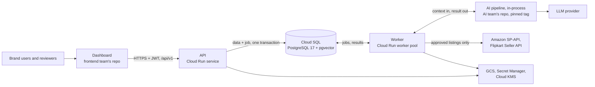
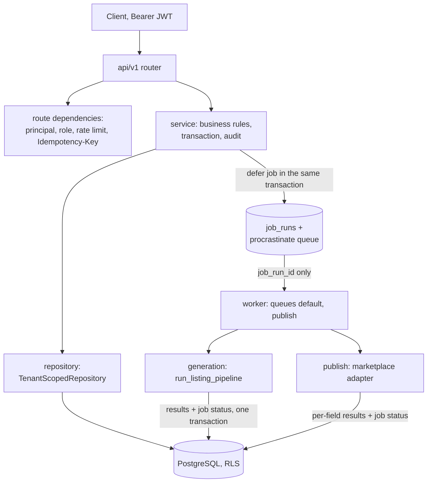

# Architecture at a glance

Purpose: a one-page map of how the backend is built and where it runs, for newcomers.

Read with: `docs/STATE.md` (status), `docs/architecture/` (design), `docs/adr/` (decisions),
`docs/canon/` (names, pins, env vars), `docs/EXECUTION-PLAN.md` (roadmap), `docs/review/TEAM-QUESTIONS.md`
(open questions), `docs/source/` (client spec).

This page is a summary. The detailed documents above stay the single source of truth; if this page
disagrees with them, they win, in the order set in `docs/README.md` ("When sources disagree").
Status on 2026-09-30: S1 (skeleton, toolchain, 10 checks) is merged; nothing past S1 is built.
Source: STATE "Where we are", "Next actions".

## 1. System context



- The chain is: AI proposes, deterministic rules validate, humans approve, adapters execute, and
  performance feeds back. AI never publishes.
- This repo is backend and database only. The dashboard and the AI pipeline (T104) have their own repos
  and pin our contracts by version.
- v1 marketplaces: Amazon and Flipkart only. Cloud: GCP `asia-south1`.

Source: spec L4715, L4747-4749; ADR-0012 §Decision; ADR-0001;
BACKEND-ARCHITECTURE.md §2.4.

## 2. Request path and job path



- **Request path.** Routers handle HTTP only, services own the rules and the transaction,
  repositories own all SQL. `.importlinter` enforces routers → services → repositories today.
- **Job path.** A job is queued in the same transaction as its data. The payload is only the
  `job_run_id`; the worker loads `tenant_id` from that `job_runs` row. Two queues, `default` and
  `publish`, run with separate concurrency. Task timeouts (`asyncio.timeout`): generation 300 s,
  publish 600 s, import 1800 s. `job_runs` is the status source the dashboard polls.
- **Built today:** `/healthz`, `/readyz` and the `/api/v1` routers. The image runs the `api`,
  `worker`, `migrate`, `seed` or `shell` role. The worker (S13a) runs both queues in one process
  with no port, a lease reaper and the periodic prunes; `make worker` runs one beside `make dev`.
- **Open: T3.** The queue choice waits on the ADR-0004 spike.

Source: BACKEND-ARCHITECTURE.md §4.1-4.4; ADR-0004 §Decision 2, 4, 5;
apps/api/app/main.py; apps/api/docker-entrypoint.sh; .importlinter.

## 3. The AI seam

```python
async def run_listing_pipeline(ctx: GenerationContext, deps: PipelineDeps) -> GenerationResult
```

| Port (exactly five, all implemented by the backend) | Returns |
|---|---|
| `retrieve_brand_chunks(tenant_id, query, k=8, types=None)` | `Sequence[BrandChunkDTO]` |
| `validate_rules(listing)` | `ErrorReport` |
| `validate_images(listing)` | `list[ImageReport]` |
| `get_model_credentials(purpose)` | `ModelCredentials` |
| `emit_node_event(node, status, detail=None)` | `None` |

- Context is pushed in. The pipeline opens no DB session, reads no env vars, never sees marketplace
  credentials and cannot publish or approve. Only the backend worker writes `agent_runs`.
- The contract lives in `packages/schemas/src/mkos_schemas/pipeline.py`. The implementation is the AI
  team's `mkos-pipeline`, pinned by git tag.
- A deterministic stub here serves PR and nightly CI; only the deploy build fetches the real pipeline.
- Built in S14b: `BackendPipelineDeps` (`app/services/pipeline_deps.py`) implements the five ports;
  the stub is the workspace member `packages/pipeline-stub` (distribution `mkos-pipeline-stub`,
  import `mkos_pipeline`), and a production worker refuses to boot with it installed. Import
  contracts keep the pipeline free of `app`, web, DB and queue packages, and only `app.workers` may
  import it. **Open: T104** (pipeline home), **T1** (Python 3.13).

Source: CANON.md "The AI seam"; CANON-ADDENDUM.md §21; ADR-0012 §Decision 3; ADR-0013 §Decision 5;
EXECUTION-PLAN.md §6.2.

## 4. Tenant isolation layers

| Layer | Mechanism | Lands in |
|---|---|---|
| Entry | Only the verified JWT `tid` claim; workers use the `job_runs` row, the OAuth callback its server-side state row. | S10 (auth), S13, S15 |
| 1. Repository | `TenantScopedRepository` adds `WHERE tenant_id = :tid` | S9 |
| 2. ORM guard | `do_orm_execute` raises `CrossTenantQueryError` on any unscoped query | S9 |
| 3. Row-level security | Policies on `app.tenant_id`, with `FORCE ROW LEVEL SECURITY` (`0005_rls`) | S10 |
| 4. Composite FKs | Child rows reference `(tenant_id, id)` | S6-S7 (migrations 0001/0002) |

- The one bypass is `platform_scope()`, importable only from `app.admin.*`, `app.cli` and `scripts.*`.
- The `tenant-isolation` check runs on every PR; it is a sentinel test until S9 makes it the real suite.

Source: BACKEND-ARCHITECTURE.md §9.1; CANON.md migration ledger; EXECUTION-PLAN.md §6.2-6.3; ADR-0013 §Decision 4.

## 5. Environments

| | Local | Staging | Production |
|---|---|---|---|
| Runs on | Laptop, Docker Desktop | GCP project `aimos-staging` | GCP project `aimos-prod` |
| API | `make dev`: uvicorn on `127.0.0.1:8000` | Cloud Run, min 0 / max 1 | Cloud Run, 1 vCPU / 1 GiB, min 1 / max 3 |
| Worker | `make worker` (S13a) | worker pool, 1 instance, 0 off-hours | worker pool, 1 vCPU / 2 GiB, 1 instance |
| Database | `pgvector/pgvector:0.8.5-pg17`; db `marketplace_os`, tests on `mos_test` / `mos_iso` | Cloud SQL PG17 `aimos-db`, stopped nights and weekends | Cloud SQL PG17 Enterprise `db-custom-1-3840`, PITR 7 days |
| Storage | MinIO (compose, Chainguard images; TEAM-QUESTIONS T107) | GCS, own buckets | GCS, own buckets |
| Ingress | `127.0.0.1` only | `api-staging.<APEX>` (Firebase Hosting rewrite) | `api.<APEX>` (global external ALB) |
| Deploy | — | every merge to `main` (from S4) | approved tag `vX.Y.Z` (from S25): zero traffic, smoke test, watch, auto-rollback |
| Today | running | projects exist; billing not linked; nothing deployed | same as staging |

- No cloud dev tier. The staging DB tier follows EXECUTION-PLAN decision 6, not ADR-0001's shared-core
  row. ADR-0009 is still proposed. **Open:** the apex domain (STATE open decision 5).

Source: ADR-0001 §Decision; ADR-0009 §Decision; docs/STATE.md ("Decided", "GCP account"); EXECUTION-PLAN.md §2
decision 6, §5.3; docker-compose.yml; Makefile.

## 6. Repository tree at 5d7cb13, before the docs PR (`git ls-files`: 198 files)

```
./                    15: pyproject.toml, uv.lock, Makefile, docker-compose.yml, .env.example,
                      README.md, tool configs
.github/              7: CODEOWNERS, PR template, actions/py-setup, workflows/ (ci-api, ci-meta,
                      contracts, main-gitleaks)
apps/api/             47: Dockerfile, docker-entrypoint.sh, pyproject.toml
  app/                16: main.py, core/config.py, api/health.py, api/v1/router.py, db/session.py,
                      services/health.py; empty packages adapters/, repositories/, workers/, api/v1/routers/
  tests/              28: unit/, integration/, meta/, tenant_isolation/
packages/schemas/     6: pyproject.toml, Makefile (no generators yet), src/mkos_schemas/__init__.py,
                      py.typed, jsonschema/ and ts/src/ placeholders
infra/                1: README.md (OpenTofu arrives in S4)
scripts/              23: db/0000_bootstrap.sql, ci/ (9 check scripts + pip-audit-ignore.txt),
                      docgen/ (7), trace/ (4), spec-sync.sh
docs/                 91: STATE, EXECUTION-PLAN, README; adr/ 15, architecture/ 2, canon/ 3, drafts/ 7,
                      review/ 6, source/ 3, trace/ 47, research/ 3, plans/ 1, archive/ 1
scaffold/             9: starter files with known bugs; never copied wholesale
```

The docs PR (P1) adds 6 front-door files under `docs/`.
Source: `git ls-files` on `main` at 5d7cb13; apps/api/tests/meta/test_repo_layout.py.

## 7. Target tree (Canon layout as amended by ADR-0012)

```
apps/api/app/
  core/, api/, db/session.py                  exists
  db/guard.py, repositories/                  S9
  services/rules_engine.py                    S14a
  services/{embeddings,vision}.py            S16-S18 (the only backend model callers)
  services/telemetry.py                       S16-S18 (records agent_runs)
  workers/                                    S13
  services/pipeline_deps.py, rules_loader.py  S14b (the five seam ports, the RuleSet loader)
  adapters/base.py, fake.py                   S14b (the ABC, FakeAdapter, the contract suite)
  adapters/ (Amazon, Flipkart)                S20-S22 (KeyWrapper S15)
  admin/ (read-only /internal/admin)          S14b (12 views, ops pages, staff gate, platform_scope)
  cli.py (seed, staff, backfill commands)     S9 onward (may use platform_scope)
apps/api/alembic.ini, alembic/versions/       S5-S10 (0001 to 0005_rls)
packages/schemas/src/mkos_schemas/            S2 (17 modules)
packages/schemas/jsonschema/openapi.json      S3 (generated)
packages/schemas/ts/src/{api,contracts}.d.ts  S3 (generated)
packages/pipeline-stub/src/mkos_pipeline/     S14b (the deterministic stub pipeline)
infra/ (OpenTofu)                             S4 staging, S25 prod
.github/workflows/deploy-{staging,prod}.yml   S4, S25
.github/workflows/{nightly,renovate}.yml      planned
```

- No `apps/web`, `packages/pipeline` or `app/agents`; the stub lives in `packages/pipeline-stub`
  (S14b default for T104). **Open: T104** (where the stub lives), **T103** (the site's single monorepo).

Source: CANON.md:84 and "The AI seam"; CANON-ADDENDUM.md §5-§6, §21; DATABASE.md §8.3, `audit_log`;
BACKEND-ARCHITECTURE.md §4.3; ADR-0012 §Decision 1; EXECUTION-PLAN.md
§4.4, §6.2-6.3; test_repo_layout.py (FORBIDDEN_DIRS).

## 8. Tech stack (as pinned)

| Component | Pin | Locked | Source |
|---|---|---|---|
| Python | `==3.13.*`; `.python-version` 3.13 | 3.13 | apps/api/pyproject.toml; ADR-0002 |
| Base image | `python:3.13-slim-trixie`, digest-pinned | — | apps/api/Dockerfile:4 |
| uv | `==0.12.19` | 0.12.19 | pyproject.toml:6; Dockerfile:13; .github/actions/py-setup |
| Build backend | hatchling `==1.31.0` + 4 deps, hash-pinned | same | pyproject.toml:9-15; build-constraints.txt |
| FastAPI | `==0.141.1` | 0.141.1 | apps/api/pyproject.toml; ADR-0005 |
| uvicorn (one process per instance) | `==0.54.0` | 0.54.0 | apps/api/pyproject.toml; ADR-0005 |
| Starlette | `>=1.3.1` | 1.7.0 | same |
| Pydantic | `>=2.13.5,<2.14` | 2.13.5 | same |
| pydantic-settings | `>=2.14.2` | 2.15.0 | same |
| SQLAlchemy | `[asyncio]>=2.0.54,<2.1` | 2.0.54 | same |
| psycopg 3 (no asyncpg) | `[binary]>=3.2` | 3.3.6 | apps/api/pyproject.toml; ADR-0004 |
| Alembic | `>=1.20,<2` | 1.20.0 (with Mako 1.4.3) | apps/api/pyproject.toml; CANON.md:20 |
| pgvector (Python) | `>=0.5,<0.6` | 0.5.0 | apps/api/pyproject.toml; ADR-0003 |
| PostgreSQL + pgvector | PG 17; pgvector `>=0.8.2`; image `pgvector/pgvector:0.8.5-pg17`, digest-pinned | — | ADR-0003; docker-compose.yml:8; .github/workflows/ci-api.yml |
| procrastinate (the Postgres job queue) | `>=3.10,<3.11` | 3.10.0 (with croniter, psycopg-pool, python-dateutil) | apps/api/pyproject.toml; ADR-0004 §1; schema vendored by revision 0003b |
| structlog (JSON logs; stdlib routed through it) | `>=26.1,<27` | 26.1.0 | apps/api/pyproject.toml; STEPS S11 |
| sentry-sdk (explicit integrations, `before_send` redaction) | `>=2.71,<3` | 2.71.0 | same; ENV.md SENTRY_DSN |
| OpenTelemetry API + SDK (no exporter, no instrumentation package yet) | `>=1.45,<2` each | 1.45.0 (with opentelemetry-semantic-conventions 0.66b0) | same; ENV.md OTEL_* |
| mkos-schemas | 0.0.0, no dependencies yet | 0.0.0 | packages/schemas/pyproject.toml |
| pyjwt[crypto] (access and refresh tokens; decoding with exactly `algorithms=["HS256"]`) | `>=2.15,<3` | 2.15.1 (with cryptography 50.0.2) | apps/api/pyproject.toml; ADR-0005:30; ENV.md JWT_ALGORITHM |
| pwdlib[argon2] (argon2id password hashes) | `==0.3.1` | 0.3.1 | apps/api/pyproject.toml; ENV.md PASSWORD_HASH_SCHEME |
| Planned, not in the lock yet | sqladmin `>=0.31.1`; uuid-utils `<1.0` | — | ADR-0002/0003/0004/0005; ENV.md |
| Checks tooling | ruff 0.16.9, black 26.5.1, mypy 2.3.1, pytest 9.1.1, import-linter 2.15, pip-audit 2.10.1, hypothesis 6.168.3, schemathesis 4.28.0, mutmut 3.8.0, squawk-cli 2.65.0 (lint only, report-only until the first prod tag), gitleaks 8.30.1 | same | pyproject.toml [dependency-groups]; scripts/ci/gitleaks.sh:12 |

- Banned imports (ruff TID251): asyncpg, redis, arq, jose, passlib, numpy, and openai/langgraph outside
  app/services/{embeddings,vision}.py. No gunicorn or slowapi (ADR-0005).
- Not pinned yet: TypeScript codegen (S3).

Source: pyproject.toml:53-64; CANON.md:126; ADR-0005 §Decision 1, 2; ADR-0013 §Decision 4.

## 9. Open items that change this picture

- **TEAM-QUESTIONS:** T1 (Python 3.13 on the AI side), T3 (Postgres queue), T103 (backend-only repo),
  T104 (pipeline home).
- **STATE open decisions:** 5 (apex domain, client items), 9 (AI team's stack), 10 (`DATABASE.md` rev 3
  as the schema source for S5-S10).

Source: docs/review/TEAM-QUESTIONS.md; docs/STATE.md "Open decisions".
