# AI Marketplace OS — Backend & Database Architecture

**Version:** v0.1 draft, 2026-09-27

## 1. How to read this document

**In plain words.** This document describes the backend and database of AI Marketplace OS: what our team builds, how it connects to the AI team's pipeline and the FE team's dashboard, and where we chose something different from the client's spec. Each section follows the same pattern: a short plain-words summary, then a diagram, then the details. A colour means the same thing in every diagram. Every design point has a tag that says where it comes from: the client's spec site, a decision we have already made, or a proposal that still needs confirming.

### 1.1 Who this document is for

| Reader | What to read it for | Where to look first |
|---|---|---|
| Our backend team | Everything. The Canon and the accepted ADRs bind us. | §12 (what is decided), §13.5 (what the Tech Lead still has to decide) |
| AI team (`packages/pipeline`) | The AI seam: `run_listing_pipeline`, the five `PipelineDeps` ports, who writes `agent_runs`, and the shared Python version | §6 (the seam), §13.3 (questions only the AI team can answer) |
| FE team (`apps/web`) | The `/api/v1` surface, job polling through `job_runs`, the 9 listing statuses, and the JWT issued by FastAPI | §5 (API surface), §13.4 (questions for the FE lead) |
| The client's team | Where we follow the spec site, where we depart from it and why, and the product questions only the client can answer | §2, §12.1, §12.4 and §13.1, plus the glossary in §14 |

### 1.2 The colour legend

Every flowchart in this document uses the same seven colours.

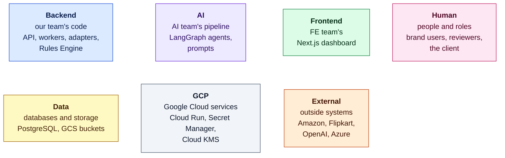

| Colour | Name | Means | Examples |
|---|---|---|---|
| Blue | backend | Code our backend team writes and runs | FastAPI API, queue workers, Rules Engine, Amazon and Flipkart adapters, auth |
| Violet | ai | The AI team's pipeline in `packages/pipeline` | The LangGraph graph; the Content, Keyword, Attribute and Image agents; prompts |
| Green | fe | The FE team's dashboard in `apps/web` | Next.js 14 screens: import, review and approve, job status |
| Yellow | data | Where data is stored | PostgreSQL 17 + pgvector on Cloud SQL, GCS buckets, tables such as `job_runs` |
| Slate grey | gcp | Google Cloud services we run on | Cloud Run, Secret Manager, Cloud KMS, Cloud Logging, the load balancer |
| Orange | external | Systems and code outside our control | Amazon SP-API, Flipkart Seller API, OpenAI, Azure OpenAI, the email provider, GitHub Actions, Sentry, and third-party libraries such as `openai` and `langgraph` |
| Pink | human | People and roles, and the approvals they give | Brand users (owner, operator, reviewer, admin), our staff, the client, the user approving a merge or a release |

Cloud SQL and GCS are Google Cloud services, but diagrams draw them yellow because what matters there is what they store. Our API and workers run on Cloud Run, but diagrams draw them blue because what matters there is our code; a grey node means the Google service itself. Third-party libraries are drawn orange (external). The sequence diagrams in §3 (the journeys) group their participants in boxes of the same colours. The other sequence and state diagrams use the renderer's default style; their participants are named, not coloured.

### 1.3 How to read an arrow

Every arrow is labelled with what flows along it: a request, a record, an ID or a result. In flowcharts a **solid** arrow is a flow that happens at runtime or deploy time, and a **dashed** arrow is a path that is forbidden or blocked (its label says by what). The example below shows one "Generate" click travelling through the system.

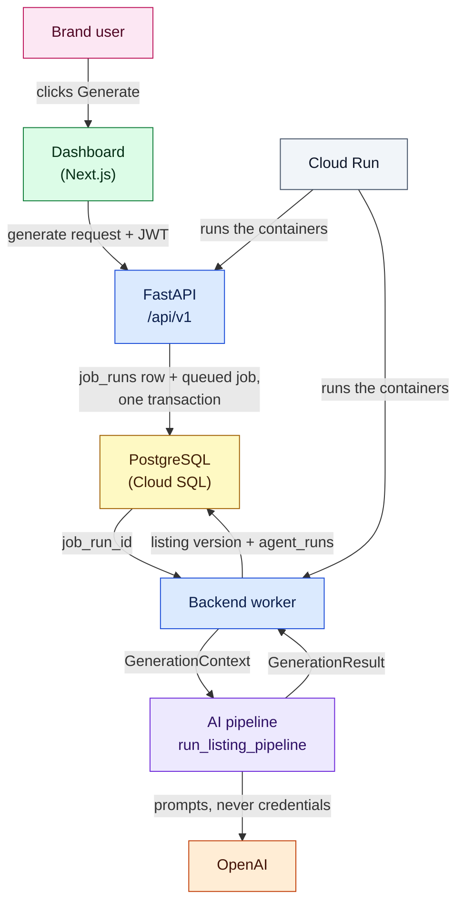

Read it top to bottom:
- The API records the job in `job_runs` and queues it **in the same database transaction**, so a job can never be lost between the two [Decided, ADR-0004].
- The worker gives the AI pipeline everything it needs up front (`GenerationContext`), and the AI package fetches nothing itself [Decided, Canon "AI seam"].
- Marketplace credentials never reach a prompt [Site, L4703].
- The backend worker, not the AI package, saves the listing version and the `agent_runs` cost records [Decided, Canon "AI seam"].
- Cloud Run runs both the API and the worker [Decided, ADR-0001].

### 1.4 The three tags

| Tag | Meaning | What it cites |
|---|---|---|
| **[Site]** | As the client's spec site specifies. The site is the source of truth. | A line number, e.g. `L4702` |
| **[Decided]** | Decided by the user (acting as Tech Lead): an accepted ADR, the Canon, or a user decision recorded in STATE ("Decided"). ADR-0006 to 0011 record such decisions but are still `proposed` as text (§12.1). **If it departs from a clear site statement, it stays provisional until the team confirms it** in TEAM-QUESTIONS, and it carries the T-id. | `ADR-00NN`, a Canon row, or a dated STATE entry, plus `Tn` where it departs |
| **[Proposed]** | Our proposal, awaiting confirmation by the team or the client. We build on it only if waiting would block a step. | A `G`, `Q` or `C` id from VISION-ALIGNMENT, a `DATABASE.md` section, a pre-Canon draft, or an open T-row |

The source follows the tag, either inside the brackets (`[Decided, ADR-0004]`) or right after them (`[Decided] ADR-0004`). Both forms mean the same.

Example: "Python 3.13 [Decided, ADR-0002; departs from L5737, T1]" means we have decided it, the site says 3.11 on line 5737, and the team still has to confirm it as row T1.

### 1.5 Other references you will see

- **`L####`**: a line number in `docs/source/system-arch-llms-full.txt`, our snapshot of the client's spec site https://system-arch.vercel.app (all 244 pages, snapshot dated 2026-09-27, site `updatedAt` 2026-09-26T11:40:32Z). The line numbers are stable.
- **spec [NN]**: a page number on the site (specs [1] to [221]). **The BRD** is the Founder BRD (L10–2286); **BRD §n** is one of its sections, e.g. **BRD §21**, the end-to-end walkthrough of one apparel product (L2084–2145). **The plan** is the 45-day build plan.
- **T1–T66**: rows in `docs/review/TEAM-QUESTIONS.md`. T1–T16 are reproduced in §12.4; T17–T66 came from the database site-alignment pass.
- **C1–C10, G1–G19, Q1–Q26**: conflicts, gaps and questions in `docs/review/VISION-ALIGNMENT.md`. **VISION** is short for that file (e.g. "VISION Q21").
- **ADR-0001 to ADR-0011**: our architecture decision records in `docs/adr/`.
- **Canon row, A§n or Addendum §n**: a row in `docs/canon/CANON.md`, or section n of `docs/canon/CANON-ADDENDUM.md`.
- **Canon `000N` / `000Nb`** (also "Canon ledger 000N", "migration 000N"): a revision in the Canon's migration ledger, e.g. `0002b` (the HNSW index) or `0004_integrity`.
- **Canon JWT rows** and **Canon role defaults**: the Canon rows that absorbed two pre-Canon decisions (CANON.md row R0-5). The JWT rows: FastAPI is the only JWT issuer (HS256, 30-minute and 14-day tokens, frozen claims). The role defaults: a reviewer may regenerate but not generate fresh or import, an edit disqualifies the editor from approving, and publishing needs owner or operator.
- **R0-n / R1-n**: a review-finding row in CANON.md, e.g. R1-11.
- **STATE open decision N**: row N of the "Open decisions" table in `docs/STATE.md`.
- **`DATABASE.md` §n**: a section of `docs/architecture/DATABASE.md`, the database design that §7 will integrate. **`DATABASE.md` §11.1 #N** is row N of its open-decisions table.
- **KNOWN-ISSUES A–D**: the lettered sections of `docs/review/KNOWN-ISSUES.md` (D is hygiene).
- **S1–S14**: the build steps in `docs/drafts/BUILD-SEQUENCE.md`, done in order.
- **Day N**: a sprint day. Day 1 is Mon 21 Sep 2026 and Day 45, the launch, is Wed 4 Nov 2026. This document was written on Sun 27 Sep 2026, Day 7.
- **"not specified"**: none of the sources says. We ask instead of guessing.

### 1.6 When two sources disagree

This order comes from `AGENTS.md` §2. The first one that answers the question wins:

0. The user's latest explicit instruction (and `docs/STATE.md` for step status).
1. The client's spec site, where its pages agree with each other.
2. Team-confirmed answers in `TEAM-QUESTIONS.md`.
3. Accepted ADRs, then `CANON-ADDENDUM.md`, then `CANON.md`, then `ENV.md`. Any of these that departs from a clear site statement stays provisional until the team confirms it.
4. Pre-Canon drafts (BUILD-SEQUENCE, DECISIONS, CONTRACTS, CHECKLISTS, ARCHITECTURE, BLOCKERS, DELEGATE-GATE): read for intent only.
5. `scaffold/`: starter files with known bugs.

## 2. The system in one page

**In plain words.** AI Marketplace OS writes and manages marketplace listings for Indian D2C
brands. A brand connects its Amazon.in and Flipkart seller accounts and uploads its products once.
For each product and each marketplace, AI drafts the listing in the brand's own voice: title,
bullets, description, keywords and attributes. Plain, deterministic code then checks the draft
against that marketplace's rules. A person who did not write it approves it. Only then does our
marketplace adapter send it to Amazon or Flipkart. AI never has the power to publish.

### 2.1 What each team builds

| Team | Builds | Tag |
|---|---|---|
| **Backend + database (us)** | The FastAPI API, the Postgres schema and migrations, the background workers, the Amazon and Flipkart adapters, the Rules Engine, login and roles (auth/RBAC), and the shared contracts package `packages/schemas`. On the AI seam we also own brand-document chunking, the embedding calls, brand-snippet search and the Pillow image checks. | [Decided] AGENTS.md §1; Canon "AI seam" ownership line |
| **AI team** | The writing pipeline in `packages/pipeline` (LangGraph agents and prompts), called through one function, `run_listing_pipeline`. | [Decided] Canon "AI seam" |
| **FE team** | The Next.js dashboard in `apps/web`. | [Decided] AGENTS.md §1 |

Both other teams build against our contracts, so a contract change breaks two teams at once
(AGENTS.md §1, §6).

**Year-1 scale** [Decided, STATE 2026-09-27]: 5–30 brands, about 50k products, 1,000-row imports,
20 generations running at once.
**Marketplaces:** Amazon.in and Flipkart only in v1 [Site L4745–4751]. The site's own intro names
other marketplaces, so this is open question T9.

### 2.2 The safety chain

**AI proposes → deterministic rules validate → humans approve → adapters publish → performance
feeds back** [Site L4713–4715, L7107]. The site calls it the foundation of the entire system: AI
is never given direct publish authority (L7109).

| Step | Who does it | What it means in practice |
|---|---|---|
| 1. AI proposes | The AI team's pipeline, running inside our worker | It writes a draft. It opens no database session, reads no environment variables, never sees a marketplace login, and has no publish or approval step [Decided, Canon "AI seam"]. |
| 2. Rules validate | Our Rules Engine: plain code, with the rules stored as data | It checks character limits, banned terms, required attributes and category compliance, then image checks run [Site L8016–8041]. The AI may correct itself at most 3 times; after that the listing is `blocked` for a person [Site L4706; Decided invariant 9]. |
| 3. Humans approve | A reviewer or owner who did not generate or edit the draft (whether an admin may also approve is open, see §3.5) | This is maker-checker, enforced in the API and again by a database trigger [Site L6620; Decided ADR-0008]. |
| 4. Adapters publish | Our Amazon and Flipkart adapters, on the `publish` queue | Every field gets its own result, every marketplace write carries an idempotency key, and a retry resends only the failed fields [Site L8135–8167, L12017]. |
| 5. Performance feeds back | Marketplace metrics | v1 ships operational metrics (volume, approval rate, validation pass rate, publish success). Marketplace performance data is Phase 2 by default (open question T14), and the Optimization Agent is Phase 3 [Site L8171–8189]. |

### 2.3 The 10 invariants, in plain words

These are never traded for speed (AGENTS.md §3). They match the build plan's 10 [Site L4692–4707].
The specs list 14 (L13690–13703); those map onto ours as 1→1, 2→2, 3→3, 4+5→4, 6→5, 7→6, 8→7,
9→8, 10→9 and 11+12→10. Their #13 (scheduled Optimization Agent) is Phase 3, and #14 (no core
rewrite for a new marketplace) is a design principle (VISION-ALIGNMENT §4.14).

| # | In plain words | How it is enforced |
|---|---|---|
| 1 | **AI never publishes.** Only our adapters publish, and only after a human approval. | The pipeline has no publish or approval node [Decided, Canon]. Publishing needs `POST /api/v1/listings/publish` on an approved listing. A database check also refuses any publish job that has no human creator [Proposed]. |
| 2 | **The rules are code, not AI.** The Rules Engine is deterministic, and it has the final say. | Rules live as data in the `rules` table. A lint ban stops the rules module from importing `openai` or `langgraph` [Decided, Canon]. |
| 3 | **A human must approve, and never their own work.** Whoever generated or edited a listing cannot approve it. | Checked in the API, in a table CHECK and in a trigger [Decided, Canon 0004; ADR-0008]. The plan bars editors too (L6620). The specs bar only the generator (L8131); we follow the stricter plan. |
| 4 | **Marketplace details stay in the adapters.** The canonical listing has no Amazon-only or Flipkart-only fields. | Adapters map the neutral listing to each marketplace's format [Site L4701]. |
| 5 | **Every brand sees only its own data.** Every query is scoped by `tenant_id`. | Enforced in the repository base class [Site L4702, L12470]. Behind it sit a query guard, row-level security and composite foreign keys, so an app bug still can't cross brands [Decided, Canon; detail in §9.1]. |
| 6 | **Marketplace logins never go near an AI prompt,** and they are encrypted at rest. | Tokens are encrypted with a key held in Cloud KMS [Site L4703; Decided]. An import-linter rule stops the AI package importing credential code, and the AI team's cloud group has no access to the marketplace secrets [Decided, Canon]. |
| 7 | **Every AI call leaves a record:** model, tokens, cost, duration and status (`agent_runs`). | The backend worker is the only writer: one row per model call [Decided, Canon]. |
| 8 | **One error shape.** Rules, image, model and marketplace failures all use the same `ErrorReport`. | One contract in `mkos_schemas`. Error codes come only from `codes.py` [Decided, Canon]. |
| 9 | **The AI gives up after 3 tries.** Self-correction is capped at 3 attempts; then the listing is `blocked` for a person. | The cap lives inside the pipeline. Generation jobs are not re-queued for these domain failures (`max_attempts=1`) [Decided, ADR-0004]. |
| 10 | **Doing it twice never does it twice.** Mutations are idempotent, and a partial failure retries only the failed field. | Idempotency keys on the API and on every marketplace write, plus a per-field publish ledger [Site L4707; ledger Proposed]. |

### 2.4 The big picture

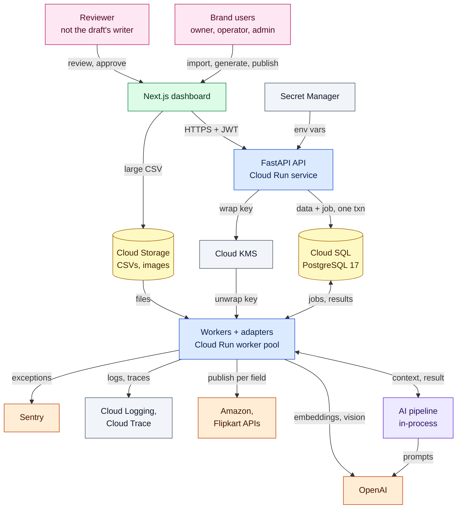

Everything drawn grey, blue or yellow runs in Google Cloud, region asia-south1. Left out of the drawing to keep it readable: the API also exchanges OAuth codes with Amazon and
Flipkart when a brand connects (journey §3.2), hands out signed Cloud Storage URLs, reads Secret
Manager values the same way the workers do, and sends its own logs and traces. The worker pool runs
both queues in one process; the AI pipeline is a library inside it, not a separate service.
Colours follow the legend in §1.2.

### 2.5 Key details

Each row is a one-line summary. The last column points to the section with the detail.

| Part | What it is | Tag and source | Detail |
|---|---|---|---|
| Dashboard | The FE team's Next.js app. NextAuth only holds the browser session; **FastAPI issues the JWT**. The site hosts the app on Cloud Run (L4964, L5445); our ADRs don't cover web hosting. | [Decided] Canon JWT rows. **Provisional, T7:** the site says NextAuth issues the JWT (L12484). | §9.2, §10 |
| Identity and roles | One global login per person, and a membership per brand that carries the role (`owner`, `operator`, `reviewer`, `admin`, the site's four roles, L7437–7475). The token names one active brand. v1 is invite-only; our staff create brands. | [Decided] ADR-0006. **Provisional, T23:** the site's DDL puts each user inside one brand (L5885–5892), so the team must confirm. | §3.1, §9.2 |
| API | Cloud Run service, one `uvicorn` process per instance. All business routes sit under `/api/v1`; only `/healthz`, `/readyz`, `/openapi.json`, `/docs` and `/internal/admin` are unversioned. Rate limits are counted in a Postgres table. | [Decided] ADR-0001, ADR-0005, Canon. **Provisional, T11:** spec [118] says the MVP has no versioning (L11545). | §5, §10.1 |
| Ingress | Prod: a global external load balancer in front of `api.<APEX>`. Staging: a Firebase Hosting rewrite for `api-staging.<APEX>`. The apex domain itself has not been chosen yet. | [Decided] ADR-0001; apex open (STATE open decision 5). | §10.2 |
| Worker pool | Cloud Run worker pool running two queues, `default` (generation, images, imports, embeddings) and `publish`, with separate concurrency so publishing is never starved. | [Decided] ADR-0001, ADR-0004, Canon. | §8 |
| Job queue | procrastinate on Postgres. A job is queued **in the same transaction** as its data, so it can't be lost. `job_runs` is the source of truth the dashboard polls. There is no Redis. | [Decided] ADR-0004, gated on a 1-day spike. **Provisional, T3:** the site says Redis + ARQ (L4779). | §8.2 |
| AI pipeline | `run_listing_pipeline(ctx, deps)`, imported in-process by the worker. Context is pushed in; exactly 5 ports go back to the backend. | [Decided] Canon "AI seam". The AI team has still to confirm Python 3.13 and LangGraph in-process (STATE open decision 9; T1). | §6 |
| Database | Cloud SQL PostgreSQL 17 Enterprise with pgvector 0.8.5 and 1536-dimension embeddings. It also holds the queue tables, the OAuth state and the rate-limit counters. | [Decided] ADR-0001, ADR-0003. **Provisional, T2:** the site says PostgreSQL 16 (L4904). | §7, §10.1 |
| Database connection | Cloud Run's built-in Cloud SQL connection; no VPC connector. The driver is psycopg 3. | [Decided] ADR-0001, ADR-0004. **Provisional, T5, T4:** the site says a VPC connector with private IP (L4909) and asyncpg. | §10.1 |
| Object storage | Cloud Storage for CSV files (deleted after 30 days) and images, using signed URLs. Code reaches it through an S3-API `StorageAdapter`, and Postgres stores only object keys. | [Decided] ADR-0001. | §10.1 |
| Secrets and keys | Secret Manager values are injected as environment variables; the app never calls the Secret Manager API. Cloud KMS keyring `marketplace-os`, key `oauth-token-key`, rotated every 90 days. | [Decided] ADR-0001, Canon. The site wants secret rotation without a redeploy (L12540); with env-var secrets, a rotation means a redeploy (VISION-ALIGNMENT §4.11). | §9.4 |
| AI models | OpenAI for generation, vision and embeddings (`text-embedding-3-small`). Azure OpenAI is proposed so the client can use Microsoft startup credits. | [Site] L8422, L8879; [Decided] Canon (`OPENAI_API_KEY`); Azure [Proposed] (STATE open decision 9). | §6.3 |
| Marketplaces | Amazon SP-API (Login with Amazon OAuth) and the Flipkart Seller API (OAuth). Six redirect URIs are frozen, one per marketplace per environment. | [Site] L12512; [Decided] Canon Addendum §26. | §3.2 |
| Observability | Cloud Logging (JSON to stdout), Cloud Trace via OTLP, and Sentry. | [Decided] ADR-0001; [Site] L6652. | §11.4 |
| Environments | Local (Docker), staging (auto-deploys from `main`) and prod (SemVer tags only), in two GCP projects, `aimos-staging` and `aimos-prod`. | [Decided] STATE, ADR-0001, ADR-0009. | §10.2 |
| Running cost | About $195–205 per month for prod + staging, before GST and excluding LLM spend. | [Decided] ADR-0001. Inside the plan's $150–250/month (L7061). **Provisional, T6:** it departs from the specs' AWS figure of about ₹6,700/month (spec [193], L13155). | §10.4 |

**Still open, and they change the picture** (all in `TEAM-QUESTIONS.md`, reproduced in §12.4, each
with a default we build on meanwhile):
- **T10, autonomy:** the BRD wants autonomous submission; the plan and specs want zero
  auto-publish. **Default:** human approval in v1, with `tenants.auto_publish` reserved and locked
  off (ADR-0008).
- **T12, T13, statuses and "live":** we store 9 listing statuses. **Default:** show "Submitted" until
  the marketplace confirms, then "Live".
- **T15, one-person brands:** under maker-checker, one person can't publish alone. **Default:**
  every brand needs a second member who can review.
- **T16, scope:** the site tags 217 of its 244 pages "mvp". **Default:** we build to the 45-day
  plan's narrower scope lock.

## 3. End-to-end journeys

**In plain words.** This section follows eight journeys through the system: six everyday ones, from
a brand's first invite to a listing going live, and two "something went wrong" paths, a job that
keeps failing and a listing that needs one answer from the seller. Each journey starts with a short
summary, then a sequence diagram (time runs downwards), then the key details with their tags.

**How to read the diagrams.** Participants sit in boxes coloured as in the legend (§1.2). Solid
arrows are requests; dashed arrows are replies. The numbers on the arrows give the order of the
steps. Labels are kept short; the key details under each diagram carry the rest.

**Rules that hold in every journey** (so each journey doesn't repeat them):
- **The brand comes from the token.** In an HTTP request the brand (`tenant_id`) comes only from the
  verified JWT `tid` claim, never from the URL, query or body. A worker takes it from its `job_runs`
  row; the OAuth callback takes it from the saved OAuth state [Decided, AGENTS.md §5; Site L12470].
- **Slow work is a job.** The API writes the data, a `job_runs` row and the queue entry in **one
  transaction**, then answers `202` with a poll URL. The dashboard polls `GET /api/v1/jobs/{job_id}`,
  which reads `job_runs`, never the queue [Decided, Canon; ADR-0004; Site L11359–11377]. A queue
  message carries only the `job_run_id` [Decided, ADR-0004]. Job statuses are in §8.1 and time
  limits in §8.3.
- **Listing statuses** (9, lowercase): `created`, `generating`, `validated`, `needs_review`,
  `approved`, `publishing`, `published`, `blocked`, `failed` [Decided, Canon]. The BRD uses 14
  (L1101–1193), which is open question T12. The diagram below shows how a listing moves between
  them; the meaning of each status is in the glossary (§14.1).

**The listing lifecycle at a glance.** The nine statuses are [Decided, Canon]. The moves between
them are [Proposed]: each one is a row in the `listing_status_transitions` table that a database
trigger enforces (DATABASE.md §6.1), and §7 will carry the full table.

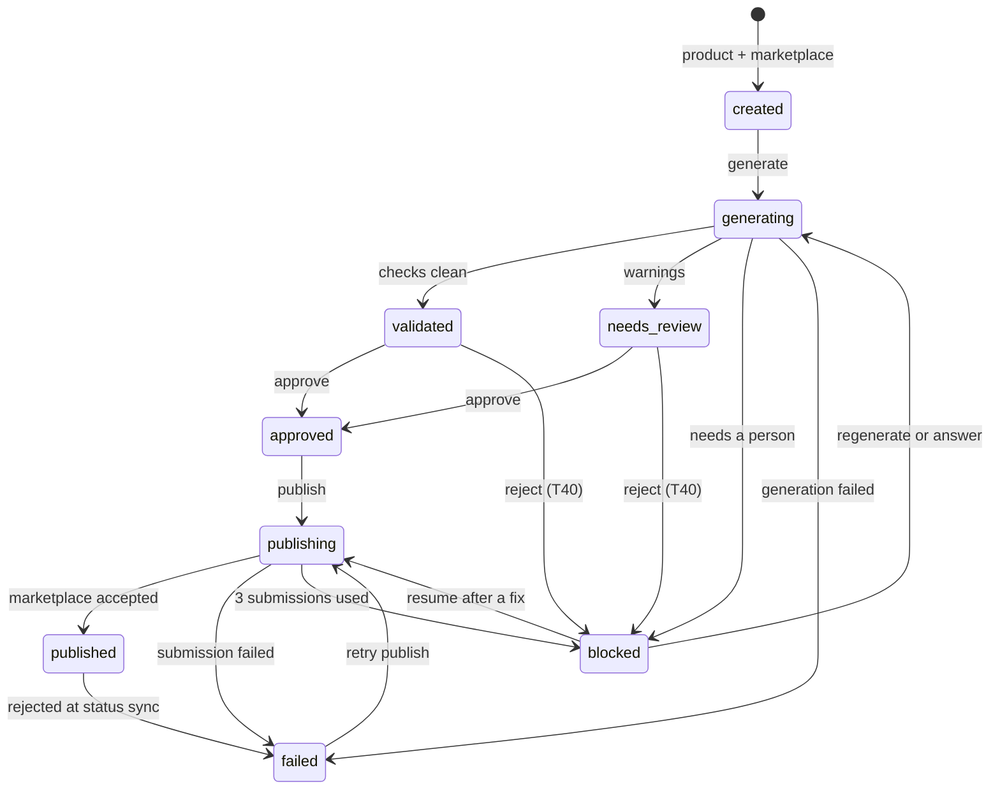

- **Not drawn, to keep it readable:** an edit or a regeneration voids any approval and sends the
  listing back through the checks, to `validated`, `needs_review` or `blocked`.

- **Approve** needs a different active reviewer or owner (maker-checker, §3.5, §9.3).
- **Publish, retry and resume** need an approval that is still current: the approved version
  must be the current version (§3.6).
- **`published` means the marketplace accepted the submission.** Whether it is live comes from a
  separate marketplace-state column, filled by a bounded status sync (T13, T18; §3.6).
- **At most 3 submissions per approved version**; after that the listing is `blocked` (T19).

### 3.1 Brand onboarding and invites

**In plain words.** In v1 nobody signs up on their own. Our staff create the brand's account and
invite its owner by email. The owner sets a password and then invites teammates, for example a
reviewer. One person can belong to several brands with a single login; their token names the brand
they are working in right now. Because nobody may approve their own work, every brand needs at
least two people.

**Part 1: our staff create the brand and invite its owner**

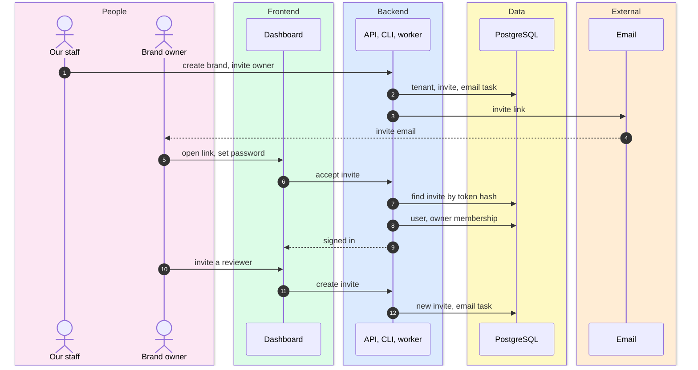

**Part 2: a teammate logs in and switches brand**

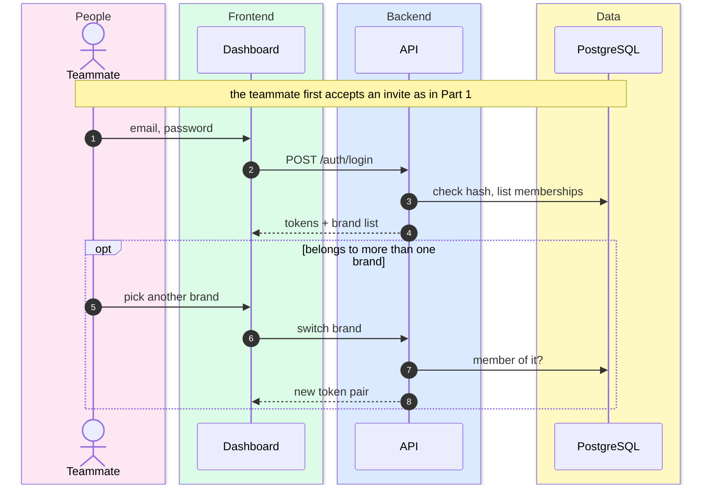

Part 1 in words: staff run `app.cli` to create the brand (status `trial` or `active`) and invite
the owner in one transaction (step 2: tenant row, invitation with a token hash and expiry, email
task). The worker sends the link with the raw token. On accept, the API finds the pending,
unexpired invitation by its hash, creates or reuses the global user, adds the owner membership,
marks the invite accepted and writes an audit entry. When the owner invites a teammate, the brand
comes from the owner's JWT, and any older pending invite for that email is revoked. In Part 2 the
login checks the argon2id hash and returns a 30-minute access JWT (with `sub` and `tid`), a 14-day
refresh token and the person's brands; a brand switch is checked against their memberships.

**Key details**
- **Invite-only, staff create brands** [Decided, ADR-0006]. `tenants.status`
  (`trial | active | suspended | offboarded`), `plan` and `trial_ends_at` are added now, so
  self-serve signup later is additive. **Provisional, T23:** the site's DDL puts each user inside
  one tenant (L5885–5892), so the team must confirm. The site never describes signup (ADR-0006).
- **One login, many brands** [Decided, ADR-0006]. Global `users` with a unique `lower(email)`;
  `tenant_memberships` carries the role (`owner | operator | reviewer | admin`, the site's four roles,
  L7437–7475). The JWT `tid` is the active brand; switching brands issues a new token.
- **Invitations** [Decided, ADR-0006] store only a sha256 hash of the token, an expiry, and at most
  one pending invite per email. The expiry length is not specified (DATABASE.md §11.1 #6).
- **Email:** no provider chosen yet (ADR-0006). Whether the email goes out as a `job_runs` job or a
  plain queue task is open (DATABASE.md §11.1 #18).
- **Who may invite or promote an owner, ownership transfer, and password reset in v1:** not
  specified (DATABASE.md §11.1 #8).
- **Login** [Decided, Canon JWT rows]: FastAPI is the only JWT issuer, and passwords use argon2id. Token
  lifetimes and claims are in §9.2. **Provisional, T7:** the site says NextAuth issues the JWT
  (L12484).
- **Proposed hardening** (DATABASE.md §5.1; detail in §9.2): the accept step reads the invitation by
  token hash before login; a guard stops a brand from losing its last active owner; a per-request
  membership check means a removed member loses access at once, not when their 30-minute token
  expires. Staff have no `users` row in v1 and act through `app.cli`, recorded as
  `actor_type = staff`.
- **Two people per brand** [Decided, ADR-0008]: onboarding must say so. **Open, T15:** the site's
  Day-45 definition of done has one user who "can independently … approve and publish" (L5450).
- **Brand voice:** tone, guidelines and glossary sit on the tenant (`GET /api/v1/tenants/me`), and
  brand documents go to `POST /api/v1/brand/documents`; the backend chunks and embeds them with
  `text-embedding-3-small` (1,536 dimensions) [Decided, Canon]. The BRD's "collect once" business
  profile (legal name, owner type, customer care, manufacturer and more, L245–387) is proposed as
  `brand_profiles` and `business_parties` (gap G2; T31) [Proposed, DATABASE.md §5.6]; §7 will carry
  the schema.

### 3.2 Connecting a marketplace account

**In plain words.** The owner clicks "Connect Amazon". We send them to Amazon's own consent page with
a one-time random "state" value that we saved first. Amazon sends them back to our fixed callback
address with a code. We check the state, swap the code for tokens, encrypt the tokens with a key
protected by Cloud KMS, and store them for that brand only. The AI never sees these tokens.

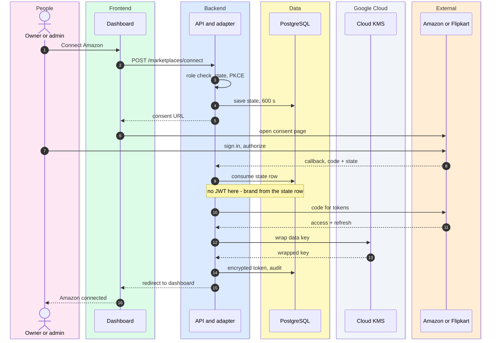

In words: the connect call (step 2) carries the JWT; the API saves the OAuth state as a hash with
the user, the marketplace and the PKCE verifier. The marketplace redirects the browser to
`GET /api/v1/marketplaces/amazon/callback` (step 8). The API deletes the matching unexpired state row
and uses it once (step 9). It then saves the marketplace account with the encrypted token, the key
version, the seller id and status `active` (step 14).

**Key details**
- **What the site asks** [Site]: OAuth 2.0 for both, Login with Amazon for Amazon and Flipkart's
  seller API OAuth (L12512); the connect call returns a consent URL (L11433); tokens are encrypted at
  rest and adapters refresh them automatically (L7966–7969). The site's own sequence is at
  L7941–7960.
- **Callback route and redirect URIs** [Decided, Canon; Addendum §26]:
  `GET /api/v1/marketplaces/{marketplace}/callback`. Six exact redirect URIs are frozen (Amazon and
  Flipkart × local, staging, prod), for example
  `https://api.<APEX>/api/v1/marketplaces/amazon/callback`. `<APEX>` is a placeholder until the apex
  domain is chosen (STATE open decision 5). Amazon's re-review takes 2–4 weeks, so these strings must
  never change.
- **Connect route:** the site's `POST /marketplaces/connect` (L11433) under our `/api/v1` prefix. Its
  exact request shape is not specified yet. Who may connect: the site gives it to the owner and the
  admin (L7437–7475); our own permission matrix for it is not specified.
- **OAuth state** [Decided, ADR-0004]: kept in a Postgres table (no Redis) and consumed once. Its
  lifetime is 600 s (`OAUTH_STATE_TTL_SECONDS`, ENV.md). The table name and columns (`oauth_states`
  with a state hash, the user, the marketplace and a PKCE verifier) are [Proposed].
- **Encryption** [Decided, Canon; ADR-0001]: `marketplace_accounts.token_enc` plus
  `kms_key_version`, under KMS keyring `marketplace-os`, key `oauth-token-key`. The envelope-encryption
  design is in §9.4. The site says AES-256 (L7802) and keys in AWS Secrets Manager (L7966); the build
  plan already says Cloud KMS (L4703).
- **Only adapters decrypt, only during a call** [Decided, invariant 6; Canon]. How the AI package is
  kept away from credentials is in §9.5.
- **When a refresh fails:** refresh once, then the account goes to `needs_reconnect` and a reconnect
  task opens [Site L11943–11947, L7850; Proposed DATABASE.md §5.4 `marketplace_accounts`]. The account
  `status` is `active | needs_reconnect | revoked`. A transient failure during the refresh is retried
  as a transport error and doesn't count.
- **Test accounts:** `AMAZON_USE_SANDBOX` is true everywhere except prod [Decided, ENV.md]. A
  Flipkart sandbox is unconfirmed (open question Q16).
- **Auditing each credential use** is a gap (G11) [Proposed].

### 3.3 CSV bulk import

**In plain words.** A brand uploads a spreadsheet of products. We check the column headings straight
away. The rows are then processed in the background, each row on its own, so in a 50-row file, 5 bad
rows give 5 clear, fixable errors and the other 45 products are still imported. The dashboard polls
for progress and then shows a per-row report.

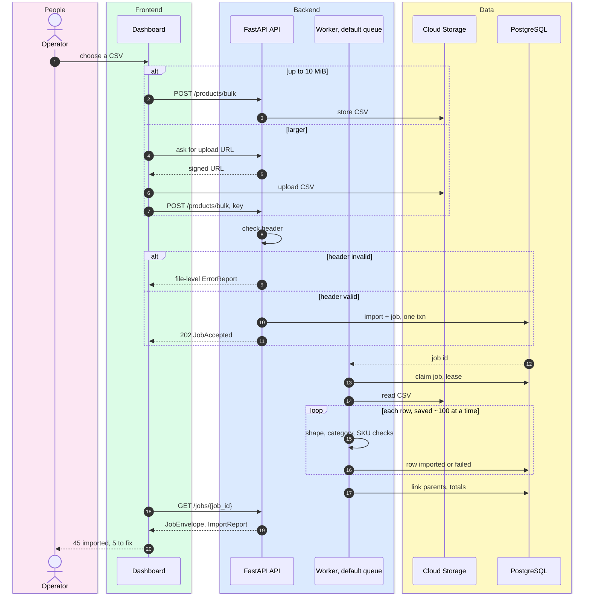

In words: the header check (step 8) looks for missing, unknown or duplicate columns; an invalid
header gets one file-level `ErrorReport` on field `file.header` and nothing is queued. A valid file
gets one transaction with the idempotency key, the `imports` row, the `bulk_import` job and its queue
entry (step 10). The worker claims the job with a compare-and-set and a lease (step 13). Each row is
checked for shape, category and SKU uniqueness in the file and in the brand. At the end the worker
links `parent_sku` values to parent products, writes the totals and ends the job `succeeded` or
`partial`.

**Key details**
- **Upload path** [Decided, Canon]: multipart up to 10 MiB (`REQUEST_MAX_BODY_BYTES`); a larger
  file goes to a signed Cloud Storage URL, then `POST /api/v1/products/bulk` with the object key. The
  site: CSV upload → Cloud Storage → header validation (L4976).
- **Header errors** [Decided, Canon Addendum §20]: `HEADER_MISSING_COLUMN`, `HEADER_UNKNOWN_COLUMN`
  and `HEADER_DUPLICATE_COLUMN` become one file-level `ErrorReport` (`IMPORT_FAILED`, field
  `file.header`). A SKU repeated inside the file is `DUPLICATE_SKU_IN_FILE`.
- **Row errors** [Decided, Canon Addendum §19]: a bad row shape has `source = schema`; a failed
  category or rule lookup (for example `CATEGORY_NOT_MAPPED`) has `source = rules_engine`.
- **SKU uniqueness** [Decided, Canon]: `UNIQUE (tenant_id, sku)`, so two brands can both hold
  `SKU-001`.
- **Variant families** [Decided, ADR-0007]: a `parent_sku` column links a child to its parent product
  in the same brand; sizes such as `M/Navy` and `m/navy` collide at import, not at the marketplace.
- **Tables** [Proposed, DATABASE.md §5.4]: `imports` plus one `import_rows` row per CSV line, saved in
  batches of about 100 so a restarted job resumes where it stopped. The job ends `partial` when some
  rows failed. CSV objects are deleted after 30 days [Decided, ADR-0001].
- **The site's test** [Site]: a 50-row CSV with 5 bad rows returns 45 imported products and 5
  row-level errors, not a batch crash (L4981). The site also requires SKU, title and at least one
  image per row (L7929); our row model has to add the image rule (VISION-ALIGNMENT §4.3).
- **Does an import start generation?** The site fans each valid row out into generation, then shows
  per-row approval (L11345, L12075). Our default (open question Q11): **no**; the user picks rows and
  marketplaces through a batch-generate contract (gap G10) [Proposed]. This departs
  from the site and has no T-row yet (candidate row, §13.2).
- **Template shape is open:** the BRD has a 64-column field dictionary (L1560–2082); ours is core
  columns plus a JSON `attributes` cell (VISION-ALIGNMENT C4), to be settled by an ADR before S13.
- **Not specified:** the endpoint that returns the per-row `ImportReport`, and whether a corrected
  re-upload skips or updates SKUs that were already imported. Draft import-report paths are listed
  in §5.2 [Proposed].

### 3.4 Generating a listing

**In plain words.** The operator asks for a listing for one product on one marketplace. The API
answers at once with a job number. In the background, our worker gathers everything the AI needs and
hands it to the AI pipeline. Four AI agents write in parallel, then our deterministic checks test the
result. If a check fails, the AI fixes only the failing fields, at most 3 times. The result is saved
as a new version. A clean listing goes to the review queue; one that still breaks a rule is
`blocked` for a person.

**Part 1: the request, the job and the save**

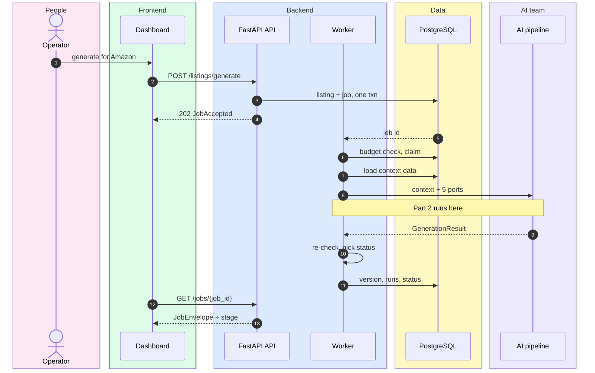

**Part 2: inside the pipeline**

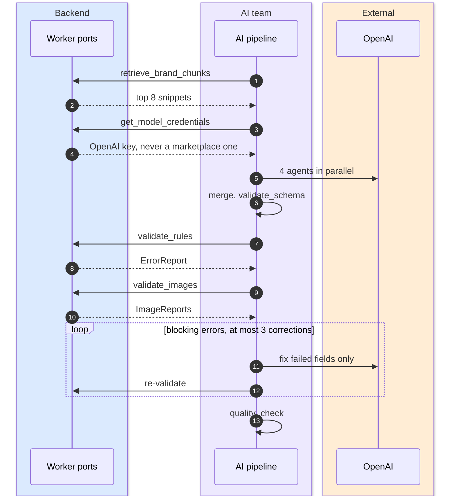

In words: in Part 1 the API writes the listing (now `generating`), the `listing_generate` job and
its queue entry in one transaction (step 3). The worker reads the brand from the job row, checks
the daily AI budget and claims the job (step 6), then loads the product, brand profile, `RuleSet`,
`CategoryTemplate` and previous version (step 7). The `GenerationResult` (step 9) carries the
terminal state, the attempts used and one record per model call. The worker re-runs the
deterministic checks, maps the result to a listing status (§6.4) and saves the new version, the
`validation_runs`, the `agent_runs`, the job status and the listing status in one transaction
(step 11). A `validated` or `needs_review` listing goes to the review queue; a `blocked` one waits
for a person. In Part 2 the four agents are content, keyword, attribute and image; `validate_rules`
calls the deterministic Rules Engine, and `validate_images` runs the Pillow checks and then the
vision model.

**Key details**
- **What the site asks** [Site]: `POST /listings/generate` answers `202` with a job id and is always
  async (L11359–11377); context assembly and four parallel agents (L7973–8015); validation runs
  schema → rules → vision (L8016–8041); at most 3 corrections, then the job is blocked with the reason
  shown (L7744–7790). Our path is `POST /api/v1/listings/generate` under the Canon prefix.
- **The seam** [Decided, Canon "AI seam"]: the worker calls `run_listing_pipeline` with a pushed
  `GenerationContext`, and the pipeline's only calls back are the 5 ports. §6 covers the context, the
  ports, the 12 transient stages (shown to the dashboard as `JobEnvelope.stage`, never written to
  `listings.status`), the checks, and the single writer of `agent_runs`. When the context is
  assembled is still open (§6.2).
- **The 3-attempt cap** lives inside the pipeline [Decided, invariant 9; ADR-0004]. The job itself is
  not retried for these failures (`max_attempts = 1`); retries and time limits are in §8.3.
- **Result to status** [Proposed, DATABASE.md §6.1]: after re-running the deterministic checks, the
  worker maps the pipeline's result to a listing status. The mapping table is in §6.4.
- **Budget** [Decided, Canon; ENV.md]: a global and a per-brand daily USD cap (local defaults 12.00
  and 2.50), computed from `agent_runs.cost_usd`. [Proposed] A reservation taken when the job is
  claimed, so 20 parallel generations can't overshoot. At the cap, the default is a hard stop with
  `BUDGET_EXCEEDED` (open question Q19).
- **The maker** [Decided, Canon; ADR-0006]: `generated_by_user_id` is the person who triggered
  generation. A reviewer may regenerate an existing listing (`POST /api/v1/listings/{id}/regenerate`)
  but may not generate fresh or import [Decided, Canon role defaults]; the site says reviewers can't
  generate (L7437–7475).
- **Known gaps:** the site escalates to a stronger model after 2 JSON failures (L8873–8879), which
  needs a seam change; the confidence formula is owed by the AI team; per-attribute source and
  confidence (gap G1) is [Proposed].

### 3.5 Review and approve

**In plain words.** A reviewer opens the review queue and sees each draft next to its check results.
They can approve, reject with feedback, edit, or ask for a regeneration. One rule never bends: the
person who generated or edited a draft cannot approve it. Clean drafts can be approved many at a
time. Every decision is recorded.

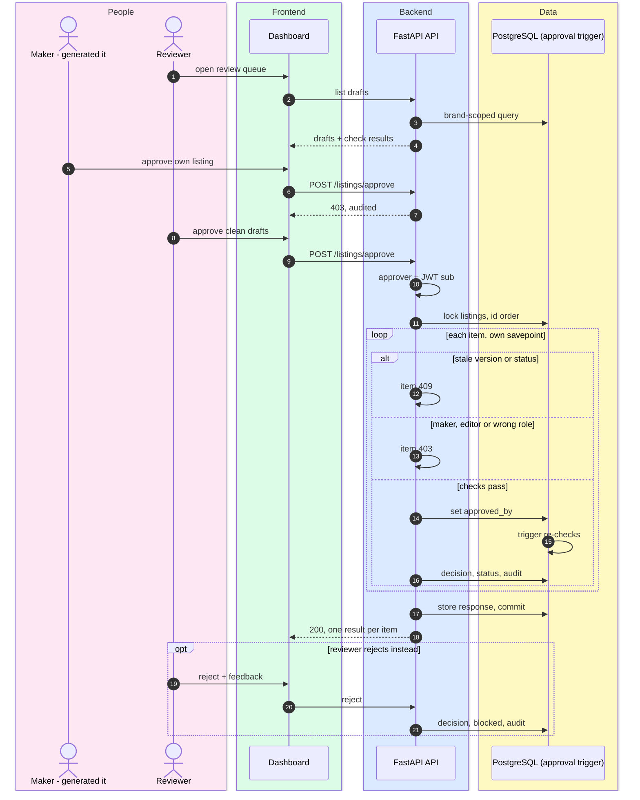

In words: the queue lists drafts in `validated` or `needs_review`, oldest first, with content,
warnings and errors. The maker's own attempt gets `403 MAKER_CHECKER_VIOLATION` and is audited
(step 7). The batch request carries an idempotency key and the listing and version ids. The approver
is the JWT `sub` and the brand is `tid`; any reviewer id in the body is ignored (step 10). The API
begins a transaction, sets the brand, claims the idempotency key and locks the listings in id order
(step 11). For each approved item the database trigger re-checks maker-checker and stamps
`approved_at`, and the API writes a `review_decisions` row, sets the listing `approved` and audits
`listing.approved`. The response is stored under the idempotency key before the commit.

**Key details**
- **What the site asks** [Site]: the reviewer sees content, validation results, warnings, errors,
  confidence and marketplace differences, and can approve, reject with feedback, edit or regenerate;
  feedback is stored (L8081–8131). Maker-checker is enforced in the API (L8131, L11804) and by a
  database CHECK (L6620).
- **Maker-checker** [Decided, Canon 0004 and role defaults; ADR-0008]: the approver may be neither the generator
  nor the editor; the API handler and the trigger compare both. Approval is set once, and approved
  content is immutable. Every approval writes a `review_decisions` row and an `audit_log` entry. The
  database side is in §9.3.
- **Which roles may approve — to reconcile.** Canon 0004 and DATABASE.md say an active `reviewer`
  or `owner`. ADR-0008 also lists `admin`. The site's admin does "operational actions only — no data
  modification" (L7437–7475), so on this point ADR-0008 departs from a clear site statement and stays
  provisional. It needs one ruling and a T-row (§13.5).
- **Who approves** [Proposed] DATABASE.md §7.1; departs from L11405 (candidate row, §13.2): the
  approver is the JWT `sub`. The site's approve request carries a reviewer id (L11405); we ignore any
  client-supplied reviewer.
- **Batch approve** [Proposed, DATABASE.md §7.1; T42]: up to 200 items per request, each in its own
  savepoint, so one bad item doesn't sink the rest. Locks are taken once in id order, so overlapping
  batches can't deadlock. The response is stored under the idempotency key for 24 h. A bulk approve
  accepts only `validated` (clean) drafts; `needs_review` drafts are approved one at a time. A stale
  version gets `409`.
- **Error code:** `MAKER_CHECKER_VIOLATION` is not yet in `codes.py`; adding it needs the Tech Lead
  (DATABASE.md §11.1 #12).
- **Reject** [Proposed, T40]: a reason and feedback are required, and the listing moves to `blocked`
  with the reason `rejected`, plus a `review_decisions` row. "Rejected" is not a 10th status (T12).
  The reviewer may ask for a regeneration in the same request.
- **Edit** [Decided, Canon]: an edit makes a new version with the editor recorded, and the
  deterministic checks re-run in the same request. [Proposed] Nobody who generated or edited any
  version since the last full generation may approve it.
- **Gaps:** the site wants the reviewer to see exactly what each marketplace will receive (L8091);
  an adapter preview is gap G11 [Proposed]. One-person brands can't publish alone (T15).

### 3.6 Publish

**In plain words.** After approval, an owner or operator presses Publish. A background job on the
separate publish queue hands the approved version to the Amazon or Flipkart adapter. The adapter
decrypts the brand's token only for that call, translates the listing into the marketplace's format,
and submits it with an idempotency key. We record each submission before we send it, and each
field's verdict once it is known. Marketplaces accept a submission first and process it later: the
listing becomes `published` when the marketplace accepts it, and the dashboard shows "Submitted"
until a later, bounded status check confirms it is live. If some fields fail, only those fields are
sent again, and an approved version gets at most 3 submissions.

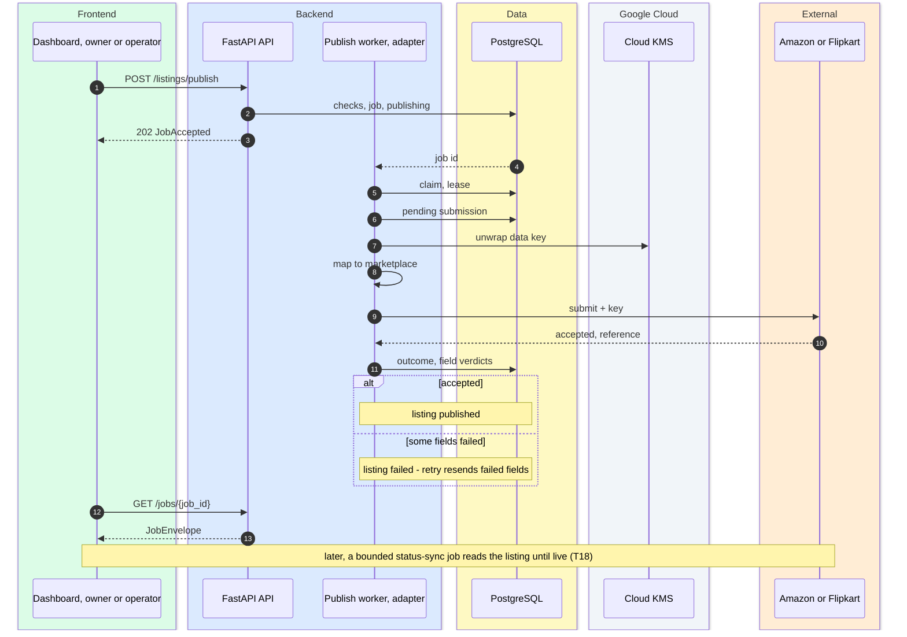

In words: in one transaction (step 2) the API checks the role, that the status is `approved` and
that the approved version is the current one, then queues a `listing_publish` job on the publish
queue with a human creator and moves the listing to `publishing` [Proposed, DATABASE.md §6.1]. The
worker commits a `pending` submission row **before** it calls the marketplace (step 6), so a crash
can never leave an unrecorded submission. It unwraps the token key in memory for this call only.
Per-field verdicts are written when the response gives them, or later by the status sync.

**Key details**
- **What the site asks** [Site]: `POST /listings/publish` works only on approved listings and returns
  a job id (L11419). The adapter maps canonical → marketplace format, calls the API with an idempotency
  key, and returns per-field results, not a boolean (L8135–8167). A partial success retries only the
  failed fields (L12033), at most 3 times (L11949–11955). Rate limits back off from 1 s, doubling with
  jitter, capped at 60 s (L11973).
- **Who may publish** [Decided, Canon role defaults]: an owner or an operator. Publish authority
  belongs only to `POST /api/v1/listings/publish` and the publish worker, after asserting
  `status = 'approved'` [Decided, Canon].
- **Database backstops** [Proposed, DATABASE.md §5.3, §5.4; §11.2 #20]: a publish job must have a
  human creator; a trigger re-checks that the approved version is the current one and that the
  status is `approved`, `failed` (a retry) or `blocked` for a marketplace action (a resume); the
  brand must be `trial` or `active`.
- **Queue and limits** [Decided, ADR-0001, ADR-0004]: publishing has its own queue with its own
  concurrency, so it is never starved by generation. The time limit is 600 s. Network, 5xx and 429
  errors are retried with backoff.
- **Publish ledger** [Proposed, DATABASE.md §5.3; gap G3]. The full design comes with §7; in short:
  - `listing_items`: one row per sellable marketplace SKU, with its marketplace id, live URL and
    marketplace state.
  - `listing_submissions`: one write-ahead row per submission, committed before the call; **at most
    3 per approved version** (T19). Its idempotency key hashes the tenant, listing, version,
    marketplace, attempt and payload hash, so a corrected resubmission gets a new key.
  - `publish_field_results`: only the per-field verdicts (`succeeded | failed | skipped`). The failed
    rows form the retry payload (§8.5).
  - Raw marketplace responses go to object storage.
- **"Submitted" vs "Live" — open, T13.** The plan and specs count a listing published when the
  adapter call succeeds (L6129, L8161). The BRD counts it live only after the marketplace confirms,
  with its marketplace id (L1079–1087). **Default:** `published` means the marketplace accepted the
  submission; "live" comes only from the marketplace state, which a bounded status-sync job reads
  (T18). The dashboard shows "Submitted" until the listing is live.
- **Duplicate protection:** the site assumes the marketplace de-duplicates on our key (L12017).
  Nothing verifies that, so we keep our own ledger and read the listing before any retry [Proposed,
  gap G3].
- **Variant families** [Decided, ADR-0007]: a parent/child family is published as one unit, with
  partial retries per child. The publishing grain is open (T45).
- **Auto-fix after a marketplace rejection** (open question Q4; T41). **Default:** only an
  adapter-side remap with unchanged content may resubmit without a new approval; any content change
  makes a new version that needs approval.
- **Status after a partial publish** [Proposed, DATABASE.md §6.1]: the listing goes to `failed` with
  the reason `publish_partial`; "partially live" is a derived display, not a stored status. When the
  3 submissions are used up, the listing goes to `blocked`. A per-account outbound rate limiter is
  gap G17 [Proposed].

### 3.7 A job failing to the dead-letter queue, and the requeue

**In plain words.** Background jobs retry short-lived problems on their own, such as a marketplace
outage or a rate limit, waiting longer each time. When a job has used all its attempts, it is parked
as `dead_letter` with its full error report, and the brand sees the failure. Our staff look at it,
fix the cause and requeue it. A requeue never edits the failed record; it creates a new job that
points back to it, so the history stays intact. A `blocked` listing is not a dead letter: it waits
for a person in the review queue.

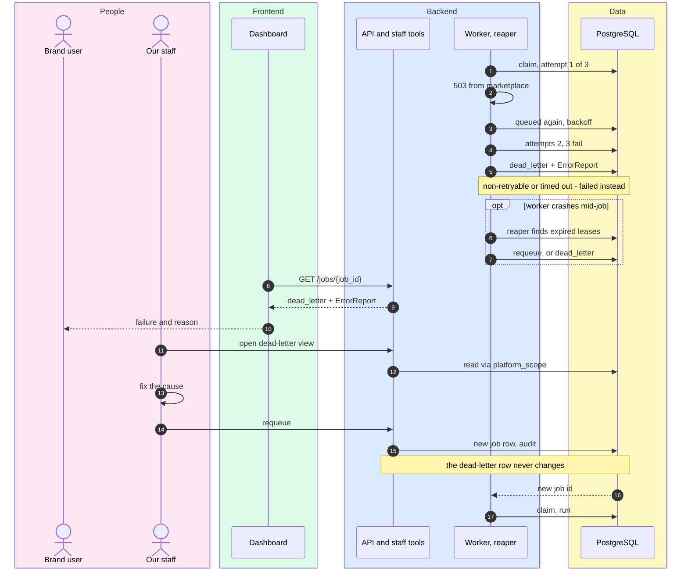

In words: a 503 is retryable, so the job goes back to `queued` after a backoff (step 3). When the
third attempt fails, the row becomes `dead_letter` with the full ErrorReport, and the listing moves
from `publishing` to `failed` (step 5). The reaper runs every minute (steps 6–7). Staff read the
dead-letter view across brands, read-only, through `platform_scope` (step 12). The requeue
(step 15) is one transaction for that brand: a new job row with `parent_job_id`, a fresh
correlation id, the same creator, a queue entry and an audit entry.

**Key details**
- **What the site asks** [Site]: jobs that use up their retries go to a dead-letter queue with their
  ErrorReport, input context and failure history, and operators can inspect, fix and resubmit them
  (L12047). Failed jobs can be re-run with the same input (L12061). Backoff: L11973.
- **Requeue** [Decided, Canon]: always a **new** `job_runs` row with a fresh `correlation_id` and
  `parent_job_id` set; the failed row is never reset. Dead-letter data lives in `job_runs`, not in a
  separate queue [Decided, ADR-0004].
- **Retries and time-outs** [Decided, ADR-0004]: procrastinate retry strategies with backoff for
  network, 5xx and 429 errors; every task is wrapped in a time limit, and a time-out records
  `JOB_TIMEOUT` on a `failed` row. Generation jobs are not re-queued for AI-quality failures
  (`max_attempts = 1`). The full table is in §8.3.
- **The retry rule** [Proposed, needs an ADR; DATABASE.md §6.2]: non-retryable → `failed`;
  retryable with attempts left → `queued` after a backoff; retryable with no attempts left →
  `dead_letter`.
- **Two different ways a job runs out of time.**
  - **The time limit fires** [Decided, ADR-0004]: the task's own `asyncio.timeout` expires while the
    worker is alive. The row ends `failed` with `JOB_TIMEOUT` and is not retried.
  - **The worker dies** [Proposed, DATABASE.md §5.4]: nobody is left to record anything, so the
    running job's lease expires. The reaper, every minute, treats that like a retryable failure:
    attempts left → back to `queued`; attempts used up → `dead_letter`, also recorded with
    `JOB_TIMEOUT`. This maps to ADR-0004 spike criterion 8 (crash recovery).
  - DATABASE.md reuses `JOB_TIMEOUT` for the lost lease; a code of its own would be clearer, but a
    new error code needs the Tech Lead, so that is not specified yet (§13.5).
- **Proposed safeguards** (DATABASE.md §5.4): a requeue copies the original creator, so a requeued
  publish still has a human creator; each row can be requeued only once (`UNIQUE (parent_job_id)`);
  the staff action is audited.
- **Who requeues — open** (DATABASE.md §11.1 #17; VISION-ALIGNMENT Q18). **Default:** our staff
  handle dead letters and system failures; the brand owner handles its own blocked listings. The
  internal admin is read-only everywhere except `api-staging` (`ADMIN_READ_ONLY`, ENV.md) and returns
  404 in production (§9.2), so the prod requeue path (admin screen or `app.cli`) is not specified.
- **Brand-side retries** [Proposed, DATABASE.md §6.2]: a user can retry a `failed` job, and a
  `partial` job retries only its failed fields or rows. Cancelling a queued job
  (`POST /api/v1/jobs/{id}/cancel`) is proposed in VISION-ALIGNMENT §4.10.
- **Replay input:** the site wants a re-run with the exact same input and context (L12059–12061).
  **Default:** same request, fresh context (open question Q26). This departs from the site and has no
  T-row yet (candidate row, §13.2).

### 3.8 "Ask one question, then resume"

**In plain words.** Sometimes a listing can't be finished because a fact is missing, for example the
fabric composition, which the AI must never guess. Instead of sending the seller back to a large form,
the system asks one clear question: why it is needed, which products it affects, what answer is
expected, and some safe suggestions. When the seller answers, the fact is saved and only the affected
fields are written again; the listing then goes back to the review queue. The client's BRD asks for
this. The 45-day plan and the specs don't, so **everything in this journey is our proposal**.

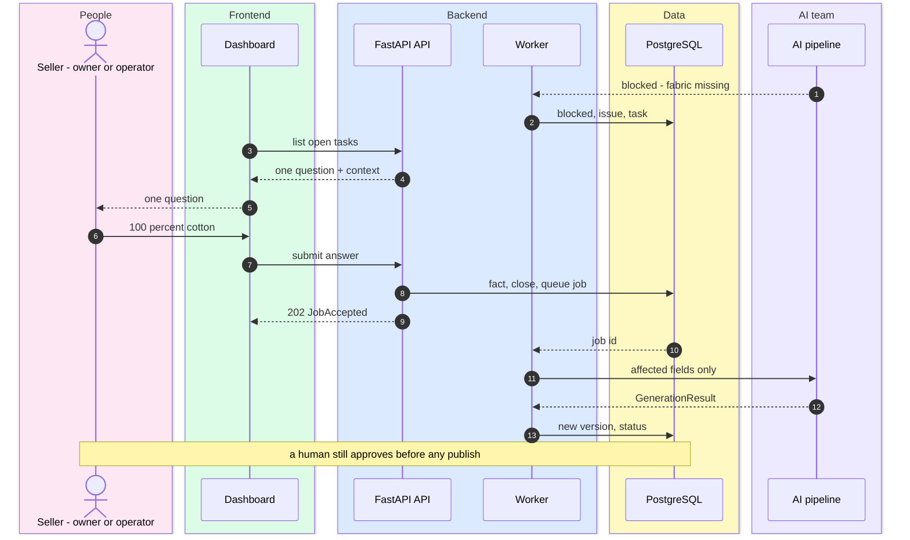

In words: the pipeline reports that the fabric composition is missing and must not be guessed
(step 1). In one transaction the worker sets the listing `blocked`, records an issue from the
`ErrorItem` and opens one human task (step 2). The task shows the question, why it is needed, the
affected SKUs, the expected answer and safe suggestions. When the answer arrives, one transaction
(step 8) saves the fact with source `seller`, closes the task, resolves the issue and queues a
partial regeneration. The regeneration gets the previous version and only the affected fields, and the new
version records which fields changed; the listing goes to `validated` or `needs_review`.

**Key details**
- **What the client asks** [Site, BRD]: Step 8, "Ask human only when necessary" (L1029–1037); when to
  ask and when not to (BRD §16, L1360–1386); the acceptance criterion "identify missing data and ask
  targeted human questions" (L2156); "human questions are first-class workflow tasks … the workflow
  must be resumable" (L2221–2223). The 45-day plan and the specs don't include it; they review whole
  listings.
- **Status today:** gap G5 in VISION-ALIGNMENT. The tables are proposed in DATABASE.md §5.7, with
  their status lifecycles in §6.5; §7 will carry them. The seam field and the endpoints are still
  not specified.
- **Proposed tables** (G5; DATABASE.md §5.7): `listing_issues`, fed from `ErrorItem`s, each with a
  resolution state; and `human_tasks`, with the field path, the question, the expected answer,
  suggestions and who answered. One task can cover many issues, so a missing fact is asked once,
  however many variants or marketplaces it affects (T20).
- **Proposed seam change:** `GenerationResult` gains structured questions. That is a MINOR
  `mkos-schemas` change and needs the Tech Lead, the AI lead and the FE lead (AGENTS.md §6).
  Detecting missing or conflicting facts is not one of today's 12 pipeline stages
  (VISION-ALIGNMENT §4.1), so it is an AI-team item.
- **No new status** [Proposed]: the listing waits in `blocked`, and the dashboard shows "human
  action required", derived from open tasks (T12).
- **Where the answer goes** [Proposed, G1]: into the product fact, with `source = seller`.
  Critical facts may never come from the AI; the default list (open question Q9) is fibre
  composition, origin, care, MRP, HSN, identifiers, certifications and measurements.
- **Resume** [Proposed, invariant 10]: a partial regeneration of only the affected field paths,
  which the new version records (DATABASE.md §5.3; §7). Whether the pipeline resumes from a saved
  checkpoint or re-runs those fields is not specified. Whether it resumes automatically, and who
  counts as the maker, is open (T51).
- **Approval is still mandatory** after a resume [Decided, invariant 3].
- **Not specified:** the endpoints for listing and answering tasks.

## 4. Inside the backend

**In plain words.** The backend is one Python application, `apps/api`, built into one container image that runs two ways: as the web API and as the background worker. A request passes through three layers in a fixed order: a *router* checks the request and the caller, a *service* applies the business rules, and a *repository* talks to the database, always filtered to the caller's brand (tenant). Slow work (AI generation, CSV imports, publishing) is handed to the worker through a queue that lives inside PostgreSQL. The worker calls the AI team's pipeline in-process through a narrow, typed "seam", and only the marketplace *adapters* ever talk to Amazon or Flipkart. The Rules Engine is plain deterministic code with no AI in it. Import rules checked in CI keep these layers from leaking into each other.

### 4.1 The request path

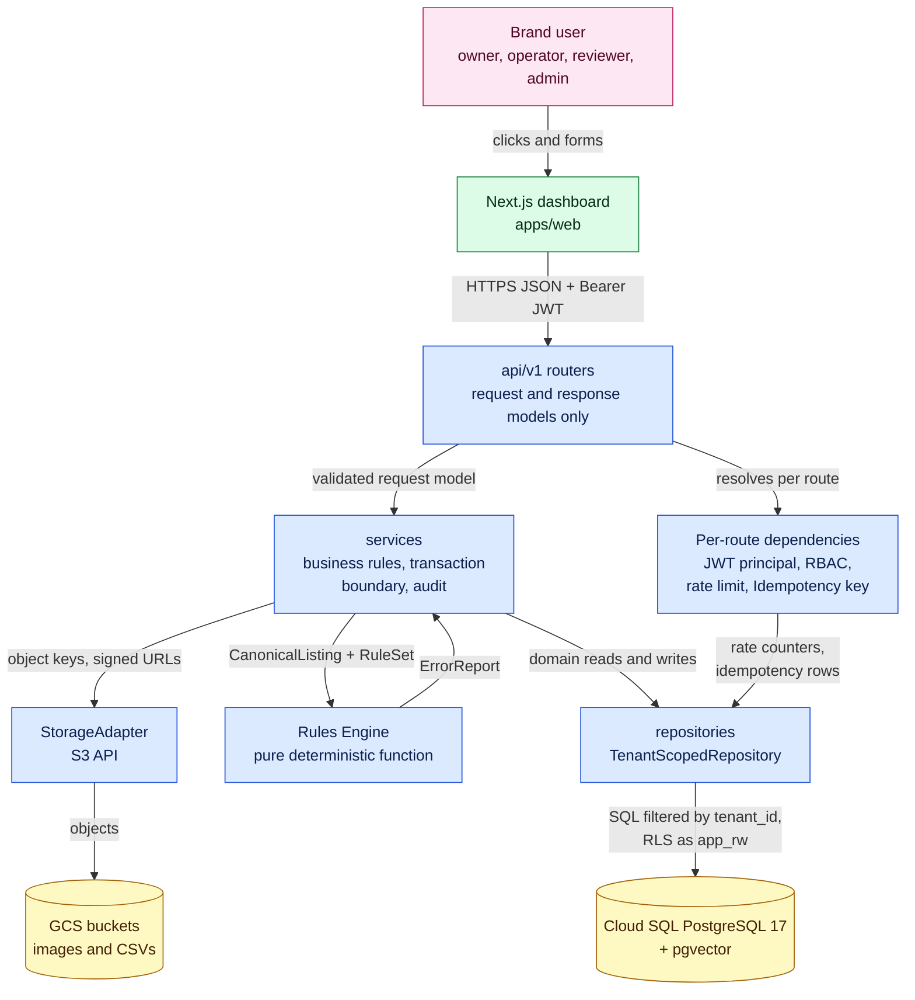

Staff reach data across brands only through the read-only internal admin and `platform_scope()`; that
path is drawn in §9.1 and described in §4.3.

### 4.2 The background path

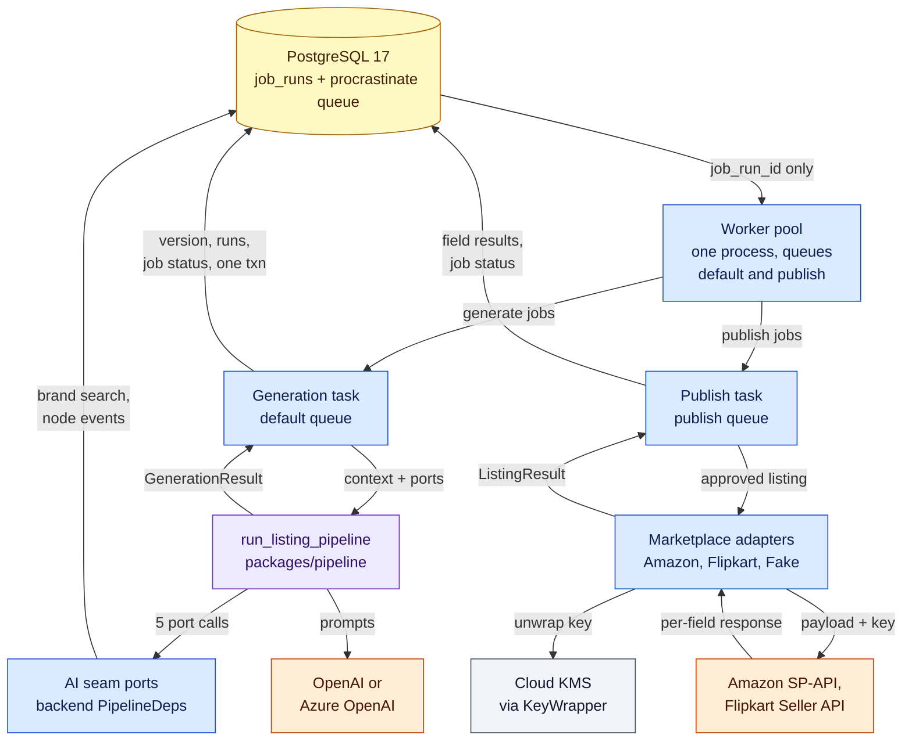

### 4.3 Components and what each one owns

| Component | Responsibility | Tag and source |
|---|---|---|
| `api/v1` routers | HTTP only: request and response models, the caller's identity, role checks, mapping domain errors to HTTP. No business logic, no SQL. | [Site] routers / services / repositories / adapters split (L12903) and the `api/v1/routers` tree (L6973). Router content rule: [Proposed] (`CHECKLISTS.md` layering row) |
| Per-route dependencies | JWT principal (`get_current_principal`), `require_role`, rate limiting, Idempotency-Key handling. Auth is a FastAPI dependency, not middleware, so `/healthz` and the OAuth callback can be public without an exclusion list. | Rate-limit dependency: [Decided] ADR-0005 §1. Auth as a dependency: [Proposed] (`BUILD-SEQUENCE.md` S10). The site says token validation happens "in middleware" (L11517) |
| Services | Business rules, the transaction boundary, audit entries, calls to repositories, adapters and the queue. Workers call the same service methods as routers. | [Site] "services (business logic)" (L12903). Transaction boundary and shared use by workers: [Proposed] (`CHECKLISTS.md` layering row) |
| Repositories | All SQL. Every repository inherits `TenantScopedRepository` and filters by `tenant_id`. A `do_orm_execute` guard raises `CrossTenantQueryError` for any unscoped query on a tenant table. | [Site] mandatory TenantScopedRepository (L6592-6610). [Decided] invariant 5; guard mechanics Addendum §6 |
| Database backstops | Row-level security as `app_rw` with a transaction-local tenant setting; composite foreign keys so rows cannot link across brands; the maker-checker trigger. | [Decided] Canon ledger `0004_integrity`, `0005_rls`. Layer details (e.g. `set_config` helpers): [Proposed] `DATABASE.md` §4. See §9.1 |
| Rules Engine | Deterministic checks (lengths, banned terms, required attributes, max items) over a `CanonicalListing`, returning one `ErrorReport`. Rules are rows in the `rules` table, not code. No DB session, no LLM. **Two signatures, one contract:** the AI seam port `validate_rules(listing) -> ErrorReport` (§6.3) is frozen, and it wraps the engine function. The engine function's own signature is still open: the site gives `validate(listing, marketplace)` (L4990), the S14 draft `validate(listing, marketplace, category)`, and DATABASE.md §11.1 #26 proposes adding the product facts and account settings. | [Site] L6188, L11549-11603. [Decided] invariant 2; `RuleDef` types in Addendum §16; the port, Canon "The AI seam". Engine signature: [Proposed] (`BUILD-SEQUENCE.md` S14) |
| AI seam ports | Backend implementation of the five `PipelineDeps` ports the AI pipeline may call (§6.3). | [Decided] Canon "The AI seam" |
| Backend model services | `app/services/embeddings.py` and `app/services/vision.py`: the only backend modules allowed to call a model. `app/services/telemetry.py` records an `agent_runs` row for each of these calls. | [Decided] Canon "The AI seam" |
| Workers | procrastinate workers on queues `default` and `publish`, in one Cloud Run worker-pool process with separate concurrency per queue. | [Decided] ADR-0001, ADR-0004 (spike-gated; deviates from the site's Redis + ARQ, T3). See §8 |
| Marketplace adapters | The only code that talks to Amazon or Flipkart. Maps the canonical listing to marketplace fields, owns auth refresh, rate limiting, idempotency and error mapping; returns a per-field `ListingResult`, never a boolean. A `FakeAdapter` lets everything run without marketplace access. | [Site] adapter ABC and responsibilities (L10519-10533). [Decided] invariant 4; FakeAdapter (Canon "The AI seam"). ABC frozen with a network-free `preview()`, and an outbound Postgres token bucket per (marketplace, account, operation): [Proposed] `VISION-ALIGNMENT.md` G11, G17 |
| Cloud adapters | `StorageAdapter` (S3 API, same code path as local MinIO), a KMS `KeyWrapper`, secrets as environment variables. Domain code never imports a cloud SDK. | [Decided] ADR-0001, AGENTS.md §4. [Site] "No Cloud Leaks into Domain Code" (L5853) |
| Configuration | Only `app/core/config.py` reads the environment; the variable is `APP_ENV`. | [Decided] AGENTS.md §5 |
| Internal admin | Read-only SQLAdmin at `/internal/admin` for platform staff. It reads across tenants only through `platform_scope()`. In production it returns 404, and turning it on there stops the app from starting. | [Decided] Canon naming register; Addendum §6, §14. Excluding `token_enc` and `hashed_password` from admin views: [Proposed] (`DATABASE.md` §5.4; `BUILD-SEQUENCE.md` S14) |

**Runtime shape** [Decided] ADR-0001, ADR-0005:
- **API:** one `uvicorn` process per Cloud Run instance.
- **Worker:** one Cloud Run worker pool.
- **Migrations:** run as a Cloud Run job before each deploy, never at container start.
- Instance sizes and the database connection budget are in §10.1.

**Open point.** ADR-0001 does not say how the internal admin is deployed. The `BUILD-SEQUENCE.md` S14 draft proposes a separate IAM-gated Cloud Run service. How staff reach dead-letter tooling in production is also open, because the admin is off there (`DATABASE.md` §11.1 #17; `VISION-ALIGNMENT.md` Q18).

### 4.4 Layering rules that CI enforces

**Code layers and the tenant bypass.** Dashed arrows are imports that are forbidden.

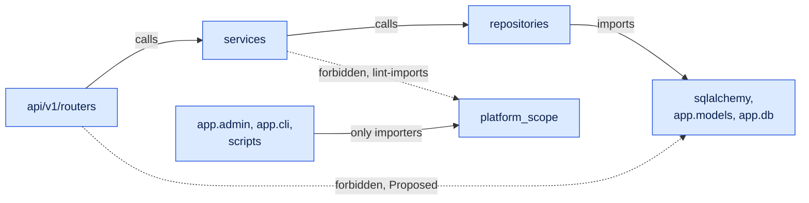

**Model libraries and the AI package.**

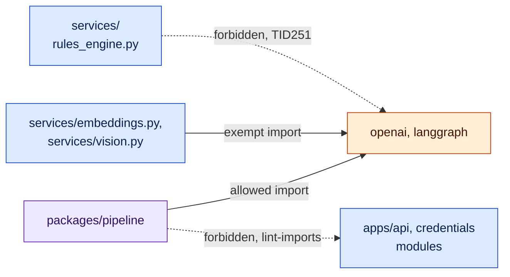

| Rule | Enforced by | Tag and source |
|---|---|---|
| `packages.pipeline` may not import `apps.api` | `lint-imports` (import-linter forbidden contract) | [Decided] Canon "The AI seam"; Addendum §12 |
| The credentials modules may not be imported by `packages.pipeline` | `lint-imports` | [Decided] Addendum §12 |
| `platform_scope` may be imported only from `app.admin.*`, `app.cli` and `scripts.*` | `lint-imports` | [Decided] Addendum §6, §12 |
| The string `tenant_scope_checked` appears in exactly two files (`app/db/guard.py`, `app/db/session.py`) | CI grep inside the `lint-imports` job | [Decided] Addendum §6 |
| `openai` and `langgraph` are banned everywhere except `packages/pipeline/**`, `app/services/embeddings.py` and `app/services/vision.py`. `app/services/rules_engine.py` is hard-banned, which makes "rules are data, not code" mechanical | ruff banned-api (TID251), inside `api-lint` | [Decided] Canon "The AI seam". Known defect: the ruff selection omits `TID`, so the rule never fires until S1 adds it ([Proposed] fix, `KNOWN-ISSUES.md`) |
| Routers may not import `sqlalchemy`, `app.models` or `app.db` | ruff banned-api plus an import-linter layered contract | [Proposed] (`BUILD-SEQUENCE.md` S12; `CHECKLISTS.md` layering row) |
| Only `app/core/config.py` reads `os.environ`; no string literal where an `ErrorCode` belongs | The rules are decided. No existing check covers them, so a custom grep or AST check is needed | Rules: [Decided] AGENTS.md §5, Addendum §20. Check: [Proposed] (`KNOWN-ISSUES.md`) |
| Banned dependencies: python-jose, passlib, numpy, cloud-sql-python-connector, slowapi, gunicorn, asyncpg | Not specified. `pip-audit` covers only known CVEs | [Decided] AGENTS.md §4; ADR-0004, ADR-0005 |
| Domain code never imports a cloud SDK | Not specified | [Decided] AGENTS.md §4; ADR-0001 |
| Types: `mypy --strict` on `apps/api` and `packages/schemas`; non-strict on `packages/pipeline` | `api-typecheck` | [Decided] Canon required checks |
| Every table mapped with `TenantScoped` is covered by the cross-tenant test, including pgvector search | `tenant-isolation` | [Decided] Canon required checks |

The full list of 12 required checks is in §11.2. No workflow that carries one of them may have a `paths:` filter [Decided] Addendum §12.

## 5. API surface

**In plain words.** The dashboard talks to the backend over a REST API. Every business route sits under `/api/v1`. Only health checks, the generated API description and the internal admin sit outside that prefix. Anything slow returns `202 Accepted` with a job id right away, and the dashboard polls one endpoint, `GET /api/v1/jobs/{job_id}`, until the job finishes. Every failure, whether a rule, an image check, an AI model or a marketplace, is described in the same `ErrorReport` shape. The site lists about ten endpoints (L6894-6962, L11223-11299). The Canon and the build drafts fill in the rest: auth, imports, jobs and dead letters, rules dry-run. Paths not yet frozen are marked [Proposed]. The full surface is frozen as OpenAPI in build step S3.

### 5.1 A listing's trip through the API

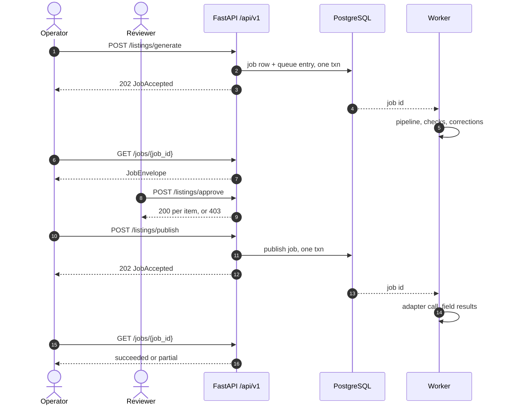

The generate call carries `product_id` and `marketplace`; `JobAccepted` carries `job_id` and
`poll_url`; `JobEnvelope` carries the status, the stage and any ErrorReport. Approve and publish
both carry an `Idempotency-Key`; a refused approval is `403 MAKER_CHECKER_VIOLATION`. The worker is
never called directly: it picks jobs up from PostgreSQL (§8.2).

### 5.2 Endpoints by group

| Group | Endpoint | What it does | Tag and source |
|---|---|---|---|
| Health and tooling (unversioned) | `GET /healthz`, `GET /readyz` | Liveness (always 200, no DB) and readiness | [Decided] Canon naming register; semantics per `SUPERSEDED.md` |
| | `GET /openapi.json`, `GET /docs` | The generated contract and its viewer | [Decided] Canon |
| | `/internal/admin` | Read-only staff admin; 404 in production | [Decided] Canon; Addendum §14 |
| Auth | `POST /api/v1/auth/login` | Email and password in; access and refresh tokens out | [Decided] Canon (rate-limit row; JWT rows). Provisional: the site has NextAuth issue the JWT (L11517), T7 |
| | `POST /api/v1/auth/refresh`, `POST /api/v1/auth/logout`, `GET /api/v1/auth/me` | Rotate the refresh token (reuse revokes the chain), revoke it, return the current principal | [Proposed] `BUILD-SEQUENCE.md` S10; the `refresh_tokens` table is [Decided] Canon `0003` |
| | Switch active brand | Issues a new token for another membership the user holds | [Decided] capability (ADR-0006). Path: not specified |
| Tenants, members, invites | `GET /api/v1/tenants/me` | The brand profile (tone, guidelines, glossary) | [Decided] Canon ledger `0002` |
| | `POST /api/v1/brand/documents` | Upload brand documents for chunking and embedding | [Decided] Canon ledger `0002` |
| | Members and invitations | Invite by email, accept, revoke, change role, deactivate. v1 is invite-only | [Decided] capability (ADR-0006). Paths: not specified. Open: invite TTL, email provider, who may invite or promote an owner (`DATABASE.md` §11.1 #6, #8, #18) |
| Products and imports | `POST /api/v1/products` | Create one product; SKU unique per tenant | [Site] L6904, L11303. [Decided] `UNIQUE (tenant_id, sku)` |
| | `GET /api/v1/products` and product read/update | List, read and update products | [Site] "create, read, update" (L11308). Exact paths: [Proposed] `BUILD-SEQUENCE.md` S3 |
| | `POST /api/v1/products/bulk` | CSV import; returns 202 and a job; bad rows are isolated, never failing the batch | [Site] L6910, L11345. [Decided] 10 MiB multipart cap; larger files via a signed upload URL, then this call with the object key (Canon) |
| | `GET /api/v1/imports/{id}`, `GET /api/v1/imports/{id}/rows?status=failed`, `POST /api/v1/imports/{id}/rows/retry` | Import report, failed rows, re-run failed rows only | [Proposed] `BUILD-SEQUENCE.md` S3 |
| Listings | `POST /api/v1/listings/generate` | Start AI generation; 202 with a job | [Site] L6916, L11359-11377 |
| | `GET /api/v1/listings/{id}/status` | Status by listing id | [Site] L6922. [Decided] kept only as a convenience alias; the primary poll is the jobs endpoint (Canon) |
| | `POST /api/v1/listings/validate` | Schema, rules and vision checks; returns an `ErrorReport`; callable on its own after a manual edit | [Site] L6928, L11391. Returns 200 with `passed: false` when rules fail, not 422: [Proposed] `BUILD-SEQUENCE.md` S3 |
| | `PATCH /api/v1/listings/{id}/content` | Human edit: creates a new version; the editor can no longer approve it | Edit rule: [Decided] Canon (role defaults). Path: [Proposed] `BUILD-SEQUENCE.md` S3 |
| | `POST /api/v1/listings/{id}/regenerate` | Regenerate an existing listing; a reviewer may do this, but may not generate fresh or import | [Decided] Canon role default; client confirmation pending (`VISION-ALIGNMENT.md` Q17) |
| | `POST /api/v1/listings/approve` | Approve or reject; maker-checker enforced server-side | [Site] L6934, L11405. Batch items, and ignoring a client-sent reviewer id (the approver is the JWT subject): [Proposed] `DATABASE.md` §7.1 |
| | `POST /api/v1/listings/publish` | Owner or operator only; approved listings only; 202 with a job | [Site] L6940, L11419. [Decided] owner or operator (Canon role defaults). Idempotency-Key required: [Proposed] `BUILD-SEQUENCE.md` S8 |
| | `POST /api/v1/listings/{id}/publish/retry-fields` | Retry only the fields that failed | [Proposed] `BUILD-SEQUENCE.md` S3; invariant 10 |
| Marketplaces | `POST /api/v1/marketplaces/connect` | Start OAuth; returns the consent URL | [Site] L6946, L11433. The Canon freezes only the callback; whether connect carries `{marketplace}` in its path is not specified |
| | `GET /api/v1/marketplaces/{marketplace}/callback` | OAuth return. No JWT: the tenant comes from the server-side OAuth state, kept in Postgres and consumed once | [Decided] Canon naming register; AGENTS.md §5; ADR-0004 §8 |
| | Connected accounts and health | List accounts and connection health | [Site] "health status returned" (L6950). Path: [Proposed] `BUILD-SEQUENCE.md` S3 |
| Images | `POST /api/v1/images/upload` | Upload an image and start the compliance checks | [Site] L11461. A signed upload-URL step: [Proposed] `BUILD-SEQUENCE.md` S3 |
| | `GET /api/v1/images/{id}/report` | The `ImageReport` for one image | [Site] L6958, L11461 |
| Rules | `GET /api/v1/rules`, `POST /api/v1/rules/dry-run` | List rules; run the Rules Engine on a draft listing without saving anything | [Proposed] `BUILD-SEQUENCE.md` S3, S14 |
| Jobs and dead letters | `GET /api/v1/jobs/{job_id}` | `JobEnvelope` read from `job_runs`, never from the queue: job id, kind, status, stage, attempt, ErrorReport, timestamps | [Decided] Canon naming register. The envelope field is `status`, not the draft's `state`; confirm in S2 (`SUPERSEDED.md`). Full field list: [Proposed] (`CONTRACTS.md` draft) |
| | `POST /api/v1/jobs/{id}/cancel` | Cancel a queued job | [Proposed] `VISION-ALIGNMENT.md` §4.10. The site asks for cancel and history (L11475) |
| | `GET /api/v1/jobs/dead-letter`, `POST /api/v1/jobs/dead-letter/{id}/requeue` | Inspect dead-lettered jobs; requeue creates a new job | Paths: [Proposed] `BUILD-SEQUENCE.md` S13. Requeue semantics: [Decided] Canon. Who may use them: open (`VISION-ALIGNMENT.md` Q18) |
| Analytics and errors | `GET /api/v1/analytics` | v1: operational metrics (volume, approval rate, validation pass rate, publish success) | [Site] L6952 says operational; L11447 says marketplace performance. v1 is operational only (T14). Sub-routes `summary`, `timeseries`, `marketplace-breakdown`, `costs`: [Proposed] `BUILD-SEQUENCE.md` S3 |
| | `GET /api/v1/errors` | Query ErrorReports by code, source, marketplace and date | [Site] L11489. [Proposed] after S14 (`VISION-ALIGNMENT.md` §4.9) |
| Not in v1 | Webhooks | Event notifications to external systems | [Site] Phase 2 (L11503) |

**Rules that apply to every request.**
- **Identity:** a Bearer JWT issued by FastAPI [Decided] Canon JWT rows, provisional under T7. Token lifetimes and claims are in §9.2.
- **Tenant:** comes only from the verified `tid` claim, never from a path, query or body. [Decided] AGENTS.md §5.
- **Roles:** owner, operator, reviewer and admin. [Site] L11531.
  - Approval needs reviewer or owner. [Decided] Canon `0004`. ADR-0008 also lists admin; that is open (§3.5).
  - Publishing needs owner or operator. [Decided] Canon role defaults.
  - The full endpoint-to-role matrix, and a test that every route declares a role or is explicitly public: [Proposed] `BUILD-SEQUENCE.md` S10.
- **Limits:** per-tenant, per-IP and login rate limits return 429 (§9.6). The body cap is 10 MiB. [Decided] ADR-0005, Canon.
- **Correlation:** every endpoint propagates a correlation id. [Site] L6896.

### 5.3 Error envelope and ErrorReport

- **One shape for every failure.**
  - [Site] "Consistent error response format using ErrorReport" (L11299).
  - [Decided] invariant 8.
  - The site's schema (L11633-11672):

```json
{
  "status": "failed",
  "error_code": "VALIDATION_FAILED",
  "retryable": true,
  "attempts_used": 1,
  "max_attempts": 3,
  "errors": [
    {
      "field": "title",
      "error_code": "TITLE_TOO_LONG",
      "message": "Title is 221 chars; Amazon limit is 200",
      "value_submitted": "Organic Cotton Kurta Set... (221 chars)",
      "suggestion": "Shorten to <= 200 chars; move detail to bullets",
      "source": "rules_engine",
      "retryable": true,
      "marketplace": "amazon"
    }
  ]
}
```

- **Fixed vocabularies.** [Decided]
  - `source` is one of `schema | rules_engine | vision_model | ai_model | amazon_adapter | flipkart_adapter | system`. API-layer and handler failures use `system`, never `api` (Canon; Addendum §19).
  - Error codes come only from `mkos_schemas/codes.py`, and a new code needs the Tech Lead (AGENTS.md §5; Addendum §20).
  - `JOB_TIMEOUT` (a whole job, `source=system`) and `TIMEOUT` (one model call, `source=ai_model`) are different codes (Addendum §20).
- **HTTP envelope.** [Proposed] `BUILD-SEQUENCE.md` S3:
  - Every non-2xx response is `{"error": {"type", "message", "status", "correlation_id", "details", "error_report"}}`.
  - This comes from two exception handlers plus an override for request-validation errors.
  - `error_report` carries the ErrorReport above.
- **Gaps before API-level 403 and 409 errors fit ErrorReport** (`DATABASE.md` §11.1 #12; `VISION-ALIGNMENT.md` §4.10):
  - `MAKER_CHECKER_VIOLATION` and a stale-version code are not yet in `codes.py`.
  - `paths.py` needs `request` and `listing` paths.

### 5.4 List pagination (keyset)

- [Proposed] `BUILD-SEQUENCE.md` S3: every list response is `{"data": [...], "page": {"next_cursor": "<opaque>", "has_more": <bool>, "limit": <int>}}`. The cursor is a base64 keyset over `(created_at, id)`. No OFFSET paging.
- [Proposed] Supporting indexes in `DATABASE.md`:
  - products: `(tenant_id, created_at DESC, id DESC) WHERE deleted_at IS NULL`;
  - the review queue: `(tenant_id, status_changed_at, id)`, with `id` as the tie-breaker;
  - recent jobs: `(tenant_id, queued_at DESC, id DESC)`.
- The site does not specify pagination. Default and maximum page size: not specified.

### 5.5 Idempotency keys

- **Site:**
  - Marketplace mutations are idempotent, and every marketplace write carries an idempotency key (L12017; site invariant 11, L13700).
  - Async tasks are enqueued "with unique job_id and idempotency key" (L6630).
- **Decided (Canon `0003`):**
  - The `idempotency_keys` table: PK `(tenant_id, key)`, with `endpoint`, `request_hash`, `response_status`, `response_json`.
  - `job_runs.idempotency_key` with `UNIQUE (tenant_id, idempotency_key)` where set.
  - Invariant 10: mutations are idempotent.
- **Proposed:**
  - An `Idempotency-Key` header is required on `POST /api/v1/listings/publish` and `POST /api/v1/products/bulk` (`BUILD-SEQUENCE.md` S8).
  - The same key with the same body replays the stored response. The same key with a different body returns 409 (`BUILD-SEQUENCE.md` S8).
  - `DATABASE.md` §5.4 adds:
    - keys expire after 24 h;
    - another member reusing a key gets 409;
    - batch items each run in their own savepoint;
    - the key is stored in the same transaction as the job rows;
    - the per-item job key is `sha256(http_key:kind:listing_id)`.
- **Other endpoints:** whether any other endpoint requires the header is not specified. `DATABASE.md` §7.1 shows it on approve.
- **Marketplace side:** nothing verifies that Amazon or Flipkart de-duplicate on our key. The proposal is our own per-field ledger plus read-before-retry (`VISION-ALIGNMENT.md` §4.8, G3).

### 5.6 Versioning

- **Site.** The site contradicts itself:
  - spec [118]: "MVP operates without versioning" (L11545);
  - the build plan's code tree: `api/v1/routers` (L6973).
- **Decided, provisional under T11.**
  - All business routes are under `/api/v1`.
  - The only unversioned routes are `/healthz`, `/readyz`, `/openapi.json`, `/docs` and `/internal/admin`.
  - The OAuth redirect URIs registered with Amazon and Flipkart embed `/api/v1/marketplaces/{marketplace}/callback` (Canon; Addendum §26), so the prefix is expensive to change later.
- **Contract change control.** [Decided] AGENTS.md §6; Canon required checks.
  - The generated `openapi.json` and the TypeScript types are committed and machine-owned. `schemas-drift` fails on hand edits.
  - The `contracts` check runs an oasdiff breaking-change diff against the base branch.
  - A MINOR (additive) change can land any day. A MAJOR (rename, removal, type change) lands only in the Day-14, Day-28 or Day-42 windows.
  - Every change needs the Tech Lead, AI lead and FE lead.
- **When `/api/v2` would be introduced:** not specified, beyond the site's "introduce v2 while maintaining v1 with a deprecation timeline" (L11545).

## 6. The AI seam

**In plain words.** The AI team's pipeline and our backend meet at exactly one function. Our worker hands the pipeline a complete, typed package of everything it needs: the product, brand voice, marketplace rules, category template, any earlier version and the user's instructions. The pipeline hands back one typed result. While it runs, the pipeline may call back into the backend through five narrow "ports": search brand voice, run the rules, check images, get a model key, report progress. It cannot open the database, read the environment or the secret store, see marketplace logins, approve or publish. The backend writes every result to the database in one transaction, including the cost record of each AI call. This lets the two teams build in parallel, and it keeps the safety rules mechanically true rather than a matter of discipline.

### 6.1 The call and its five ports

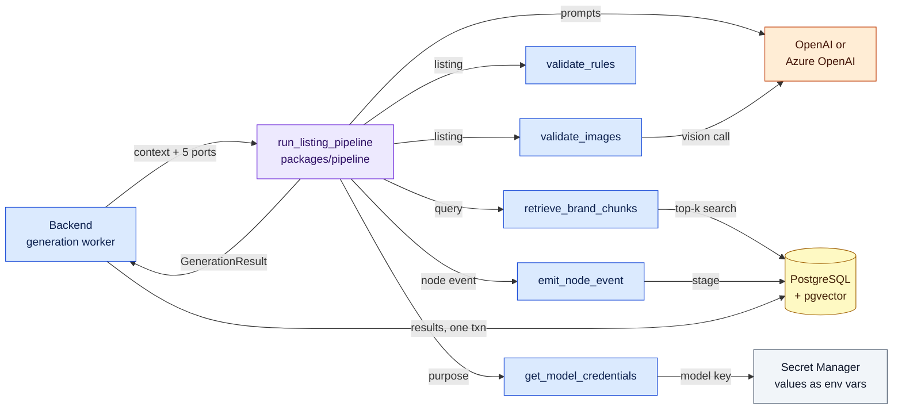

What each port returns is in the table in §6.3: `BrandChunkDTO`s, an `ErrorReport`, a list of
`ImageReport`s, `ModelCredentials`, or nothing. The worker saves the results, the `agent_runs` and
the job status in one transaction.

- **Signature.** [Decided] Canon "The AI seam":

```python
async def run_listing_pipeline(ctx: GenerationContext, deps: PipelineDeps) -> GenerationResult
```

- **Where it lives.** [Decided] Canon; Addendum §21.
  - The implementation is in `packages/pipeline/src/mkos_pipeline/graph.py`, re-exported from `mkos_pipeline`. That package is a uv workspace member (dist `mkos-pipeline`), owned by the AI team.
  - The contract is in `packages/schemas/src/mkos_schemas/pipeline.py`: the `PipelineDeps` Protocol and the signature, re-exporting the other seam types from their owning modules (`jobs.py`, `rules.py`, `agent.py`).
  - The backend generation worker calls it in-process. [Site] "The LangGraph graph executes in-process on the background worker" (L6138).
- **Shared interpreter.** Both sides run on Python 3.13. [Decided] ADR-0002; the AI team's confirmation is pending (T1).

### 6.2 What goes in: GenerationContext

**Context is pushed, not pulled.** [Decided] Canon. The backend assembles everything up front and the AI package fetches nothing. `GenerationContext` carries:
- `product`, `brand_profile`;
- `marketplace_rules` (a typed `RuleSet`) and `category_template` (a typed `CategoryTemplate`);
- `previous_version`, `user_instructions`, `max_attempts`;
- `request_id`, `job_id`, `tenant_id`, `product_id`, `listing_id`, `marketplace`, `category`.

**Deviation from the site.**
- The site feeds the graph an `AgentState` object and has the graph's own `load_context` node fetch product, rules and tenant profile (L8358ff, L6138-6142).
- The Canon makes `AgentState` internal to the AI team, and moves loading to the backend. Nothing ever leaves the AI package as `AgentState`.
- No `TEAM-QUESTIONS.md` row covers this yet (candidate row, §13.2).

**Proposed addition.** An optional `review_feedback` field carries a reviewer's rejection notes into a regeneration: a MINOR change (`VISION-ALIGNMENT.md` G4).

**Open.** When exactly the context is assembled is not specified:
- the Canon says "before enqueue";
- ADR-0004 job payloads carry only `job_run_id`;
- `DATABASE.md` keeps `job_runs.payload_json` to ids only, 64 KiB at most.

Settle it in S2 or S13 (§13.5).

### 6.3 The five ports (all implemented by the backend)

[Decided] Canon. `PipelineDeps` is frozen at exactly these five:

| Port | Signature | Backend implementation |
|---|---|---|
| `retrieve_brand_chunks` | `(tenant_id, query, k=8, types=None) -> Sequence[BrandChunkDTO]` | `BrandChunkRepository.search`. It embeds the query with `text-embedding-3-small` (1536 dimensions) and runs a cosine search on the pgvector HNSW index (m=16, ef_construction=64). The result is a plain DTO, never the SQLAlchemy model. The tenant-isolation check covers this search. [Site] top-k = 8 (L8760-8794) |
| `validate_rules` | `(listing: CanonicalListing) -> ErrorReport` | The deterministic Rules Engine (§4.3). [Site] L6188 |
| `validate_images` | `(listing: CanonicalListing) -> list[ImageReport]` | Deterministic Pillow checks, then the vision model call through `app/services/vision.py`. The AI team writes the vision prompt content; the backend makes the call. |
| `get_model_credentials` | `(purpose: 'generation' \| 'vision' \| 'embedding') -> ModelCredentials` | Returns `provider`, `api_key`, `api_base`, `model`, `timeout_seconds` from settings. This is the only credential that crosses the seam, and it is never a marketplace credential (invariant 6). The provider is OpenAI (`OPENAI_API_KEY`, Canon). Using Azure OpenAI for Microsoft credits is [Proposed] to the AI team (STATE open decision 9) |
| `emit_node_event` | `(node: PipelineStage, status: 'started' \| 'ok' \| 'failed', detail=None) -> None` | Writes the stage to `job_runs.node`; the dashboard sees it as `JobEnvelope.stage`. The stage is never written to `listings.status` |

Four earlier port ideas are deleted: `load_rules` and `load_category_template` (now pushed in the context), `validate_schema` (plain `CanonicalListing.model_validate`) and `record_agent_run` (see §6.5). [Decided] Canon; Addendum §17.

### 6.4 What comes out: GenerationResult, and the graph's shape

- **The return value.** `GenerationResult` is the only thing the pipeline returns. [Decided] Canon. It carries:
  - `terminal_state`, one of `generated | needs_review | blocked | failed`;
  - `blocks[]`, with per-agent partial success. A *block* is one agent's section of the output
    (content, keyword, attribute or image); it has nothing to do with the `blocked` status;
  - `attempts_used`;
  - `agent_runs[]`, one record per model call the pipeline made.
- **From result to listing status.** `terminal_state` is not a listing status (`generated` is not
  one of the 9). The worker re-runs the deterministic checks and then maps the result
  [Proposed, DATABASE.md §6.1]:

  | Pipeline result, after the worker's re-check | `listings.status` |
  |---|---|
  | `generated`, no errors or warnings | `validated` |
  | `generated` with warnings or a failed block, or `needs_review` | `needs_review` |
  | Any blocking error, or `blocked` (corrections used up, or a question for the seller) | `blocked` |
  | `failed`, or no result at all | `failed` |
- **The 12 transient stages.** [Decided] Addendum §18: `load_context`, `retrieve_brand`, `content_agent`, `keyword_agent`, `attribute_agent`, `image_agent`, `merge_outputs`, `validate_schema`, `validate_rules`, `validate_vision`, `correct`, `quality_check`.
- **No approval or publish node.** [Decided] The graph ends at `quality_check`.
  - Publishing belongs only to `POST /api/v1/listings/publish` and the publish worker, after the listing is approved.
  - This supersedes site spec [16], whose node table lists `await_approval` and `publish` with checkpoint and resume (L8526-8574).
  - The site's own invariants support the ruling (L6182-6184, L13690). No `TEAM-QUESTIONS.md` row covers this yet (§12.3).
- **Bounded self-correction.** [Decided] invariant 9; [Site] L8999, L11931-11935.
  - At most 3 correction attempts inside the graph, then the listing is `blocked`.
  - Generation jobs use `max_attempts=1` for domain failures, so the queue never multiplies the cap (ADR-0004 §6).
  - Open, for the AI team: does "max 3" count corrections or all attempts (`DATABASE.md` §11.1 #11; §13.3)?

### 6.5 Who writes `agent_runs`

- **One writer.** [Decided] Canon "Who persists agent_runs":
  - Only the backend generation worker writes `agent_runs` rows for the pipeline's calls.
  - The pipeline returns `AgentRunRecord`s in `GenerationResult.agent_runs[]`.
  - The worker inserts them in **one transaction** with the new `listing_version`, the `validation_runs` rows and the `job_runs` status update.
- **Who owns a row.** Whoever executes the model call owns its row, and there is exactly one row per call.
  - The backend's own calls (embeddings, vision) are recorded directly through `app/services/telemetry.py`.
  - Each row records model, tokens, cost in USD (`cost_usd NUMERIC(12,6)`), duration and status (invariant 7).
- **Proposed** (`DATABASE.md` §5.4):
  - Inserts use `ON CONFLICT (id) DO NOTHING`.
  - An LLM budget reservation is taken when the job is claimed and released when the real rows land.
- **Open:** what is recorded when a run times out or crashes mid-way (`DATABASE.md` §11.1 #19; §13.3). Inventing rows is ruled out.

### 6.6 What the AI package may never touch

```mermaid
flowchart LR
  classDef backend fill:#dbeafe,stroke:#1d4ed8,color:#0b1f4d;
  classDef ai fill:#ede9fe,stroke:#6d28d9,color:#2e1065;
  classDef fe fill:#dcfce7,stroke:#15803d,color:#052e16;
  classDef data fill:#fef9c3,stroke:#a16207,color:#422006;
  classDef gcp fill:#f1f5f9,stroke:#475569,color:#0f172a;
  classDef external fill:#ffedd5,stroke:#c2410c,color:#431407;
  classDef human fill:#fce7f3,stroke:#be185d,color:#500724;
  PIPE["packages/pipeline - AI team"]:::ai
  DB["app.* modules, SQLAlchemy sessions"]:::backend
  CRED["marketplace_accounts and OAuth tokens"]:::data
  ENV["os.environ and Secret Manager"]:::gcp
  PUBL["Publish and approval actions"]:::backend
  MP["Amazon and Flipkart APIs"]:::external
  SCH["mkos-schemas contracts"]:::backend
  LIBS["langgraph, langchain-core, openai, tiktoken"]:::external
  PIPE -->|"imports - allowed"| SCH
  PIPE -->|"imports - allowed"| LIBS
  PIPE -.->|"never - import-linter"| DB
  PIPE -.->|"never - import-linter and IAM"| CRED
  PIPE -.->|"never - reads no environment"| ENV
  PIPE -.->|"never - no graph node"| PUBL
  PIPE -.->|"never - adapters only"| MP
```

| Never | Enforced by | Tag and source |
|---|---|---|
| Import SQLAlchemy, FastAPI or any `app.*` module, or open a DB session | `lint-imports`: `packages.pipeline` may not import `apps.api` | [Decided] Canon; Addendum §12 |
| See `marketplace_accounts`, OAuth tokens or any marketplace credential | `lint-imports` on the credentials modules, plus GCP IAM: the AI team's Google group has no secretAccessor on `AMAZON_*` or `FLIPKART_*` | [Decided] Canon; invariant 6 |
| Read `os.environ` | Contract rule; model keys arrive only through `get_model_credentials` | [Decided] Canon. Mechanical check: [Proposed] (`KNOWN-ISSUES.md`) |
| Approve or publish | There is no graph node for either; the publish route and worker check approval server-side | [Decided] invariants 1 and 3; [Site] L6184 |
| Call Amazon or Flipkart | Only adapters talk to marketplaces | [Decided] invariant 4; [Site] L10533 |

What this means for prompts, including what never reaches the LLM, is in §9.5.

**Dependencies.** The pipeline package depends only on `mkos-schemas`, `langgraph`, `langchain-core`, `openai` and `tiktoken`. `mypy` runs on it non-strict for the sprint, but the seam function and all of `mkos_schemas` stay fully typed. [Decided] Canon.

**Test harness.** The backend ships a `FakeAdapter` and a stub `run_listing_pipeline` that returns a valid `GenerationResult` from fixtures. The generation worker is then testable before the AI team writes a node. [Decided] Canon, which planned it for Day 5. Nothing is built yet (STATE: pre-S1).

**Change control.**
- The Canon froze the seam on Fri 25 Sep 2026 (Day 5); the `schemas-v1.0.0` tag that publishes it comes in build step S2.
- Any change is a PR against `CANON.md` plus a MINOR or MAJOR bump of `mkos-schemas`, approved by the Tech Lead, AI lead and FE lead.
- MAJOR changes land only in the Day-14, Day-28 or Day-42 windows.

[Decided] Canon; AGENTS.md §6.

## 7. Data architecture

<!-- DB-CHAPTER: integrated from docs/architecture/DATABASE.md after the site-alignment pass -->
<!-- DB-CHAPTER-STUB-START: replace from here to DB-CHAPTER-STUB-END when the chapter is integrated -->

**Generated for the Word edition.** `scripts/docgen/build.sh` fills this chapter from
`docs/architecture/DATABASE.md`: the database choice, the big picture, tenant isolation, each domain's
summary and diagrams, the lifecycles and the key flows. Here in the .md, go to DATABASE.md
directly, so there is a single copy to maintain. The sections needed most often:

| Topic | DATABASE.md |
|---|---|
| Which database and why; the big picture | §2, §3 |
| Tenant isolation in four layers | §4 |
| Identity and tenancy: `tenants`, `users`, `tenant_memberships`, `invitations`, `audit_log` | §5.1 |
| Catalog, rules and templates: `products`, `rules`, `category_templates` | §5.2 |
| Listings, approval and publishing: `listings`, `listing_versions`, `review_decisions`, `listing_items`, `listing_submissions`, `publish_field_results` | §5.3 |
| Operations: `job_runs`, `imports`/`import_rows`, `idempotency_keys`, `agent_runs`, `marketplace_accounts`, `oauth_states`, `rate_limit_counters` | §5.4 |
| Brand voice vectors: `brand_documents`, `brand_chunks` | §5.5 |
| Product facts and compliance: `brand_profiles`, `business_parties` | §5.6 |
| Issues and human tasks: `listing_issues`, `human_tasks` | §5.7 |
| Lifecycles: listing, job, display projection, submission, issue and task statuses | §6 |
| Key flows: approve, enqueue, publish and status sync, error resolution | §7 |
| Roles, privileges, migration ledger, expand/contract rules | §8 |
| Retention, backups and restore targets | §9 |
| Open decisions, changes vs the Canon, deviations from the site | §11 |

<!-- DB-CHAPTER-STUB-END -->

## 8. Jobs and reliability

**In plain words.** Anything slow becomes a *job*: one row in the `job_runs` table that the dashboard can poll. The job row and its queue entry are written in the same database transaction as the data they belong to, so a job can never be lost or run before its data exists. Workers pick jobs up, run them under a time limit, and retry only failures worth retrying, a bounded number of times. A job that keeps failing is parked as a dead letter for a person to inspect; retrying it creates a fresh job and keeps the history. Publishing to a marketplace is tracked per field, so a partial failure retries only the fields that failed. Mutations are idempotent, so a double click or a network retry never creates duplicate work or publishes twice.

### 8.1 Job lifecycle

```mermaid
stateDiagram-v2
  [*] --> queued : row + queue entry
  queued --> running : claim, lease
  queued --> cancelled : cancel
  running --> succeeded : done
  running --> partial : some failed
  running --> queued : retry, attempts left
  running --> failed : non-retryable or time limit
  running --> dead_letter : attempts used up
  running --> cancelled : cooperative stop
  succeeded --> [*] : final
  partial --> [*] : final
  failed --> [*] : final
  cancelled --> [*] : final
  dead_letter --> [*] : final
  note right of dead_letter
    Every end state is final: the row never changes again.
    A requeue or retry inserts a NEW row that starts at
    queued, with parent_job_id pointing back here.
  end note
```

Reading the edges: a retry after a retryable error or a lost lease goes back to `queued` while
attempts are left, and to `dead_letter` once they are used up. The time limit is the task's own
`asyncio.timeout`, which ends the row `failed` with `JOB_TIMEOUT` (§3.7 explains how that differs
from a crashed worker). A cooperative stop of a running job is never done mid-publish. A requeue
from the dead-letter list, a user's retry of a `failed` job and a retry of only the failed fields or
rows of a `partial` job all create a new row.

- **States.** [Decided] Canon; Addendum §18. `job_runs.status` has exactly seven lowercase values: `queued | running | succeeded | partial | failed | cancelled | dead_letter`.
  - They are stored as TEXT with a CHECK constraint, never a Postgres ENUM.
  - A timeout is not a state. When a task's time limit fires, it is recorded as
    `error_code = JOB_TIMEOUT` on a `failed` row. A lost lease after a worker crash is different: the
    reaper requeues the job, or dead-letters it once attempts are used up [Proposed] (§3.7).
  - `partial` is required for per-field publish retry.
- **Site difference.** The site gives two vocabularies:
  - `QUEUED → RUNNING → COMPLETED | FAILED | TIMEOUT` (spec [131], L11911);
  - `SUCCEEDED / FAILED / PARTIAL` (build plan, L6642).
  - The Canon uses the plan's names, adds `cancelled` and `dead_letter`, and turns TIMEOUT into an error code (`VISION-ALIGNMENT.md` §4.10). No `TEAM-QUESTIONS.md` row covers this yet (candidate row, §13.2). T24 covers only where job state lives (Postgres, not Redis).
- **Transitions.** [Proposed] `DATABASE.md` §6.2, needing an ADR:
  - `retryable=false` → `failed`;
  - retryable with attempts left → back to `queued`, with backoff;
  - retryable with attempts exhausted → `dead_letter`;
  - the claim only ever moves `queued → running`;
  - terminal rows are immutable.
- **Cancellation.** Cancel applies to queued jobs (`VISION-ALIGNMENT.md` §4.10). `DATABASE.md` also proposes a cooperative cancel of a running job, never mid-publish.
- **Not a dead letter.** A `blocked` listing is not a dead letter: it waits in a human review queue (`DATABASE.md` §6.2).

### 8.2 Transactional enqueue in Postgres (ADR-0004, spike-gated)

```mermaid
sequenceDiagram
  autonumber
  participant FE as Dashboard
  participant API as FastAPI
  participant PG as PostgreSQL 17
  participant W as Worker
  FE->>API: POST /products/bulk + key
  API->>PG: BEGIN, tenant from tid
  API->>PG: claim idempotency key
  API->>PG: domain rows + job row
  API->>PG: defer task, job_run_id
  API->>PG: COMMIT
  API-->>FE: 202 JobAccepted
  PG-->>W: task visible after commit
  W->>PG: tenant from job row
  W->>PG: claim, queued to running
  W->>W: work under time limit
  W->>PG: results + end status
  FE->>API: GET /jobs/{job_id}
  API-->>FE: JobEnvelope from job_runs
```

In words: the job row (status `queued`) and the procrastinate task, which carries only the
`job_run_id`, commit together, so they appear together (step 6). The worker sets the tenant context
from the `job_runs` row (step 9) and claims the job with a compare-and-set (step 10). It works inside
`asyncio.timeout` with no transaction open, then writes the results and the end status in one short
transaction. The dashboard's poll reads `job_runs`, never the queue.

- **Decided** (ADR-0004, accepted 2026-09-27, **gated on a 1-day spike that has not run yet**; STATE next actions):
  - The queue is procrastinate (`>=3.10,<3.11`) on PostgreSQL 17, with two queues, `default` and `publish`.
  - A job is deferred inside the same transaction as its domain rows and its `job_runs` row, through one tested helper. This removes the commit/enqueue gap and the old 60 s sweeper.
  - The queue payload carries only `job_run_id`. The worker loads `tenant_id` from `job_runs` and sets the tenant context with `set_config('app.tenant_id', …, true)`.
  - `job_runs` stays the source of truth and the frontend's polling contract. `arq_job_id` becomes `queue_job_id`.
- **Deviation from the site.**
  - The site specifies Redis + ARQ on Memorystore (L11859-11897, L6622-6642).
  - ADR-0004 drops Redis (T3) and moves the driver to psycopg 3 (T4).
  - If the spike fails, the Canon's Redis + ARQ design stands unchanged: commit first, then enqueue, with a 60 s sweeper for the gap (`DATABASE.md` §7.2).
- **Spike pass criteria** (all eight must hold; ADR-0004):
  1. Rollback leaves 0 rows in both tables; commit leaves 1 in each.
  2. The job runs with the tenant context set, and RLS holds.
  3. A timeout produces a `failed` row with `JOB_TIMEOUT`.
  4. Retries back off and stop at the cap.
  5. Periodic tasks run.
  6. A 1,000-row import plus 20 concurrent jobs keep p95 pickup latency under 2 s.
  7. SIGTERM finishes or releases jobs within Cloud Run's 10 s window.
  8. Stalled jobs recover after a `kill -9` of a worker.
- **Queues and workers.**
  - `default` carries generation, images, imports and embeddings; `publish` carries publishing. [Decided] Canon queue row; ADR-0004.
  - Both queues run in one Cloud Run worker-pool process with separate concurrency, so publishing is never starved (ADR-0001). The concurrency numbers are not specified.
  - The site asks for one queue per job type plus per-marketplace concurrency (L11897). The per-marketplace part is proposed as an outbound limiter (`VISION-ALIGNMENT.md` G17).
- **Proposed** (`DATABASE.md` §5.4):
  - **Claim:** a compare-and-set `UPDATE … WHERE status='queued' AND attempt < max_attempts`. If 0 rows update, the delivery is a duplicate and is dropped.
  - **Lease:** start + timeout + 60 s. A lease reaper, run as a periodic task every minute, requeues or dead-letters jobs whose worker died. This covers spike criterion 8.
  - **Work:** the worker holds no transaction open while it works, and writes results and the terminal status in one short transaction.

### 8.3 Timeouts, retries and bounded corrections

| Failure | What happens | Cap | Tag and source |
|---|---|---|---|
| Job runs too long | Each task is wrapped in `asyncio.timeout`: generation 300 s, publish 600 s, import 1800 s. The row becomes `failed` with `JOB_TIMEOUT` (`source=system`) | per job kind | [Decided] ADR-0004 §5; Addendum §20. [Site] asks for timed-out jobs to be cleaned up with clear messages (L11911) |
| Transport error, 5xx, 429 rate limit | procrastinate retry strategy with backoff. The site specifies 1 s doubling, with jitter, capped at 60 s | `job_runs.max_attempts` (`DATABASE.md`: default 3, range 1-3 proposed) | [Decided] ADR-0004 §6. [Site] L11937-11941, L11973. Cap range: [Proposed] `DATABASE.md` §5.4 |
| Rules failure in generated content | The AI correction node fixes only the failing fields and re-validates. After that the listing goes to `blocked` with the full ErrorReport | 3 corrections, inside the graph; the queue job uses `max_attempts=1` for domain failures | [Decided] invariant 9; ADR-0004 §6. [Site] L8999, L11931-11935 |
| Invalid JSON from the model | Repair, then re-prompt, then escalate the model | 2, then escalate | [Site] L11955-11959. This lives in the AI team's graph; our docs specify nothing further |
| Marketplace auth failure | Refresh the token once. If the refresh is rejected, the account goes to `needs_reconnect` and a reconnect task opens for the user. The S13 draft surfaces this as `AUTH_EXPIRED` with `retryable=false` | 1 refresh | [Site] L11943-11947, L7850; account status: [Proposed] `DATABASE.md` §5.4; draft: [Proposed] `BUILD-SEQUENCE.md` S13 |
| Partial publish success | Resend only the failed fields (§8.5) | 3 submissions per approved version | [Site] L11949-11953. The cap: [Proposed] `DATABASE.md` §5.3, §11.2 #20; T19 |
| Non-retryable error | The row becomes `failed` and never re-enters the queue | none | [Proposed] `DATABASE.md` §6.2 |
| Worker crash (lost lease) | Not a timeout of the task itself (§3.7). The reaper requeues the job if attempts are left, else dead-letters it, also with `JOB_TIMEOUT`. The listing leaves `generating` or `publishing` | `max_attempts` | [Proposed] `DATABASE.md` §5.4 |

- **Retry classes.** The site defines four: AUTO-RETRY, AI-CORRECT, USER-ACTION and SYSTEM-FAILURE (L11744-11774). Our `ErrorItem` carries a `retryable` boolean. A four-class retry map as data is [Proposed] (`VISION-ALIGNMENT.md` G18).
- **Spend cap.** At the daily LLM budget cap, the default is a hard stop with `BUDGET_EXCEEDED` (`VISION-ALIGNMENT.md` Q19, client to confirm). The budget check at claim time is [Proposed] (`DATABASE.md` §5.4).
- **Replaying a failed run.** The site wants a retry to restart "from the exact point of failure" (L5339) and a re-run "with the same context" (L12061). Today a requeue is a new job row, and only publish retry works per field. The default replay is "same request, fresh context" (`VISION-ALIGNMENT.md` §4.10, Q26); no T-row yet (candidate row, §13.2).

### 8.4 Dead letters and idempotency

- **Dead letters.** Journey §3.7 shows how a job reaches `dead_letter` and how staff requeue it. In short:
  - Dead letters live in `job_runs` with status `dead_letter`, not in a separate queue store [Decided] ADR-0004 §7.
  - A requeue always inserts a **new** row with a fresh correlation id and `parent_job_id` set, so the audit trail survives [Decided] Canon.
  - One requeue per row, and a requeue copies `created_by` [Proposed] `DATABASE.md` §5.4.
  - Who may requeue in production is open (`VISION-ALIGNMENT.md` Q18).
- **Idempotency: three layers**, plus two guards.
  - **Layers** (`DATABASE.md` §5.3, §5.4; §5.5):
    1. HTTP `Idempotency-Key` → `idempotency_keys`. Replay on the same body, 409 on a different one.
    2. `job_runs.idempotency_key`, unique per tenant.
    3. A per-submission marketplace key on `listing_submissions`: sha256 of tenant, listing, version, marketplace, attempt and payload hash. A corrected resubmission of the same fields therefore gets a new key, so a de-duplicating marketplace can't drop the fix.
  - **Guards:**
    - The compare-and-set claim drops duplicate deliveries.
    - A proposed partial unique index allows only one active job per (tenant, listing, kind).
  - [Decided] invariant 10; [Site] L12017.

### 8.5 Publish with per-field retry

```mermaid
sequenceDiagram
  autonumber
  actor OP as Owner or operator
  participant API as FastAPI
  participant PG as PostgreSQL
  participant W as Publish worker
  participant AD as Adapter
  participant MP as Amazon or Flipkart
  OP->>API: POST /listings/publish
  API->>PG: approval checks + job
  API-->>OP: 202 JobAccepted
  PG-->>W: job id
  W->>PG: submission 1, pending
  W->>AD: approved listing
  AD->>MP: fields + key 1
  MP-->>AD: per-field outcome
  AD-->>W: ListingResult
  W->>PG: verdicts, job partial
  OP->>API: retry failed fields
  API->>PG: new job row
  PG-->>W: job id
  W->>PG: submission 2, pending
  W->>AD: failed fields only
  AD->>MP: patch + key 2
  MP-->>AD: accepted
  W->>PG: verdicts, published
```

In words: every submission is a new `listing_submissions` row committed before the call, and each
one has its own key (attempt and payload hash). `ListingResult` gives `succeeded`, `failed` or
`skipped` per field. The retry job has `parent_job_id` set and sends, as a patch, only the fields
whose latest verdict is `failed`. `published` means the marketplace accepted the listing; "live" is
confirmed later by the status sync (§3.6).

- **Site rules.**
  - On partial success, retry only the failed fields and never re-push the whole listing (L12033; site invariant 12, L13701).
  - Every adapter method returns a `ListingResult` with per-field outcomes (L10529).
- **Decided.**
  - Only an adapter publishes, and only after human approval (invariants 1 and 3). The graph has no publish node.
  - Publish requires owner or operator (Canon role defaults).
  - Publish returns a job, not the per-field results (whether it may answer synchronously is T46).
  - `auto_publish` exists per tenant but is locked off in v1 (ADR-0008; T10).
  - Publishing runs on the separate `publish` queue with a 600 s timeout (ADR-0004).
- **Proposed** (`DATABASE.md` §5.3, §6.1, §11.2 #20 and #27; `VISION-ALIGNMENT.md` G3). The ledger, the database backstops and the status sync are introduced with journey §3.6. What matters for retries:
  - **Ledger.** `publish_field_results` is append-only and holds only per-field verdicts. The latest row per field is the current state, and the failed rows form the retry payload.
  - **Submissions.** Each attempt is a write-ahead `listing_submissions` row; at most 3 per approved version (T19), then the listing is `blocked`. The key includes the attempt and the payload hash.
  - **Publish gate.** The gate checks `approved_version_id = current_version_id` and status `approved`, `failed` (a retry) or `blocked` for a marketplace action (a resume). The Canon only checks `status='approved'`.
  - **Meaning of `published`.** The marketplace accepted the submission. Whether it is live comes from the marketplace state, read by a bounded status-sync job (T18); the dashboard shows "Submitted" until then (T13, §3.6). `partial` is a job status, never a listing status.
- **Open.** Whether the first field retries run automatically inside the job or on a user's click is not specified. The retry endpoint `POST /api/v1/listings/{id}/publish/retry-fields` is [Proposed] (`BUILD-SEQUENCE.md` S3).

## 9. Security and tenant isolation

**In plain words.** Every brand (a "tenant") sees only its own data. Its signed login token names exactly one brand. After that, four separate layers enforce the brand boundary: two in our code and two inside the database. A single bug therefore cannot leak one brand's data to another. Only people with the right role can act. Whoever wrote or edited a listing can never approve it: the API refuses, and the database refuses again. Seller tokens for Amazon and Flipkart are encrypted with keys held in Google Cloud KMS. Only the marketplace adapter can decrypt them, and they never reach the AI. Every important action goes into an audit log that nobody can edit.

```mermaid
flowchart TB
  U["Brand user"]:::human
  WEB["Next.js web app - keeps the session"]:::fe
  LB["Load balancer - TLS"]:::gcp
  API["FastAPI API - JWT, roles, rate limits, maker-checker"]:::backend
  SM["Secret Manager"]:::gcp
  DB[("PostgreSQL - RLS, composite keys, approval trigger, append-only audit")]:::data
  WK["Worker pool - tenant taken from the job row"]:::backend
  PIPE["AI pipeline - no database, no credentials"]:::ai
  LLM["LLM provider - OpenAI"]:::external
  AD["Marketplace adapters - only code that decrypts seller tokens"]:::backend
  KMS["Cloud KMS - wraps token keys"]:::gcp
  MP["Amazon and Flipkart"]:::external
  U -->|"sign-in and clicks"| WEB
  WEB -->|"HTTPS with Bearer JWT"| LB
  LB -->|"request"| API
  SM -->|"secrets as env vars at deploy"| API
  API -->|"tenant-scoped SQL plus job row, one transaction"| DB
  DB -->|"queued job id"| WK
  WK -->|"GenerationContext and 5 ports"| PIPE
  PIPE -->|"prompts: product and brand data only"| LLM
  WK -->|"approved version"| AD
  AD -->|"unwrap data key"| KMS
  AD -->|"API call with seller token"| MP
  classDef backend fill:#dbeafe,stroke:#1d4ed8,color:#0b1f4d;
  classDef ai fill:#ede9fe,stroke:#6d28d9,color:#2e1065;
  classDef fe fill:#dcfce7,stroke:#15803d,color:#052e16;
  classDef data fill:#fef9c3,stroke:#a16207,color:#422006;
  classDef gcp fill:#f1f5f9,stroke:#475569,color:#0f172a;
  classDef external fill:#ffedd5,stroke:#c2410c,color:#431407;
  classDef human fill:#fce7f3,stroke:#be185d,color:#500724;
```

| Concern | What the site asks for | What we build | Tag |
|---|---|---|---|
| App sign-in | JWT "via NextAuth bridge", validated in FastAPI (L6562, L11517) | FastAPI issues the JWT; NextAuth only holds the session | [Decided], T7 open |
| Tenant isolation | `tenant_id` on every query, enforced in a base repository (L6592-6614, L12470) | That, plus an ORM guard, Postgres row-level security and composite foreign keys | [Site] + [Decided] |
| Roles | Owner, Operator, Reviewer, Admin (L7445-7475) | The same four roles, held per brand in a membership | [Site] + [Decided] |
| Approval integrity | Whoever generates or edits cannot approve; DB CHECK + API (L6620). The specs bar only the generator (L8131) | The same, following the stricter plan wording | [Site] + [Decided] |
| Seller credentials | AES-256, KMS-wrapped keys (L6570, L5262) | KMS envelope encryption; only adapters decrypt | [Site] + [Decided] |
| Secrets | GCP Secret Manager; nothing in git, code or images (L6590) | Secret Manager, injected as env vars | [Site] + [Decided] |
| Transport | TLS 1.3 via Cloud Run managed certificates (L6586) | TLS at the load balancer (prod) and Firebase Hosting (staging); certificate details not specified in ADR-0001 | [Site] + [Decided] |
| Audit | Append-only record of every important action (L11818) | Append-only `audit_log`, enforced by trigger and privileges | [Site] + [Decided] |

### 9.1 Tenant isolation in four layers

**In plain words.** The brand's id arrives inside a signed token, and nothing the browser sends can change it. The request then passes four checks, and each one catches a different kind of mistake. First, the repository adds the brand filter to the query. Second, a guard refuses any query that skipped the repository. Third, the database hides every other brand's rows. Fourth, the database refuses to link a row to another brand's row.

```mermaid
flowchart TB
  WEB["Next.js web app"]:::fe
  AUTH["Identity - verify JWT, read tid"]:::backend
  WK["Worker - tenant from its job_runs row"]:::backend
  CB["OAuth callback - tenant from its oauth_states row"]:::backend
  L1["Layer 1 - TenantScopedRepository adds WHERE tenant_id"]:::backend
  L2["Layer 2 - ORM guard rejects any unscoped query"]:::backend
  L3["Layer 3 - Postgres row-level security, forced"]:::data
  L4["Layer 4 - composite foreign keys on tenant_id plus id"]:::data
  ROWS[("One brand's rows")]:::data
  PS["platform_scope - admin, seeds, rollups"]:::backend
  WEB -->|"Bearer JWT"| AUTH
  AUTH -->|"principal: user, tid, role"| L1
  WK -->|"tenant_id"| L1
  CB -->|"tenant_id"| L1
  L1 -->|"scoped statement, marked checked"| L2
  L2 -->|"app.tenant_id set per transaction"| L3
  PS -->|"sanctioned bypass of layers 1-2"| L3
  L3 -->|"only that tenant's rows visible or writable"| L4
  L4 -->|"no link to another brand's row"| ROWS
  classDef backend fill:#dbeafe,stroke:#1d4ed8,color:#0b1f4d;
  classDef ai fill:#ede9fe,stroke:#6d28d9,color:#2e1065;
  classDef fe fill:#dcfce7,stroke:#15803d,color:#052e16;
  classDef data fill:#fef9c3,stroke:#a16207,color:#422006;
  classDef gcp fill:#f1f5f9,stroke:#475569,color:#0f172a;
  classDef external fill:#ffedd5,stroke:#c2410c,color:#431407;
  classDef human fill:#fce7f3,stroke:#be185d,color:#500724;
```

| Layer | What it does | The bug it catches | Tag and source |
|---|---|---|---|
| Identity (entry) | The tenant comes only from the verified JWT `tid` claim, never from a path, query or body. Workers take it from the `job_runs` row or `GenerationContext`. The OAuth callback takes it from the server-side OAuth state row. | A client naming another brand's id | [Site] "cannot be overridden by the client" (L12470); [Decided] AGENTS.md §5 |
| 1. Repository filter | Every repository extends `TenantScopedRepository`, which adds `WHERE tenant_id = :tid` | A handler that forgets the filter | [Site] L6592-6614; [Decided] invariant 5 |
| 2. ORM guard | A SQLAlchemy `do_orm_execute` guard raises `CrossTenantQueryError` for any query on a tenant-owned table that did not come through the repository | A raw query that bypasses the repository | [Decided] Canon R1-11, Addendum §6 |
| 3. Row-level security (RLS) | Postgres policies on every tenant-owned table (`USING` and `WITH CHECK` on `app.tenant_id`), with `FORCE ROW LEVEL SECURITY` so the table owner is not exempt. They ship behind a settings flag for one week, then become the default. | Any code path that reaches the database with a wrong or missing filter | [Decided] Canon migration `0005_rls` |
| 4. Composite foreign keys | Child rows reference their parent by `(tenant_id, id)`. Actor columns (who generated, edited or approved) reference `tenant_memberships`. | A row linked to another brand's row, e.g. a tenant-B approver on a tenant-A listing | [Decided] Canon `0001`/`0002` anchors; memberships as the FK target: user decision 2026-09-27 |

**The one sanctioned bypass.** Admin screens, seeds and cross-brand rollups use `platform_scope()`. It is the only code that marks a session as "checked". It is importable only from `app.admin.*`, `app.cli` and `scripts.*`, enforced by an import-linter contract. A CI grep fails if the marker appears in any file other than the guard and the session module. It is read-only by default, with a write carve-out (`readonly=False`) for `app.cli` and `scripts/**` only, for seeding and dead-letter requeue on staging [Decided] (Addendum §6). Proposed hardening (DATABASE.md §4; §11.2 #17) [Proposed]:
- `platform_scope()` becomes always SELECT-only, through a NOLOGIN role (`app_platform_ro`) instead of BYPASSRLS. No database role has BYPASSRLS. This replaces the write carve-out.
- Cross-brand writes (seed, dead-letter requeue, the lease reaper) read through `platform_scope()`, then write brand by brand with the tenant set.

**How the database learns the tenant** [Proposed] (DATABASE.md §4):
- The tenant is set with `set_config('app.tenant_id', …, true)`, which lasts one transaction, and re-applied at the start of every transaction.
- An unset value yields zero rows instead of an error.
- State-changing updates assert that exactly one row changed, so a forgotten tenant setting fails loudly.

**How we prove it:**
- The `tenant-isolation` required check runs on every PR against a dedicated database. It covers relational reads and pgvector similarity search, and it loops over every tenant-scoped table, so a table added later cannot skip coverage [Decided] (Canon).
- Tests must show each guard can fail. Remove the tenant filter and the isolation test must go red [Decided] (AGENTS.md §6).
- Proposed [Proposed] (DATABASE.md §4, §8.1):
  - The isolation job runs as the application role `app_rw`, asserts that role is neither superuser nor BYPASSRLS, and proves each layer on its own.
  - The whole test suite also runs as `app_rw`.

**Named exceptions** [Proposed] (DATABASE.md §5.1; §11.2 row 19). A few lookups happen before a tenant is known: login by email, token-hash lookups, the OAuth callback and the brand switcher. Each is a named exception to invariant 5 with its own isolation test.

**Limit.** RLS stops bugs, not a compromised application role, because that role can set its own tenant value. Secret handling, import-linter and CI greps cover that risk (DATABASE.md §4).

### 9.2 Sign-in, memberships and roles

**In plain words.** A person has one login for the whole platform and a separate membership, with one role, in each brand they work for. Signing in gives them a short-lived token for one brand at a time. Switching brand gives them a new token. In v1 people join a brand only by invitation (journey §3.1).

```mermaid
sequenceDiagram
  autonumber
  actor U as Brand user
  participant W as Web app
  participant A as FastAPI
  participant D as Postgres
  U->>W: email and password
  W->>A: POST /api/v1/auth/login
  A->>D: check email and argon2id hash
  A->>D: list active memberships
  A-->>W: JWT 30 min with tid, refresh 14 d
  Note over W: NextAuth keeps tokens in its session
  W->>A: API call with Bearer JWT
  A->>A: verify HS256, iss, aud, exp
  A->>D: membership active? (Proposed)
  U->>W: switch brand
  W->>A: tenant switch request
  A->>D: member of that brand?
  A-->>W: new tokens for the new tid
```

**Tokens** [Decided] (Canon JWT rows; ENV.md:76-81; ADR-0005):
- **Issuer:** FastAPI is the only issuer. NextAuth keeps our tokens inside its own encrypted session cookie and signs nothing for the API. **This departs from the site's "JWT via NextAuth" (L11517, L12380, L4948): T7, open.**
- **Signing:** HS256 through PyJWT, decoded with exactly `algorithms=["HS256"]`. `JWT_SECRET` must differ per environment, so a staging token is useless in production.
- **Lifetimes:** access token 30 minutes. Refresh token 14 days, rotated on every use, with reuse detection. Postgres `refresh_tokens` is the source of truth for logout. The optional Redis fast path is dropped (ADR-0004).
- **Claims (frozen):** `{sub, tid, roles[], email, typ, jti, iss, aud, iat, exp}`, where `sub` is the user id and `tid` is the active brand.
- **Passwords:** argon2id (pwdlib). Login is limited to 5 attempts per minute (§9.6).

**Memberships and onboarding** [Decided] (ADR-0006; provisional under T23, because it departs from the site's per-tenant `users`, L5885–5892):
- **Identity:** global users with a unique lower-cased email, plus a `tenant_memberships` table (user × brand × role).
- **Active brand:** the JWT `tid` is the active brand, and switching brand issues a new token pair.
- **Invite-only:** v1 is invite-only. `tenants.status`, `plan` and `trial_ends_at` exist now, so self-serve sign-up later is an additive change.

**Proposed details** [Proposed] (DATABASE.md §5.1):
- **Membership check:** a one-lookup membership check on every request. It rejects deactivated members and suspended brands, and it uses the membership's current role rather than a role that may be up to 30 minutes stale in the token.
- **Invitations:** stored only as a hash of a random token, one pending invite per email per brand.
- **Last owner:** a rule that a brand can never lose its last active owner.
- **Tenant switch:** reads the requested brand from the request and checks it against the caller's own memberships. It is one of the named exceptions to "tenant only from the JWT" (§9.1) and needs its own ADR.

**Roles.** The site defines four roles [Site] (L7445-7475). Endpoints declare required roles, checked by a FastAPI dependency (L11531, L4949). Our v1 defaults come from Canon role defaults and the approval rule in Canon `0004` [Decided]. The client has not yet confirmed them (VISION-ALIGNMENT Q17; no T-row yet).

| Role | Site: can do | Site: restriction | Our v1 default where it differs |
|---|---|---|---|
| Owner | Everything: connect marketplaces, import, generate, approve, publish, manage the team | None | Same. Still cannot approve a listing they generated or edited. |
| Operator | Import products, trigger generation, edit listings | Cannot approve own generated listings | May publish (publish needs owner or operator). Cannot approve at all, because the approver must hold reviewer or owner. |
| Reviewer | Review, approve, reject, give feedback | Cannot generate or import | May regenerate an existing listing (`listing:regenerate`), but not generate fresh or import |
| Admin | Brand settings, marketplace connections, team roles | Operational actions only, no data changes | Same under Canon 0004: admin is not an approver role. ADR-0008 lists admin as an approver; that is open (§3.5). |

**Open items:**
- **One-person brands:** every brand needs a second reviewer, so a one-login brand can never publish (T15, open).
- **Social login in v1:** default no (VISION Q21).
- **Staff access:**
  - The internal admin at `/internal/admin` mounts only when `ADMIN_ENABLED=true` and `APP_ENV` is not production. In production it returns 404, and the app refuses to start if the flag is on [Decided] (ENV.md:21; Addendum §14).
  - In v1, staff act through `app.cli` as `actor_type='staff'` [Proposed] (DATABASE.md §5.1).
  - Who may clear blocked listings and requeue dead letters is open (VISION Q18).

### 9.3 Maker-checker: enforced by the API and by the database

**In plain words.** No single person can push content to a marketplace alone. Whoever generated or edited a listing version cannot approve it, and the approver must hold an approver role in the same brand. The API checks this first. A database trigger checks it again, so even a bug in the API cannot let a self-approval through.

```mermaid
sequenceDiagram
  autonumber
  actor R as Reviewer
  participant A as FastAPI
  participant D as Postgres
  participant T as DB trigger
  R->>A: POST /api/v1/listings/approve
  A->>A: approver and tenant from JWT
  A->>D: lock listing, read version
  alt maker or editor, or wrong role
    A->>D: audit approve_denied
    A-->>R: 403 ErrorReport
  else API checks pass
    A->>D: set approved_by on version
    D->>T: before update
    alt trigger finds a violation
      T-->>A: reject, roll back
      A-->>R: 403
    else trigger passes
      A->>D: status approved, audit
      A-->>R: 200 approved
    end
  end
```

- **[Site]** "The user who generates or edits a listing CANNOT approve that listing". It is enforced by a database `CHECK` and confirmed in the API before any publish (L6620). The generator is "the person or agent that triggered listing creation" (L7481). The approve endpoint enforces it server-side (L5313).
- **[Decided]** Invariant 3 (AGENTS.md §3): human approval is mandatory, with maker-checker. Canon rulings:
  - **Constraint:** `listing_versions` carries a maker-checker constraint (Canon `0002`).
  - **Immutability:** migration `0004_integrity` adds a trigger on `listing_versions` (named `lv_guard` in DATABASE.md §5.3) that makes `generated_by_user_id`, the content and the approval immutable once written. The same trigger re-checks maker-checker.
  - **Approver checks:** the approver must exist, be in the same brand and hold reviewer or owner (ADR-0008 adds admin; open, §3.5). The trigger compares **both** the generator and the editor against the approver, exactly as the API does.
  - **Edits:** editing creates a new version and disqualifies the editor from approving (Canon role defaults).
- **[Decided]** All maker-checker actor columns reference `tenant_memberships`, so "same brand" is enforced by the schema (user, 2026-09-27).
- **[Decided]** Human approval in v1. A per-brand `auto_publish` setting is reserved in the schema and off (ADR-0008). The site's BRD wants autonomous submission; T10 is open.
- **[Proposed]** (DATABASE.md §7.1). Approver identity (always the JWT `sub`, never a body field) and batch approval are described with journey §3.5. In addition:
  - **Denials:** a denial is audited as `listing.approve_denied`. It returns a 403 `ErrorReport` whose new error code still needs the Tech Lead (DATABASE.md §11.1 #12).
  - **Publish time:** the API and a publish-gate trigger check again that the approved version is still the current one.

### 9.4 Secrets and KMS envelope encryption

**In plain words.** Passwords and API keys live in Google Secret Manager and reach the app as environment variables at deploy time. They are never in git, code or container images. Marketplace tokens get a second lock. Each one is encrypted with a fresh key, and that key is itself encrypted ("wrapped") by a master key in Cloud KMS that never leaves Google. Only the adapter unwraps it, in memory, at the moment it calls Amazon or Flipkart.

```mermaid
sequenceDiagram
  autonumber
  participant A as Adapter code
  participant D as Postgres
  participant K as Cloud KMS
  participant M as Marketplace
  Note over A: in the API - owner clicks Connect
  A->>D: one-time state, 10 min
  A->>M: owner to consent page
  M->>A: callback with code and state
  A->>D: use state once, get tenant
  A->>M: swap code for tokens
  A->>A: encrypt, new AES-256 key
  A->>K: wrap data key
  A->>D: save token_enc, key version
  Note over A: later, in the publish worker
  A->>D: read token_enc for tenant
  A->>K: unwrap data key
  A->>M: API call, token in memory only
```

**Secrets** [Decided] (ADR-0001; Canon):
- **Storage:** Secret Manager, injected into Cloud Run as env vars. The app never calls the Secret Manager API. Staging and prod have their own secrets. [Site] env-from-secret bindings (L5781, L5835-5837). Examples: `DATABASE_URL`, `JWT_SECRET`, `OPENAI_API_KEY`, `SENTRY_DSN`. The site's `REDIS_URL` and `LLM_API_KEY` are gone (ADR-0004; Canon).
- **Database login:** a URL plus password from Secret Manager. Laptops reach cloud databases only through the Cloud SQL Auth Proxy. IAM database auth is deferred (Canon).
- **No key files:** there are no service-account key files anywhere. CI deploys keylessly through Workload Identity Federation, and developers use `gcloud auth application-default login` (ADR-0001; Canon).
- **`gitleaks`:** a required check that scans every PR for committed secrets (Addendum §12).
- **Rotation:** env-var secrets rotate by redeploying. Spec [161] says secrets are fetched at startup and rotate "without deployment" (L12540). That is a minor conflict (VISION-ALIGNMENT §4.11; no T-row yet). Zero-traffic deploys make a redeploy cheap.
- **Superseded site pages:** spec pages [160]/[161] name AWS Secrets Manager (L12526, L12540). The build plan's GCP edition replaces them (L5775-5781, L5835).

**Envelope encryption of seller tokens:**
- **[Site]**
  - Access and refresh tokens are encrypted with AES-256 before they are written to `marketplace_accounts`, using a KMS-wrapped key (L5262, L5785-5789).
  - Decryption happens in memory, only when the adapter makes an API call (L12526).
  - Tokens refresh automatically (L12512, L5263).
  - A failed refresh raises an alert (L5360).
- **[Decided]**
  - Keyring `marketplace-os`, key `oauth-token-key`, 90-day rotation, one key per environment (ADR-0001; Canon `KMS_KEY_URI`).
  - Cloud code stays behind a `KeyWrapper` interface; locally a `LocalKmsStub` is used and no GCP call is made (ADR-0001 portability rules; ENV.md:67-68).
  - OAuth state is a durable Postgres row, consumed exactly once (ADR-0004).
- **[Proposed]** (DATABASE.md §5.4, §8.1, §9; VISION-ALIGNMENT §4.11):
  - **Cipher:** a fresh AES-256-GCM key per write, bound to the brand as additional authenticated data. The cipher is to be pinned in a crypto ADR.
  - **Revocation:** on revoke, the ciphertext and key version are set to NULL (crypto-shredding).
  - **Status:** tracked as `active`, `needs_reconnect` or `revoked`. The adapter refreshes once; if the refresh is rejected, the account goes to `needs_reconnect` and a reconnect task opens, as the site asks (L11943–11947; §8.3).
  - **Visibility:** `token_enc` is never granted to read-only database roles, and it is excluded from the admin UI and from logs.
  - **Key versions:** never destroyed while any backup still uses them.
  - **OAuth state:** stored as a hash, with a PKCE verifier.
  - **Access:** `secretAccessor` is granted per secret, not per project (KNOWN-ISSUES D, hygiene).
  - **Audit:** a "credential used" audit action, which the site asks for (L12629, G11).

### 9.5 What never reaches an LLM

**In plain words.** The AI pipeline gets a sealed package of exactly what it needs to write one listing for one brand, plus a model key to make the call. It cannot open the database, read settings or see any marketplace token. Our build tools and cloud permissions make that mechanically impossible, not just a rule people follow. The import and IAM rules behind this are in §6.6.

```mermaid
flowchart TB
  CTX["GenerationContext - product, brand profile, rules, template, previous version"]:::backend
  RAG["Brand chunks - same tenant only"]:::data
  MK["Model API key - for the call, never in a prompt"]:::gcp
  PIPE["AI pipeline - mkos_pipeline"]:::ai
  LLM["LLM provider - OpenAI"]:::external
  NO["Never reachable - seller tokens and marketplace credentials, other brands' data, DB sessions, env vars"]:::data
  CTX -->|"pushed before the run"| PIPE
  RAG -->|"retrieve_brand_chunks port"| PIPE
  MK -->|"get_model_credentials port"| PIPE
  PIPE -->|"prompts with product and brand data"| LLM
  PIPE -.-x|"no access: import-linter, IAM, seam design"| NO
  classDef backend fill:#dbeafe,stroke:#1d4ed8,color:#0b1f4d;
  classDef ai fill:#ede9fe,stroke:#6d28d9,color:#2e1065;
  classDef fe fill:#dcfce7,stroke:#15803d,color:#052e16;
  classDef data fill:#fef9c3,stroke:#a16207,color:#422006;
  classDef gcp fill:#f1f5f9,stroke:#475569,color:#0f172a;
  classDef external fill:#ffedd5,stroke:#c2410c,color:#431407;
  classDef human fill:#fce7f3,stroke:#be185d,color:#500724;
```

| Never reaches the pipeline or a prompt | How it is enforced | Tag and source |
|---|---|---|
| Marketplace OAuth tokens and seller credentials | The pipeline never sees `marketplace_accounts`. import-linter forbids it from importing the credential modules. The AI team's Google group has no `secretAccessor` on `AMAZON_*`/`FLIPKART_*`. | [Site] invariant 6 (L4703), "accessible only by the adapter (not by AI agents)" (L12629); [Decided] Canon AI seam, Addendum §12 |
| Another brand's data | Context is pushed per brand. `retrieve_brand_chunks` takes the `tenant_id`, and pgvector search is covered by the `tenant-isolation` check. | [Site] "No cross-tenant data is ever included in prompts" (L12601); [Decided] Canon |
| Database sessions, environment variables, backend code | The pipeline imports no SQLAlchemy, FastAPI or `app.*`, opens no DB session and reads no `os.environ`. import-linter forbids `packages.pipeline` from importing `apps.api`. | [Decided] Canon AI seam |
| Personal data in error reports | Sentry runs with `send_default_pii=False` and a scrubber. "Sensitive data is never logged." | [Decided] ENV.md:127; [Site] L12643 |

- **[Site]** Prompt-injection defences (L12615):
  - Strict output validation.
  - The Rules Engine catching malicious content.
  - System prompts separated from user data.

  A prompt-injection test is planned for Day 41 (L5395). Prompts are the AI team's. A `pattern` rule in the Rules Engine is proposed (VISION G6) [Proposed].
- **Open:** a review of the AI provider's data retention (L12601). The default is no-training API terms (VISION Q22).

### 9.6 Rate limits and request limits

**In plain words.** Each brand, each network address and each login attempt has a per-minute allowance. Going over it returns "429 Too Many Requests" before any work starts. Separately, each marketplace adapter paces its own calls to stay inside that marketplace's quota.

```mermaid
flowchart TB
  C["Caller"]:::human
  DEP["FastAPI rate-limit dependency"]:::backend
  RL[("rate_limit_counters - UNLOGGED, one row per bucket per minute")]:::data
  H["Route handler and business transaction"]:::backend
  E["429 Too Many Requests"]:::backend
  AD["Adapter outbound limiter"]:::backend
  MP["Amazon and Flipkart"]:::external
  C -->|"HTTP request"| DEP
  DEP -->|"add 1 to tenant, IP or login bucket"| RL
  RL -->|"current count"| DEP
  DEP -->|"under the limit"| H
  DEP -->|"over the limit"| E
  H -->|"enqueues publish job, worker runs adapter"| AD
  AD -->|"calls paced to each marketplace quota, backoff on 429"| MP
  classDef backend fill:#dbeafe,stroke:#1d4ed8,color:#0b1f4d;
  classDef ai fill:#ede9fe,stroke:#6d28d9,color:#2e1065;
  classDef fe fill:#dcfce7,stroke:#15803d,color:#052e16;
  classDef data fill:#fef9c3,stroke:#a16207,color:#422006;
  classDef gcp fill:#f1f5f9,stroke:#475569,color:#0f172a;
  classDef external fill:#ffedd5,stroke:#c2410c,color:#431407;
  classDef human fill:#fce7f3,stroke:#be185d,color:#500724;
```

- **[Site]** Rate limiting per tenant and per IP, input validation, allowed-origin CORS, request size limits and parameterised SQL (L12569-12573). Each adapter has its own limiter based on the marketplace's quotas, with exponential backoff (L11987).
- **[Decided]** (ADR-0005; Canon; ENV.md:17-19):
  - **Limits:** 120 requests/min per brand, 60/min per IP on unauthenticated routes, and 5/min on `POST /api/v1/auth/login` (per IP and per email).
  - **Mechanism:** a FastAPI dependency over an UNLOGGED Postgres table, not slowapi (it silently skips routers on current FastAPI). A test asserts the 429 fires.
- **[Decided]** Uploads are capped at 10 MiB per multipart request. Larger CSVs go through a signed Cloud Storage upload URL (Canon). CORS allows only the web app's origin(s) (ENV.md:15).
- **[Decided]** Marketplace calls retry with backoff on transport errors, 5xx and 429 (ADR-0004).
- **[Proposed]** The counter increments in its own tiny transaction, so one brand's long request never blocks its next one (DATABASE.md §5.4).
- **Gap:** limits per seller account and per operation (VISION G17).

### 9.7 Audit log

**In plain words.** Every important action is written down: who did what, to which item, and when, including refused approvals and failed logins. The application can only add entries and read its own brand's entries. It can never change or delete one.

```mermaid
flowchart TB
  ACT["State-changing action - approve, publish, role change, failed login"]:::backend
  FN["audit function - drops secret and personal-data keys"]:::backend
  AL[("audit_log - append-only")]:::data
  RW["app_rw database role - API and workers"]:::backend
  MIG["migrator role - Cloud Run job only"]:::backend
  RD["Brand owner or reviewer"]:::human
  ACT -->|"actor, action, entity, before and after ids, request_id"| FN
  FN -->|"INSERT"| AL
  RW -->|"INSERT and SELECT own tenant only, no UPDATE or DELETE"| AL
  MIG -->|"prune after the retention period - Proposed"| AL
  AL -->|"who did what, when"| RD
  classDef backend fill:#dbeafe,stroke:#1d4ed8,color:#0b1f4d;
  classDef ai fill:#ede9fe,stroke:#6d28d9,color:#2e1065;
  classDef fe fill:#dcfce7,stroke:#15803d,color:#052e16;
  classDef data fill:#fef9c3,stroke:#a16207,color:#422006;
  classDef gcp fill:#f1f5f9,stroke:#475569,color:#0f172a;
  classDef external fill:#ffedd5,stroke:#c2410c,color:#431407;
  classDef human fill:#fce7f3,stroke:#be185d,color:#500724;
```

- **[Site]** Every important action creates a record: actor, action, entity, timestamp, before/after. The trail is append-only, "never modified or deleted" (L11818, L12587). Credential access is logged as events, never values (L12629).
- **[Decided]** (Canon `0002`, `0004`):
  - `audit_log` is not partitioned in the MVP.
  - It is append-only at two layers: a trigger and database privileges.
  - It carries `request_id`, so an entry links to its logs and traces.
- **[Proposed]** (DATABASE.md §5.1, §9):
  - **Privileges:** `UPDATE`, `DELETE` and `TRUNCATE` are explicitly revoked from the application role.
  - **Deletion:** only the `migrator` role, running a named purge, redact or prune, can remove rows.
  - **Content:** `before`/`after` hold ids only. There are no emails, names, phones or IPs, and a deny-list strips secret keys.
  - **Platform events:** `tenant_id` may be NULL only for system or staff events. The Canon currently says NOT NULL, so this is a proposed Canon change.
  - **Retention:** 24 months, never under 12, to be confirmed with counsel (DPDP).
- **Gaps:** a `reason` column and a "credential used" action (VISION G11).

### 9.8 Where this section departs from the site, and what is open

| Item | Site | Ours | Status |
|---|---|---|---|
| JWT issuer | NextAuth (L11517, L12380, L4948) | FastAPI issues; NextAuth holds the session | T7 open |
| Role rights | Spec [4] rights (L7445-7475) | Canon role defaults (reviewer may regenerate, operator may publish, only reviewer/owner approve) | VISION Q17; no T-row yet |
| Admin as approver | Admin: operational actions only, no data changes (L7437–7475) | ADR-0008 lists admin as an approver; Canon 0004 does not | Open; needs a T-row (§13.5) |
| One-person brand | Day-45 DoD: one user can approve and publish (L5450) | A second reviewer is required | T15 open |
| Auto-publish | BRD: autonomous submission (L2243) | Human approval in v1; `auto_publish` reserved, off | T10 open |
| Secret rotation | "Without deployment" (L12540) | Rotate by redeploy | VISION §4.11; no T-row yet |
| DB network path | Private IP via VPC connector (L5854) | Cloud Run's built-in Cloud SQL connection | T5 open |
| Encryption of the DB connection | "TLS everywhere" (L12554) | Not stated in ADR-0001; T5 says "still encrypted" | Doc gap: state it in ADR-0001 / S4 |
| Security audit | Day 41: isolation, RBAC, maker-checker, secrets in git/logs/LLM context, prompt injection (L5391-5398) | Kept. Isolation, secrets and import rules also run on every PR. | [Site] |

## 10. Deployment on Google Cloud

**In plain words.** The backend runs on Google Cloud in Mumbai (`asia-south1`), in two separate projects: one for staging and one for production. Our code runs in Cloud Run containers: one service answers web requests and one pool of workers runs the background jobs. Everything durable lives in one managed PostgreSQL 17 database, and files live in Cloud Storage. There is no Redis and no Kubernetes. Production and staging together cost about $195–205 a month at list price, before GST and before AI model usage. Budgets, alerts and hard limits stop the bill from drifting.

```mermaid
flowchart TB
  U["Brand users"]:::human
  WEB["Next.js web app - FE team"]:::fe
  LB["Global external Application Load Balancer - api.APEX"]:::gcp
  API["Cloud Run service - API, one uvicorn, min 1 max 3"]:::backend
  WP["Cloud Run worker pool - queues default and publish"]:::backend
  SQL[("Cloud SQL PostgreSQL 17 Enterprise - zonal, PITR 7 days")]:::data
  GCS[("Cloud Storage - images and CSVs")]:::data
  LLM["OpenAI"]:::external
  MP["Amazon SP-API and Flipkart Seller API"]:::external
  U -->|"browser"| WEB
  WEB -->|"HTTPS API calls with JWT"| LB
  LB -->|"HTTPS requests, via serverless NEG"| API
  API -->|"built-in Cloud SQL connection"| SQL
  API -->|"V4 signed upload and download URLs"| GCS
  API -->|"OAuth code exchange"| MP
  SQL -->|"queued jobs"| WP
  WP -->|"results, job status"| SQL
  WP -->|"images and CSV files"| GCS
  WP -->|"model calls"| LLM
  WP -->|"publish approved listings"| MP
  classDef backend fill:#dbeafe,stroke:#1d4ed8,color:#0b1f4d;
  classDef ai fill:#ede9fe,stroke:#6d28d9,color:#2e1065;
  classDef fe fill:#dcfce7,stroke:#15803d,color:#052e16;
  classDef data fill:#fef9c3,stroke:#a16207,color:#422006;
  classDef gcp fill:#f1f5f9,stroke:#475569,color:#0f172a;
  classDef external fill:#ffedd5,stroke:#c2410c,color:#431407;
  classDef human fill:#fce7f3,stroke:#be185d,color:#500724;
```

- **[Decided]** GCP `asia-south1`, a "bootstrapped profile", with two projects: `aimos-staging` and `aimos-prod` (ADR-0001, accepted 2026-09-27). The site's build plan is also on GCP (L4671, L5801-5855). The spec pages that describe AWS (L13005, L13019) are superseded by the plan's GCP edition (VISION-ALIGNMENT C7).
- **[Decided]** Provisioning happens only through reviewed OpenTofu, in the build step that owns it (S4/S12). Nobody creates cloud resources by hand (AGENTS.md §4).
- **[Decided]** Domain code never imports a cloud SDK. Storage sits behind an S3-API `StorageAdapter`, keys behind a KMS `KeyWrapper`, and secrets arrive as env vars. That keeps a move to another cloud a planned 1–2 engineer-week job (ADR-0001 portability rules). [Site] "No Cloud Leaks into Domain Code" (L5853).
- **Web app hosting.** The site places the Next.js app on Cloud Run (L4964, L5445). ADR-0001 covers the API side only. Web sizing, ingress and cost are **not specified** in our ADRs (FE team).

### 10.1 Production services

**In plain words.** A single container image is built once, stored in Artifact Registry, and used for the API, the workers and the migration job. Secrets come from Secret Manager, seller-token keys from Cloud KMS, and logs, traces and errors go to Cloud Logging, Cloud Trace and Sentry.

```mermaid
flowchart TB
  GH["GitHub Actions"]:::external
  AR["Artifact Registry - one image digest"]:::gcp
  MJ["Cloud Run job - Alembic migrations as migrator"]:::backend
  RUN["Cloud Run API service and worker pool"]:::backend
  SQL[("Cloud SQL PostgreSQL 17")]:::data
  SM["Secret Manager"]:::gcp
  KMS["Cloud KMS - key oauth-token-key"]:::gcp
  OBS["Cloud Logging and Cloud Trace"]:::gcp
  SEN["Sentry"]:::external
  GH -->|"image, keyless via Workload Identity Federation"| AR
  AR -->|"same digest"| MJ
  AR -->|"same digest"| RUN
  MJ -->|"schema change before each deploy"| SQL
  SM -->|"secrets injected as env vars"| RUN
  RUN -->|"wrap and unwrap data keys"| KMS
  RUN -->|"JSON logs, OTLP spans"| OBS
  RUN -->|"exceptions"| SEN
  classDef backend fill:#dbeafe,stroke:#1d4ed8,color:#0b1f4d;
  classDef ai fill:#ede9fe,stroke:#6d28d9,color:#2e1065;
  classDef fe fill:#dcfce7,stroke:#15803d,color:#052e16;
  classDef data fill:#fef9c3,stroke:#a16207,color:#422006;
  classDef gcp fill:#f1f5f9,stroke:#475569,color:#0f172a;
  classDef external fill:#ffedd5,stroke:#c2410c,color:#431407;
  classDef human fill:#fce7f3,stroke:#be185d,color:#500724;
```

| Component | Production setting | Tag and source |
|---|---|---|
| API | Cloud Run service, 1 vCPU / 1 GiB, **one `uvicorn` process per instance**, min 1 / max 3 instances | [Decided] ADR-0001, ADR-0005 |
| Worker | Cloud Run **worker pool**, 1 vCPU / 2 GiB, 1 instance (raised to 2 by hand when needed) | [Decided] ADR-0001 |
| Worker queues | procrastinate queues `default` and `publish` in one process, each with its own concurrency so publishing is never starved. It can split into two pools later by configuration alone. | [Decided] ADR-0001, ADR-0004 (gated on the 1-day queue spike) |
| Database | **Cloud SQL PostgreSQL 17, Enterprise edition**, `db-custom-1-3840`, zonal, 30 GB SSD with autoresize | [Decided] ADR-0001, ADR-0003 |
| Database: backups | Automated backups plus **point-in-time recovery for 7 days**; maintenance window outside IST business hours | [Decided] ADR-0001 |
| Database: settings | `max_connections=100`, pgvector 0.8.5. Scale to `db-custom-2-7680` on a CPU or latency alarm. | [Decided] ADR-0001 |
| DB connection | Cloud Run's built-in Cloud SQL connection (unix socket through the managed proxy). No VPC connector, no Direct VPC egress, no authorized networks. | [Decided] ADR-0001; departs from site L4909, L5854 (**T5 open**) |
| Object storage | Cloud Storage, regional: images and CSVs, CSVs deleted after 30 days, V4 signed URLs | [Decided] ADR-0001 |
| Secrets | Secret Manager, injected as env vars | [Decided] ADR-0001; [Site] L5781 |
| Keys | Cloud KMS keyring `marketplace-os`, key `oauth-token-key`, 90-day rotation | [Decided] ADR-0001; [Site] L5843 |
| Ingress / TLS | Global external Application Load Balancer + serverless NEG for `api.<APEX>`. Cloud Armor (WAF) can be added here later. | [Decided] ADR-0001 |
| CI/CD | GitHub Actions, keyless via Workload Identity Federation, pushing to Artifact Registry. One image digest is promoted from staging to prod. | [Decided] ADR-0001 |
| Migrations | A Cloud Run **job** runs Alembic as `migrator` before each deploy, never at container start | [Decided] ADR-0001; Canon |
| Observability | Cloud Logging (JSON on stdout), Cloud Trace via OTLP, Sentry | [Decided] ADR-0001; [Site] L5791-5797 |

**Connection budget** [Decided] (ADR-0001), recomputed whenever instances or pools change:

| Consumer | Calculation | Connections |
|---|---|---|
| API | 3 instances × (pool 5 + overflow 5) | 30 |
| Worker | 2 × (app pool 10 + procrastinate pool 5) | 30 |
| Migration job | — | 5 |
| Proxy and admin sessions | — | 10 |
| Reserved | — | 3 |
| **Total** | | **78 of 100** |

**Not decided yet** (DATABASE.md §11.1 #3):
- A move to a high-availability database (roughly double the database cost).
- Where weekly logical backup exports live under the `asia-south1` region lock.

### 10.2 Three environments, and how staging differs

**In plain words.** There are exactly three places the system runs: a developer's laptop, staging and production. There is no separate cloud "dev" tier. Staging runs the same image and the same deploy flow as production, but it is smaller and switches itself off when nobody is using it.

```mermaid
flowchart TB
  LAPI["Local - API and worker<br/>on the laptop, Docker Desktop"]:::backend
  LPG[("Local Postgres 17<br/>+ pgvector container")]:::data
  LMIN[("Local MinIO - S3 API")]:::data
  GHA["GitHub Actions"]:::external
  SRUN["Staging - aimos-staging<br/>API min 0 max 1,<br/>worker pool off out of hours"]:::backend
  SSQL[("Staging Cloud SQL<br/>shared-core, stopped<br/>nights and weekends")]:::data
  PRUN["Prod - aimos-prod<br/>API min 1 max 3,<br/>worker pool 1 instance"]:::backend
  PSQL[("Prod Cloud SQL<br/>db-custom-1-3840,<br/>PITR 7 days")]:::data
  LAPI -->|"SQL"| LPG
  LAPI -->|"S3 API"| LMIN
  LAPI -->|"pull request, merged to main"| GHA
  GHA -->|"auto-deploy every merge"| SRUN
  SRUN -->|"SQL"| SSQL
  GHA -->|"same image digest, on an approved SemVer tag"| PRUN
  PRUN -->|"SQL"| PSQL
  classDef backend fill:#dbeafe,stroke:#1d4ed8,color:#0b1f4d;
  classDef ai fill:#ede9fe,stroke:#6d28d9,color:#2e1065;
  classDef fe fill:#dcfce7,stroke:#15803d,color:#052e16;
  classDef data fill:#fef9c3,stroke:#a16207,color:#422006;
  classDef gcp fill:#f1f5f9,stroke:#475569,color:#0f172a;
  classDef external fill:#ffedd5,stroke:#c2410c,color:#431407;
  classDef human fill:#fce7f3,stroke:#be185d,color:#500724;
```

- **[Decided]** Local (Docker) + staging (cloud, auto-deploys from `main`) + prod (cloud, tagged releases); no cloud dev tier (ADR-0009). [Site] local, staging, production (L13031-13055).

| Setting | Production | Staging | Source |
|---|---|---|---|
| API | min 1 / max 3 | same image; min 0 / max 1 | ADR-0001 |
| Worker pool | 1 instance | 1 instance, scaled to 0 off-hours | ADR-0001 |
| Database | `db-custom-1-3840`, zonal, PITR 7 days | shared-core `db-f1-micro` (`db-g1-small` if the smoke suite needs it), stopped nights and weekends | ADR-0001 |
| Buckets, secrets, KMS key | own set | separate buckets, own secrets and key | ADR-0001 |
| Ingress | Global Application Load Balancer, `api.<APEX>` | Firebase Hosting rewrite, `api-staging.<APEX>` (about $0) | ADR-0001 |
| Deploy trigger | SemVer tag + user approval | every merge to `main` | ADR-0009 |
| Deploy method | zero-traffic revision, smoke test, traffic shift, watch, auto-rollback | same flow | ADR-0001, ADR-0009 |
| Budget alert start | $250/mo | $60/mo | ADR-0001 |
| Log retention | 30 days | 7 days | ADR-0001 |
| Marketplace accounts | production seller accounts | test accounts where they exist: `AMAZON_USE_SANDBOX`; no Flipkart switch yet | [Site] L13049, L13083; VISION Q16 |

**The domain is not chosen yet.** `<APEX>` is a placeholder. The six OAuth redirect URIs are frozen except for the apex label (Addendum §26), and choosing the apex is the user's call (STATE open decision 5).

### 10.3 Local development

**In plain words.** A developer runs the whole backend on a laptop with Docker Desktop: a PostgreSQL 17 database with the vector extension, and MinIO standing in for Cloud Storage. It needs no cloud account and no AI key to start.

| Item | Local setup | Tag and source |
|---|---|---|
| Container runtime | Docker Desktop (Apple silicon build; free under 250 staff and $10M revenue). The user installs it. | [Decided] STATE open decision 3 |
| Database | `pgvector/pgvector:0.8.5-pg17` (pinned, never a floating tag); `postgres / postgres / marketplace_os` on `localhost:5432` | [Decided] ADR-0003; Canon |
| Object storage | MinIO through the same S3-API `StorageAdapter` as Cloud Storage. Buckets `marketplace-images` and `marketplace-csv` are created by compose. | [Decided] ADR-0001; Canon; [Site] L13069 |
| Queue | Postgres (procrastinate). **No Redis container.** | [Decided] ADR-0004; the site lists Redis (L13043, L13069): T3 open |
| KMS | `LocalKmsStub` when `APP_ENV=local`; no GCP call | [Decided] ENV.md:67-68 |
| Config | One `.env.example` at the repo root; only `app/core/config.py` reads the environment | [Decided] Canon; AGENTS.md §5 |
| Cloud credentials | `gcloud auth application-default login`; no service-account key files. Laptops reach cloud databases only through the Cloud SQL Auth Proxy. | [Decided] Canon; ADR-0001 |
| Seed data | `make seed`: 2 brands sharing SKU-001, one user per role; runs with no LLM key and no GCP credentials | [Decided] Canon |
| Check it works | `curl -s localhost:8000/healthz && curl -s localhost:8000/readyz` | [Decided] Canon |
| Proof on every PR | The `bootstrap` required check boots this stack from a clean clone, migrates, seeds, probes health and builds the image | [Decided] Addendum §7 |
| RLS locally | Today local runs as the superuser, so RLS never runs locally. Proposal: run the app and the tests as `app_rw`. | [Proposed] DATABASE.md §8.1, open decision 9 |

### 10.4 Costs

**In plain words.** About $195–205 a month (roughly ₹16.5–17.5k) for production and staging together, at list price before 18% GST. GST can be reclaimed once the company is GST-registered. AI model usage is extra and depends on volume.

| Item | Per month (USD list, before GST) | Source |
|---|---|---|
| Production | about $170 (no Memorystore, one worker pool) | [Decided] ADR-0001 |
| Staging | about $25–35 | [Decided] ADR-0001 |
| **Total** | **about $195–205 (≈ ₹16.5–17.5k)** | [Decided] ADR-0001 |
| From year 2, with 1-year committed-use discounts | about $170–180 | ADR-0001 |
| LLM tokens | volume-dependent, not included | [Site] L7061; ADR-0001 |
| Web app hosting | not specified | — |

- **Per-component breakdown:** not specified in ADR-0001.
- **Site comparison:**
  - The site's build plan estimates **$150–250/month** on GCP, including Memorystore (L7057-7061). Ours sits inside that range.
  - The site's spec pages price AWS at about **₹6,700/month** (L13155). That figure is superseded by the plan's GCP edition. T6 is open, and the client should hear why (VISION C7, Q13).
- **Why GCP and not AWS:**
  - The research ranked AWS Mumbai + Activate credits first, but only if the client is incorporated with DPIIT recognition and the team has AWS operations skills.
  - Incorporation status is unknown, the second condition is not met, and year-2 cost is about equal. So the user delegated the choice, and GCP was chosen (ADR-0001; `docs/research/hosting-2026-09.md`).

### 10.5 Startup credits

The client applies, in the company's name (ADR-0001). The status of every application is unknown today (STATE open decision 5).

| Credit | Amount and validity | Conditions |
|---|---|---|
| GCP Free Trial | $300, 90 days | Instant; needs a new billing account |
| Google for Startups Cloud Program, Start tier | $2,000, 12 months | A live website, email on the same domain, founded within 24 months, and a *truthful* "plans to seek venture funding soon". Discretionary. **Cannot pay for OpenAI.** Use Zoho or a Workspace trial for email, because paid Google Workspace voids a Start perk. |
| Google Scale / AI-first tiers | up to $200k over 2 years / up to $350k | Only if the client raises VC; AI-first only if Gemini becomes core |
| Microsoft for Startups: Azure OpenAI tokens | $200 now, $5k after business verification | To be proposed to the AI team (STATE open decision 9) |

Incorporation (Pvt Ltd/LLP) and GST registration are strongly recommended, whatever the cloud. They are needed for the Amazon SP-API developer profile, customer contracts and the GST reclaim (ADR-0001).

### 10.6 Cost guardrails (from day 1)

**In plain words.** Alerts fire long before the bill surprises anyone. Nothing can scale without limit, staging sleeps when idle, and AI spend has a hard ceiling per day and per brand.

| Guardrail | Setting | Source |
|---|---|---|
| Budgets | Alerts at 50/80/100% per project; start at $250/mo prod, $60/mo staging | [Decided] ADR-0001 |
| Region lock | An org policy that allows only `asia-south1` (plus global services) | [Decided] ADR-0001 |
| Scale caps | Explicit `max-instances` on every Cloud Run service | [Decided] ADR-0001 |
| Idle staging | Staging scales to zero; its database is stopped off-hours | [Decided] ADR-0001 |
| Housekeeping | Log retention 30 days prod / 7 days staging; lifecycle rules on Artifact Registry and Cloud Storage | [Decided] ADR-0001 |
| Commitments | Nothing upfront while on credits | [Decided] ADR-0001 |
| LLM spend | A hard monthly cap on the LLM account, per-brand daily budgets, daily cost alerts from `agent_runs` | [Decided] ADR-0001; [Site] L6828 |
| LLM budget defaults | $12.00/day overall, $2.50/day per brand, in USD to match `agent_runs.cost_usd` | [Decided] ENV.md:97-98; Canon |
| At the cap | A hard daily stop with `BUDGET_EXCEEDED`, or degrade? Default: stop | Open: VISION Q19 |

**Revisit triggers** (ADR-0001):
- The client raises VC or joins an incubator: re-check the Google Scale tier and AWS Activate Portfolio.
- The bill passes ₹25k/month before funding: re-price the lean option (DigitalOcean BLR1).
- Workers need autoscaling: add worker-pool autoscaling or split the pools.
- A security review requires a WAF: add Cloud Armor on the existing load balancer.

### 10.7 Where this section departs from the site, and what is open

| Item | Site | Ours | Status |
|---|---|---|---|
| Queue / Redis | Redis + ARQ on Memorystore Basic 1 GB (L4907, L5761-5763) | Postgres queue (procrastinate), no Redis, no Memorystore | T3 open; gated on the ADR-0004 spike |
| DB network | Serverless VPC connector, private IP (L4909, L5854) | Built-in Cloud SQL connection, no connector | T5 open |
| Cost | GCP $150–250/mo (L7061); spec AWS ₹6,700/mo (L13155) | about $195–205/mo prod + staging | T6 open |
| Versions | Python 3.11 (L5737); PostgreSQL 16 (L4904) | Python 3.13; PostgreSQL 17 | T1 (AI team to confirm) and T2 open |
| Cloud Run worker shape | ARQ worker as a Cloud Run service, min-instances 1 (L5031) | Cloud Run worker pool, no HTTP port needed | [Decided] ADR-0001; follows from T3 (no ARQ) |
| Environments | Separate staging and prod Cloud Run services with dedicated databases (L5855) | Two GCP projects, each with its own database | Aligned |
| Deployment page | EC2 + systemd + `git pull` (L13019) | Container images on Cloud Run | Superseded by the plan's GCP edition (VISION §4.12; ADR-0009) |

## 11. Delivery (release, testing, observability)

**In plain words.** Every change arrives as a pull request and must pass 12 automatic checks. The user then approves the merge. Each merge to `main` deploys itself to staging, where smoke and end-to-end tests run against the real deployment. Production only ever receives a numbered release, with a changelog, that the user has approved. The production release first updates the database, then starts the new version with **no** traffic. It tests that version privately, moves users onto it, and watches it for 10–15 minutes. If errors appear, traffic goes back to the previous version automatically. There is no manual user-acceptance phase: the automated suite has to catch regressions.

**Part 1: from pull request to a release candidate**

```mermaid
flowchart TB
  PR["Pull request"]:::backend
  CK{"12 required checks green?"}:::backend
  MG["User approves, squash merge to main"]:::human
  STG["Auto-deploy to staging - same zero-traffic flow as prod"]:::gcp
  SE{"Staging smoke and E2E pass?"}:::backend
  RC["Release candidate - this image digest"]:::backend
  PR -->|"code and tests"| CK
  CK -->|"no"| PR
  CK -->|"yes"| MG
  MG -->|"image built once, pushed to Artifact Registry"| STG
  STG -->|"deployed build"| SE
  SE -->|"no"| PR
  SE -->|"yes"| RC
  classDef backend fill:#dbeafe,stroke:#1d4ed8,color:#0b1f4d;
  classDef ai fill:#ede9fe,stroke:#6d28d9,color:#2e1065;
  classDef fe fill:#dcfce7,stroke:#15803d,color:#052e16;
  classDef data fill:#fef9c3,stroke:#a16207,color:#422006;
  classDef gcp fill:#f1f5f9,stroke:#475569,color:#0f172a;
  classDef external fill:#ffedd5,stroke:#c2410c,color:#431407;
  classDef human fill:#fce7f3,stroke:#be185d,color:#500724;
```

**Part 2: from release tag to live production**

```mermaid
flowchart TB
  TAG["User approves SemVer tag<br/>vX.Y.Z and changelog"]:::human
  ZR["Prod migration job, then new revision at zero traffic"]:::gcp
  SM{"Smoke test on the revision's tagged URL passes?"}:::backend
  STOP["Stop - traffic stays on the current revision"]:::backend
  SH["Shift traffic to the new revision"]:::gcp
  W{"Errors in the 10-15 min watch?"}:::backend
  OK["Release live"]:::backend
  RB["Automatic rollback to the previous revision"]:::gcp
  TAG -->|"same image digest as staging"| ZR
  ZR -->|"private tagged URL"| SM
  SM -->|"no"| STOP
  SM -->|"yes"| SH
  SH -->|"live traffic"| W
  W -->|"no"| OK
  W -->|"yes"| RB
  classDef backend fill:#dbeafe,stroke:#1d4ed8,color:#0b1f4d;
  classDef ai fill:#ede9fe,stroke:#6d28d9,color:#2e1065;
  classDef fe fill:#dcfce7,stroke:#15803d,color:#052e16;
  classDef data fill:#fef9c3,stroke:#a16207,color:#422006;
  classDef gcp fill:#f1f5f9,stroke:#475569,color:#0f172a;
  classDef external fill:#ffedd5,stroke:#c2410c,color:#431407;
  classDef human fill:#fce7f3,stroke:#be185d,color:#500724;
```

### 11.1 The release flow, step by step

**Merging** [Decided] (AGENTS.md §6; Canon):
- Branch names match `^(feat|fix|chore|docs|refactor|test|perf)/[a-z0-9._-]+$`. PR titles are Conventional Commits.
- Squash merge only. The user approves every merge to `main`.
- No workflow carrying a required check may have a `paths:` filter, so every check reports on every PR.
- [Site] trunk-based, short-lived branches, Conventional Commits, ADRs (L7053-7055).

**Staging** [Decided] (ADR-0009; ADR-0001):
- A merge to `main` deploys to staging automatically. [Site] "GitHub Actions CI/CD auto-deploy on main" (L5020).
- The image is built once. The **same image digest** is later promoted to production, so prod runs exactly what staging tested.

**Production** [Decided] (ADR-0009; ADR-0001):
1. **Release:** the user approves a SemVer tag (`vX.Y.Z`) with a changelog.
2. **Migration:** the prod migration job (a Cloud Run job, running as `migrator`) applies the schema change, expand-only.
3. **Zero-traffic deploy:** the new revision is deployed at 0% traffic.
4. **Private smoke test:** a smoke test runs on the revision's private tagged URL.
5. **Traffic shift:** traffic moves to the new revision.
6. **Watch:** error rate and latency are watched for 10–15 minutes.
7. **Rollback:** on a breach, traffic rolls back automatically to the previous revision.

- **The hosting requirement:** it must support revision traffic control, and Cloud Run does.
- **Rollback** means redeploying the previous tag. There is no production downgrade migration. It is rehearsed before launch, targeting under 15 minutes (ADR-0009).

**Not specified yet:**
- The thresholds that count as a breach during the watch.
- The contents of the smoke suite.

ADR-0009 sets the signals (error rate and latency) but not these two.

**Safe migrations.** Rollback runs the previous code against the new schema, so release N must work with release N−1's code. Every migration is therefore backward-compatible (expand/contract), spread over several releases [Decided] ADR-0009. squawk and a "previous revision on new schema" test enforce it (ADR-0009, ADR-0010). The detailed rules are [Proposed] (DATABASE.md §8.3):

- **Allowed in one release:**
  - New tables.
  - Nullable or constant-default columns.
  - `CREATE INDEX CONCURRENTLY`.
  - `ADD CONSTRAINT … NOT VALID`, then `VALIDATE` in the next release.
- **Never in one release:**
  - Renames or type changes.
  - Dropping anything the previous tag still uses.
  - Narrowing a CHECK.
  - Adding a guard trigger, RLS policy or column revoke before the code that satisfies it has shipped.
  - A plain `SET NOT NULL`.
- **Tooling:** every revision starts with `SET lock_timeout = '5s'`, and the `squawk` linter checks each migration.
- **Numbering:** revision ids are claimed in the Canon's migration ledger before the file is written [Decided] (Canon).

### 11.2 The 12 required checks

**In plain words.** These 12 checks must be green before anything merges. Together they prove the code is formatted, type-safe and tested. They also prove that one brand cannot see another's data, that the shared contracts did not break the AI or frontend teams, that a fresh machine can still boot the system, and that no secret was committed.

All 12 are [Decided] (Canon "Required CI checks"; Addendum §12). GitHub check names are exact.

| Check | What it proves |
|---|---|
| `api-lint` | `ruff check` + `black --check` over the Python code |
| `api-typecheck` | mypy `--strict` over `apps/api` and `packages/schemas`; the AI pipeline runs non-strict |
| `api-tests` | Migrations run up, `alembic check`, down to base and up again on a throwaway pgvector database, then `pytest`. Coverage ramps from 0 in week 1 to 70% at Day 11, then +5 each Friday. |
| `tenant-isolation` | The cross-brand tests, as their own job on a dedicated database, including vector search (§9.1) |
| `contracts` | The shared schemas install in a bare venv, golden fixtures round-trip, and `oasdiff` finds no breaking API change |
| `schemas-drift` | Regenerating the JSON Schema and TypeScript types produces no diff |
| `web-lint` | eslint with zero warnings allowed (FE code) |
| `web-typecheck` | `tsc --noEmit` in strict mode (FE code) |
| `commit-lint` | PR title and branch name follow the naming rules |
| `bootstrap` | A clean clone boots, migrates, seeds, answers `/healthz` and `/readyz`, and the Docker image imports the app |
| `lint-imports` | Import boundaries: the AI pipeline cannot import the backend or the credential modules, and only admin, CLI and scripts may use `platform_scope` |
| `gitleaks` | No secret appears in the PR's commits |

- **Also in CI** [Decided] (ADR-0005, ADR-0010): `pip-audit` (or osv-scanner) for known vulnerabilities, run in the PR gate. Renovate opens weekly grouped dependency PRs, and only dev-dependency patches auto-merge. Whether `pip-audit` is one of the *required* checks is not specified.
- **"Done"** for a code change means every required check that exists yet has passed, with fresh output shown (AGENTS.md §6).

### 11.3 The four test gates and quality bars

**In plain words.** Tests run at four moments: on every pull request (fast, about 10 minutes), every night (slow, deep checks), after every staging deploy (against the real cloud setup), and during every production deploy (a private smoke test, then a watched rollout). The most dangerous code must be tested so thoroughly that deliberately planted bugs are caught.

```mermaid
flowchart TB
  PR["Pull request"]:::backend
  G1["Gate 1 - every PR, at most about 10 min:<br/>the 12 required checks"]:::backend
  MAIN["main branch"]:::backend
  G2["Gate 2 - nightly:<br/>mutation score on core modules"]:::backend
  G3["Gate 3 - staging deploy:<br/>smoke and E2E on the deployed build"]:::backend
  TAG["User approves SemVer tag"]:::human
  G4["Gate 4 - prod deploy: smoke on<br/>zero-traffic revision, watch, auto-rollback"]:::backend
  PR -->|"every push"| G1
  G1 -->|"green, user approves merge"| MAIN
  MAIN -->|"every night"| G2
  MAIN -->|"every merge"| G3
  G3 -->|"green build"| TAG
  TAG -->|"same image digest"| G4
  classDef backend fill:#dbeafe,stroke:#1d4ed8,color:#0b1f4d;
  classDef ai fill:#ede9fe,stroke:#6d28d9,color:#2e1065;
  classDef fe fill:#dcfce7,stroke:#15803d,color:#052e16;
  classDef data fill:#fef9c3,stroke:#a16207,color:#422006;
  classDef gcp fill:#f1f5f9,stroke:#475569,color:#0f172a;
  classDef external fill:#ffedd5,stroke:#c2410c,color:#431407;
  classDef human fill:#fce7f3,stroke:#be185d,color:#500724;
```

All four gates are [Decided] by the user and recorded in ADR-0010 (text still `proposed`), which is provisional because it replaces the site's UAT launch gate (T8).

| Gate | When | What runs | Tag |
|---|---|---|---|
| 1. PR | Every push to a PR, at most about 10 minutes | The 12 required checks (§11.2), including integration tests on real PostgreSQL 17 and the tenant-isolation suite, plus squawk and pip-audit | [Decided] ADR-0010; Canon |
| 2. Nightly | Every night | Mutation testing of the core modules (score ≥ 80%), the full Schemathesis run, Hypothesis at high example counts, randomised test order | [Decided] ADR-0010 |
| 3. Staging deploy | Every merge to `main` | A migration on a prod-like copy, smoke tests, and the BRD §21 walkthrough as an automated E2E test. One deliberately messy product as an extra fixture is [Proposed] (VISION C8). | [Decided] ADR-0010, provisional (T8) |
| 4. Prod deploy | Every approved tag | Smoke test on the zero-traffic revision, 10–15 minute watch, automatic rollback | [Decided] ADR-0009, ADR-0010 |

**Quality bars** [Decided] (ADR-0010):
- **Core modules:** the rules engine, tenant guard, maker-checker, idempotency and publish retry need 90% branch coverage **and** a nightly mutation score of at least 80%.
- **Everything else** follows the Canon coverage ramp. `alembic/versions` and `packages/pipeline` are excluded (Canon).
- **Load target:** a 1,000-row CSV import plus 20 concurrent generations. [Site] launch gate 8 (L6796); STATE v1 scale; also the ADR-0004 spike's pass bar (p95 job pickup under 2 s).

**Test toolset** [Decided] (ADR-0010; exact-pinned dev dependencies, added in S1):
- pytest
- Hypothesis
- Schemathesis
- squawk
- mutmut
- pytest-randomly
- pytest-socket (no network in unit tests)
- pip-audit
- plus the Canon gates

**How the site's test plan maps onto our gates.** VISION-ALIGNMENT §4.13 judges our gates stricter. ADR-0010 does not yet say where every client suite runs; those rows read "not specified".

| Site layer (L6664-6738) | Site cadence | Where it lands |
|---|---|---|
| Unit: rules, schema, tenant isolation, field mapping | Every PR | Gate 1 (`api-tests`, `tenant-isolation`) |
| AI contract: JSON shape, repair, prompt injection | Nightly (AI team) | The AI team's suite; placement not specified |
| Image suite: 50-image fixture library | Weekly | Not specified |
| Integration: CSV → queue → LangGraph → rules → DB → mock adapter | Weekly | Gate 1 runs integration tests on real PostgreSQL 17 (ADR-0010); whether they cover this whole path is not specified |
| Failure injection: rate limits, token expiry, partial publish, network drop, duplicate jobs | Weeks 5–6 | Gap; not named in ADR-0010 (VISION §4.13) |
| Security audit | Day 41 | Kept as a one-off audit (L5391-5398); isolation, secrets and import rules also run on every PR |
| E2E (Playwright, login to publish) and load (1,000-row CSV) | Day 42 | Gate 3 for E2E; the Playwright owner is not yet named (VISION §4.13) |
| UAT by the whole team | Days 43–44 | **Replaced by automated gates** (T8 open; VISION C8/Q15) |

### 11.4 Observability

**In plain words.** Every request gets an id when it arrives, and that id travels with it. It follows the request into the background job, through each AI step, and into the call to Amazon or Flipkart. Logs, traces and error reports all carry it. One failed publish can therefore be followed end to end in one place. Alerts go to the team when errors, costs or queues misbehave.

```mermaid
flowchart TB
  WEB["Web app"]:::fe
  API["API - assigns request_id"]:::backend
  JR[("job_runs - request_id, correlation_id")]:::data
  WK["Worker - restores request_id, writes agent_runs"]:::backend
  PIPE["AI pipeline nodes"]:::ai
  AD["Marketplace adapter - each call logged"]:::backend
  MP["Amazon or Flipkart"]:::external
  subgraph SINKS["Where telemetry lands"]
    LOG["Cloud Logging - JSON logs"]:::gcp
    TR["Cloud Trace - spans"]:::gcp
    SEN["Sentry - exceptions and alerts"]:::external
  end
  WEB -->|"request"| API
  API -->|"job row with request_id"| JR
  JR -->|"job_run_id"| WK
  WK <-->|"context in,<br/>AgentRunRecords out"| PIPE
  WK -->|"approved listing"| AD
  AD -->|"API call, request_id in logs"| MP
  API -->|"logs, spans, errors"| SINKS
  WK -->|"logs, spans, errors"| SINKS
  classDef backend fill:#dbeafe,stroke:#1d4ed8,color:#0b1f4d;
  classDef ai fill:#ede9fe,stroke:#6d28d9,color:#2e1065;
  classDef fe fill:#dcfce7,stroke:#15803d,color:#052e16;
  classDef data fill:#fef9c3,stroke:#a16207,color:#422006;
  classDef gcp fill:#f1f5f9,stroke:#475569,color:#0f172a;
  classDef external fill:#ffedd5,stroke:#c2410c,color:#431407;
  classDef human fill:#fce7f3,stroke:#be185d,color:#500724;
```

**Correlation:**
- **[Site]** Every request gets a UUID `request_id`. It travels through context variables, HTTP headers, worker jobs and Cloud Trace spans (L6650). The chain runs request → job → agent run → model call → adapter call (L12643, L12775). A single failed publish must be traceable "from frontend button click to marketplace API response in one Cloud Trace view" (L5385).
- **[Decided]** (Canon):
  - `job_runs` carries `request_id`, plus a `correlation_id` that is fresh for every row, including each dead-letter requeue.
  - `agent_runs`, `validation_runs` and `audit_log` carry `request_id`.
  - Job payloads carry only the `job_run_id`. The worker loads everything else, the tenant included, from the row (ADR-0004).
- **[Proposed]** Today only `request_id` enters jobs. To get one unbroken trace, also carry the W3C `traceparent` in job payloads, in S11 (VISION §4.12).

**Logs** [Decided] (ADR-0001; ENV.md):
- Structured JSON to stdout, collected by Cloud Logging.
- Kept 30 days in prod and 7 days in staging.
- `/healthz` and `/readyz` are left out of access logs and traces.
- [Site] fields: timestamp, level, `request_id`, `tenant_id`, module, message, context; "sensitive data is never logged" (L12643).
- [Site] Each adapter call is logged: endpoint, method, duration, status code, error details and remaining rate limit (L12719).

**Traces** [Decided]:
- OpenTelemetry to Cloud Trace via OTLP (ADR-0001). ENV.md:130 still describes the older
  `opentelemetry-exporter-gcp-trace` direct export with an empty OTLP endpoint; ADR-0001 outranks it,
  and ENV.md needs updating.
- Service names `marketplace-os-api` and `marketplace-os-worker` (ENV.md:129).
- Parent-based sampling at 10% (ENV.md:131–132).
- [Site] One span per graph node (L5213). Spans cover request → API → queue → agent → model → validation → marketplace (L12677).

**Errors** [Decided] (ENV.md:127-128; Addendum §14):
- Sentry on the backend, with the environment tag from `APP_ENV` and the release from the git SHA.
- 10% performance sampling, no personal data, and a scrubber on every event.
- `SENTRY_DSN` is required in every environment except local.
- [Site] Sentry on both frontend and backend with release tagging (L5381).

**AI cost** [Site] + [Decided]:
- Every AI call records model, tokens, cost, duration and status in `agent_runs` (invariant 7; L12691).
- Costs roll up per listing, per brand and per model (L12705).
- A cost dashboard is part of launch gate 7 (L6790).

**Alerts:**

| Alert | Where it goes | Tag and source |
|---|---|---|
| Critical errors, elevated error rates, marketplace API failures, AI model failures | Sentry alert rules | [Site] L12733 |
| Marketplace token refresh failed | Sentry + webhook, plus a reconnect prompt in the UI | [Site] L5360-5362 |
| Queue latency and budget alerts | Slack webhook (`ALERT_SLACK_WEBHOOK`) | [Decided] ENV.md:133 |
| Cloud spend at 50/80/100% of budget | GCP budget alerts | [Decided] ADR-0001 |
| Daily LLM cost | Alert computed from `agent_runs` | [Decided] ADR-0001 |
| Error rate or latency breach during a prod rollout | Automatic rollback | [Decided] ADR-0009; thresholds not specified |

- **Health probes:** `/healthz` and `/readyz`, unversioned, outside `/api/v1` [Decided] (Canon).
- **Metrics:** the site lists API latency (p50/p95/p99), generation duration, validation pass rate, marketplace latency, queue depth, error rate by source and AI cost per listing (L12657-12663). Where these are computed and shown is **not specified** in our ADRs.
- **On-call and incident response:** the site's launch checklist asks for a documented incident response plan (L13671). Who runs operations is still open (VISION Q18).

### 11.5 Where this section departs from the site, and what is open

| Item | Site | Ours | Status |
|---|---|---|---|
| Launch UAT | Whole-team UAT, launch gate 9 (L6732-6738, L6800-6802) | Automated gates only, plus the BRD §21 walkthrough as an automated test (ADR-0010) | T8 open |
| Release mechanics | Cut a `release-v1.0` branch and freeze features (L5419); EC2 + `git pull` (L13019) | SemVer tags on `main`, one promoted image, zero-traffic Cloud Run revisions, auto-rollback (ADR-0009) | Superseded (VISION §4.12); no T-row yet |
| Rollback rehearsal | Rollback procedure tested in under 15 minutes (L5424, L6808) | Auto-rollback by revision; rehearsed before launch, targeting under 15 minutes (ADR-0009) | Aligned; rehearsal still to be scheduled |
| Backup/restore rehearsal | Under 15 minutes, launch gate 6 (L6784) | PITR 7 days (ADR-0001). The restore-time target is still a proposal (DATABASE.md §9; §7). | Open |
| Failure injection | Network failure, model timeout, DB failure (L13627) | Not yet planned | Gap; not named in ADR-0010 |
| One trace end to end | Button click to marketplace response in one trace (L5385) | `request_id` today; `traceparent` in jobs proposed | [Proposed], S11 |
| Test strategy | Layered suites with set cadences (L6664-6738) | Four automated gates and quality bars (ADR-0010) | ADR-0010 proposed; provisional under T8 |

## 12. Decisions and where we differ from the client's spec

**In plain words.** The client's spec site is the source of truth, and we follow it wherever it is clear and consistent. On 26–27 September 2026 the user, acting as Tech Lead, made eleven engineering decisions, recorded as ADR-0001 to ADR-0011; the first five are accepted, and the text of the other six awaits the user's accept. Most of them follow the site. A few depart from it: newer Python and PostgreSQL versions, a job queue inside PostgreSQL instead of Redis, a simpler database connection, automated tests instead of manual UAT, and a different user model. Each departure is a question for the whole team, and it stays provisional until the team confirms it. The site also contradicts itself in many places (T9–T16 here, and more from the database pass). For each one we build a stated default until the team picks. All 66 questions in TEAM-QUESTIONS (T1–T66) are still open.

```mermaid
sequenceDiagram
  autonumber
  participant S as Spec site
  participant B as Backend team
  participant Q as TEAM-QUESTIONS
  actor U as User, Tech Lead
  actor T as Team leads
  actor C as Client
  S->>B: requirement, line cited
  alt clear and buildable
    B->>B: build it, tag [Site]
  else departs, contradicts or unclear
    B->>Q: add a T-row + default
    Note over B,Q: default only if waiting blocks
    U->>T: open rows
    opt product question
      U->>C: ask (Q-list)
      C-->>U: answer
    end
    T-->>U: confirmed, site-wins, changed
    U->>Q: answer, who, date
  end
```

In words: every requirement is cited by its site line number (e.g. L4702). If it is clear,
consistent with the other pages and buildable, we build it as written and tag it [Site]. If we
depart from it, or the site contradicts itself or is unclear, we add a T-row with what the site
says, our default and why, and build on the default only if waiting would block the step. The user
takes the open rows to the team leads (backend, AI and FE), and product questions to the client
through the VISION-ALIGNMENT Q-list, then records the answer, who gave it and the date.

**How a T-row closes.** `confirmed` means we keep our proposal. `site-wins` means we follow the site as written. `changed` means the team made a new ruling. Until then the row's default is what we build (TEAM-QUESTIONS.md, "How it works").

### 12.1 The ADRs

ADR-0001 to 0005 are accepted (user in chat, 2026-09-27). ADR-0006 to 0011 are written as `proposed`: they record decisions the user made in chat (STATE "Decided") and wait for the user to accept the text (`docs/adr/README.md`; STATE). Agents may only write an ADR as `proposed`; only the user can set `accepted`.

| ADR | What we decided | Why, in one line | What the site says | T-id | Status |
|---|---|---|---|---|---|
| **0001** Hosting | **GCP asia-south1 (Mumbai)**, two projects: `aimos-staging` and `aimos-prod`. A Cloud Run service for the API, a Cloud Run **worker pool** for the queue workers, Cloud SQL PostgreSQL 17 Enterprise (PITR 7 days), GCS, Secret Manager and Cloud KMS. Cloud Run's built-in Cloud SQL connection, with no VPC connector. About **$195–205/month for prod + staging** before GST (prod about $170, staging about $25–35). | AWS ranked first only with credits that need incorporation and DPIIT recognition (status unknown) and AWS operations skills. The user knows GCP a little, and the year-2 cost is about the same. | Plan: GCP at $150–250/month (L7057–7061); DB over private IP through a Serverless VPC Connector (L4909, L5831). Specs: AWS at about ₹6,700/month (spec [193], L13155; the MVP cost page, spec [192], starts at L13087). | T5, T6 | Accepted; the user delegated the choice. Provisional where it departs. |
| **0002** Python | **Python 3.13** (`==3.13.*`, image `python:3.13-slim-trixie`) | 3.11 reaches end of life on 2027-10-31, about 12 months after launch. 3.13 is supported to about 2029-10, and every dependency supports it. 3.14 waits until LangGraph declares support. | Python 3.11 (L5737) | T1 | Accepted; **AI-team confirmation pending** (one shared interpreter) |
| **0003** PostgreSQL | **PostgreSQL 17** everywhere, **pgvector ≥ 0.8.2** (local and CI image `pgvector/pgvector:0.8.5-pg17`) | Supported to 2029-11. Its vacuum improvements help a Postgres job queue. pgvector before 0.8.2 carries CVE-2026-3172. PG18 is not yet offered on every host. | PostgreSQL 16 (L4904, L4906; compose `pg16`, L4895) | T2 | Accepted |
| **0004** Job queue | **procrastinate on PostgreSQL, no Redis**, with the **psycopg 3** driver. Two queues, `default` and `publish`. Jobs are queued in the same transaction as their data. `job_runs` stays the FE contract and the source of truth. | ARQ has been maintenance-only since 2025-10-18. Redis (Memorystore Basic) isn't durable. Transactional enqueue removes the commit/enqueue gap and its sweeper. One paid service fewer, about $36/month per environment (T3). | Redis + ARQ (L4779, L5005, L5028); Memorystore Basic 1 GB (L4907); `postgresql+asyncpg` (L7035, L12931) | T3, T4 | Accepted, **gated on a 1-day spike** with 8 pass criteria (§8.2). If the spike fails, the Canon's Redis + ARQ design stands. |
| **0005** Hygiene | **No slowapi.** Rate limits are a FastAPI dependency over a Postgres table (§9.6). **One uvicorn process per instance** (no gunicorn). Exact pins and security floors. Exact-pinned TypeScript codegen. pip-audit and Renovate in CI. | slowapi silently skips routes mounted with `include_router` on FastAPI ≥ 0.137, which is our whole `/api/v1` surface. The rest keeps the connection budget truthful and known CVEs out. | Rate limiting "per tenant and per IP" (spec [163], L12569). The tools are not specified. | none | Accepted |
| **0006** Identity and tenancy | **Global `users`** (unique `lower(email)`) plus **`tenant_memberships`** (user × tenant × role). The JWT `tid` is the one active tenant, and switching brands issues a new token. Maker-checker foreign keys point at memberships. **Invite-only onboarding in v1**: an `invitations` table, staff create tenants, and `tenants.status`, `plan` and `trial_ends_at` are added now. | Per-tenant users make login ambiguous when one email is in two brands, and agencies or founders with several brands would need several passwords. | The DDL puts each user in one tenant: `users.tenant_id` with `UNIQUE (tenant_id, email)` (L5885–5892). The site never describes signup. | T23 | Proposed (user decision in chat, 2026-09-27); **provisional** |
| **0007** Apparel variants | **Variant families on `products`**: `parent_product_id`, a neutral `variation_theme` on the parent (e.g. `size_color`) and `variant_attributes` on each child. The CSV gains `parent_sku`. Adapters map the theme to each marketplace and publish the family as one unit. | The first customers are apparel D2C brands selling size × colour families. | BRD: a parent SKU or style ID (L407); parent-child links kept apart from marketplace variation rules (L638). The plan's DDL has a flat `products` table. | none (matches the BRD); T17 amends it | Proposed (user decision in chat, 2026-09-27). The BRD's colour level and unavailable combinations are T17 (gap G8). |
| **0008** Human approval | **v1 publishes only after a human approves one specific `listing_version`.** The approver is a different active member with the reviewer, owner or admin role, enforced in the API and by a DB trigger. `tenants.auto_publish` is reserved, with `CHECK (auto_publish = false)` in v1. Every approval writes `review_decisions` and `audit_log`. | It follows the build plan and specs (L4700, L4812) and invariant 3. | BRD: autonomous submission, approval optional (L39–41, L2243). Admin: operational actions only, no data modification (L7437–7475). | T10 (also T15) | Proposed (user decision in chat, 2026-09-27); the client confirms the long term (Q1). Admin as approver departs from the site and from Canon 0004, so that point is provisional (§13.5). |
| **0009** Environments and release | **local** (Docker Desktop) + **staging** (auto-deploys every merge to `main`) + **prod** (only a SemVer tag `vX.Y.Z`, after the user approves, with a changelog). No cloud dev tier. A prod deploy migrates first (expand-only), gives the new revision zero traffic, smoke-tests it, shifts traffic, watches error rate and latency for 10–15 minutes and **rolls back automatically**. Rollback means redeploying the previous tag. | A small, bootstrapped team owns merges and prod rollouts. Expand/contract migrations let the previous revision run on the new schema. | Local, staging and production (spec [189], L13023); tested rollback under 15 minutes (L5424, L6806–6808). The EC2/systemd deployment text (L13014–13019) is superseded. | none | Proposed (user decision in chat, 2026-09-27) |
| **0010** Test strategy | **Automated only, four gates:** PR (at most about 10 minutes), nightly, staging deploy, prod deploy. The BRD §21 walkthrough runs as an automated E2E test on staging. Core modules (rules engine, tenant guard, maker-checker, idempotency, publish retry) need **90% branch coverage and a nightly mutation score of at least 80%**. | The backend team works mostly alone and wants every kind of test automated and sensitive to small regressions. | Whole-team UAT as launch gate 9 (L6732–6738, L6800–6802) | T8 | Proposed (user decision in chat, 2026-09-27); **provisional** |
| **0011** Team loop | For each build step: context, plan and critique, **the user approves the plan**, tests first, gates, code and security reviews with every finding re-checked, at most 3 fix rounds, then **the user approves the merge**. The coding agents (Claude Code and Codex) hand over through `docs/STATE.md`. | Two human approvals are the only waits per step, and every step leaves a paper trail in `docs/plans/<step>/`. | Not specified | none | Proposed (user decision in chat, 2026-09-27) |

### 12.2 Other recorded decisions (STATE "Decided", 26–27 Sep 2026)

These are decisions the user made that are not ADRs in their own right, or that fed an ADR.

| Area | Decision [Decided] | Note |
|---|---|---|
| Source of truth | The client spec site. The snapshot of 2026-09-27 (244 pages) lives in `docs/source/`. Anything unclear or departing goes to TEAM-QUESTIONS. | Our ADRs that depart from the site stay provisional until the team confirms them. |
| Hosting inputs | No cloud yet. No India-only data requirement; we scale globally later, but the first region stays near India. v1 scale: 5–30 brands, about 50k products, 1k-row imports, 20 concurrent generations. The client applies for startup credits, so year 1 is covered; the year-2 cost without credits must stay bearable. | These fed ADR-0001. |
| Stack | Python + FastAPI. | The AI team hasn't yet confirmed Python + LangGraph (§13.3). |
| Build location | This project folder becomes the monorepo root (2026-09-26). Only the user runs `git init`, at the start of S1. | — |
| Local runtime | Docker Desktop (free under 250 staff and $10M revenue). The user installs it. | Needed for S1 and the ADR-0004 spike. |
| LLM credits | Propose Azure OpenAI to the AI team, paid with Microsoft for Startups credits. | GCP credits can't pay for OpenAI (ADR-0001). |
| Agent tooling | Third-party agent skills were evaluated and none installed; only test-first discipline was adopted. Remote Control is off for this project. | Internal ways of working. |

### 12.3 Canon rulings that differ from a site page

These rulings predate the ADRs. VISION-ALIGNMENT §1 counts them as deliberate choices the client "only needs to hear about".

| Ruling [Decided, Canon] | What the site says | T-id |
|---|---|---|
| `tenant_id` everywhere, never `brand_id`; products are `UNIQUE (tenant_id, sku)` | "unique SKU constraint per tenant (brand_id, sku)" (L4923); "`tenant_id` or `brand_id`" (L5869) | T58 |
| All business routes under `/api/v1`; only `/healthz`, `/readyz`, `/openapi.json`, `/docs` and `/internal/admin` sit outside it | Spec [118]: MVP without versioning (L11545); plan: `api/v1/routers` (L4893, L6973) | T11 |
| `listings.status` holds 9 lowercase values; the 12 pipeline stages are transient and live only in `job_runs.node` | BRD: 14 statuses (L1101–1193); plan DDL: 9 (L5937) | T12 |
| FastAPI is the only JWT issuer (HS256; 30-minute access and 14-day refresh tokens); NextAuth only holds the session | "JWT via NextAuth bridge" (L4948, L6562, L11512) | T7 |
| An HNSW vector index (cosine, m=16, ef_construction=64) | Plan: HNSW (L4935, L5813). Spec [183]: IVFFlat (L12945). Spec [101]: "IVFFlat or HNSW" (L11204). The site contradicts itself. | T66 |
| The LangGraph graph ends at `quality_check` and has **no approval node and no publish node**. Publishing belongs to the publish endpoint and worker. | Plan: `human_approval_interrupt` and `publish` nodes (L6176–6180); spec [16]: an `await_approval` node (L8526, L8567–8574) | none yet |

Section C of TEAM-QUESTIONS is meant to collect every remaining page the traceability pass marks as a conflict. The page-level traceability pass is verified (STATE, 2026-09-27: 10 conflict and 19 needs-client pages). Its new questions go into Section C after the line-by-line mapping pass, which is still running, so Section C has no rows yet. The "none yet" rows above are candidates for it [Proposed]; §13.2 lists the others this document found.

### 12.4 TEAM-QUESTIONS T1–T16 as of 27 Sep 2026 (abridged from `docs/review/TEAM-QUESTIONS.md`)

These are the first 16 rows, abridged: both sections leave out the empty "Answer (who, date)" column, because every row is still open, and some defaults are shortened. The full rationale is in TEAM-QUESTIONS.md. Rows T17–T66 were added on 2026-09-27 by the database site-alignment pass; DATABASE.md §11.4 maps each one to the schema it affects, and §7 will carry them. This document cites them where a journey depends on one (for example T19, T23, T40).

**A. Where our plan departs from a clear site statement (the team confirms or overrules)**

| T-id | Topic | Site says | Our default | Why | Status |
|---|---|---|---|---|---|
| T1 | Python version | Python 3.11 (L5737) | **3.13** (ADR-0002) | 3.11 loses security support Oct 2027, a year after launch; every dependency supports 3.13. Needs the AI team's OK (same process). | open |
| T2 | PostgreSQL version | PostgreSQL 16 (L4904, L4906; compose `pg16` L4895) | **17** (ADR-0003) | One more year of support, mature, same features we need; pgvector ≥ 0.8.2 for a security fix | open |
| T3 | Job queue / Redis | Redis + ARQ (L4779, L5005, L5028); Memorystore Basic 1 GB (L4907) | **Postgres queue (procrastinate), no Redis** (ADR-0004); a 1-day trial decides | ARQ has been maintenance-only since 2025-10. Jobs queue in the same transaction as their data. One paid service fewer (about $36/mo per environment). | open |
| T4 | DB driver | `postgresql+asyncpg` (L7035, L12931) | **psycopg 3** (ADR-0004) | Needed for transactional enqueue with the Postgres queue | open |
| T5 | DB network path | Serverless VPC Connector + private IP (L4909, L5831) | **Cloud Run's built-in Cloud SQL connection**, with no connector (ADR-0001) | Cheaper and simpler, still encrypted and IAM-gated. We can move to private IP later. | open |
| T6 | Hosting cost | Build plan: GCP $150–250/mo (L7057–7061); specs: AWS at about ₹6,700/mo (spec [192]) | **GCP asia-south1, about $195–205/mo prod + staging** (ADR-0001) | Matches the build plan. The specs' AWS figure is superseded by the plan's GCP edition. | open |
| T7 | Auth token issuer | "JWT via NextAuth bridge" (L4948, L6562, L11512) | **FastAPI issues the JWT; NextAuth only holds the session** (Canon JWT rows) | One security boundary in our code. The FE team isn't required to do crypto. | open |
| T8 | Release testing | Whole-team UAT as launch gate 9 (L6732–6738, L6800–6802) | **Automated gates only**, plus the BRD §21 walkthrough as an automated test (STATE, 2026-09-27) | The user's decision. VISION C8/Q15. | open |

**B. Where the site contradicts itself (the team picks)**

| T-id | Topic | Site says (version A / version B) | Our default | Status |
|---|---|---|---|---|
| T9 | Which marketplaces | **A:** the site's own intro (`llms.txt`): "Amazon, Shopify, Walmart, and TikTok Shop". **B:** BRD: up to six Indian marketplaces, starting with 2–3 (L219–243); plan and specs: Amazon + Flipkart. | **Amazon.in + Flipkart only in v1** | open |
| T10 | Publish autonomy | **A:** BRD: autonomous submission, approval optional (L2243, L39–41). **B:** Build plan and specs: zero auto-publish in Phase 1 (L4765–4769, L7483, L11786–11788). | **Human approval in v1**, with `auto_publish` reserved and off (VISION C1/Q1) | open |
| T11 | API versioning | **A:** Spec [118]: "MVP operates without versioning" (L11545). **B:** Build plan: `api/v1/routers` (L4893, L6973). | **`/api/v1`** (Canon) | open |
| T12 | Listing statuses | **A:** BRD: 14 statuses (L1101–1193). **B:** Build plan DDL: 9 (L5937); spec [17] adds others. | **9 stored statuses, plus extra columns and a BRD-named display** (VISION C3/Q3) | open |
| T13 | "Published" vs "live" | **A:** BRD: live only when the marketplace confirms it (L183–185, L1079–1087). **B:** Plan and specs: published when the adapter call succeeds (L6129, L8161). | **"Submitted" until the marketplace confirms, then "live"** (VISION C2/Q2) | open |
| T14 | Analytics in v1 | **A:** Build plan: operational analytics in Phase 1, performance tracking in Phase 2 (L4690, L6880). **B:** Specs: performance data in MVP (L8189, L11131). | **Operational metrics in v1; marketplace performance in Phase 2** (VISION C9/Q10) | open |
| T15 | One-person brands | **A:** Day-45 DoD: one user "can independently … approve and publish" (L5450). **B:** Same DoD and plan: a creator can't approve their own work (L4689, L5313). | **Every brand needs a second reviewer** (VISION C10/Q5) | open |
| T16 | Scope size | **A:** The site tags 217 of 244 pages "mvp" (`content.json` `scope`). **B:** The 45-day plan's own scope lock is much narrower (L4723–4852). | **Build to the plan's scope lock and treat the rest as later.** Re-baseline the schedule with the client (VISION Q25). | open |

**C. Filled from the page-by-page check:** no rows yet (see §12.3).

Note: the T6 source row cites the AWS figure as spec [192]; line L13155 is on spec [193] (Infrastructure Cost). That slip is left as copied, to be fixed in TEAM-QUESTIONS.md.

## 13. Open questions

**In plain words.** Some answers only the client can give: how autonomous the product should become, what counts as "listed", which legal declarations block approval, and the status of the marketplace applications and the domain. Others belong to the whole team, like the 66 TEAM-QUESTIONS rows, or to one lead: the AI team on Python and the model provider, the FE lead on how statuses appear. A few are the Tech Lead's own calls. Every question has a **default we build until it is answered**, so nothing stalls. The most urgent ones feed the first database migrations (0001–0003) and the first tagged contracts release (`schemas-v1.0.0`), because changing those later is a MAJOR change for all three teams (VISION-ALIGNMENT §1).

```mermaid
flowchart LR
  US["User<br/>(Tech Lead)"]:::human
  CL["Client<br/>(founder and team)"]:::human
  TM["Team leads<br/>backend, AI, FE"]:::human
  AIL["AI team lead"]:::human
  FEL["FE lead"]:::human
  INF["S4, S10, S12<br/>and the adapters"]:::backend
  FIL["Amazon and Flipkart<br/>developer applications"]:::external
  DB["Migrations 0001-0003<br/>and schemas-v1.0.0"]:::backend
  S1["S1 repo and CI"]:::backend
  ADR["Provisional ADRs and<br/>Canon rows that depart<br/>from the site"]:::backend
  SEAM["S2 AI seam<br/>and S13"]:::backend
  UI["Dashboard<br/>status display"]:::fe
  US -->|"choose apex domain"| FIL
  CL -->|"incorporation, billing,<br/>OpenAI key, categories"| INF
  CL -->|"Q12 filing status,<br/>domain ownership"| FIL
  CL -->|"Q1 autonomy, Q2 LIVE,<br/>Q3 statuses, Q6 brands"| DB
  US -->|"Q24 accept<br/>Tier A gaps"| DB
  US -->|"git init, GitHub<br/>org and repo"| S1
  TM -->|"T1-T66 confirmed,<br/>site-wins or changed"| ADR
  AIL -->|"Python 3.13, LangGraph,<br/>Azure OpenAI"| SEAM
  FEL -->|"C3 BRD-named statuses<br/>(with client Q3)"| UI
  classDef backend fill:#dbeafe,stroke:#1d4ed8,color:#0b1f4d;
  classDef ai fill:#ede9fe,stroke:#6d28d9,color:#2e1065;
  classDef fe fill:#dcfce7,stroke:#15803d,color:#052e16;
  classDef data fill:#fef9c3,stroke:#a16207,color:#422006;
  classDef gcp fill:#f1f5f9,stroke:#475569,color:#0f172a;
  classDef external fill:#ffedd5,stroke:#c2410c,color:#431407;
  classDef human fill:#fce7f3,stroke:#be185d,color:#500724;
```

Each arrow runs from **who decides** to **what the answer unblocks**. The "blocks" links come from STATE's open-decisions table and VISION-ALIGNMENT §6–§7. Where the sources don't name a blocked step, none is drawn.

### 13.1 The client decides (the user relays)

These come from VISION-ALIGNMENT §7, which orders them by what they block first. Every default below is [Proposed].

| Q | Question | Default we build until answered | Related |
|---|---|---|---|
| Q1 | Long-term autonomy: will auto-publish ever be allowed, and unlocked at what level? | Approval is mandatory in v1. A Phase-3 unlock per tenant × marketplace after a track record. The v1 column is a placeholder. **Needed before migration 0001.** | T10, C1, ADR-0008 |
| Q2 | What counts as "listed"? | The BRD's definition: live only after the marketplace confirms it (polled in v1), shown as "Submitted" until then. | T13, C2, G3 |
| Q3 | Which status names does the dashboard show? | 9 stored statuses plus extra columns, shown through a BRD-named projection. | T12, C3 |
| Q5 | How do one-person brands work under maker-checker? | A second invited reviewer or owner is required; a staff-review tier comes later. | T15, C10 |
| Q6 | Can several brands sit behind one Amazon or Flipkart seller account? | No: tenant = brand. If the answer is yes, a `brands` table goes under the tenant **before 0001**. | T31 |
| Q7 | Which two launch categories, with their Amazon product type or browse node and Flipkart vertical? | Two apparel categories; the seed's non-apparel tenant becomes apparel. | — |
| Q8 | Which Legal Metrology declarations block approval, and who signs off the rule text? | Block on manufacturer/marketer/importer, origin, MRP including taxes, consumer care and size (the 2022 garment amendment, L1508); warn on generic name, net quantity and the rest. The client's adviser signs. | G2, T36 |
| Q9 | Which attributes may AI infer? | Never fibre composition, origin, care, MRP, HSN, identifiers, certifications or measurements. Others may be inferred, with the source shown. | G1, T34 |
| Q10 | Launch analytics: are marketplace performance numbers in v1? | Follow the plan: volume, first-pass validation, approval rate, publish success and cost per listing; no extra SP-API roles. | T14, C9 |
| Q12 | What is the status of the Amazon and Flipkart filings and the apex domain? Were the kickoff pack's wrong redirect URIs filed? | File now with the Canon URIs. | STATE open decisions 5 and 7 |
| Q13 | What is the year-2 infrastructure ceiling, and the incorporation, GST and DPIIT status (it gates the credits)? | ADR-0001's about $195–205/month for prod + staging, excluding LLM; revisit above ₹25k/month. | T6, C7 |
| Q15 | Can automated E2E tests replace launch gate 9 (UAT)? | Yes, plus optional design-partner acceptance. | T8, C8, ADR-0010 |
| Q16 | What may staging publish to? | The Amazon sandbox in CI, a test SKU on the client's accounts for staging, and the FakeAdapter for Flipkart until a sandbox exists. | — |
| Q18 | Who does operations: blocked items, the dead-letter queue, SKU conflicts, incidents? | The tenant owner handles their own blocked items; our staff handle dead letters and system failures through `/internal/admin`. The admin returns 404 in production, so the prod path is not specified (§3.7). | — |
| Q19 | At the LLM budget cap, stop or degrade? | A hard daily stop with `BUDGET_EXCEEDED`; `tenants.plan` sets the cap. | — |

**The other client questions** (default in brackets):
- Q4: may a deterministic fix after a marketplace rejection resubmit without re-approval? [only adapter-side remaps with the canonical content unchanged, audited as `system`; T41]
- Q11: does an import auto-generate? [no]
- Q14: does the client approve the scope additions (variants, memberships, tenant lifecycle, `auto_publish`)? [treat them as approved and flag them in the next update]
- Q17: does the client confirm the Canon role defaults? [accept them]
- Q20: catalog sync or live-listing import in v1? [no; Phase 2]
- Q21: social login in v1? [no; Google later]
- Q22: AI-provider data retention, and India-region endpoints? [no-training API terms; no India-region need]
- Q23: swatch images, or a third marketplace in v1? [no and no; see T9]

**Client items whose status is unknown** (STATE open decision 5): incorporation, GST and DPIIT; the apex domain; the Amazon and Flipkart applications (due 23 Sep); the cloud billing account and credit applications; the OpenAI key; the launch categories; the UAT users. They block S4, S10, S12 and the adapters. The Addendum also asks under which developer accounts the redirect URIs are filed: the client's existing Amazon SP-API and Flipkart accounts, or new ones. That decides who owns the marketplace app credentials, and whether adding URIs takes days or a fresh 2–4 week review.

### 13.2 The whole team decides (TEAM-QUESTIONS)

All 66 rows (T1–T66) are **open**. T1–T16 are in §12.4; T17–T66 come from the database pass and §7 will carry them. The user takes them to the team; nothing has been answered yet.

| Rows | What the team does | Notes |
|---|---|---|
| T1–T8 | Confirm or overrule each departure. Until then every ADR or Canon row that departs from a clear site statement stays provisional (AGENTS.md §2): today that covers parts of ADR-0001 to 0005, ADR-0006 (T23), ADR-0008 (admin as approver) and ADR-0010. | T1 (Python 3.13) also needs the AI team's OK, because the pipeline runs in the same interpreter. |
| T9–T16 | Pick a version wherever the site contradicts itself. | Several are also client questions: T8 = Q15, T9 = Q23, T10 = Q1, T12 = Q3, T13 = Q2, T14 = Q10, T15 = Q5, T16 = Q25. |
| T17–T66 | Confirm or pick, as above. | From the database site-alignment pass; DATABASE.md §11.4 maps each row to the schema. |
| New rows [Proposed] | Add rows for the departures below. None has a T-id yet. | The page-level traceability pass is verified (STATE, 2026-09-27: 10 conflict and 19 needs-client pages). Its new questions go into Section C after the line-by-line mapping pass, which is still running, so Section C has no rows yet. |

**Candidate rows** [Proposed]. Each one departs from a site page and is flagged where it appears in this document:
- ADR-0008: `admin` may approve, while the site's admin makes no data changes (L7437–7475) and Canon 0004 allows only reviewer or owner (§3.5).
- The §12.3 Canon ruling without a T-id: no approval or publish node in the graph (L6176–6180, L8526–8574). (`tenant_id` instead of `brand_id` is now T58.)
- A pushed `GenerationContext` instead of the site's `AgentState` with in-graph context loading (L8358ff, L6138–6142; §6.2).
- One job-status vocabulary, where the site gives two (L11911 vs L6642; §8.1).
- The approve call ignores a client-sent reviewer id (L11405; §3.5).
- Token validation as a FastAPI dependency, not middleware (L11517; §4.3).
- Role rights that differ from spec [4] (L7445–7475; §9.2; client question Q17).
- Secrets rotated by redeploy, not "without deployment" (L12540; §9.4).
- SemVer release tags instead of a release branch and feature freeze (L5419; §11.5).
- An import does not start generation, while the site fans each valid row out into generation (L11345, L12075; §3.3; client question Q11).
- A replay runs the same request with a fresh context, while the site re-runs with the same input and context (L12059–12061; §3.7; client question Q26).

§7 (the database chapter) keeps its own list of schema-level open decisions; they are not repeated here.

### 13.3 The AI team decides

| Question | Default until answered | Source |
|---|---|---|
| Do you accept **Python 3.13** for the shared interpreter? | 3.13. If you refuse, ADR-0002 reopens, because the interpreter must be shared. Blocks S2 (the seam) and S13. | ADR-0002, T1, STATE open decision 9 |
| Do you confirm **Python + LangGraph, running in-process**? | Yes: the backend worker calls `run_listing_pipeline` directly. Blocks S2 and S13. | STATE open decision 9, Canon "AI seam" |
| Will you use **Azure OpenAI**, paid with Microsoft for Startups credits ($200 now, $5k after business verification)? | The user will propose it. GCP credits can't pay for OpenAI. | ADR-0001, STATE open decision 9 |
| What is the **CanonicalListing shape**? (Decided with the FE lead and the user.) | Nested content, plus `hidden_terms` and a sibling `images[]`. It needs a Canon row and an ADR before `schemas-v1.0.0`. | VISION C5 |
| Does "max 3" count corrections (attempts 1–4) or all attempts (1–3)? | Not specified. | `DATABASE.md` §11.1 #11; §6.4 |
| On a timeout or crash, will you return partial `agent_runs` so invariant 7 holds? (Decided with the Tech Lead.) | Until you do, the budget reservation stays counted. | `DATABASE.md` §11.1 #19; §6.5 |
| When will the confidence-formula ADR be ready? | Due by Day 21. | VISION §6.2 |

### 13.4 The FE lead decides

| Question | Default until answered | Source |
|---|---|---|
| How are statuses shown? (Decided with the client's Q3 answer and the user.) | A BRD-named display projection over the 9 stored statuses and the extra columns. | VISION C3, T12 |
| What does a listing show between the submit call and marketplace confirmation? | "Submitted" until confirmed, then "live". | VISION C2, T13 |
| What does the intake template look like? (Decided with the user.) | Named columns for the BRD core and the compliance, commercial and identifier fields; JSON for the long tail; rename or document `title`. An ADR is needed before S13. | VISION C4 |
| What is the CanonicalListing shape? (Decided with the AI lead.) | As in §13.3. | VISION C5 |
| Do you accept NextAuth as a session wrapper only? | FastAPI issues the JWT; NextAuth only holds the session. The FE team does no token crypto. | T7, Canon JWT rows |

### 13.5 The user (Tech Lead) decides

| Question | Default until answered | Source |
|---|---|---|
| Accept the Tier A gaps (G1–G8, G10, G15) into the 0001–0003 designs? | Yes, with ADRs written as `proposed`. | VISION Q24 |
| Re-baseline the schedule and tell the client before Day 11 (Thu 1 Oct)? | Yes. The plan expected GCP, CI, migrations 0001/0002, auth and a staging skeleton by Day 7 (L4873–4968); we are pre-S1. | VISION Q25, C6 |
| How does a failed run replay (L12059–12061)? | Same request, fresh context; tell the client. | VISION Q26 |
| Which roles may approve: reviewer or owner (Canon 0004, `DATABASE.md`), or also admin (ADR-0008)? | Not specified. The site's admin makes no data changes (L7437–7475), so admin as approver needs a T-row. | §3.5, ADR-0008 |
| When is `GenerationContext` assembled: before enqueue (Canon), or by the worker after it reads the job row (ADR-0004 payloads carry only `job_run_id`)? | Not specified. Settle it in S2 or S13. | §6.2 |
| `git init` here, then a GitHub org and repo? A private repo needs the paid GitHub Team plan for branch protection. | Not specified. Blocks S1 and safe handoffs. Decided by the user with the client. | STATE open decision 4 |
| Which apex domain? The Addendum's fallback rule (3) has triggered. | Choosing the apex is the user's call; agents never pick or register one. | STATE open decision 5, Addendum "Still open" |
| Was the kickoff pack sent to the client, and were its wrong KMS ring and `/v1/marketplace` redirect URIs used to file with Amazon or Flipkart? | Not specified. Blocks marketplace filing. | STATE open decision 7 |
| Does a lost lease after a worker crash keep `JOB_TIMEOUT`, or get an error code of its own? | Not specified. DATABASE.md reuses `JOB_TIMEOUT`; a new code needs the Tech Lead. | §3.7, `DATABASE.md` §5.4 |
| Does ADR-0004's 1-day spike pass (procrastinate), or do we fall back to Redis + ARQ? | procrastinate, if all 8 criteria pass. Run it before S8 is planned. | ADR-0004 |
| Who is the Tech Lead? | The user, to be confirmed. | STATE header |

## 14. Glossary

**In plain words.** These are the words a newcomer meets in the first week, grouped by topic. The diagram shows how the most important ones connect. A brand (the **tenant**) owns products. A job asks the AI pipeline for a draft **canonical listing**. The **Rules Engine** checks it and answers with an **ErrorReport**. A second person approves it (**maker-checker**), and only then does an **adapter** publish it to Amazon or Flipkart. Each entry carries its tag: [Site] if the client's spec defines it, [Decided] if it is our ruling, [Proposed] if it still needs confirming.

```mermaid
flowchart TB
  T["Tenant = one brand<br/>(tenant_id, RLS)"]:::data
  R["Reviewer<br/>(a different member,<br/>never the maker)"]:::human
  P["Product<br/>UNIQUE (tenant_id, sku)"]:::data
  J["job_runs<br/>+ procrastinate queue"]:::data
  W["Backend worker"]:::backend
  AI["AI pipeline<br/>run_listing_pipeline"]:::ai
  RE["Rules Engine<br/>(deterministic)"]:::backend
  LV["Listing version<br/>(CanonicalListing)"]:::data
  AD["Marketplace adapter"]:::backend
  K["Cloud KMS"]:::gcp
  MK["Amazon SP-API /<br/>Flipkart Seller API"]:::external
  T -->|"owns"| P
  T -->|"membership with a role"| R
  P -->|"generate job"| J
  J -->|"job_run_id"| W
  W -->|"GenerationContext"| AI
  AI -->|"CanonicalListing"| RE
  RE -->|"ErrorReport"| AI
  AI -->|"GenerationResult"| W
  W -->|"saves"| LV
  R -->|"approve (maker-checker)"| LV
  LV -->|"approved version via publish job"| AD
  K -->|"unwraps data key"| AD
  AD -->|"publish call +<br/>idempotency key"| MK
  MK -->|"per-field result"| AD
  classDef backend fill:#dbeafe,stroke:#1d4ed8,color:#0b1f4d;
  classDef ai fill:#ede9fe,stroke:#6d28d9,color:#2e1065;
  classDef fe fill:#dcfce7,stroke:#15803d,color:#052e16;
  classDef data fill:#fef9c3,stroke:#a16207,color:#422006;
  classDef gcp fill:#f1f5f9,stroke:#475569,color:#0f172a;
  classDef external fill:#ffedd5,stroke:#c2410c,color:#431407;
  classDef human fill:#fce7f3,stroke:#be185d,color:#500724;
```

### 14.1 The product and its safety chain

| Term | Meaning | Tag |
|---|---|---|
| Safety chain | "AI proposes → Deterministic rules validate → Humans approve → Adapters execute → Performance feeds back" (L4715). The whole design follows this order, and AI never has publish authority (§2.2). | [Site] |
| The 10 invariants | The rules nobody trades for speed (L4698–4707; AGENTS.md §3), listed in plain words with their enforcement in §2.3. Some drafts number a 14-item list; use this numbering. | [Site] |
| Canonical listing (`CanonicalListing`) | The marketplace-neutral listing (title, bullets, description, keywords, attributes, images) that the AI agents produce and the Rules Engine validates. It never contains raw marketplace structures (L6045–6047). It lives in `mkos_schemas.listing`. Its exact shape is still open (VISION C5). | [Site]; shape [Proposed] |
| Listing | One product on one marketplace: `UNIQUE (product_id, marketplace)` (Canon 0002). | [Decided] |
| Listing version | Every change creates a new version holding the complete content (L9864). Approval is always for one specific version (ADR-0008). | [Site] + [Decided] |
| Listing status | The 9 stored lowercase values. `created`: the listing exists, nothing generated yet. `generating`: a generation job is running. `validated`: generated and every check passed, ready for review. `needs_review`: generated with warnings, so a closer human look is needed. `approved`: a different reviewer or owner approved the current version. `publishing`: a publish job is submitting it. `published`: the marketplace accepted it (whether it is live is shown separately, T13). `blocked`: waiting for a person (corrections used up, rejected, a question for the seller, or a marketplace action). `failed`: generation or publishing failed; it can be regenerated or retried. The BRD's 14 statuses become a display projection (T12). The lifecycle diagram is in §3. | [Decided, Canon; T12]; moves [Proposed] |
| Pipeline stage | The 12 transient node names (load_context, retrieve_brand, content_agent, keyword_agent, attribute_agent, image_agent, merge_outputs, validate_schema, validate_rules, validate_vision, correct, quality_check). They show progress while a job runs, are stored only in `job_runs.node`, and never go into `listings.status`. | [Decided, Canon] |
| Maker-checker | Whoever generated or edited a listing cannot approve it (L6618–6620; invariant 3). It is enforced in the API and by a database trigger. The approver must be a different active member with the reviewer or owner role (Canon 0004); ADR-0008 also lists admin, which is open (§13.5). A one-person brand therefore needs a second member (T15). | [Site] + [Decided] |
| Human approval gate | Zero auto-publishing in Phase 1: a person approves before anything is published (L4700). | [Site] |
| `auto_publish` | A per-tenant setting reserved in the schema and held off in v1 by `CHECK (auto_publish = false)`. Turning it on needs a new ADR (ADR-0008). | [Decided] |
| Rules Engine | Deterministic code, never an LLM call, and the final arbiter (L4699): a pure function that returns one ErrorReport (L4990). Its signature, and the frozen AI-seam port `validate_rules` that wraps it, are in §4.3. Marketplace rules are **data** in the `rules` table, never code. | [Site] |
| ErrorReport | One JSON error shape for rules, vision, model and marketplace failures alike (L4705, L6194–6215). Fields: `status`, `error_code`, `retryable`, `attempts_used`, `max_attempts`, and `errors[]`, each with `field`, `error_code`, `message`, `value_submitted`, `suggestion`, `source`, `retryable` and `marketplace` (§5.3). | [Site] |
| ErrorSource | Where an error came from: schema, rules_engine, vision_model, ai_model, amazon_adapter, flipkart_adapter or system. Error codes come only from `mkos_schemas/codes.py`, and a new one needs the Tech Lead. | [Decided, Canon] |
| Correction loop (bounded retries) | The AI re-prompts only the fields an ErrorReport flags, at most 3 times, and then the listing goes to `blocked` (L4706; invariant 9). The cap lives inside the graph. Whether "3" counts corrections or all attempts is open (§13.3). | [Site] |
| Adapter (`MarketplaceAdapter`) | The only code that talks to a marketplace: an abstract base class (L6497) with `get_listing`, `create_listing`, `update_listing`, `publish_listing` and `get_performance` (L5248). It returns per-field results, never a bare yes/no, and owns auth refresh, rate limiting, idempotency and error mapping (L10529–10531). | [Site] |
| FakeAdapter | A stand-in adapter, so publish logic can be tested without a real marketplace (L5246–5253). | [Site] |
| Partial retry | On partial success, only the failed fields are retried, never the whole listing (L4707, L7822). The job status `partial` exists for this. | [Site] |
| Variant family | A parent product with child variants: `parent_product_id`, a neutral `variation_theme` on the parent (e.g. `size_color`) and `variant_attributes` on each child. The CSV carries `parent_sku`. Adapters publish the family as one unit (ADR-0007). | [Decided] |
| Submitted vs live | Our default: a listing shows "Submitted" after the adapter call, and "live" only once the marketplace confirms it (T13, Q2). | [Proposed] |
| ASIN / FSN | Amazon's and Flipkart's identifiers for a live listing. We have no columns for them yet (VISION §1, G3). | [Proposed] to add |
| Legal Metrology | India's rules for packaged goods. The 2022 garment amendment requires declarations such as manufacturer, marketer or importer details and consumer care (L1506–1508). Which declarations block approval is still open (Q8). | [Site]; blocking list [Proposed] |
| Scope lock | The plan's Phase-1 table. Any feature not in its left column goes to the backlog (L4731–4733). | [Site] |
| Non-goals | Kubernetes, Kafka, a separate vector database, model fine-tuning, competitor scraping, and any marketplace beyond Amazon and Flipkart (AGENTS.md §4; no dedicated vector DB, L4811). | [Site] + [Decided] |
| D2C | Direct-to-consumer: a brand that sells its own products straight to shoppers, here through Amazon and Flipkart. The first customers are Indian apparel D2C brands (ADR-0007). | [Site] |
| BRD and BRD §21 | The Founder BRD, the business requirements document on the spec site (L10–2286). BRD §21 is its end-to-end walkthrough of one apparel product (L2084–2145), which we run as an automated E2E test on staging (ADR-0010). | [Site] |
| DoD | Definition of done. The "Day-45 DoD" is the plan's list of what must work at launch (L5450). | [Site] |
| MRP | Maximum Retail Price, the price ceiling Indian law requires on packaged goods. A critical fact that AI may never infer (Q9, T34). | [Site]; critical list [Proposed] |
| HSN | Harmonised System of Nomenclature code, which sets a product's GST rate. A critical fact that AI may never infer (Q9, T34). | [Site]; critical list [Proposed] |
| DPDP | India's Digital Personal Data Protection Act, 2023. It shapes how long we keep personal data, for example the audit-log retention, to be confirmed with counsel (§9.7). | [Proposed] retention |

### 14.2 The AI side and the seam

| Term | Meaning | Tag |
|---|---|---|
| AI seam | The single interface between our backend and the AI team: `async def run_listing_pipeline(ctx: GenerationContext, deps: PipelineDeps) -> GenerationResult`. It has been frozen since Day 5 (25 Sep); any change needs the Tech Lead, the AI lead and the FE lead (§6). | [Decided, Canon] |
| `GenerationContext` | Everything the pipeline needs, **pushed** by the backend before the pipeline runs: the product, brand profile, marketplace rules, category template, previous version, user instructions and IDs. The AI package fetches nothing, opens no DB session and never sees OAuth tokens. | [Decided, Canon] |
| `PipelineDeps` | Exactly five ports, all implemented by the backend: `retrieve_brand_chunks`, `validate_rules`, `validate_images`, `get_model_credentials` and `emit_node_event`. | [Decided, Canon] |
| `GenerationResult` | The pipeline's only return value. Its terminal state is one of generated, needs_review, blocked or failed (not a listing status; §6.4 maps it to one), and it carries the `agent_runs[]` records. | [Decided, Canon] |
| AgentRun (`agent_runs`) | A record of every AI call: model, tokens, cost (`cost_usd`), duration and status (L4704; invariant 7). The backend worker is its only writer. | [Site] + [Decided] |
| LangGraph | The AI team's orchestration library. It runs the Content, Keyword, Attribute and Image agents in parallel and merges their outputs into the canonical listing (L8008). | [Site] |
| Brand RAG | Retrieving chunks of the brand's own guidelines so the generated text sounds like the brand (L4686, L4797). The backend owns chunking, embedding calls and `BrandChunkRepository.search`. | [Site] + [Decided] |
| Embedding | A 1536-number vector that represents a chunk of text, from the model `text-embedding-3-small` (L5902, L7042). | [Site] |
| pgvector | The PostgreSQL extension that stores vectors and finds similar ones (L12945). We require version 0.8.2 or later (ADR-0003). | [Site] + [Decided] |
| HNSW | The vector index type we use on `brand_chunks.embedding`: cosine distance, m=16, ef_construction=64 (Canon 0002b; plan L4935). Spec [183] mentions IVFFlat instead (L12945), so the site contradicts itself (T66). | [Site]; T66 |
| Model provider | OpenAI (`OPENAI_API_KEY`, Canon). Azure OpenAI, paid with Microsoft credits, is being proposed to the AI team (ADR-0001). | [Decided] / [Proposed] |
| `BrandChunkDTO` | A plain data object for one brand snippet, returned by `retrieve_brand_chunks`; never the database model (§6.3). | [Decided, Canon] |
| `ImageReport` | The result of the image checks for one image: `validate_images` returns a list of them, and `GET /api/v1/images/{id}/report` returns one (§5.2, §6.3). | [Site] + [Decided] |
| Pillow | The Python imaging library behind the deterministic image checks that run before any vision-model call (§6.3). The backend owns these checks. | [Decided] AGENTS.md §1 |

### 14.3 Tenancy, identity and security

| Term | Meaning | Tag |
|---|---|---|
| Tenant (`tenant_id`) | One customer account; in the MVP, one tenant is one brand. Every tenant-owned row carries `tenant_id` (never `brand_id`), and every query filters on it (L4702). | [Site] + [Decided, Canon] |
| Tenant membership | User × tenant × role. The role lives on the membership, not on the user, and users are global with one login per email (ADR-0006). | [Decided], provisional |
| Roles | Owner (full access), Operator (import and generate), Reviewer (approve and reject), Admin (settings) (L11531). Our v1 defaults are in §9.2. | [Site] |
| JWT and `tid` | FastAPI signs the access token (HS256; 30-minute access and 14-day refresh tokens). The `tid` claim is the active tenant and the only source of tenant identity: never a path, query or body. Switching brands issues a new token. NextAuth only holds the session (T7). | [Decided] |
| Invite-only onboarding | v1 has no self-serve signup. Staff create tenants, and people join by invitation (ADR-0006). | [Decided] |
| `TenantScopedRepository` | The repository base class that adds `WHERE tenant_id = …` to every query (L4936; invariant 5). | [Site] |
| Tenant guard | An ORM-level check in our code (a SQLAlchemy `do_orm_execute` hook) that raises `CrossTenantQueryError` when a query touches a tenant table without going through the repository (Canon; §9.1, layer 2). | [Decided] |
| `platform_scope()` | The one sanctioned bypass of the tenant filter, for admin, seed and rollup code. It is read-only by default, with a write carve-out for `app.cli` and `scripts` (Addendum §6), and it can be imported only from `app.admin`, `app.cli` and `scripts`. Making it always SELECT-only is [Proposed] (DATABASE.md §11.2 #17). | [Decided] |
| RLS (row-level security) | PostgreSQL policies on every tenant-owned table that return only rows whose `tenant_id` matches the transaction's `app.tenant_id` setting. `FORCE` means even the table owner isn't exempt (Canon migration 0005). It is a database backstop behind the repository filter; the site asks only for repository-level scoping. | [Decided] |
| `migrator` and `app_rw` | Database roles: `migrator` owns the schema and runs migrations; the API and workers connect as `app_rw` (Canon 0000). | [Decided] |
| Cloud KMS (key wrapping) | Marketplace OAuth tokens are encrypted at rest with Cloud KMS (L4703): key ring `marketplace-os`, key `oauth-token-key`, rotated every 90 days (ADR-0001). Code reaches it only through a `KeyWrapper` interface. | [Site] + [Decided] |
| Secret Manager | Holds secrets and injects them as environment variables; the app never calls its API (ADR-0001). | [Decided] |
| OAuth callback and redirect URI | After a seller connects their account, the marketplace sends them back to `GET /api/v1/marketplaces/{marketplace}/callback`. The exact URI string for each environment is frozen, because an Amazon re-review takes 2–4 weeks (Canon). | [Decided] |
| SP-API / Flipkart Seller API | Amazon's Selling Partner API and Flipkart's seller API, reached only through the adapters (L6410). | [Site] |
| Rate limits | Per-tenant, per-IP and login limits through a Postgres-backed FastAPI dependency (ADR-0005; numbers in §9.6). The site asks for limits per tenant and per IP (L12569). | [Site] + [Decided] |
| NextAuth | The Next.js sign-in library the FE team uses. In our design it only keeps the browser session, holding the tokens FastAPI issued; the site has it issue the JWT (T7). | [Site] + [Decided] |
| argon2id | The password-hashing algorithm we use, through pwdlib (AGENTS.md §4). | [Decided] |
| PKCE | Proof Key for Code Exchange: an OAuth safeguard. The connect step stores a secret verifier, and the code exchange must present it, so an intercepted code is useless on its own (§3.2). | [Proposed] |
| Envelope encryption | Each seller token is encrypted with its own data key, and that key is encrypted ("wrapped") by a master key that never leaves Cloud KMS. Only the adapter unwraps it, in memory, for one call (§9.4). | [Site] + [Decided] |
| Composite foreign key | A reference by `(tenant_id, id)` instead of `id` alone, so a row can only point at a row of the same brand (§9.1, layer 4). | [Decided, Canon] |
| `lv_guard` | The database trigger on `listing_versions` that keeps content and approval immutable and re-checks maker-checker (§9.3). | [Decided] Canon 0004; the name [Proposed] DATABASE.md §5.3 |

### 14.4 Data, jobs and reliability

| Term | Meaning | Tag |
|---|---|---|
| PostgreSQL 17 | The single database for relational data, vectors, the job queue, rate-limit counters and OAuth state (ADR-0003, ADR-0004). | [Decided]; T2 |
| Migration ledger (Alembic) | Numbered schema changes. Their ids are claimed in the Canon's ledger before the file is written. `0000_bootstrap` is raw SQL, run once per environment, and sits outside Alembic. | [Decided, Canon] |
| Expand/contract | Every migration keeps the previous release working, so rolling back means redeploying the previous tag (ADR-0009; §11.1). | [Decided] |
| `job_runs` | The table that records every background job, and the one the dashboard polls (`GET /api/v1/jobs/{job_id}`). Its `status` is one of queued, running, succeeded, partial, failed, cancelled or dead_letter, stored as text with a CHECK constraint. | [Decided, Canon] |
| procrastinate | A Python job-queue library that uses PostgreSQL as its broker. It replaces Redis + ARQ, subject to a 1-day spike (ADR-0004; T3). | [Decided] |
| Transactional enqueue | A job is queued in the same database transaction as its data and its `job_runs` row. So a job is never lost, and never runs for data that was rolled back (ADR-0004). | [Decided] |
| Queues `default` and `publish` | Two queues. Publishing gets its own concurrency, so generation work never starves it (ADR-0001, ADR-0004). | [Decided] |
| Dead letter | A job that has failed for good. A requeue inserts a **new** `job_runs` row linked to the old one by `parent_job_id`, so the audit trail survives (Canon). | [Decided] |
| `JOB_TIMEOUT` | Every task runs under a time limit (generation 300 s, publish 600 s, import 1800 s). When it fires, the row ends `failed` with error code `JOB_TIMEOUT`, not a separate state (ADR-0004). A lost lease after a worker crash is different: the reaper requeues the job, and once attempts are used up dead-letters it with the same code [Proposed] (§3.7). | [Decided]; lost lease [Proposed] |
| Idempotency key | A unique key sent with a change request, so a repeat never does the work twice. The server stores (tenant, key) with a hash of the request and the response. A repeat replays the stored response; the same key with a different body gets 409 (Canon 0003; §5.5). The site requires idempotency keys on all marketplace mutations, so nothing is published twice (L12010). | [Site] + [Decided] |
| PITR | Point-in-time recovery: the prod database can be restored to any moment in the last 7 days (ADR-0001). | [Decided] |
| Connection ledger | The budget of database connections: 78 of `max_connections` 100 (ADR-0001; breakdown in §10.1). | [Decided] |
| `JobAccepted` | The `202` answer to a slow request: the `job_id` and the `poll_url` to poll (§5.1). | [Decided] Addendum §21 |
| `JobEnvelope` | What `GET /api/v1/jobs/{job_id}` returns, read from `job_runs`: job id, kind, status, stage, attempt, ErrorReport and timestamps (§5.2). | [Decided, Canon]; full field list [Proposed] |
| `ErrorItem` | One entry in an ErrorReport's `errors[]`: one problem with one field (§5.3). | [Site] |
| `ImportReport` | The per-row result of a CSV import: which rows were imported, and each failed row's errors (§3.3). Its endpoint is not specified. | [Proposed] |
| `ListingResult` | What an adapter returns: a per-field outcome (`succeeded`, `failed` or `skipped`), never a bare yes/no (L10529). | [Site] |
| Compare-and-set claim | The worker takes a job with one `UPDATE … WHERE status = 'queued'`. If no row changes, another worker already has it, and the duplicate delivery is dropped (§8.2). | [Proposed] |
| Lease | A deadline on a running job (start + time limit + 60 s). If it passes, the worker is presumed dead (§8.2). | [Proposed] |
| Reaper | A periodic task that runs every minute, finds running jobs whose lease has expired, and requeues or dead-letters them (§3.7). | [Proposed] |
| Savepoint | A checkpoint inside a database transaction. Batch approve runs each item in its own savepoint, so one bad item is rolled back alone (§3.5). | [Proposed] |

### 14.5 Cloud and delivery

| Term | Meaning | Tag |
|---|---|---|
| GCP asia-south1 | Google Cloud's Mumbai region, with two projects: `aimos-staging` and `aimos-prod` (ADR-0001). | [Decided]; T6 |
| Cloud Run service | Runs the API container: one uvicorn process per instance, scaled by adding instances (prod min 1, max 3) (ADR-0001, ADR-0005). | [Decided] |
| Cloud Run worker pool | The Cloud Run option for background workers that don't serve HTTP, so no `$PORT` health server is needed. It runs the procrastinate workers: 1 instance in prod, raised to 2 by hand when needed (ADR-0001). | [Decided] |
| Cloud Run job | A one-off container run. Database migrations run as a job before each deploy (ADR-0001). | [Decided] |
| Cloud SQL (Enterprise edition) | Managed PostgreSQL 17. Prod runs `db-custom-1-3840`, zonal, with 30 GB SSD, automated backups and 7-day PITR (ADR-0001). | [Decided] |
| Built-in Cloud SQL connection / Cloud SQL Auth Proxy | Cloud Run connects through its built-in managed connection, with no VPC connector (T5). Laptops use the Auth Proxy. | [Decided]; T5 |
| GCS and `StorageAdapter` | Google Cloud Storage holds images and CSVs, with V4 signed URLs. Code goes through an S3-API `StorageAdapter`, so local development uses MinIO (ADR-0001). | [Decided] |
| Zero-traffic deploy and auto-rollback | The new revision gets 0% of traffic and is smoke-tested on its own URL. Then traffic shifts, error rate and latency are watched for 10–15 minutes, and traffic rolls back automatically on a breach (ADR-0009). | [Decided] |
| OpenTofu | Infrastructure as code. Cloud resources are created only through reviewed OpenTofu, never by hand (AGENTS.md §4). | [Decided] |
| Workload Identity Federation | Lets GitHub Actions deploy to GCP without stored keys; one image digest is promoted from staging to prod (ADR-0001). | [Decided] |
| Startup credits | The GCP free trial ($300 for 90 days) and the Start tier ($2,000 for 12 months, at Google's discretion); Microsoft for Startups credits for Azure OpenAI. Most larger credits depend on incorporation and DPIIT (Startup India) recognition (ADR-0001; hosting research; §10.5). | [Decided] / [Proposed] |
| GST | 18% on Indian invoices. It is reclaimable once the client is GST-registered, so all cost figures here are before GST (ADR-0001). | [Decided] |
| SemVer | Semantic versioning, `vX.Y.Z`. Production receives only a SemVer tag the user approved (ADR-0009). | [Decided] |
| OpenTelemetry and OTLP | The open standard for traces, and its wire protocol. Our spans go to Cloud Trace over OTLP (ADR-0001; §11.4). | [Site] + [Decided] |
| Serverless NEG | A "network endpoint group" that lets Google's load balancer send traffic to a Cloud Run service (ADR-0001; §10.1). | [Decided] |
| Firebase Hosting rewrite | A Firebase Hosting rule that forwards `api-staging.<APEX>` to the staging Cloud Run service, at about $0 instead of a paid load balancer (ADR-0001; §10.2). | [Decided] |
| ARQ and Memorystore | The site's job queue (a Python library on Redis) and Google's managed Redis. We replace both with procrastinate on Postgres, pending the spike (T3; ADR-0004). | [Site]; replaced [Decided] |

### 14.6 Contracts and ways of working

| Term | Meaning | Tag |
|---|---|---|
| Canon and Addendum | Our register of names, paths and rulings (`CANON.md`, `CANON-ADDENDUM.md`). They win over the drafts, and accepted ADRs amend them. | [Decided] |
| ADR | Architecture decision record (`docs/adr/`). Agents write ADRs only as `proposed`; only the user sets `accepted`. | [Decided] |
| `mkos-schemas` / `mkos_schemas` / `@mkos/schemas` | The shared contracts package: its Python distribution name, its Python import name and its TypeScript package. The generated `openapi.json` and `.d.ts` files are machine-owned and never hand-edited. | [Decided, Canon] |
| `schemas-v1.0.0` | The first tagged release of the contracts package. Shape changes are cheap before it and a MAJOR three-team change after it (VISION §1). | [Decided] |
| MINOR / MAJOR contract change | MINOR is an additive optional field and can land any day. MAJOR is a rename, removal or type change and can land only in the Day-14, Day-28 or Day-42 windows. Both need the Tech Lead, the AI lead and the FE lead. | [Decided] |
| Required checks | The 12 CI checks that must pass before a merge to `main` (Addendum §12; listed in §11.2). | [Decided] |
| Build steps S1–S14 | The dependency-ordered build plan, done in order (`BUILD-SEQUENCE.md`). | [Decided] |
| Spike | A time-boxed trial. ADR-0004's 1-day spike has 8 pass criteria, including transactional defer, tenant context under RLS, timeouts, retries, throughput and crash recovery (§8.2). | [Decided] |
| UAT | User acceptance testing by people. The site makes whole-team UAT launch gate 9; we use automated tests instead (T8, ADR-0010). | [Site] / [Decided] |
| Team loop | Plan, user approval, tests first, build, reviews, at most 3 fix rounds, then user approval of the merge (ADR-0011). | [Decided] |
| Tier A gaps | VISION-ALIGNMENT gaps G1–G8, G10 and G15, which must land in migrations 0001–0003 or `schemas-v1.0.0` (Q24). | [Proposed] |
| Conventional Commits | A commit and PR-title format such as `feat(api): …`. Our PR titles must match it (AGENTS.md §6; L7054). | [Site] + [Decided] |
| oasdiff | A tool that compares two OpenAPI files. The `contracts` check fails on a breaking API change (§5.6). | [Decided, Canon] |
| squawk | A linter for SQL migrations that flags locking or otherwise unsafe changes (§11.1). | [Decided] ADR-0010 |
| Mutation testing (mutmut) | The tool plants small bugs in the code and checks that the tests catch them. Core modules need a score of at least 80% (§11.3). | [Decided] ADR-0010 |
| Schemathesis and Hypothesis | Property-based test tools. Schemathesis generates API requests from the OpenAPI contract; Hypothesis generates inputs for Python functions (§11.3). | [Decided] ADR-0010 |

## Appendix. Review notes (2026-09-27)

Two reviews of v0.1 raised 35 findings (13 and 22). All 35 were applied; five were applied only in
part, for the reasons below. Nothing was rejected outright.

| Finding | What was not done | Why |
|---|---|---|
| §7 is empty (fill it, add ER diagrams) | §7 now has a visible "Pending" stub with pointers into DATABASE.md, not the full chapter and its ER diagrams | The chapter is integrated from DATABASE.md after its site-alignment pass, by a separate step. The stub sits between markers so that step can replace it cleanly. |
| Sequence diagrams too wide for A4 (aim for about 1,200 px) | Labels were cut to a few words, §3.1 and §3.4 were split, and lanes were merged in §3.1, §3.6 and §3.7. The journeys now render at about 800–1,500 px, down from 1,850–2,480 px | A sequence diagram with 6 lanes in coloured boxes needs about 1,400 px at mermaid's default spacing. A compact spacing setting reached about 1,180 px, but labels and box titles then overlapped, which is less readable. Narrower still means fewer lanes or a landscape page. |
| Colour legend: draw the PR and tag nodes blue | PR nodes are now blue; the "user approves" merge and tag nodes stay pink | Those nodes are the user's approval, which the legend now defines as human (§1.2). |
| §12.4: add the "Why" and "Answer" columns | "Why" was added for T1–T8; the empty "Answer (who, date)" column was left out, and the heading now says "abridged" | Every row is still open, so the column would be empty. |
| HNSW row: mark it "none yet" | The row cites T66 instead | TEAM-QUESTIONS gained T17–T66 on 2026-09-27 (the database pass), and T66 covers the index type. The same pass gave T-ids to other items this document called "none yet": T23 for ADR-0006 and T58 for `tenant_id`. |

**Not changed (reviewer notes, not findings):** §12.1 (ADR-0011) and §12.2 ("Agent tooling") still
mention internal agent tooling in a document the client reads; trimming them is the user's call.
VISION-ALIGNMENT G19 still describes the old token-refresh proposal; that file is outside this
document's scope.
