# Database Architecture — AI Marketplace OS

_Design proposal · 2026-09-27 (Day 7, pre-S1) · rev 3: review fixes on rev 2 (site alignment: product facts, publishing ledger, issues and tasks, rules and templates, site DDL mapping); changes listed in §11.3 · Owner: backend lead (the user) · Readers: backend lead, contributors · Nothing here is built yet._

**Summary.** Everything durable lives in one database, **PostgreSQL 17 with pgvector** (ADR-0003), on Cloud SQL in asia-south1 (ADR-0001): brands (tenants) and their people, product facts with their sources, AI-written listings with every version, approvals, the marketplace submission ledger, issues and human questions, the audit trail, background jobs, brand-voice vectors and (ADR-0004) the job queue, so there is no Redis (pending the spike). We chose it because the database itself **refuses unsafe actions**: a trigger blocks self-approval, another refuses an AI-sourced value for a critical compliance fact, privileges keep the audit log append-only, row-level security (RLS) hides one brand's rows from another even when app code has a bug, and composite foreign keys stop rows from linking across brands (job references are the documented soft exceptions). Every brand row carries `tenant_id`; a person has one global login and a **membership** (role) per brand; nothing reaches a marketplace until someone who did not write it approves it, and nothing counts as live until the marketplace confirms it; every schema change is backward-compatible, so rollback is always "redeploy the previous tag". **Rev 2** aligns the schema with the client spec site, which is the source of truth (`docs/PROCESS.md` §2). Where the site contradicts itself or we depart from it, §11.4 names the TEAM-QUESTIONS row (`Tn`); its Default is what we build until the team answers.

## 1. About this document

| Tag | Meaning | Changed by |
|---|---|---|
| **[Site]** | Required by the client spec site (`L####` = line in `docs/source/system-arch-llms-full.txt`; `[nn]` = spec page). It wins over the Canon and our ADRs (`docs/PROCESS.md` §2). Names and CHECK details under a [Site] item may still be [Proposed] | the client, via TEAM-QUESTIONS |
| **[Canon]** | A row in `docs/canon/CANON.md` / `CANON-ADDENDUM.md` (`A§n` = Addendum §n), or a base-spec column the Canon ledger extends with "+ …". **[Canon ADR-000N]** = an accepted "Amendments by ADR" row (ADR-0001 to ADR-0005). **[Canon inv. n]** = invariant n in `docs/RULES.md` §1 | PR to CANON.md |
| **[Decided 2026-09-27]** | A user decision in `docs/STATE.md`, recorded as **proposed** ADR-0006 (identity), ADR-0007 (variants) and ADR-0008 (approval); CANON.md lists their row as "proposed, not yet in force". Written **[Decided, ADR-000N proposed]**. Provisional wherever it departs from the site (ADR-0006 until T23 is answered). Only the columns the decision names carry this tag; constraints on them are [Proposed] | the user |
| **[Proposed]** | **Pending approval.** A catalogus move (`#n`, `docs/research/catalogus.md`) or a design detail from this doc. Nothing is built before approval and an ADR. In diagrams, Proposed items say "Proposed" | the user |
| **[Fix KI-x]** / **[Fix]** | **Proposed fix, pending approval,** for a defect in `docs/review/KNOWN-ISSUES.md` A/B/C, or (plain [Fix]) in rev 1 of this doc. Listed in §11.2 | Tech Lead (ADR + Canon PR) |
| **[Pending]** | Waits on a gate: the ADR-0004 queue spike | gate owner |

**How to read it.** For the picture, read §2–§4 and the diagrams. To write a migration, use the §5 tables, then §8 (ledger, expand/contract) and §11 (Canon PRs and team questions first). Appendix A maps every site table, column and BRD record to ours.

**Conventions** (unless a table says otherwise):
- Every table has `id uuid PK DEFAULT gen_random_uuid()` and `created_at timestamptz NOT NULL DEFAULT now()`. Mutable tables add `updated_at` via the `set_updated_at()` trigger [Canon].
- **"std tenant"** = `tenant_id uuid NOT NULL REFERENCES tenants(id) ON DELETE CASCADE` + anchor `UNIQUE (tenant_id, id)` [Canon].
- `→ t` = `(tenant_id, col) REFERENCES t (tenant_id, id)`; `→ m` = the same pair referencing `tenant_memberships (tenant_id, user_id)`; `→ lv` = `(listing_id, col) REFERENCES listing_versions (listing_id, id)`, which pins a version to its own listing (used with `(tenant_id, listing_id) → listings`); `→ l/mkt` = `(listing_id, marketplace) REFERENCES listings (id, marketplace)`.
- Internal FKs default to `NO ACTION`. `tenants(id)` cascades, so the final purge is one `DELETE`. Exceptions are listed on their tables: `tenant_memberships.user_id` RESTRICT, `refresh_tokens` CASCADE, `import_rows` CASCADE, two `SET NULL (col)`, the DEFERRABLE listing version pointers (§9), `brand_profiles.tenant_id` NO ACTION, and RESTRICT on the fact and family FKs (§5.2, §5.6).
- **Job references are soft** on immutable or longer-lived tables (`listing_versions`, `agent_runs`, `review_decisions`, `brand_documents`, `audit_log`, `listing_issues`, `human_tasks`): an indexed `job_id` with no FK, so 90-day `job_runs` pruning never hits an FK (§9). **The same rule covers any reference from a row kept longer to a row pruned sooner** (`listing_issues.human_task_id` and `recurrence_of_id`, §5.7); a catalog assertion refuses a hard FK in that direction (§8.2).
- Vocabularies are `TEXT + CHECK`, never ENUM [Canon]. Timestamps are `timestamptz` (UTC). A type ending in `?` is nullable. Every `marketplace` column has `CHECK (marketplace IN ('amazon','flipkart'))` [Proposed; T9].
- **Digests:** every sha256 column (`*_sha256`, `*_digest`, `token_hash`, `state_hash`, `request_hash`) is `bytea` with `CHECK (octet_length(col) = 32)`; PostgreSQL has no `bytea(n)`.

## 2. Which database and why

**Verdict [Canon, reaffirmed]: PostgreSQL + pgvector as the single database.** It is the only option that meets all four hard requirements: (1) invariants enforced inside the commit (CHECKs, triggers, FKs); (2) an RLS tenant backstop; (3) vector search in the same transaction, under the same tenant filter; (4) managed on every cloud, and identical in local Docker.

| Option | Maker-checker + audit in DB | RLS | Vectors in txn | Queue in txn | Managed + local | Verdict |
|---|---|---|---|---|---|---|
| **PostgreSQL 17 + pgvector** | CHECK, triggers, composite FKs, grants | native + FORCE | HNSW | procrastinate | yes | **chosen** |
| MySQL 8/9 | partial | no | no ANN (community) | no | yes | fails RLS, vectors |
| MongoDB Atlas | no FKs; triggers after commit | no | eventually consistent | no | Atlas only | fails invariants |
| DynamoDB / Firestore | no joins, no FKs | no | none/limited | no | single cloud | fails integrity |
| + separate vector DB | — | namespaces | dual writes | — | extra vendor | **named non-goal** |

**Year 1 is small:** 5–30 tenants, ~50k products, 1k-row imports, 20 concurrent generations [Decided 2026-09-27 #6]. That is ≈10 GB and ~60k vectors: one modest instance, no sharding.

**PostgreSQL major: [Canon ADR-0003] 17** (site says 16: T2). Supported to Nov 2029, faster VACUUM for the queue, pgvector 0.8.5 on every host. 18 adds `uuidv7()`, async I/O and skip scan, but not every host offers it yet. **Minimums:** PG ≥ 16 (for `GRANT … WITH INHERIT FALSE, SET TRUE`) and pgvector ≥ 0.8.2 (0002b checks this, CVE-2026-3172). **IDs:** `gen_random_uuid()` (v4); UUIDv7 is open decision 14.

**Host: [Canon ADR-0001] Cloud SQL for PostgreSQL 17, Enterprise edition, asia-south1.**
- **Prod:** `db-custom-1-3840`, zonal, 30 GB SSD autoresize, automated backups + **PITR 7 days**, `max_connections = 100`, pgvector 0.8.5. Connection ledger **78 of 100** (API 30, worker 30, migration job 5, proxy/admin 10, reserved 3).
- **Staging:** shared-core `db-f1-micro` (or `db-g1-small`), stopped off-hours; its pool budget is in §10.
- **Access:** Cloud Run's built-in Cloud SQL connection (T5); laptops use the Cloud SQL Auth Proxy.
- **Still to verify on Cloud SQL** (open decision 3): `GRANT … WITH INHERIT FALSE, SET TRUE` and the non-superuser bootstrap (§8.1).

**Job queue: [Canon ADR-0004] procrastinate on Postgres (T3), [Pending] its 1-day spike.**

| | procrastinate (Canon ADR-0004) | Redis + ARQ (fallback if the spike fails) |
|---|---|---|
| Enqueue | same txn as domain rows + `job_runs`; can't be lost | after COMMIT; the gap needs a 60 s sweeper |
| Durability, parts | WAL + PITR; one datastore (rate limits, OAuth state too) | Redis Basic isn't durable; +1 service; ARQ is maintenance-only |
| Costs | LISTEN connections, UPDATE churn (fillfactor 80) | dual-write bug class |

`job_runs` fits **either** queue. It is the source of truth, the claim is a compare-and-set, the payload is just `job_run_id`, `queue_job_id` is text, and a lease plus a periodic **reaper** [Proposed] recovers jobs whose worker died (§5.4).

## 3. The big picture

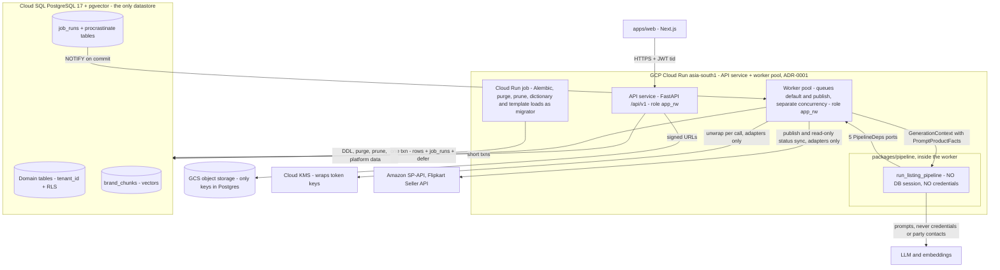

- **The AI package has no DB access** [Canon]. It gets a pushed `GenerationContext` and 5 `PipelineDeps` ports. The backend worker is the only writer of `agent_runs`.
- **Blobs never go in Postgres.** The only in-row secret is the envelope-encrypted `token_enc`; submission payloads and raw marketplace responses live in object storage, referenced by key and hash.
- **No transaction stays open across an LLM, KMS, storage or marketplace call.** Pattern: short read → release → work → one short write. The one exception by design is the write-ahead submission row, which is committed *before* the marketplace call (§5.3).

## 4. Tenant isolation in four layers

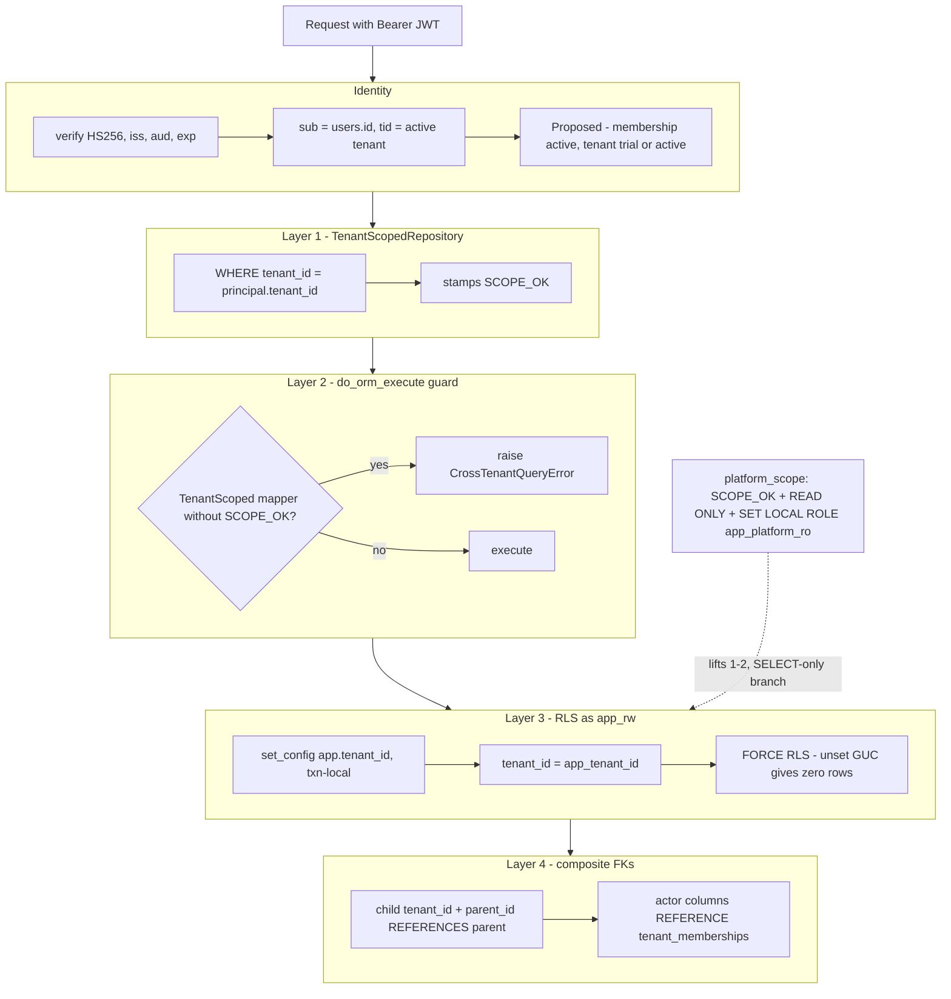

**Each layer catches a different bug.** The CI isolation job runs **as `app_rw`** and asserts `rolsuper = rolbypassrls = false` [Fix KI-B]. It proves each layer on its own: no repository filter → the guard raises; a hand-stamped `SCOPE_OK` → RLS returns 0 rows; a tenant-B approver on a tenant-A version → the FK rejects it. `tenant_id` sits on every tenant row, including the site's join-only tables (T59), because a policy can't enforce a join.

**GUC contract [Fix KI-B, KI-C].** Only `SELECT set_config(name, :value, true)` sets GUCs, because `SET LOCAL … = :tid` can't bind a parameter (KI-C). Helpers wrap reads in `nullif(…, '')`: pooled connections reset a setting to `''`, and the Canon's `current_setting(…)::uuid` would then raise instead of returning 0 rows.
- **Every transaction, not every session [Proposed].** A SQLAlchemy `after_begin` event re-applies `app.tenant_id` and `app.user_id` from `session.info`, because the worker uses several transactions per job.
- **No silent zero-row writes [Proposed].** A forgotten GUC makes RLS return 0 rows with no error, so state-changing repository UPDATEs (terminal write, status transition, approval, fact merge) assert `rowcount == 1`. Only the claim treats 0 rows as "drop" (§5.4).
- **Helper grants [Proposed].** 0000 revokes EXECUTE from PUBLIC by default and policy expressions run with the caller's privileges, so 0001 grants EXECUTE on the helpers, `fact_map_valid()` and `gtin_valid()` explicitly; `audit()` and its grant arrive with `0004_integrity` [S6].
- **Restorable CHECK helpers [Proposed].** Functions used in a CHECK or a GENERATED column (`fact_map_valid`, `gtin_valid`) are `LANGUAGE sql … BEGIN ATOMIC` bodies (PG14+, parsed at creation) with every reference schema-qualified, because `pg_restore` runs with `search_path = ''` and would otherwise fail on the first CHECK. The restore drill (§9) and a CI job do a `pg_dump` → `pg_restore` round trip.

```sql
CREATE FUNCTION app_tenant_id() RETURNS uuid LANGUAGE sql STABLE PARALLEL SAFE
  AS $$ SELECT nullif(current_setting('app.tenant_id', true), '')::uuid $$;
-- likewise app_user_id(), app_login_email(), app_job_id(), app_purge_tenant(), app_token_hash() (bytea)
GRANT EXECUTE ON FUNCTION app_tenant_id(), app_user_id(), app_login_email(), app_job_id(),
  app_token_hash(), fact_map_valid(jsonb, boolean), gtin_valid(text) TO app_rw, app_platform_ro, app_ro;
GRANT EXECUTE ON FUNCTION audit TO app_rw;   -- name is unique, so no argument list is needed
-- purge_tenant, redact_user, prune_* : no grant at all (migrator only, §8.1)
-- 0005 template, every tenant-owned table:
ALTER TABLE t ENABLE ROW LEVEL SECURITY;  ALTER TABLE t FORCE ROW LEVEL SECURITY;
CREATE POLICY t_tenant   ON t TO app_rw USING (tenant_id = (SELECT app_tenant_id()))
                                        WITH CHECK (tenant_id = (SELECT app_tenant_id()));
CREATE POLICY t_platform ON t FOR SELECT TO app_platform_ro, app_ro
                         USING (current_user IN ('app_platform_ro','app_ro'));
CREATE POLICY t_migrator ON t TO migrator USING (true) WITH CHECK (true);
```

**Platform reads [Fix KI-B "RLS vs platform_scope"]** use a role branch, not BYPASSRLS, which is host-dependent and would also bypass writes.
- `app_platform_ro` is NOLOGIN and SELECT-only, with no grant on secret or personal columns (§8.1). `app_rw` is a member of it `WITH INHERIT FALSE, SET TRUE`.
- `platform_scope()` (A§6) adds `SET TRANSACTION READ ONLY` and `SET LOCAL ROLE app_platform_ro`. The `current_user` guard keeps the branch shut for plain `app_rw`.
- Cross-tenant writes (seed, DLQ requeue, the reaper, the status-sync scheduler, backfills) read through `platform_scope`, then write per tenant with `set_config`. This **replaces the A§6 `readonly=False` carve-out** (§11.2 row 17).
- **Platform-global tables** (`category_templates`, `marketplace_error_map`, `attribute_definitions`, `attribute_columns`, `category_attributes`, `listing_status_transitions`) have no RLS, are SELECT-only for the app roles, and are written only by migrator-run `app.cli` commands in the Cloud Run job, audited with a NULL tenant. **`rules` is mixed** (platform rows with a NULL tenant, brand rows with one): it has RLS ENABLE + FORCE with its own policies (§5.2), and its platform rows follow the same write path.

**Limit.** RLS stops bugs, not a compromised `app_rw`, which can set its own GUCs. Secret handling, import-linter and CI greps cover that.

## 5. Domains

| § | Domain | Tables |
|---|---|---|
| 5.1 | Identity & tenancy | `tenants`, `users`, `tenant_memberships`, `invitations`, `refresh_tokens`, `audit_log` |
| 5.2 | Catalog, rules & templates | `products` (identity, family), `product_colourways`, `variant_matrix_cells`, `images`, `rules`, `category_templates`, `marketplace_error_map` |
| 5.3 | Listings, approval & publishing | `listings`, `listing_versions`, `review_decisions`, `validation_runs`, `batches`, `listing_items`, `listing_submissions`, `publish_field_results`, `listing_status_transitions` |
| 5.4 | Operations & execution | `job_runs`, `imports`/`import_rows`, `idempotency_keys`, `agent_runs`, `marketplace_accounts`, `oauth_states`, `performance`, `rate_limit_counters` |
| 5.5 | Brand voice vectors | `brand_documents`, `brand_chunks` |
| 5.6 | Product facts & compliance | `brand_profiles`, `business_parties`, the `products` fact columns, `attribute_definitions`, `attribute_columns`, `category_attributes` |
| 5.7 | Issues & human tasks | `listing_issues`, `human_tasks`, error taxonomy contracts |

### 5.1 Identity & tenancy

**Plain English.** Each brand is a **tenant**: one brand workspace with one voice and one legal business (T31); its business and compliance profile is a 1:1 `brand_profiles` row (§5.6). A person has **one global login** and a **membership** per brand carrying the role (`owner`, `operator`, `reviewer` or `admin`). The token names **one active brand**; switching brands issues a new token. v1 is **invite-only**. Important actions go to an **append-only audit log**. Brands can be suspended or offboarded, and are erased only by a controlled purge. **Auto-publish is reserved, and locked off in v1** (ADR-0008 proposed, T10).

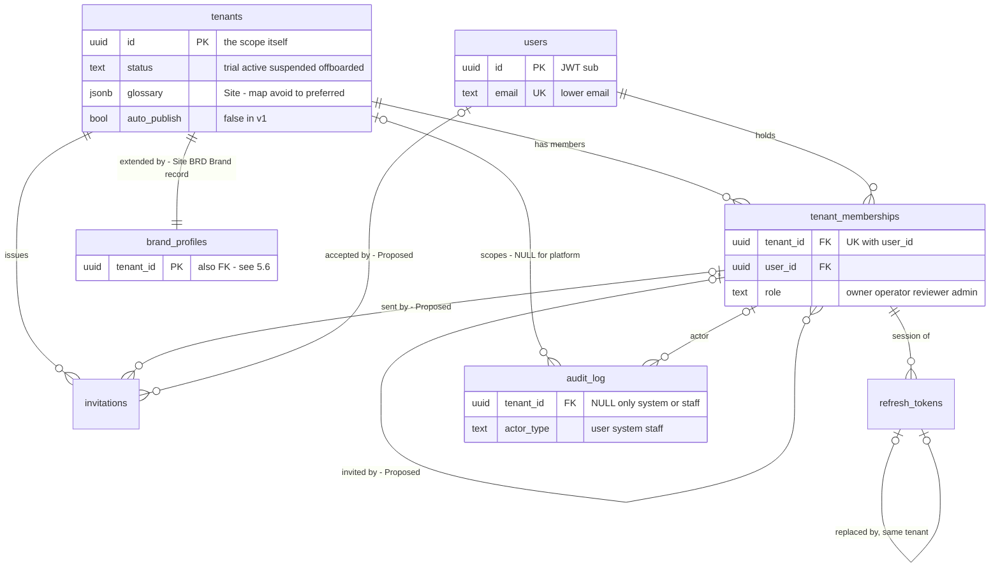

#### `tenants` — [Site] [87]/[88] + [Canon 0001/0002] + [Decided 2026-09-27] + [Proposed #6] + [Fix KI-B]
The root table: `id`, `created_at`, `updated_at`, and **no `tenant_id`** (its `id` is the scope). [87] "primary entity representing a brand".

| Column | Type | Tag | Notes |
|---|---|---|---|
| name / slug | text | Site / Canon A§5 | slug UNIQUE; Proposed CHECK `^[a-z0-9][a-z0-9-]{1,39}$` |
| tone | text? | Site | brand voice |
| guidelines / glossary | jsonb? | Site [88] + Fix | `CHECK (jsonb_typeof(guidelines) = 'array')` of rule strings / `CHECK (jsonb_typeof(glossary) = 'object')`, a map `{term_to_avoid: preferred_term}`, e.g. [61] `{"kurta outfit": "kurta set"}` (rev 1 had `[{term, preferred}]`; T38). The JSONB is the source of truth the Rules Engine checks; `brand_embed` derives the `glossary` chunks from it. [87]/[88] `embedding_refs` is not a column: it is `brand_chunks.tenant_id` (T64) |
| status | text | Decided | `trial\|active\|suspended\|offboarded`; no default |
| plan / trial_ends_at | text? / timestamptz? | Decided | plan vocabulary open; `trial_ends_at` required while `trial` |
| auto_publish | boolean | Decided, ADR-0008 proposed | DEFAULT false; `CHECK (auto_publish = false)` in v1 |
| llm_daily_budget_usd | numeric(10,2)? | Proposed #6 | overrides `LLM_TENANT_DAILY_BUDGET_USD` |
| offboarded_at, purge_after, data_purged_at | timestamptz? | Proposed #6 | `(status='offboarded') = (offboarded_at IS NOT NULL)` (§9) |

- **Privileges [Proposed].** `app_rw` has no DELETE and can UPDATE only `name`, `tone`, `guidelines`, `glossary`. Lifecycle columns change only through two migrator-owned SECURITY DEFINER functions, both audited, with a pinned `search_path` (§8.1): `set_tenant_lifecycle(p_tenant, …)` (EXECUTE for `app_rw`, staff via `app.cli`; asserts `p_tenant = app_tenant_id()`; revokes tokens on suspend) and the argument-free `expire_trials()` (periodic; only `trial → suspended` where `trial_ends_at < now()`).
- **RLS:** `id = app_tenant_id()`, plus a switcher SELECT via the caller's active membership.
- `GenerationContext.brand_profile` carries tone, guidelines, glossary and the prompt-safe `brand_profiles` fields (`brand_names`, `brand_owner_type`, `content_locale`).

#### `users` — [Decided, ADR-0006 proposed; provisional until T23] replaces the site's per-tenant users; [Fix KI-A login ambiguity]
One global identity. No `tenant_id`, no role.

| Column | Type | Tag | Notes |
|---|---|---|---|
| email | text | Site / ADR-0006 | `UNIQUE (lower(email))` (site: `UNIQUE (tenant_id, email)`) |
| hashed_password / auth_provider | text? | Site / Canon | argon2id, ORM `deferred()`, never granted to read-only roles; `auth_provider` NULL in v1 |
| is_active | boolean | Canon | global login switch |
| display_name / email_verified_at, last_login_at, erased_at | text? / timestamptz? | Proposed | `erased_at` = user erasure (§9) |

- **Credential CHECK:** Canon's `hashed_password OR auth_provider` becomes `… OR erased_at IS NOT NULL` [Proposed] (§11.2 row 16). Canon's `UNIQUE (tenant_id, lower(email))` and its anchor are removed.
- **RLS:** self (`id = app_user_id()`); login and signup on `lower(email) = app_login_email()`; teammates via membership. No DELETE for `app_rw`.

#### `tenant_memberships` — [Decided, ADR-0006 proposed; T23] new in 0001; roles [Site `users.role` L5890] [Canon A§5]
Every actor FK targets this table, so "the approver is in the same brand" is enforced by the schema. Std tenant + `updated_at`.

| Column | Type | Tag | Notes |
|---|---|---|---|
| user_id | uuid | ADR-0006 | → `users(id)` ON DELETE RESTRICT |
| role | text | Site / Canon A§5 | `owner\|operator\|reviewer\|admin` (the site's 4 values); one per membership, so `roles[]` has length 1 |
| is_active / deactivated_at | boolean / timestamptz? | ADR-0006 / Proposed | deactivate, never delete |
| invited_by_user_id / last_used_at | uuid? / timestamptz? | Proposed | → m (self) / default `tid` at login |

- **Keys:** `UNIQUE (tenant_id, user_id)` (the FK target); index on `(user_id) WHERE is_active`.
- **Last-owner trigger [Proposed]:** deferred; refuses to leave an active tenant with no active owner. It takes `pg_advisory_xact_lock(hashtext('owners:' || tenant_id))` before counting, so two owners demoting each other can't both commit (write skew); `SELECT … FOR UPDATE` on `tenants` would block every FK check against it.
- **RLS:** standard, plus own rows. These policies read GUCs only, so they never recurse.

#### `invitations` — [Decided, ADR-0006 proposed] new; placed in 0001 [Proposed]
The only way a membership is created in v1. Std tenant + `updated_at`. Reliable email delivery is open decision 18.

| Column | Type | Tag | Notes |
|---|---|---|---|
| email / role | text | Proposed / ADR-0006 | email lowercased and trimmed; one of the 4 roles |
| token_hash | bytea | ADR-0006 | sha256 of 32 random bytes; UNIQUE; the raw token exists only in the email |
| invited_by_user_id / expires_at | uuid? / timestamptz | Proposed / ADR-0006 | → m (NULL = staff); TTL is open decision 6 |
| accepted_at, accepted_user_id, revoked_at | timestamptz?, uuid? | Proposed | `accepted_user_id` → `users(id)`; accepted and revoked are exclusive |

- **Status is derived,** not stored. **One pending invite per email:** partial `UNIQUE (tenant_id, email)` while pending; re-inviting revokes the old row.
- **RLS:** standard, plus a SELECT on `token_hash = app_token_hash()` for the pre-login accept step.

#### `refresh_tokens` — [Canon 0003] + [Proposed, follows ADR-0006] membership FK + [Proposed] family
Std tenant.

| Column | Type | Tag | Notes |
|---|---|---|---|
| user_id | uuid | Canon / Proposed FK | `(tenant_id, user_id)` → m ON DELETE CASCADE (exception); mints only that `tid` |
| token_hash / expires_at / revoked_at | bytea / timestamptz / timestamptz? | Canon | sha256, UNIQUE; TTL 14 days |
| replaced_by / user_agent / ip | uuid? / text? / inet? | Canon | `(tenant_id, replaced_by)` → `refresh_tokens (tenant_id, id)` ON DELETE SET NULL (replaced_by), so rotation never links across tenants; a tenant switch starts a new family |
| family_id / revoked_reason | uuid / text? | Proposed | reuse revokes the family in one UPDATE; reason `rotated\|logout\|reuse_detected\|…_deactivated\|tenant_suspended\|password_changed` (no CHECK: `password_changed` is S16's) |

**RLS:** standard, plus a token-hash branch, plus own rows for "log out everywhere".

#### `audit_log` — [Site] [97] + [Canon 0002/0004] + [Fix KI-B ×2] + [Proposed] actor FK + [Proposed #6]
Not partitioned [Canon] (BUILD-SEQUENCE S7's monthly partitioning is superseded).

| Column | Type | Tag | Notes |
|---|---|---|---|
| id | uuid | Site | |
| tenant_id | uuid? | Fix KI-B | NULL only for platform events; FK **NO ACTION** (the Canon had CASCADE) |
| actor_type / actor_user_id / actor_email | text / uuid? / text? | Canon (site `actor` split, T65) / Proposed FK | `user\|system\|staff`; user → m (MATCH SIMPLE); email is a snapshot, required for staff, redactable |
| action, entity_type / entity_id | text / uuid? | Site [97] | e.g. `listing.approved`, `product.fact_updated` |
| before, after / request_id | jsonb? / text? | Site / Canon | changed fields only (rule below) |
| reason | text? | Site (BRD Audit Event, L929) | ≤ 1000; the human's stated reason (reject feedback, dismissal note, pause/archive reason, staff action note) or a system reason code; untrusted text, never a prompt input |
| job_id / ip | uuid? / inet? | Proposed | soft `job_id`; `ip` is personal data, redacted with the actor |
| occurred_at | timestamptz | Canon (site `timestamp`, T65) | |

- **Checks [Fix KI-B].** `tenant_id IS NOT NULL OR actor_type IN ('system','staff')`; a user actor needs `actor_user_id`, a staff actor needs `actor_email`.
- **What `before`/`after` may hold [Proposed, amended in rev 3].** `audit()` applies a **per-entity allow-list of non-personal columns**, not a blanket deny-list, because the BRD Audit Event needs old value, new value, actor and reason (L927-931) and the dashboard promises a "complete record of who/what modified any field" (L1268) [Site]. Allow-listed changes carry their old and new values: fact writes (`product.fact_updated`, `brand_profile.updated`: the changed keys' Fact envelopes, §5.6); listing `status`, `status_reason`, pause/archive; `rules.enabled`; membership `role` and `is_active`; tenant `name`, `tone`, `guidelines`, `glossary`; marketplace account `status` and the changed `settings` sections; template promotions; business-party `roles` and `source`. Every personal field (email, person or party name, phone, IP, party contact fields, addresses, GSTIN, human-task answers) stays **ids only**; an invitee is an `invitation_id`. So erasure only has to null `actor_email` and `ip` (§9). A test scans `audit_log.after` for `@` and for phone-shaped strings after the demo seed; a CI test checks every audited entity has an allow-list entry. **[S10] Built** as `audit_allowlist(entity_type) RETURNS text[]` (top-level keys of `before`/`after`; an unknown entity raises `GRD01`): `product` {`attributes`, `provenance`} (the changed keys' envelopes), `brand_profile` {`provenance`}, `listing` {`status`, `status_reason`, `paused_at`, `archived_at`}, `rules` {`enabled`}, `membership` {`role`, `is_active`}, `tenant` {`name`, `tone`, `guidelines`, `glossary`}, `marketplace_account` {`status`, `settings`}, `business_party` {`roles`, `source`}, `category_template` {`marketplace`, `category`}, `job_run` {`kind`, `status`, `parent_job_id`}, `image` {`slot`, `status`, `deleted_at`}, `listing_issue` {`status`, `resolution`}, `marketplace_error_map` {`enabled`}, `brand_document` {} and `user` {} (ids only; every `auth.*` event uses `user`). The code's one registry of audited entities is `app/repositories/audit.py::AUDITED_ENTITIES`, and each member must answer `audit_allowlist`.
- **Append-only [Canon 0004].** `REVOKE UPDATE, DELETE, TRUNCATE FROM app_rw` explicitly (default privileges grant them). A trigger raises unless `session_user = 'migrator'` and a matching purge/redact/prune GUC is set (§9); it checks `session_user` because inside a SECURITY DEFINER function `current_user` is always the owner.
- **Inserts** go through `audit()` without `RETURNING` (RETURNING must also pass the SELECT policy).
- **Indexes** on `tenant_id`: `(…, occurred_at DESC, id DESC)`, `(…, entity_type, entity_id, occurred_at DESC)`, `(…, actor_user_id, occurred_at DESC)`, plus `(occurred_at DESC) WHERE tenant_id IS NULL`.
- **RLS.** SELECT own tenant only. INSERT `WITH CHECK (tenant_id = app_tenant_id() OR tenant_id IS NULL)`, so failed logins still get logged. No UPDATE.

**Identity notes.**
- **JWT claims are unchanged** [Canon D6]: `{sub, tid, roles[], email, typ, jti, iss, aud, iat, exp}`, with `sub = users.id`. Login also returns `memberships[]`; `JWTClaims` goes into `mkos_schemas/auth.py` [Fix KI-B]. FastAPI issues the token (T7).
- **Login:** set `app.login_email` → verify argon2id → set `app.user_id` → list active memberships → pick the `tid` by `last_used_at`. Reusing a refresh token revokes its whole family.
- **Tenant switch** mints a new token pair and a new refresh family. It is the only **carve-out** from `docs/RULES.md` §3: the requested tenant is read from the request and validated against the caller's own active memberships (ADR + `docs/RULES.md` edit, §11.2 row 18).
- **Identity RLS branches** (login email, token hashes, `jr_by_id`, the tenant switcher) are named invariant-5 exceptions, each with its own isolation test (§11.2 row 19).
- **Per-request membership probe [Proposed]:** one index lookup. It rejects inactive members and suspended tenants, and RBAC uses the row's role instead of JWT roles that can be up to 30 min stale.
- **Staff** have no `users` row in v1. They act through `app.cli` as `actor_type='staff'`. Who may clear `blocked` and failed-publish listings and requeue DLQ rows (the KI-A ops role) is open decision 17.

### 5.2 Catalog, rules & templates

**Plain English.** **Products** hold the seller's facts, marketplace-neutral. **Apparel** is a style → colour → size family, and the **complete size × colour matrix** is stored, including combinations that don't exist, so no variant is ever invented (BRD §7). **Images** are object keys in fixed slots, optionally tied to a colour. **Category templates** are versioned copies of each marketplace's schema; **rules** are versioned policy rows, never code; the **error map** turns raw marketplace codes into our taxonomy. All three are data, so we can always show which rulebook and schema judged a listing.

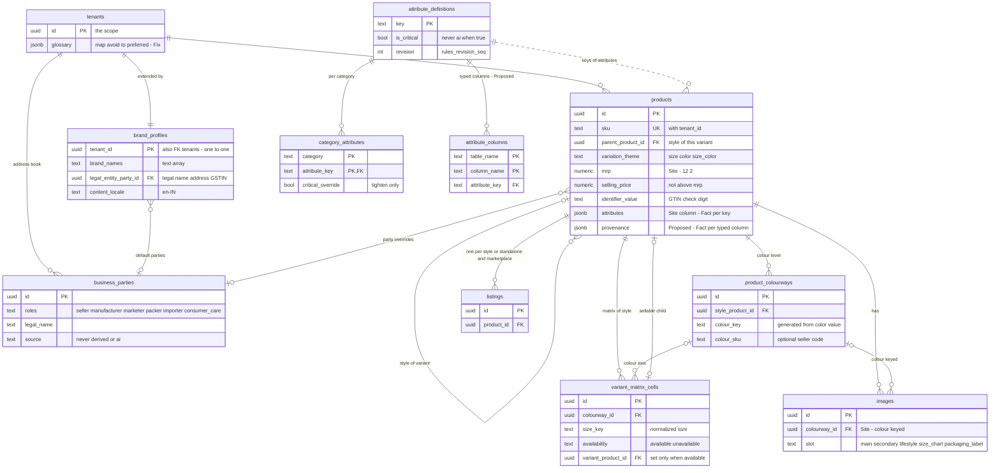

#### `products` — [Site] [06]/[85]/[89] + [Canon 0001] + [Decided, ADR-0007 proposed] family + [Proposed]
Std tenant + `updated_at`. One row per **style** (family parent), sellable **variant** (child) or **standalone** product. The fact columns (commercial, compliance, identifier, dimensions, `attributes`, `provenance`) are in §5.6.

| Column | Type | Tag | Notes |
|---|---|---|---|
| sku | text | Site / Canon | `CONSTRAINT products_tenant_sku_idx UNIQUE (tenant_id, sku)` (site `products_brand_sku_idx`, T58), full not partial; a re-import revives soft-deleted rows; stable, never changed (L637). [Proposed] `ck_products_sku CHECK (sku ~ '^[^]\s]{1,64}$')`, the charset `paths.py` can address in `variants[<sku>]`; marketplace SKU length limits: T72 |
| title | text | Site | NOT NULL, 1..500. The BRD `product_name`: the seller's factual name, not the marketplace title (VISION C4) |
| status | text | Site | DEFAULT `'draft'` ([06] L5916); Proposed vocabulary `draft\|active` (the product, not the listing); [104] returns `"created"` (L11328), so the vocabulary is T69 |
| category / deleted_at | text / timestamptz? | Canon | internal slug `^[a-z0-9_]{2,64}$`; soft delete |
| brand_name, style_number, sub_category, product_type, gender | text? | Site (BRD §6.1 L393-465; gender §6.2 L473-475 and §20 L1638) | style-level; `brand_name` ≤ 100 and ∈ `brand_profiles.brand_names` (case-insensitive, Identity gate; rev 1 `brand`); `style_number` ≤ 64; slugs `^[a-z0-9_]{2,64}$`; gender `men\|women\|unisex\|boys\|girls`. Taxonomy confidence = `provenance.category.confidence` (L781) |
| stock_ref | text? | Site (L873-875) | ≤ 128; a reference only, inventory is a non-goal |
| description | text? | Proposed | seller's source description, untrusted prompt data |
| source_image_urls | jsonb | Proposed (site `images`, T62) | raw seller URLs from import only; the `images` table is authoritative |
| parent_product_id | uuid? | ADR-0007 | → products (self, composite) = this variant's style; CSV `parent_style_id` (L1582; `parent_sku` alias) |
| variation_theme | text? | ADR-0007 + Proposed vocabulary | style only; `size\|color\|size_color`, neutral (adapters map) |
| size_run | text[]? | Proposed | style only, theme contains size: ordered normalized sizes (`{s,m,l,xl}`), 1..40, no NULLs, filled by the import in `size_system` order |
| variant_attributes / variant_key | jsonb / text? | ADR-0007 / Proposed | child: `{"size":"m","color":"jet black"}` = its matrix cell's axes; `variant_key` written by the guard (keys sorted, trimmed, lowercased), e.g. `color=jet black\|size=m` |
| created_by | uuid? | Proposed | → m |

- **Checks:** not its own parent; only styles carry a theme; `(parent_product_id IS NULL) = (variant_attributes = '{}')`; `ck_products_style_owned`: a child carries no `brand_name`, `style_number`, `sub_category`, `product_type` or `gender` (it inherits them). On import, a child value equal to the style's is dropped and a different one is an import error (L959), never a silent overwrite.
- **Where the colour fact lives:** a colourway row when the theme contains `color`; the style row for theme `size`; the product row for a standalone product.
- **Variant guard [Proposed, 0004]:** the parent is a live style in the same category, read `FOR SHARE` (a concurrent soft-delete or category change waits); one level deep; no deleting a style with live children; the child's `variant_attributes` keys equal the theme's axes; the guard writes `variant_key`; every live child is referenced by one available matrix cell (deferred check, below).
- **Indexes:** `(tenant_id, created_at DESC, id DESC) WHERE deleted_at IS NULL` (keyset); `(tenant_id, parent_product_id)`; [Proposed] `UNIQUE (tenant_id, parent_product_id, variant_key) WHERE parent_product_id IS NOT NULL AND deleted_at IS NULL`, so `M/Navy` and `m/navy` collide at import, not at the marketplace; [S6]: `tenant_id` leads, because `products.id` is global and a key without it would answer 23505 for another tenant's row before the composite FK answers 23503 (a unique check runs at index insertion, before the statement-end FK check, and RLS does not hide it).

#### `product_colourways` — [Site] BRD colour level (L609-627) + [Proposed] shape; 0001
Std tenant + `updated_at`; anchors `UNIQUE (tenant_id, id)` and [Proposed] `UNIQUE (id, style_product_id)` (the target of the same-style composite FKs on cells and images).

| Column | Type | Notes |
|---|---|---|
| style_product_id | uuid | → products ON DELETE RESTRICT, built `→ t` (`(tenant_id, style_product_id)`, S6); a live style whose theme contains `color` (guard, `FOR SHARE`) |
| attributes | jsonb | `CHECK (fact_map_valid(attributes, true) AND attributes ? 'color' AND jsonb_typeof(attributes->'color'->'value') = 'string')`: colour-level facts (`color`: seller name as value, colour family as normalized; `secondary_color`; colour overrides of pattern, print, fiber_composition). A JSON-null value fails the `jsonb_typeof` test |
| colour_key | text GENERATED STORED **NOT NULL** | `lower(btrim(attributes->'color'->>'value'))`, CHECK 1..64: the structural axis value; "Jet Black" and "Onyx" stay distinct even if both normalize to black. NOT NULL, so a missing value can't slip past `UNIQUE (tenant_id, style_product_id, colour_key)` |
| colour_sku | text? | the seller's colour code, e.g. `TSHIRT-001-BLK` (L615); never synthesized |
| position / deleted_at | smallint / timestamptz? | soft delete only |

- **Keys:** `UNIQUE (tenant_id, style_product_id, colour_key) WHERE deleted_at IS NULL` [S6]: `tenant_id` leads, because `products.id` is global and a key without it would answer 23505 for another tenant's row before the composite FK answers 23503 (a unique check runs at index insertion, before the statement-end FK check, and RLS does not hide it); `UNIQUE (tenant_id, colour_sku) WHERE colour_sku IS NOT NULL AND deleted_at IS NULL`; index `(tenant_id, style_product_id)`.
- Created only from seller input (import rows, form, PIM); the AI package has no DB session. Not a listing in v1: adapters use `colour_key`/`colour_sku` for Flipkart grouping and fan colour-keyed images out to each size child. Privileges: SELECT, INSERT, UPDATE.

#### `variant_matrix_cells` — [Site] complete size × colour matrix (L635-638, Variants gate L1406-1408) + [Proposed] shape; 0001
Std tenant + `updated_at`; anchor `UNIQUE (tenant_id, id)`.

| Column | Type | Notes |
|---|---|---|
| style_product_id / colourway_id | uuid / uuid? | → products (built `→ t`, S6) / → product_colourways, both RESTRICT; [Proposed] `(colourway_id, style_product_id) → product_colourways (id, style_product_id)` MATCH SIMPLE, so "the colourway belongs to this style" is a key, not a trigger check |
| size_key | text? | normalized size `^[a-z0-9][a-z0-9 ./+-]{0,31}$` (`s`, `xl`, `32`, `free`) |
| availability / variant_product_id | text / uuid? | `available\|unavailable`; the child → products (built `→ t`, S6), set iff available; `UNIQUE (tenant_id, variant_product_id)` [S6]: the same one cell per variant (`products.id` is global and the composite FK pins the tenant), and a cell in another tenant naming the variant fails at the FK (23503), never at the key (23505), which would reveal the row |
| unavailable_reason | text? | `not_produced\|discontinued\|not_provided`, set iff unavailable |
| source / evidence_ref | text / text? | `seller\|pim\|marketplace\|derived`; `derived` only for a `not_provided` gap, so an available cell (a sellable variant) is never derived |

- **Keys:** `vmc_cell_uq UNIQUE NULLS NOT DISTINCT (tenant_id, style_product_id, colourway_id, size_key)` (PG15+) [S6]: `tenant_id` leads, because `products.id` is global and a key without it would answer 23505 for another tenant's row before the composite FK answers 23503 (a unique check runs at index insertion, before the statement-end FK check, and RLS does not hide it); CHECK at least one axis; index `(tenant_id, style_product_id)`.
- **`variant_matrix_guard` [0004]:** the style is live with a theme (`FOR SHARE`); the colourway belongs to it (now enforced by the composite FK above); axes follow the theme (`size_color` both, `size` only `size_key`, `color` only `colourway_id`); `size_key ∈ size_run` when set; an available cell's child has `parent_product_id = style_product_id`, `variant_attributes = jsonb_strip_nulls(jsonb_build_object('size', size_key, 'color', colour_key))` and `attributes.size.normalized = size_key`, else `VAR01`. A DEFERRABLE INITIALLY DEFERRED constraint trigger on `products` checks at commit that every live child is in exactly one available cell, and that soft-deleting a child flipped its cell to `unavailable/discontinued` in the same transaction (`VAR02`).
- **Import rule (T17):** available cells from seller rows, then one `unavailable/not_provided` cell (`source='derived'`, `evidence_ref 'import:<id>'`) per missing colour × size, so the matrix is complete after every import. The ref is a soft pointer that may dangle once the import is pruned (90 days, §9): `derived` + `not_provided` is self-explanatory. Privileges: no DELETE (availability changes instead).

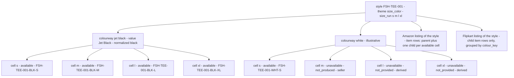

#### `images` — [Site] [06]/[99] + [Canon 0002] + [Proposed] ingest fields
Std tenant + `updated_at`. URLs are signed at read time; the site's `s3_url` ([99]) is not stored (T63).

| Column | Type | Tag | Notes |
|---|---|---|---|
| product_id / storage_key | uuid / text | Site [06] | → products; object key, never a URL. Key shape (S17b D1, spec L10193, T109): `<tenant_id>/<product_id>/images/<image_id>` (lowercase canonical UUIDs, no extension), checked by exact parse before any read |
| colourway_id | uuid? | Site (L663-667) | → product_colourways RESTRICT; [Proposed] `(colourway_id, product_id) → product_colourways (id, style_product_id)` MATCH SIMPLE, so `product_id` = the colourway's style is a key; guard: `slot='size_chart'` only on a style or standalone row |
| slot | text | Site [99] + Canon + Proposed | `main\|secondary\|lifestyle\|size_chart\|packaging_label` (size_chart and packaging_label: T28), **no default**. `packaging_label` [Site L681-685 "use for compliance evidence"] is **never publishable**: it can back a Fact (`image:<id>`), `ImageRef` refuses it in `CanonicalListing.images`, and every adapter maps only the slots in its own publishable map and refuses any other slot (test). Detail, back and side shots are publishable additional images (L657-659, L675-679) and use `secondary` |
| status | text | Site [06] + Fix | `pending\|uploaded\|failed` DEFAULT `'uploaded'` (rev 1 `stored`); `pending` = URL import not fetched yet |
| metadata | jsonb | Site [06] | NOT NULL DEFAULT `'{}'`, object; untyped extras only (original_filename, seller_ref, EXIF subset); never URLs or secrets |
| compliance_status / image_report_json | text / jsonb | Site [99] + Proposed | `pending\|passed\|failed` DEFAULT pending = worst-of rollup across marketplaces, written in the same UPDATE as the report; report = object keyed `amazon`/`flipkart` (`CHECK ((image_report_json - ARRAY['amazon','flipkart']) = '{}')`), each the latest ImageReport. Per-version evidence stays in `listing_versions.image_reports_json` (G12 alternative: T63) |
| deleted_at | timestamptz? | Canon | |
| position, source_url?, content_hash?, mime_type?, width_px?, height_px?, bytes? | mixed | Proposed | typed columns are authoritative over `metadata`; `source_url` makes re-imports idempotent |

**Indexes:** `(product_id) WHERE deleted_at IS NULL`; `(tenant_id, status)`; `(tenant_id, colourway_id) WHERE colourway_id IS NOT NULL`; [Fix] `images_one_main UNIQUE (product_id, colourway_id) NULLS NOT DISTINCT WHERE slot='main' AND deleted_at IS NULL` (rev 1's `UNIQUE (product_id)` allowed a 3-colour style only one main image); [Proposed] `UNIQUE (tenant_id, storage_key)`, so two rows never own one object. Finer publishable roles (detail vs back vs side as distinct values) stay G12 (open decision 25).

#### `rules` — [Site] [06]/[70]/[93] + [Canon A§4] + [Fix KI-B key, versions] + [Proposed #4]
Created in 0002 together with `CREATE SEQUENCE rules_revision_seq AS integer` (shared with the dictionary, §5.6).

| Column | Type | Tag | Notes |
|---|---|---|---|
| tenant_id | uuid? | Site ERD [84]/[86] + [62] | NULL = platform; set = a brand compliance rule (v1: 2 types, T48); FK now **CASCADE** (A§4 had NO ACTION) so the purge stays one DELETE; a composite `(tenant_id, rule_id)` FK can't reach a platform row (NULL tenant), so `listing_issues.rule_id` is a documented plain-FK exception whose guard checks "platform rule or same tenant" (§5.7) |
| marketplace / category | text / text? | Site | category slug; NULL = all categories |
| field | text | Site [06] | `paths.py` path, `'*'`, `'content.bullets[*]'`, or `'images'` (image rules only: `rules_images_field`) |
| rule_type / subject / pack | text | Fix KI-B + Proposed #4 | promoted from `rule_def`, each tied by a CHECK: `rules_type_matches` (`rule_type IS NOT DISTINCT FROM rule_def->>'type'`), `rules_subject_matches` (attribute, claim, name or `slot:check` per type, COALESCE `''`; subject `^[a-z0-9_:*]{0,96}$`), `rules_pack_matches` (DEFAULT `core`) |
| severity / version / enabled | text / int / boolean | Site / Site / Canon | `error\|warning` DEFAULT error; version ≥ 1 DEFAULT 1 |
| revision | int | Fix KI-B | `nextval('rules_revision_seq')`, bumped on every UPDATE |
| rule_def | jsonb | Site | a RuleDef (14 types, below) |

- **Key [Fix].** `rules_scope_key UNIQUE (marketplace, COALESCE(category,''), field, rule_type, subject, pack, version, COALESCE(tenant_id, zero-uuid))`. Rev 1's expression key read `rule_def->>'attribute'`, so two image rules (slot + check) or two claim rules on one attribute collided; a plain `=` against a missing JSON key yields NULL and passes a CHECK, hence `IS NOT DISTINCT FROM`/`COALESCE`.
- **Brand-rule CHECKs [Proposed].** `rules_tenant_types`: tenant rows only `banned_terms` and `claim_requires_attribute`; `rules_platform_only_regex`: tenant rows have no `pattern` and no `banned_terms match='regex'` (ReDoS); `rules_platform_cited`: platform rows carry a `policy_ref` object.
- **Indexes:** `(marketplace, category) WHERE enabled`; `rules_tenant_idx (tenant_id, marketplace) WHERE tenant_id IS NOT NULL` (the [101] tenant index).
- **Guard.** Only `enabled` may change; each UPDATE bumps `revision`; new content = a new version row; DELETE only under the purge GUC.
- **Resolution [Fix KI-B, backend `RuleSetResolver`, pure Python].** Fetch rows for `(marketplace, category OR NULL, tenant OR NULL)`; group by shadow key `(tenant_id, field, rule_type, subject, pack)`; in each group use the category rows if any is enabled, else the `category IS NULL` rows; the highest enabled version wins; none enabled = rule off. So disabling the newest version rolls back to the previous one. Tenant rows never shadow platform rows (the tenant is in the key): both run and any failure fails, so brand rules only tighten (invariant 2). `rules_version = max(revision)` over **every** fetched row, disabled ones included, plus **all** `attribute_definitions` rows (a global criticality flip on a key not listed for the category must still move it) and the `category_attributes` rows for the category (§5.6). T55.
- **Privileges and RLS.** Platform rows: migrator-only, via `app.cli rules import <object>` run as a Cloud Run job against a versioned rules pack in object storage: a job run, not an image deploy ([93] "no deployment", T29). Brand rows [Site [62], T48]: `app_rw` gets column INSERT and `UPDATE (enabled)`, plus `GRANT USAGE ON SEQUENCE rules_revision_seq TO app_rw` (the INSERT default and the toggle's revision bump call `nextval`). `rules` has **ENABLE + FORCE RLS** with five policies: `rules_read FOR SELECT TO app_rw USING (tenant_id IS NULL OR tenant_id = app_tenant_id())`, `rules_write FOR INSERT TO app_rw WITH CHECK (tenant_id = app_tenant_id())`, `rules_toggle FOR UPDATE TO app_rw USING/WITH CHECK (tenant_id = app_tenant_id())`, `t_platform` (SELECT for `app_ro`, `app_platform_ro`) and `t_migrator` (the platform import and the purge). Owner-only `POST /api/v1/brand/rules` writes one row per marketplace, pack forced to `brand`, audited; the same text is still chunked into `brand_chunks` type `compliance`.

**RuleDef (`mkos_schemas/rules.py`, MINOR before schemas-v1.0.0; three leads).** All extend `_RuleBase {message, suggestion?, error_code, pack='core', policy_ref?, error_class?, retry_class?}`; `PolicyRef {source: amazon_policy|flipkart_policy|legal_metrology|platform|brand, title, url?, section?, retrieved_on?}`. Message placeholders documented: `{value} {limit} {term} {attribute} {allowed_values} {slot} {threshold}` (closes KI-C).

| Type | Tag | Shape (error_code) |
|---|---|---|
| `max_length`, `min_length`, `banned_terms`, `required_attribute`, `max_items` | Canon | unchanged; `required_attribute.allowed_values` kept for compatibility |
| `min_items` | Site [42] | `limit` (FIELD_TOO_SHORT); e.g. Amazon bullets min 5, warning |
| `allowed_values` | Site L1005, [40] | `attribute`, `source inline\|template`, `values` iff inline, `normalize casefold_trim` (VALUE_NOT_ALLOWED); `template` passes when the canonical value is in the template spec's allowed values or `value_map` keys |
| `conditional_required` | Site L221, L1524 | `attribute`, `when: Condition[1..4]` AND; `Condition {path, op eq\|ne\|in\|not_in\|present\|absent, value?, values?}`; paths: listing, `product.<fact>`, `account.<settings path>` (MISSING_ATTRIBUTE) |
| `cross_field` | Site L1005, L1424 | `name`, `left`, `op lte\|lt\|eq\|ne\|gte\|gt\|contains_value_of\|not_contains_value_of`, `right` (CROSS_FIELD_MISMATCH); e.g. `price_lte_mrp` |
| `claim_requires_attribute` | Site [62], L765 | `claim`, `terms[1..50]`, `match word\|substring`, `requires {attribute, any_of?}` (UNSUPPORTED_CLAIM); e.g. `organic` → certifications any_of `gots`; pack `golden_rule` |
| `image_requirement` | Site [44]-[51] | `slot main\|secondary\|lifestyle\|size_chart\|any`, `check min_resolution\|recommended_resolution\|aspect_ratio\|background\|fill_ratio\|text_overlay\|watermark\|logo\|format\|max_bytes`, `params`, `issue_code` (IMAGE_NON_COMPLIANT); one row per threshold |
| `pattern` | Proposed #4 | `name`, `regex` ≤ 256 in RE2 (google-re2, linear time), `must match\|not_match`, `flags ['i']` (PATTERN_MISMATCH); platform-only |
| `fact_source` | Site L941 | `attribute: key\|'*critical'`, `forbidden_sources`, `min_confidence?`, `require_confirmation_if_agent_captured` over ProductFacts (CRITICAL_FACT_MISSING, FACT_SOURCE_FORBIDDEN, FACT_NEEDS_CONFIRMATION); field `'*'` |
| `fact_backed_attribute` | Site L763-765, [23] | `attribute: key\|'*critical'`, `compare normalized`: a listing attribute that differs from, or is absent in, the facts (FACT_MISMATCH) |

- **Image seed** ([46]-[51], plan L5184-5186): Amazon main min 1000 px error, 1:1, pure white, fill 0.85 warning, text prohibited; Flipkart main min 500 error + recommended 1000 warning, 1:1 or 3:4, white or light, text **restricted = warning** (T52); watermark prohibited and logo product-only on both; formats jpeg/png/tiff; ≤ 10 MB. The backend evaluates Pillow checks and the vision model's structured findings against these rows ([47] L10007); the vision agent holds no thresholds.
- **Template checks** are derived from `category_templates` (below), not stored as rows: required/conditional → MISSING_ATTRIBUTE; enum not mappable → VALUE_NOT_ALLOWED (dedupe suffix `template:<key>`, `rule_id` NULL); unsupported → dropped by the adapter.
- `GenerationContext` carries the pinned RuleSet and template; `PipelineDeps.validate_rules(listing)` keeps its frozen signature, and the backend implementation closes over the RuleSet, template, ProductFacts and account settings (G9, open decision 26).

#### `category_templates` — [Site] BRD Marketplace Schema record (L855-859) + [71] category mapping (L10621) + [Canon 0003] + [Fix KI-C] + [Proposed]
**Platform-global:** no `tenant_id`, no RLS, SELECT-only for app roles. It is also the site's [71] "mapping table: internal category → Amazon browse node → Flipkart category ID": the current row per `(marketplace, category)` gives `external_category_id` and `product_type`. The marketplace category is therefore a function of the product's internal category, with no per-product override or marketplace-side confidence in v1 (T68); the classification confidence is `provenance.category.confidence`, and each version pins the template it used (`listing_versions.category_template_id`).

| Column | Type | Tag | Notes |
|---|---|---|---|
| marketplace / category | text | Canon | internal slug |
| version / is_current | int / boolean | Site ("current + historical", L2215, L2253) | `ct_version_key UNIQUE (marketplace, category, version)`; `ct_one_current UNIQUE (marketplace, category) WHERE is_current` |
| product_type / external_category_id | text / text? | Site (PTD type or Flipkart vertical) / Canon | external id is adapter-only |
| source / source_version / source_digest / raw_schema_key | text / text? / bytea? / text? | Proposed | `ptd\|fk_vertical\|manual`; digest sha256 (refresh skips unchanged); key `^platform/templates/…`, never a URL; `ct_fetched` (non-manual ⇒ fetched_at + digest) |
| fetched_at | timestamptz? | Site ("last updated") | |
| attributes | jsonb | Canon + Site | must hold `required_attributes`, `optional_attributes`, `specs`; also `conditional_attributes`, `unsupported_attributes`, `variation_themes` (ADR-0007) |

- **`specs`** = `{<canonical key>: AttributeSpec}`, `AttributeSpec {requirement required|conditional|optional|unsupported, marketplace_field (adapter-only), value_type text|enum|number|boolean|measurement, allowed_values?, value_map {normalized canonical → marketplace value} (adapter-only), max_length?, unit?, when: Condition[]}`. Keys are **canonical** (the §5.6 dictionary; a CI test checks each exists), never marketplace field names. Site BRD L2153 "required, conditional, optional, unsupported".
- **`CategoryTemplate`** wire model (MINOR, three leads, §11.2 row 23) + `for_generation()`, which strips `marketplace_field` and `value_map` so the AI emits canonical values only; adapters apply `value_map` (inv. 4, T49).
- **Guard [0004]:** content immutable, only `is_current` changes, no DELETE (validation runs pin rows forever). Promotion = two ordered UPDATEs in one transaction (a partial unique index can't be deferred). Writes: migrator `app.cli templates load|refresh|promote`, audited with a NULL tenant; refresh policy is T53.
- **Seed [Fix KI-C; apparel per the BRD scope]:** `tshirts` (the BRD §21 walkthrough product, L2092-2144, and a `category_attributes` group) and `ethnic_wear_kurta_sets` (the site's own example, L8380, L9647), for both marketplaces, `source='manual'`, version 1, current. Rev 2's `home_decor_lamps` is dropped: no site page mentions it and the BRD scope is apparel. Q7 still names the launch pair; until then these two are the seed. **[S20] Amazon mappings:** `seed` (through `app.cli platform load`) adds Amazon `ethnic_wear_kurta_sets` **version 2** (product type `KURTA`, `marketplace_field` and `value_map` per spec, the three variation themes) and promotes it with the two ordered UPDATEs after the demo listing is written, so KURTA-001 stays pinned to version 1; Amazon `tshirts` (`SHIRT`) is version 1, current. Version 1 rows carry no `marketplace_field`, so the adapter reads them as unmapped (CATEGORY_NOT_MAPPED). `home_decor_lamps` stays unmapped. Field names and values are believed until DW1/DW2 (sandbox, PTD). **[S22] Flipkart mappings:** the same path adds Flipkart `ethnic_wear_kurta_sets` **version 2** (vertical `kurta`, `marketplace_field` per spec, e.g. `color` → `Colour` with `navy blue` → `Navy Blue`, the three variation themes), promoted the same way, and Flipkart `tshirts` (`t_shirt`) version 1, current; Flipkart names are believed until DW1/DW2 (T127). The demo seed pins acme's Flipkart KURTA-001 and KURTA-FAM-01 listings to it. Without them every CSV row fails with `CATEGORY_NOT_MAPPED`. Replaces rev 1's `version, enabled, UNIQUE … WHERE enabled`.

#### `marketplace_error_map` — [Site] BRD error library (L2257-2259, L1270-1342), [73] + [Proposed] shape; 0003
Platform-global like `rules`; SELECT-only for app roles; written by migrator `app.cli errors load`. Seeds come from sandbox and observed responses, never invented; unknown codes are harvested from `li_unknown_codes` (§5.7).

| Column | Type | Notes |
|---|---|---|
| marketplace / match_on / raw_value / version | text / text / text / int | `match_on code\|category` (SP-API issue categories: verify, open decision 27); `mem_key UNIQUE (marketplace, match_on, raw_value, version)` |
| error_code / error_class / retry_class / severity | text | a codes.py member (CI test); one of the 10 classes (`unknown` = no row); `auto_retry\|ai_correct\|user_action\|system_failure`; error\|warning |
| auto_fixable / fix_action / field_hint | bool / text? / text? | `mem_fix` CHECK [S8]: `(auto_fixable AND fix_action IS NOT NULL) OR (NOT auto_fixable AND fix_action IS NULL)`, plus `mem_fix_action` CHECK `fix_action IS NULL OR fix_action IN` the 4 FixAction values; field_hint = a paths.py path when the raw error names no attribute |
| plain_text / seller_action / policy_ref | text / text? / jsonb? | plain language ≤ 500 with `{value} {field} {marketplace}` (L1065, L1342); "exact remaining action" (L1354) |
| enabled | bool | the only mutable column; no DELETE |

Lookup: code, then category, highest enabled version (index `(marketplace, match_on, raw_value, version DESC) WHERE enabled`). No row → class `unknown`, `MARKETPLACE_UNKNOWN_ERROR`, `user_action`: stop unsafe automation, show the raw message plus a plain summary, open a `marketplace_error_review` task (L1338-1342). An auto-fixable row tries its `fix_action` once, then `retry_class` applies. Plain text is templated, no LLM in v1 (T54).

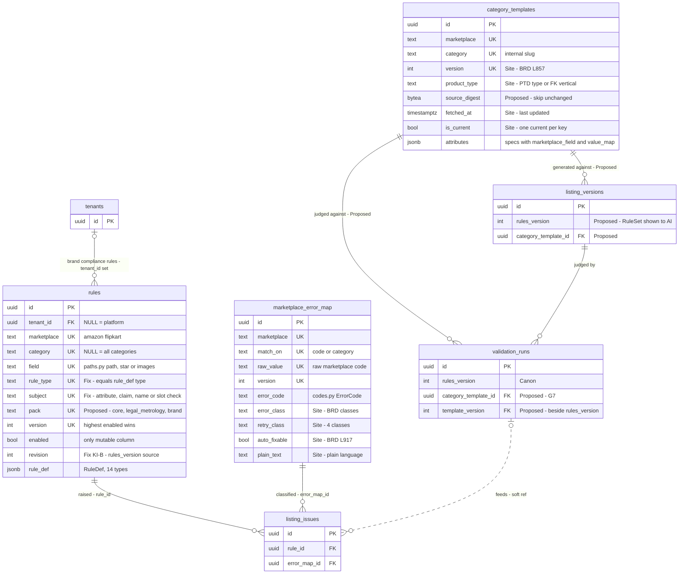

### 5.3 Listings, approval & publishing

**Plain English.** **One listing per style (or standalone product) per marketplace**; each sellable SKU is a **listing item** with its own marketplace state (T45). **Every text change is a new, frozen version**, so we can always show exactly what was approved. **9 fixed statuses** [Site L5937]; the BRD's 14 names are a display projection over them plus four orthogonal columns (§6.3, T12). The AI self-corrects at most 3 times, then the listing is `blocked` for a human. **Self-approval is refused three times:** in the API, by a CHECK and by a trigger. Every submission is a **write-ahead ledger row** committed before the marketplace call, at most 3 per approved version, and a retry needs a reason the BRD accepts (L1358). `published` means **the marketplace accepted it**; **LIVE** comes only from the marketplace's confirmation (T13).

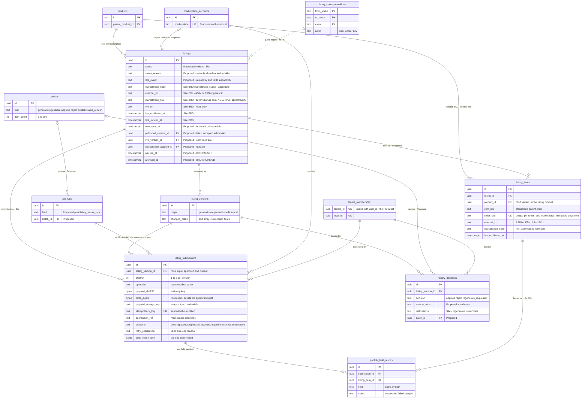

#### `listings` — [Site] [06]/[85]/[91] + BRD Listing record (L903-907) + [Canon 0002] + [Proposed]
Std tenant + `updated_at` (tenant_id is on the row though the site DDL has none: T59). All new columns are nullable or constant-default (expand-safe).

| Column | Type | Tag | Notes |
|---|---|---|---|
| product_id / marketplace | uuid / text | Site | → products: a style or standalone product (the guard refuses a variant child under the family grain, T45); `UNIQUE (product_id, marketplace)` [Canon]; **`UNIQUE (id, marketplace)`** [Proposed, now unconditional] = the `→ l/mkt` target |
| status | text | Site | DEFAULT `created`; `created\|generating\|validated\|needs_review\|approved\|publishing\|published\|blocked\|failed` |
| status_reason | text? | Proposed | `ck_status_reason`: blocked ⇒ `corrections_exhausted\|validation_errors\|rejected\|human_task_open\|marketplace_action_required\|publish_attempts_exhausted`; failed ⇒ `generation_failed\|publish_failed\|publish_partial\|marketplace_rejected`; otherwise NULL |
| last_event / last_event_at | text / timestamptz | Proposed | NOT NULL DEFAULT `create` / `now()`; one of 30 events (§6.1), the key into `listing_status_transitions` and the BRD "Last activity" (L1251-1253); stamped by the guard |
| category / status_changed_at | text / timestamptz | Proposed | RuleSet key snapshot / stamped by the guard |
| current_version_id / approved_version_id | uuid? | Proposed | → lv **DEFERRABLE INITIALLY IMMEDIATE** (the purge defers them, §9); approval clears when current changes |
| published_version_id / live_version_id | uuid? | Proposed | latest **accepted** submission's version / version last confirmed live on ≥ 1 SKU; same deferrable FK. Derived: *live with a draft* = `live_version_id IS NOT NULL AND live_version_id <> current_version_id` |
| first_published_at / last_published_at | timestamptz? | Proposed | first / latest accepted submission; `last ≥ first` |
| external_id | text? | Site ([06] L5938, [85], [91]) | standalone ASIN/FSN/LID or the Amazon parent ASIN; NULL for a Flipkart family; written only from a ListingResult or a sync snapshot (retagged from Proposed #1) |
| marketplace_sku | text? | Site (L905) | seller SKU as sent (standalone or Amazon family parent); **NULL for a Flipkart family**, which sends no parent row (T45); immutable once `first_published_at` is set. The per-SKU mapping is `listing_items.seller_sku` |
| marketplace_state / marketplace_state_changed_at | text / timestamptz? | Site (BRD `marketplace_status`) | DEFAULT `not_submitted`; `not_submitted\|processing\|pending_review\|live\|partially_live\|inactive\|rejected\|removed`; aggregate of the non-parent items, same transaction: all live → live; ≥ 1 live → partially_live; else first of processing, pending_review, rejected, inactive; all removed → removed; else not_submitted. `processing` = BRD PROCESSING (L1147), labelled "Submitted" |
| live_url | text? | Site | `^https://`, ≤ 2048; built by the adapter, never user input |
| live_confirmed_at / last_synced_at | timestamptz? | Site (L1085) | first confirmation of `live_version_id` / last **successful** marketplace read |
| next_sync_at / sync_poll_count | timestamptz? / smallint | Proposed | bounded status sync (below); count 0..9 |
| marketplace_account_id | uuid? | Proposed (site ER mandatory: T44) | `(tenant_id, col)` → marketplace_accounts and `(col, marketplace)` → `marketplace_accounts (id, marketplace)`; set at the first submission; re-pointed only to the tenant's active account for the same marketplace. **[Audit fix 2026-10-10]** the re-point happens when a connect creates a new account for the marketplace (`marketplaces.confirm`): every listing pinned to one of the tenant's revoked accounts for it **with the same `seller_id`** moves to the new one, so a listing published before a revoke + reconnect publishes again; a connect of a different seller adopts nothing (the old seller's SKUs stay on its revoked account, unsynced and unpublishable). No backfill: a listing stranded by a revoke + reconnect made before this fix stays on its revoked account until the next revoke + connect of that seller (KNOWN-ISSUES §E) |
| paused_at, paused_by_user_id / archived_at, archived_by_user_id | timestamptz?, uuid? | Proposed (BRD PAUSED/ARCHIVED L1183-1193, T43) | → m (NULL = system); exclusive; by-user ⇒ at; neither while `generating`/`publishing` (409 LISTING_BUSY) |

- **Checks.** `ck_published`: `published` ⇒ `published_version_id`, `first_published_at` and `marketplace_state IN (processing, pending_review, live, partially_live)`. **`ck_live_minimum` [Site L1081-1087]:** `marketplace_state IN (live, partially_live)` ⇒ `live_version_id`, `live_confirmed_at` and `last_synced_at` are set. "Seller SKU mapped; variant status captured; marketplace ID captured" is per SKU, so it lives in the item twin `ck_item_live_minimum` (`seller_sku` NOT NULL, `external_id`); rev 2 also required `listings.marketplace_sku`, which made LIVE unreachable for a Flipkart family. Together they are BRD step 13 literally (ADD as NOT VALID + VALIDATE once data exists; free now).
- **Sync mapping onto `published` [Proposed].** The sync writes the new `marketplace_state` and the event in the same UPDATE, so `ck_published` always holds: aggregate `rejected` → `marketplace_rejected` (published → failed); aggregate `inactive` or `removed` (e.g. Amazon search suppression, delisting) → `marketplace_action_required` (published → blocked); an item not yet visible stays `processing` until `sync_exhausted`, so a published listing never aggregates to `not_submitted`. The display golden test (§6.3) covers every `(status, marketplace_state)` pair the CHECKs allow.
- **Guard `listings_status_guard` [Proposed, 0004]:** table-driven (§6.1). Also: the listing's product is not a variant child; `marketplace_sku` and `external_id`, once set, change only with `app_job_id()` set; while paused or archived no status changes (`LST02` → 409 LISTING_PAUSED / LISTING_ARCHIVED). It keeps the invariant-1/3 backstops: `approved`/`publishing` need `approved_version_id = current_version_id` carrying a human approval, and the tenant `trial`/`active`.
- **Indexes:** [Canon] `(tenant_id, status, marketplace)`; review queue `(tenant_id, status_changed_at, id) WHERE status IN ('validated','needs_review') AND paused_at IS NULL AND archived_at IS NULL`; human-action tab `(tenant_id, status_reason, status_changed_at DESC) WHERE status IN ('blocked','failed')`; dashboard `(tenant_id, marketplace, marketplace_state)`; last activity `(tenant_id, last_event_at DESC, id DESC)`; `(tenant_id, marketplace, external_id) WHERE external_id IS NOT NULL`; `ix_listings_sync_due (next_sync_at) WHERE next_sync_at IS NOT NULL AND paused_at IS NULL AND archived_at IS NULL`; ops queue `(status, status_changed_at) WHERE status IN ('blocked','failed','publishing')`.

**Pause and archive [Proposed, T43].** Workflow-only overlays: they freeze status changes, and the generate/publish job gates and the sync scheduler skip the listing; the marketplace listing is untouched (deactivation is Phase 2). pause/unpause: owner or operator; the system pauses on account revoke or tenant suspend (**not built in v1**, KNOWN-ISSUES §E: a revoke pauses nothing; the publish request refuses a listing on a non-active account with 409 AUTH_EXPIRED, and the status sync skips it, below). archive/unarchive: owner; soft-deleting a product archives its listings. Every change is audited; unpause/unarchive of a submitted listing sets `next_sync_at = now()`.

**Bounded status sync [Proposed, T18; Site L1051-1057].** After each accepted submission (`sync_poll_count` reset to 0), polls at +2 m, +10 m, +30 m, +1 h, +3 h, +6 h, +12 h, +24 h, +72 h. Only polls while `processing`/`pending_review` count; a dead-lettered sync job counts. After the 9th with no terminal state: event `sync_exhausted` (published → blocked, `marketplace_action_required`), `next_sync_at = NULL`, and **in the same transaction the open submission moves `accepted → error`** with `error_code MARKETPLACE_UNCONFIRMED` (retryable), so `ux_ls_open` is released and `resume_publish` can insert the next attempt under `retryable_condition` (§5.3 `ls_guard`). Live or partially live: a daily reconciliation poll, uncounted. `POST …/refresh-status` resets the schedule (1 per 5 min per listing). Never scheduled while paused, archived, `publishing`, or the tenant is not `trial`/`active`; **[Audit fix 2026-10-10]** nor while the listing's account is not `active` (revoked or `needs_reconnect`): the slot stays due, a sync job that finds such an account skips it and puts the slot back, and an auth refusal when the reader opens fails the job with AUTH_EXPIRED (never INTERNAL_ERROR). A procrastinate periodic task `schedule_status_sync` (every minute) scans `ix_listings_sync_due` via `platform_scope` and enqueues per tenant; **the enqueue transaction sets `next_sync_at = NULL`** (the job sets the next slot), so a slow job is never enqueued twice. **Write economy [Proposed]:** a sync that changes no state writes only `last_synced_at`, `next_sync_at` and `sync_poll_count`; `last_event`/`last_event_at` are stamped (event `sync`) only when a marketplace state changes, which keeps the daily reconciliation off the last-activity index. Moving the schedule columns to a narrow 1:1 table is a stage-2 option (§10) if HOT-update loss shows up. Sync uses only `get_listing` (read-only, below). Webhooks are later (SP-API notifications need AWS SQS/EventBridge: verify, open decision 27). **[S21]** The slots are stored as gaps from the previous poll (`next_sync_at = now() + gap[sync_poll_count]`, gaps 2 m, 8 m, 20 m, 30 m, 2 h, 3 h, 6 h, 12 h, 48 h: the schedule above, cumulative). D7: a `failed/publish_partial` listing whose latest submission is `partially_accepted` is synced too, items and `marketplace_state` only (its submission is terminal). `refresh-status` is allowed on `published` (any `marketplace_state`) and on that partial case; `publishing` is 409 LISTING_BUSY, anything else (never submitted, `blocked/*`, other `failed/*`) is 409 INVALID_STATUS_TRANSITION, because the sync has no listing or submission edge there (recovery is a publish). The 5-minute limit is a member-requested sync job of the listing queued in the last 300 s (a live sync job is returned instead). A sync read that no longer finds a SKU reads it `removed` if it was live, else still `processing`; a write never confirms `live` (only this read does).

#### `listing_versions` — [Site] [06] + [Canon 0002/0004] + [Decided, ADR-0006 proposed] membership FKs + [Proposed #2]
Std tenant. Immutable except the one-time approval. Proposed anchor `UNIQUE (listing_id, id)`, the target of every `→ lv`.

| Column | Type | Tag | Notes |
|---|---|---|---|
| listing_id / version | uuid / int | Site | `(tenant_id, listing_id)` → listings; `CONSTRAINT listing_versions_listing_version_idx UNIQUE (listing_id, version)` (site name) |
| content_json / image_reports_json | jsonb | Site | CanonicalListing (no URLs, secrets or marketplace fields) / immutable evidence |
| generated_by_user_id | uuid | Site / ADR-0006 | the **human** who triggered generation; → m (site FK → users: T23) |
| edited_by_user_id / approved_by_user_id / approved_at | uuid? / uuid? / timestamptz? | Site / Canon | → m; approval set once; `approved_at` stamped by the trigger |
| origin / parent_version_id | text / uuid? | Proposed #2 | `generation\|regeneration\|edit\|import` / → lv (same listing) |
| changed_paths | text[]? | Site (L8117 "edited fields") / Proposed | renamed from rev 1 `regenerated_paths`: `origin='edit'` ⇒ `cardinality > 0`; only edit/regeneration may set it; regeneration NULL = full |
| locale | text | Site (L2245-2247, G15) | NOT NULL DEFAULT `'en-IN'`, `^[a-z]{2,3}-[A-Z]{2}$` |
| rules_version / category_template_id | int? / uuid? | Proposed (G7) | the RuleSet and template the AI was shown; template FK added in 0003 |
| job_id / attempts_used | uuid? / int | Proposed | soft reference (indexed, no FK) / 0..3 |

- **Checks [Site `ck_maker_checker` L5949-5950, Canon]:** the approver ≠ `generated_by` and IS DISTINCT FROM `edited_by`; `ck_approval_ts`.
- **`lv_guard` [Canon 0004 + ADR-0006 proposed]:** immutable columns (incl. `locale`, `rules_version`, `category_template_id`) can't change, and the approval is set only once; the approver needs an **active `reviewer`/`owner` membership**, read `FOR SHARE`, and must not be the maker or editor; [Proposed] the version must be current; [Proposed] **contributor chain:** nobody who generated or edited any version since the last `generation` or full `regeneration` may approve (a partial regeneration carries human edits forward, so the guard walks `parent_version_id` back); a violation raises `MKC01` → 403 `MAKER_CHECKER_VIOLATION` (T15).
- **Privileges [Proposed]:** `app_rw` may UPDATE only the approval columns; no DELETE. **Index:** `(job_id) WHERE job_id IS NOT NULL`.

#### `review_decisions` — [Proposed #2] + [Fix KI-A "rejected has no state"]; BRD approval and regenerate records [Site L8111-8127, L11788]
Std tenant, append-only, kept for the life of the tenant.

| Column | Type | Notes |
|---|---|---|
| listing_id / listing_version_id | uuid / uuid? | the exact version decided on; → listings and → lv; NULL only for `regenerate_requested` on a listing with no current version (a `failed/generation_failed` listing) |
| decision | text | `approve\|reject\|regenerate_requested` |
| reason_code / feedback / field_paths | text? / text? / text[] | reason `inaccurate_fact\|off_brand_voice\|policy_violation\|poor_quality\|wrong_category\|image_issue\|other`; feedback ≤ 2000; **reject needs both** ([12] L8111 stores "rejection reason, feedback text"; [108] L11405 calls feedback optional: T40); paths drive partial retries |
| instructions | text? | [Site L8121-8123 "Regenerate … with optional instructions — data stored: regeneration trigger, user instructions", L11788] ≤ 2000, untrusted; only on `regenerate_requested` |
| facts_digest | bytea? | [Proposed] on `approve` rows: the `facts_digest` of the passed `rules_engine` run the approval relied on (below, and `ls_guard`) |
| decided_by_user_id / decided_at | uuid / timestamptz | → m; `decided_at` DEFAULT `now()` (the transaction timestamp) |
| batch_id / regeneration_job_id / request_id | uuid? / uuid? / text? | `(tenant_id, batch_id)` → batches; soft job ref, **required** for `regenerate_requested`, allowed on a reject (`reject_regenerate`) |

- **Bulk backstop [Proposed, 0004]:** an `approve` row whose batch has `item_count > 1` requires `listings.status = 'validated'` (409 BULK_APPROVE_REQUIRES_VALIDATED; T42).
- **Order** in one transaction: the decision row, then the listings UPDATE; the guard checks the row exists for `current_version_id` on approve, reject, reject_regenerate **and every user `regenerate`** (a `regenerate_requested` row). "In this transaction" is tested as `decided_at = now() AND decided_by_user_id = app_user_id()` (`now()` is fixed for the whole transaction, including the per-item SAVEPOINTs of §7.1), never with `xmin`, which a subtransaction changes.
- **Feedback loop:** the latest ≤ 5 reject rows feed `GenerationContext.review_feedback`; the `instructions` of the `regenerate_requested` row that started the job (or the feedback of a `reject_regenerate`) feed the new `GenerationContext.user_instructions` [Site L8004 "… and user instructions"]. Both are untrusted text inside the prompt-injection boundary (L8127); contract change in §11.1 row 23.
- **Indexes:** `UNIQUE (listing_version_id) WHERE decision='approve'`; `(tenant_id, listing_id, decided_at DESC)`; `(tenant_id, batch_id)`; `(regeneration_job_id) WHERE regeneration_job_id IS NOT NULL`.

#### `validation_runs` — [Site] [06]/[94] + [Canon 0002, A§19] + [Proposed]
Std tenant, append-only. One row per stage per attempt, in the single ErrorReport shape (invariant 8).

| Column | Type | Tag | Notes |
|---|---|---|---|
| listing_id / listing_version_id | uuid / uuid? | Site / Canon | → listings; version → lv (MATCH SIMPLE), NULL when no draft was produced |
| marketplace / source | text | Canon A§19 | source ∈ the 7 ErrorSource values (site: 3 values, T60) |
| passed / error_report_json | boolean / jsonb | Site | passed = no `severity=error` item |
| attempt / rules_version / duration_ms / request_id | int / int? / int? / text? | Canon | CHECK attempt 1..4 (decision 11) |
| category_template_id / template_version | uuid? / int? | Proposed (G7) | `→ category_templates (id, version)` (anchor `ct_id_version UNIQUE (id, version)`), added in 0003 NOT VALID + VALIDATE; `vr_rules_pins`: a `rules_engine` row needs `rules_version`, both pins and `facts_digest` |
| facts_digest | bytea? | Proposed | sha256 of the canonical JSON of the resolved `ProductFacts` the run validated, family and full parties included (exactly the facts an adapter would send) |
| blocking_count, warning_count | int | Proposed | `passed = (blocking_count = 0)` |

- **Indexes:** `(listing_id, created_at DESC)`; `(listing_version_id)`; `(tenant_id, source, created_at DESC) WHERE NOT passed`; [Proposed, Site [100] L11187] `validation_runs_errors_gin USING gin (error_report_json jsonb_path_ops) WHERE NOT passed`, queried as `error_report_json @> '{"errors":[{"error_code":…,"marketplace":…}]}'`, BitmapAnd with the tenant B-tree.
- **Approve/publish precondition (G9):** a passed `rules_engine` run for `current_version_id` whose `(rules_version, category_template_id, facts_digest)` equal the currently resolved ones; a promoted template or changed rule forces a cheap deterministic revalidation (event `revalidate`), not a regeneration.
- **Facts pinned at approval [Proposed; lifecycle ADR, open decision 22].** Invariants 1 and 3 cover the facts the adapter sends, not only the text. (1) The approve API recomputes the digest and refuses a stale run; the `approve` decision row records it. (2) The FactWriter, in the transaction that changes a fact, enqueues `revalidate` for every listing whose resolved facts use it (the product's family; for a brand-profile or party write, every listing that inherits it), which voids an approval (`approved → needs_review|blocked`). (3) The publish job recomputes the digest before the write-ahead INSERT; on a mismatch it sends nothing and moves the listing `publishing → needs_review|blocked` (event `revalidate`, voids approval). (4) The database backstop: `listing_submissions.facts_digest` must equal the approve row's digest (`ls_guard`, SQLSTATE `SUB04` → 409 `FACTS_CHANGED_SINCE_APPROVAL`). The database can't resolve facts itself, so (4) compares stored digests; (1)–(3) keep them honest. How a fact-only change reaches a `published` listing (no text change, so no new version) is open decision 30.

**Listing notes [Fix].**
- **`terminal_state` mapping [Fix KI-B].** The backend first re-runs the deterministic checks, then: null or failed → `failed/generation_failed`; any error → `blocked/corrections_exhausted` (or `blocked/human_task_open`, event `human_task_opened`, when a task was opened); warnings or a failed block → `needs_review`; otherwise `validated`, the only status a multi-item approve accepts.
- **Rev 1's derived labels are replaced** by stored columns: *rejected* = `status_reason 'rejected'` (backed by the decision row); *partially published* = `failed/publish_partial` plus the items' states (rev 1's "failed with `external_id`" also matched a failed update of a live listing); *publish vs generation failure* = `status_reason` (rev 1's "`approved_version_id` set" broke after a regeneration cleared the approval); *live with a draft* uses `live_version_id`.
- **Regenerating makes the requester the maker** (D13; open decision 10); only a full regeneration resets the contributor chain.

#### `batches` — [Proposed] anchor for batch approve / publish / generate (G10, T42); 0002
Std tenant, insert-only, kept for the life of the tenant. `kind generate|regenerate|approve|reject|publish|status_refresh`; `item_count` 1..200; `created_by_user_id` → m; `import_id uuid?` (soft ref, `generate` only: a batch picked from an import, T67); `request_id text?`. Index `(tenant_id, created_at DESC, id DESC)`. `GET /api/v1/batches/{id}` aggregates `job_runs` by status, or `review_decisions` for approve/reject batches. The site asks for a per-row approval UI after bulk import (L7427, L7922) and single-item APIs (L11405, L11419); a single action is a batch of one. **The site also says an import fans each valid row out to generation** (L7806, L7929, L11345, L12075); v1 does not: see §5.4 imports and T67.

#### `listing_items` — [Site] per-variant status (L905, L1085, L2219) + [Proposed] shape; 0002
One row per sellable marketplace SKU. Std tenant + `updated_at`; anchors `UNIQUE (tenant_id, id)`, `UNIQUE (id, listing_id)`.

| Column | Type | Notes |
|---|---|---|
| listing_id / marketplace | uuid / text | → listings and → l/mkt |
| product_id / item_role | uuid / text | → products; `standalone\|parent\|child`; `UNIQUE (listing_id, product_id)`; `UNIQUE (listing_id) WHERE item_role IN ('standalone','parent')` |
| seller_sku | text | = `products.sku` at insert (L637, "keep the same seller SKU"); **`UNIQUE (tenant_id, marketplace, seller_sku)`**: one identity per SKU per marketplace (L2224) |
| external_id / live_url | text? | ASIN/FSN/LID of this SKU; https ≤ 2048 |
| marketplace_state | text | DEFAULT `not_submitted`; the listing vocabulary minus `partially_live` |
| live_version_id | uuid? | → lv, DEFERRABLE INITIALLY IMMEDIATE |
| first_submitted_at, live_confirmed_at, last_synced_at, state_changed_at | timestamptz? | `ck_item_live_minimum`: live ⇒ external_id, live_confirmed_at, last_synced_at, live_version_id; not_submitted or `first_submitted_at` set |

- **`li_guard` [0004]:** role vs product (standalone = the listing's product, with no live children; parent = the listing's product with a theme; child = a live product whose `parent_product_id` is the listing's product; both read `FOR SHARE`); `seller_sku = products.sku` on INSERT; sku, product, role and listing immutable once submitted; `live` only in a transaction that resolves a submission or in a sync write (`app.job_id` of a publish or sync job). Violations → `LIT01` → 409 SELLER_SKU_CONFLICT / INVALID_ITEM.
- Upserted by the publish job in the same transaction as the pending submission. Works for either grain (T45): per family = one child row per available cell plus a parent row where the marketplace has one (Amazon); per child = one standalone row per listing. Removing a child from a live family is out of v1. Privileges: SELECT, INSERT, UPDATE; no DELETE. Indexes `(tenant_id, listing_id, item_role)`, `(tenant_id, marketplace, external_id) WHERE external_id IS NOT NULL`.

#### `listing_submissions` — [Site] BRD "marketplace submission record" (L1041-1049, L1077, L1344-1358) + [Proposed] shape; 0003
One row per logical submission. Std tenant; anchors `UNIQUE (tenant_id, id)`, `UNIQUE (id, listing_id, listing_version_id)`.

| Column | Type | Notes |
|---|---|---|
| listing_id / listing_version_id / marketplace | uuid / uuid / text | → listings, → lv (the exact version sent, L1045), → l/mkt |
| marketplace_account_id | uuid | NOT NULL; → t and `(col, marketplace)` → `marketplace_accounts (id, marketplace)` |
| job_id | uuid | → job_runs (t): publish jobs are kept for the life of the listing |
| attempt | smallint | 1..3 per (listing, version) (inv. 9, T19); `UNIQUE (listing_id, listing_version_id, attempt)` |
| operation / field_paths | text / text[]? | `create\|update\|patch`; patch ⇔ paths set (≥ 1): the failed paths being resent (inv. 10) |
| payload_sha256 / payload_storage_key | bytea / text | digest CHECK `octet_length = 32` (§1); snapshot in object storage under the tenant prefix; never a URL or credentials |
| facts_digest | bytea | NOT NULL [Proposed]: the digest of the `ProductFacts` in the adapter input; must equal the approve row's (§5.3 validation_runs, `ls_guard`) |
| idempotency_key | text | hex sha256(tenant, listing, version, marketplace, attempt, payload_sha256), sent with the mutation; `UNIQUE (tenant_id, marketplace, idempotency_key)` |
| submission_ref | text? | SP-API submissionId / Flipkart request id |
| outcome / error_code | text / text? | DEFAULT `pending`; `pending\|accepted\|partially_accepted\|rejected\|error\|live\|superseded` (§6.4) / codes.py member copied from the report, required for `error` |
| retry_justification / previous_submission_id | text? / uuid? | `changed_input\|retryable_condition\|marketplace_transition\|human_resolution` (L1358; `human_resolution` is T71); previous → (id, listing, version) of the same table; both NULL iff attempt 1 |
| corrections_json | jsonb? | `[{field, listing_item_id, from_digest, to_digest, source adapter_remap\|human_edit\|regeneration\|human_task}]`: BRD "record correction made"; `from_digest` = the value digest sent by the previous attempt |
| requested_by_user_id / actor_type | uuid / text | → m, the human this traces to (copied on `auto_resubmit`) / `user\|system`; system ⇒ `changed_input` |
| error_report_json / raw_response_sha256 / raw_response_storage_key | jsonb? / bytea? / text? | the one ErrorReport (source `amazon_adapter`/`flipkart_adapter`), required for partially_accepted, rejected, error |
| sent_at / responded_at / resolved_at | timestamptz? | terminal ⇔ `resolved_at`; non-pending ⇒ `responded_at`; `sent_at` is stamped just before the mutation leaves the worker |

- **Write-ahead protocol.** The `pending` row is COMMITTED before the marketplace call. **Only a definitive failure moves `pending → error` directly:** a response that proves nothing was applied (HTTP 429, an auth rejection of the mutation, a request refused before sending). **An ambiguous failure keeps the row `pending`** (a timeout, a connection reset after the request was written, a 5xx after `sent_at`): the job's transport retries reuse the row and its key, and if they run out the row stays `pending`. A crash leaves `pending` too. The next job must **read before retry** (`adapter.get_listing`) and resolve it to accepted, live, rejected, or `error` with `SUBMISSION_NOT_APPLIED` (retryable) before inserting attempt n+1, so a new idempotency key is never used while the old mutation may have landed. We never rely on marketplace dedupe (L12015-12017). **[S21 D8, CP1]** The read rule: a `create` whose every SKU is found is `accepted`; otherwise (and always for `update`/`patch`, whose PUT/PATCH are idempotent) a row of the same job is resent on the same row and key, uncounted, and a row of an ended job becomes `error SUBMISSION_NOT_APPLIED` before attempt n+1, which keeps the row's operation (a `patch` resends the retry payload). A connect error before anything was sent (`MARKETPLACE_UNAVAILABLE`) keeps the row `pending` too. After a dead letter the listing is `failed/publish_failed` with the row `pending`; the next publish skips the cap and justification pre-checks and the job resolves the row first.
- **`ux_ls_open UNIQUE (listing_id) WHERE outcome IN ('pending','accepted')`:** at most one open submission per listing, so two jobs can never double-submit. **A newer approved version's attempt 1** first moves an open `accepted` row of an older version to `superseded` in the same transaction (the index refuses the INSERT otherwise: 409 SUBMISSION_IN_FLIGHT). Other indexes: `(tenant_id, listing_id, created_at DESC, id DESC)` (BRD "Submission attempts" panel), `(job_id)`, `(tenant_id, marketplace, submission_ref) WHERE submission_ref IS NOT NULL`.
- **`ls_guard` [0004].** BEFORE INSERT, locking the listing: status `publishing`; `listing_version_id = approved_version_id = current_version_id` with a human approval (inv. 1, 3); `facts_digest` = the approve row's digest (`SUB04` → 409 FACTS_CHANGED_SINCE_APPROVAL); not paused/archived; tenant `trial`/`active`; `attempt = 1 + count` for the version (a 4th fails → 409 SUBMISSION_ATTEMPTS_EXHAUSTED, `SUB02`); for attempt > 1 the previous row is attempt − 1, terminal and in (partially_accepted, rejected, error), and the BRD anti-loop rule holds:
  - `changed_input` ⇒ a different `payload_sha256` **and** `corrections_json` names ≥ 1 field with `to_digest <> from_digest`, which must be one of the previous attempt's failed fields when it has any (a patch that resends the same failed values hashes differently from a full attempt 1, so the payload hash alone can't prove a change);
  - `retryable_condition` ⇒ previous `error` with `retryable = true` (e.g. `SUBMISSION_NOT_APPLIED`, `MARKETPLACE_UNCONFIRMED`); **[S21 D1, `0008_publish_retry_condition`]** also a previous `partially_accepted` or `rejected` row whose report has `retryable = true` **and** whose every `severity = error` item is retryable (a transient field failure such as a throttled child; the top-level flag alone is not enough);
  - `marketplace_transition` ⇒ `marketplace_state_changed_at > previous.resolved_at`;
  - `human_resolution` (T71) ⇒ a human task linked to an issue raised by the previous attempt (`listing_issues.job_id = previous.job_id`) reached `applied` after `previous.resolved_at` (a `reconnect_account` or `permission_decision` task, the kinds that resume a publish under T51);
  - else `SUB01` → 409 DUPLICATE_SUBMISSION_BLOCKED; `system` ⇒ same `requested_by_user_id` as the previous row.
  
  BEFORE UPDATE: only outcome columns change, along `pending → {accepted, partially_accepted, rejected, error, live}` and `accepted → {live, partially_accepted, rejected, error, superseded}`; `accepted → error` only with `MARKETPLACE_UNCONFIRMED` (`sync_exhausted`); `superseded` only in the transaction that inserts attempt 1 of a newer version; an `error` row with `sent_at` set needs `SUBMISSION_NOT_APPLIED` (a resolving read), `MARKETPLACE_UNCONFIRMED` or a code on the definitive-failure list (RATE_LIMITED, AUTH_EXPIRED, ACCOUNT_PERMISSION_DENIED); terminal rows are immutable (`SUB03`).
- **Privileges:** INSERT and SELECT, plus column UPDATE on the outcome columns; no DELETE except the migrator purge.

#### `publish_field_results` — [Proposed #1, re-parented in rev 2] per-field ledger keyed by child SKU; 0003
Std tenant, append-only (INSERT, SELECT). `job_id`, `attempt`, `marketplace`, `marketplace_account_id`, `idempotency_key`, `submission_ref`, the raw-response digest and the `submitted` status moved to `listing_submissions`.
- **Columns:** `submission_id` → listing_submissions (t) and `(submission_id, listing_id, listing_version_id)` → its anchor; `listing_item_id` → `listing_items (id, listing_id)`; `field` (a paths.py path, CHECK mirrors FIELD_PATH_RE; [S8] the FIELD_PATH_PATTERNS frozen into 0003 joined by `|`, `char_length ≤ 192`, with Python's `\s` in the two `variants[…]` brackets spelled out as its 29 code points, since PostgreSQL's `\s` follows LC_CTYPE and differs); `status succeeded|failed|skipped`; `error_json?` (an ErrorItem; failed ⇔ set); `marketplace_code?` (raw, input to the error map). `UNIQUE (submission_id, listing_item_id, field)`.
- Written once the verdict is known: from the synchronous response, or by the sync job when an accepted submission resolves.
- **Retry payload (inv. 10)** = `DISTINCT ON (listing_item_id, field) … ORDER BY listing_item_id, field, created_at DESC` over the rows for `approved_version_id`, **then** filtered to `status = 'failed'` (filtering first would resend a field that failed once and later succeeded), sent as operation `patch`. Index `(tenant_id, listing_id, listing_version_id, listing_item_id, field, created_at DESC)`.
- **[Proposed #7] Adapter `publish_mode` (`api|file_export`)** lives in adapter code: no column in v1. A `file_export` adapter would record a `pending` submission and put the file in object storage.

**Adapter usage [Site ABC L6505-6533].** `publish_listing`/`update_listing` take `idempotency_key` and `field_paths` (None = full) and return a `ListingResult` with per-item, per-field results. `get_listing(sku)` is the **only** method the sync task may call: it receives a `MarketplaceReader` Protocol exposing just that, checked by a test and an import-linter contract. Adapters route marketplace error classes: account permission, brand approval, SKU_CONFLICT, unknown → `marketplace_action_required`; deterministic auto-fixable (enum, format, derived, parent-child) → `auto_resubmit` (T41); RATE_LIMITED, 5xx, AUTH_EXPIRED → a job transport retry. Whether SP-API "ACCEPTED" means live, and which read shows BUYABLE, is verified in the adapter step, never assumed. **[S20]** the Amazon adapter is built against the fake SP-API only: ACCEPTED is read as applied (not live), a GET summary with BUYABLE as `live`, else `processing`; nothing is verified against Amazon yet (DW1: sandbox credentials, real responses, quotas and the first observed error-map rows). **[S21]** `get_listing` reads BUYABLE → `live`, an ERROR issue without BUYABLE → `rejected`, neither BUYABLE nor DISCOVERABLE → `inactive`, else `processing` (CP6). The sync holds a `ReaderView` exposing only `get_listing` (`app.workers.readers`), and the import contract `status-sync-reader-only` keeps the sync modules away from the mutating adapter (CP14). **D11 (TEAM-QUESTIONS T125):** a 429 or an auth rejection of the mutation is a definitive `pending → error` (as :871/:880 say), counted against the 3 attempts, not the uncounted transport retry this paragraph names; RATE_LIMITED retries the job (attempt n+1 under `retryable_condition`), AUTH_EXPIRED blocks the listing (`marketplace_action_required`) with its issue linked to the account's `reconnect_account` task, so the resume after reconnect is `human_resolution`; a 5xx or timeout after send stays `pending` (ambiguous).

### 5.4 Operations & execution

**Plain English.** **Every background task the dashboard shows is a row in `job_runs`,** polled by the dashboard, never the queue (the site keeps job state in Redis: T3, T24). **The queue entry is written in the same transaction** (ADR-0004), so a job can't be lost; **[Proposed]** a reaper recovers jobs whose worker died. **Imports keep one row per CSV line.** **Every AI call logs its USD cost,** and those rows enforce the budgets. **Marketplace logins are encrypted** and bound to their brand, with the BRD account profile beside them.

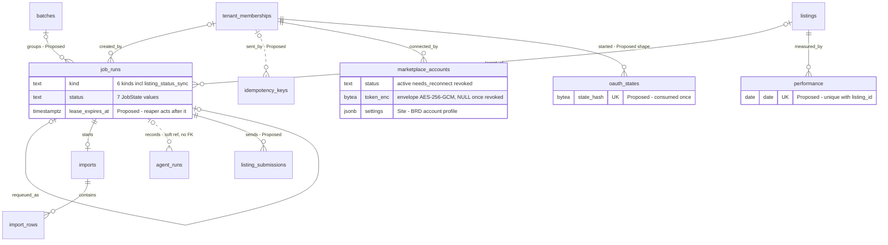

#### `job_runs` — [Canon 0003] + [Canon ADR-0004] + [Proposed] + [Pending spike]
Std tenant. Timestamps are `queued_at`, `started_at?`, `lease_expires_at?` and `finished_at?`, with no `created_at`/`updated_at`. Proposed `fillfactor = 80`.

| Column | Type | Tag | Notes |
|---|---|---|---|
| kind | text | Canon / Proposed vocabulary | `listing_generate\|listing_publish\|listing_status_sync\|bulk_import\|image_compliance\|brand_embed`; `listing_status_sync` is required by BRD L1057 (not a reservation) |
| queue | text | Proposed | `default\|publish`, set by a BEFORE INSERT trigger; `publish` for `listing_publish` **and** `listing_status_sync` (they share the per-account limiter, G17). A plain column, not GENERATED |
| status | text | Canon | DEFAULT `queued`; `queued\|running\|succeeded\|partial\|failed\|cancelled\|dead_letter` |
| node | text? | Canon | the 12 PipelineStage values, generate only |
| attempt / max_attempts | int | Canon | 0 / 3; CHECK `0 <= attempt <= max_attempts`, `max_attempts` 1..3; generation = 1; sync = 3 (transport only), timeout 120 s, lease 180 s |
| queue_job_id | text? | Canon ADR-0004 | was `arq_job_id`; replaced whenever re-deferred |
| listing_id / entity_type / entity_id | uuid? / text / uuid | Canon | → listings; required for the 3 listing kinds; vocabulary `listing\|import\|image\|brand_document` |
| idempotency_key | text? | Canon | `UNIQUE (tenant_id, idempotency_key) WHERE NOT NULL`; derivation `hex(sha256(http_key ':' kind ':' listing_id))`, one key per batch item |
| payload_json / result_json / error_report_json | jsonb / jsonb? / jsonb? | Canon | ids only, ≤ 64 KiB; error required on failure; timeout = `JOB_TIMEOUT` |
| correlation_id / request_id / parent_job_id / created_by | uuid / text? / uuid? / uuid? | Canon | parent → self, NO ACTION, [S8] as `(tenant_id, parent_job_id) → job_runs (tenant_id, id)` on the row's own anchor, so a requeue stays in its tenant; `created_by` → m (NULL allowed for system sync jobs); a requeue copies `created_by` |
| batch_id / error_code | uuid? / text? | Proposed | `(tenant_id, batch_id)` → batches (MATCH SIMPLE; batches outlive jobs); `error_code` copied from the report |
| lease_expires_at / cost_reserved_usd | timestamptz? / numeric(12,6) | Proposed | start + timeout (300/600/1800 s) + 60 s / the LLM budget reservation, DEFAULT 0 |
| traceparent | text? | [S23] `0009_analytics_trace` | the enqueuing request's W3C trace context (`00-<32 hex>-<16 hex>-0[01]`, CHECK `ck_job_runs_traceparent_format`); the worker's job span is its child. NULL for jobs enqueued outside a request span (periodic slots, staff requeue). Ids only, no baggage |

- **Checks.** Attempt bounds; terminal ⇔ `finished_at`; `running` needs a lease; failure needs a report. **No auto-publish** [ADR-0008 (proposed) backstop]: `kind <> 'listing_publish' OR created_by IS NOT NULL`; an `auto_resubmit` job copies the original publisher (T41).
- **Triggers [Proposed, 0004].** Terminal rows immutable (the pruner may DELETE); edges follow §6.2. **Publish gate** (BEFORE INSERT of a `listing_publish` row): the listing has `approved_version_id = current_version_id` and status `approved`, `failed` (retry) or `blocked` with reason `marketplace_action_required` (resume); not paused/archived; fewer than 3 submissions for the approved version; the marketplace account is `active`; no open `error` issue with `retry_class = 'user_action'` that was **first seen on the approved version** and is **not linked to an `answered` or `applied` task** (anti-loop, L1358; older-version issues and issues a human has already answered no longer block, T71); the `created_by` membership is an active `owner` or `operator`, read `FOR SHARE`.
- **Statement order for a publish-family event [Proposed].** The gate needs the listing still in its pre-publish status and the status guard needs a queued `listing_publish` job, so every publish writes, in one transaction: **INSERT `job_runs`** (the gate sees `approved`/`failed`/`blocked`) → **UPDATE `listings`** (the guard sees the queued job) → `defer`. An `auto_resubmit` from a running publish job first writes that job's terminal status, then inserts the new job, because `UNIQUE (tenant_id, listing_id, kind) WHERE status IN ('queued','running')` allows one live publish job per listing. Tests cover both orders (the wrong one must fail).
- **Indexes [Proposed].** `UNIQUE (tenant_id, listing_id, kind) WHERE status IN ('queued','running')` (dedupes sync and publish per listing); `UNIQUE (parent_job_id)`; `(lease_expires_at) WHERE status='running'`; `(tenant_id, finished_at DESC) WHERE status='dead_letter'` + `(finished_at DESC) WHERE status='dead_letter'`; `(tenant_id, batch_id) WHERE batch_id IS NOT NULL`; `(tenant_id, queued_at DESC, id DESC)`; `(tenant_id, entity_type, entity_id)`.
- **RLS.** Standard, plus `jr_by_id` (SELECT `id = app_job_id()`) [Proposed]: payloads carry only `job_run_id`, so the worker reads `tenant_id` before any tenant GUC exists (named invariant-5 exception, §11.2 row 19).

**procrastinate tables** [Canon ADR-0004; placement Proposed]. Shipped by the pinned 3.10 release, created by `migrator` in `0003b`. They hold only `{job_run_id}`, so they have **no RLS** and are allowlisted in the isolation test. `app_rw` gets explicit `EXECUTE` on their functions. Periodic tasks: the reaper, `schedule_status_sync`, `expire_trials`, pruning.

#### `imports` / `import_rows` — [Canon 0003] + [Decided, ADR-0007 proposed] + [Proposed]
Both std tenant. `imports` backs `ImportReport` (rename `ImportReport.batch_id` → `import_id`, open decision 13; the site's bulk-import "batch ID", L11345, is this `import_id`: T67). Columns come from the BUILD-SEQUENCE S8 draft and are Proposed.

**Import → generate policy [T67 default; departs from Site L7806, L7929, L11345, L12075].** The site fans every valid row out to generation. v1 does not: `bulk_import` creates or updates products, facts, parties, colourways and matrix cells, then ends with its `ImportReport` (created product ids included). The user then picks rows and marketplaces in the per-row review UI, which sends one `generate` batch (`batches.kind='generate'`, `import_id` set, ≤ 200 items, one `listing_generate` job per item). Reasons: the LLM budget (a 1k-row file would start ~2k generations at once) and choosing marketplaces per product. If the team picks the site's behaviour, `bulk_import` enqueues that same `generate` batch itself at the end of pass 2, for the marketplaces named in the upload request; the tables don't change.

| Column | Type | Tag | Notes |
|---|---|---|---|
| imports.storage_key / filename / status | text | Proposed | CSV object key (draft `gcs_uri`); status = JobState minus `dead_letter` |
| imports.total_rows / imported_rows, failed_rows | int? / int | Proposed | recomputed from `import_rows` at the end |
| imports.job_id / created_by / finished_at | uuid / uuid / timestamptz? | Proposed | → job_runs (same 90-day retention) / → m |
| imports.error_report_json | jsonb? | Canon A§20 | file-level `HEADER_*` errors (`file.header`) |
| import_rows.import_id / row_number | uuid / int | Proposed | → imports ON DELETE CASCADE (exception); row ≥ 2; `UNIQUE (tenant_id, import_id, row_number)` |
| import_rows.sku / parent_sku | text? | Proposed / ADR-0007 | header `seller_sku` / `parent_style_id` (alias `parent_sku`) → the style row |
| import_rows.raw_row / status | jsonb / text | Proposed | cells as uploaded (untrusted; unmapped columns stay here with a warning; holds party contact cells, so no SELECT for `app_ro`/`app_platform_ro`, §8.1); `pending\|imported\|failed` |
| import_rows.product_id / error_report_json / job_id | uuid? / jsonb? / uuid? | Proposed | product → SET NULL (product_id) (exception); source `schema` or `rules_engine` |

- **Headers** are the BRD master names verbatim (Appendix A.6); ADR-0007's `parent_sku` and the scaffold's `mrp_inr`, `price_inr`, `weight_grams` are aliases (`attribute_definitions.input_aliases`).
- **Pass 1** upserts style rows (their title, brand and classification must agree across child rows), matches or creates `business_parties` on `dedupe_key`, creates colourways; **pass 2** writes children, facts through the FactWriter (§5.6) and matrix cells (T17). "Failed rows re-runnable" (L5036).
- **Cells that don't map 1:1 [Proposed; nothing is invented, L765, L941]:**
  - `manufacturer_name` + `manufacturer_address` (one free-text cell, L1614): the raw address goes into `address_line1` unchanged and into `provenance.manufacturer.value`; `postal_code`, `state_code` and `city` are filled only when parsing is unambiguous (e.g. exactly one trailing 6-digit PIN). The party is matched on `dedupe_key`.
  - `consumer_care_email` / `consumer_care_phone` (no name column, L1878-1890): equal to the brand default consumer-care party's contact → that party (inherited, no product override); otherwise match or create a **nameless consumer-care party** (`legal_name` NULL, `roles = {consumer_care}`, §5.6), never a made-up name. Whether a nameless contact satisfies the Legal Metrology declaration is a `legal_metrology` rule (T36).
  - `package_weight` (no unit given, L1918-1922): the cell needs a unit suffix (`450 g`, `0.45 kg`), converted to grams; a bare number is ambiguous and is a row error (source `schema`) naming the expected format. The alias header `package_weight_g` takes a bare number of grams.
- **Indexes:** `import_rows (tenant_id, import_id, status, row_number)`; `imports (job_id)`. Rows commit in batches of ~100, so a re-claimed job resumes where it stopped. The per-row `facts_guard` cost is measured in the S13 import test (open decision 28).

#### `idempotency_keys` — [Canon 0003] + [Proposed]
**PK `(tenant_id, key)`**, no `id`. [Canon] `endpoint`, `request_hash bytea` (sha256 of endpoint + body), `response_status?`, `response_json?`; [Proposed] `user_id` → m (another member gets 409), `expires_at` = now() + 24 h, indexed for pruning.
- **Protocol:** `INSERT … ON CONFLICT DO NOTHING`, then the job rows, then the response, then COMMIT, in one transaction. A concurrent duplicate waits, then replays; a different hash gets 409.
- **Batches [Proposed #3]:** each item runs in its own SAVEPOINT, so one item's `MKC01` or unique violation becomes that item's result while the outer transaction still stores the response (§7.1). Item keys are derived per item.

#### `agent_runs` — [Site] [06]/[85]/[95] + [Canon 0002] + [Canon inv. 7] + [Proposed] from `AgentRunRecord`
Std tenant, append-only. **One row per model call** (invariant 7), written only by the backend.

| Column | Type | Tag | Notes |
|---|---|---|---|
| product_id / listing_id, listing_version_id | uuid? | Site / Canon | → products / → listings and → lv; NO ACTION (only the purge hard-deletes parents, and it deletes `agent_runs` first) |
| job_id | uuid? | Canon | soft reference: `agent_runs` outlive `job_runs` (13 months vs 90 days) |
| trigger | text | Site | `CHECK (trigger IN ('generate','correct','embed','vision'))` [Proposed CHECK, site vocabulary]; agent → trigger: content/keyword/attribute/quality → generate, correction → correct, embedding → embed, image → vision |
| model_used, tokens_in, tokens_out, duration_ms, status, error_report_json? | mixed | Site + inv. 7 | spec names kept; `TokenUsage.input/output` → `tokens_in/out`; status `running\|completed\|failed\|timeout`; CHECK `status = 'running' OR model_used IS NOT NULL` |
| cost_usd | numeric(12,6) | Canon (site `cost DECIMAL(10,6)`, T25) | USD only; budget day = UTC day of `started_at` |
| request_id / agent_name / attempt / prompt_version / started_at / finished_at | mixed | Canon | agent `content\|keyword\|attribute\|image\|correction\|embedding\|quality` |
| tokens_cached_in, input_digest? | int / text? | Proposed | from `AgentRunRecord` |

- **Indexes:** `(tenant_id, started_at) INCLUDE (cost_usd)` (tenant kill switch, index-only); `(started_at) INCLUDE (cost_usd)` (global budget via `platform_scope`); `(job_id)`; [Site L6042, L11203] `agent_runs_product_created_idx (product_id, created_at) INCLUDE (cost_usd, tokens_in, tokens_out, duration_ms) WHERE product_id IS NOT NULL`; [Proposed, [100]] `agent_runs_errors_gin USING gin (error_report_json jsonb_path_ops) WHERE error_report_json IS NOT NULL`.
- **Inserts** use `ON CONFLICT (id) DO NOTHING`.
- **Budget reservation [Proposed].** The claim takes `pg_advisory_xact_lock(hashtext('budget:' || tenant_id))`, then checks today's `SUM(agent_runs.cost_usd)` + `SUM(job_runs.cost_reserved_usd)` against the tenant budget. The reservation is a per-kind ceiling (max tokens × price × attempts); the terminal write zeroes it in the transaction that inserts the real rows. A timeout or crash leaves it counted, so 20 concurrent generations can't overshoot. Records lost on timeout: open decision 19.

#### `marketplace_accounts` — [Site] [06]/[85]/[90] + BRD §5.2 profile + [Canon 0002] + [Proposed]
Std tenant + `updated_at`; anchor `uq_ma_id_marketplace UNIQUE (id, marketplace)`. Only adapters decrypt, and only inside a call (invariant 6).

| Column | Type | Tag | Notes |
|---|---|---|---|
| marketplace / seller_id / region / scopes | text / text / text / text[] | Site / Canon | `region` is adapter-owned |
| token_enc / kms_key_version | bytea? / text? | Site (`NOT NULL` relaxed, T27) / Canon | per-write AES-256-GCM key wrapped by KMS; AAD = `tenant_id`; both NULL once revoked (crypto-shred); CHECK `status = 'revoked' OR token_enc IS NOT NULL`, and [S7] `ck_ma_revoked_shredded` CHECK `status <> 'revoked' OR (token_enc IS NULL AND kms_key_version IS NULL)` |
| expires_at, last_refresh_at / connected_by_user_id | timestamptz? / uuid | Canon | → m |
| status / status_changed_at / needs_reconnect_since / last_refresh_error_code | text / timestamptz / timestamptz? / text? | Site DEFAULT `'active'` (L5928) + Fix ([132] L11943-11947) | `active\|needs_reconnect\|revoked`; `ma_reconnect`: needs_reconnect ⇔ since set. The adapter refreshes **once** on AUTH_EXPIRED; an auth rejection of the refresh (e.g. `invalid_grant`) → `needs_reconnect` in the transaction that opens a `reconnect_account` task; a transient failure is `marketplace_technical/auto_retry` and doesn't count. Rev 1's `refresh_failures` (3) and `reauth_required` are dropped |
| revoked_at | timestamptz? | Proposed | |
| settings / settings_updated_at / settings_updated_by | jsonb / timestamptz? / uuid? | Site (BRD §5.2 L335-371, L293-297) | NOT NULL DEFAULT `'{}'`, object ≤ 32 KiB; updated_by → m. Shape below |

- **`MarketplaceAccountSettings`** (an `apps/api` Pydantic model in OpenAPI for the FE; not a seam type, the AI never sees accounts): `seller_display_name`; `locations[≤20] {code, name, pincode ^[1-9][0-9]{5}$, is_default}`; `fulfilment {channel merchant|marketplace, handling_days 0..30, procurement_type, shipping_template}`; `listing_permissions {brand_registry {status approved|pending|not_enrolled|unknown, brand_names, proof_storage_keys, source seller|marketplace, checked_at}, category_approvals[{category, product_type?, status approved|pending|denied|not_required|unknown, source, checked_at}]}`; `identifier_status {policy gtin|exempt|mixed|unknown, exemption_ref, exempt_categories}` (the approved GTIN exemption, T39); `commercial_defaults {default_hsn, gst_rate_pct numeric 0..100, default_handling_days}`. No GST slab list: the site gives none (L329-331, L1910 "seller-provided/verified"), and rev 2's `0|5|12|18|28` looks out of date after India's September 2025 GST rationalisation (verify against an official source). Plausibility is a Rules Engine check, not a CHECK, matching `products.tax_rate`.
- **Trust (T57):** each section records `source` and `checked_at`; v1 stores seller declarations, adapters overwrite with marketplace-verified values where an API exists. `commercial_defaults` only ever becomes a **suggestion** in a human task; MRP, HSN and tax rate are never filled from account defaults (critical, seller-declared; T37).
- **No secrets in settings** (a test rejects keys ending `token|secret|password|key`). Owner-only `PATCH /api/v1/marketplaces/{marketplace}/settings`, audited. A marketplace permission denial sets the approval `denied` and opens a `permission_decision` task. `conditional_required` rules read `account.*` through the validation context.
- **Index:** `UNIQUE (tenant_id, marketplace) WHERE status <> 'revoked'`: one live account per brand per marketplace; and global `uq_marketplace_accounts_marketplace_seller_id UNIQUE (marketplace, seller_id) WHERE status <> 'revoked'`, so a v1 seller account connects to exactly one tenant (T31). `seller_id` comes from the OAuth callback, never from the brand, so the global key is no tenant-chosen probe. **`token_enc` stays hidden:** no column grant to the read-only roles, excluded from SQLAdmin and logs.

#### `oauth_states` — [Canon ADR-0004] table required; name and shape [Proposed]
Std tenant; replaces the Redis OAuth state. `state_hash bytea UNIQUE`, `user_id` → m, `marketplace`, `code_verifier text?` (PKCE; NULL for Amazon), `expires_at` (+ `OAUTH_STATE_TTL_SECONDS` = 600). **[S15] Pending rows** (revision `0006_oauth_pending`): `token_enc bytea?`, `kms_key_version text?`, `seller_id text?`, `region text?`, `scopes text[]?`, `token_expires_at timestamptz?`, all NULL on a state row; the callback writes a pending row (the sha256 of a fresh opaque handle in `state_hash`, the sealed token pair) for the confirm. CHECKs: `ck_oauth_states_pending_complete` (`token_enc`, `kms_key_version` and `seller_id` NULL together), `ck_oauth_states_pending_no_verifier` (a pending row has no verifier), `ck_oauth_states_pending_bounds` (`octet_length(token_enc) <= 16384`, `seller_id ~ '^[A-Za-z0-9]{1,64}$'`, key version ≤ 512, region ≤ 32, ≤ 64 scopes). The read-only roles get no grant on the new columns. **Consumed once:** a state row by the callback, `DELETE … WHERE state_hash=:h AND marketplace=:m AND token_enc IS NULL AND expires_at > now() RETURNING tenant_id, user_id, marketplace, code_verifier`; a pending row by the confirm under the tenant policy, `DELETE … WHERE tenant_id=:t AND state_hash=:h AND user_id=:u AND token_enc IS NOT NULL AND expires_at > now() RETURNING …`. **RLS:** a SELECT branch and a DELETE branch, both `USING (state_hash = app_token_hash() AND token_enc IS NULL)`, so the public path never sees or deletes a pending row (`oauth_states_hash_select`, `oauth_states_hash_delete`; no UPDATE or INSERT branch), because the callback (`GET /api/v1/marketplaces/{marketplace}/callback`) carries no JWT; the tenant comes from the row (`docs/RULES.md` §3; named invariant-5 exception, §11.2 row 19).

#### `performance` — [Site] [06]/[96]/[101] + [Canon 0002] + [Proposed]
Std tenant + `updated_at`. Site: `listing_id`, `date date`, `impressions`, `clicks`, `orders`, `returns` (int NOT NULL DEFAULT 0), [96] `marketplace`, `ranking_position int?`. **[Proposed; the index is Site L11205]** `performance_listing_date_key UNIQUE (listing_id, date)` replaces the Canon `UNIQUE (listing_id, marketplace, date)` (a listing has one marketplace, so uniqueness is unchanged, and the index serves the site's "listing_id + date" time-series path; the site asks only for the index, the uniqueness is ours); upserts `ON CONFLICT (listing_id, date)`; FK → l/mkt, and [S7] `(tenant_id, listing_id)` → listings, so a row can't name another tenant's listing (→ l/mkt alone does not check the tenant). Under the family grain (T45) a row is **family-level**: per-SKU numbers (ranking and sessions are per child ASIN/FSN) need an additive nullable `listing_item_id` with `UNIQUE NULLS NOT DISTINCT (listing_id, listing_item_id, date)` when T14 brings performance in. Proposed: `revenue numeric(14,2)`, `currency` (DEFAULT `'INR'`), `metrics jsonb`. Whether v1 fills it: T14; report sources: open decision 16.

#### `rate_limit_counters` — [Canon ADR-0005] UNLOGGED; name and shape [Proposed]
Counters only, so no `tenant_id` and no RLS. PK `(bucket_key, window_start)` plus `n int`; bucket `t:<tenant_id>`, `ip:<sha256>` or `login:<sha256>`. **[S23] Alert dedupe:** buckets `alert:<kind>:<key>` (window = the alert's dedupe window), `alert:job_dead_lettered:cap:<job_kind>` (15-minute storm cap, 20 events) and `alert:job_dead_lettered:summary:<job_kind>`; kept 25 h by the prune (limiter rows still 5 min). **[S23] Analytics in-flight cap:** bucket `an:<tenant_id>` on the minute window, cap 2 (counted up on entry, back down on exit, never below 0; a request straddling a minute releases its own row). **[S20] Outbound marketplace calls** share the table: bucket `mkt:<marketplace>:<account_id>:<operation>` with 1-second windows (`app/workers/outbound_limiter.py`, the adapter's limiter port; rates are an adapter constant, 1 call/s per Listings Items operation until DW1 reads the published quotas). An increment over the rate sleeps to the next window and tries again, at most 30 times, then `RATE_LIMITED`. Calls within one adapter session are sequential, so the in-flight bound per account and operation is rate × the longest call (at most 10 at 1/s with the client's 10 s read timeout). `INSERT … ON CONFLICT DO UPDATE SET n = n + 1 RETURNING n` enforces per-minute limits of 120 per tenant, 60 per IP and 5 per login. **Outside the business transaction [Proposed]:** the increment autocommits before the business transaction begins; inside it, the row lock on `t:<tenant_id>` would serialize a tenant's requests (a 200-item approve) until COMMIT. Test: two concurrent requests for one tenant, one held open, don't block each other. UNLOGGED empties after a crash (fine for counters); rows older than 5 minutes are deleted every minute (§9).

**Ops notes.**
- **Claim is a compare-and-set:** `UPDATE job_runs SET status='running', attempt=attempt+1, started_at=now(), lease_expires_at=…, cost_reserved_usd=… WHERE id=:id AND status='queued' AND attempt < max_attempts RETURNING …`. 0 rows = duplicate or stale delivery: drop it. Recovering a stuck `running` row is the reaper's job alone.
- **Reaper [Proposed; ADR-0004 spike criterion 8].** A lease reaper (not the removed commit-gap sweeper), a periodic task every minute: reads `WHERE status='running' AND lease_expires_at < now()` through `platform_scope`; then per tenant, one transaction per job: attempts left → `queued`, lease cleared, re-deferred (new `queue_job_id`); exhausted → `dead_letter` + `JOB_TIMEOUT`, and the listing moves `generating → failed/generation_failed` or `publishing → failed/publish_failed` (event `submission_failed`), **leaving any `pending` submission unresolved** so the retry must read before retry. procrastinate's own stalled-job retry is off, or above the longest lease (1,860 s). Spike and CI test: `kill -9` during generate and during publish.
- **Retries:** a retryable failure with attempts left → `queued`, redelivered after backoff (ADR-0004 §6). **Timeouts:** `asyncio.timeout` → `failed` + `JOB_TIMEOUT` [Canon ADR-0004]. **Requeue** always inserts a new row [Canon], copying `created_by`.
- **Idempotency:** HTTP keys, `job_runs.idempotency_key`, and the per-submission marketplace key (attempt + payload hash, so a corrected resubmission never shares a key with the failed one).
- **Cross-tenant scans** read via `platform_scope`, then act per tenant; the rollup module joins the import-linter allowlist [Fix KI-B].

### 5.5 Brand voice vectors

**Plain English.** Brands upload voice guides, glossaries and compliance documents. We split them into one chunk per meaningful unit (a rule, a glossary pair, a paragraph or bullet; at most ~200 words, T90) and store each chunk's 1,536-number "meaning fingerprint" in the same Postgres. At generation time the AI receives the 8 most relevant snippets; it never queries the table.

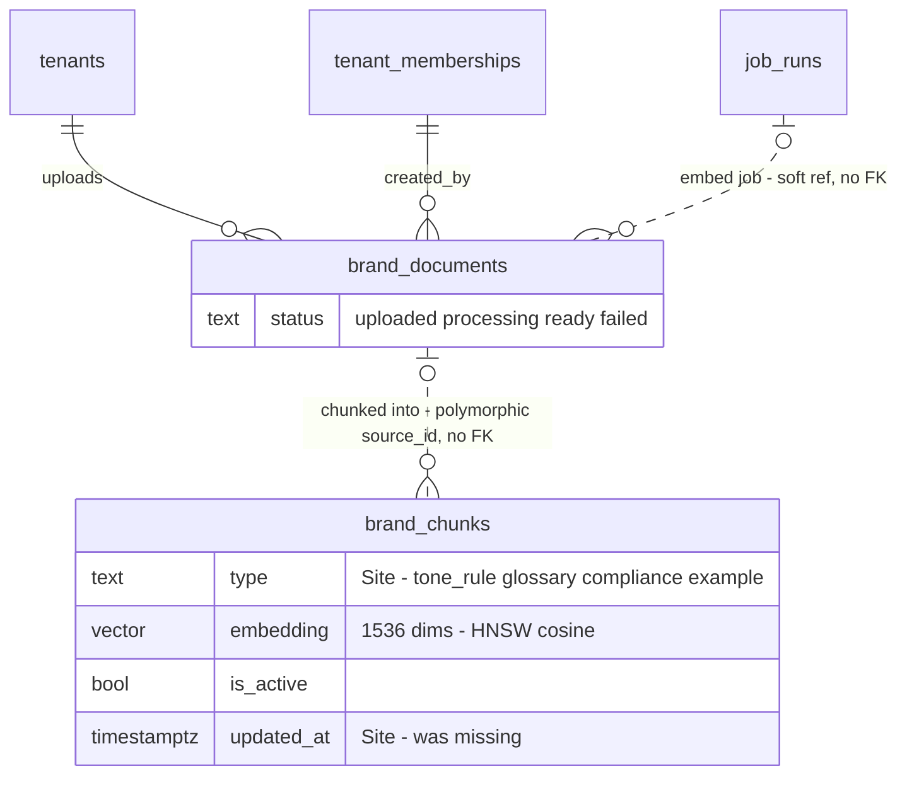

#### `brand_documents` — [Canon 0002] + [Proposed, follows ADR-0006] FK + [Proposed]
Std tenant + `updated_at`. [Canon] `filename`, `storage_key` (built in S7 in place of the Canon `gcs_uri`, open decision 13: an object key with the `images` rule, the S6 key-shape CHECK and `UNIQUE (tenant_id, storage_key)`; the tenant prefix waits on T109), `status` (Proposed `uploaded|processing|ready|failed`), `job_id?` (soft reference), `chunk_count`, `created_by` → m. [Proposed] `content_type`, `bytes` (≤ 10 MiB), `content_hash` with `UNIQUE (tenant_id, content_hash) WHERE deleted_at IS NULL`, `error_report_json?` (required when `failed`), `deleted_at?`.

#### `brand_chunks` — [Site] [06]/[85]/[98] + [Canon 0002 + 0002b] + [Proposed]
**Std tenant + `updated_at`** [Site L5903; rev 1 lacked it] with the `set_updated_at` trigger (the row changes when `is_active` flips on a re-chunk). Maps 1:1 to `BrandChunkDTO`. The site's `brand_id` is `tenant_id` (T58).

| Column | Type | Tag | Notes |
|---|---|---|---|
| type / text | text | Site | `CONSTRAINT ck_brand_chunks_type CHECK (type IN ('tone_rule','glossary','compliance','example'))` ([06], [85], [98] agree); text ~200 words, untrusted |
| embedding / embedding_model / content_hash | vector(1536) / text / text | Site / Canon | embedding **NOT NULL** (a chunk without one can't be retrieved); text-embedding-3-small ([84] L10861), cosine; every query filters on the model |
| source_type / source_id | text / uuid | Canon | Proposed `brand_document\|brand_profile\|listing_version`; `brand_profile` = glossary chunks derived from `tenants.glossary`; polymorphic, no FK |
| chunk_index / token_count / is_active | int / int? / boolean | Canon | a re-chunk deactivates the old rows first |

- **Indexes [Site L6039 + Canon 0002b].** `brand_chunks_embedding_idx` HNSW `vector_cosine_ops` (m=16, ef_construction=64, built in AUTOCOMMIT); `(tenant_id, type) WHERE is_active`; [Proposed] `UNIQUE (tenant_id, source_type, source_id, chunk_index, embedding_model) WHERE is_active`.
- **Search in year 1 [Proposed, T66]: exact, not HNSW.** One global HNSW index serves small tenants badly: ~20 chunks of a type among ~60k rows is ~0.03% selective, so the iterative scan hits `hnsw.max_scan_tuples` (20,000) and returns fewer than 8 hits, sometimes 0; a prepared statement's generic plan can also pin the HNSW path for every tenant. So the query filters first, then sorts a few thousand rows exactly:
  ```sql
  WITH c AS MATERIALIZED (
    SELECT id, text, embedding FROM brand_chunks
    WHERE tenant_id = :t AND is_active AND embedding_model = :m AND type = :ty)
  SELECT id, text, embedding <=> :q AS distance FROM c ORDER BY distance LIMIT 8;
  ```
- **HNSW stays** for when a tenant passes ~20k chunks: `hnsw.ef_search = 64`, `hnsw.iterative_scan = 'relaxed_order'`, a higher `hnsw.max_scan_tuples`, and an outer re-sort (relaxed order can return rows out of order). BUILD-SEQUENCE S7's done-when ("EXPLAIN shows HNSW") must test both paths.
- **Recall test [Proposed, CI].** A tiny tenant beside a large one gets `min(8, its chunk count)` hits. **Cap** `example` chunks at about 200 per tenant and category.

### 5.6 Product facts & compliance

**Plain English.** Every product fact records **who said it, how sure we are and what proves it** (BRD §11, L933-941). The **Golden Rule** (L763-765): the AI never invents fabric composition, measurements, certifications, care, origin, tax or other factual attributes. So a **dictionary** marks each attribute critical or not, the database **refuses an AI-sourced value for a critical fact**, and the Rules Engine reports critical facts that are missing or unconfirmed. Legal Metrology data (L1430-1508) lives in typed columns and a party address book. The AI sees a **prompt-safe projection** with no contact data; adapters get everything the marketplace must display.

**Fact envelope [Proposed contract; the record is Site L867-871].** The BRD "Product Attribute" record (name, value, normalized value, source, confidence, evidence, last updated), stored as JSON paths (L829 leaves storage to us): `{value, normalized, unit?, source, confidence?, normalized_by?, evidence_ref?, evidence_snapshot?, captured_via, agent_run_id?, confirmed_by?, confirmed_at?, updated_at}`.

| Field | Rule |
|---|---|
| source | `seller\|document\|pim\|marketplace\|derived\|ai` (the §11.1 trust order, T33) |
| captured_via / normalized_by | `form\|import\|api\|agent\|human_task\|system` / `vocabulary\|rule\|ai\|human` |
| confidence | 0..1; required when source is `derived`/`ai` or `normalized_by = 'ai'` |
| evidence_ref | `^[a-z_]{2,32}:[A-Za-z0-9._:-]{1,128}(#…)?$`, kinds `image, import_row, human_task, listing, agent_run, rule, brand_profile`; required unless source = seller. No `url` kind: URL intake is deferred (SSRF); no non-image document kind in v1 (T70) |
| evidence_snapshot | [Proposed, rev 3] object ≤ 2 KiB, **required when the ref's kind is prunable** (`import_row` 90 days, `human_task` and `agent_run` 13 months, §9): `import_row` → `{import_id, row_number, header, cell}`; `human_task` → `{question, answer}`; `agent_run` → `{agent_name, model_used, prompt_version, started_at}`. Written once, with the fact. The ref may then dangle after pruning, but the proof stays with the fact for the life of the product (L867-871, L2216 "critical facts should have confidence/evidence"). An answer to a party key snapshots the party id, never contact values |
| agent_run_id | required when `captured_via = 'agent'` (links invariant 7) |
| confirmed_by, confirmed_at | set together |

- **Contract:** new module `mkos_schemas/facts.py` (a Canon module-layout row): `Fact`, `FactSource`, `CapturedVia`, `NormalizedBy`, `FactLevel` (`brand|style|colour|variant|standalone`), `FactValue` (scalar, `list[str]`, flat dict or list of flat dicts).
- **SQL twin** `fact_map_valid(m jsonb, require_value boolean)`, IMMUTABLE PARALLEL SAFE: an object ≤ 128 KiB; keys `^[a-z][a-z0-9_]{1,63}$`; each value an object passing the rules above (`require_value` ⇒ `value` or `normalized` present; a prunable evidence kind ⇒ `evidence_snapshot` present), in one ordered CASE so every cast is guarded; a `BEGIN ATOMIC` body with schema-qualified references (§4). A Hypothesis golden test proves Pydantic and SQL accept and reject the same documents. **A rule change = a new function name + `ADD CONSTRAINT … NOT VALID` + `VALIDATE`**, because CHECKs aren't re-run when a function is replaced (§8.3).
- **Seller text in facts is still untrusted prompt data:** provenance says who asserted a fact, not that it is safe to follow.

**Where facts live.**
- **`products.attributes`** [Site column; meaning Proposed]: `jsonb NOT NULL DEFAULT '{}' CHECK (fact_map_valid(attributes, true))`, one Fact per dictionary key with `storage='attributes'`. Rev 1 called it "raw source, untrusted"; raw input now stays in `import_rows.raw_row`. A separate attribute table was rejected: it would duplicate the site's column and need a polymorphic owner.
- **`provenance`** on `products` and `brand_profiles` [Proposed]: `jsonb NOT NULL DEFAULT '{}' CHECK (fact_map_valid(provenance, false))`, one Fact per typed column (key = dictionary key, e.g. `mrp`, `manufacturer`), without `normalized` (the column holds it); `provenance.<key>.value` keeps raw seller input when it differs (`Made in India` vs `IN`).
- **`product_colourways.attributes`**: colour-level facts (§5.2).
- **Write rule (inv. 10) [Proposed].** The FactWriter merges server-side, per key: `SET attributes = attributes || jsonb_build_object(:key, :fact)` or `SET <col> = :v, provenance = provenance || …`, never a whole-map rewrite from Python, so two task answers on one product can't lose each other's keys. A re-run with the same value, normalized value and source is a no-op that doesn't bump `updated_at`. No GIN index in v1.

#### `products` fact columns — [Site] BRD §6/§18 (L1430-1530, L1862-1946) + [Proposed] constraints; 0001

| Group | Columns (nullable) | Constraints |
|---|---|---|
| Commercial [Site]; `currency` [Proposed] | `mrp`, `selling_price` numeric(12,2); `currency` text NOT NULL DEFAULT `'INR'` (no site line defines it; INR is implied by L1476 "MRP inclusive of taxes"); `tax_rate` numeric(5,2); `hsn_code` text | > 0; `ck_price_le_mrp` on the row (a child vs the style's MRP is the Commercial gate); `currency = 'INR'` in v1; tax 0..100 (GST %, seller-given); HSN `^([0-9]{4}\|[0-9]{6}\|[0-9]{8})$`. Rev 1's `price` → `selling_price` (one per variant for all marketplaces, T37) |
| Compliance [Site] | `country_of_origin`, `generic_name`, `net_quantity` numeric(10,3), `net_quantity_unit` | ISO alpha-2; 1..100; > 0; unit `N\|U\|pair\|set\|g\|kg\|m\|cm`, both or neither |
| Parties [Site L1508; FK shape Proposed] | `manufacturer_party_id`, `marketer_party_id`, `packer_party_id`, `importer_party_id`, `consumer_care_party_id` uuid | each → business_parties ON DELETE RESTRICT; override the brand default |
| Identifier [Site L453-459] | `identifier_type` (`gtin\|ean\|upc`), `identifier_value`, `identifier_status` (`provided\|exempt\|not_applicable`) | replaces rev 1's `gtin`; below |
| Dimensions [Site L785-799] | `package_length_cm`, `package_breadth_cm`, `package_height_cm` numeric(7,2); `package_weight_g`, `product_weight_g` int | > 0; the three dims all-or-none; `product_weight_g` replaces `weight_grams` (the BRD separates product and package weight, L791) |

- **Levels:** any of these may sit on a style, variant or standalone row; the resolver takes variant → colourway → style → brand default. MRP per colour sits on each variant row (the template has one row per SKU).
- **`ck_products_typed_facts_sourced` [Site L2216 "every field should have a source"]:** `provenance ? 'title'` and `? 'category'`, and for every non-null typed fact the matching key (the same pairs `attribute_columns` holds, checked by a CI test): `mrp`, `selling_price`, `tax_rate`, `hsn_code`, `country_of_origin`, `generic_name`, `net_quantity`, `identifier` (on `identifier_status`), `package_dimensions` (on `package_length_cm`), `package_weight`, `product_weight`, the five party keys, `brand_name`, `sub_category`, `product_type`, `gender`.
- **Identifier [Proposed].** `gtin_valid(v text)` (SQL, IMMUTABLE): GS1 check digit over GTIN-8/12/13/14, left-padded to 14, with a CASE guard before the cast. CHECKs: a value is valid; type and value both or neither; value ⇒ status `provided`; `provided` ⇒ value; a style row carries no identifier (like an Amazon parent). `products_identifier_uq UNIQUE (tenant_id, lpad(identifier_value, 14, '0')) WHERE identifier_value IS NOT NULL AND deleted_at IS NULL`, so EAN-13 and GTIN-14 spellings can't name two SKUs. The approved exemption (brand × category) is `marketplace_accounts.settings.identifier_status`; a rule checks `exempt` against it (T39).

#### `brand_profiles` — [Site] BRD §5.1 (L245-333) + Brand record (L837-839) + [Proposed] shape; 0001
1:1 with tenants: **`tenant_id uuid PRIMARY KEY REFERENCES tenants(id)` (NO ACTION)**, inserted with the tenant by `app.cli create-tenant`; `created_at`, `updated_at`. The BRD "Brand" record = tenants + brand_profiles + business_parties (T31). [88]'s "extends tenant" (L11019) covers the voice fields, which stay on `tenants`; it is not the basis of this table.

| Column | Type | Notes |
|---|---|---|
| brand_names | text[] NOT NULL DEFAULT `'{}'` | BRD "Brand name(s)" (L263): consumer brands sharing one voice; ≤ 20, no NULLs |
| brand_owner_type | text? | `brand_owner\|manufacturer\|reseller\|distributor\|trader` |
| website_url / brand_description / logo_storage_key | text? | `^https?://…` ≤ 2000 / ≤ 2000 / object key under the tenant prefix, never a URL |
| legal_entity_party_id | uuid? | legal name, registered address and GSTIN live on this party (roles contain `seller`) |
| default_manufacturer_party_id, default_marketer_party_id, default_packer_party_id, default_importer_party_id, consumer_care_party_id | uuid? | Legal Metrology defaults; all six party columns → business_parties RESTRICT (MATCH SIMPLE) |
| default_country_of_origin | text? | ISO alpha-2; inherited only under T35 |
| content_locale | text NOT NULL DEFAULT `'en-IN'` | `^[a-z]{2,3}-[A-Z]{2}$` (G15, L2245-2247) → `GenerationContext.locale` |
| provenance / onboarding_completed_at | jsonb / timestamptz? | one Fact per typed column |

- **Why a 1:1 table, not more tenant columns:** `tenants` already has lifecycle columns behind a column grant and SECURITY DEFINER functions (§5.1); PK = tenant_id keeps every read tenant-keyed. Voice stays on `tenants`, as the plan DDL has it (L5874-5881).
- The BRD §5.2 account items (seller display name, locations, shipping, permissions, brand registry, GTIN exemption, commercial conventions) are `marketplace_accounts.settings` (§5.4).
- **Privileges:** SELECT, INSERT, UPDATE (owner/admin in the API); no DELETE. **RLS:** the standard template (tenant_id is the PK). API: `GET`/`PUT /api/v1/brand-profile` (singleton for the JWT `tid`; Day-15 brand-profile API, L5068-5075).

#### `business_parties` — [Site] Legal Metrology parties (L299-321, L1508, L1606-1614, L1878-1890) + [Proposed] shape; 0001
A tenant address book: many products share one manufacturer, and one legal entity can be seller + manufacturer + marketer. Std tenant + `updated_at`; anchor `UNIQUE (tenant_id, id)`.

| Column | Type | Notes |
|---|---|---|
| roles | text[] | 1..6 of `seller\|manufacturer\|marketer\|packer\|importer\|consumer_care` |
| legal_name | text? | 1..300; **NULL only for a consumer-care-only contact** (`bp_named CHECK (legal_name IS NOT NULL OR (roles = '{consumer_care}' AND (email IS NOT NULL OR phone IS NOT NULL)))`): the BRD template gives only `consumer_care_email`/`_phone` (L1878-1890), and a made-up name would be a fabricated compliance fact (L765) |
| address_line1, address_line2, city, state_code, postal_code, country_code | text? | ≤ 300 / ≤ 300 / ≤ 100; state `^[A-Z]{2}$`; country NOT NULL DEFAULT `'IN'`; an Indian postcode is `^[1-9][0-9]{5}$`. An imported single-cell address stays whole in `address_line1` (§5.4) |
| email / phone / gstin | text? | ≤ 254 + pattern; `^[+]?[0-9][0-9 -]{5,19}$`; the 15-char GSTIN pattern |
| source / evidence_ref | text / text? | `seller\|document\|pim\|marketplace`, never derived or ai (L765, L941); evidence required unless seller, and only non-prunable kinds (`image`, `brand_profile`) |
| dedupe_key | text GENERATED STORED **NOT NULL** | named party: `lower(btrim(legal_name)) \|\| '\|' \|\| coalesce(lower(regexp_replace(address_line1, '\s+', ' ', 'g')), '') \|\| '\|' \|\| coalesce(postal_code, '') \|\| '\|' \|\| country_code`; nameless consumer-care contact: `'cc\|' \|\| coalesce(lower(email), '') \|\| '\|' \|\| coalesce(regexp_replace(phone, '[^0-9]', '', 'g'), '')`. Every nullable part is wrapped in `coalesce` (a bare `\|\|` with a NULL gives a NULL key, which the unique index ignores, so each import row would add a duplicate); `concat_ws`/`format` can't be used because they are STABLE, not IMMUTABLE. `bp_dedupe_uq UNIQUE (tenant_id, dedupe_key) WHERE deleted_at IS NULL` = the import's match-or-create |
| deleted_at | timestamptz? | soft delete only |

- A `consumer_care` party needs email or phone (CHECK). A missing address on a manufacturer, packer or importer is a Compliance-gate error, not a CHECK: imports arrive partially. CI test: two import rows with the same `legal_name` and no address produce one party.
- **Privileges:** SELECT, INSERT, UPDATE; no DELETE (only the purge). The five `*_party_id` FK columns on `products` and the six on `brand_profiles` have no index: only the purge deletes parties, and the purge CI test measures it. **Personal data:** `app_ro`/`app_platform_ro` get no grant on `email`, `phone`, `address_line1/2`, `postal_code`, `gstin`, nor on `dedupe_key`, which is built from them [S6] (a sole proprietor's contact data is personal data under the DPDP Act, and a GSTIN embeds the holder's PAN). Never in an LLM prompt; adapters do send them, because Legal Metrology requires them on the marketplace (L1508). API: `/api/v1/business-parties` list/create/update/soft-delete.

#### `attribute_definitions` — [Proposed] platform dictionary; 0003
The canonical key names are part of the shared contract (FE forms, AI prompts, rules, adapters), key names per T32. Source file `packages/schemas/src/mkos_schemas/data/attribute_dictionary.json`, loaded by the migrator `app.cli dictionary sync` (idempotent; CI runs it after the downgrade/upgrade cycle and before pytest, and the deploy job runs it after every `upgrade`, §8.2). No tenant_id, no RLS; SELECT-only for app roles; a guard bumps `revision` on UPDATE; no DELETE (disable instead). **[S10]** The guard takes a new `revision` only when the row minus `revision` changed, so a no-op `dictionary sync` upsert keeps `rules_version`; the same guard runs on `category_attributes`.

| Column | Type | Notes |
|---|---|---|
| key | text PK | `^[a-z][a-z0-9_]{1,63}$` |
| section | text | `identity\|classification\|attributes\|care\|compliance\|commercial\|dimensions` (BRD §6) |
| storage | text | `column\|attributes`; a `column` key has ≥ 1 row in `attribute_columns` (below; checked by the loader and a CI test). Rev 2's single `column_name` couldn't hold multi-column facts or the same fact under two column names |
| owner_levels | text[] | ≥ 1 of brand, style, colour, variant, standalone |
| value_type / unit / vocabulary | text / text? / text[]? | `text\|text_list\|enum\|enum_list\|number\|integer\|boolean\|money\|measure\|composition\|object\|party`; vocabulary = allowed normalized values or object keys |
| input_aliases | text[] | import headers and API keys, e.g. `material` → `fabric_type` |
| is_critical / allowed_sources / min_confidence / confirm_agent_captures | bool / text[] / numeric(3,2)? / bool | `ck_ad_critical_never_ai` (critical ⇒ `ai` not allowed); `ck_ad_critical_confirms` (critical ⇒ an agent-captured value needs human confirmation) |
| brd_ref / enabled / revision | text? / bool / int | revision `nextval('rules_revision_seq')`, so a criticality change moves `rules_version` |

**Seed v1** (from BRD §6.1-6.3, §9, §18, §20; the critical set is the T34 default):
- **Column-backed:** `title`, `brand_name`, `style_number`, `stock_ref` (identity, never ai); `category`, `sub_category`, `product_type`, `gender` (all sources, min 0.80); critical: `mrp`, `selling_price`, `tax_rate`, `hsn_code` (seller/document/pim, + marketplace for prices), `country_of_origin` (never derived, L1462; levels include brand), `generic_name` and `net_quantity` (derived allowed), `identifier`, `package_dimensions`, `package_weight`, `product_weight`, and the party keys `manufacturer`, `marketer`, `packer`, `importer`, `consumer_care` (levels include brand).
- **Column-backed, brand level only** (the `brand_profiles` typed columns, so a brand-profile write never raises `PRV02`): `brand_names`, `brand_owner_type`, `website_url`, `brand_description`, `logo`, `legal_entity`, `content_locale` (seller only, not critical).
- **Attributes-backed, critical:** `size`, `size_measurements` (object: chest/waist/hip/length/shoulder/sleeve/inseam in cm, basis), `fabric_type` (alias `material`), `fiber_composition` (`[{fibre, percent}]`, summing to 100 by rule), `lining` (`{lined, material}`), `gsm`, `wash_care`, `iron_care`, `certifications` and `performance_claims` (seller/document only; the evidence backs [62] "no organic without GOTS"), `set_composition`, `number_of_pieces`, `product_dimensions`.
- **Attributes-backed, not critical** (ai allowed, min 0.70): `color`, `secondary_color` (colour level), `size_system` (derived allowed), `body_type`, `age_group`, `construction`, `weave_finish`, `transparency`, `stretch`, `fit`, `pattern`, `silhouette`, `neckline`, `collar_type`, `sleeve_type`, `sleeve_length`, `cuff_type`, `garment_length`, `rise`, `waist_style`, `leg_style`, `closure`, `pocket_type` (`{present, type, count}`), `hem`, `placket`, `print_type`, `embroidery`, `occasion`, `season`, `kurta_type`, `dress_type`, `side_slits`, `wash`, `distressed`, `pleat`, `insulation`, `hood`, `fleece`.

#### `attribute_columns` — [Proposed] platform-global map from typed columns to dictionary keys; 0003
PK `(table_name, column_name)`; `attribute_key` → attribute_definitions RESTRICT; `table_name IN ('products','brand_profiles')`. Written by the migrator's `app.cli dictionary sync` from the same JSON file; read by `facts_guard` (steps 3-4) and the loader. Seed examples: `products.mrp → mrp`; `products.package_length_cm`, `package_breadth_cm`, `package_height_cm → package_dimensions`; `products.identifier_type`, `identifier_value`, `identifier_status → identifier`; `products.net_quantity`, `net_quantity_unit → net_quantity`; `products.manufacturer_party_id` and `brand_profiles.default_manufacturer_party_id → manufacturer`; `products.country_of_origin` and `brand_profiles.default_country_of_origin → country_of_origin`; `brand_profiles.brand_names → brand_names`. **CI test:** every typed fact column on `products` and `brand_profiles` maps to exactly one key, and the pairs agree with `ck_products_typed_facts_sourced`.

#### `category_attributes` — [Proposed] platform-global; 0003
PK `(category, attribute_key)`; `attribute_key` → attribute_definitions RESTRICT; `relevance core|common|optional`; `critical_override boolean?` CHECK NULL or true (tighten only); `display_order`, `enabled`, `revision` (same sequence). It is BRD §6.3 "common additional fields" per sub-category as data, and L1562 "hide fields that are not relevant to the category" (the FE renders forms from it). Seed: the 12 BRD groups (tshirts, shirts, tops_blouses, dresses, jeans, trousers_pants, shorts, skirts, kurtas, ethnic_sets_coords, jackets_outerwear, sweatshirts_hoodies) plus the launch categories once Q7 names them. Marketplace-side requirements stay in `category_templates`.

#### `facts_guard()` — [Site L941] DB backstop + [Proposed] mechanics; `0007_facts_guard` (S13b; steps 1-3, PRV04/PRV05 open)
BEFORE INSERT OR UPDATE OF `attributes`, `provenance`, `category`, `parent_product_id`, `variation_theme` and every typed fact column, on `products`, `product_colourways` and `brand_profiles`; SECURITY INVOKER, pinned `search_path`. The same pattern as `lv_guard` for invariant 3.
1. **Row level:** brand (`brand_profiles`); colour (colourways, category read from the style `FOR SHARE`); variant, style or standalone (`products`).
2. **Each `attributes` key whose envelope changed** (OLD vs NEW per key; untouched keys are not re-checked): known, `storage='attributes'` and enabled (`PRV02` → 422 UNKNOWN_FACT_KEY); level ∈ `owner_levels` (`PRV03` → 422 FACT_LEVEL_INVALID); source ∈ `allowed_sources`, and never `ai` for a key that is critical or has `critical_override` for the row's category (`PRV01` → 422 FACT_SOURCE_FORBIDDEN).
3. The same for changed `provenance` keys against `storage='column'`.
4. A changed non-null typed column needs a changed `provenance.<key>.updated_at` for the key `attribute_columns` maps it to (`PRV04` → 500, a programming error): a value can't outlive its source.
5. A party used as manufacturer … consumer_care must list that role and be live (`PRV05`).

**Only changed keys are checked**, so a dictionary change can't block unrelated writes: after a key turns critical, a product that still holds an old `ai` value for it can still take a task answer for another key. Existing rows that violate the new dictionary are reported by the Rules Engine's `fact_source` rule and fixed by a backfill, never by the guard (§8.3 lists dictionary narrowing as a two-release change). The Rules Engine stays the arbiter (inv. 2): it reports missing or unconfirmed critical facts (RuleDef `fact_source`), which the DB doesn't block because imports may be partial. The migrator backfill sets a GUC exemption, like the purge. SQLSTATE → ErrorReport source `schema`, retryable false.

#### ProductFacts — the resolved read model [Proposed contract, `mkos_schemas/facts.py`]
- **`ResolvedFact(Fact)`** adds `key`, `inherited_from: FactLevel | None`, `is_critical`. **`ProductFacts`** (`schema_version '1.0.0'`): `product_id`, `sku`, `level standalone|style|variant`, `style_product_id`, `colour_key`, `size_key`, identity and classification, `commercial {mrp, selling_price, currency, tax_rate, hsn_code}` (Decimals as strings on the wire), `identifier {type, value, status}`, `package {…}`, `product_weight_g`, `compliance {country_of_origin, generic_name, net_quantity, unit, manufacturer, marketer, packer, importer, consumer_care: PartyFacts?}`, `attributes`/`provenance: dict[str, ResolvedFact]`, `family: FamilySummary?` (`theme`, colours, `size_run`, cells), `dictionary_version`.
- Built by `ProductFactsRepository.resolve(product_id)` in Python, deterministically (variant → colourway → style → brand default for keys whose levels include brand), with Hypothesis property tests. Source priority vs recovery order: T33.
- **`for_prompt()` → `PromptProductFacts`** drops every `PartyFacts` field except `legal_name` (a nameless consumer-care contact contributes nothing), and drops `gstin` (DPDP data minimization).
- **`facts_digest(ProductFacts)`** = sha256 of the canonical JSON (sorted keys, Decimals as strings, `updated_at` excluded) of the full resolved facts, family and parties included; it pins facts at approval (§5.3). A family context carries only **available** cells, so copy like "Available in S to XL" never lists an unavailable size.
- **Consumers:** (1) `GenerationContext.product` becomes `PromptProductFacts` instead of the untyped dict `{sku, title, attributes, image_ids}` (AI-seam change; the AI team must be told), plus `GenerationContext.locale`; (2) `validate()` receives ProductFacts (G9), so the BRD quality gates (Identity, Classification, Attributes, Variants, Commercial, Compliance; L1388-1428) can run; (3) the adapter publish input gets the full `product_facts` plus the family's children, so Flipkart gets MRP, price, package and HSN and Amazon gets origin and the Legal Metrology parties (L1520-1530). `CanonicalListing` still carries no marketplace fields (inv. 4).
- **`CanonicalListing.attribute_sources: dict[str, AttributeSourceRef {fact_key?, source, inherited_from?}]`** and **`locale: Locale = 'en-IN'`** (additive): the backend fills `attribute_sources` after `merge_outputs` by matching each listing attribute to a resolved fact (none → `{fact_key: null, source: 'ai'}`); the AI never writes it.
- **paths.py** gains `^facts\.[a-z][a-z0-9_]{1,63}$`, `^variants$`, `^variants\[[^\]\s]{1,64}\]$`, `^variants\[…\]\.facts\.<key>$` (addressed by the stable seller SKU, e.g. `variants[FSH-TEE-001-BLK-XL].facts.mrp`) and `brand.<key>`; a task answer targets the same path and re-runs only the affected checks (inv. 10). `enums.Locale = Literal['en-IN']` (widening is MINOR).

**API [Site [104] L11303-11332].** `POST /api/v1/products` keeps the site body `{sku, title, images, attributes: {color: 'navy blue', material: 'organic cotton'}}`: the server wraps each flat value as `Fact{value, source: 'seller', captured_via: 'api'|'form', updated_at}` and resolves keys through `input_aliases` (unknown → 422 UNKNOWN_FACT_KEY). Additive: typed commercial/compliance fields, party ids, and `facts: {key: FactIn}` for explicit envelopes with document evidence (`FactIn` omits `captured_via` and `agent_run_id`, which only the server sets). `PATCH /api/v1/products/{id}/facts` merges per key with `If-Match` on `updated_at`. `ProductOut` adds `facts`, the typed blocks and `family {colourways, cells}`, so the FE can show a source badge per field. `images` stays storage keys or upload ids, not URLs.

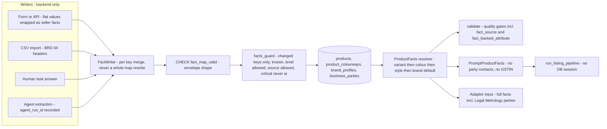

**Audit of facts.** Fact writes emit `product.fact_updated` (or `brand_profile.updated`) with only the changed keys' envelopes in `before`/`after`, plus `entity_type`/`entity_id` and the job or human-task id (§5.1 allow-list; BRD L927-931, L2225).

**Seed and E2E fixture: the BRD §21 walkthrough (L2084-2164) [Proposed].** `--profile demo` adds, for one apparel tenant: `brand_profiles` (brand_names `{Acme}`, `brand_owner`, `en-IN`); a legal-entity party with roles `{seller, manufacturer, marketer}` and a separate consumer-care party; the style `FSH-TEE-001` in category **`tshirts`** (the seeded template for both marketplaces, §5.2) (women, relaxed fit, `size_color`, size_run `{s,m,l,xl}`, 100% cotton and wash care from the seller); one colourway `Jet Black` → black (normalized_by vocabulary); four available cells with children `FSH-TEE-001-BLK-S/M/L/XL`, each with mrp, selling_price, hsn_code, tax_rate and size_measurements; and `lining` deliberately missing, so the "ask one targeted question" step runs. It keeps the three shared isolation SKUs (A§5) and is the automated stand-in for launch gate 9 (ADR-0010, T8).

### 5.7 Issues & human tasks

**Plain English.** Every problem a seller must see is an **issue row** with a class, a plain-language message and a resolution state (BRD Issue record L915-919, L2220); the immutable ErrorReport JSON stays as evidence, so invariant 8 is untouched. When only a human can answer, the system asks **one clear question per missing fact**, whatever the number of variants, marketplaces or issues it affects (L1029-1037). The answer updates the fact and re-runs only what it affects.

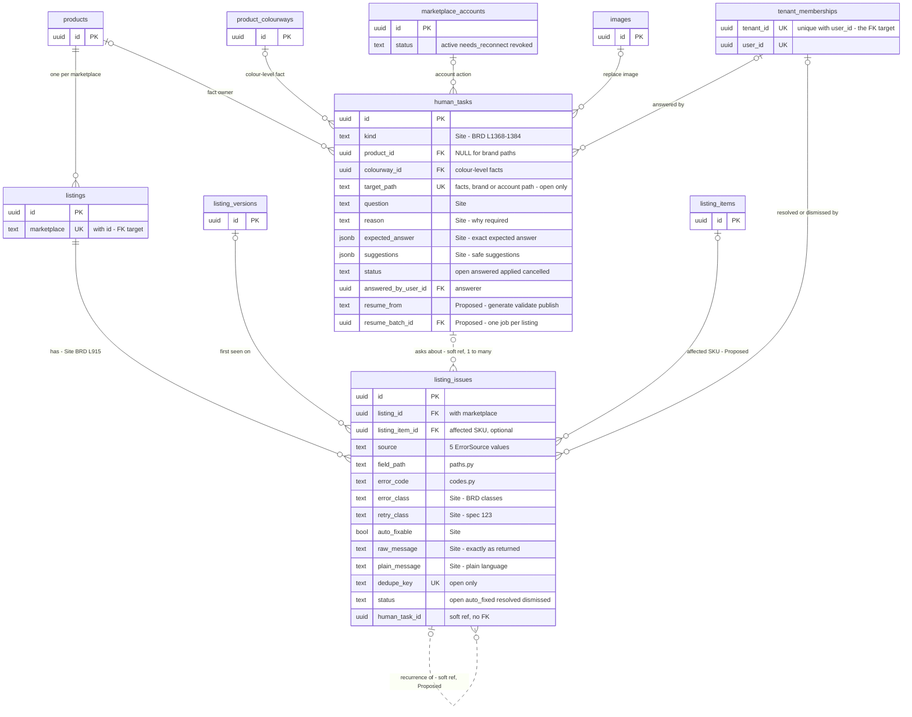

#### `listing_issues` — [Site] BRD Issue + Validation Result "resolution state" (L909-919, L2220, [114]) + [Proposed]; 0002
Std tenant + `updated_at`. Both first-class rows and the JSONB evidence (T50).

| Column | Type | Tag | Notes |
|---|---|---|---|
| listing_id / marketplace | uuid / text | Site | → listings and → l/mkt |
| listing_item_id | uuid? | Site (BRD "identify affected SKU", L1350) + Proposed | `(listing_item_id, listing_id)` → `listing_items (id, listing_id)`; set for adapter items that name a SKU |
| listing_version_id / validation_run_id, last_validation_run_id / job_id | uuid? | Site ("listing/job ID") | version → lv (first seen on); run and job ids are soft (runs are pruned at 13 months) |
| source | text | Proposed | `schema\|rules_engine\|vision_model\|amazon_adapter\|flipkart_adapter`; internal `ai_model`/`system` failures are not seller issues (T56) |
| field_path / error_code | text | Site | paths.py path ≤ 192 (`variants[<sku ≤ 64>].facts.<key ≤ 64>` reaches 145) / codes.py member |
| error_class | text | Site (BRD "issue type", L1278-1342) | `missing_data\|invalid_value\|category_mismatch\|variation_error\|media_error\|content_error\|identifier_error\|compliance_error\|account_permission\|marketplace_technical\|unknown` |
| retry_class | text | Site [123] L11752-11774 | `auto_retry\|ai_correct\|user_action\|system_failure` |
| severity / auto_fixable / fix_action | text / bool / text? | Site / Site / Proposed | `li_fix`: auto_fixable ⇔ fix_action; `remap_value\|reformat\|derive_field\|rebuild_variation` (L1067) |
| rule_id / error_map_id | uuid? | Site (the rule) / Proposed | → rules (plain FK: the documented exception, §5.2; the guard requires a platform rule or one with the same `tenant_id`); → marketplace_error_map (FK added in 0003, NOT VALID + VALIDATE) |
| marketplace_code / raw_message | text? | Site L1346 | raw code or ImageIssueCode ≤ 128 / exactly as returned ≤ 4000 |
| message / plain_message / suggestion / value_submitted | text | Site L1065 | ≤ 1000 (value ≤ 600) |
| dedupe_key / occurrences / first_seen_at / last_seen_at | text / int / timestamptz | Proposed | `li_key_prefix`: starts with `source\|field_path\|error_code\|` |
| status / resolution / action_taken | text / text? / text? | Site (status, action taken) / Proposed | `open\|auto_fixed\|resolved\|dismissed`; resolution `deterministic_fix\|ai_correction\|human_answer\|human_edit\|regenerated\|revalidated_clean\|marketplace_cleared\|accepted_warning` |
| resolved_at / resolved_by_user_id | timestamptz? / uuid? | Proposed | → m |
| human_task_id / recurrence_of_id | uuid? | Proposed | **soft references** (indexed, no FK): an open issue lives as long as its listing and a recurrence can be opened a year after the issue it repeats, while closed issues and terminal tasks are pruned at 13 months; a hard NO ACTION FK would make `prune_closed` fail, and SET NULL would UPDATE immutable closed rows (§1, §9) |

- **CHECKs:** open ⇔ no `resolved_at` and no resolution; `auto_fixed` ⇒ `deterministic_fix`; `resolved` ⇒ one of the six fix/clear resolutions; `dismissed` ⇒ `accepted_warning`, `severity='warning'` and a resolver ([44]/[50] "accept warning"); `last_seen_at ≥ first_seen_at`.
- **`listing_issues_guard` [0004]:** status moves only `open → {auto_fixed, resolved, dismissed}`; closed rows and identity columns are immutable; a dismissal reads the resolver's membership `FOR SHARE` and needs an active reviewer or owner; **errors can never be dismissed** (the Rules Engine stays the arbiter); `rule_id` must name a platform rule or a rule with the row's `tenant_id` (the plain-FK exception, §5.2).
- **Indexes:** `li_one_open UNIQUE (listing_id, dedupe_key) WHERE status='open'` (the sync's ON CONFLICT target); `(listing_id, dedupe_key, resolved_at DESC)` (recurrence lookup); `(tenant_id, listing_id) WHERE status='open'`; `(tenant_id, created_at DESC, id DESC) WHERE status='open'` (the default open inbox of `GET /api/v1/issues`, which would otherwise scan 13 months of closed rows) plus `(tenant_id, created_at DESC, id DESC)` for the all-status view (keyset; filters code, source, marketplace, date: [114]); `(tenant_id, error_code, created_at DESC)`; `(human_task_id)` and `(recurrence_of_id)` where set; `li_unknown_codes (marketplace, marketplace_code) WHERE error_class='unknown' AND status='open'` (read cross-tenant only via `app_platform_ro`, to grow the error map).
- **Privileges:** SELECT, INSERT, UPDATE; no DELETE (closed rows pruned by the migrator, §9). Audit `listing_issue.dismissed`. `POST /api/v1/issues/{id}/dismiss`.

**Issue sync [Proposed].** `sync_issues(listing, source, report, scope_fields=None)` runs in the same transaction as the `validation_runs` INSERT or the `publish_field_results` write:
1. For each ErrorItem: `dedupe_key = source|field|error_code|COALESCE(rule_id, raw_code, 'template:'+key, '')`, plus `|item:<listing_item_id>` when the item names a SKU (so one size's rejection doesn't merge with another's). Class, retry class, auto_fixable and fix action come from the item, else `ERROR_CODE_META`, and for adapter items from `marketplace_error_map` (no row → `unknown`).
2. `INSERT … ON CONFLICT (listing_id, dedupe_key) WHERE status='open' DO UPDATE SET occurrences = occurrences + 1, last_seen_at, last_validation_run_id, message, value_submitted`; a fresh insert sets `recurrence_of_id` to the latest closed row with the same key.
3. Close open rows of this listing and source whose key is absent from the report. Rules, schema and vision runs are full-scope; adapter results close only rows whose `field_path` is in `scope_fields`. The resolution comes from the cause of the re-run (deterministic fix, correction node, task apply, `origin='edit'` version, regeneration, status sync, else `revalidated_clean`).
4. Items with `retry_class user_action` that aren't auto-fixable, and that survive the BRD "find missing data" ladder (L1015-1025) and the "do not ask" list (L1370-1386), link to a human task (created, or reused through the unique open-fact index).

Opening a **fact or image** task (`missing_fact`, `conflicting_facts`, `unverified_declaration`, `approval_or_evidence`, `image_replacement`) sets the listing `blocked/human_task_open` (event `human_task_opened`) from `generating`, `validated`, `needs_review`, `approved` (voids the approval), `failed` or `published` (the live version stays), or turns `blocked/validation_errors` into `blocked/human_task_open` (the one reason-only edge, §6.1); the display shows HUMAN_ACTION_REQUIRED. An **account** task (`reconnect_account`, `permission_decision`, `marketplace_error_review`) leaves the listing at `blocked/marketplace_action_required`, already shown as HUMAN_ACTION_REQUIRED, and resumes by `resume_publish`. BRD §23 metrics come straight from these rows: auto-resolution by `resolution`, recurrence by `recurrence_of_id`, question rate from `human_tasks`.

#### `human_tasks` — [Site] BRD Human Task (L921-925, L1029-1037, L2221) + [Proposed]; 0002 (created before `listing_issues`)
Std tenant + `updated_at`.

| Column | Type | Notes |
|---|---|---|
| kind | text | `missing_fact\|conflicting_facts\|unverified_declaration\|approval_or_evidence\|permission_decision\|reconnect_account\|image_replacement\|marketplace_error_review` (BRD "ask when" L1368-1384, L1330, L1342) |
| product_id / colourway_id / target_path | uuid? / uuid? / text? | product → products (the fact owner: the style for style- and colour-level facts; NULL for a brand fact); [Proposed] colourway → product_colourways (t), set for a colour-level fact so two colourways needing different values get two tasks; path `facts.<key>`, `brand.<key>` or `account.<settings path>` (e.g. `account.category_approvals.kurtas`), `^(facts\|brand\|account)(\.[a-z0-9_]{1,64}){1,2}$`. Colours are never encoded in the path (colour keys may contain spaces) |
| marketplace_account_id / image_id | uuid? | → marketplace_accounts / → images |
| question / reason | text | 5..500 each: "one clear question" and "why it is required" |
| expected_answer | jsonb | `AnswerSpec {kind enum\|multi_enum\|text\|number\|money_inr\|percent_composition\|boolean\|file\|acknowledge\|reconnect, allowed_values?, unit?, min?, max?, max_length?}` (API-owned, in OpenAPI); `percent_composition` covers "100% cotton or 95% cotton / 5% elastane" (L1033) |
| suggestions / evidence | jsonb | `[{value, label, source, evidence_ref?}]` ≤ 10, never `ai` for a critical fact (L941) / `[{kind raw_marketplace_message\|source_value\|document_ref, text?, ref?}]`; may hold contact data, so no SELECT for the read-only roles (§8.1) |
| status / answer / answered_by_user_id / answered_at | text / jsonb? / uuid? / timestamptz? | `open\|answered\|applied\|cancelled`; answerer → m; answer set once |
| resume_from / applied_at / resume_batch_id | text / timestamptz? / uuid? | `generate\|validate\|publish`; `(tenant_id, resume_batch_id)` → batches (kind `regenerate` or `publish`): one task can resume several listings (Amazon and Flipkart, T20), one job each, so rev 2's single `resume_job_id` is replaced |
| cancelled_reason / request_id | text? | `issues_closed\|listing_archived\|product_deleted\|superseded` (S15: a revoke cancels the account's live `reconnect_account` task as `superseded`, no new value; **[Audit fix 2026-10-10]** a publish attempt that hits AUTH_EXPIRED on a revoked account opens no task on it, and the connect of the replacement account cancels any task still live on the revoked one and links the attempt's open AUTH_EXPIRED issue to one `reconnect_account` task on the new account, answered and applied by that connect, so the publish gate and `human_resolution` accept the resume) |

- **CHECKs:** fact kinds need `target_path`, with `(target_path LIKE 'brand.%') = (product_id IS NULL)` and `colourway_id` only beside a `product_id`; account kinds need the account and a `target_path` under `account.`; `image_replacement` needs the image; open ⇒ no answer fields; answered/applied ⇒ all answer fields; applied ⇔ `applied_at`; cancelled ⇔ reason. "Which products or variants it affects" is derived from the linked issues (T20).
- **Indexes:** `ht_one_live_fact UNIQUE NULLS NOT DISTINCT (tenant_id, product_id, colourway_id, target_path) WHERE status IN ('open','answered') AND target_path IS NOT NULL AND marketplace_account_id IS NULL` (one question per fact across both marketplaces and every variant; a brand fact such as the default manufacturer is one task for the whole brand, not one per product); `ht_one_live_account UNIQUE (tenant_id, marketplace_account_id, kind, target_path) WHERE status IN ('open','answered') AND marketplace_account_id IS NOT NULL` (permission decisions for two categories stay two tasks); inbox `(tenant_id, status, created_at DESC, id DESC)`; `(tenant_id, product_id)`; `(tenant_id, resume_batch_id)` where set.
- **`human_tasks_guard` [0004]:** `open → answered|cancelled`, `answered → applied|cancelled`; terminal rows immutable; kind, targets, question, reason and expected_answer immutable after INSERT. Privileges: SELECT, INSERT, UPDATE; no DELETE. Audit `human_task.answered`, `human_task.applied`. API: `GET /api/v1/tasks`, `POST /api/v1/tasks/{id}/answer` (Idempotency-Key).

**Answer → fact → resume [Proposed; Site L1037, L2223 "continue from the blocked step"].** One transaction, transactional enqueue:
1. CAS `UPDATE … SET status='answered' … WHERE id=:id AND status='open'`; validate the answer against `expected_answer` (422 ErrorReport).
2. Write the fact through the FactWriter: `source 'seller'`, `captured_via 'human_task'`, `evidence_ref 'human_task:<id>'` with its `evidence_snapshot` (§5.6); account kinds write `marketplace_accounts.settings`; `image_replacement` is satisfied by the re-upload. Audited.
3. If the listing has a running job, stop at `answered`; the job's terminal write applies pending answers. Otherwise resume: `generate` → partial regeneration of the linked issues' field paths (a new `origin='regeneration'` version with `changed_paths`, event `task_answered`), then full deterministic revalidation; `validate` → revalidate only (a compliance fact outside the listing text); `publish` → only for `reconnect_account`/`permission_decision`: re-run the failed publish (failed fields only, max 3; event `resume_publish`).
4. `status='applied'`, `applied_at`, `resume_batch_id`, and **every open issue linked to the task closes** in this transaction (`resolved/human_answer`). Rev 2 waited for "the next sync", but an adapter issue closes only on a new adapter result for its fields, which the open issue itself blocked (publish gate), so a resume could never start. If the next run raises the same `dedupe_key`, a new row opens with `recurrence_of_id` set, which is the honest record that the answer didn't fix it.

The answerer is the maker of the resulting version and cannot approve it (T51). A post-approval change to an adapter-only fact (HSN, package dimensions) also needs re-approval in v1.

**Error taxonomy contracts [Site BRD §15, [121]-[123] + Proposed; Tech Lead PR before schemas-v1.0.0].**
- **`enums.py`:** `ErrorClass` (the 11 BRD classes), `RetryClass`, `FixAction`; plus the listing enums of §6 (`ListingDisplayStatus` 14, `MarketplaceState` 8, `ListingStatusReason` 10, `ListingEvent` 30, `SubmissionOutcome` 7, `SubmissionOperation` 3), `Locale`; `JobKind += listing_status_sync`.
- **`ErrorItem` (T21)** gains optional `rule_id`, `raw_code` (≤ 128), `error_class`, `retry_class`, `auto_fixable = False`, `fix_action`; validators: `retryable == (retry_class in {auto_retry, ai_correct})` when set; `auto_fixable == (fix_action is not None)`. The site's `retryable` stays. The correction node routes only `ai_correct` items (AI team's `state.py`).
- **`codes.py`** additions, one merged list (Tech Lead): rules `VALUE_NOT_ALLOWED`, `CROSS_FIELD_MISMATCH`, `PATTERN_MISMATCH`; facts `FACT_SOURCE_FORBIDDEN`, `CRITICAL_FACT_MISSING`, `FACT_NEEDS_CONFIRMATION`, `FACT_MISMATCH`, `UNKNOWN_FACT_KEY`, `FACT_LEVEL_INVALID`, `PRICE_ABOVE_MRP`, `VARIANT_MATRIX_INCOMPLETE`; adapters `IDENTIFIER_MISSING`, `IDENTIFIER_INVALID`, `IDENTIFIER_DUPLICATE`, `VARIATION_INVALID`, `COMPLIANCE_DECLARATION_MISSING`, `ACCOUNT_PERMISSION_DENIED`, `MARKETPLACE_UNAVAILABLE`, `MARKETPLACE_UNKNOWN_ERROR`, `MARKETPLACE_UNCONFIRMED`, `SUBMISSION_NOT_APPLIED`; API/system `MAKER_CHECKER_VIOLATION`, `INVALID_STATUS_TRANSITION`, `LISTING_PAUSED`, `LISTING_ARCHIVED`, `LISTING_BUSY`, `SUBMISSION_ATTEMPTS_EXHAUSTED`, `DUPLICATE_SUBMISSION_BLOCKED`, `SUBMISSION_IN_FLIGHT`, `FACTS_CHANGED_SINCE_APPROVAL` (rev 3), `SELLER_SKU_CONFLICT`, `BATCH_TOO_LARGE`, `BULK_APPROVE_REQUIRES_VALIDATED`; plus `request`/`listing` paths for API-level errors (KI-B).
- **`ERROR_CODE_META: dict[ErrorCode, CodeMeta(error_class?, retry_class, fix_action?)]`** (a CI test: every code has an entry). Defaults: content codes (SCHEMA_INVALID, FIELD_TOO_LONG/SHORT, BANNED_TERM, BYTE_BUDGET_EXCEEDED, UNSUPPORTED_CLAIM, PATTERN_MISMATCH, KEYWORD_DUPLICATE with `reformat`) → `content_error/ai_correct`; REQUIRED_FIELD_MISSING, MISSING_ATTRIBUTE → `missing_data/user_action` (the engine upgrades MISSING_ATTRIBUTE to `ai_correct` when the fact exists and isn't critical, T47); VALUE_NOT_ALLOWED (`remap_value` on a map hit), CROSS_FIELD_MISMATCH → `invalid_value/user_action`; CATEGORY_MISMATCH `user_action`, CATEGORY_NOT_MAPPED `system_failure`; IMAGE_NON_COMPLIANT → `media_error`; SKU_CONFLICT and identifier codes → `identifier_error`; VARIATION_INVALID (`rebuild_variation`) → `variation_error`; COMPLIANCE_DECLARATION_MISSING → `compliance_error`; AUTH_EXPIRED (after one refresh), ACCOUNT_PERMISSION_DENIED → `account_permission`; RATE_LIMITED, MARKETPLACE_UNAVAILABLE, SUBMISSION_NOT_APPLIED, MARKETPLACE_UNCONFIRMED → `marketplace_technical/auto_retry` (retryable, so they justify the next attempt as `retryable_condition`); API_REJECTED_PARTIAL (overridden by the map row), MARKETPLACE_UNKNOWN_ERROR → `unknown/user_action`; JSON_INVALID, TIMEOUT, TOKEN_LIMIT, MODEL_UNAVAILABLE → no class, `auto_retry`; INTERNAL_ERROR, RETRY_EXHAUSTED, JOB_TIMEOUT → `system_failure`.

## 6. Lifecycles

### 6.1 `listings.status` — 9 persisted values [Site]; edges = `listing_status_transitions` [Proposed]

**`listing_status_transitions`** (0004, platform-global, no RLS, SELECT-only, allowlisted in the isolation test, changed only by migration): `from_status`, `to_status` (≠ from, except the one reason-only row below; 9 values each), `event` (the 30-value `last_event` vocabulary), `actor user|worker|any`, `requires_current_approval`, `voids_approval`, `allowed_reasons text[]?` (set ⇔ to is blocked/failed), `requires_from_reason text[]?`; PK `(from_status, to_status, event)`. **Seed, 63 rows** (rev 2 had 55; rev 3 adds 6 `human_task_opened` rows and 2 `revalidate` rows from `publishing`). Self-loops need none, except `blocked → blocked` for `human_task_opened`, a reason-only change:

| Event | From → to | Actor | Flags, reasons |
|---|---|---|---|
| generate | created → generating | user | |
| generation_clean / generation_warnings | generating → validated / needs_review | worker | |
| corrections_exhausted / human_task_opened / generation_failed | generating → blocked / blocked / failed | worker | `corrections_exhausted` / `human_task_open` / `generation_failed` |
| human_task_opened | validated, needs_review, approved (voids), failed, published → blocked; blocked → blocked (reason only) | any | `human_task_open`; the blocked self-row requires from `validation_errors` |
| approve | validated, needs_review → approved | user | guard then checks approved = current |
| reject | validated, needs_review → blocked | user | `rejected` (T40) |
| reject_regenerate | validated, needs_review → generating | user | voids approval |
| regenerate | validated, needs_review, approved, blocked, failed, published → generating | user | voids |
| edit | the same 6 → validated, needs_review, blocked (15 rows) | user | voids; blocked: `validation_errors` |
| revalidate | validated → needs_review, blocked; needs_review → validated, blocked; approved → needs_review, blocked (voids); blocked → validated, needs_review; publishing → needs_review, blocked (voids; the publish job found the facts digest changed, §5.3) | any | blocked: `validation_errors` |
| task_answered | blocked → generating, validated, needs_review | user | from `human_task_open` |
| publish | approved → publishing | user | requires current approval |
| submission_accepted | publishing → published | worker | |
| submission_failed | publishing → failed | any | `publish_failed`, `publish_partial` |
| submission_attempts_exhausted / marketplace_action_required | publishing → blocked | worker | `publish_attempts_exhausted` / `marketplace_action_required` |
| marketplace_rejected | published → failed | worker | `marketplace_rejected` |
| marketplace_action_required / sync_exhausted | published → blocked | worker | `marketplace_action_required` |
| retry_publish | failed → publishing | user | current approval; from `publish_failed`, `publish_partial`, `marketplace_rejected` |
| auto_resubmit | failed → publishing | worker | current approval (T41) |
| resume_publish | blocked → publishing | user | current approval; from `marketplace_action_required` (account tasks keep this reason, §5.7) |

Events without a status change: `create`, `sync`, `refresh_requested`, `pause`, `unpause`, `archive`, `unarchive`. **[S10]** 0004 adds `ck_listings_last_event` over these 30 values (0002 left `last_event` unchecked).

**`listings_status_guard` [Proposed, 0004], rewritten table-driven.** When `NEW.status IS DISTINCT FROM OLD.status` **or `NEW.status_reason IS DISTINCT FROM OLD.status_reason`**: paused or archived → `LST02`; look up `(OLD.status, NEW.status, NEW.last_event)`, none → `LST01` → 409 INVALID_STATUS_TRANSITION (a stale `last_event` usually names no edge and fails, but not always, e.g. `revalidate` twice, so the repository always sets `last_event` explicitly on every transition); `actor='user'` ⇒ `app_user_id()` set, `'worker'` ⇒ `app_job_id()` set; `requires_current_approval` ⇒ `approved_version_id = current_version_id` and approved; `voids_approval` ⇒ approval cleared or not current; reasons match `allowed_reasons`/`requires_from_reason`. Event rules: `edit` ⇒ `current_version_id` moved to a new `origin='edit'` version; approve/reject/reject_regenerate/regenerate ⇒ a `review_decisions` row for `current_version_id` in this transaction (`decided_at = now() AND decided_by_user_id = app_user_id()`, §5.3; `regenerate` needs `regenerate_requested`); generate/regenerate/reject_regenerate ⇒ a queued `listing_generate` job; publish-family events ⇒ a queued `listing_publish` job and fewer than 3 submissions for the version; `submission_accepted` ⇒ `published_version_id` = the accepted version. It stamps `status_changed_at` and `last_event_at`. CI: every seeded edge passes and every other `(from, to, event)` raises `LST01`.

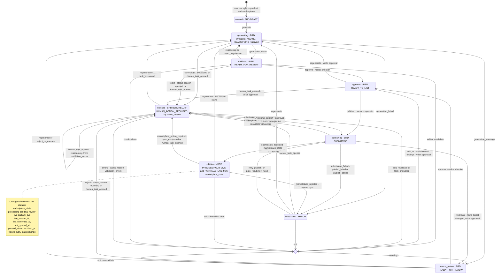

- **A human edit** creates a new `origin='edit'` version and re-runs the deterministic checks in the same request; the diamond is that re-check, not a status. An edit of a `published` listing leaves the live version in place (*live with a draft*); the marketplace state keeps the display at LIVE.
- **The inner states of `generating`** (load_context → retrieve_brand → 4 agents → merge_outputs → validate_schema → validate_rules ⇄ correct (≤ 3, failed fields only) → validate_vision → quality_check) are PipelineStage nodes, stored only in `job_runs.node` [Canon].
- **Fixes vs rev 1 [Fix]:** `publishing → blocked` added (invariant 9 "max 3, then BLOCKED", and SKU_CONFLICT needs a human, L6254); `failed → edit` added (a content rejection needs an edit and re-approval); `blocked → publishing` added (resume after a marketplace permission fix); `published → failed/blocked` from the status sync added; the reaper now leaves an in-flight submission pending; and rev 1's per-field key (`sha256(tenant, listing, version, marketplace, sorted fields)`) gave a corrected resubmission of the same fields the same key, so a deduping marketplace would drop the fix.

### 6.2 `job_runs.status` — 7 JobState values [Canon]

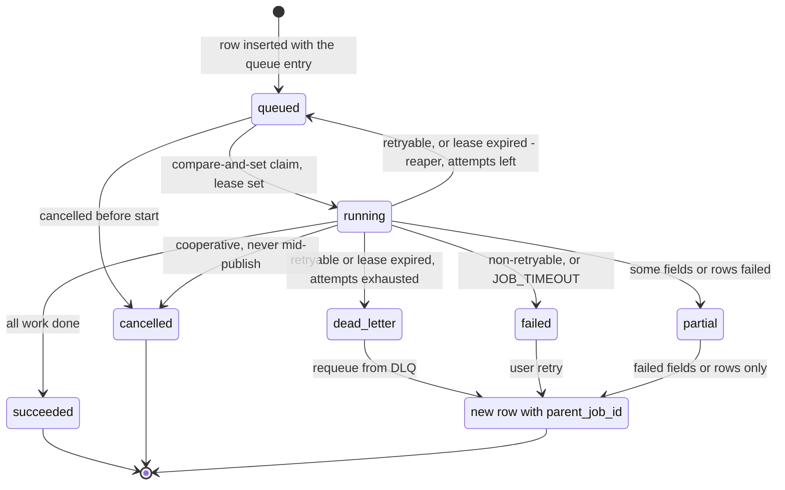

**Proposed rule (needs an ADR):** `retryable=false` → `failed`; retryable with attempts left → `queued` with backoff; retryable and exhausted → `dead_letter`; a dead worker is detected only by the reaper (§5.4), which applies the same two rules. The claim only ever moves `queued → running`. A `blocked` listing is not a DLQ item: it waits in a human queue.

### 6.3 BRD display projection [Proposed, T12, T13; Site L1101-1253]

Nothing is stored: **`listing_display_status(status, status_reason, marketplace_state, paused, archived)`** and **`listing_display_step(status, marketplace_state)`** are IMMUTABLE SQL functions (0004), so renaming a display value is a function replace, not a table rewrite or a three-team enum break. Wire values are the 14 BRD names in lowercase; the FE renders labels (`LIVE`, "Submitted").

| Precedence (first match) | Display |
|---|---|
| `archived_at` set / `paused_at` set | `archived` / `paused` |
| `blocked` with reason `human_task_open` or `marketplace_action_required` | `human_action_required` |
| `marketplace_state` live / partially_live | `live` / `partially_live` |
| else the step: created / generating / validated, needs_review / approved / publishing / published / blocked / failed | `draft` / `understanding` (`classifying` reserved: no classify node in v1) / `ready_for_review` / `ready_to_list` / `submitting` / `processing` / `blocked` (sub-label from `status_reason`, e.g. "Rejected") / `error` |

- **`listing_status_display`** view (`security_invoker = true`, so RLS applies): tenant, listing, product, marketplace, status, reason, marketplace_state, `display_status`, `display_step` (BRD "current step"), `is_live`, `human_action_required`, `live_with_draft`, external_id, marketplace_sku, live_url, last_synced_at, last_event, last_event_at.
- **`product_status_display`** (`security_invoker`), grouped by product. `overall_status`, first match (L1243-1245): all archived → archived; all live or archived → live; any live/partially live → partially_live; any human action or blocked → blocked; any error → error; any submitting/processing → processing; all paused/archived → paused; else the furthest pre-submit step. Plus `open_issue_count` (open `listing_issues`), `human_action_required`, `last_activity_at = GREATEST(product updated_at, max(last_event_at))`, `max(last_synced_at)`. These are the BRD workflow columns `overall_status`, `open_issue_count`, `human_action_required`, `last_updated`: derived, never stored (no drift).
- The spec [17] states map as: REJECTED → blocked/`rejected`; PARTIALLY_PUBLISHED → failed/`publish_partial` (shown as partially_live when some SKUs are live, else error); PUBLISH_FAILED → error. Golden-table test: every combination the CHECKs allow maps to exactly one of the 14 values.

### 6.4 `listing_submissions.outcome` [Proposed]

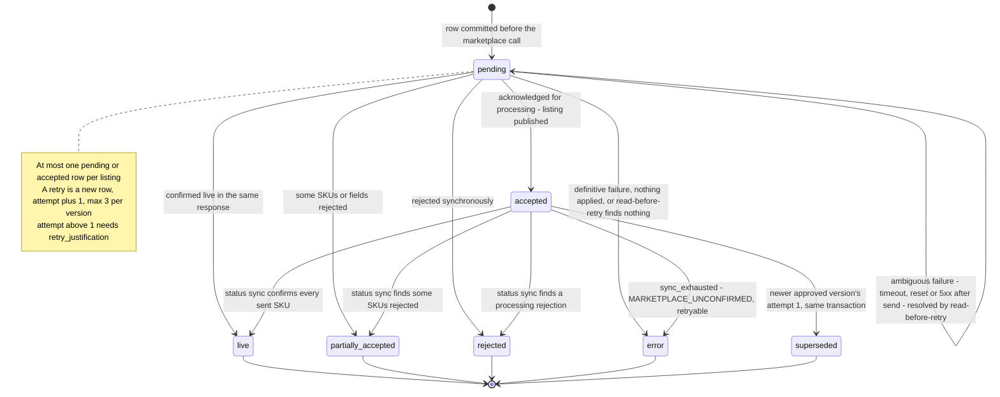

`ListingResult` (site L6516) keeps `published|partially_published|failed` and adds `submission_ref`, `marketplace_state`, `items[ItemResult{product_id, seller_sku, external_id, marketplace_state, live_url, fields}]`; `published` means accepted, not live. Mapping: published → `accepted` (`live` if every item is live); partially_published → `partially_accepted`; failed → `rejected`, or `error` for a definitive failure that applied nothing (an ambiguous transport failure leaves the row `pending`, §5.3). New `ListingStatusSnapshot{external_id, marketplace_state, live_url, items, issues, observed_at}` is returned by `get_listing`.

### 6.5 `listing_issues.status` and `human_tasks.status` [Proposed]

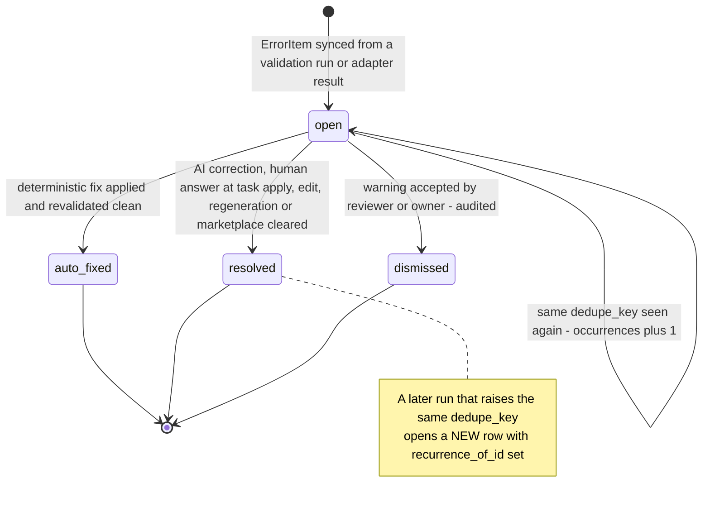

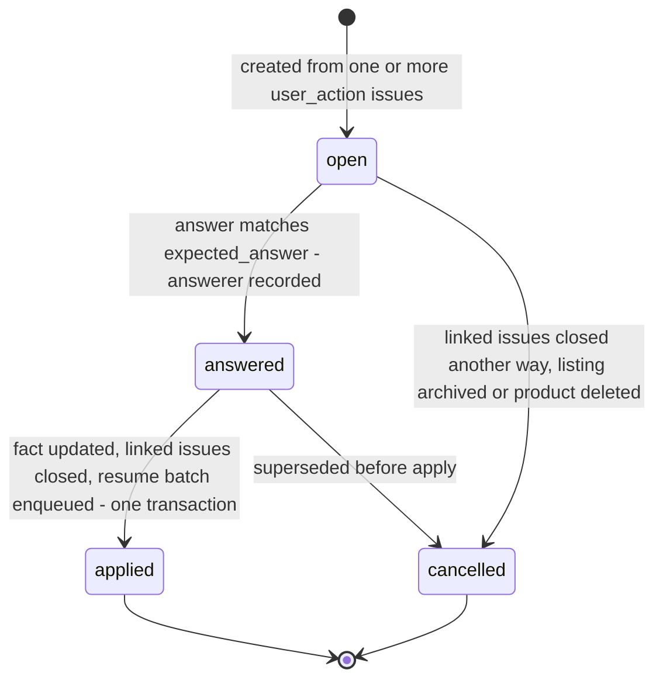

## 7. Key flows

### 7.1 Approve — maker-checker in the API and in the database

Batch-shaped (`items[1..200]`, T42); a single approve is a batch of one. A multi-item approve accepts only `validated` (0 errors, 0 warnings); `needs_review` items are approved one at a time. The permission is `listing:approve` (reviewer or owner). A reject needs `reason_code` + `feedback` and may set `regenerate=true` (event `reject_regenerate`, T40).

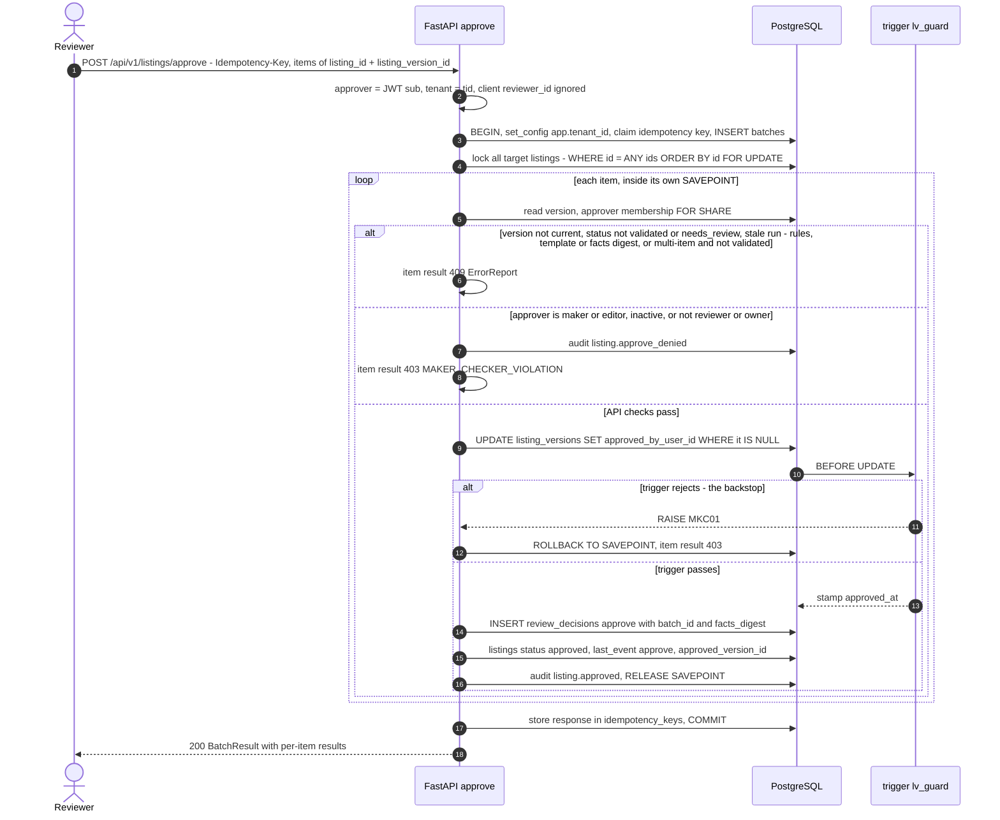

- **Locks are taken once, in id order,** so two overlapping batches, or a batch and a worker's final write, can't deadlock.
- **At publish time,** the approval is checked again by the API, the transition table and the publish-gate trigger.
- **Contracts (`batches.py`, new):** `ApproveItem{listing_id, listing_version_id, decision approve|reject, reason_code?, feedback?, regenerate=False}`, `ApproveRequest{items 1..200}`, `PublishItem`, `PublishRequest`, `RegenerateItem{listing_id, instructions? ≤ 2000}` (rev 3, Site L8121-8123), `BatchItemResult{listing_id, http_status, listing_status?, job_id?, error?}`, `BatchResult`, `BatchAccepted{batch_id, items, poll_url}`, `BatchEnvelope{batch_id, kind, item_count, counts_by_state, items}`. No `reviewer_id` (StrictModel `extra=forbid`). The listing read model adds display_status, display_step, status_reason, marketplace_state, is_live, human_action_required, live_with_draft, external_id, marketplace_sku, live_url, live_confirmed_at, last_synced_at, last_event, last_event_at, paused_at, archived_at, published_version, live_version.
- **Other endpoints [Proposed]:** `POST /api/v1/listings/{id}/pause|unpause|archive|unarchive`; `…/refresh-status` (rate-limited); `GET /api/v1/listings/{id}/submissions` (BRD "Submission attempts" panel, with the payload snapshot via a short-lived signed URL); `GET /api/v1/batches/{batch_id}`. All mutations take an Idempotency-Key.

### 7.2 Enqueue — transactional (Canon ADR-0004) vs enqueue-after-commit (fallback)

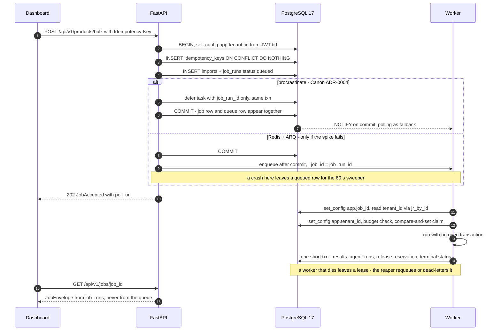

### 7.3 Publish and bounded status sync [Proposed; Site L1041-1087]

`POST /api/v1/listings/publish` answers **202** with a job per item (T46): marketplace calls can exceed request timeouts, and ADR-0004 routes publish through the `publish` queue. Owner or operator only.

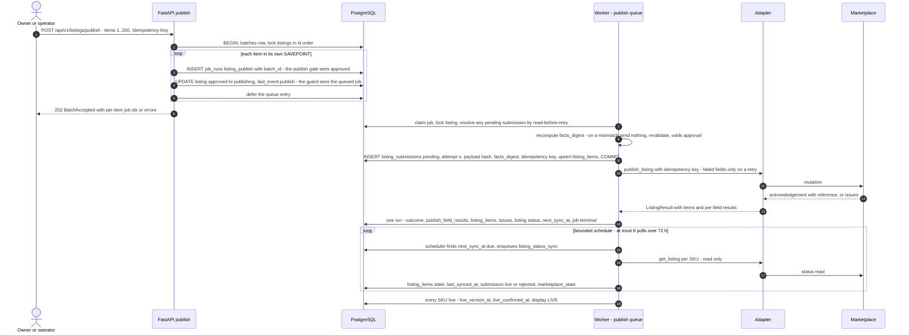

### 7.4 Error resolution loop [Proposed; Site L1344-1358]

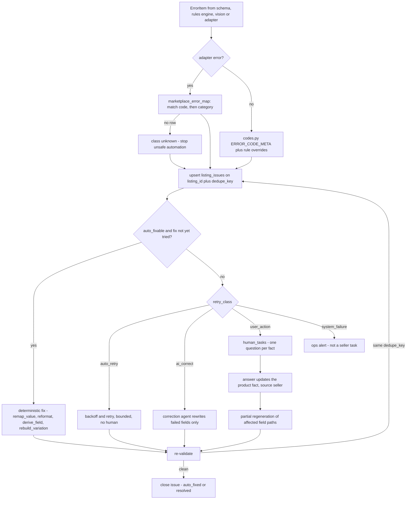

An adapter-side deterministic fix after a rejection (e.g. the §21 size remap) resubmits as `auto_resubmit` only if canonical content is unchanged (approval still current), the payload hash changed and attempts remain (T41); any content or fact change is a new version that needs approval.

## 8. Roles, privileges and migrations

### 8.1 Roles — [Canon 0000] + [Fix KI-B] `app_ro`, `app_platform_ro`

```mermaid
flowchart LR
  SU["host superuser or cloudsqlsuperuser - runs 0000_bootstrap.sql once per env"]
  MIG["migrator - owns every object, runs Alembic, purge, prune and platform loads in the Cloud Run job"]
  RW["app_rw - API and worker pool"]
  PRO["app_platform_ro NOLOGIN - SELECT, secret and contact columns not granted"]
  RO["app_ro - developers, read-only"]
  TT[("tenant tables - RLS ENABLE + FORCE")]
  AUD[("append-only tables")]
  PL[("platform tables - SELECT only")]
  FN["migrator-only - purge_tenant, redact_user, prune_audit_log, prune_append_only, prune_closed"]
  FT["tenant-scoped definers - set_tenant_lifecycle, expire_trials"]
  HF["GUC helpers, audit, fact_map_valid, gtin_valid"]
  SU -->|"extensions, roles, default privileges"| MIG
  MIG -->|"owns"| TT
  MIG -->|"owns"| AUD
  MIG -->|"owns and writes"| PL
  MIG -->|"owns, sole EXECUTE"| FN
  MIG -->|"owns"| FT
  RW -->|"DML under t_tenant"| TT
  RW -->|"INSERT + SELECT only"| AUD
  RW -->|"SELECT"| PL
  RW -->|"EXECUTE"| FT
  RW -->|"EXECUTE"| HF
  RW -.->|"SET LOCAL ROLE in platform_scope"| PRO
  RO -->|"member, INHERIT TRUE"| PRO
  PRO -->|"SELECT under t_platform"| TT
```

**No role has BYPASSRLS.** The host superuser is never used by the app or tests. `app_rw` cannot TRUNCATE, delete tenants, UPDATE/DELETE append-only tables, or write platform tables (brand `rules` rows excepted, §5.2). The two read-only roles can't write, and can't read secret or contact columns.

**Function EXECUTE boundary [Proposed].**
- **Migrator-only:** `purge_tenant`, `redact_user`, `prune_audit_log`, `prune_append_only`, `prune_closed(regclass, cutoff)` (closed issues and terminal tasks). EXECUTE is granted to nobody, so only the owner runs them, from the Cloud Run job logged in as `migrator`. SECURITY INVOKER.
- **Tenant-scoped definers:** `set_tenant_lifecycle` (asserts `p_tenant = app_tenant_id()`) and `expire_trials()`, EXECUTE for `app_rw`.
- **Every SECURITY DEFINER function** declares `SET search_path = pg_catalog, public, pg_temp`. **Helpers** are granted explicitly (§4). **Append-only triggers** check `session_user`, never `current_user`. A dedicated `ops_admin` role is open decision 20.

**Read-only roles get no default SELECT [Proposed].** Each migration grants SELECT per table, and per column on secret- or personal-data tables, so `token_enc`, `hashed_password`, `token_hash`, `state_hash`, `code_verifier`, the `business_parties` contact columns and `gstin`, `import_rows.raw_row` and `human_tasks.answer`/`suggestions`/`evidence` (they can hold the same contact data) are never readable by `app_platform_ro` or `app_ro`.

**Additions to `0000_bootstrap.sql` [Fix KI-B + Proposed]:** create `app_ro` and `app_platform_ro`; `GRANT app_platform_ro TO app_rw WITH INHERIT FALSE, SET TRUE`; on Cloud SQL, `GRANT migrator TO CURRENT_USER WITH INHERIT FALSE, SET TRUE` before `ALTER SCHEMA public OWNER TO migrator` and any `ALTER DEFAULT PRIVILEGES FOR ROLE migrator` (`cloudsqlsuperuser` is not a superuser; verify on staging during the spike); `ALTER DEFAULT PRIVILEGES FOR ROLE migrator REVOKE EXECUTE ON FUNCTIONS FROM PUBLIC`; role timeouts (60 s idle-in-transaction for `app_rw`, 5 s `lock_timeout` for `migrator`), `app_ro` read-only by default; UTC; **passwords only through psql variables** (`ALTER ROLE app_rw PASSWORD :'app_rw_password'`), never in git.

**S5 (verified):** `WITH INHERIT FALSE, SET TRUE` alone does not let a non-superuser run `ALTER DEFAULT PRIVILEGES FOR ROLE migrator`, and a schema grant after the owner change grants nothing; 0000 runs them inside `SET ROLE migrator … RESET ROLE`. The EXECUTE revoke is global (no `IN SCHEMA`); the schema-scoped form leaves PUBLIC EXECUTE in place. Passwords are psql variables holding SCRAM verifiers (`scripts/db/0000_role_passwords.sql`; EXECUTION-PLAN.md:545). That file refuses to send a verifier while the server would log it or `pg_stat_statements.track_utility` is on (the view keeps utility-statement text verbatim, on disk), so set the Cloud SQL flag `pg_stat_statements.track_utility=off`, or leave `pg_stat_statements` unloaded, before running it. It also needs `log_min_error_statement=panic` (it sets it when the login may; on Cloud SQL set the flag), since a failing `ALTER ROLE` would otherwise be logged with its verifier, and it runs the `ALTER ROLE`s in one transaction. A deadlock report logs every waiting statement whatever `log_min_error_statement` says, so inside that transaction the file first takes each target role's row with a no-op `ALTER ROLE … CONNECTION LIMIT` (its current value); no `ALTER ROLE … PASSWORD` then waits on a lock or appears in a deadlock report. Remaining risks: each `ALTER ROLE … PASSWORD` is visible in `pg_stat_activity.query` to superusers and `pg_read_all_stats` members until the next statement, milliseconds later; and (TEAM-QUESTIONS T108, not verified) Cloud SQL Query Insights may capture the query text by its own path on staging.

**CI bootstrap [Proposed]** runs as a non-superuser `CREATEROLE` role, to mimic Cloud SQL. Local dev uses the superuser today, so RLS never runs locally (open decision 9); **[Proposed]** the whole pytest suite runs as `app_rw`.

### 8.2 Migration ledger, re-planned for the 2026-09-27 decisions and rev 2

This needs a Canon PR (A§25) first. The Day 3–12 targets have slipped; the Tech Lead re-baselines them. Nothing exists yet, so these changes cost nothing now.

| Revision | Contents | Status |
|---|---|---|
| `0000_bootstrap.sql` (raw SQL) | extensions `vector, pgcrypto, pg_trgm`; `migrator`, `app_rw`, default privileges; **+** `app_ro`, `app_platform_ro`, Cloud SQL self-grant, EXECUTE revoke, timeouts, password variables | [Canon] + [Fix KI-B] + [Proposed] |
| `0001_core_tenancy` | `set_updated_at()`, GUC helpers, **`fact_map_valid()`, `gtin_valid()`** + grants, naming convention; `tenants` (+ lifecycle, JSONB CHECKs), global `users`, `tenant_memberships`, `invitations`, `products` (+ family + fact columns), **`brand_profiles`, `business_parties`, `product_colourways`, `variant_matrix_cells`: 3 → 9 tables**. [S6] `audit()` is not in 0001: it writes `audit_log` (0002) and is created in `0004_integrity`. The case-fold `variant_key` collision (`M/Navy` vs `m/navy`) is proven with the 0004 variant guard, which writes the key; 0001 has the unique index on stored keys | [Canon] + [ADR-0006/0007] + [Site] + [Proposed] |
| `0002_listing_pipeline` | `rules_revision_seq`; the 11 Canon tables (membership FKs, nullable `audit_log.tenant_id`, rules key + promoted columns, `marketplace_accounts` settings/status + anchor, `images` colourway/metadata/status, `brand_chunks.updated_at`, `performance` key, `agent_runs` trigger CHECK + index); **+** `review_decisions`, `batches`, `listing_items`, `human_tasks`, `listing_issues` (**16 tables**); listings, listing_versions and validation_runs columns; template pin columns without FKs; soft `job_id` columns | [Canon] + [Site] + [Fix] + [Proposed] |
| `0002b_brand_chunks_hnsw` | HNSW + partial index, AUTOCOMMIT; asserts pgvector ≥ 0.8.2 | [Canon ADR-0003] |
| `0003_ops_tables` | the 6 Canon tables (`job_runs` + kinds + `batch_id` FK; `category_templates` versioned) **+** `oauth_states`, `rate_limit_counters`, `listing_submissions`, `publish_field_results`, `attribute_definitions`, `attribute_columns`, `category_attributes`, `marketplace_error_map` (**14 tables**); then `ADD CONSTRAINT … NOT VALID` + `VALIDATE` for `li_error_map_fk`, the `validation_runs` template pin and `listing_versions.category_template_id` (empty tables, instant). FKs into `job_runs` come only from this revision | [Canon] + [Canon ADR-0004/0005] + [Site] + [Proposed] |
| `0003b_procrastinate` | procrastinate's shipped schema (3.10) + grants. [S8] The 3.10.0 `schema.sql`, vendored byte for byte as `apps/api/alembic/sql/procrastinate-3.10.0-schema.sql` (a test compares it with the pinned library), then the spike's GRANT loop: EXECUTE for `app_rw` on every non-trigger `procrastinate%` function; the downgrade drops every `procrastinate_%` table, function and type | [Canon ADR-0004]; [Pending spike] |
| `0004_integrity` | **+ `listing_status_transitions`** (platform) + 63-row seed; `audit()` + its grant (moved from 0001, S6); `lv_guard`, append-only (purge-aware), table-driven `listings_status_guard`, `li_guard`, `ls_guard`, `facts_guard`, variant + `variant_matrix_guard` + deferred matrix check, colour-image guard, `listing_issues_guard`, `human_tasks_guard`, review bulk backstop, rules/template/error-map/dictionary guards, job guards + publish gate + reaper edges, last-owner guard; REVOKEs, column grants; display functions + 2 views; `purge_tenant()`, `redact_user()`, `prune_*()`; `set_tenant_lifecycle()`, `expire_trials()` **[S10] Built** in `apps/api/alembic/sql/0004/` (ordered `NN_name.up.sql`/`.down.sql` pairs); `audit(p_tenant_id, p_actor_type, p_actor_user_id, p_action, p_entity_type, p_entity_id, p_before, p_after, p_reason, p_request_id, p_job_id, p_ip, p_actor_email) RETURNS void`. `facts_guard` and `app.cli dictionary sync` move out to S13's ledger-claimed revision `0007_facts_guard` (S13b, **Built**: PRV01-PRV03 on changed keys, a malformed map left to the 0001 CHECK), after the dictionary loads in CI. SQLSTATEs DATABASE.md leaves unnamed: `OWN01` last owner (→ `LAST_OWNER_REQUIRED`), `REV01` bulk backstop, `GRD01` every other guard refusal (→ `INTERNAL_ERROR`); `LST02` carries CONSTRAINT `paused` or `archived`; `VAR01`/`VAR02` → `VARIATION_INVALID`/`VARIANT_MATRIX_INCOMPLETE`. Purge and prune GUCs: `app.purge_tenant`, `app.prune_table` (a regclass), `app.redact_user`. | [Canon] + [Site] + [Proposed #6] (ADRs before 0004) |
| `0005_rls` | ENABLE + FORCE, 3-policy template on every tenant table, including the 14 new ones: `tenant_memberships`, `invitations`, `brand_profiles` (works because tenant_id is its PK), `business_parties`, `product_colourways`, `variant_matrix_cells` (0001); `review_decisions`, `batches`, `listing_items`, `human_tasks`, `listing_issues` (0002); `oauth_states`, `listing_submissions`, `publish_field_results` (0003). The catalog assertion (RLS forced on every table with `tenant_id`) is the real check, not this list. Plus identity branches, `jr_by_id`, and the 5 `rules` policies (§5.2); platform tables allowlisted; staging first; the Canon "settings flag" → a migrator-run emergency DISABLE script, kept 1 week. **[S10] Built** in `apps/api/alembic/versions/0005_rls.py`: the template policies `t_tenant`, `t_platform`, `t_migrator`; branches `users_self`, `users_login`, `users_signup` (INSERT on the login email), `users_teammates`, `memberships_own`, `tenants_switcher`, `refresh_tokens_hash`, `refresh_tokens_own`, `invitations_hash`, `oauth_states_hash` (on `state_hash`), `jr_by_id`, all SELECT-only but signup; `rules_read`, `rules_write`, `rules_toggle`; `audit_read`, `audit_insert`. The script is `scripts/db/rls_emergency_disable.sql` | [Canon] + [Fix] |
| `0006_oauth_pending` | **[S15]** `oauth_states` pending columns `token_enc`, `kms_key_version`, `seller_id`, `region`, `scopes`, `token_expires_at` (nullable, no default); the 3 CHECKs `ck_oauth_states_pending_complete`, `_no_verifier`, `_bounds` (`NOT VALID` + `VALIDATE`); 0005's SELECT-only `oauth_states_hash` replaced by `oauth_states_hash_select` + `oauth_states_hash_delete` with `token_enc IS NULL`. No `marketplace_accounts` change (the global seller key is 0002's `uq_marketplace_accounts_marketplace_seller_id`). Downgrade deletes pending rows and restores 0005's policy. S15 merged before S13b, so it holds 0006 and S13b's `facts_guard` takes 0007 | [Proposed] (R1) |
| `0009_analytics_trace` | **[S23]** `job_runs.traceparent text` (nullable) + CHECK `ck_job_runs_traceparent_format` (NOT VALID, then validated in its own transaction); 4 analytics read indexes built `CONCURRENTLY` (each after `DROP INDEX CONCURRENTLY IF EXISTS`): `ix_listing_versions_tenant_id_created_at_generated (tenant_id, created_at) WHERE origin IN ('generation','regeneration')`, `ix_review_decisions_tenant_id_decided_at (tenant_id, decided_at) INCLUDE (decision)`, `ix_validation_runs_tenant_id_created_at_first_pass (tenant_id, created_at) INCLUDE (passed, marketplace) WHERE source = 'rules_engine' AND attempt = 1`, `ix_listing_submissions_tenant_id_responded_at (tenant_id, responded_at) INCLUDE (outcome, marketplace) WHERE responded_at IS NOT NULL`. Claimed in parallel with S21's `0008_publish_retry_condition`; re-parented onto it at rebase. **Built** | [Proposed] S23 |

```mermaid
flowchart LR
  B0["0000 bootstrap.sql - superuser"] --> M1["0001 core tenancy - 9 tables"]
  M1 --> M2["0002 listing pipeline - 16 tables"]
  M2 --> M2B["0002b HNSW"]
  M2B --> M3["0003 ops - 14 tables"]
  M3 --> M3B["0003b procrastinate"]
  M3B --> M4["0004 integrity - 1 platform table, guards, views"]
  M4 --> M5["0005 RLS - staging first"]
  M5 --> MN["0006 onward - expand/contract, ids claimed in the Canon first"]
```

**CI** (`docs/RULES.md` §8; EXECUTION-PLAN.md §4.4): bootstrap → upgrade → `alembic check` → downgrade → upgrade → **platform data loads** (`app.cli dictionary sync`, `templates load`, `errors load`, all idempotent) → pytest, with the isolation job running as `app_rw`. Rev 2 ran the dictionary sync before the downgrade, so pytest started with an empty dictionary and `facts_guard` raised `PRV02` on every product write. **The deploy Cloud Run job** runs the same loads after every `upgrade`, so a fresh environment is never left without its dictionary; the v1 transition seed stays in 0004 because the guards read it. **squawk** on the rendered SQL, `0003b` included [Decided #5]; rules in §8.3.

**Proposed catalog assertions** (what `alembic check` can't see): RLS forced, with its policies, on every tenant table; `app_rw` has no UPDATE or DELETE on append-only tables and no write on platform tables; no function executable by PUBLIC; the helper grants exist; `app_rw` holds no EXECUTE on migrator-only functions; every SECURITY DEFINER function has a `search_path`; `app_platform_ro` and `app_ro` hold no privilege on any column matching `(token|hash|password|secret|verifier|_enc)$`, the party contact columns, `gstin`, `import_rows.raw_row` or `human_tasks.answer|suggestions|evidence`; `purge_tenant()` covers every table with `tenant_id`, in an order that respects every FK, and every table appears in the retention map (§9); **no hard FK runs from a table with longer retention to one with shorter retention** (soft references instead, §1).

**Proposed CI tests** for the database backstops:
- purge: seed `--profile demo`, drive one listing to `approved` and `published`, run `purge_tenant(acme,'data')` then `'final'`; zero `acme` rows remain and `bharat`'s counts are unchanged;
- `kill -9` of a worker during generate and during publish (the reaper), and between the pending-submission COMMIT and the response (read-before-retry resolves it; no duplicate submission);
- two-connection races: approve vs deactivate, two owners demoting each other, a child insert vs a style soft-delete, two publish jobs on one listing (`ux_ls_open` lets exactly one win), two task answers on one product (no lost key);
- maker-checker property tests, including a partial regeneration after a human edit;
- the transition table is exhaustive; the display golden table; a 4th attempt is refused; the same payload after a rejection is refused (`SUB01`), and so is a patch that resends the same failed values; `ck_live_minimum` blocks LIVE without an id or sync time; a paused listing freezes status; a 200-item approve with one `MKC01` and one `needs_review` item;
- publishing ledger (rev 3): `sync_exhausted` → `resume_publish` yields exactly one new attempt; regenerate → approve → publish while the old submission is `accepted` supersedes it; permission denied → task answered → resume → exactly one new attempt (`human_resolution`), with the issue closed or recurred; a timeout after send leaves `pending`, and the next job resolves it by read before inserting; a fact changed after approval makes the publish job revalidate instead of sending, and `ls_guard` refuses a stale `facts_digest` (`SUB04`); a Flipkart family (no parent SKU) reaches LIVE;
- statement order: a publish that UPDATEs `listings` before inserting its job fails; a review decision made in an earlier transaction doesn't satisfy the guard;
- facts: `fact_map_valid` ↔ Pydantic golden test; an `ai` source on a critical key raises `PRV01`; after a key turns critical, a write to another key of a product holding an old `ai` value still succeeds; a prunable evidence ref without a snapshot fails the CHECK; two import rows with one `legal_name` and no address make one party; GTIN check digits and the EAN-13/GTIN-14 collision; the matrix is complete after an import; a soft-deleted child without its cell flipped raises `VAR02`;
- the BRD §21 walkthrough as an automated E2E (T8): lining asked once → answered → partial regeneration → approve → one size rejected → adapter remap → attempt 2 `changed_input` → Amazon LIVE while Flipkart shows PROCESSING;
- a limiter test with one request held open; the vector recall test (§5.5).

### 8.3 Expand/contract rules — [Decided 2026-09-27 #5]

Rollback means **redeploying the previous tag against the new schema**; there is no prod downgrade. So release N must work with release N−1's code.

```mermaid
flowchart LR
  N["Release N - expand: nullable column or table, index CONCURRENTLY, constraint NOT VALID, code writes both"] --> N1["N+1 - batched backfill via app.cli, VALIDATE, read new"]
  N1 --> N2["N+2 - stop touching old"]
  N2 --> N3["N+3 - contract: drop old"]
  RB["Rollback = redeploy previous tag"] -.-> N
```

- **Allowed in one release:** new tables; nullable or constant-default columns; `CREATE INDEX CONCURRENTLY`; `ADD CONSTRAINT … NOT VALID`, then `VALIDATE` in the next release; widening a CHECK (drop it, re-add it `NOT VALID`); a new CHECK function under a **new name** (a replaced function doesn't re-check existing rows); adding a transition-table row or a dictionary/template/error-map row, or widening a dictionary row (data, loaded by migrator).
- **Never in one release:** renames or type changes; dropping anything the previous tag still uses; narrowing a CHECK; removing a transition row; adding or tightening a guard trigger, an RLS policy or a column REVOKE before the code that satisfies it has shipped; changing a GENERATED expression (`colour_key`, `dedupe_key`; `job_runs.queue` and `error_code` are plain columns for this reason); a plain `SET NOT NULL` (use the validated-CHECK trick); **narrowing a dictionary row** (`is_critical` → true, `enabled` → false, fewer `allowed_sources` or `owner_levels`, a new `critical_override`): it is a guard tightening shipped as data, so it takes two steps, first the Rules Engine reports violations (its `rules_version` moves) and a backfill fixes them, then the narrowed row loads.
- **procrastinate upgrades** use its pre/post migration split. **Code writes a new vocabulary value one release after the schema accepts it.** **Every revision** starts with `SET lock_timeout = '5s'`; backfills are idempotent, batched `app.cli` commands.
- **squawk rules:** `require-concurrent-index-creation`, `constraint-missing-not-valid`, `adding-foreign-key-constraint`, `adding-not-nullable-field`, `changing-column-type`, `renaming-column`, `ban-drop-column`, `prefer-timestamp-tz`, `prefer-robust-stmts` [Proposed]. 0001–0005 may be exempted until the first prod tag.
- **0000 role changes survive a redeploy,** so they must be additive only.

## 9. Data lifecycle

**Backups [Canon ADR-0001] + [Proposed].**
- **Prod [Canon ADR-0001]:** Cloud SQL automated backups and **PITR 7 days** (enabled at creation), zonal. **[Proposed]:** backups kept 30 days, and a weekly logical export kept 35 days, satisfying ADR-0001's asia-south1 org policy: an asia-south1 bucket in a separate project with a retention lock, or an explicit exception for asia-south2 (open decision 3). **Staging:** 7 days + PITR.
- **Targets [Proposed]:** **RPO ≤ 5 min**; **RTO ≤ 2 h** for logical damage (clone, swap the secret, redeploy), **≤ 4 h** if the zone is lost (ADR-0001 is zonal; HA roughly doubles the cost; open decision 3).
- **Restore drills** before launch, then quarterly, into an isolated instance: check `alembic_version`, row counts, forced RLS, an `app_rw` login and one `token_enc` decrypt; restore the weekly logical export with `pg_restore` too (CHECK helpers must survive `search_path = ''`, §4). **KMS key versions** are never destroyed while any backup still uses them.

**Retention [Proposed; needs an ADR and counsel].**

| Data | Kept |
|---|---|
| Tenant business data (incl. `brand_profiles`, `business_parties`, `product_colourways`, `variant_matrix_cells`, brand `rules`) | life of the tenant, then purged |
| `audit_log` | 24 months proposed; never under 12 (DPDP log minimum, to confirm) |
| `agent_runs`, `validation_runs` | 13 months (append-only: migrator prune) |
| `review_decisions`, `listing_versions`, `batches` | life of the tenant |
| `listing_items`, `listing_submissions` (+ payload and raw-response objects), `publish_field_results`, `listing_publish` jobs | life of the listing |
| `listing_issues`, `human_tasks` | open: life of the listing; closed or terminal: 13 months (`prune_closed`); references between them are soft (§5.7), so pruning order doesn't matter |
| `job_runs` (other kinds) | 90 days (180 if `failed`/`dead_letter`), pruned by whole requeue chain |
| `imports`, `import_rows`, CSV objects | 90 days |
| `idempotency_keys` / `refresh_tokens` / `invitations` / inactive `brand_chunks` | 24 h / 7 d after expiry / 30 d / 30 d |
| `oauth_states` / `rate_limit_counters` | deleted hourly once expired, state and pending rows alike (S15 `oauth_states_prune`) / 5 min, deleted every minute |
| procrastinate jobs | succeeded: 7 days (`remove_old_jobs`); others follow `job_runs` |
| platform tables (`category_templates`, `rules` platform rows, `attribute_definitions`, `attribute_columns`, `category_attributes`, `marketplace_error_map`, `listing_status_transitions`) | kept; disabled, never deleted (runs pin them) |

**Pruning [Proposed].**
- **Fact evidence outlives its source rows.** Facts live for the life of the product, but `import_rows` go at 90 days and `human_tasks`/`agent_runs` at 13 months. So a Fact whose `evidence_ref` has a prunable kind carries an `evidence_snapshot` written with it (§5.6, enforced by `fact_map_valid`); after pruning the ref dangles harmlessly and the proof stays readable. Matrix cells' `import:<id>` refs may dangle the same way.
- **Mutable tables:** a daily task loops over tenants with `set_config` and deletes in batches of 1,000, children first (`import_rows`, `imports`, then `job_runs`).
- **`job_runs` chains** are deleted only when every member is terminal and past its cutoff; job references from longer-lived tables are soft, and `parent_job_id` is NO ACTION, so no SET NULL ever UPDATEs a terminal row.
- **Tables where `app_rw` has no DELETE** (`audit_log`, `agent_runs`, `validation_runs`, closed `listing_issues`, terminal `human_tasks`) are pruned only by the migrator-only `prune_audit_log(cutoff)`, `prune_append_only(regclass, cutoff)` and `prune_closed(regclass, cutoff)`, run from the Cloud Run job. Each refuses a cutoff inside its table's floor and sets the prune GUC the triggers check. The §8.2 catalog assertion fails if a table is missing from this map.

**Tenant lifecycle and DPDP erasure** [Decided 2026-09-27 statuses; Proposed #6 purge; Fix KI-B "audit CASCADE vs append-only"]:

```mermaid
stateDiagram-v2
  [*] --> trial : staff creates tenant, invites owner
  [*] --> active : staff creates paid pilot
  trial --> active : plan set
  trial --> suspended : trial ended - expire_trials, or staff
  active --> suspended : non-payment or abuse
  suspended --> active : reinstated
  trial --> offboarded : staff offboards
  active --> offboarded : contract ends or erasure request
  suspended --> offboarded : not resolved
  offboarded --> active : reactivated before purge_after
  state "offboarded - data purged" as data_purged
  offboarded --> data_purged : purge_tenant data, after purge_after
  state "erased - platform tombstone only" as erased
  data_purged --> erased : purge_tenant final, after audit retention
  erased --> [*]
```

1. **Offboard.** `status='offboarded'`, `offboarded_at`, `purge_after` = + 30 days (proposed). Logins and jobs are refused; marketplace tokens are crypto-shredded immediately; listings are paused by the system.
2. **`purge_tenant(t, 'data')`**, migrator-only, from the Cloud Run job. It runs `SET CONSTRAINTS ALL DEFERRED` (listings ↔ listing_versions, item version pointers) and deletes every tenant table except `tenants`, `tenant_memberships` and `audit_log`, children first: `publish_field_results` → `listing_submissions` → `listing_items`; `listing_submissions` and `imports` before `job_runs`; `review_decisions` and `job_runs` before `batches`; `listing_issues` → `human_tasks`; `variant_matrix_cells` → `product_colourways`; `images`; products; `brand_profiles`, then `business_parties` (RESTRICT FKs). It nulls `actor_email` and `ip` in the tenant's audit rows, pseudonymises users with no other membership, and deletes the tenant's storage prefix (payload snapshots included).
3. **`purge_tenant(t, 'final')`,** after audit retention: deletes the audit rows, then the tenant (cascading to memberships), then orphaned users (`RESTRICT` protects anyone in another brand).

The append-only triggers allow these deletes only when `session_user = 'migrator'` and `app.purge_tenant` matches. Each phase writes a `tenant.purged` platform tombstone (`tenant_id` NULL, `after = {mode, row_counts, backups_expire_by}`). Erasure is complete once backups expire (≤ 35 days).

**User erasure [Proposed].** `redact_user()`, migrator-only (it acts on a global user across tenants): replaces the email with a placeholder, clears the password hash and sets `erased_at`, deactivates memberships, deletes tokens and invitations, nulls `actor_email` and `ip` in audit rows. Party contact data is business data of the tenant; a sole proprietor's erasure request is handled by editing or soft-deleting the party, **and** by redacting the same data where it was copied: `import_rows.raw_row` (or deleting the import early) and `human_tasks.answer`/`suggestions`/`evidence`, by the migrator under the redact GUC (open decision 4).

## 10. Scaling path, and what we deliberately do NOT do now

| Stage | Trigger | Moves |
|---|---|---|
| **1 — now** | 5–30 tenants, ~50k products | one zonal Cloud SQL primary, scaled vertically (`db-custom-1-3840` → `2-7680` on a CPU or latency alarm, ADR-0001) |
| **2** | ~100–1,000 tenants | managed pooler (psycopg `prepare_threshold=None`; LISTEN stays direct); read replica for platform reads; time partitioning of append-heavy tables, **only with automated partition creation**; GIN on `products.attributes` if per-key search is needed; move the listing sync schedule columns to a narrow 1:1 table if HOT-update loss on `listings` shows up |
| **3 — global** | many regions | cells: a stack per region, each tenant in a home cell, a thin global directory (tenant → cell, email → user); UUIDs + `tenant_id` make a move an export/import |

**Connection budget per environment.**

| Env | Limit | Pools | Total |
|---|---|---|---|
| prod [Canon ADR-0001] | `max_connections = 100` | API 3 × (5 + 5) = 30; worker 2 × (app 10 + procrastinate 5) = 30; migration job 5; proxy/admin 10; reserved 3 | **78** |
| staging [Proposed] | `db-f1-micro` default is about 25 (verify), or set the flag | API 1 × (2 + 2) = 4; worker 1 × (app 4 + procrastinate 3) = 7; migration job 2; proxy 5 | **18** |

The rate limiter's autocommitted statement, the reaper and the sync scheduler use the same pools. Recompute whenever instances or pools change. **Vectors past ~5–10M chunks:** a `halfvec(1536)` index or per-tenant partitioning; a separate vector DB needs an ADR (named non-goal).

**Not now:** sharding/Citus, partitioning, replicas, PgBouncer, CDC/Kafka, multi-region, a separate vector DB, Redis, materialized analytics views, premium engines, marketplace webhooks. **Kept open cheaply:** UUID keys; `tenant_id` on every row; transaction-local GUCs (safe with a pooler); expand/contract; no blobs in the database; locale-tagged content (a second language is language-tagged values inside one listing, not a second listing; a per-Fact `lang` key can come later).

## 11. Open decisions, changes vs the Canon, and deviations from the site

### 11.1 Open decisions

Rows marked **→ Tn** moved to TEAM-QUESTIONS and are built on its Default.

| # | Decision | Owner |
|---|---|---|
| 1 | ADR-0004 spike: procrastinate, or fall back to Redis + ARQ (T3) | Tech Lead (user) |
| 2 | Approve the Proposed and [Fix] items of §11.2: catalogus #1–#4, #6, #7, and this doc's pointers, guards, grants, reaper, budget reservation, soft job references and the rev-2 designs | user |
| 3 | Hosting leftovers: `GRANT … WITH INHERIT FALSE, SET TRUE` and the non-superuser bootstrap on Cloud SQL (local half answered by the S5 mimic (`make bootstrap`); staging confirms); HA; backup-export location; staging `max_connections` | user |
| 4 | Audit retention (24 mo?), offboarding grace (30 d?), DPDP log minimum, erasure of a sole proprietor's party data (incl. its copies in `import_rows` and `human_tasks`, §9) | user + counsel |
| 5 | `tenants.plan` vocabulary; what happens at `trial_ends_at` | client |
| 6 | Invitation TTL; transactional email provider | user |
| 7 | `reject` semantics → **T40**; statuses → **T12** | client |
| 8 | Who can invite or promote an owner; ownership transfer; password reset in v1 | user |
| 9 | Run the local app as `app_rw` (new env names) | Tech Lead |
| 10 | Per-request membership check; regenerating makes you the maker; contributor chain; the answerer is the maker (**T51**) | user |
| 11 | Does "max 3" count corrections (attempt 1..4) or all attempts (1..3)? (S18 default, D8: at most 3 `validate_rules` port calls; a 4th gets `INTERNAL_ERROR`; the backend re-check is attempt n+1 ≤ 4) | AI team |
| 12 | The merged `codes.py` additions and `request`/`listing` paths (§5.7) | Tech Lead |
| 13 | Rename `gcs_uri` → `storage_key`; `ImportReport.batch_id` → `import_id` (a site departure too: **T67**) | Tech Lead + FE |
| 14 | UUIDv7 generated in the app, or v4 until PG18 | Tech Lead |
| 15 | Variant publishing grain, Flipkart parent row, publish order → **T45** | client + adapters |
| 16 | Performance metrics and report sources (**T14**) | client + adapters |
| 17 | The ops role (KI-A): who may clear `blocked` and failed-publish listings and requeue DLQ rows | client + user |
| 18 | Invitation email delivery: a `job_runs` kind or a procrastinate task outside `job_runs` | user |
| 19 | Invariant 7 on timeout or crash: partial `agent_runs` on cancellation | AI team + Tech Lead |
| 20 | Migrator-only functions under the `migrator` login, or an `ops_admin` role | Tech Lead |
| 21 | Claim **ADR-0012** "Product facts, provenance and compliance" (amends ADR-0007; records the T31 default) before 0001 | user |
| 22 | A **listing lifecycle and publish ledger** ADR (C2/C3/G3/G16) before 0002, and an **issues, tasks, rules and templates** ADR (G5/G6/G7/G18/G19) | user |
| 23 | Contract changes before schemas-v1.0.0, all needing the three leads: `facts.py` (incl. `evidence_snapshot`, rev 3), `batches.py` (incl. `RegenerateItem`), RuleDef members, CategoryTemplate, ErrorItem fields, enums, codes, `ImageSlot += packaging_label` (T28), `GenerationContext.product/locale/review_feedback/user_instructions` (`user_instructions` is rev 3, Site L8004, L8121-8123), CanonicalListing `locale`/`attribute_sources` (+ T61, T26) | Tech Lead + AI + FE leads |
| 24 | Credential-use audit actions (G11); `audit_log.reason` and the non-personal old/new allow-list are now in §5.1 (rev 3) | Tech Lead |
| 25 | G12: finer publishable media roles (detail vs back vs side; `packaging_label` added in rev 3) and whether per-image-per-marketplace verdicts become a child table (T63) | user |
| 26 | G9: `validate(listing, facts, account_settings)` behind the frozen `PipelineDeps.validate_rules` | AI team + Tech Lead |
| 27 | Verify in the adapter step: SP-API ACCEPTED vs BUYABLE; notifications via SQS/EventBridge; issue categories for the error map | adapters |
| 28 | Measure `facts_guard` per-row cost on a 1k-row import (S13) | Tech Lead |
| 29 | `google-re2` as a pinned dependency under ADR-0005 | Tech Lead |
| 30 | How a fact-only change (e.g. a new MRP) reaches a `published` listing: no text change means no new version, and no edge re-publishes the same version with new facts (rev 3, found by the facts-digest design) | user + client |
| 31 | Re-approving a version whose approval a `revalidate` voided: `approved_by_user_id` is set once and `review_decisions` allows one `approve` per version, so S19 answers 409 `INVALID_STATUS_TRANSITION` ("edit or regenerate to approve again"); an approval history per version needs a migration (**T124**) | user |

### 11.2 Changes vs the Canon

| # | Canon says | This doc says | Why | ADR / PR |
|---|---|---|---|---|
| 1 | `users` unique per `(tenant_id, lower(email))` | global `users`; anchor = `tenant_memberships (tenant_id, user_id)` | ADR-0006; KI-A (T23) | ADR-0006 (proposed; provisional until T23) + Canon row |
| 2 | 0004: approver in the same tenant via `users` | actor FKs → memberships; trigger checks role + active | ADR-0006 | same |
| 3 | 0001 = tenants, users, products | + lifecycle, `auto_publish`, memberships, invitations, variant and fact columns, brand_profiles, business_parties, colourways, matrix cells | ADR-0006/0007/0008; Site BRD §5-§7 | ADR-0012 + ledger |
| 4 | `audit_log.tenant_id NOT NULL`, CASCADE; append-only at trigger + privilege layer | nullable + CHECK; NO ACTION; two-phase purge; migrator-only exemption on `session_user` + GUC; per-entity allow-list of non-personal old/new values; `reason` column | Fix KI-B; Site L929, L1268 | ADR before 0004 |
| 5 | 0005 `current_setting(…)::uuid` + `SET LOCAL` | `set_config(…, true)` + `nullif` helpers | Fix KI-C | Canon PR |
| 6 | 0005 behind a settings flag | staging first + emergency DISABLE script | a migration can't sit behind a flag | Canon PR |
| 7 | 0000 creates `migrator`, `app_rw`; no passwords | + `app_ro`, `app_platform_ro`, EXECUTE revoke, Cloud SQL self-grant, psql-variable passwords; per-table/per-column grants | Fix KI-B | Canon PR |
| 8 | A§6 `platform_scope` = SCOPE_OK + READ ONLY | + `SET LOCAL ROLE app_platform_ro` | Fix KI-B | Addendum PR |
| 9 | A§4 rules key has no type or attribute; v1 platform-only; A§17 "tenant shadows platform" | promoted `rule_type`/`subject`/`pack` + `revision`; 14 RuleDef types; v1 brand rules (2 types), tighten-only, never shadow; `tenant_id` CASCADE | Fix KI-B; Site [62], [70]; invariant 2 (T48, T55) | ADR + Addendum PR + `rules.py` docstring |
| 10 | 0002 = 11 tables, 0003 = 6 | 0001 = 9; 0002 = 16; 0003 = 14; + `0003b`; 0004 adds 1 platform table | rev-2 designs; ADR-0004/0005 | ledger PR (A§25) |
| 11 | `job_runs` columns per the Canon; ADR-0004 removes the sweeper | + `queue` (plain), lease, `error_code`, `batch_id` FK, `cost_reserved_usd`, kind `listing_status_sync`; lease reaper; `jr_by_id` | ADR-0004 gaps; BRD L1057 | ADR-0004 addendum |
| 12 | `listings` stores only a status | + version pointers (published = accepted, live), marketplace identity and LIVE columns, `status_reason`, `last_event`, pause/archive, sync schedule, account id; table-driven transitions; display projection | Site L1081-1087, L1101-1193; invariants 1, 3 (T12, T13) | lifecycle ADR |
| 13 | local `DATABASE_URL` = superuser | local app runs as `app_rw` | RLS never runs in dev | ADR + Canon row |
| 14 | `refresh_tokens` user FK unspecified | composite FK → memberships; `family_id` | ADR-0006 | same as #1 |
| 15 | no rollback strategy | expand/contract, squawk | Decided #5 | release ADR (ADR-0009) |
| 16 | 0001 `CHECK (hashed_password IS NOT NULL OR auth_provider IS NOT NULL)` | `… OR erased_at IS NOT NULL` | user erasure (DPDP) | erasure ADR + Canon PR |
| 17 | A§6 `platform_scope(readonly=False)` for seeding and DLQ requeue | always SELECT-only; cross-tenant writes loop per tenant; platform rows by `migrator` | a SELECT-only branch can't write | Addendum PR |
| 18 | `docs/RULES.md` §3: tenant only from the verified JWT `tid` | tenant switch reads the requested tenant, checked against memberships | ADR-0006 | ADR + `docs/RULES.md` edit |
| 19 | 0005: one policy template on every tenant table | + named invariant-5 exceptions (login email, token hashes, `jr_by_id`, switcher), each tested | pre-login and pre-GUC reads | ADR + Canon PR |
| 20 | Canon publish asserts `status='approved'` (row 124) | `approved_version_id = current_version_id` and status `approved`, `failed` (retry, `auto_resubmit`) or `blocked/marketplace_action_required` (resume); ≤ 3 submissions per version | invariants 9, 10; Site L1358 (T41) | Canon PR |
| 21 | spec `marketplace_accounts.token_enc BYTEA NOT NULL` | nullable + CHECK | crypto-shred (T27) | erasure ADR |
| 22 | job references are FKs (drafts) | soft `job_id` on long-lived tables; `listing_versions.job_run_id` → `job_id`; `products.created_by_user_id` → `created_by` | 90-day pruning; one name per concept | same as #12 |
| 23 | `CategoryTemplate` = required + optional attributes | + conditional/unsupported, `variation_themes`, `specs` per canonical key with `value_map`; `for_generation()`; table versioned with `is_current` | ADR-0007; Site L855-859 (T49, T53) | MINOR `mkos-schemas`, three leads |
| 24 | Canon 0001 `products` (sku, title, attributes, category, …) | + BRD identity/classification, commercial, compliance, identifier, dimension columns; `attributes` = Fact envelopes; `provenance`; `facts_guard` | Site BRD §6, §11, §18 (T32-T37, T39) | ADR-0012 + Canon PR |
| 25 | ADR-0007: two levels, no unavailable combinations | + `product_colourways`, `variant_matrix_cells`, `size_run`, neutral theme vocabulary | Site BRD §7 (T17) | ADR-0012 amends ADR-0007 |
| 26 | 17 schema modules (A§21) | + `facts.py`, `batches.py` | contracts | Canon PR + three leads |
| 27 | Proposed #1 flat `publish_field_results` with per-field key | `listing_items` + `listing_submissions` (write-ahead, ≤ 3, anti-loop incl. `human_resolution`, ambiguous failures stay pending, facts digest pinned at approval) + re-parented results; key includes attempt + payload hash | Site L1041-1079, L1358 (T18, T19, T71) | lifecycle ADR |
| 28 | Canon 0002 `performance` `UNIQUE (listing_id, marketplace, date)` | `UNIQUE (listing_id, date)` + FK → l/mkt (the site asks only for the index; the uniqueness is Proposed) | Site [101] L11205 | Canon PR |
| 29 | Canon 0002 `listings` without `external_id`; `brand_chunks` without `updated_at`; `images` without `metadata` | all three added, tagged [Site] | Site [06] | Canon ledger PR |
| 30 | rev-1 draft `marketplace_accounts` 3 refresh failures → `reauth_required` | one failed refresh → `needs_reconnect` + a task; `settings` jsonb | Site [132] L11943-11947, BRD §5.2 | Canon PR |
| 31 | codes.py and ErrorItem per A§19 | + merged codes, `ERROR_CODE_META`, optional ErrorItem classification | Site BRD §15, [123] (T21) | Tech Lead PR + AI/FE leads |
| 32 | `GenerationContext.product` untyped dict | `PromptProductFacts` (no contacts, no GSTIN) + `locale`, `review_feedback`, `user_instructions` | G1/G2/G15; inv. 6 minimization; Site L8004, L8121-8123 | AI-seam Canon PR |

### 11.3 Review notes

Two reviews (fidelity and DB engineering, 2026-09-27) raised 45 findings on rev 1; all were applied. Sub-points applied differently from the reviewer's suggestion:
- **`ops_admin` role:** not added; migrator-only functions run under the `migrator` login (open decision 20).
- **Synthetic `agent_runs` rows on timeout:** rejected (invariant 7, "exactly one row per model call"); the unreleased budget reservation covers the spend (open decision 19).
- **`agent_runs.model_used NOT NULL`:** rejected; a conditional CHECK is used, because `AgentRunRecord.model_used` is nullable.
- **Spec column names** (`tokens_in/out`, `performance` metrics, `tenants.guidelines`) are kept rather than renamed.
- **`CHECK (tenant_id IS NULL)` on `rules`:** not used; privileges and policies scope brand rows instead.
- **Crashed-job recovery:** the reaper is the only recovery path, so a CAS miss can always be dropped.
- **Invitation email job kind:** not reserved (open decision 18). `listing_status_sync` is not a reservation: BRD L1057 requires it.

**Rev-2 reconciliation** (where the four design areas disagreed, the choice made here):
- **Publishing grain:** one listing per style or standalone product, SKUs as `listing_items` (ADR-0007 "publish the family as one unit"). The per-child alternative would add `listings.parent_listing_id` with FKs `(tenant_id, parent_listing_id) → listings` and `→ l/mkt`; it is recorded under T45, not built.
- **FK anchor on `listings`:** `UNIQUE (id, marketplace)` only; no third `(tenant_id, id, marketplace)` key.
- **Listing ↔ account:** a nullable `listings.marketplace_account_id`, plus `NOT NULL` on each submission (T44), rather than "no column".
- **Account status:** `needs_reconnect` after one failed refresh (site), replacing both `reauth_required` and the 3-failure rule.
- **Rules scope:** v1 brand rules of two types (site [62]) instead of "platform-only in v1".
- **Human-task targets** use the fact dictionary paths (`facts.<key>`, `brand.<key>`); `regenerated_paths` is renamed `changed_paths` everywhere.
- **HUMAN_ACTION_REQUIRED** is derived from `status_reason`; `human_tasks` is the backing record.
- **`rules_revision_seq`** is an integer sequence shared by rules, the dictionary and category attributes; `rules_version` covers all three.
- **Account `commercial_defaults`** are suggestions only; critical commercial facts are never filled from them.
- **`codes.py`:** one merged list; `publish_field_results.marketplace_account_id` moved to `listing_submissions`.

**Rev-3 review** (site fidelity and DB engineering, 2026-09-27, on rev 2): 40 findings (5 high, 20 medium, 15 low). All were checked against the cited lines and all were accepted; none was rejected. New team questions T67–T72. Applied differently from, or narrower than, the reviewer's suggestion:
- **Marketplace Mapping:** recorded as T68 (marketplace category is a function of the internal category) instead of adding a per-listing override column; A.5 now maps all 16 BRD records.
- **Media roles:** one non-publishable slot `packaging_label` added (T28 amended); `detail` is not a separate slot, because the BRD treats detail shots as publishable additional images (L657-659), so they use `secondary`.
- **Consumer care:** a nameless consumer-care party (`legal_name` NULL, keyed on email/phone) rather than Fact columns on `products`, so the Legal Metrology party model stays one table; whether it satisfies the declaration is a rule (T36).
- **Fact evidence vs pruning:** the snapshot option (`evidence_snapshot`, enforced by `fact_map_valid`) rather than exempting rows from pruning, which would have made three prune paths conditional.
- **Accepted submission after `sync_exhausted`:** the reviewer's first option (`accepted → error`, `MARKETPLACE_UNCONFIRMED`), plus the stated supersede rule for a newer version.
- **Facts pinned at approval:** the database can't resolve facts, so its backstop compares stored digests (approve row vs submission, `SUB04`); the API, the FactWriter and the publish job keep the digests honest. Two `revalidate` edges from `publishing` were added for the job's pre-send check, and the gap it exposed (fact-only updates to a live listing) is open decision 30.
- **Resume after a human fix:** all three fixes (apply closes the linked issues; the publish gate ignores answered and older-version issues; `human_resolution` justification, T71), limited to the task kinds T51 lets resume a publish.
- **Status-sync write amplification:** the cheap parts only (no `last_event` stamp on an unchanged sync; the scheduler clears `next_sync_at` on enqueue); the narrow 1:1 schedule table is a stage-2 option (§10), not built.
- **`human_tasks.resume_job_id`:** replaced by `resume_batch_id` → batches rather than dropped.
- **GST slab list:** the enumeration is removed rather than updated; no team question is needed while nothing depends on a slab list.
- **ERD cosmetics** (§5.7 membership keys, the `category_attributes` FK marker) and the reviewer's minor notes (the `human_task_opened` reason slip, the "stale `last_event` always fails" claim, the purge order, unindexed party FKs, the global `rules_version` scope) were fixed too.

### 11.4 Deviations from the site

Every place where we build something other than what a site page says, or where the site disagrees with itself. Each row's TEAM-QUESTIONS Default is what this doc builds until the team answers.

| Area | The site says | We build | T |
|---|---|---|---|
| Queue / job state | Redis + ARQ; job state in Redis (L4779, L6630) | procrastinate; `job_runs` in Postgres | T3, T24 |
| Marketplaces | intro lists Shopify, Walmart, TikTok | CHECK `amazon\|flipkart` | T9 |
| Statuses | BRD 14, plan 9, spec [17] 17 | 9 stored + 4 columns + display projection | T12 |
| Published vs live | plan: adapter success; BRD: marketplace confirms | published = accepted; LIVE from `marketplace_state` | T13 |
| Performance | specs: MVP; plan: Phase 2 | table built; v1 filling per T14 | T14 |
| Maker-checker | one user publishes alone vs creator can't approve | second reviewer required | T15 |
| Colour level, matrix | BRD §7 complete matrix vs ADR-0007 two levels | colourways + matrix cells; gaps recorded as `not_provided` | T17 |
| Status sync | "keep checking until terminal" (unbounded) | 9 polls over 72 h, then blocked | T18 |
| Submission attempts | no maximum (BRD, [17]) | ≤ 3 per approved version | T19 |
| Human task ↔ issue | a task carries one Issue ID | one task per fact, many issues | T20 |
| ErrorItem | [121] field list | + 6 optional classification fields | T21 |
| BRD Marketplace record | a logical record to preserve | no table; TEXT + CHECK | T22 |
| Users | `users.tenant_id`, role on user | global users + memberships | T23 |
| Table count | "12 tables" (13 in DDL) | 13 site + 27 more (+ procrastinate), all additive | T24 |
| `agent_runs.cost` | DECIMAL(10,6) | `cost_usd numeric(12,6)` | T25 |
| `backend_keywords` | two pages agree | `keywords.hidden_terms` | T26 |
| `token_enc` | NOT NULL | nullable after revoke | T27 |
| Image slots | main/secondary/lifestyle | + size_chart, + `packaging_label` (never publishable) | T28 |
| Rules updates | "no deployment" | migrator job run on a rules pack | T29 |
| Extra columns | DDL columns only | the additions per table (Appendix A) | T30 |
| Tenant vs brand | BRD Brand vs Seller Account records | tenant = brand workspace + 1:1 `brand_profiles` | T31 |
| Attribute keys | `color`/`material` vs BRD `color_name`/`fabric_type` | BRD names; `material` alias of `fabric_type` | T32 |
| Source order | §11.1 trust order vs Step 7 search order | §11.1 = trust, Step 7 = search | T33 |
| Critical fields | "define which can be inferred" | dictionary seed critical list | T34 |
| Origin inheritance | brand collects origin vs "do not infer" | inherit only explicit seller value, not with an importer | T35 |
| Blocking declarations | silent | error/warning split per T36 | T36 |
| Selling price | one per SKU vs account conventions | one per variant, all marketplaces | T37 |
| Glossary shape | [88] map vs [61] chunks | JSONB map, chunks derived | T38 |
| GTIN exemption | per product vs per account | status per variant, approval on the account | T39 |
| Reject | plan auto-correct vs spec REJECTED state | blocked/`rejected` + optional regenerate | T40 |
| Auto-resubmit | BRD auto-resubmits vs zero auto-publish | only adapter remaps of approved content | T41 |
| Batch actions | per-row UI vs single-item APIs | batch contracts, 1..200 | T42 |
| PAUSED / ARCHIVED | named only | workflow overlays, marketplace untouched | T43 |
| Listing ↔ account | ER mandatory vs DDL no column | nullable column, NOT NULL per submission | T44 |
| Publishing grain | per variant (BRD) vs one per product (plan) | one listing per style, items per SKU; a Flipkart family has no listing-level SKU; performance rows are family-level | T45 |
| Publish response | per-field results vs job id | 202 + job per item | T46 |
| MISSING_ATTRIBUTE | AI-correct vs ask the seller | ask unless the fact exists and isn't critical | T47 |
| Brand rules | [62] MVP vs rules DDL without tenant | 2 brand rule types, tighten-only | T48 |
| Value maps | adapter vs Attribute Agent | adapter; AI emits canonical values | T49 |
| Error storage | JSONB only vs first-class issues | both | T50 |
| Resume after answer | autonomous vs approval | partial regeneration, re-approval | T51 |
| Flipkart main-image text | "restricted" | warning | T52 |
| Schema refresh | silent on credentials, cadence | migrator job, platform authorization, staff promotion | T53 |
| Plain-language text | silent on author | templates, no LLM | T54 |
| Rule versions | silent | shadow key, highest enabled wins | T55 |
| Internal failures | silent | not seller issues | T56 |
| Account settings trust | silent | source + checked_at per section | T57 |
| `brand_id` | brand_id and tenant_id mixed | `tenant_id` everywhere | T58 |
| Join-only tables | prose: every table has tenant_id; DDL: 7 don't | `tenant_id` on all | T59 |
| `validation_runs.source` | 3 values, two spellings | 7 ErrorSource values | T60 |
| CanonicalListing | flat [06] vs nested [35] | nested + images + run id | T61 |
| `products.images` | JSONB and a table | table authoritative; `source_image_urls` | T62 |
| `images` columns | [06] vs [99] | the union; per-marketplace report object | T63 |
| `embedding_refs` | in [87]/[88], not in DDL | no column | T64 |
| `audit_log` names | [06] vs [97] | [97] entity; `occurred_at` | T65 |
| Vector index | HNSW vs IVFFlat | HNSW + exact scan for small tenants | T66 |
| Import → generate | CSV rows fan out to generation automatically (L7806, L7929, L11345, L12075); bulk import returns a "batch ID" | import ends at the report; the user picks rows and marketplaces in a `generate` batch; `import_id` | T67 |
| Marketplace mapping | per-product marketplace category + product type + confidence (L891-895, L965, L1400) | a function of the internal category via `category_templates` ([71]); no per-product override or confidence | T68 |
| `products.status` | `'draft'` ([06]) vs `"created"` ([104]) | `draft\|active` | T69 |
| Seller documents | 2nd in source priority; product documents are an input (L936, L951) | v1 evidence: images and import rows only; PDFs later | T70 |
| Retry after a human fix | a retry needs a changed input, retryable condition or marketplace transition (L1358) | an applied reconnect or permission task counts (`human_resolution`) | T71 |
| SKU limits | silent | `sku` charset `^[^]\s]{1,64}$`; marketplace length limits per adapter | T72 |
| Python, PG, driver, network, cost, JWT, UAT | site values | ADR-0001..0005, D6, ADR-0010 | T1, T2, T4-T8 |

## Appendix A. Site data-model mapping

Status: **present**, **renamed**, **moved**, **changed**, **added** (ours only), **dropped**, **Fix** (a site item rev 1 got wrong). Site refs: [06] DDL L5873-6024; [85] L10896-10960; model pages [87]-[99]; [100] L11187; [101] L11199-11205.

### A.1 The site's 13 tables

| Site table.column | Site definition | Ours | Status |
|---|---|---|---|
| tenants.id, name, tone, created_at | uuid PK; text NOT NULL; text; DEFAULT now() | same (created_at NOT NULL) | present |
| tenants.guidelines / glossary | jsonb; [88] array of rules / map of preferred terms | jsonb + `jsonb_typeof` CHECKs | present / Fix (T38) |
| tenants.embedding_refs | [87]/[88] prose only | `brand_chunks.tenant_id` | dropped (T64) |
| users.id, email, hashed_password, created_at | uuid PK; text NOT NULL; text | same | present |
| users.tenant_id, role, UNIQUE (tenant_id, email) | FK; CHECK 4 roles | `tenant_memberships`; `UNIQUE (lower(email))` | moved (T23) |
| brand_chunks.id, type, text, embedding | uuid; text NOT NULL (4 types); text NOT NULL; vector(1536) | same; type CHECK; embedding NOT NULL | present |
| brand_chunks.brand_id | → tenants (NOT NULL [06], nullable [85]) | `tenant_id NOT NULL` | renamed (T58) |
| brand_chunks.updated_at | DEFAULT now() | + trigger | Fix (rev 1 missing) |
| products.id, sku, title, attributes, created_at, updated_at | uuid; text NOT NULL ×2; jsonb | same; `attributes` = Fact envelopes | present |
| products.brand_id, UNIQUE (brand_id, sku) | → tenants | `tenant_id`; `products_tenant_sku_idx` | renamed (T58) |
| products.images | jsonb; [89] "S3 URLs" | `source_image_urls` + `images` table | renamed (T62) |
| products.status | DEFAULT 'draft' | same + CHECK `draft\|active` | present |
| marketplace_accounts.id, marketplace, created_at | uuid; text "amazon or flipkart" | same + CHECK | present |
| marketplace_accounts.brand_id | → tenants | `tenant_id` | renamed (T58) |
| marketplace_accounts.token_enc | bytea NOT NULL, KMS-wrapped | nullable + CHECK | changed (T27) |
| marketplace_accounts.status | DEFAULT 'active' | `active\|needs_reconnect\|revoked` DEFAULT active | present |
| listings.id, product_id, marketplace, status (9), external_id, created_at | [06] L5933-5940 | same (+ tenant_id); external_id retagged Site | present |
| listings (tenant) | none in DDL; [86]/[101] every table | `tenant_id NOT NULL` | added (T59) |
| listings ↔ MarketplaceAccount | ER [86] `}o--\|\|` | nullable `marketplace_account_id` | changed (T44) |
| listing_versions.id, listing_id, version, content_json, image_reports_json, created_at | [06] L5943-5954 | same | present |
| listing_versions.generated_by / approved_by_user_id | → users(id) | → memberships | changed (T23) |
| listing_versions CHECK maker ≠ checker; `listing_versions_listing_version_idx` | [06] | superset CHECK + `lv_guard`; site index name | present |
| rules.id, marketplace, category, field, rule_def, severity, version, created_at | [06] L5957-5966; [93] | same + promoted columns, revision, enabled | present |
| rules (tenant) | ERD "Tenant configures Rules"; DDL none | nullable `tenant_id` | added (T48) |
| validation_runs.id, listing_id, passed, error_report_json, created_at | [06] L5969-5976 | same | present |
| validation_runs.source | rules/vision/marketplace_api ([94] rules/vision/api) | 7 ErrorSource values | changed (T60) |
| agent_runs.id, product_id, trigger, model_used, tokens_in/out, duration_ms, status, error_report_json, created_at | [06] L5979-5991 | same; trigger CHECK | present |
| agent_runs.cost | DECIMAL(10,6) | `cost_usd numeric(12,6)` | renamed (T25) |
| images.id, tenant_id, product_id, storage_key, created_at | [06] L5994-6002 | same | present |
| images.metadata / status DEFAULT 'uploaded' | [06] | added / vocabulary fixed | Fix |
| images.s3_url / slot / compliance_status / image_report_json | [99] | dropped / + size_chart / rollup / per-marketplace object | T63, T28 |
| performance.id, listing_id, impressions, clicks, orders, returns, date | [06] L6005-6013 | same | present |
| performance.marketplace, ranking_position | [96] | same | present |
| audit_log.id, action, before, after | [06] L6016-6024 | same | present |
| audit_log.actor / entity / timestamp | uuid → users; [97] user/system, entity_type + entity_id | `actor_type`, `actor_user_id`, `actor_email`; `entity_type`, `entity_id`; `occurred_at` | changed (T65) |
| audit_log (tenant) | ERD "Tenant tracks AuditLog" | nullable `tenant_id` + CHECK | added |

**Columns we add** to site tables (T30) are tagged per table in §5: largest are the listings ledger and LIVE columns, the products family and fact columns, tenants lifecycle, agent_runs job/listing links and validation_runs attempt/rules_version/template pins.

### A.2 CanonicalListing (stored in `listing_versions.content_json`; T61)

| Field | [06] flat | [35] nested | Ours |
|---|---|---|---|
| listing_id, category, version, created_at | — | yes | as [35] |
| product_id, marketplace | yes | yes | present |
| status | — | `'generated'` (not one of the 9) | `ListingStatus`, default created |
| title, bullets, description | top level | under `content` | `content.{…}` |
| keywords.search_terms / backend_keywords | yes | yes | present / `hidden_terms` (T26) |
| attributes | map | map | primitive values; + `attribute_sources` (backend-filled) |
| images[{image_id, slot}] | yes | — | `ImageRef{image_id, slot, position}` |
| image_reports | — | [] | `listing_versions.image_reports_json`, not in the listing |
| confidence_score | yes | yes | float 0..1 or null |
| generated_by / schema_version | `agent_run_552` / `'1.0'` | — | `generated_by_agent_run_id` UUID / `'1.0.0'` |
| (locale) | — | — | `locale 'en-IN'` (Site L2245) |
| [65] generic names, value formats | — | — | the §5.6 dictionary + template value maps |

### A.3 Site indexes

| Site index | Ours | Status |
|---|---|---|
| `brand_chunks_embedding_idx` HNSW cosine (L6039) | same, 0002b | present |
| `products_brand_sku_idx` (L6040) | `products_tenant_sku_idx` | renamed |
| `listing_versions_listing_version_idx` (L6041) | same name | present |
| `agent_runs_product_created_idx` covering (L6042, L11203) | added in 0002 | Fix (rev 1 missing) |
| tenant B-tree on every multi-tenant table (L6043, L11201) | std-tenant anchors; `rules_tenant_idx` | present |
| listings marketplace + status (L11202) | `(tenant_id, status, marketplace)` | present |
| embedding IVFFlat or HNSW (L11204; IVFFlat [183]) | HNSW + exact scan | present (T66) |
| performance listing_id + date (L11205) | `UNIQUE (listing_id, date)` (uniqueness Proposed; family-level under T45) | present + changed |
| [100] errors queryable by field, code, source, marketplace, retryable | GIN on both `error_report_json` + `listing_issues` | added |

### A.4 Tables not on the site (all additive; T24)

`tenant_memberships`, `invitations` (ADR-0006); `refresh_tokens`, `category_templates`, `job_runs`, `imports`, `import_rows`, `idempotency_keys` (Canon 0003); `oauth_states` (ADR-0004); `rate_limit_counters` (ADR-0005); `procrastinate_*` (0003b); `brand_documents` (Canon 0002); `review_decisions`, `batches` (approval); `listing_items`, `listing_submissions`, `publish_field_results`, `listing_status_transitions` (publishing); `brand_profiles`, `business_parties`, `product_colourways`, `variant_matrix_cells`, `attribute_definitions`, `attribute_columns`, `category_attributes` (facts); `listing_issues`, `human_tasks`, `marketplace_error_map` (issues). Several back BRD logical records (A.5).

### A.5 BRD logical records (L827-931; "not an implementation prescription", L829)

| BRD record | Ours |
|---|---|
| Brand (L837-839) | `tenants` + `brand_profiles` + `business_parties` (T31) |
| Seller Account (L843-847) | `marketplace_accounts` (+ `settings`) |
| Marketplace (L849-853) | TEXT + CHECK; supported categories = current `category_templates` (T22) |
| Marketplace Schema (L855-859) | `category_templates` (versioned, `is_current`) |
| Product (L861-865) | `products` (style or standalone) |
| Variant (L873-875) | `products` child + `variant_matrix_cells` + `product_colourways` |
| Product Attribute (L867-871) | Fact envelope in `attributes` / `provenance` (evidence kept by `evidence_snapshot` after pruning, §9) |
| Media Asset (L879-883) | `images` (role = `slot`, incl. the non-publishable `packaging_label`; validation state = `compliance_status` + `image_report_json`) |
| Content Asset (L885-889) | `listing_versions.content_json` (the texts; type = the content path) + `listing_versions.image_reports_json`; source = `generated_by_agent_run_id` / `origin` / `CanonicalListing.attribute_sources`; confidence = `confidence_score`; approval state = `approved_by_user_id`/`approved_at` + `review_decisions` |
| Marketplace Mapping (L891-895) | `listings` (one per product and marketplace) + `listing_versions.category_template_id` → `category_templates` (marketplace category = `external_category_id`, product type = `product_type`; the [71] mapping table) + `listing_items.external_id` / `listings.external_id`; mapped fields = the adapter's `value_map` output, kept in the submission payload snapshot. No per-product override or mapping confidence in v1 (T68) |
| Listing Job (L897-901) | `job_runs` (`kind` = requested action, `listing_id`, `started_at`, `node` = current stage, `status`); the product via the listing |
| Listing (L903-907) | `listings` + `listing_items` + `listing_versions` |
| Validation Result (L909-913) | `validation_runs` + `listing_issues` |
| Issue (L915-919) | `listing_issues` |
| Human Task (L921-925) | `human_tasks` |
| Audit Event (L927-931) | `audit_log` (`reason` column and non-personal old/new values, rev 3; personal fields ids-only) |
| Marketplace submission (L1045-1047) | `listing_submissions` + `publish_field_results` |

### A.6 BRD master field dictionary (64 columns, L1560-2082) → storage

Import headers are these names verbatim. Level: S = style, C = colourway, V = variant/standalone.

| Section | BRD column → ours |
|---|---|
| Identity | `seller_sku` → `products.sku` (V); `parent_style_id` → style row via `parent_product_id`; `product_name` → `title`; `brand_name` → `brand_name` (S, ∈ `brand_names`); `manufacturer_name`, `manufacturer_address` → `business_parties` (the address cell stays whole in `address_line1`, parsed only when unambiguous; match on `dedupe_key`) → `manufacturer_party_id`, fallback brand default; `product_identifier_type` → `identifier_type`; `product_identifier` → `identifier_value` (+ `identifier_status`) |
| Classification | `gender`, `category`, `sub_category`, `product_type` → same columns (S) |
| Attributes | `color_name` → `attributes.color.value` (C, S or V); `normalized_color` → `.normalized` (+ normalized_by, confidence); `size_name` → `attributes.size.value` (V); `normalized_size` → `.normalized` = cell `size_key`; `size_system` → `attributes.size_system` (S); `fit`, `pattern`, `fabric_type`, `fiber_composition`, `lining`, `stretch`, `neckline`, `collar_type`, `sleeve_type`, `sleeve_length`, `garment_length`, `rise`, `leg_style`, `closure`, `pocket_type`, `occasion`, `season` → `attributes.<same key>` |
| Care | `wash_care`, `iron_care` → `attributes.<key>` |
| Compliance | `country_of_origin` → column (ISO alpha-2); `mrp` → column; `consumer_care_email`, `consumer_care_phone` → the brand default party when they match it, else a nameless consumer-care party (`legal_name` NULL, keyed on email/phone) via `consumer_care_party_id`; never a made-up name (§5.4); `hsn_code` → column |
| Commercial | `selling_price`, `tax_rate` → columns; `package_weight` → `package_weight_g` (needs a `g`/`kg` suffix; alias header `package_weight_g` takes bare grams); `package_length_cm`, `package_breadth_cm`, `package_height_cm` → columns |
| Media | `main_image` → `images` slot main (product, colourway); `additional_images` → secondary/lifestyle by position; `size_chart` → slot size_chart on the style; a packaging/label image has no CSV column and is uploaded as `packaging_label` |
| Content (export-only in v1) | `title`, `bullet_1_to_n`, `description`, `keywords` → `listing_versions.content_json` (`content.*`, `keywords.search_terms` + `hidden_terms`) |
| Marketplace (adapter or ledger, inv. 4) | `marketplace_category` → `category_templates.external_category_id`; `marketplace_product_type` → `.product_type` (both from the product's internal category; a seller-supplied value is compared with the current template and a mismatch is a row warning, not a per-product override, T68); `marketplace_sku` → `listings.marketplace_sku` / `listing_items.seller_sku`; `marketplace_listing_id` → `external_id`; `marketplace_status` → `marketplace_state`; `live_url` → `live_url` |
| Workflow (derived, not stored) | `overall_status`, `open_issue_count`, `human_action_required`, `last_updated` → `product_status_display` (§6.3) |

- **BRD fields outside the 64, also mapped:** model/style number → `style_number`; internal product ID → `products.id`; product dimensions/weight → `product_dimensions`, `product_weight_g`; generic name, net quantity, importer, packer, marketer → §5.6 columns; size declaration → `size` + `size_measurements`; certifications and claims → attributes; stock reference → `stock_ref`.
- **Deliberately not on the canonical product:** §6.2 "marketplace colour value" and "marketplace size" (adapter value maps, inv. 4); §5.2 account items (`marketplace_accounts.settings`); stock quantity (non-goal); non-image product documents (v1 evidence is images and import rows; T70); URL/website intake (deferred, SSRF).
- **Import rule:** a child row whose style-level values differ from the style's is an import error, never a silent overwrite. No master column is dropped.
