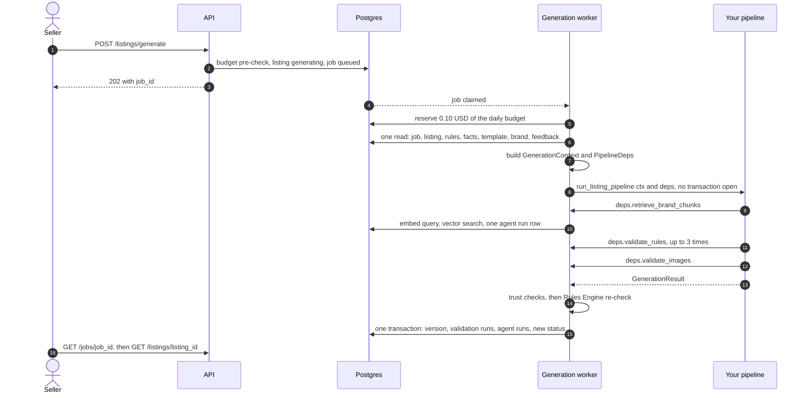
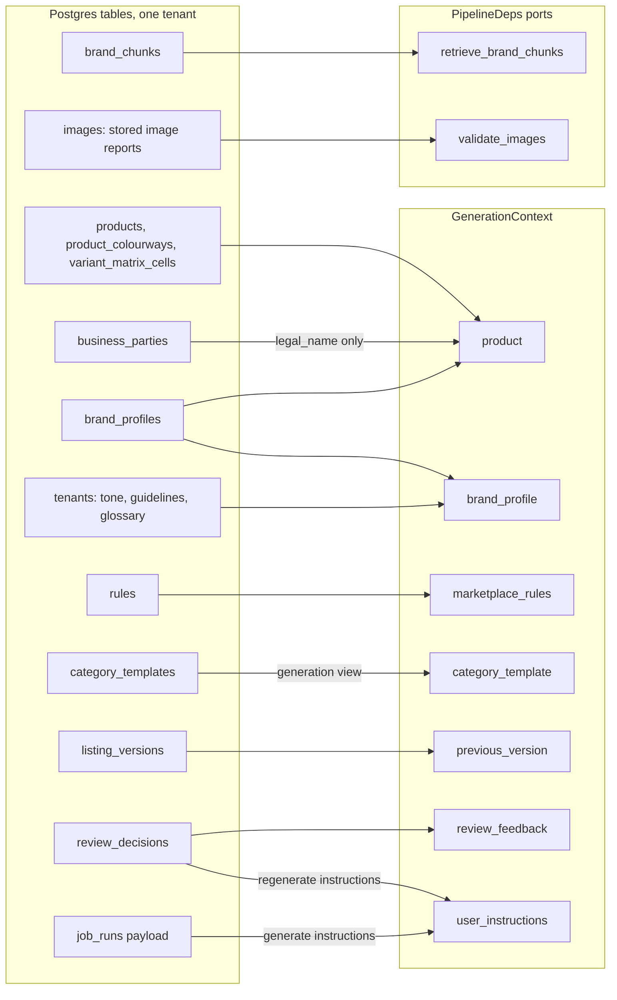

# AI team integration guide: the generation seam (v1)

This guide is for the AI team. It explains exactly how the backend calls your pipeline, what you
receive, what you must return, what the backend checks afterwards, and how to test your package
against the backend on your own machine.

The short version: the backend calls **one async function** in your package, once per generation
job. You get a `GenerationContext` and a `PipelineDeps` object with five backend services ("ports").
You return a `GenerationResult`. You never touch the database, the queue, the HTTP API or a
marketplace.

```python
# your package: import name mkos_pipeline, module mkos_pipeline.graph
async def run_listing_pipeline(ctx: GenerationContext, deps: PipelineDeps) -> GenerationResult: ...
```

All types live in the contracts package `mkos-schemas` (Python import `mkos_schemas`), version
**1.1.0**: `jobs.py`, `listing.py`, `agent.py`, `errors.py`, `images.py`, `rules.py`,
`validation.py`, and the protocol in `pipeline.py`. Their JSON Schemas are in
`packages/schemas/jsonschema/` and golden examples in `packages/schemas/fixtures/`.

Related handover docs in this folder: [ARCHITECTURE.md](ARCHITECTURE.md), [DATABASE.md](DATABASE.md), [FLOWS.md](FLOWS.md), [API-REFERENCE.md](API-REFERENCE.md) and [FRONTEND-GUIDE.md](FRONTEND-GUIDE.md).

## Contents

1. [Words used in this guide](#1-words-used-in-this-guide)
2. [Who owns what](#2-who-owns-what)
3. [How one generation job runs](#3-how-one-generation-job-runs)
4. [What the pipeline reads](#4-what-the-pipeline-reads)
5. [Input: GenerationContext](#5-input-generationcontext)
6. [The five ports: PipelineDeps](#6-the-five-ports-pipelinedeps)
7. [Output: GenerationResult](#7-output-generationresult)
8. [What the backend checks after you return](#8-what-the-backend-checks-after-you-return)
9. [Failures, timeouts and telemetry](#9-failures-timeouts-and-telemetry)
10. [Plugging in the real pipeline](#10-plugging-in-the-real-pipeline)
11. [Testing locally with the stub](#11-testing-locally-with-the-stub)
12. [Not in v1](#12-not-in-v1)
13. [Contract versioning](#13-contract-versioning)
14. [Open questions for the AI team](#14-open-questions-for-the-ai-team)

---

## 1. Words used in this guide

| Word | Meaning |
|---|---|
| **Tenant** | One brand (a customer company). Every row belongs to one tenant; your pipeline only ever sees one tenant's data per call. |
| **Product facts** | The seller's data about a product (SKU, title, category, prices, attributes, compliance), resolved across levels (brand default, style, colour, variant). |
| **Family / variant** | A style (parent) with child products per size and colour. |
| **Listing** | The marketplace content for one product (or family) on one marketplace. |
| **Listing version** | A frozen copy of a listing's content. Each generation or human edit adds one. |
| **CanonicalListing** | The marketplace-neutral listing you return: title, bullets, description, keywords, attributes, image refs. It has no Amazon- or Flipkart-specific fields; adapters map it later. |
| **Rules Engine** | Deterministic backend code (no model) that checks a listing against the marketplace and brand rules. It is the final judge. |
| **Category template** | The list of attributes a marketplace category needs (required, optional, allowed values). |
| **Brand document / brand chunks** | Text the brand uploads (tone rules, glossary, compliance notes). The backend splits it into chunks and embeds them for vector search. |
| **Maker-checker** | Whoever generated or edited a version cannot approve it; a second person must. |
| **Job run** | One row in `job_runs` for one background job. A generation job has `kind = listing_generate`. |
| **Agent run** | One row in `agent_runs` per model call (cost, tokens, model, status). |
| **Issue / human task** | A problem shown to the seller / a question only a human can answer. |
| **Invariants** | The 10 rules the system never breaks (`docs/RULES.md` §1). The ones that touch you: 1 (AI never publishes), 2 (the Rules Engine is the final arbiter), 4 (no marketplace fields in the canonical listing), 6 (no marketplace credentials in prompts), 7 (every AI call persists an agent run), 8 (one `ErrorReport` shape), 9 (at most 3 self-correction attempts, then `blocked`). |

## 2. Who owns what

- **Backend** owns: the API, the database, jobs, adapters, the Rules Engine, brand-document
  chunking, embedding calls, the deterministic (Pillow) image checks and the brand-chunk vector
  search.
- **AI team** owns: all generation and correction prompts, the vision prompt content, model choice
  and the graph inside `run_listing_pipeline`.
- The only meeting point is `run_listing_pipeline(ctx, deps)`. Only one backend module imports
  your package: `apps/api/app/workers/generation.py`. An import-linter contract
  (`.importlinter`, `only-workers-import-pipeline`) forbids every other layer from importing
  `mkos_pipeline`, and another contract (`pipeline-never-imports-app`) forbids your package from
  importing `app`, `sqlalchemy`, `fastapi`, `starlette`, `psycopg` or `procrastinate`.

## 3. How one generation job runs



How to read it: the API only queues the job (steps 1-3). The worker builds your input from database
rows when the job starts (steps 4-7), so a retry always sees fresh facts. Your pipeline runs with no
database transaction open and calls back into the backend only through the ports (steps 8-12). After
you return, the backend checks your result, runs its own Rules Engine pass and writes everything in
one transaction (steps 13-15).

Key numbers for one job:

| Item | Value | Source |
|---|---|---|
| Job timeout | 300 s for the whole job | `app/workers/policy.py` |
| Job retries | none: a generation job runs once (`max_attempts` 1, no transport retry) | `app/workers/policy.py` |
| Self-correction attempts | `ctx.max_attempts`, 1 to 3 (`LLM_MAX_CORRECTION_ATTEMPTS`, default 3) | `generation_context.py` |
| `validate_rules` calls | at most 3; a 4th returns an `INTERNAL_ERROR` report without evaluating | `pipeline_deps.py` |
| Model call timeout | `ModelCredentials.timeout_seconds` (`LLM_TIMEOUT_SECONDS`, default 60) | `config.py` |
| Agent run records | at most 100 per result | `generation_result.py` |
| Budget reservation | 0.10 USD per run, replaced by the real `cost_usd` of your records | `app/workers/budget.py` |

## 4. What the pipeline reads



How to read it: everything on the left is read by the backend, never by you. The middle box is
handed to you up front in the context. The right box is fetched on demand through ports. Brand
documents reach you only as chunks via vector search; image files never reach you, only their stored
check reports.

## 5. Input: GenerationContext

The backend validates the context before calling you. It is a pydantic model; unknown keys from a
newer backend are ignored (`extra="ignore"`).

| Field | Type | What it holds |
|---|---|---|
| `schema_version` | string | The contract version, `"1.1.0"`. |
| `request_id` | string, 1-128 chars | The request that queued the job. Echo it in your result and records. |
| `job_id` | UUID | The job run. Echo it in your result. |
| `tenant_id` | UUID | The tenant. Pass it to `retrieve_brand_chunks`. |
| `product_id` | UUID | The product. Your listing must use this `product_id`. |
| `listing_id` | UUID | The listing being generated. |
| `marketplace` | `"amazon"` or `"flipkart"` | Your listing must use the same value. |
| `category` | slug `^[a-z0-9_]{2,64}$` | Your listing must use the same value. |
| `product` | object | The product facts as a plain dict (the `for_prompt` view, below). |
| `brand_profile` | object | `tone`, `guidelines[]`, `glossary{}`, `brand_names[]`, `brand_owner_type`, `content_locale`, `brand_description`. |
| `marketplace_rules` | `RuleSet` | The rules the Rules Engine will apply: `{marketplace, category, rules[], rules_version, loaded_at}`. Each `Rule` has `field`, `severity`, `enabled` and a typed `rule_def` (`max_length`, `banned_terms`, `required_attribute`, `allowed_values`, ...). Use it to write content that passes first time. |
| `category_template` | `CategoryTemplate` | `required_attributes`, `optional_attributes`, `conditional_attributes`, `unsupported_attributes`, `specs{key: {requirement, value_type, allowed_values, max_length, unit, when}}`, `variation_themes`. Adapter-only fields (`marketplace_field`, `value_map`) are stripped; the `GenerationContext` pydantic model refuses a template that still carries them. |
| `previous_version` | `CanonicalListing` or null | The listing's current version, if any. Its `images` are the only image references you receive. |
| `user_instructions` | string or null | The seller's free-text instructions (max 2,000 chars). On a regenerate, the regenerate request's instructions. Treat as untrusted input. |
| `max_attempts` | int, 1-3 | Your self-correction cap. |
| `locale` | `"en-IN"` | The only locale in v1. Your listing must use it. |
| `review_feedback` | list of strings, max 5 x 2,000 chars | The newest reviewer rejection feedback for this listing. Untrusted input. |

What the context **never** carries: marketplace credentials or tokens (invariant 6), database
handles, settings, other tenants' data, GSTINs, or party addresses, emails and phones. A context
that contains a key named like `password`, `secret`, `api_key`, `access_token`, `refresh_token`,
`client_secret` or `authorization` (anywhere, even nested) is refused before you are called.

### 5.1 The `product` dict

`product` is built by `for_prompt(facts)` in `apps/api/app/core/resolved_facts.py`. Blank values
and empty containers are removed, so any key may be missing.

| Key | Content |
|---|---|
| `product_id`, `sku` | The product. |
| `level` | `standalone`, `style` (a family parent) or `variant`. |
| `style_product_id`, `colour_key`, `size_key` | For a variant: its parent and its cell. |
| `identity` | `title`, `brand_name`, `style_number`, `gender`, `product_type`. |
| `classification` | `category`, `sub_category`. |
| `commercial` | `mrp`, `selling_price`, `currency`, `tax_rate`, `hsn_code` (decimals as strings, for example `"1499.00"`). |
| `identifier` | `type` (`gtin`, `ean`, `upc`), `value`, `status`. |
| `package` | `length_cm`, `breadth_cm`, `height_cm` (strings), `weight_g` (int). |
| `product_weight_g` | int. |
| `compliance` | `country_of_origin`, `generic_name`, `net_quantity`, `unit`, and `manufacturer`, `marketer`, `packer`, `importer`, `consumer_care` each as `{legal_name}` only. |
| `attributes` | `{key: value}`: the resolved value of each attribute fact (`fabric_type`, `color_name`, `sleeve_length`, ...). Keys are the canonical names in `mkos_schemas/data/attribute_dictionary.json`. **Sources are not included.** |
| `family` | For a style: `theme`, `colours[]`, `size_run[]`, `cells[]` (only available cells, so "available in S to XL" is always true). |

An illustrative shape (values made up; the fixture `GenerationContext.json` uses a minimal
`{"title": "Sample"}`):

```json
{
  "product_id": "4e8a1b30-77cc-41d9-8f02-5b9c1de3a004",
  "sku": "KURTA-001",
  "level": "standalone",
  "identity": { "title": "Cotton Kurta Set", "brand_name": "Acme", "gender": "women" },
  "classification": { "category": "ethnic_wear_kurta_sets" },
  "commercial": { "mrp": "1999.00", "selling_price": "1499.00", "currency": "INR" },
  "compliance": { "country_of_origin": "IN", "manufacturer": { "legal_name": "Acme Apparel Pvt Ltd" } },
  "attributes": { "fabric_type": "cotton", "color_name": "indigo", "sleeve_length": "three_quarter" }
}
```

### 5.2 The golden context fixture

`packages/schemas/fixtures/GenerationContext.json`:

```json
{
  "schema_version": "1.1.0",
  "request_id": "req-golden-1",
  "job_id": "44444444-4444-4444-4444-444444444444",
  "tenant_id": "11111111-1111-1111-1111-111111111111",
  "product_id": "4e8a1b30-77cc-41d9-8f02-5b9c1de3a004",
  "listing_id": "9c1d2f6a-3b84-4f21-9a55-0c6f8b2e77d1",
  "marketplace": "amazon",
  "category": "apparel",
  "product": { "title": "Sample" },
  "brand_profile": { "tone": "warm" },
  "marketplace_rules": {
    "marketplace": "amazon", "category": "apparel", "rules": [],
    "rules_version": 1, "loaded_at": "2026-09-22T10:29:00Z"
  },
  "category_template": {
    "marketplace": "amazon", "category": "apparel", "external_category_id": null,
    "required_attributes": [], "optional_attributes": [], "conditional_attributes": [],
    "unsupported_attributes": [], "specs": {}, "variation_themes": []
  },
  "previous_version": null,
  "user_instructions": null,
  "max_attempts": 3,
  "locale": "en-IN",
  "review_feedback": []
}
```

`packages/schemas/fixtures/RuleSet.json` shows real rule rows (`max_length` 200 on
`content.title`, `min_length`, `banned_terms`, ...), and `CategoryTemplate.json` a filled template.

## 6. The five ports: PipelineDeps

The backend implementation is `apps/api/app/services/pipeline_deps.py`. All five are `async`.

| Port | Input limits | What it does | When it fails |
|---|---|---|---|
| `retrieve_brand_chunks(tenant_id, query, k=8, types=None)` | `tenant_id` must be `ctx.tenant_id`; `query` 1-2,000 chars; `k` 1-50; `types` a non-empty subset of `tone_rule`, `glossary`, `compliance`, `example` | Embeds the query (the backend records one agent run for it), then a vector search over this tenant's brand chunks. Returns `BrandChunkDTO {id, tenant_id, type, text, similarity, source_type, source_id, chunk_index}`. | Raises on bad input or when the embedding service is down. |
| `validate_rules(listing)` | A `CanonicalListing` for this context's marketplace and category | Runs the deterministic Rules Engine on your draft with the preloaded rules, template and product facts. Returns an `ErrorReport` (`errors[]` with `field`, `error_code`, `severity`, `message`, `suggestion`). Each call is recorded as a validation run (attempt 1, 2, 3). | A 4th call, a foreign rule or an engine fault returns an `INTERNAL_ERROR` report: never a pass. |
| `validate_images(listing)` | A `CanonicalListing` | Returns the stored deterministic `ImageReport`s for the images your listing references (by `image_id`), for this marketplace. No I/O, no model. | Returns `[]` for another marketplace or unknown ids. |
| `get_model_credentials(purpose)` | `"generation"`, `"vision"` or `"embedding"` | Returns `ModelCredentials {provider, api_key, api_base, model, timeout_seconds}`. `generation` and `vision` use the configured `LLM_PROVIDER` and `LLM_MODEL_DEFAULT`; `embedding` always uses OpenAI (`OPENAI_API_KEY`, `EMBEDDING_MODEL`). `api_base` is null in v1. Locally with no key set, `api_key` is the placeholder `local_only_model_key_unset`; `.env.example` ships `OPENAI_API_KEY=sk-REPLACE_ME`, which is passed through as is. Neither works against a real provider. | Raises when no key is configured outside local, or for an unknown `purpose`. |
| `emit_node_event(node, status, detail=None)` | `node` a `PipelineStage` value; `status` `started`, `ok` or `failed`; `detail` a small dict | `started` sets the job's visible `stage` (the FE shows it as progress) and opens a trace span; `ok`/`failed` closes it. `detail` is only logged, redacted and cut to 2 KiB. | Raises `ValueError` for an unknown node or status. |

`PipelineStage` values: `load_context`, `retrieve_brand`, `content_agent`, `keyword_agent`,
`attribute_agent`, `image_agent`, `merge_outputs`, `validate_schema`, `validate_rules`,
`validate_vision`, `correct`, `quality_check`.

Rules for using the ports:

- Use `api_key` only inside the model call. Never log it, return it or put it in a prompt.
- Do not catch and hide port exceptions. Let them propagate: the backend records the failure.
- Count your `validate_rules` calls: the cap is 3 per job, matching invariant 9.

## 7. Output: GenerationResult

| Field | Type | Rule |
|---|---|---|
| `schema_version` | string | Leave the default. |
| `request_id`, `job_id` | | Must equal the context's values, or the result is refused. |
| `listing` | `CanonicalListing` or null | Null only when you produced nothing. |
| `image_reports` | list of `ImageReport` | Your vision findings. Stored on the version as given. **Warnings only in v1**: they never block approval. |
| `validation` | `ValidationSummary` or null | Your own summary. Informational; the backend runs its own check. |
| `agent_runs` | list of `AgentRunRecord`, max 100 | One per model call (invariant 7). |
| `blocks` | list of `AgentBlockStatus` | One per agent: `{agent: content, keyword, attribute or image; status: ok, failed or skipped; agent_run_id; error}`. A `failed` block sends the listing to review. |
| `attempts_used` | int, 0-3 | Your correction attempts. (The stored value is the backend's own count of `validate_rules` calls.) |
| `terminal_state` | `generated`, `needs_review`, `blocked` or `failed` | Your verdict; see the mapping in section 8. |
| `error` | `ErrorReport` or null | Why it failed or blocked, in the shared shape. |

### 7.1 CanonicalListing

| Field | Limits |
|---|---|
| `product_id`, `marketplace`, `category`, `locale` | Must equal the context's values. |
| `listing_id` | Null, or the context's `listing_id`. The backend stamps it anyway. |
| `content.title` | 1-500 chars (the marketplace rule is usually tighter: Amazon 200). |
| `content.bullets` | 1-10 items, each 1-1,000 chars. |
| `content.description` | 1-5,000 chars. |
| `keywords.search_terms`, `keywords.hidden_terms` | Up to 50 each, each up to 256 chars. |
| `attributes` | Up to 128 keys matching `^[a-z0-9_]{1,64}$`; values are string, number, boolean or list of strings; strings up to 256 chars; no objects. Use the template's keys and allowed values. |
| `images` | Up to 20 `{image_id, slot, position}`; slot `main`, `secondary`, `lifestyle` or `size_chart` (`packaging_label` is refused). |
| `confidence_score` | Optional, 0 to 1. |
| `generated_by_agent_run_id` | Optional: the id of one of your `agent_runs`; otherwise it is cleared. |
| `status`, `version`, `created_at` | Ignored: the backend sets them. |

No marketplace-specific fields (invariant 4). The adapters map the canonical listing to Amazon or
Flipkart later.

### 7.2 AgentRunRecord

| Field | Rule |
|---|---|
| `id` | A fresh UUID per model call (rows are inserted with "on conflict do nothing", so a reused id is dropped). |
| `tenant_id`, `product_id`, `listing_id`, `job_id`, `request_id` | Overwritten by the backend from the job, so they always match. |
| `agent_name` | `content`, `keyword`, `attribute`, `image`, `correction`, `embedding` or `quality`. |
| `trigger` | `generate`, `correct`, `embed` or `vision`. |
| `attempt` | 1-3. |
| `model_used`, `prompt_version` | Strings: please always set both. |
| `tokens` | `{input, output, cached_input}`. |
| `cost_usd` | A decimal string with at most 6 decimal places, for example `"0.000413"`. Quantize with `ROUND_HALF_UP` before sending; more digits are refused, not rounded. **The daily budget is computed from this value.** |
| `duration_ms`, `status` | `status` is `running`, `completed`, `failed` or `timeout`. |
| `error_report` | An `ErrorReport` for a failed call. |
| `input_digest` | A hash of the input, never the raw prompt. |
| `started_at`, `created_at` | Timezone-aware. A `started_at` outside the job's run window is clamped to the job start. |

### 7.3 The golden result fixture

From `packages/schemas/fixtures/GenerationResult.json`, shortened here: some list items, the null
fields and the validation `stages` are left out. Note that the two golden fixtures are not a pair:
the context fixture uses category `apparel` and this result uses `ethnic_wear_kurta_sets`, so this
result would fail trust check 4 (section 8.1) against that context. Build your own matching pair
for an end-to-end test.

```json
{
  "schema_version": "1.1.0",
  "request_id": "req-golden-1",
  "job_id": "44444444-4444-4444-4444-444444444444",
  "listing": {
    "listing_id": "9c1d2f6a-3b84-4f21-9a55-0c6f8b2e77d1",
    "product_id": "4e8a1b30-77cc-41d9-8f02-5b9c1de3a004",
    "marketplace": "amazon",
    "category": "ethnic_wear_kurta_sets",
    "locale": "en-IN",
    "content": {
      "title": "Fabrica Organic Cotton Kurta Set for Women | Indigo | Handloom Weave",
      "bullets": [
        "Crafted from 100% organic cotton certified by GOTS for breathable comfort",
        "Traditional handloom weave with a contemporary relaxed silhouette"
      ],
      "description": "Elevate your ethnic wardrobe with the Fabrica Organic Cotton Kurta Set."
    },
    "keywords": {
      "search_terms": ["organic cotton kurta", "ethnic wear women"],
      "hidden_terms": ["cotton kurta set", "indigo kurta"]
    },
    "attributes": { "color": "navy blue", "material": "organic cotton", "size": "M" },
    "images": [ { "image_id": "1f0b7c22-9d41-4a3e-b0f5-6c2a11e8d900", "slot": "main", "position": 0 } ],
    "confidence_score": 0.91,
    "generated_by_agent_run_id": "7b3c9e10-22d5-4f6a-8c31-9e0a4d5b6f22"
  },
  "image_reports": [],
  "validation": { "listing_id": "9c1d2f6a-3b84-4f21-9a55-0c6f8b2e77d1", "passed": false, "stages": [], "blocking_count": 1, "warning_count": 0 },
  "agent_runs": [
    {
      "id": "7b3c9e10-22d5-4f6a-8c31-9e0a4d5b6f22",
      "tenant_id": "11111111-1111-1111-1111-111111111111",
      "request_id": "req-golden-1",
      "agent_name": "content",
      "trigger": "generate",
      "attempt": 1,
      "tokens": { "input": 0, "output": 0, "cached_input": 0 },
      "cost_usd": "0.012300",
      "duration_ms": 0,
      "status": "completed",
      "started_at": "2026-09-22T10:30:00Z",
      "created_at": "2026-09-22T10:30:05Z"
    }
  ],
  "blocks": [],
  "attempts_used": 1,
  "terminal_state": "needs_review",
  "error": null
}
```

A failure looks like the stub's `failed` scenario: `listing: null`, `terminal_state: "failed"`,
every block `failed`, and `error` an `ErrorReport` with `error_code: "GENERATION_FAILED"`,
`source: "ai_model"`.

## 8. What the backend checks after you return

`apps/api/app/services/generation_result.py` decides whether to trust the result, then re-checks
it. Your own verdict never validates a listing (invariant 2).

### 8.1 Trust checks (all must pass)

1. The result is serialized to JSON and validated again as a `GenerationResult`. This catches an
   object built without validation (`model_construct`, `model_copy(update=...)`). Unknown extra keys
   are dropped, never stored.
2. `job_id` and `request_id` equal the context's.
3. At most 100 `agent_runs`.
4. The listing's `product_id`, `marketplace`, `category` and `locale` equal the context's, and its
   `listing_id` is null or the context's.

If any check fails, the job fails with `INTERNAL_ERROR` ("The pipeline result failed the `<check>`
check."), no version is saved, and the listing becomes `failed/generation_failed`. Your agent runs
are still saved if each one validates on its own.

### 8.2 The re-check and the status mapping

The backend runs the Rules Engine on your listing with the same rules, template and product facts,
then maps the outcome:

| Condition (checked in this order) | Listing status | Version saved? |
|---|---|---|
| No listing, or `terminal_state = failed` | `failed`, reason `generation_failed` | no |
| The re-check has any `error`-severity finding | `blocked`, reason `corrections_exhausted` | yes |
| The re-check has warnings, or any block is `failed`, or `terminal_state` is `needs_review` or `blocked` | `needs_review` | yes |
| Otherwise | `validated` | yes |

A listing never goes to `approved` or `publishing` from generation (invariant 1). A human approves
it later with maker-checker, and only adapters publish.

In the same transaction the backend writes: the listing version (origin `generation` or
`regeneration`), one `validation_runs` row per `validate_rules` call you made plus one for its own
re-check, one `agent_runs` row per record, your `image_reports` on the version, and the status move.

### 8.3 What the Rules Engine checks in v1

- Evaluated rule types: `max_length`, `min_length`, `banned_terms`, `required_attribute`,
  `max_items`, `min_items`, `allowed_values`, `conditional_required`, `cross_field`,
  `claim_requires_attribute`, `pattern`, plus the template checks (required attributes and allowed
  values from the category template).
- Not evaluated in v1: `image_requirement` (images go through the image checks instead),
  `fact_source` and `fact_backed_attribute`. So in v1 nothing automatically checks that a listing
  attribute matches the product's fact. **Do not invent facts**: copy attribute values from
  `ctx.product`, and leave a value out rather than guess it.
- Tenant (brand) rules only add checks; they never relax platform rules.

### 8.4 The facts guard

The database has a trigger, `facts_guard()`, on every write of product facts: a key must be known,
set at an allowed level, and from an allowed source, and **a critical fact can never have the source
`ai`** (`FACT_SOURCE_FORBIDDEN`). In v1 your pipeline never writes facts: what you return goes only
into the listing version. The guard matters when a later version lets AI suggest facts.

## 9. Failures, timeouts and telemetry

| What happens | Job ends | Error code on the job | Listing | Your `agent_runs` saved? |
|---|---|---|---|---|
| Daily budget used up at claim | `failed` | `BUDGET_EXCEEDED` | `failed/generation_failed` | n/a (not called) |
| The context cannot be built (no current template for the category; rare, because the generate request already checks it) | `failed` | `CATEGORY_NOT_MAPPED` | `failed/generation_failed` | n/a |
| The product was deleted before the job ran | `failed` | `NOT_FOUND` | `failed/generation_failed` | n/a |
| The stored rules cannot be loaded safely | `failed` | `INTERNAL_ERROR` | `failed/generation_failed` | n/a |
| The pipeline raises `TimeoutError` | `failed` | `JOB_TIMEOUT` | `failed/generation_failed` | **no** |
| The whole job passes its 300 s timeout | `failed` | `JOB_TIMEOUT` | `failed/generation_failed` | **no** |
| The pipeline or a port raises any other exception | `failed` | `INTERNAL_ERROR` (fixed message; only the exception class is logged) | `failed/generation_failed` | **no** |
| The result fails a trust check | `failed` | `INTERNAL_ERROR` | `failed/generation_failed` | yes, if each record validates |
| You return no listing or `terminal_state = failed` | `failed` | `GENERATION_FAILED` | `failed/generation_failed` | yes |
| You return a listing | `succeeded` | none (a `blocked` result carries the re-check report) | `validated`, `needs_review` or `blocked` | yes |

Also on every path:

- The `validate_rules` calls you made are kept as validation runs.
- The embedding calls made by `retrieve_brand_chunks` are recorded by the backend as their own
  agent runs, so they are never lost.
- The seller recovers with Regenerate. No job is retried automatically.

**Invariant 7 and the known gap (DATABASE.md open decision 19).** Invariant 7 says every AI call
persists an agent run. Your records reach the backend only inside the `GenerationResult`. When your
code raises (a timeout, a crash, a cancellation), there is no result, so the records of the model
calls you already made are lost. The backend does not invent synthetic rows. The budget reservation
(0.10 USD) stays counted in that case, so spend is not under-counted by more than that per run. How
to close the gap (for example a port to report records as they happen) is open with the AI team and
the Tech Lead. Until then: catch model-call timeouts inside your graph where you can, finish with a
`failed` result that carries the records, and raise only for faults you cannot handle.

Logs never carry prompt text, product data or instructions: only ids and codes.

## 10. Plugging in the real pipeline

1. **Package shape.** Import name `mkos_pipeline`, with `run_listing_pipeline` importable from both
   `mkos_pipeline` and `mkos_pipeline.graph`, with exactly the signature in
   `mkos_schemas/pipeline.py` (`packages/pipeline-stub/tests/test_contract.py` checks this). The
   distribution name must **not** be `mkos-pipeline-stub`: a production worker refuses to boot when
   that distribution is installed.
2. **Python and dependencies.** Python `3.13.*`. `mkos-schemas` needs `pydantic>=2.11,<3`, but the
   backend currently pins `pydantic>=2.13.5,<2.14` (`apps/api/pyproject.toml`), so your package must
   accept pydantic 2.13 or it cannot be installed beside the API. Depend on `mkos-schemas` by
   git tag; never copy the models. You may depend on model SDKs; you may not import `app`,
   `sqlalchemy`, `fastapi`, `starlette`, `psycopg` or `procrastinate`.
3. **Purity.** No database access, no queue, no files outside your package, no HTTP calls other than
   to the model providers with the credentials from `get_model_credentials`.
4. **Strictness.** Inside your package you may use `extra="forbid"` for your own model-output types.
   The seam types use `extra="ignore"`.
5. **Release.** Tag a release (the tag scheme is still to be agreed, T104). The backend swaps the
   `mkos-pipeline-stub` dependency in `apps/api/pyproject.toml` (and `uv.lock`) for your tagged
   package. Today the image build in `apps/api/Dockerfile` installs only the stub, so this swap is
   required before a production worker can start.
6. **Acceptance.** The same backend tests that run against the stub must pass with your package:
   the signature and import-path tests in `packages/pipeline-stub/tests/test_contract.py`
   (`test_stub_dist_requires_only_schemas` there is about the stub's own metadata and does not
   apply to your package), and the integration tests
   `apps/api/tests/integration/test_seam_stub_end_to_end.py` and `test_generation_hooks.py`, plus
   the security tests `apps/api/tests/security/test_prompt_injection.py` and
   `test_secrets_never_logged.py`.

## 11. Testing locally with the stub

The stub (`packages/pipeline-stub`, import `mkos_pipeline`) is a deterministic reference
implementation: no model, no key, no network. It calls every port in the canonical stage order,
so it is also the best example of how to use them (`packages/pipeline-stub/src/mkos_pipeline/graph.py`).

Pick a scenario with a `stub:<name>` prefix on `user_instructions`:

| Scenario | Result |
|---|---|
| (none) / `stub:ok` | A compliant listing: `validated`. |
| `stub:blocked` | A 221-char title on every attempt: 3 `validate_rules` calls, then `blocked`. |
| `stub:failed` | No listing, `GENERATION_FAILED`: `failed/generation_failed`. |
| `stub:warnings` | The word `stubwarn` in the title; acme's demo brand rule flags it: `needs_review`. |
| `stub:vision_warn` | The `ok` listing plus one vision warning per image of the previous version. Vision results never change the status, so it still ends `validated`. |
| `stub:timeout` | Sleeps past the model timeout and raises `TimeoutError`: `JOB_TIMEOUT`. |
| `stub:malformed` | Returns `attempts_used=7` without validation: refused by the trust check. |

Run it end to end (Docker, `uv`, Python 3.13; in the backend repo):

```sh
cp .env.example .env
make dev        # terminal 1: Postgres, MinIO, migrations, API on http://localhost:8000
make seed       # terminal 2: demo tenants acme and bharat; local-only password devpassword123
make worker     # terminal 3: the job worker, with the stub pipeline
```

Then, in terminal 2 (needs `jq`):

```sh
API=http://localhost:8000/api/v1
TOKEN=$(curl -s "$API/auth/login" -H 'Content-Type: application/json' \
  -d '{"email":"operator@acme.test","password":"devpassword123"}' | jq -r .access_token)

PRODUCT=$(curl -s "$API/products" -H "Authorization: Bearer $TOKEN" -H 'Content-Type: application/json' \
  -d '{"sku":"AI-TEST-001","title":"Test Kurta Set","category":"ethnic_wear_kurta_sets"}' | jq -r .id)

JOB=$(curl -s "$API/listings/generate" -H "Authorization: Bearer $TOKEN" \
  -H 'Content-Type: application/json' -H "Idempotency-Key: $(uuidgen)" \
  -d "{\"product_id\":\"$PRODUCT\",\"marketplace\":\"amazon\",\"user_instructions\":\"stub:blocked\"}")
echo "$JOB"   # job_id, listing_id, poll_url

curl -s "$API/jobs/$(echo "$JOB" | jq -r .job_id)" -H "Authorization: Bearer $TOKEN" | jq '{status, stage, error}'
curl -s "$API/listings/$(echo "$JOB" | jq -r .listing_id)" -H "Authorization: Bearer $TOKEN" | jq '{status, status_reason, validation}'
```

Use the category `ethnic_wear_kurta_sets`: it has a seeded Amazon template. A category with no
current template is refused by the generate request itself (422 `VALIDATION_FAILED` on
`category`), so no job is created. To look at the telemetry rows:

```sh
docker compose exec -T postgres psql -U postgres -d marketplace_os \
  -c "SELECT agent_name, trigger, attempt, status, cost_usd FROM agent_runs ORDER BY created_at DESC LIMIT 10"
```

`make e2e` runs the full scripted flows, including `scripts/e2e/generate.sh` and `regenerate.sh`.

**Trying your own package locally.** The workspace installs the stub as a dependency of the API.
To try a drop before the formal swap, replace the stub in the local virtualenv
(`uv pip uninstall mkos-pipeline-stub`, then `uv pip install <your wheel or git tag>`) and start the
worker without a re-sync: `APP_ROLE=worker .venv/bin/python -m app.workers.main` (from the repo
root, where it reads `.env`). `make worker` runs `uv run --frozen`, which re-syncs and reinstalls the
stub. Set a real model key in `.env` for real calls.

## 12. Not in v1

| Feature | v1 behaviour | Planned |
|---|---|---|
| "Ask one question, then resume" | A missing fact ends the listing `blocked` with an `ErrorReport`; the seller edits or regenerates. The `human_tasks` table and `GET /tasks` exist, but there is no answer endpoint and no partial "affected fields only" regeneration. | 1.1 (cut C2) |
| Adapter-side remap after a marketplace rejection | Not built. Any content fix makes a new version that needs a new approval. | open (Q4, T41) |
| Blocking vision results | Your `image_reports` are warnings only; only the deterministic image checks block approval. | 1.1 (cut C8) |
| Typed product facts (`facts.py`), `CanonicalListing.attribute_sources` | `GenerationContext.product` stays a plain dict; the listing carries no per-attribute source. | after v1 |
| Approved-listing memory (retrieving approved listings as examples) | Not built; `BrandChunkDTO.source_type` reserves `listing_version`. | 1.1 (cut C5) |
| Locales other than `en-IN` | Not accepted. | widening is a MINOR |

## 13. Contract versioning

- The Python package `mkos-schemas` and the npm package share one version, released by one
  `schemas-v<version>` git tag. `schemas-v1.0.0` is tagged. **1.1.0 is the current version in the
  repo but not tagged yet** (its CHANGELOG heading is "unreleased"); the seam types did not change
  between 1.0.0 and 1.1.0, but pin 1.1.0 once it is tagged.
- `packages/schemas/CHANGELOG.md` lists every change. An additive change is a MINOR (1.x).
  Adding a member to a closed set (an enum value, a `Literal`, a rule type, an error code, a field
  path) is breaking and waits for a MAJOR window.
- Every seam model has `schema_version`. Unknown fields are ignored, so a newer backend can add
  fields without breaking you.
- Any seam change goes through a contracts pull request reviewed by both teams.

## 14. Open questions for the AI team

1. **Records lost on a raise** (DATABASE.md open decision 19): do you want a port to report agent
   runs as they happen, or will you always return a `failed` result instead of raising?
2. **Images for vision.** The context carries image references only through `previous_version`, and
   no port returns image bytes or URLs. A first generation therefore has no images to place or look
   at. Which do you need: the product's image ids and slots in the context, a signed-URL port, or
   both?
3. **Fact sources.** `ctx.product.attributes` holds resolved values without their source or
   confidence. Do you need the source (seller, document, ...) to decide what you may state?
4. **Repository and tag scheme** for `mkos-pipeline` (T104), and confirmation of Python 3.13 (T1).
5. **Time budget.** The whole job has 300 s, including up to 3 correction rounds. Is that enough for
   your graph at the model timeout you plan to use?
