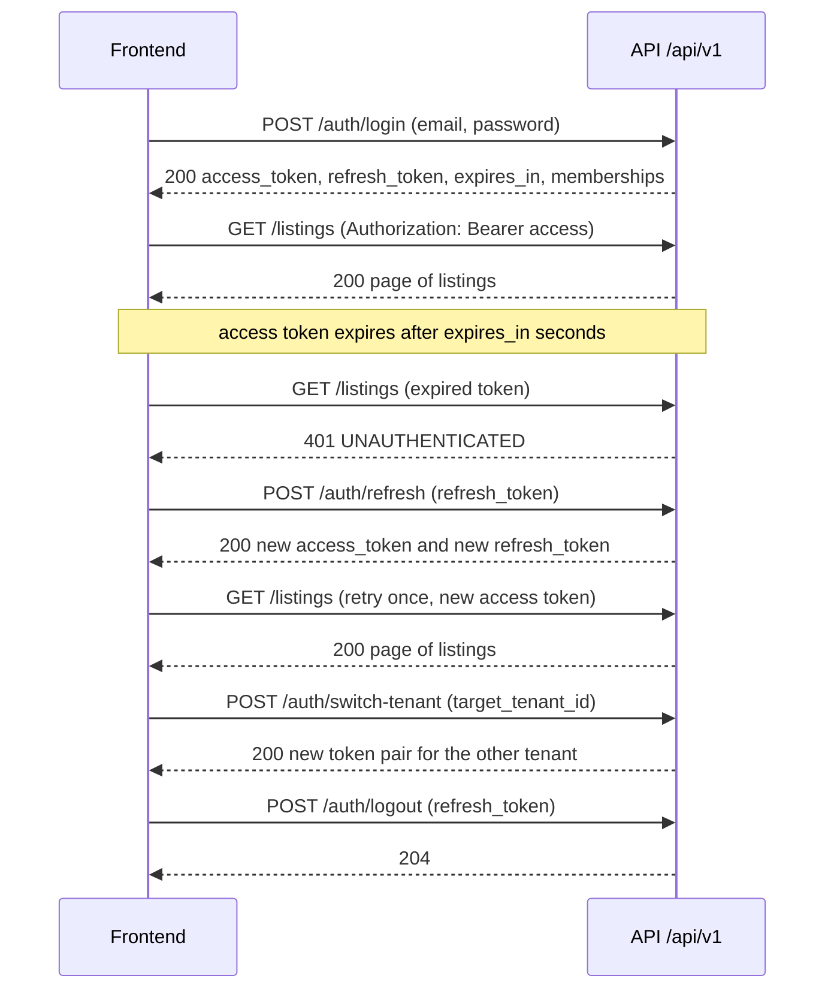
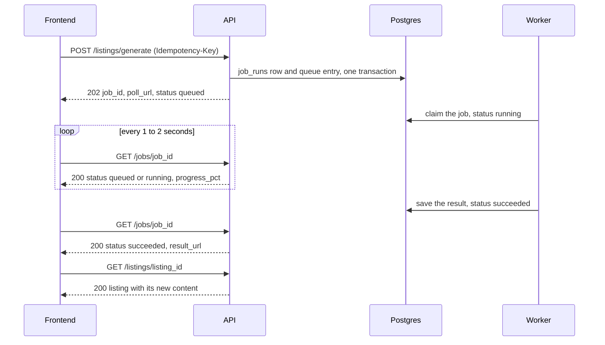
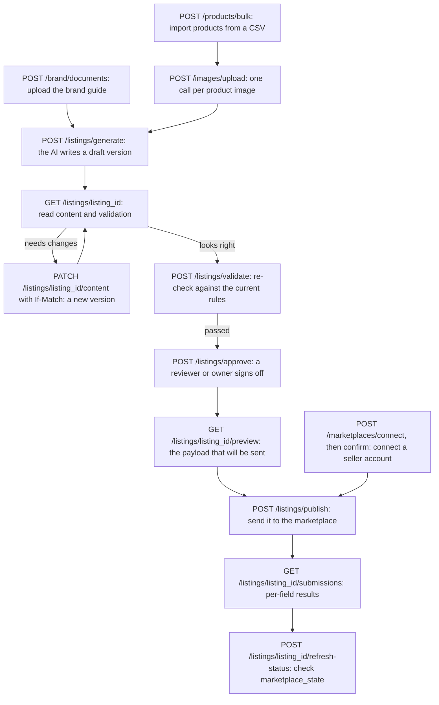
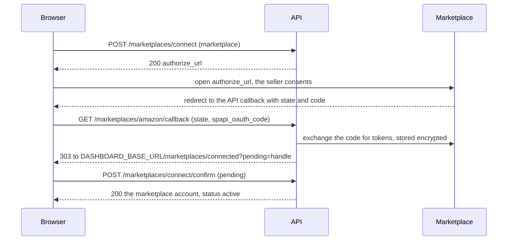

# AI Marketplace OS API reference (v1.1.0)

> Generated from `packages/schemas/jsonschema/openapi.json` by `scripts/docs/gen_api_reference.py`. Do not edit by hand: change the code, export the contract, then run `make docs-handover`.

This is the complete reference of the backend's HTTP API for the frontend and AI teams. It lists all 57 operations: what each one does, who may call it, what to send and what comes back. The same contract ships as generated TypeScript types in the npm package `@maniacultasset/schemas` (GitHub Packages), which the frontend installs under the alias `@mkos/schemas`, so never hand-write a request or response type.

- Read **Conventions** first: auth, tenants, idempotency, concurrency, paging, errors and jobs work the same everywhere.
- Then use the **summary table** to find an operation, and its section for the details.
- For an interactive view, open [`swagger.html`](swagger.html) in a browser. It opens straight from disk because the spec is embedded in it; the Swagger UI scripts load from `cdn.jsdelivr.net`, so the browser needs internet access.
- For the bigger picture, read the other handover documents in this folder: [`ARCHITECTURE.md`](ARCHITECTURE.md) (how the backend is built and deployed), [`DATABASE.md`](DATABASE.md) (tables, relations and the listing status machine) and [`FRONTEND-GUIDE.md`](FRONTEND-GUIDE.md) (screen by screen integration).

## Base URLs

Every path below already includes its prefix: all routes are under `/api/v1` except `/healthz` and `/readyz`. The full URL is the base URL plus the path, for example `http://localhost:8000/api/v1/auth/login`.

| Environment | Base URL | Notes |
|---|---|---|
| Local (your machine, `make dev`) | `http://localhost:8000` | Port is `API_HOST_PORT` (default 8000). |
| Local mock (`make mock`) | `http://127.0.0.1:4010` | Answers every operation with its example from the contract; send `Prefer: code=<status>` for a declared error. No database, no real data. |
| Staging | `https://api.staging.<DOMAIN>` | Placeholder: filled in after the GCP rollout. |
| Production | `https://api.<DOMAIN>` | Placeholder: filled in after the GCP rollout. |

## How to regenerate

```bash
make docs-handover
```

It rewrites this file and `swagger.html` from the committed `openapi.json`. When an API changes, first re-export the contract (`make -C packages/schemas all`, checked by `make schemas-drift`), then run `make docs-handover`. The generator fails if any operation in the spec is missing from the summary table. `python scripts/docs/gen_api_reference.py --check` exits 1 when the committed files are out of date.

## Words used in this reference

| Term | Meaning |
|---|---|
| **Tenant** | One brand (one seller business). All data belongs to exactly one tenant. Your access token names the active tenant; no route takes a `tenant_id`. |
| **Member / role** | A user's membership in a tenant, with one role: `owner`, `admin`, `operator` or `reviewer`. A user can belong to several tenants. |
| **Product** | The seller's facts about one item (SKU, title, category, attributes, images), independent of any marketplace. |
| **Family / variant** | Apparel is sold as a style (the family, one parent product) with child variant products, one per colour and size. The backend stores the full size x colour matrix, so the AI never invents a variant that does not exist. |
| **Listing** | One product prepared for one marketplace (for example the Amazon listing of SKU-001). It has two states: our lifecycle `status` (`created`, `generating`, `validated`, `needs_review`, `approved`, `publishing`, `published`, `blocked`, `failed`) and the marketplace's own view, `marketplace_state` (`not_submitted`, `processing`, `pending_review`, `live`, `partially_live`, `inactive`, `rejected`, `removed`). |
| **Listing version** | An immutable snapshot of a listing's content (a `CanonicalListing`). Generation and every human edit create a new version; `current_version_id` points to the newest. |
| **Maker-checker** | Whoever generated or edited a version (or an earlier version since the last full generation) can never approve it; another active reviewer or owner must. This stops one person from both writing and signing off content. A violation is a 403 `MAKER_CHECKER_VIOLATION` on that item inside the 200 batch answer of `POST /api/v1/listings/approve`. |
| **Marketplace account** | A seller account on Amazon or Flipkart connected with OAuth. The backend stores its tokens encrypted and never returns them. |
| **Job run** | One background job (generate, publish, import, image check, brand embed, status sync). A 202 answer gives its `job_id`; read it with `GET /api/v1/jobs/{job_id}`. |
| **Issue** | A problem found on a listing (a rule failure, a marketplace rejection), with an error code and a suggested fix. Shown in the issue inbox. |
| **Human task** | A question only a person can answer, such as a missing fact or a reconnect. Shown in the task inbox. |
| **Rules Engine** | The deterministic checker. It validates listing content against versioned rules and marketplace templates and answers with an `ErrorReport`. |

## Conventions every call follows

These rules hold for every operation below. The per-operation sections do not repeat them.

### Authentication

Every `/api/v1` route except `auth/login`, `auth/refresh`, `auth/logout` and the OAuth callback needs an **access token** in the `Authorization` header:

```http
Authorization: Bearer <ACCESS_TOKEN>
```

- **Log in.** `POST /api/v1/auth/login` with `{"email", "password"}` returns `access_token`, `refresh_token`, `expires_in` (seconds) and the user's `memberships`. The active tenant is the one the user used most recently. Every refusal (a wrong password, an unknown email, and so on) is the same `401 UNAUTHENTICATED`, so the answer never tells an attacker which part was wrong. Login is limited to 5 tries a minute per IP and email.
- **Token lifetimes.** The access token lives 30 minutes and the refresh token 14 days (the defaults of `ACCESS_TOKEN_TTL_MINUTES` and `REFRESH_TOKEN_TTL_DAYS`). Read `expires_in` instead of hard-coding it.
- **Refresh.** `POST /api/v1/auth/refresh` with `{"refresh_token"}` returns a new pair and the old refresh token stops working (rotation). Reusing an already rotated refresh token revokes the whole chain (the token "family") and answers 401, because it means a token was stolen or copied. So **serialise refreshes** in the client: two tabs refreshing the same token at once count as reuse and log the user out.
- **Log out.** `POST /api/v1/auth/logout` with `{"refresh_token"}` revokes the family and always answers `204`. An access token already issued stays valid until it expires, so drop it from memory.
- **Who am I.** `GET /api/v1/auth/me` returns the user, the active tenant, the role and all memberships.
- **Switch tenant.** `POST /api/v1/auth/switch-tenant` with `{"target_tenant_id"}` returns a brand-new token pair (a new family) for another tenant the user is an active member of. A tenant the user is not in is `404`. Replace both tokens; the old ones keep pointing at the old tenant.
- **401 vs 403.** A missing, expired or invalid token is `401 UNAUTHENTICATED` (with `WWW-Authenticate: Bearer`). A valid token whose role lacks the permission is `403 PERMISSION_DENIED`.



How to read it: time runs top to bottom. Solid arrows are requests from the frontend, dashed arrows are the API's answers. The middle part shows the normal recovery from an expired access token: one refresh, then retry the original call once. If the refresh itself answers 401, the session is over: send the user to the login screen. The last two calls show a tenant switch and a log out.

<sub>Source: apps/api/app/api/v1/routers/auth.py, apps/api/app/api/v1/deps.py, apps/api/app/services/auth.py, apps/api/app/core/config.py, apps/api/app/api/rate_limit.py</sub>

### Roles and permissions

Each operation requires one **action** (shown as "Permission" in every operation, from the `x-mkos-action` field of the spec). A member may call it only if their role holds that action. The role comes from the membership row in the database, never from the token, so a role change applies on the next request.

| Action | owner | admin | operator | reviewer | Operations |
|---|---|---|---|---|---|
| `analytics:read` | yes | yes | yes | yes | 2 |
| `listing:approve` | yes | - | - | yes | 2 |
| `listing:edit` | yes | - | yes | - | 3 |
| `listing:generate` | yes | - | yes | - | 2 |
| `listing:publish` | yes | - | yes | - | 3 |
| `listing:regenerate` | yes | - | yes | yes | 1 |
| `marketplace:connect` | yes | yes | - | - | 3 |
| `product:import` | yes | - | yes | - | 5 |
| `settings:manage` | yes | yes | - | - | 3 |
| `team:manage` | yes | yes | - | - | 2 |
| `tenant:read` | yes | yes | yes | yes | 20 |

Public operations (`x-mkos-action: public`) need no token. `/healthz` and `/readyz` carry no action at all. A role not in the table holds nothing. The sign-up queue (`x-mkos-action: platform:admin`, ADR-0019) is not in the table: it needs the caller's own `users.is_platform_admin` flag, whatever their role.

<sub>Source: apps/api/app/core/rbac.py, apps/api/app/api/v1/deps.py</sub>

### Tenant scoping

A **tenant** is one brand. The tenant of every request is the `tid` inside the access token; no route accepts a `tenant_id` in the path, query or body (the one exception is `target_tenant_id` on `auth/switch-tenant`, which is checked against the caller's own memberships). The database enforces the same boundary with row-level security, so a bug in one query still cannot leak another tenant's rows.

An object that belongs to another tenant answers **`404 NOT_FOUND`, never `403`**, so the API never confirms that someone else's id exists.

<sub>Source: apps/api/app/api/v1/deps.py (get_current_principal binds the tenant), apps/api/app/api/v1/routers/auth.py (switch-tenant), docs/architecture/DATABASE.md (RLS)</sub>

### Idempotency-Key

Operations that start background work or change several rows require an `Idempotency-Key` header, so a retry after a network error never does the work twice.

- **Value:** 1 to 255 visible ASCII characters. Use a fresh UUID per user action, and reuse it only to retry that same action.
- **Replay:** the same key, the same method and path, the same body and the same member within **24 hours** returns the stored first answer (same status, same body) without running the work again. A stored `422` is replayed too.
- **Mismatch:** the same key with a different body, a different endpoint or a different member is `409 IDEMPOTENCY_KEY_REUSED`.
- **Failures are not stored:** if the first call failed with an error, the key is released, and a retry with the same key runs again.
- **Expiry:** after 24 hours the key counts as new.
- For a multipart upload, the "body" that is compared is the bytes of the `file` part, not the raw multipart body (its boundary is random).

These operations require it:

- [`POST /api/v1/brand/documents`](#post-apiv1branddocuments) (`brand_documents_upload`)
- [`POST /api/v1/products/bulk`](#post-apiv1productsbulk) (`products_bulk`)
- [`POST /api/v1/imports/{import_id}/rows/retry`](#post-apiv1importsimport_idrowsretry) (`imports_rows_retry`)
- [`POST /api/v1/images/upload`](#post-apiv1imagesupload) (`images_upload`)
- [`POST /api/v1/listings/approve`](#post-apiv1listingsapprove) (`listings_approve`)
- [`POST /api/v1/listings/generate`](#post-apiv1listingsgenerate) (`listings_generate`)
- [`POST /api/v1/listings/publish`](#post-apiv1listingspublish) (`listings_publish`)
- [`POST /api/v1/listings/{listing_id}/publish/retry-fields`](#post-apiv1listingslisting_idpublishretry-fields) (`listings_retry_fields`)
- [`POST /api/v1/listings/{listing_id}/refresh-status`](#post-apiv1listingslisting_idrefresh-status) (`listings_refresh_status`)
- [`POST /api/v1/listings/{listing_id}/regenerate`](#post-apiv1listingslisting_idregenerate) (`listings_regenerate`)
- [`POST /api/v1/jobs/{job_id}/cancel`](#post-apiv1jobsjob_idcancel) (`jobs_cancel`)
- [`POST /api/v1/issues/{issue_id}/dismiss`](#post-apiv1issuesissue_iddismiss) (`issues_dismiss`)

<sub>Source: apps/api/app/api/v1/deps.py (IdempotencyKey), apps/api/app/services/idempotency.py, apps/api/app/repositories/idempotency.py</sub>

### ETag and If-Match (optimistic concurrency)

Two resources can be edited by several people at once. Their GET (and every successful PATCH) returns an `ETag` header: the current version id as a quoted UUID, for example `"5f0c7c1e-8d2b-5a4e-9b6f-3c2d1e0f9a8b"`. Send it back as `If-Match` on the next PATCH.

- A stale `If-Match` (someone saved in between) is **`409 STALE_VERSION`**. Re-read the resource, show the user the new content, and let them re-apply their change.
- A missing `If-Match`, or one that is not a quoted UUID, is **`422 VALIDATION_FAILED`** (the header is required).
- This API does **not** use `412 Precondition Failed` or `428 Precondition Required`.
- For a listing, the `ETag` equals `current_version_id` in the body, and each content PATCH creates a new listing version.

These operations require `If-Match`:

- [`PATCH /api/v1/tenants/me`](#patch-apiv1tenantsme) (`tenants_me_update`)
- [`PATCH /api/v1/listings/{listing_id}/content`](#patch-apiv1listingslisting_idcontent) (`listings_content_patch`)

<sub>Source: apps/api/app/api/v1/deps.py (IfMatch, IF_MATCH_PATTERN), apps/api/app/api/v1/routers/listings.py, apps/api/app/api/v1/routers/tenants.py</sub>

### Cursor pagination

Every list operation answers the same shape, and pages with an opaque cursor (there is no offset or page number):

```json
{
  "data": [ { "...": "one item" } ],
  "page": { "next_cursor": "<OPAQUE_CURSOR>", "has_more": true, "limit": 50 }
}
```

- Query parameters: `limit` (1 to 200, default 50) and `cursor` (the `page.next_cursor` of the previous page; leave it out for the first page).
- Stop when `has_more` is `false` (then `next_cursor` is `null`).
- Treat the cursor as an opaque string. Do not build or edit one: an invalid cursor is `422` with `details[0].loc = ["query", "cursor"]`. Keep the same filters while you page. Most lists are newest first. The exceptions: members and rules are oldest first, import rows come in the CSV's row order, and `GET /api/v1/listings` filtered to `status=validated` or `status=needs_review` (the review queue) pages oldest first by the time the listing entered that status, so the longest-waiting listing comes first. The review queue refuses a cursor made for the other order (`422`).

These operations are paginated:

- [`GET /api/v1/members`](#get-apiv1members) (`members_list`)
- [`GET /api/v1/brand/documents`](#get-apiv1branddocuments) (`brand_documents_list`)
- [`GET /api/v1/products`](#get-apiv1products) (`products_list`)
- [`GET /api/v1/imports/{import_id}/rows`](#get-apiv1importsimport_idrows) (`imports_rows`)
- [`GET /api/v1/listings`](#get-apiv1listings) (`listings_list`)
- [`GET /api/v1/listings/{listing_id}/history`](#get-apiv1listingslisting_idhistory) (`listings_history`)
- [`GET /api/v1/listings/{listing_id}/submissions`](#get-apiv1listingslisting_idsubmissions) (`listings_submissions`)
- [`GET /api/v1/issues`](#get-apiv1issues) (`issues_list`)
- [`GET /api/v1/tasks`](#get-apiv1tasks) (`tasks_list`)
- [`GET /api/v1/marketplaces/accounts`](#get-apiv1marketplacesaccounts) (`marketplaces_accounts`)
- [`GET /api/v1/rules`](#get-apiv1rules) (`rules_list`)
- [`GET /api/v1/admin/signup-requests`](#get-apiv1adminsignup-requests) (`admin_signup_requests_list`)

<sub>Source: apps/api/app/api/pagination.py, apps/api/app/repositories/listings.py (QUEUE_STATUSES), apps/api/app/repositories/members.py, apps/api/app/repositories/rules.py, apps/api/app/repositories/imports.py</sub>

### The error envelope

Every non-2xx answer on every `/api/v1` route (including 404 for an unknown path, 405, 413 and 500) has this one shape. The only exception is the `503` of `/readyz`, a fixed probe body (see [`GET /readyz`](#get-readyz)).

```json
{
  "error": {
    "correlation_id": "req-example-0001",
    "details": [
      {
        "loc": [
          "body",
          "field"
        ],
        "msg": "Field required"
      }
    ],
    "error_report": {
      "attempts_used": 0,
      "error_code": "VALIDATION_FAILED",
      "errors": [
        {
          "auto_fixable": false,
          "error_code": "VALIDATION_FAILED",
          "field": "request",
          "message": "Request validation failed.",
          "retryable": false,
          "severity": "error",
          "source": "system"
        }
      ],
      "max_attempts": 3,
      "request_id": "req-example-0001",
      "retryable": false,
      "schema_version": "1.1.0",
      "status": "failed"
    },
    "message": "Request validation failed.",
    "status": 422,
    "type": "VALIDATION_FAILED"
  }
}
```

| Field | Meaning |
|---|---|
| `error.type` | The machine-readable error code. Branch on this, never on `message`. All codes are listed in [Error codes](#error-codes). |
| `error.message` | A short fixed text that is safe to show. It never echoes your input. |
| `error.status` | The HTTP status again, for logging. |
| `error.correlation_id` | The request id (same as the `X-Request-ID` response header). Log it and quote it in bug reports. |
| `error.details` | Only on validation errors: a list of `{loc, msg}`, where `loc` is the path to the bad input, for example `["body", "items", 0, "listing_id"]` or `["query", "cursor"]`. At most 50 items. `null` otherwise. |
| `error.error_report` | The shared `ErrorReport` object (the same shape the Rules Engine uses for listing problems), so one UI component can render both. |

Status codes you will see: `400` malformed request, `401` not authenticated, `403` role lacks the permission (or maker-checker), `404` not found or another tenant's, `405` wrong method (with an `Allow` header), `409` conflict with the current state, `413` body too large, `422` validation failed, `429` rate limited, `500` internal error (never with details), `501` the marketplace is switched off or not configured, `502`/`503` the marketplace answered badly or is down (OAuth callback only; `/readyz` also answers 503 when the database is down).

<sub>Source: apps/api/app/api/errors.py, packages/schemas/src/mkos_schemas/codes.py</sub>

### Request size limits

A request body over 10 MiB (`REQUEST_MAX_BODY_BYTES`, default 10,485,760 bytes) is refused with `413 PAYLOAD_TOO_LARGE` before any processing. `POST /api/v1/rules/dry-run` has a tighter cap of 256 KiB. A malformed `Content-Length` is `400`.

<sub>Source: apps/api/app/api/body_limit.py, apps/api/app/main.py, apps/api/app/api/v1/routers/rules.py</sub>

### Rate limits and Retry-After

| Limit | Applies to | Default |
|---|---|---|
| Per tenant | every authenticated request, counted after the token and membership check pass | 120 per minute (`RATE_LIMIT_PER_TENANT_PER_MIN`) |
| Per IP | every public route (login, refresh, logout, OAuth callback) | 60 per minute (`RATE_LIMIT_PER_IP_PER_MIN`) |
| Login | `POST /auth/login` and `POST /signup/status`, per IP and email | 5 per minute (`AUTH_LOGIN_RATE_LIMIT_PER_MIN`) |
| Login | `POST /auth/login` and `POST /signup/status`, per email from any address | 10 per minute (`AUTH_LOGIN_EMAIL_RATE_LIMIT_PER_MIN`) |
| Sign-up | `POST /signup`, per IP | 5 per minute (`AUTH_LOGIN_RATE_LIMIT_PER_MIN`) |
| Status refresh | `POST /listings/{listing_id}/refresh-status`, per listing | once per 5 minutes |
| Per-tenant caps | live imports, live image jobs, live brand document jobs, documents and chunks per tenant | fixed caps |
| Daily AI budget | `listings/generate`, `listings/{listing_id}/regenerate`, and (per item) a reject with `regenerate` in `listings/approve` | a daily spend cap per tenant (`LLM_TENANT_DAILY_BUDGET_USD`); answers `429 BUDGET_EXCEEDED` |

The windows are fixed calendar minutes. Every 429 carries a `Retry-After` header in seconds: the time until the minute window resets, the time left on a cap with a known end, 30 seconds for a cap with no known end, or the time to the next midnight UTC for `BUDGET_EXCEEDED`. Wait at least that long before retrying, and do not retry in a tight loop.

<sub>Source: apps/api/app/api/rate_limit.py, apps/api/app/services/rate_limit.py, apps/api/app/core/errors.py (CAP_RETRY_AFTER_S), apps/api/app/core/config.py, apps/api/app/services/publish.py (REFRESH_WINDOW_S), apps/api/app/services/budget.py, apps/api/app/services/imports/cap.py, apps/api/app/services/images.py, apps/api/app/services/brand_documents.py</sub>

### Request ids (X-Request-ID)

Every response carries exactly one `X-Request-ID` header. If you send an `X-Request-ID` that is 1 to 128 characters of `A-Z a-z 0-9 . _ : -`, the API keeps it; otherwise it makes a new UUID. The same id appears as `error.correlation_id` in errors and as `request_id` on jobs started by that request, and it is in every server log line. Send one per user action to trace it end to end.

<sub>Source: apps/api/app/core/middleware.py, apps/api/app/core/request_context.py</sub>

### Background work: 202 and job polling

Slow work (AI generation, publishing, CSV import, image checks, brand document embedding, status refresh) does not finish inside the request, because it can take from seconds to minutes and must survive a restart. The API answers **`202 Accepted`** at once with a body that carries a `job_id` and a `poll_url` (`/api/v1/jobs/{job_id}`).

- `POST /api/v1/listings/publish` is a batch: its 202 body has one item per listing, each with its own `job_id` (or an `error`). Its top-level `poll_url` names only the first job, so poll each item's job.
- Poll `GET /api/v1/jobs/{job_id}` about every 1 to 2 seconds (the end-to-end tests poll every second). `estimated_duration_seconds`, present on some 202 bodies, is a hint for a progress bar.
- `status` moves `queued` -> `running` -> one terminal state: `succeeded`, `partial` (some items failed), `failed`, `cancelled` or `dead_letter` (gave up after its retries). A temporary failure (for example the marketplace timed out) sends the job from `running` back to `queued` for another attempt, so `queued` can come again after `running`. Stop polling only at a terminal state.
- `progress_pct` (0 to 100) and `stage` show progress; `attempt` / `max_attempts` show retries. On failure, `error` holds an `ErrorReport`.
- `POST /api/v1/jobs/{job_id}/cancel` stops a job that is still `queued`; a job that is no longer `queued` is `409 INVALID_STATUS_TRANSITION`.
- A job of another tenant is `404`, like every other object.



How to read it: the request returns before the work is done. The job is written to a queue table in the same database and in the same transaction as the request's other writes, so a job is never lost between the API and the worker. The worker runs it and saves the result; the frontend polls the job, then reads the finished resource (the job's `listing_id` or `result_url`).

<sub>Source: apps/api/app/api/v1/routers/jobs.py, apps/api/app/services/jobs.py, apps/api/app/workers/wrapper.py (retry back to queued), apps/api/app/services/publish.py (BatchAccepted poll_url), packages/schemas/src/mkos_schemas/jobs.py, packages/schemas/src/mkos_schemas/enums.py (JobState), scripts/e2e/generate.sh</sub>

### CORS

Browsers may call the API only from the exact origins in `ALLOWED_ORIGINS` (comma-separated). Staging and production refuse to start with `*`, an http or loopback origin, or a trailing `/`: every entry must be an exact `https://host[:port]`. The local default is `http://localhost:3000`; a Vite dev server on `http://localhost:5173` must be added to the backend's `.env`. Credentials (cookies) are off: auth is the Bearer header only. Allowed methods are the ones the API serves (`GET`, `POST`, `PATCH`, `DELETE`), allowed request headers are `Authorization`, `Content-Type`, `Idempotency-Key`, `If-Match` and `X-Request-ID`, and the readable response headers are `ETag`, `Location`, `Retry-After` and `X-Request-ID`. Preflights are cached for 10 minutes. A preflight from an origin that is not allowed is `400` in the error envelope.

<sub>Source: apps/api/app/api/cors.py, apps/api/app/core/config.py, docs/canon/ENV.md</sub>

### Live Swagger on a running server

On `local` and `staging` the API itself serves Swagger UI at `/docs` and the spec at `/openapi.json` (for example `http://localhost:8000/docs`). "Try it out" works there, because the page and the API share one origin. Production serves neither. The copy next to this file, `swagger.html`, opens from disk anywhere because the spec is embedded in it (its Swagger UI scripts come from a CDN); from disk it can show the API but not call it.

<sub>Source: apps/api/app/main.py</sub>

## A typical journey

The order in which a brand's data moves through the API, from a CSV to a live listing. It is the order the end-to-end acceptance test (`scripts/e2e/acceptance.sh`) follows.



How to read it: each box is one API call, and arrows show what must happen first. Calls that answer `202` (import, brand upload, image upload, generate, publish, refresh-status) start a [background job](#background-work-202-and-job-polling); poll it before you move to the next box. Generation and every content edit already run the Rules Engine and leave the listing `validated` or `needs_review`. `validate` re-checks on demand: an approval needs a passed check against the rules in force now, so if the rules changed since, approve answers 409 `STALE_VERSION` until you validate again. A publish needs an approved listing and a connected account for that marketplace.

<sub>Source: scripts/e2e/acceptance.sh, apps/api/app/services/generation_result.py, apps/api/app/services/listing_edit.py, apps/api/app/services/listing_validate.py, apps/api/app/services/review.py</sub>

## All operations

Auth: `yes` means a Bearer access token is required. Permission: the action the caller's role must hold, then the roles that hold it. Idempotent: whether a retry is safe and why.

| # | Method | Path | Purpose | Auth | Permission (roles) | Idempotent |
|---|---|---|---|---|---|---|
| 1 | POST | [`/api/v1/auth/login`](#post-apiv1authlogin) | Log in with email and password | no | none (public) | no |
| 2 | POST | [`/api/v1/auth/logout`](#post-apiv1authlogout) | Revoke the refresh token | no | none (public) | yes (always 204; a repeat is a no-op) |
| 3 | GET | [`/api/v1/auth/me`](#get-apiv1authme) | The current principal and memberships | yes | `tenant:read`: owner, admin, operator, reviewer | yes (read-only) |
| 4 | POST | [`/api/v1/auth/refresh`](#post-apiv1authrefresh) | Rotate the refresh token | no | none (public) | no (a repeat counts as token reuse and ends the session) |
| 5 | POST | [`/api/v1/auth/switch-tenant`](#post-apiv1authswitch-tenant) | Switch the active tenant: a new token pair for another of the caller's tenants | yes | `tenant:read`: owner, admin, operator, reviewer | no |
| 6 | GET | [`/api/v1/tenants/me`](#get-apiv1tenantsme) | The brand profile | yes | `tenant:read`: owner, admin, operator, reviewer | yes (read-only) |
| 7 | PATCH | [`/api/v1/tenants/me`](#patch-apiv1tenantsme) | Update the brand profile (If-Match: the ETag from GET) | yes | `settings:manage`: owner, admin | no (guarded by If-Match) |
| 8 | GET | [`/api/v1/members`](#get-apiv1members) | List the tenant's members | yes | `team:manage`: owner, admin | yes (read-only) |
| 9 | PATCH | [`/api/v1/members/{user_id}`](#patch-apiv1membersuser_id) | Change a member's role or active flag (only an owner grants or removes owner) | yes | `team:manage`: owner, admin | yes (a repeat sets the same values again) |
| 10 | GET | [`/api/v1/brand/documents`](#get-apiv1branddocuments) | List the brand documents | yes | `tenant:read`: owner, admin, operator, reviewer | yes (read-only) |
| 11 | POST | [`/api/v1/brand/documents`](#post-apiv1branddocuments) | Upload a brand document for chunking | yes | `settings:manage`: owner, admin | yes (Idempotency-Key) |
| 12 | DELETE | [`/api/v1/brand/documents/{document_id}`](#delete-apiv1branddocumentsdocument_id) | Delete a brand document and deactivate its chunks | yes | `settings:manage`: owner, admin | yes (a repeat is 404) |
| 13 | GET | [`/api/v1/products`](#get-apiv1products) | List products | yes | `tenant:read`: owner, admin, operator, reviewer | yes (read-only) |
| 14 | POST | [`/api/v1/products`](#post-apiv1products) | Create one product | yes | `product:import`: owner, operator | no (a repeat with the same SKU is 409 `SKU_CONFLICT`) |
| 15 | POST | [`/api/v1/products/bulk`](#post-apiv1productsbulk) | Import products from a CSV file | yes | `product:import`: owner, operator | yes (Idempotency-Key) |
| 16 | GET | [`/api/v1/products/{product_id}`](#get-apiv1productsproduct_id) | Read one product | yes | `tenant:read`: owner, admin, operator, reviewer | yes (read-only) |
| 17 | GET | [`/api/v1/imports/{import_id}`](#get-apiv1importsimport_id) | The import report (counts; rows via /rows) | yes | `tenant:read`: owner, admin, operator, reviewer | yes (read-only) |
| 18 | GET | [`/api/v1/imports/{import_id}/rows`](#get-apiv1importsimport_idrows) | Import rows, optionally only failed ones | yes | `tenant:read`: owner, admin, operator, reviewer | yes (read-only) |
| 19 | POST | [`/api/v1/imports/{import_id}/rows/retry`](#post-apiv1importsimport_idrowsretry) | Re-run the failed rows only | yes | `product:import`: owner, operator | yes (Idempotency-Key) |
| 20 | POST | [`/api/v1/images/upload`](#post-apiv1imagesupload) | Upload an image (or name an uploaded key) and start the checks | yes | `product:import`: owner, operator | yes (Idempotency-Key) |
| 21 | POST | [`/api/v1/images/upload-url`](#post-apiv1imagesupload-url) | A signed upload URL for one image | yes | `product:import`: owner, operator | no |
| 22 | GET | [`/api/v1/images/{image_id}/report`](#get-apiv1imagesimage_idreport) | The image compliance reports | yes | `tenant:read`: owner, admin, operator, reviewer | yes (read-only) |
| 23 | GET | [`/api/v1/listings`](#get-apiv1listings) | List listings (the review queue) | yes | `tenant:read`: owner, admin, operator, reviewer | yes (read-only) |
| 24 | POST | [`/api/v1/listings/approve`](#post-apiv1listingsapprove) | Approve or reject a batch (maker-checker enforced) | yes | `listing:approve`: owner, reviewer | yes (Idempotency-Key) |
| 25 | POST | [`/api/v1/listings/generate`](#post-apiv1listingsgenerate) | Start AI generation | yes | `listing:generate`: owner, operator | yes (Idempotency-Key) |
| 26 | POST | [`/api/v1/listings/publish`](#post-apiv1listingspublish) | Publish approved listings | yes | `listing:publish`: owner, operator | yes (Idempotency-Key) |
| 27 | POST | [`/api/v1/listings/validate`](#post-apiv1listingsvalidate) | Run schema, rules and vision checks (200 with passed=false on a rules failure) | yes | `listing:edit`: owner, operator | yes (a repeat with unchanged rules returns the stored result) |
| 28 | GET | [`/api/v1/listings/{listing_id}`](#get-apiv1listingslisting_id) | Read one listing with its content and validation | yes | `tenant:read`: owner, admin, operator, reviewer | yes (read-only) |
| 29 | PATCH | [`/api/v1/listings/{listing_id}/content`](#patch-apiv1listingslisting_idcontent) | Edit content (creates a new version) | yes | `listing:edit`: owner, operator | no (guarded by If-Match) |
| 30 | GET | [`/api/v1/listings/{listing_id}/history`](#get-apiv1listingslisting_idhistory) | The listing's audit history, newest first | yes | `tenant:read`: owner, admin, operator, reviewer | yes (read-only) |
| 31 | GET | [`/api/v1/listings/{listing_id}/preview`](#get-apiv1listingslisting_idpreview) | Preview the marketplace payload of the current version (sends nothing) | yes | `tenant:read`: owner, admin, operator, reviewer | yes (read-only) |
| 32 | POST | [`/api/v1/listings/{listing_id}/publish/retry-fields`](#post-apiv1listingslisting_idpublishretry-fields) | Retry only the fields that failed to publish | yes | `listing:publish`: owner, operator | yes (Idempotency-Key) |
| 33 | POST | [`/api/v1/listings/{listing_id}/refresh-status`](#post-apiv1listingslisting_idrefresh-status) | Check the marketplace status now (at most once per 5 minutes per listing) | yes | `listing:publish`: owner, operator | yes (Idempotency-Key) |
| 34 | POST | [`/api/v1/listings/{listing_id}/regenerate`](#post-apiv1listingslisting_idregenerate) | Regenerate an existing listing | yes | `listing:regenerate`: owner, operator, reviewer | yes (Idempotency-Key) |
| 35 | GET | [`/api/v1/listings/{listing_id}/status`](#get-apiv1listingslisting_idstatus) | Listing status (a convenience alias; poll jobs instead) | yes | `tenant:read`: owner, admin, operator, reviewer | yes (read-only) |
| 36 | GET | [`/api/v1/listings/{listing_id}/submissions`](#get-apiv1listingslisting_idsubmissions) | The listing's publish attempts with their per-field results, newest first | yes | `tenant:read`: owner, admin, operator, reviewer | yes (read-only) |
| 37 | GET | [`/api/v1/jobs/{job_id}`](#get-apiv1jobsjob_id) | The job envelope, read from job_runs | yes | `tenant:read`: owner, admin, operator, reviewer | yes (read-only) |
| 38 | POST | [`/api/v1/jobs/{job_id}/cancel`](#post-apiv1jobsjob_idcancel) | Cancel a queued job | yes | `listing:generate`: owner, operator | yes (Idempotency-Key) |
| 39 | GET | [`/api/v1/issues`](#get-apiv1issues) | The issue inbox (open issues by default) | yes | `tenant:read`: owner, admin, operator, reviewer | yes (read-only) |
| 40 | POST | [`/api/v1/issues/{issue_id}/dismiss`](#post-apiv1issuesissue_iddismiss) | Dismiss an open warning (errors cannot be dismissed) | yes | `listing:approve`: owner, reviewer | yes (Idempotency-Key) |
| 41 | GET | [`/api/v1/tasks`](#get-apiv1tasks) | The human task inbox (open tasks by default) | yes | `tenant:read`: owner, admin, operator, reviewer | yes (read-only) |
| 42 | GET | [`/api/v1/marketplaces/accounts`](#get-apiv1marketplacesaccounts) | Connected accounts and their health | yes | `tenant:read`: owner, admin, operator, reviewer | yes (read-only) |
| 43 | POST | [`/api/v1/marketplaces/accounts/{account_id}/revoke`](#post-apiv1marketplacesaccountsaccount_idrevoke) | Revoke a connection: delete the stored tokens | yes | `marketplace:connect`: owner, admin | yes (a repeat returns the account unchanged) |
| 44 | POST | [`/api/v1/marketplaces/connect`](#post-apiv1marketplacesconnect) | Start OAuth; returns the consent URL | yes | `marketplace:connect`: owner, admin | no |
| 45 | POST | [`/api/v1/marketplaces/connect/confirm`](#post-apiv1marketplacesconnectconfirm) | Confirm a pending connection: the account joins the caller's tenant | yes | `marketplace:connect`: owner, admin | no (the pending handle is single-use; a repeat is 409) |
| 46 | GET | [`/api/v1/marketplaces/{marketplace}/callback`](#get-apiv1marketplacesmarketplacecallback) | OAuth return: 303 to the app with an opaque pending handle | no | none (public) | no (the OAuth state is single-use; a replay is 409) |
| 47 | GET | [`/api/v1/rules`](#get-apiv1rules) | List rules | yes | `tenant:read`: owner, admin, operator, reviewer | yes (read-only) |
| 48 | POST | [`/api/v1/rules/dry-run`](#post-apiv1rulesdry-run) | Run the Rules Engine on a draft listing; saves nothing | yes | `listing:edit`: owner, operator | yes (saves nothing) |
| 49 | GET | [`/api/v1/analytics`](#get-apiv1analytics) | Operational metrics (alias of /analytics/summary) | yes | `analytics:read`: owner, admin, operator, reviewer | yes (read-only) |
| 50 | GET | [`/api/v1/analytics/summary`](#get-apiv1analyticssummary) | Operational metrics for a date range | yes | `analytics:read`: owner, admin, operator, reviewer | yes (read-only) |
| 51 | POST | [`/api/v1/signup`](#post-apiv1signup) | Sign up a brand: a pending request a platform admin approves | no | none (public) | no |
| 52 | POST | [`/api/v1/signup/status`](#post-apiv1signupstatus) | The caller's latest sign-up request (email and password) | no | none (public) | no |
| 53 | GET | [`/api/v1/admin/signup-requests`](#get-apiv1adminsignup-requests) | List sign-up requests, oldest first (platform admins) | yes | `platform:admin`: platform admins only (`users.is_platform_admin`), any role | yes (read-only) |
| 54 | POST | [`/api/v1/admin/signup-requests/{request_id}/approve`](#post-apiv1adminsignup-requestsrequest_idapprove) | Approve a sign-up: create the trial tenant and its owner (idempotent) | yes | `platform:admin`: platform admins only (`users.is_platform_admin`), any role | no |
| 55 | POST | [`/api/v1/admin/signup-requests/{request_id}/reject`](#post-apiv1adminsignup-requestsrequest_idreject) | Reject a sign-up with a reason (idempotent) | yes | `platform:admin`: platform admins only (`users.is_platform_admin`), any role | no |
| 56 | GET | [`/healthz`](#get-healthz) | Liveness probe: always 200, never touches the database | no | none (public probe) | yes (read-only) |
| 57 | GET | [`/readyz`](#get-readyz) | Readiness probe: 200 when the database answers, else 503 | no | none (public probe) | yes (read-only) |

## Auth

Log in, renew tokens, log out, read who you are, and switch the active tenant. Login, refresh and logout are public (no access token); they are rate limited per IP.

| Operation | Purpose |
|---|---|
| [`POST /api/v1/auth/login`](#post-apiv1authlogin) | Log in with email and password |
| [`POST /api/v1/auth/logout`](#post-apiv1authlogout) | Revoke the refresh token |
| [`GET /api/v1/auth/me`](#get-apiv1authme) | The current principal and memberships |
| [`POST /api/v1/auth/refresh`](#post-apiv1authrefresh) | Rotate the refresh token |
| [`POST /api/v1/auth/switch-tenant`](#post-apiv1authswitch-tenant) | Switch the active tenant: a new token pair for another of the caller's tenants |

### POST /api/v1/auth/login

**Log in with email and password.**

Email and password in; access and refresh tokens and the user's memberships out. The active tenant is the most recently used one. Every refusal is the same 401.

| | |
|---|---|
| Operation id | `auth_login` |
| Auth | none |
| Permission (roles that hold it) | none (public) |
| Idempotent | no |
| Success | 200 `TokenResponse` |

#### Parameters

None.

#### Request body

Content type `application/json`, required. Schema: `LoginRequest`.

| Field | Type | Required | Description | Constraints |
|---|---|---|---|---|
| `email` | string | yes |  | min length 3; max length 320; pattern `^[^@\s]+@[^@\s]+$` |
| `password` | string (password) | yes |  | min length 1; max length 1024; write-only (never returned) |

Example (built from the schema; values are placeholders):

```json
{
  "email": "user@example.com",
  "password": "<PASSWORD>"
}
```

#### Example call

```bash
curl -X POST "http://localhost:8000/api/v1/auth/login" \
  -H "Content-Type: application/json" \
  -d '{"email":"user@example.com","password":"<PASSWORD>"}'
```

#### Responses

| Status | Meaning | Body | Headers | Error codes |
|---|---|---|---|---|
| 200 | Success. | `TokenResponse` |  |  |
| 400 | The request could not be parsed. | `ErrorEnvelope` |  | `VALIDATION_FAILED` |
| 401 | Authentication required. | `ErrorEnvelope` |  | `UNAUTHENTICATED` |
| 413 | Request body too large. | `ErrorEnvelope` |  | `PAYLOAD_TOO_LARGE` |
| 422 | Request validation failed. | `ErrorEnvelope` |  | `VALIDATION_FAILED` |
| 429 | Too many requests. | `ErrorEnvelope` | `Retry-After` | `RATE_LIMITED` |
| default | Any other failure, in the same envelope: 405 `METHOD_NOT_ALLOWED`, 500 `INTERNAL_ERROR`. | `ErrorEnvelope` |  |  |

Every error status above answers with the [error envelope](#the-error-envelope).

**200 body fields** (`application/json`):

| Field | Type | Required | Description | Constraints |
|---|---|---|---|---|
| `access_token` | string | yes |  | min length 1 |
| `expires_in` | integer | yes | Access token lifetime in seconds. | min 1 |
| `memberships` | array of MembershipOut | yes |  |  |
| `memberships[].role` | string (enum) | yes |  | one of: `owner`, `operator`, `reviewer`, `admin` |
| `memberships[].tenant_id` | string (uuid) | yes |  |  |
| `memberships[].tenant_name` | string | yes |  | min length 1 |
| `refresh_token` | string | yes |  | min length 1 |
| `token_type` | const "bearer" | no |  | default `"bearer"` |

200 example:

```json
{
  "access_token": "eyJhbGciOiJIUzI1NiJ9.example.signature",
  "expires_in": 1800,
  "memberships": [
    {
      "role": "owner",
      "tenant_id": "0b1c2d3e-0000-4000-8000-000000000001",
      "tenant_name": "Fabrica"
    }
  ],
  "refresh_token": "rt_example_opaque_value",
  "token_type": "bearer"
}
```

[Back to the summary](#all-operations)

### POST /api/v1/auth/logout

**Revoke the refresh token.**

Revoke the refresh token's whole family. Always 204: an invalid, expired, unknown or already revoked token is a no-op. An access token already issued stays valid until it expires (CANON.md:82).

| | |
|---|---|
| Operation id | `auth_logout` |
| Auth | none |
| Permission (roles that hold it) | none (public) |
| Idempotent | yes (always 204; a repeat is a no-op) |
| Success | 204 (no body) |

#### Parameters

None.

#### Request body

Content type `application/json`, required. Schema: `LogoutRequest`.

| Field | Type | Required | Description | Constraints |
|---|---|---|---|---|
| `refresh_token` | string (password) | yes |  | min length 1; max length 4096; write-only (never returned) |

Example (built from the schema; values are placeholders):

```json
{
  "refresh_token": "<REFRESH_TOKEN>"
}
```

#### Example call

```bash
curl -X POST "http://localhost:8000/api/v1/auth/logout" \
  -H "Content-Type: application/json" \
  -d '{"refresh_token":"<REFRESH_TOKEN>"}'
```

#### Responses

| Status | Meaning | Body | Headers | Error codes |
|---|---|---|---|---|
| 204 | Done; no body. |  |  |  |
| 400 | The request could not be parsed. | `ErrorEnvelope` |  | `VALIDATION_FAILED` |
| 413 | Request body too large. | `ErrorEnvelope` |  | `PAYLOAD_TOO_LARGE` |
| 422 | Request validation failed. | `ErrorEnvelope` |  | `VALIDATION_FAILED` |
| 429 | Too many requests. | `ErrorEnvelope` | `Retry-After` | `RATE_LIMITED` |
| default | Any other failure, in the same envelope: 405 `METHOD_NOT_ALLOWED`, 500 `INTERNAL_ERROR`. | `ErrorEnvelope` |  |  |

Every error status above answers with the [error envelope](#the-error-envelope).

[Back to the summary](#all-operations)

### GET /api/v1/auth/me

**The current principal and memberships.**

The current principal: user, active tenant, role (from the membership row), the live memberships and whether the user is a platform admin.

| | |
|---|---|
| Operation id | `auth_me` |
| Auth | Bearer access token |
| Permission (roles that hold it) | `tenant:read`: owner, admin, operator, reviewer |
| Idempotent | yes (read-only) |
| Success | 200 `MeOut` |

#### Parameters

None.

#### Request body

None.

#### Example call

```bash
curl -X GET "http://localhost:8000/api/v1/auth/me" \
  -H "Authorization: Bearer <ACCESS_TOKEN>"
```

#### Responses

| Status | Meaning | Body | Headers | Error codes |
|---|---|---|---|---|
| 200 | Success. | `MeOut` |  |  |
| 400 | The request could not be parsed. | `ErrorEnvelope` |  | `VALIDATION_FAILED` |
| 401 | Authentication required. | `ErrorEnvelope` |  | `UNAUTHENTICATED` |
| 413 | Request body too large. | `ErrorEnvelope` |  | `PAYLOAD_TOO_LARGE` |
| 429 | Too many requests. | `ErrorEnvelope` | `Retry-After` | `RATE_LIMITED` |
| default | Any other failure, in the same envelope: 405 `METHOD_NOT_ALLOWED`, 500 `INTERNAL_ERROR`. | `ErrorEnvelope` |  |  |

Every error status above answers with the [error envelope](#the-error-envelope).

**200 body fields** (`application/json`):

| Field | Type | Required | Description | Constraints |
|---|---|---|---|---|
| `display_name` | string or null | no |  |  |
| `email` | string | yes |  | min length 3; max length 320; pattern `^[^@\s]+@[^@\s]+$` |
| `is_platform_admin` | boolean | no | True for a platform admin (ADR-0019): show the sign-up request queue. | default `false` |
| `memberships` | array of MembershipOut | yes |  |  |
| `memberships[].role` | string (enum) | yes |  | one of: `owner`, `operator`, `reviewer`, `admin` |
| `memberships[].tenant_id` | string (uuid) | yes |  |  |
| `memberships[].tenant_name` | string | yes |  | min length 1 |
| `role` | string (enum) | yes |  | one of: `owner`, `operator`, `reviewer`, `admin` |
| `tenant_id` | string (uuid) | yes |  |  |
| `user_id` | string (uuid) | yes |  |  |

200 example:

```json
{
  "display_name": "Asha",
  "email": "owner@fabrica.example",
  "is_platform_admin": false,
  "memberships": [
    {
      "role": "owner",
      "tenant_id": "0b1c2d3e-0000-4000-8000-000000000001",
      "tenant_name": "Fabrica"
    }
  ],
  "role": "owner",
  "tenant_id": "0b1c2d3e-0000-4000-8000-000000000001",
  "user_id": "0b1c2d3e-0000-4000-8000-000000000002"
}
```

[Back to the summary](#all-operations)

### POST /api/v1/auth/refresh

**Rotate the refresh token.**

Rotate the refresh token; reusing a rotated one revokes the whole chain. Refreshes must be serialised by the client: a concurrent second refresh of one token counts as reuse.

| | |
|---|---|
| Operation id | `auth_refresh` |
| Auth | none |
| Permission (roles that hold it) | none (public) |
| Idempotent | no (a repeat counts as token reuse and ends the session) |
| Success | 200 `TokenResponse` |

#### Parameters

None.

#### Request body

Content type `application/json`, required. Schema: `RefreshRequest`.

| Field | Type | Required | Description | Constraints |
|---|---|---|---|---|
| `refresh_token` | string (password) | yes |  | min length 1; max length 4096; write-only (never returned) |

Example (built from the schema; values are placeholders):

```json
{
  "refresh_token": "<REFRESH_TOKEN>"
}
```

#### Example call

```bash
curl -X POST "http://localhost:8000/api/v1/auth/refresh" \
  -H "Content-Type: application/json" \
  -d '{"refresh_token":"<REFRESH_TOKEN>"}'
```

#### Responses

| Status | Meaning | Body | Headers | Error codes |
|---|---|---|---|---|
| 200 | Success. | `TokenResponse` |  |  |
| 400 | The request could not be parsed. | `ErrorEnvelope` |  | `VALIDATION_FAILED` |
| 401 | Authentication required. | `ErrorEnvelope` |  | `UNAUTHENTICATED` |
| 413 | Request body too large. | `ErrorEnvelope` |  | `PAYLOAD_TOO_LARGE` |
| 422 | Request validation failed. | `ErrorEnvelope` |  | `VALIDATION_FAILED` |
| 429 | Too many requests. | `ErrorEnvelope` | `Retry-After` | `RATE_LIMITED` |
| default | Any other failure, in the same envelope: 405 `METHOD_NOT_ALLOWED`, 500 `INTERNAL_ERROR`. | `ErrorEnvelope` |  |  |

Every error status above answers with the [error envelope](#the-error-envelope).

**200 body fields** (`application/json`):

| Field | Type | Required | Description | Constraints |
|---|---|---|---|---|
| `access_token` | string | yes |  | min length 1 |
| `expires_in` | integer | yes | Access token lifetime in seconds. | min 1 |
| `memberships` | array of MembershipOut | yes |  |  |
| `memberships[].role` | string (enum) | yes |  | one of: `owner`, `operator`, `reviewer`, `admin` |
| `memberships[].tenant_id` | string (uuid) | yes |  |  |
| `memberships[].tenant_name` | string | yes |  | min length 1 |
| `refresh_token` | string | yes |  | min length 1 |
| `token_type` | const "bearer" | no |  | default `"bearer"` |

200 example:

```json
{
  "access_token": "eyJhbGciOiJIUzI1NiJ9.example.signature",
  "expires_in": 1800,
  "memberships": [
    {
      "role": "owner",
      "tenant_id": "0b1c2d3e-0000-4000-8000-000000000001",
      "tenant_name": "Fabrica"
    }
  ],
  "refresh_token": "rt_example_opaque_value",
  "token_type": "bearer"
}
```

[Back to the summary](#all-operations)

### POST /api/v1/auth/switch-tenant

**Switch the active tenant: a new token pair for another of the caller's tenants.**

A new token pair, in a new family, for another of the caller's active tenants (the one body field naming a tenant: ADR-0006, CODE-PLAN S10 Q9). A tenant the caller is not an active member of, or that is not live, is 404. Tokens already issued keep their `tid`.

| | |
|---|---|
| Operation id | `auth_switch_tenant` |
| Auth | Bearer access token |
| Permission (roles that hold it) | `tenant:read`: owner, admin, operator, reviewer |
| Idempotent | no |
| Success | 200 `TokenResponse` |

#### Parameters

None.

#### Request body

Content type `application/json`, required. Schema: `SwitchTenantRequest`.

| Field | Type | Required | Description | Constraints |
|---|---|---|---|---|
| `target_tenant_id` | string (uuid) | yes |  |  |

Example (built from the schema; values are placeholders):

```json
{
  "target_tenant_id": "00000000-0000-4000-8000-000000000000"
}
```

#### Example call

```bash
curl -X POST "http://localhost:8000/api/v1/auth/switch-tenant" \
  -H "Authorization: Bearer <ACCESS_TOKEN>" \
  -H "Content-Type: application/json" \
  -d '{"target_tenant_id":"00000000-0000-4000-8000-000000000000"}'
```

#### Responses

| Status | Meaning | Body | Headers | Error codes |
|---|---|---|---|---|
| 200 | Success. | `TokenResponse` |  |  |
| 400 | The request could not be parsed. | `ErrorEnvelope` |  | `VALIDATION_FAILED` |
| 401 | Authentication required. | `ErrorEnvelope` |  | `UNAUTHENTICATED` |
| 404 | Not found. | `ErrorEnvelope` |  | `NOT_FOUND` |
| 413 | Request body too large. | `ErrorEnvelope` |  | `PAYLOAD_TOO_LARGE` |
| 422 | Request validation failed. | `ErrorEnvelope` |  | `VALIDATION_FAILED` |
| 429 | Too many requests. | `ErrorEnvelope` | `Retry-After` | `RATE_LIMITED` |
| default | Any other failure, in the same envelope: 405 `METHOD_NOT_ALLOWED`, 500 `INTERNAL_ERROR`. | `ErrorEnvelope` |  |  |

Every error status above answers with the [error envelope](#the-error-envelope).

**200 body fields** (`application/json`):

| Field | Type | Required | Description | Constraints |
|---|---|---|---|---|
| `access_token` | string | yes |  | min length 1 |
| `expires_in` | integer | yes | Access token lifetime in seconds. | min 1 |
| `memberships` | array of MembershipOut | yes |  |  |
| `memberships[].role` | string (enum) | yes |  | one of: `owner`, `operator`, `reviewer`, `admin` |
| `memberships[].tenant_id` | string (uuid) | yes |  |  |
| `memberships[].tenant_name` | string | yes |  | min length 1 |
| `refresh_token` | string | yes |  | min length 1 |
| `token_type` | const "bearer" | no |  | default `"bearer"` |

200 example:

```json
{
  "access_token": "eyJhbGciOiJIUzI1NiJ9.example.signature",
  "expires_in": 1800,
  "memberships": [
    {
      "role": "owner",
      "tenant_id": "0b1c2d3e-0000-4000-8000-000000000001",
      "tenant_name": "Fabrica"
    }
  ],
  "refresh_token": "rt_example_opaque_value",
  "token_type": "bearer"
}
```

[Back to the summary](#all-operations)

## Tenants

The brand profile of the caller's tenant: tone, guidelines and glossary. The AI uses it when it writes listings. Updates use `ETag` / `If-Match`.

| Operation | Purpose |
|---|---|
| [`GET /api/v1/tenants/me`](#get-apiv1tenantsme) | The brand profile |
| [`PATCH /api/v1/tenants/me`](#patch-apiv1tenantsme) | Update the brand profile (If-Match: the ETag from GET) |

### GET /api/v1/tenants/me

**The brand profile.**

The brand profile of the caller's tenant (tone, guidelines, glossary), with its `ETag`.

| | |
|---|---|
| Operation id | `tenants_me` |
| Auth | Bearer access token |
| Permission (roles that hold it) | `tenant:read`: owner, admin, operator, reviewer |
| Idempotent | yes (read-only) |
| Success | 200 `TenantOut` |

#### Parameters

None.

#### Request body

None.

#### Example call

```bash
curl -X GET "http://localhost:8000/api/v1/tenants/me" \
  -H "Authorization: Bearer <ACCESS_TOKEN>"
```

#### Responses

| Status | Meaning | Body | Headers | Error codes |
|---|---|---|---|---|
| 200 | Success. | `TenantOut` | `ETag` |  |
| 400 | The request could not be parsed. | `ErrorEnvelope` |  | `VALIDATION_FAILED` |
| 401 | Authentication required. | `ErrorEnvelope` |  | `UNAUTHENTICATED` |
| 413 | Request body too large. | `ErrorEnvelope` |  | `PAYLOAD_TOO_LARGE` |
| 429 | Too many requests. | `ErrorEnvelope` | `Retry-After` | `RATE_LIMITED` |
| default | Any other failure, in the same envelope: 405 `METHOD_NOT_ALLOWED`, 500 `INTERNAL_ERROR`. | `ErrorEnvelope` |  |  |

Every error status above answers with the [error envelope](#the-error-envelope).

Header `ETag` on 200: The current version (of the profile or the listing), a quoted UUID. Send it back as `If-Match` on the next PATCH.

**200 body fields** (`application/json`):

| Field | Type | Required | Description | Constraints |
|---|---|---|---|---|
| `glossary` | map of string to string | no |  |  |
| `guidelines` | array of string | no |  |  |
| `id` | string (uuid) | yes |  |  |
| `name` | string | yes |  | min length 1 |
| `slug` | string | yes |  | pattern `^[a-z0-9][a-z0-9-]{1,39}$` |
| `status` | string (enum) | yes |  | one of: `trial`, `active`, `suspended`, `offboarded` |
| `tone` | string or null | no |  |  |

200 example:

```json
{
  "glossary": {
    "kurta set": "kurta and palazzo"
  },
  "guidelines": [
    "Never claim 'best'."
  ],
  "id": "0b1c2d3e-0000-4000-8000-000000000001",
  "name": "Fabrica",
  "slug": "fabrica",
  "status": "active",
  "tone": "Warm, plain and factual."
}
```

[Back to the summary](#all-operations)

### PATCH /api/v1/tenants/me

**Update the brand profile (If-Match: the ETag from GET).**

Update the brand profile. `If-Match` is the `ETag` from GET; a stale one is 409 `STALE_VERSION`. A voice change (tone, guidelines, glossary) re-embeds the profile chunks.

| | |
|---|---|
| Operation id | `tenants_me_update` |
| Auth | Bearer access token |
| Permission (roles that hold it) | `settings:manage`: owner, admin |
| Idempotent | no (guarded by If-Match) |
| Success | 200 `TenantOut` |

#### Parameters

| Name | In | Type | Required | Description | Constraints |
|---|---|---|---|---|---|
| `If-Match` | header | string | yes | The quoted `current_version_id` the edit is based on, e.g. "<uuid>". A stale value is 409 STALE_VERSION. | pattern `^"[0-9a-f-]{36}"$` |

#### Request body

Content type `application/json`, required. Schema: `TenantPatch`.

| Field | Type | Required | Description | Constraints |
|---|---|---|---|---|
| `glossary` | map of string to string or null | no |  | max keys 500 |
| `guidelines` | array of string or null | no |  | max items 100 |
| `name` | string or null | no |  | min length 1; max length 200 |
| `tone` | string or null | no |  | min length 1; max length 2000 |

Example (built from the schema; values are placeholders):

```json
{
  "glossary": {},
  "guidelines": [
    "string"
  ],
  "name": "string",
  "tone": "string"
}
```

#### Example call

```bash
curl -X PATCH "http://localhost:8000/api/v1/tenants/me" \
  -H "Authorization: Bearer <ACCESS_TOKEN>" \
  -H 'If-Match: "<ETAG>"' \
  -H "Content-Type: application/json" \
  -d '{"glossary":{},"guidelines":["string"],"name":"string","tone":"string"}'
```

#### Responses

| Status | Meaning | Body | Headers | Error codes |
|---|---|---|---|---|
| 200 | Success. | `TenantOut` | `ETag` |  |
| 400 | The request could not be parsed. | `ErrorEnvelope` |  | `VALIDATION_FAILED` |
| 401 | Authentication required. | `ErrorEnvelope` |  | `UNAUTHENTICATED` |
| 403 | Permission denied. | `ErrorEnvelope` |  | `PERMISSION_DENIED` |
| 409 | The request conflicts with the current state. | `ErrorEnvelope` |  | `STALE_VERSION` |
| 413 | Request body too large. | `ErrorEnvelope` |  | `PAYLOAD_TOO_LARGE` |
| 422 | Request validation failed. | `ErrorEnvelope` |  | `VALIDATION_FAILED` |
| 429 | Too many requests. | `ErrorEnvelope` | `Retry-After` | `RATE_LIMITED` |
| default | Any other failure, in the same envelope: 405 `METHOD_NOT_ALLOWED`, 500 `INTERNAL_ERROR`. | `ErrorEnvelope` |  |  |

Every error status above answers with the [error envelope](#the-error-envelope).

Header `ETag` on 200: The current version (of the profile or the listing), a quoted UUID. Send it back as `If-Match` on the next PATCH.

**200 body fields** (`application/json`):

| Field | Type | Required | Description | Constraints |
|---|---|---|---|---|
| `glossary` | map of string to string | no |  |  |
| `guidelines` | array of string | no |  |  |
| `id` | string (uuid) | yes |  |  |
| `name` | string | yes |  | min length 1 |
| `slug` | string | yes |  | pattern `^[a-z0-9][a-z0-9-]{1,39}$` |
| `status` | string (enum) | yes |  | one of: `trial`, `active`, `suspended`, `offboarded` |
| `tone` | string or null | no |  |  |

200 example:

```json
{
  "glossary": {
    "kurta outfit": "kurta set"
  },
  "guidelines": [
    "Never claim 'best'.",
    "Name the fabric first."
  ],
  "id": "0b1c2d3e-0000-4000-8000-000000000001",
  "name": "Fabrica",
  "slug": "fabrica",
  "status": "active",
  "tone": "Warm, plain and factual."
}
```

[Back to the summary](#all-operations)

## Members

The people in the tenant and their roles. Only owners and admins manage the team.

| Operation | Purpose |
|---|---|
| [`GET /api/v1/members`](#get-apiv1members) | List the tenant's members |
| [`PATCH /api/v1/members/{user_id}`](#patch-apiv1membersuser_id) | Change a member's role or active flag (only an owner grants or removes owner) |

### GET /api/v1/members

**List the tenant's members.**

The tenant's members, active or not, oldest membership first.

| | |
|---|---|
| Operation id | `members_list` |
| Auth | Bearer access token |
| Permission (roles that hold it) | `team:manage`: owner, admin |
| Idempotent | yes (read-only) |
| Success | 200 `MemberPage` |

#### Parameters

| Name | In | Type | Required | Description | Constraints |
|---|---|---|---|---|---|
| `cursor` | query | string or null | no | Opaque `page.next_cursor` from the previous page. | min length 1; max length 512 |
| `limit` | query | integer | no | Page size, 1..200 (default 50). | min 1; max 200; default `50` |

#### Request body

None.

#### Example call

```bash
curl -X GET "http://localhost:8000/api/v1/members" \
  -H "Authorization: Bearer <ACCESS_TOKEN>"
```

#### Responses

| Status | Meaning | Body | Headers | Error codes |
|---|---|---|---|---|
| 200 | Success. | `MemberPage` |  |  |
| 400 | The request could not be parsed. | `ErrorEnvelope` |  | `VALIDATION_FAILED` |
| 401 | Authentication required. | `ErrorEnvelope` |  | `UNAUTHENTICATED` |
| 403 | Permission denied. | `ErrorEnvelope` |  | `PERMISSION_DENIED` |
| 413 | Request body too large. | `ErrorEnvelope` |  | `PAYLOAD_TOO_LARGE` |
| 422 | Request validation failed. | `ErrorEnvelope` |  | `VALIDATION_FAILED` |
| 429 | Too many requests. | `ErrorEnvelope` | `Retry-After` | `RATE_LIMITED` |
| default | Any other failure, in the same envelope: 405 `METHOD_NOT_ALLOWED`, 500 `INTERNAL_ERROR`. | `ErrorEnvelope` |  |  |

Every error status above answers with the [error envelope](#the-error-envelope).

**200 body fields** (`application/json`):

| Field | Type | Required | Description | Constraints |
|---|---|---|---|---|
| `data` | array of MemberOut | yes |  |  |
| `data[].display_name` | string or null | no |  |  |
| `data[].email` | string | yes |  | min length 3; max length 320; pattern `^[^@\s]+@[^@\s]+$` |
| `data[].is_active` | boolean | yes |  |  |
| `data[].role` | string (enum) | yes |  | one of: `owner`, `operator`, `reviewer`, `admin` |
| `data[].user_id` | string (uuid) | yes |  |  |
| `page` | PageInfo | yes |  |  |
| `page.has_more` | boolean | yes |  |  |
| `page.limit` | integer | yes |  | min 1; max 200 |
| `page.next_cursor` | string or null | no |  | max length 512 |

200 example:

```json
{
  "data": [
    {
      "display_name": "Asha",
      "email": "owner@fabrica.example",
      "is_active": true,
      "role": "owner",
      "user_id": "0b1c2d3e-0000-4000-8000-000000000002"
    },
    {
      "display_name": "Ravi",
      "email": "ravi@fabrica.example",
      "is_active": true,
      "role": "reviewer",
      "user_id": "0b1c2d3e-0000-4000-8000-000000000003"
    }
  ],
  "page": {
    "has_more": false,
    "limit": 50
  }
}
```

[Back to the summary](#all-operations)

### PATCH /api/v1/members/{user_id}

**Change a member's role or active flag (only an owner grants or removes owner).**

Change one member's role or active flag. A member of another tenant is 404; an admin touching an owner, or granting owner, is 403; leaving no active owner is 409 LAST_OWNER_REQUIRED. Deactivating revokes that member's refresh tokens.

| | |
|---|---|
| Operation id | `members_patch` |
| Auth | Bearer access token |
| Permission (roles that hold it) | `team:manage`: owner, admin |
| Idempotent | yes (a repeat sets the same values again) |
| Success | 200 `MemberOut` |

#### Parameters

| Name | In | Type | Required | Description | Constraints |
|---|---|---|---|---|---|
| `user_id` | path | string (uuid) | yes |  |  |

#### Request body

Content type `application/json`, required. Schema: `MemberPatch`.

| Field | Type | Required | Description | Constraints |
|---|---|---|---|---|
| `is_active` | boolean or null | no |  |  |
| `role` | string (enum) or null | no |  | one of: `owner`, `operator`, `reviewer`, `admin` |

Example (built from the schema; values are placeholders):

```json
{
  "is_active": false,
  "role": "owner"
}
```

#### Example call

```bash
curl -X PATCH "http://localhost:8000/api/v1/members/<user_id>" \
  -H "Authorization: Bearer <ACCESS_TOKEN>" \
  -H "Content-Type: application/json" \
  -d '{"is_active":false,"role":"owner"}'
```

#### Responses

| Status | Meaning | Body | Headers | Error codes |
|---|---|---|---|---|
| 200 | Success. | `MemberOut` |  |  |
| 400 | The request could not be parsed. | `ErrorEnvelope` |  | `VALIDATION_FAILED` |
| 401 | Authentication required. | `ErrorEnvelope` |  | `UNAUTHENTICATED` |
| 403 | Permission denied. | `ErrorEnvelope` |  | `PERMISSION_DENIED` |
| 404 | Not found. | `ErrorEnvelope` |  | `NOT_FOUND` |
| 409 | The request conflicts with the current state. | `ErrorEnvelope` |  | `LAST_OWNER_REQUIRED` |
| 413 | Request body too large. | `ErrorEnvelope` |  | `PAYLOAD_TOO_LARGE` |
| 422 | Request validation failed. | `ErrorEnvelope` |  | `VALIDATION_FAILED` |
| 429 | Too many requests. | `ErrorEnvelope` | `Retry-After` | `RATE_LIMITED` |
| default | Any other failure, in the same envelope: 405 `METHOD_NOT_ALLOWED`, 500 `INTERNAL_ERROR`. | `ErrorEnvelope` |  |  |

Every error status above answers with the [error envelope](#the-error-envelope).

**200 body fields** (`application/json`):

| Field | Type | Required | Description | Constraints |
|---|---|---|---|---|
| `display_name` | string or null | no |  |  |
| `email` | string | yes |  | min length 3; max length 320; pattern `^[^@\s]+@[^@\s]+$` |
| `is_active` | boolean | yes |  |  |
| `role` | string (enum) | yes |  | one of: `owner`, `operator`, `reviewer`, `admin` |
| `user_id` | string (uuid) | yes |  |  |

200 example:

```json
{
  "display_name": "Ravi",
  "email": "ravi@fabrica.example",
  "is_active": true,
  "role": "operator",
  "user_id": "0b1c2d3e-0000-4000-8000-000000000003"
}
```

[Back to the summary](#all-operations)

## Brand

Brand documents (style guides and similar). An upload is split into chunks and embedded in the background, so the AI can quote the brand's own words.

| Operation | Purpose |
|---|---|
| [`GET /api/v1/brand/documents`](#get-apiv1branddocuments) | List the brand documents |
| [`POST /api/v1/brand/documents`](#post-apiv1branddocuments) | Upload a brand document for chunking |
| [`DELETE /api/v1/brand/documents/{document_id}`](#delete-apiv1branddocumentsdocument_id) | Delete a brand document and deactivate its chunks |

### GET /api/v1/brand/documents

**List the brand documents.**

The tenant's live brand documents, newest first; a `failed` one carries its `error`.

| | |
|---|---|
| Operation id | `brand_documents_list` |
| Auth | Bearer access token |
| Permission (roles that hold it) | `tenant:read`: owner, admin, operator, reviewer |
| Idempotent | yes (read-only) |
| Success | 200 `BrandDocumentPage` |

#### Parameters

| Name | In | Type | Required | Description | Constraints |
|---|---|---|---|---|---|
| `cursor` | query | string or null | no | Opaque `page.next_cursor` from the previous page. | min length 1; max length 512 |
| `limit` | query | integer | no | Page size, 1..200 (default 50). | min 1; max 200; default `50` |

#### Request body

None.

#### Example call

```bash
curl -X GET "http://localhost:8000/api/v1/brand/documents" \
  -H "Authorization: Bearer <ACCESS_TOKEN>"
```

#### Responses

| Status | Meaning | Body | Headers | Error codes |
|---|---|---|---|---|
| 200 | Success. | `BrandDocumentPage` |  |  |
| 400 | The request could not be parsed. | `ErrorEnvelope` |  | `VALIDATION_FAILED` |
| 401 | Authentication required. | `ErrorEnvelope` |  | `UNAUTHENTICATED` |
| 413 | Request body too large. | `ErrorEnvelope` |  | `PAYLOAD_TOO_LARGE` |
| 422 | Request validation failed. | `ErrorEnvelope` |  | `VALIDATION_FAILED` |
| 429 | Too many requests. | `ErrorEnvelope` | `Retry-After` | `RATE_LIMITED` |
| default | Any other failure, in the same envelope: 405 `METHOD_NOT_ALLOWED`, 500 `INTERNAL_ERROR`. | `ErrorEnvelope` |  |  |

Every error status above answers with the [error envelope](#the-error-envelope).

**200 body fields** (`application/json`):

| Field | Type | Required | Description | Constraints |
|---|---|---|---|---|
| `data` | array of BrandDocumentOut | yes |  |  |
| `data[].chunk_count` | integer | yes |  |  |
| `data[].created_at` | string (date-time) | yes |  |  |
| `data[].error` | ErrorReport or null | no | Fields: see [ErrorReport](#errorreport). |  |
| `data[].filename` | string | yes |  | min length 1 |
| `data[].id` | string (uuid) | yes |  |  |
| `data[].status` | string (enum) | yes |  | one of: `uploaded`, `processing`, `ready`, `failed` |
| `page` | PageInfo | yes |  |  |
| `page.has_more` | boolean | yes |  |  |
| `page.limit` | integer | yes |  | min 1; max 200 |
| `page.next_cursor` | string or null | no |  | max length 512 |

200 example:

```json
{
  "data": [
    {
      "chunk_count": 42,
      "created_at": "2026-10-05T09:30:00Z",
      "filename": "brand-voice.md",
      "id": "0b1c2d3e-0000-4000-8000-000000000901",
      "status": "ready"
    }
  ],
  "page": {
    "has_more": false,
    "limit": 50
  }
}
```

[Back to the summary](#all-operations)

### POST /api/v1/brand/documents

**Upload a brand document for chunking.**

Upload a brand document (`.txt` or `.md`, UTF-8); a job chunks and embeds it. The same bytes again (under any key) answer the first upload's job.

| | |
|---|---|
| Operation id | `brand_documents_upload` |
| Auth | Bearer access token |
| Permission (roles that hold it) | `settings:manage`: owner, admin |
| Idempotent | yes (Idempotency-Key) |
| Success | 202 `JobAccepted` |

#### Parameters

| Name | In | Type | Required | Description | Constraints |
|---|---|---|---|---|---|
| `Idempotency-Key` | header | string | yes | 1-255 visible ASCII characters. The same key with the same body replays the stored response; with a different body it is 409 IDEMPOTENCY_KEY_REUSED (24 h). | pattern `^[\x21-\x7E]{1,255}$` |

#### Request body

Content type `multipart/form-data`, required. Schema: `Body_brand_documents_upload`.

| Field | Type | Required | Description | Constraints |
|---|---|---|---|---|
| `file` | binary file | yes | The brand document (multipart, 10 MiB cap). | content type `application/octet-stream` |
| `type` | string (enum) | no | The chunk type of every unit in the file (default `tone_rule`). | one of: `tone_rule`, `glossary`, `compliance`; default `"tone_rule"` |

#### Example call

```bash
curl -X POST "http://localhost:8000/api/v1/brand/documents" \
  -H "Authorization: Bearer <ACCESS_TOKEN>" \
  -H "Idempotency-Key: <UNIQUE_KEY>" \
  -F "file=@./<PATH_TO_FILE>" \
  -F "type=tone_rule"
```

#### Responses

| Status | Meaning | Body | Headers | Error codes |
|---|---|---|---|---|
| 202 | Success. | `JobAccepted` |  |  |
| 400 | The request could not be parsed. | `ErrorEnvelope` |  | `VALIDATION_FAILED` |
| 401 | Authentication required. | `ErrorEnvelope` |  | `UNAUTHENTICATED` |
| 403 | Permission denied. | `ErrorEnvelope` |  | `PERMISSION_DENIED` |
| 409 | The request conflicts with the current state. | `ErrorEnvelope` |  | `IDEMPOTENCY_KEY_REUSED` |
| 413 | Request body too large. | `ErrorEnvelope` |  | `PAYLOAD_TOO_LARGE` |
| 422 | Request validation failed. | `ErrorEnvelope` |  | `VALIDATION_FAILED` |
| 429 | Too many requests. | `ErrorEnvelope` | `Retry-After` | `RATE_LIMITED` |
| default | Any other failure, in the same envelope: 405 `METHOD_NOT_ALLOWED`, 500 `INTERNAL_ERROR`. | `ErrorEnvelope` |  |  |

Every error status above answers with the [error envelope](#the-error-envelope).

**202 body fields** (`application/json`):

| Field | Type | Required | Description | Constraints |
|---|---|---|---|---|
| `estimated_duration_seconds` | integer | no |  | min 0; default `30` |
| `job_id` | string (uuid) | yes |  |  |
| `listing_id` | string (uuid) or null | no |  |  |
| `poll_url` | string | yes |  | min length 1 |
| `status` | JobState (enum) | no |  | one of: `queued`, `running`, `succeeded`, `partial`, `failed`, `cancelled`, `dead_letter`; default `"queued"` |

202 example:

```json
{
  "estimated_duration_seconds": 30,
  "job_id": "0b1c2d3e-0000-4000-8000-000000000301",
  "poll_url": "/api/v1/jobs/0b1c2d3e-0000-4000-8000-000000000301",
  "status": "queued"
}
```

[Back to the summary](#all-operations)

### DELETE /api/v1/brand/documents/{document_id}

**Delete a brand document and deactivate its chunks.**

Delete a brand document; its chunks stop being used at once. Another tenant's document, an unknown id and an already deleted one are the same 404.

| | |
|---|---|
| Operation id | `brand_documents_delete` |
| Auth | Bearer access token |
| Permission (roles that hold it) | `settings:manage`: owner, admin |
| Idempotent | yes (a repeat is 404) |
| Success | 204 (no body) |

#### Parameters

| Name | In | Type | Required | Description | Constraints |
|---|---|---|---|---|---|
| `document_id` | path | string (uuid) | yes |  |  |

#### Request body

None.

#### Example call

```bash
curl -X DELETE "http://localhost:8000/api/v1/brand/documents/<document_id>" \
  -H "Authorization: Bearer <ACCESS_TOKEN>"
```

#### Responses

| Status | Meaning | Body | Headers | Error codes |
|---|---|---|---|---|
| 204 | Done; no body. |  |  |  |
| 400 | The request could not be parsed. | `ErrorEnvelope` |  | `VALIDATION_FAILED` |
| 401 | Authentication required. | `ErrorEnvelope` |  | `UNAUTHENTICATED` |
| 403 | Permission denied. | `ErrorEnvelope` |  | `PERMISSION_DENIED` |
| 404 | Not found. | `ErrorEnvelope` |  | `NOT_FOUND` |
| 413 | Request body too large. | `ErrorEnvelope` |  | `PAYLOAD_TOO_LARGE` |
| 422 | Request validation failed. | `ErrorEnvelope` |  | `VALIDATION_FAILED` |
| 429 | Too many requests. | `ErrorEnvelope` | `Retry-After` | `RATE_LIMITED` |
| default | Any other failure, in the same envelope: 405 `METHOD_NOT_ALLOWED`, 500 `INTERNAL_ERROR`. | `ErrorEnvelope` |  |  |

Every error status above answers with the [error envelope](#the-error-envelope).

[Back to the summary](#all-operations)

## Products

Products hold the seller's facts, marketplace-neutral. Create one at a time, or import a CSV in bulk (a background job).

| Operation | Purpose |
|---|---|
| [`GET /api/v1/products`](#get-apiv1products) | List products |
| [`POST /api/v1/products`](#post-apiv1products) | Create one product |
| [`POST /api/v1/products/bulk`](#post-apiv1productsbulk) | Import products from a CSV file |
| [`GET /api/v1/products/{product_id}`](#get-apiv1productsproduct_id) | Read one product |

### GET /api/v1/products

**List products.**

List the brand's products, newest first.

| | |
|---|---|
| Operation id | `products_list` |
| Auth | Bearer access token |
| Permission (roles that hold it) | `tenant:read`: owner, admin, operator, reviewer |
| Idempotent | yes (read-only) |
| Success | 200 `ProductPage` |

#### Parameters

| Name | In | Type | Required | Description | Constraints |
|---|---|---|---|---|---|
| `cursor` | query | string or null | no | Opaque `page.next_cursor` from the previous page. | min length 1; max length 512 |
| `limit` | query | integer | no | Page size, 1..200 (default 50). | min 1; max 200; default `50` |

#### Request body

None.

#### Example call

```bash
curl -X GET "http://localhost:8000/api/v1/products" \
  -H "Authorization: Bearer <ACCESS_TOKEN>"
```

#### Responses

| Status | Meaning | Body | Headers | Error codes |
|---|---|---|---|---|
| 200 | Success. | `ProductPage` |  |  |
| 400 | The request could not be parsed. | `ErrorEnvelope` |  | `VALIDATION_FAILED` |
| 401 | Authentication required. | `ErrorEnvelope` |  | `UNAUTHENTICATED` |
| 413 | Request body too large. | `ErrorEnvelope` |  | `PAYLOAD_TOO_LARGE` |
| 422 | Request validation failed. | `ErrorEnvelope` |  | `VALIDATION_FAILED` |
| 429 | Too many requests. | `ErrorEnvelope` | `Retry-After` | `RATE_LIMITED` |
| default | Any other failure, in the same envelope: 405 `METHOD_NOT_ALLOWED`, 500 `INTERNAL_ERROR`. | `ErrorEnvelope` |  |  |

Every error status above answers with the [error envelope](#the-error-envelope).

**200 body fields** (`application/json`):

| Field | Type | Required | Description | Constraints |
|---|---|---|---|---|
| `data` | array of ProductOut | yes |  |  |
| `data[].attributes` | map of string to boolean or integer or number or string | no |  |  |
| `data[].category` | string | yes |  | pattern `^[a-z0-9_]{2,64}$` |
| `data[].created_at` | string (date-time) | yes |  |  |
| `data[].id` | string (uuid) | yes |  |  |
| `data[].images` | array of string | no |  |  |
| `data[].parent_product_id` | string (uuid) or null | no |  |  |
| `data[].sku` | string | yes | 1-64 characters, no whitespace and no `]` (T72; unique per brand). | pattern `^[^\]\s]{1,64}$` |
| `data[].status` | string (enum) | yes |  | one of: `draft`, `active` |
| `data[].title` | string | yes |  | min length 1; max length 500 |
| `data[].updated_at` | string (date-time) | yes |  |  |
| `page` | PageInfo | yes |  |  |
| `page.has_more` | boolean | yes |  |  |
| `page.limit` | integer | yes |  | min 1; max 200 |
| `page.next_cursor` | string or null | no |  | max length 512 |

200 example:

```json
{
  "data": [
    {
      "attributes": {
        "color": "indigo",
        "material": "organic cotton",
        "size": "M"
      },
      "category": "ethnic_wear_kurta_sets",
      "created_at": "2026-10-05T09:30:00Z",
      "id": "0b1c2d3e-0000-4000-8000-000000000101",
      "images": [
        "t/0b1c2d3e-0000-4000-8000-000000000001/img/0b1c2d3e-0000-4000-8000-000000000101/main.jpg"
      ],
      "sku": "FAB-KURTA-001",
      "status": "draft",
      "title": "Organic Cotton Kurta Set",
      "updated_at": "2026-10-05T09:30:00Z"
    },
    {
      "attributes": {
        "color": "indigo",
        "material": "organic cotton",
        "size": "M"
      },
      "category": "ethnic_wear_kurta_sets",
      "created_at": "2026-10-05T09:30:00Z",
      "id": "0b1c2d3e-0000-4000-8000-000000000102",
      "images": [
        "t/0b1c2d3e-0000-4000-8000-000000000001/img/0b1c2d3e-0000-4000-8000-000000000102/main.jpg"
      ],
      "sku": "FAB-KURTA-002",
      "status": "draft",
      "title": "Handloom Cotton Kurta",
      "updated_at": "2026-10-05T09:30:00Z"
    }
  ],
  "page": {
    "has_more": false,
    "limit": 50
  }
}
```

[Back to the summary](#all-operations)

### POST /api/v1/products

**Create one product.**

Create one product. The SKU is unique per brand (409 SKU_CONFLICT); an unknown attribute key is 422 UNKNOWN_FACT_KEY.

| | |
|---|---|
| Operation id | `products_create` |
| Auth | Bearer access token |
| Permission (roles that hold it) | `product:import`: owner, operator |
| Idempotent | no (a repeat with the same SKU is 409 `SKU_CONFLICT`) |
| Success | 201 `ProductOut` |

#### Parameters

None.

#### Request body

Content type `application/json`, required. Schema: `ProductCreate`.

| Field | Type | Required | Description | Constraints |
|---|---|---|---|---|
| `attributes` | map of string to boolean or integer or number or string | no |  | max keys 200; keys match `^[a-z][a-z0-9_]{0,63}$` |
| `category` | string | yes |  | pattern `^[a-z0-9_]{2,64}$` |
| `images` | array of string | no |  | max items 50 |
| `sku` | string | yes | 1-64 characters, no whitespace and no `]` (T72; unique per brand). | pattern `^[^\]\s]{1,64}$` |
| `title` | string | yes |  | min length 1; max length 500 |

Example (built from the schema; values are placeholders):

```json
{
  "attributes": {
    "example_key": "string"
  },
  "category": "string",
  "images": [
    "string"
  ],
  "sku": "SKU-001",
  "title": "string"
}
```

#### Example call

```bash
curl -X POST "http://localhost:8000/api/v1/products" \
  -H "Authorization: Bearer <ACCESS_TOKEN>" \
  -H "Content-Type: application/json" \
  -d '{"attributes":{"example_key":"string"},"category":"string","images":["string"],"sku":"SKU-001","title":"string"}'
```

#### Responses

| Status | Meaning | Body | Headers | Error codes |
|---|---|---|---|---|
| 201 | Success. | `ProductOut` |  |  |
| 400 | The request could not be parsed. | `ErrorEnvelope` |  | `VALIDATION_FAILED` |
| 401 | Authentication required. | `ErrorEnvelope` |  | `UNAUTHENTICATED` |
| 403 | Permission denied. | `ErrorEnvelope` |  | `PERMISSION_DENIED` |
| 404 | Not found. | `ErrorEnvelope` |  | `NOT_FOUND` |
| 409 | The request conflicts with the current state. | `ErrorEnvelope` |  | `SKU_CONFLICT` |
| 413 | Request body too large. | `ErrorEnvelope` |  | `PAYLOAD_TOO_LARGE` |
| 422 | Request validation failed. | `ErrorEnvelope` |  | `VALIDATION_FAILED`, `UNKNOWN_FACT_KEY` |
| 429 | Too many requests. | `ErrorEnvelope` | `Retry-After` | `RATE_LIMITED` |
| default | Any other failure, in the same envelope: 405 `METHOD_NOT_ALLOWED`, 500 `INTERNAL_ERROR`. | `ErrorEnvelope` |  |  |

Every error status above answers with the [error envelope](#the-error-envelope).

**201 body fields** (`application/json`):

| Field | Type | Required | Description | Constraints |
|---|---|---|---|---|
| `attributes` | map of string to boolean or integer or number or string | no |  |  |
| `category` | string | yes |  | pattern `^[a-z0-9_]{2,64}$` |
| `created_at` | string (date-time) | yes |  |  |
| `id` | string (uuid) | yes |  |  |
| `images` | array of string | no |  |  |
| `parent_product_id` | string (uuid) or null | no |  |  |
| `sku` | string | yes | 1-64 characters, no whitespace and no `]` (T72; unique per brand). | pattern `^[^\]\s]{1,64}$` |
| `status` | string (enum) | yes |  | one of: `draft`, `active` |
| `title` | string | yes |  | min length 1; max length 500 |
| `updated_at` | string (date-time) | yes |  |  |

201 example:

```json
{
  "attributes": {
    "color": "indigo",
    "material": "organic cotton",
    "size": "M"
  },
  "category": "ethnic_wear_kurta_sets",
  "created_at": "2026-10-05T09:30:00Z",
  "id": "0b1c2d3e-0000-4000-8000-000000000101",
  "images": [
    "t/0b1c2d3e-0000-4000-8000-000000000001/img/0b1c2d3e-0000-4000-8000-000000000101/main.jpg"
  ],
  "sku": "FAB-KURTA-001",
  "status": "draft",
  "title": "Organic Cotton Kurta Set",
  "updated_at": "2026-10-05T09:30:00Z"
}
```

[Back to the summary](#all-operations)

### POST /api/v1/products/bulk

**Import products from a CSV file.**

Start a CSV import: 202 with the import and its job. Bad rows are isolated, never failing the batch, and the import does not start generation.

| | |
|---|---|
| Operation id | `products_bulk` |
| Auth | Bearer access token |
| Permission (roles that hold it) | `product:import`: owner, operator |
| Idempotent | yes (Idempotency-Key) |
| Success | 202 `ImportAccepted` |

#### Parameters

| Name | In | Type | Required | Description | Constraints |
|---|---|---|---|---|---|
| `Idempotency-Key` | header | string | yes | 1-255 visible ASCII characters. The same key with the same body replays the stored response; with a different body it is 409 IDEMPOTENCY_KEY_REUSED (24 h). | pattern `^[\x21-\x7E]{1,255}$` |

#### Request body

Content type `multipart/form-data`, required. Schema: `Body_products_bulk`.

| Field | Type | Required | Description | Constraints |
|---|---|---|---|---|
| `file` | binary file | yes | The CSV file (multipart only, 10 MiB cap). | content type `application/octet-stream` |

#### Example call

```bash
curl -X POST "http://localhost:8000/api/v1/products/bulk" \
  -H "Authorization: Bearer <ACCESS_TOKEN>" \
  -H "Idempotency-Key: <UNIQUE_KEY>" \
  -F "file=@./<PATH_TO_FILE>"
```

#### Responses

| Status | Meaning | Body | Headers | Error codes |
|---|---|---|---|---|
| 202 | Success. | `ImportAccepted` |  |  |
| 400 | The request could not be parsed. | `ErrorEnvelope` |  | `VALIDATION_FAILED` |
| 401 | Authentication required. | `ErrorEnvelope` |  | `UNAUTHENTICATED` |
| 403 | Permission denied. | `ErrorEnvelope` |  | `PERMISSION_DENIED` |
| 409 | The request conflicts with the current state. | `ErrorEnvelope` |  | `IDEMPOTENCY_KEY_REUSED` |
| 413 | Request body too large. | `ErrorEnvelope` |  | `PAYLOAD_TOO_LARGE` |
| 422 | Request validation failed. | `ErrorEnvelope` |  | `VALIDATION_FAILED`, `IMPORT_FAILED` |
| 429 | Too many requests. | `ErrorEnvelope` | `Retry-After` | `RATE_LIMITED` |
| default | Any other failure, in the same envelope: 405 `METHOD_NOT_ALLOWED`, 500 `INTERNAL_ERROR`. | `ErrorEnvelope` |  |  |

Every error status above answers with the [error envelope](#the-error-envelope).

> **Note.** The contract's 202 example shows `poll_url` as `/api/v1/imports/0b1c2d3e-0000-4000-8000-000000000401`. The running API returns `/api/v1/jobs/0b1c2d3e-0000-4000-8000-000000000301` (source: `apps/api/app/services/imports/upload.py (accepted_body)`); the example below and `swagger.html` show the corrected value. The local mock (`make mock`) still answers the contract's value.

**202 body fields** (`application/json`):

| Field | Type | Required | Description | Constraints |
|---|---|---|---|---|
| `import_id` | string (uuid) | yes |  |  |
| `job_id` | string (uuid) | yes |  |  |
| `poll_url` | string | yes |  | min length 1 |
| `status` | string (enum) | no |  | one of: `queued`, `running`, `succeeded`, `partial`, `failed`, `cancelled`; default `"queued"` |

202 example:

```json
{
  "import_id": "0b1c2d3e-0000-4000-8000-000000000401",
  "job_id": "0b1c2d3e-0000-4000-8000-000000000301",
  "poll_url": "/api/v1/jobs/0b1c2d3e-0000-4000-8000-000000000301",
  "status": "queued"
}
```

[Back to the summary](#all-operations)

### GET /api/v1/products/{product_id}

**Read one product.**

Read one product. Another brand's id is 404, never 403.

| | |
|---|---|
| Operation id | `products_get` |
| Auth | Bearer access token |
| Permission (roles that hold it) | `tenant:read`: owner, admin, operator, reviewer |
| Idempotent | yes (read-only) |
| Success | 200 `ProductOut` |

#### Parameters

| Name | In | Type | Required | Description | Constraints |
|---|---|---|---|---|---|
| `product_id` | path | string (uuid) | yes |  |  |

#### Request body

None.

#### Example call

```bash
curl -X GET "http://localhost:8000/api/v1/products/<product_id>" \
  -H "Authorization: Bearer <ACCESS_TOKEN>"
```

#### Responses

| Status | Meaning | Body | Headers | Error codes |
|---|---|---|---|---|
| 200 | Success. | `ProductOut` |  |  |
| 400 | The request could not be parsed. | `ErrorEnvelope` |  | `VALIDATION_FAILED` |
| 401 | Authentication required. | `ErrorEnvelope` |  | `UNAUTHENTICATED` |
| 404 | Not found. | `ErrorEnvelope` |  | `NOT_FOUND` |
| 413 | Request body too large. | `ErrorEnvelope` |  | `PAYLOAD_TOO_LARGE` |
| 422 | Request validation failed. | `ErrorEnvelope` |  | `VALIDATION_FAILED` |
| 429 | Too many requests. | `ErrorEnvelope` | `Retry-After` | `RATE_LIMITED` |
| default | Any other failure, in the same envelope: 405 `METHOD_NOT_ALLOWED`, 500 `INTERNAL_ERROR`. | `ErrorEnvelope` |  |  |

Every error status above answers with the [error envelope](#the-error-envelope).

**200 body fields** (`application/json`):

| Field | Type | Required | Description | Constraints |
|---|---|---|---|---|
| `attributes` | map of string to boolean or integer or number or string | no |  |  |
| `category` | string | yes |  | pattern `^[a-z0-9_]{2,64}$` |
| `created_at` | string (date-time) | yes |  |  |
| `id` | string (uuid) | yes |  |  |
| `images` | array of string | no |  |  |
| `parent_product_id` | string (uuid) or null | no |  |  |
| `sku` | string | yes | 1-64 characters, no whitespace and no `]` (T72; unique per brand). | pattern `^[^\]\s]{1,64}$` |
| `status` | string (enum) | yes |  | one of: `draft`, `active` |
| `title` | string | yes |  | min length 1; max length 500 |
| `updated_at` | string (date-time) | yes |  |  |

200 example:

```json
{
  "attributes": {
    "color": "indigo",
    "material": "organic cotton",
    "size": "M"
  },
  "category": "ethnic_wear_kurta_sets",
  "created_at": "2026-10-05T09:30:00Z",
  "id": "0b1c2d3e-0000-4000-8000-000000000101",
  "images": [
    "t/0b1c2d3e-0000-4000-8000-000000000001/img/0b1c2d3e-0000-4000-8000-000000000101/main.jpg"
  ],
  "sku": "FAB-KURTA-001",
  "status": "draft",
  "title": "Organic Cotton Kurta Set",
  "updated_at": "2026-10-05T09:30:00Z"
}
```

[Back to the summary](#all-operations)

## Imports

The report and the rows of a CSV import, and a retry of only the failed rows.

| Operation | Purpose |
|---|---|
| [`GET /api/v1/imports/{import_id}`](#get-apiv1importsimport_id) | The import report (counts; rows via /rows) |
| [`GET /api/v1/imports/{import_id}/rows`](#get-apiv1importsimport_idrows) | Import rows, optionally only failed ones |
| [`POST /api/v1/imports/{import_id}/rows/retry`](#post-apiv1importsimport_idrowsretry) | Re-run the failed rows only |

### GET /api/v1/imports/{import_id}

**The import report (counts; rows via /rows).**

The import report: counts and the import-level error. `rows` is always empty here; read rows from `/imports/{import_id}/rows`.

| | |
|---|---|
| Operation id | `imports_get` |
| Auth | Bearer access token |
| Permission (roles that hold it) | `tenant:read`: owner, admin, operator, reviewer |
| Idempotent | yes (read-only) |
| Success | 200 `ImportReport` |

#### Parameters

| Name | In | Type | Required | Description | Constraints |
|---|---|---|---|---|---|
| `import_id` | path | string (uuid) | yes |  |  |

#### Request body

None.

#### Example call

```bash
curl -X GET "http://localhost:8000/api/v1/imports/<import_id>" \
  -H "Authorization: Bearer <ACCESS_TOKEN>"
```

#### Responses

| Status | Meaning | Body | Headers | Error codes |
|---|---|---|---|---|
| 200 | Success. | `ImportReport` |  |  |
| 400 | The request could not be parsed. | `ErrorEnvelope` |  | `VALIDATION_FAILED` |
| 401 | Authentication required. | `ErrorEnvelope` |  | `UNAUTHENTICATED` |
| 404 | Not found. | `ErrorEnvelope` |  | `NOT_FOUND` |
| 413 | Request body too large. | `ErrorEnvelope` |  | `PAYLOAD_TOO_LARGE` |
| 422 | Request validation failed. | `ErrorEnvelope` |  | `VALIDATION_FAILED` |
| 429 | Too many requests. | `ErrorEnvelope` | `Retry-After` | `RATE_LIMITED` |
| default | Any other failure, in the same envelope: 405 `METHOD_NOT_ALLOWED`, 500 `INTERNAL_ERROR`. | `ErrorEnvelope` |  |  |

Every error status above answers with the [error envelope](#the-error-envelope).

**200 body fields** (`application/json`):

| Field | Type | Required | Description | Constraints |
|---|---|---|---|---|
| `error` | ErrorReport or null | no | Fields: see [ErrorReport](#errorreport). |  |
| `failed` | integer | yes |  | min 0 |
| `import_id` | string (uuid) | yes |  |  |
| `imported` | integer | yes |  | min 0 |
| `rows` | array of ImportRowResult | no |  | max items 10000 |
| `rows[].errors` | array of ErrorItem | no |  |  |
| `rows[].errors[].auto_fixable` | boolean | no |  | default `false` |
| `rows[].errors[].error_class` | ErrorClass (enum) or null | no |  | one of: `missing_data`, `invalid_value`, `category_mismatch`, `variation_error`, `media_error`, `content_error`, `identifier_error`, `compliance_error`, `account_permission`, `marketplace_technical`, `unknown` |
| `rows[].errors[].error_code` | ErrorCode (enum) | yes |  | one of the [error codes](#error-codes) |
| `rows[].errors[].field` | string | yes |  |  |
| `rows[].errors[].fix_action` | FixAction (enum) or null | no |  | one of: `remap_value`, `reformat`, `derive_field`, `rebuild_variation` |
| `rows[].errors[].marketplace` | Marketplace (enum) or null | no |  | one of: `amazon`, `flipkart` |
| `rows[].errors[].message` | string | yes |  | min length 1; max length 1000 |
| `rows[].errors[].raw_code` | string or null | no |  | max length 128 |
| `rows[].errors[].retry_class` | RetryClass (enum) or null | no |  | one of: `auto_retry`, `ai_correct`, `user_action`, `system_failure` |
| `rows[].errors[].retryable` | boolean | yes |  |  |
| `rows[].errors[].rule_id` | string (uuid) or null | no |  |  |
| `rows[].errors[].severity` | Severity (enum) | no |  | one of: `error`, `warning`; default `"error"` |
| `rows[].errors[].source` | ErrorSource (enum) | yes |  | one of: `schema`, `rules_engine`, `vision_model`, `ai_model`, `amazon_adapter`, `flipkart_adapter`, `system` |
| `rows[].errors[].suggestion` | string or null | no |  | min length 1; max length 1000 |
| `rows[].errors[].value_submitted` | string or null | no |  |  |
| `rows[].product_id` | string (uuid) or null | no |  |  |
| `rows[].row_number` | integer | yes |  | min 2 |
| `rows[].sku` | string or null | no |  |  |
| `rows[].status` | string (enum) | yes |  | one of: `imported`, `failed` |
| `schema_version` | string | no |  | default `"1.1.0"` |
| `total_rows` | integer | yes |  | min 0 |

200 example:

```json
{
  "failed": 1,
  "import_id": "0b1c2d3e-0000-4000-8000-000000000401",
  "imported": 2,
  "rows": [],
  "schema_version": "1.1.0",
  "total_rows": 3
}
```

[Back to the summary](#all-operations)

### GET /api/v1/imports/{import_id}/rows

**Import rows, optionally only failed ones.**

The import's rows, optionally only `imported` or `failed` ones.

| | |
|---|---|
| Operation id | `imports_rows` |
| Auth | Bearer access token |
| Permission (roles that hold it) | `tenant:read`: owner, admin, operator, reviewer |
| Idempotent | yes (read-only) |
| Success | 200 `ImportRowPage` |

#### Parameters

| Name | In | Type | Required | Description | Constraints |
|---|---|---|---|---|---|
| `import_id` | path | string (uuid) | yes |  |  |
| `cursor` | query | string or null | no | Opaque `page.next_cursor` from the previous page. | min length 1; max length 512 |
| `limit` | query | integer | no | Page size, 1..200 (default 50). | min 1; max 200; default `50` |
| `status` | query | string (enum) or null | no |  | one of: `imported`, `failed` |

#### Request body

None.

#### Example call

```bash
curl -X GET "http://localhost:8000/api/v1/imports/<import_id>/rows" \
  -H "Authorization: Bearer <ACCESS_TOKEN>"
```

#### Responses

| Status | Meaning | Body | Headers | Error codes |
|---|---|---|---|---|
| 200 | Success. | `ImportRowPage` |  |  |
| 400 | The request could not be parsed. | `ErrorEnvelope` |  | `VALIDATION_FAILED` |
| 401 | Authentication required. | `ErrorEnvelope` |  | `UNAUTHENTICATED` |
| 404 | Not found. | `ErrorEnvelope` |  | `NOT_FOUND` |
| 413 | Request body too large. | `ErrorEnvelope` |  | `PAYLOAD_TOO_LARGE` |
| 422 | Request validation failed. | `ErrorEnvelope` |  | `VALIDATION_FAILED` |
| 429 | Too many requests. | `ErrorEnvelope` | `Retry-After` | `RATE_LIMITED` |
| default | Any other failure, in the same envelope: 405 `METHOD_NOT_ALLOWED`, 500 `INTERNAL_ERROR`. | `ErrorEnvelope` |  |  |

Every error status above answers with the [error envelope](#the-error-envelope).

**200 body fields** (`application/json`):

| Field | Type | Required | Description | Constraints |
|---|---|---|---|---|
| `data` | array of ImportRowResult | yes |  |  |
| `data[].errors` | array of ErrorItem | no |  |  |
| `data[].errors[].auto_fixable` | boolean | no |  | default `false` |
| `data[].errors[].error_class` | ErrorClass (enum) or null | no |  | one of: `missing_data`, `invalid_value`, `category_mismatch`, `variation_error`, `media_error`, `content_error`, `identifier_error`, `compliance_error`, `account_permission`, `marketplace_technical`, `unknown` |
| `data[].errors[].error_code` | ErrorCode (enum) | yes |  | one of the [error codes](#error-codes) |
| `data[].errors[].field` | string | yes |  |  |
| `data[].errors[].fix_action` | FixAction (enum) or null | no |  | one of: `remap_value`, `reformat`, `derive_field`, `rebuild_variation` |
| `data[].errors[].marketplace` | Marketplace (enum) or null | no |  | one of: `amazon`, `flipkart` |
| `data[].errors[].message` | string | yes |  | min length 1; max length 1000 |
| `data[].errors[].raw_code` | string or null | no |  | max length 128 |
| `data[].errors[].retry_class` | RetryClass (enum) or null | no |  | one of: `auto_retry`, `ai_correct`, `user_action`, `system_failure` |
| `data[].errors[].retryable` | boolean | yes |  |  |
| `data[].errors[].rule_id` | string (uuid) or null | no |  |  |
| `data[].errors[].severity` | Severity (enum) | no |  | one of: `error`, `warning`; default `"error"` |
| `data[].errors[].source` | ErrorSource (enum) | yes |  | one of: `schema`, `rules_engine`, `vision_model`, `ai_model`, `amazon_adapter`, `flipkart_adapter`, `system` |
| `data[].errors[].suggestion` | string or null | no |  | min length 1; max length 1000 |
| `data[].errors[].value_submitted` | string or null | no |  |  |
| `data[].product_id` | string (uuid) or null | no |  |  |
| `data[].row_number` | integer | yes |  | min 2 |
| `data[].sku` | string or null | no |  |  |
| `data[].status` | string (enum) | yes |  | one of: `imported`, `failed` |
| `page` | PageInfo | yes |  |  |
| `page.has_more` | boolean | yes |  |  |
| `page.limit` | integer | yes |  | min 1; max 200 |
| `page.next_cursor` | string or null | no |  | max length 512 |

200 example:

```json
{
  "data": [
    {
      "errors": [
        {
          "error_code": "REQUIRED_FIELD_MISSING",
          "field": "file.row",
          "message": "title is required",
          "retryable": false,
          "severity": "error",
          "source": "schema"
        }
      ],
      "row_number": 3,
      "sku": "FAB-KURTA-003",
      "status": "failed"
    }
  ],
  "page": {
    "has_more": false,
    "limit": 50
  }
}
```

[Back to the summary](#all-operations)

### POST /api/v1/imports/{import_id}/rows/retry

**Re-run the failed rows only.**

Re-run every failed row of the import, and only those.

| | |
|---|---|
| Operation id | `imports_rows_retry` |
| Auth | Bearer access token |
| Permission (roles that hold it) | `product:import`: owner, operator |
| Idempotent | yes (Idempotency-Key) |
| Success | 202 `JobAccepted` |

#### Parameters

| Name | In | Type | Required | Description | Constraints |
|---|---|---|---|---|---|
| `import_id` | path | string (uuid) | yes |  |  |
| `Idempotency-Key` | header | string | yes | 1-255 visible ASCII characters. The same key with the same body replays the stored response; with a different body it is 409 IDEMPOTENCY_KEY_REUSED (24 h). | pattern `^[\x21-\x7E]{1,255}$` |

#### Request body

None.

#### Example call

```bash
curl -X POST "http://localhost:8000/api/v1/imports/<import_id>/rows/retry" \
  -H "Authorization: Bearer <ACCESS_TOKEN>" \
  -H "Idempotency-Key: <UNIQUE_KEY>"
```

#### Responses

| Status | Meaning | Body | Headers | Error codes |
|---|---|---|---|---|
| 202 | Success. | `JobAccepted` |  |  |
| 400 | The request could not be parsed. | `ErrorEnvelope` |  | `VALIDATION_FAILED` |
| 401 | Authentication required. | `ErrorEnvelope` |  | `UNAUTHENTICATED` |
| 403 | Permission denied. | `ErrorEnvelope` |  | `PERMISSION_DENIED` |
| 404 | Not found. | `ErrorEnvelope` |  | `NOT_FOUND` |
| 409 | The request conflicts with the current state. | `ErrorEnvelope` |  | `IDEMPOTENCY_KEY_REUSED`, `INVALID_STATUS_TRANSITION` |
| 413 | Request body too large. | `ErrorEnvelope` |  | `PAYLOAD_TOO_LARGE` |
| 422 | Request validation failed. | `ErrorEnvelope` |  | `VALIDATION_FAILED` |
| 429 | Too many requests. | `ErrorEnvelope` | `Retry-After` | `RATE_LIMITED` |
| default | Any other failure, in the same envelope: 405 `METHOD_NOT_ALLOWED`, 500 `INTERNAL_ERROR`. | `ErrorEnvelope` |  |  |

Every error status above answers with the [error envelope](#the-error-envelope).

**202 body fields** (`application/json`):

| Field | Type | Required | Description | Constraints |
|---|---|---|---|---|
| `estimated_duration_seconds` | integer | no |  | min 0; default `30` |
| `job_id` | string (uuid) | yes |  |  |
| `listing_id` | string (uuid) or null | no |  |  |
| `poll_url` | string | yes |  | min length 1 |
| `status` | JobState (enum) | no |  | one of: `queued`, `running`, `succeeded`, `partial`, `failed`, `cancelled`, `dead_letter`; default `"queued"` |

202 example:

```json
{
  "estimated_duration_seconds": 30,
  "job_id": "0b1c2d3e-0000-4000-8000-000000000301",
  "poll_url": "/api/v1/jobs/0b1c2d3e-0000-4000-8000-000000000301",
  "status": "queued"
}
```

[Back to the summary](#all-operations)

## Images

Product images. Either upload the file through the API, or get a signed URL, PUT the file to storage, then register the key. Every image goes through background compliance checks.

| Operation | Purpose |
|---|---|
| [`POST /api/v1/images/upload`](#post-apiv1imagesupload) | Upload an image (or name an uploaded key) and start the checks |
| [`POST /api/v1/images/upload-url`](#post-apiv1imagesupload-url) | A signed upload URL for one image |
| [`GET /api/v1/images/{image_id}/report`](#get-apiv1imagesimage_idreport) | The image compliance reports |

### POST /api/v1/images/upload

**Upload an image (or name an uploaded key) and start the checks.**

Upload an image, or name one already uploaded, and start the compliance checks. Send exactly one of `file` and `storage_key`.

| | |
|---|---|
| Operation id | `images_upload` |
| Auth | Bearer access token |
| Permission (roles that hold it) | `product:import`: owner, operator |
| Idempotent | yes (Idempotency-Key) |
| Success | 202 `ImageAccepted` |

#### Parameters

| Name | In | Type | Required | Description | Constraints |
|---|---|---|---|---|---|
| `Idempotency-Key` | header | string | yes | 1-255 visible ASCII characters. The same key with the same body replays the stored response; with a different body it is 409 IDEMPOTENCY_KEY_REUSED (24 h). | pattern `^[\x21-\x7E]{1,255}$` |

#### Request body

Content type `multipart/form-data`, required. Schema: `Body_images_upload`.

| Field | Type | Required | Description | Constraints |
|---|---|---|---|---|
| `colourway_id` | string (uuid) or null | no |  |  |
| `file` | binary file or null | no | The image (10 MiB cap). | content type `application/octet-stream` |
| `product_id` | string (uuid) | yes |  |  |
| `slot` | ImageSlot (enum) | yes |  | one of: `main`, `secondary`, `lifestyle`, `size_chart`, `packaging_label` |
| `storage_key` | string or null | no | A key from `/images/upload-url`, instead of `file`. | min length 1; max length 512; pattern `^[A-Za-z0-9][A-Za-z0-9._/-]*$` |

#### Example call

```bash
curl -X POST "http://localhost:8000/api/v1/images/upload" \
  -H "Authorization: Bearer <ACCESS_TOKEN>" \
  -H "Idempotency-Key: <UNIQUE_KEY>" \
  -F "colourway_id=00000000-0000-4000-8000-000000000000" \
  -F "file=@./<PATH_TO_FILE>" \
  -F "product_id=00000000-0000-4000-8000-000000000000" \
  -F "slot=main" \
  -F "storage_key=string"
```

#### Responses

| Status | Meaning | Body | Headers | Error codes |
|---|---|---|---|---|
| 202 | Success. | `ImageAccepted` |  |  |
| 400 | The request could not be parsed. | `ErrorEnvelope` |  | `VALIDATION_FAILED` |
| 401 | Authentication required. | `ErrorEnvelope` |  | `UNAUTHENTICATED` |
| 403 | Permission denied. | `ErrorEnvelope` |  | `PERMISSION_DENIED` |
| 404 | Not found. | `ErrorEnvelope` |  | `NOT_FOUND` |
| 409 | The request conflicts with the current state. | `ErrorEnvelope` |  | `IDEMPOTENCY_KEY_REUSED` |
| 413 | Request body too large. | `ErrorEnvelope` |  | `PAYLOAD_TOO_LARGE` |
| 422 | Request validation failed. | `ErrorEnvelope` |  | `VALIDATION_FAILED` |
| 429 | Too many requests. | `ErrorEnvelope` | `Retry-After` | `RATE_LIMITED` |
| default | Any other failure, in the same envelope: 405 `METHOD_NOT_ALLOWED`, 500 `INTERNAL_ERROR`. | `ErrorEnvelope` |  |  |

Every error status above answers with the [error envelope](#the-error-envelope).

**202 body fields** (`application/json`):

| Field | Type | Required | Description | Constraints |
|---|---|---|---|---|
| `image_id` | string (uuid) | yes |  |  |
| `job_id` | string (uuid) | yes |  |  |
| `poll_url` | string | yes |  | min length 1 |
| `status` | JobState (enum) | no |  | one of: `queued`, `running`, `succeeded`, `partial`, `failed`, `cancelled`, `dead_letter`; default `"queued"` |

202 example:

```json
{
  "image_id": "0b1c2d3e-0000-4000-8000-000000000501",
  "job_id": "0b1c2d3e-0000-4000-8000-000000000301",
  "poll_url": "/api/v1/jobs/0b1c2d3e-0000-4000-8000-000000000301",
  "status": "queued"
}
```

[Back to the summary](#all-operations)

### POST /api/v1/images/upload-url

**A signed upload URL for one image.**

A short-lived signed URL to PUT one image to; its `storage_key` is then sent to `/images/upload`.

| | |
|---|---|
| Operation id | `images_upload_url` |
| Auth | Bearer access token |
| Permission (roles that hold it) | `product:import`: owner, operator |
| Idempotent | no |
| Success | 200 `UploadUrlOut` |

#### Parameters

None.

#### Request body

Content type `application/json`, required. Schema: `UploadUrlRequest`.

| Field | Type | Required | Description | Constraints |
|---|---|---|---|---|
| `bytes` | integer | yes |  | min 1; max 10485760 |
| `content_type` | string (enum) | yes |  | one of: `image/jpeg`, `image/png`, `image/webp` |
| `product_id` | string (uuid) | yes |  |  |
| `slot` | ImageSlot (enum) | yes |  | one of: `main`, `secondary`, `lifestyle`, `size_chart`, `packaging_label` |

Example (built from the schema; values are placeholders):

```json
{
  "bytes": 1,
  "content_type": "image/jpeg",
  "product_id": "00000000-0000-4000-8000-000000000000",
  "slot": "main"
}
```

#### Example call

```bash
curl -X POST "http://localhost:8000/api/v1/images/upload-url" \
  -H "Authorization: Bearer <ACCESS_TOKEN>" \
  -H "Content-Type: application/json" \
  -d '{"bytes":1,"content_type":"image/jpeg","product_id":"00000000-0000-4000-8000-000000000000","slot":"main"}'
```

#### Responses

| Status | Meaning | Body | Headers | Error codes |
|---|---|---|---|---|
| 200 | Success. | `UploadUrlOut` |  |  |
| 400 | The request could not be parsed. | `ErrorEnvelope` |  | `VALIDATION_FAILED` |
| 401 | Authentication required. | `ErrorEnvelope` |  | `UNAUTHENTICATED` |
| 403 | Permission denied. | `ErrorEnvelope` |  | `PERMISSION_DENIED` |
| 404 | Not found. | `ErrorEnvelope` |  | `NOT_FOUND` |
| 413 | Request body too large. | `ErrorEnvelope` |  | `PAYLOAD_TOO_LARGE` |
| 422 | Request validation failed. | `ErrorEnvelope` |  | `VALIDATION_FAILED` |
| 429 | Too many requests. | `ErrorEnvelope` | `Retry-After` | `RATE_LIMITED` |
| default | Any other failure, in the same envelope: 405 `METHOD_NOT_ALLOWED`, 500 `INTERNAL_ERROR`. | `ErrorEnvelope` |  |  |

Every error status above answers with the [error envelope](#the-error-envelope).

**200 body fields** (`application/json`):

| Field | Type | Required | Description | Constraints |
|---|---|---|---|---|
| `expires_at` | string (date-time) | yes |  |  |
| `headers` | map of string to string | no |  |  |
| `storage_key` | string | yes | An object key under the caller's tenant prefix, never a URL: ASCII letters, digits and `._/-`, no `..`, no `//`, no leading or trailing `/`. | min length 1; max length 512; pattern `^[A-Za-z0-9][A-Za-z0-9._/-]*$` |
| `upload_url` | string | yes |  | min length 1; max length 4096 |

200 example:

```json
{
  "expires_at": "2026-10-05T09:31:00Z",
  "headers": {
    "Content-Type": "image/jpeg"
  },
  "storage_key": "t/0b1c2d3e-0000-4000-8000-000000000001/img/0b1c2d3e-0000-4000-8000-000000000101/main.jpg",
  "upload_url": "http://localhost:9000/marketplace-images/t/example?X-Amz-Signature=ex"
}
```

[Back to the summary](#all-operations)

### GET /api/v1/images/{image_id}/report

**The image compliance reports.**

The image's compliance status and per-marketplace `ImageReport`s.

| | |
|---|---|
| Operation id | `images_report` |
| Auth | Bearer access token |
| Permission (roles that hold it) | `tenant:read`: owner, admin, operator, reviewer |
| Idempotent | yes (read-only) |
| Success | 200 `ImageReportOut` |

#### Parameters

| Name | In | Type | Required | Description | Constraints |
|---|---|---|---|---|---|
| `image_id` | path | string (uuid) | yes |  |  |

#### Request body

None.

#### Example call

```bash
curl -X GET "http://localhost:8000/api/v1/images/<image_id>/report" \
  -H "Authorization: Bearer <ACCESS_TOKEN>"
```

#### Responses

| Status | Meaning | Body | Headers | Error codes |
|---|---|---|---|---|
| 200 | Success. | `ImageReportOut` |  |  |
| 400 | The request could not be parsed. | `ErrorEnvelope` |  | `VALIDATION_FAILED` |
| 401 | Authentication required. | `ErrorEnvelope` |  | `UNAUTHENTICATED` |
| 404 | Not found. | `ErrorEnvelope` |  | `NOT_FOUND` |
| 413 | Request body too large. | `ErrorEnvelope` |  | `PAYLOAD_TOO_LARGE` |
| 422 | Request validation failed. | `ErrorEnvelope` |  | `VALIDATION_FAILED` |
| 429 | Too many requests. | `ErrorEnvelope` | `Retry-After` | `RATE_LIMITED` |
| default | Any other failure, in the same envelope: 405 `METHOD_NOT_ALLOWED`, 500 `INTERNAL_ERROR`. | `ErrorEnvelope` |  |  |

Every error status above answers with the [error envelope](#the-error-envelope).

**200 body fields** (`application/json`):

| Field | Type | Required | Description | Constraints |
|---|---|---|---|---|
| `compliance_status` | string (enum) | yes |  | one of: `pending`, `passed`, `failed` |
| `image_id` | string (uuid) | yes |  |  |
| `reports` | ImageReports | no |  |  |
| `reports.amazon` | ImageReport or null | no |  |  |
| `reports.amazon.agent_run_id` | string (uuid) or null | no |  |  |
| `reports.amazon.checks` | array of ImageCheck | no |  |  |
| `reports.amazon.checks[].check` | string (enum) | yes |  | one of: `format`, `corruption`, `resolution`, `aspect_ratio`, `file_size`, `exif_orientation`, `background`, `fill_ratio`, `text_overlay`, `watermark`, `logo`, `product_visibility` |
| `reports.amazon.checks[].method` | string (enum) | yes |  | one of: `deterministic`, `vision` |
| `reports.amazon.checks[].passed` | boolean | yes |  |  |
| `reports.amazon.confidence` | number or null | no |  | min 0; max 1 |
| `reports.amazon.image_id` | string (uuid) | yes |  |  |
| `reports.amazon.issues` | array of ImageIssue | no |  |  |
| `reports.amazon.issues[].check` | string (enum) | yes |  | one of: `format`, `corruption`, `resolution`, `aspect_ratio`, `file_size`, `exif_orientation`, `background`, `fill_ratio`, `text_overlay`, `watermark`, `logo`, `product_visibility` |
| `reports.amazon.issues[].code` | ImageIssueCode (enum) | yes |  | one of: `BACKGROUND_OFF`, `RESOLUTION_LOW`, `TEXT_DETECTED`, `WATERMARK`, `FILL_RATIO_LOW`, `WRONG_ASPECT`, `FORMAT_UNSUPPORTED`, `FILE_TOO_LARGE`, `CORRUPT`, `LOGO_PROHIBITED` |
| `reports.amazon.issues[].suggestion` | string | yes |  | min length 1; max length 1000 |
| `reports.amazon.marketplace` | Marketplace (enum) | yes |  | one of: `amazon`, `flipkart` |
| `reports.amazon.model_used` | string or null | no |  |  |
| `reports.amazon.pass` | boolean | yes |  |  |
| `reports.amazon.processed_at` | string (date-time) | yes |  |  |
| `reports.amazon.schema_version` | string | no |  | default `"1.1.0"` |
| `reports.amazon.slot` | ImageSlot (enum) | yes |  | one of: `main`, `secondary`, `lifestyle`, `size_chart`, `packaging_label` |
| `reports.flipkart` | ImageReport or null | no |  |  |
| `reports.flipkart.agent_run_id` | string (uuid) or null | no |  |  |
| `reports.flipkart.checks` | array of ImageCheck | no |  |  |
| `reports.flipkart.checks[].check` | string (enum) | yes |  | one of: `format`, `corruption`, `resolution`, `aspect_ratio`, `file_size`, `exif_orientation`, `background`, `fill_ratio`, `text_overlay`, `watermark`, `logo`, `product_visibility` |
| `reports.flipkart.checks[].method` | string (enum) | yes |  | one of: `deterministic`, `vision` |
| `reports.flipkart.checks[].passed` | boolean | yes |  |  |
| `reports.flipkart.confidence` | number or null | no |  | min 0; max 1 |
| `reports.flipkart.image_id` | string (uuid) | yes |  |  |
| `reports.flipkart.issues` | array of ImageIssue | no |  |  |
| `reports.flipkart.issues[].check` | string (enum) | yes |  | one of: `format`, `corruption`, `resolution`, `aspect_ratio`, `file_size`, `exif_orientation`, `background`, `fill_ratio`, `text_overlay`, `watermark`, `logo`, `product_visibility` |
| `reports.flipkart.issues[].code` | ImageIssueCode (enum) | yes |  | one of: `BACKGROUND_OFF`, `RESOLUTION_LOW`, `TEXT_DETECTED`, `WATERMARK`, `FILL_RATIO_LOW`, `WRONG_ASPECT`, `FORMAT_UNSUPPORTED`, `FILE_TOO_LARGE`, `CORRUPT`, `LOGO_PROHIBITED` |
| `reports.flipkart.issues[].suggestion` | string | yes |  | min length 1; max length 1000 |
| `reports.flipkart.marketplace` | Marketplace (enum) | yes |  | one of: `amazon`, `flipkart` |
| `reports.flipkart.model_used` | string or null | no |  |  |
| `reports.flipkart.pass` | boolean | yes |  |  |
| `reports.flipkart.processed_at` | string (date-time) | yes |  |  |
| `reports.flipkart.schema_version` | string | no |  | default `"1.1.0"` |
| `reports.flipkart.slot` | ImageSlot (enum) | yes |  | one of: `main`, `secondary`, `lifestyle`, `size_chart`, `packaging_label` |

200 example:

```json
{
  "compliance_status": "passed",
  "image_id": "0b1c2d3e-0000-4000-8000-000000000501",
  "reports": {
    "amazon": {
      "checks": [
        {
          "check": "resolution",
          "method": "deterministic",
          "passed": true
        }
      ],
      "image_id": "0b1c2d3e-0000-4000-8000-000000000501",
      "issues": [],
      "marketplace": "amazon",
      "pass": true,
      "processed_at": "2026-10-05T09:31:00Z",
      "schema_version": "1.1.0",
      "slot": "main"
    }
  }
}
```

[Back to the summary](#all-operations)

## Listings

The core flow: generate a listing with AI, validate it, edit it (each edit is a new version), approve it (maker-checker), publish it to a marketplace, then follow its marketplace status.

| Operation | Purpose |
|---|---|
| [`GET /api/v1/listings`](#get-apiv1listings) | List listings (the review queue) |
| [`POST /api/v1/listings/approve`](#post-apiv1listingsapprove) | Approve or reject a batch (maker-checker enforced) |
| [`POST /api/v1/listings/generate`](#post-apiv1listingsgenerate) | Start AI generation |
| [`POST /api/v1/listings/publish`](#post-apiv1listingspublish) | Publish approved listings |
| [`POST /api/v1/listings/validate`](#post-apiv1listingsvalidate) | Run schema, rules and vision checks (200 with passed=false on a rules failure) |
| [`GET /api/v1/listings/{listing_id}`](#get-apiv1listingslisting_id) | Read one listing with its content and validation |
| [`PATCH /api/v1/listings/{listing_id}/content`](#patch-apiv1listingslisting_idcontent) | Edit content (creates a new version) |
| [`GET /api/v1/listings/{listing_id}/history`](#get-apiv1listingslisting_idhistory) | The listing's audit history, newest first |
| [`GET /api/v1/listings/{listing_id}/preview`](#get-apiv1listingslisting_idpreview) | Preview the marketplace payload of the current version (sends nothing) |
| [`POST /api/v1/listings/{listing_id}/publish/retry-fields`](#post-apiv1listingslisting_idpublishretry-fields) | Retry only the fields that failed to publish |
| [`POST /api/v1/listings/{listing_id}/refresh-status`](#post-apiv1listingslisting_idrefresh-status) | Check the marketplace status now (at most once per 5 minutes per listing) |
| [`POST /api/v1/listings/{listing_id}/regenerate`](#post-apiv1listingslisting_idregenerate) | Regenerate an existing listing |
| [`GET /api/v1/listings/{listing_id}/status`](#get-apiv1listingslisting_idstatus) | Listing status (a convenience alias; poll jobs instead) |
| [`GET /api/v1/listings/{listing_id}/submissions`](#get-apiv1listingslisting_idsubmissions) | The listing's publish attempts with their per-field results, newest first |

### GET /api/v1/listings

**List listings (the review queue).**

List the brand's listings, filtered by status, marketplace or product. `status=validated` or `needs_review` is the review queue, oldest first; any other filter is newest first.

| | |
|---|---|
| Operation id | `listings_list` |
| Auth | Bearer access token |
| Permission (roles that hold it) | `tenant:read`: owner, admin, operator, reviewer |
| Idempotent | yes (read-only) |
| Success | 200 `ListingPage` |

#### Parameters

| Name | In | Type | Required | Description | Constraints |
|---|---|---|---|---|---|
| `cursor` | query | string or null | no | Opaque `page.next_cursor` from the previous page. | min length 1; max length 512 |
| `limit` | query | integer | no | Page size, 1..200 (default 50). | min 1; max 200; default `50` |
| `marketplace` | query | Marketplace (enum) or null | no |  | one of: `amazon`, `flipkart` |
| `product_id` | query | string (uuid) or null | no |  |  |
| `status` | query | ListingStatus (enum) or null | no |  | one of: `created`, `generating`, `validated`, `needs_review`, `approved`, `publishing`, `published`, `blocked`, `failed` |

#### Request body

None.

#### Example call

```bash
curl -X GET "http://localhost:8000/api/v1/listings" \
  -H "Authorization: Bearer <ACCESS_TOKEN>"
```

#### Responses

| Status | Meaning | Body | Headers | Error codes |
|---|---|---|---|---|
| 200 | Success. | `ListingPage` |  |  |
| 400 | The request could not be parsed. | `ErrorEnvelope` |  | `VALIDATION_FAILED` |
| 401 | Authentication required. | `ErrorEnvelope` |  | `UNAUTHENTICATED` |
| 413 | Request body too large. | `ErrorEnvelope` |  | `PAYLOAD_TOO_LARGE` |
| 422 | Request validation failed. | `ErrorEnvelope` |  | `VALIDATION_FAILED` |
| 429 | Too many requests. | `ErrorEnvelope` | `Retry-After` | `RATE_LIMITED` |
| default | Any other failure, in the same envelope: 405 `METHOD_NOT_ALLOWED`, 500 `INTERNAL_ERROR`. | `ErrorEnvelope` |  |  |

Every error status above answers with the [error envelope](#the-error-envelope).

**200 body fields** (`application/json`):

| Field | Type | Required | Description | Constraints |
|---|---|---|---|---|
| `data` | array of ListingOut | yes |  |  |
| `data[].approved_version_id` | string (uuid) or null | no |  |  |
| `data[].category` | string or null | no |  | pattern `^[a-z0-9_]{2,64}$` |
| `data[].created_at` | string (date-time) | yes |  |  |
| `data[].current_version_id` | string (uuid) or null | no |  |  |
| `data[].id` | string (uuid) | yes |  |  |
| `data[].live_url` | string or null | no |  |  |
| `data[].marketplace` | Marketplace (enum) | yes |  | one of: `amazon`, `flipkart` |
| `data[].marketplace_state` | MarketplaceState (enum) | yes |  | one of: `not_submitted`, `processing`, `pending_review`, `live`, `partially_live`, `inactive`, `rejected`, `removed` |
| `data[].product_id` | string (uuid) | yes |  |  |
| `data[].status` | ListingStatus (enum) | yes |  | one of: `created`, `generating`, `validated`, `needs_review`, `approved`, `publishing`, `published`, `blocked`, `failed` |
| `data[].status_changed_at` | string (date-time) | yes |  |  |
| `data[].status_reason` | string or null | no |  |  |
| `data[].updated_at` | string (date-time) | yes |  |  |
| `page` | PageInfo | yes |  |  |
| `page.has_more` | boolean | yes |  |  |
| `page.limit` | integer | yes |  | min 1; max 200 |
| `page.next_cursor` | string or null | no |  | max length 512 |

200 example:

```json
{
  "data": [
    {
      "category": "ethnic_wear_kurta_sets",
      "created_at": "2026-10-05T09:30:00Z",
      "current_version_id": "0b1c2d3e-0000-4000-8000-000000000202",
      "id": "0b1c2d3e-0000-4000-8000-000000000201",
      "marketplace": "amazon",
      "marketplace_state": "not_submitted",
      "product_id": "0b1c2d3e-0000-4000-8000-000000000101",
      "status": "needs_review",
      "status_changed_at": "2026-10-05T09:31:00Z",
      "updated_at": "2026-10-05T09:31:00Z"
    }
  ],
  "page": {
    "has_more": false,
    "limit": 50
  }
}
```

[Back to the summary](#all-operations)

### POST /api/v1/listings/approve

**Approve or reject a batch (maker-checker enforced).**

Approve or reject up to 200 listings. The approver is the JWT subject; whoever generated or edited a version cannot approve it (403 MAKER_CHECKER_VIOLATION per item). The request is 200 with each item's own `http_status` and `error`.

| | |
|---|---|
| Operation id | `listings_approve` |
| Auth | Bearer access token |
| Permission (roles that hold it) | `listing:approve`: owner, reviewer |
| Idempotent | yes (Idempotency-Key) |
| Success | 200 `BatchResult` |

#### Parameters

| Name | In | Type | Required | Description | Constraints |
|---|---|---|---|---|---|
| `Idempotency-Key` | header | string | yes | 1-255 visible ASCII characters. The same key with the same body replays the stored response; with a different body it is 409 IDEMPOTENCY_KEY_REUSED (24 h). | pattern `^[\x21-\x7E]{1,255}$` |

#### Request body

Content type `application/json`, required. Schema: `ApproveRequest`.

| Field | Type | Required | Description | Constraints |
|---|---|---|---|---|
| `items` | array of ApproveItem | yes |  | min items 1; max items 200 |
| `items[].decision` | string (enum) | yes |  | one of: `approve`, `reject` |
| `items[].feedback` | string or null | no |  | min length 1; max length 2000 |
| `items[].listing_id` | string (uuid) | yes |  |  |
| `items[].listing_version_id` | string (uuid) | yes |  |  |
| `items[].reason_code` | string or null | no |  | pattern `^[a-z0-9_]{2,64}$` |
| `items[].regenerate` | boolean | no |  | default `false` |

Example (built from the schema; values are placeholders):

```json
{
  "items": [
    {
      "decision": "approve",
      "feedback": "string",
      "listing_id": "00000000-0000-4000-8000-000000000000",
      "listing_version_id": "00000000-0000-4000-8000-000000000000",
      "reason_code": "string",
      "regenerate": false
    }
  ]
}
```

#### Example call

```bash
curl -X POST "http://localhost:8000/api/v1/listings/approve" \
  -H "Authorization: Bearer <ACCESS_TOKEN>" \
  -H "Idempotency-Key: <UNIQUE_KEY>" \
  -H "Content-Type: application/json" \
  -d '{"items":[{"decision":"approve","feedback":"string","listing_id":"00000000-0000-4000-8000-000000000000","listing_version_id":"00000000-0000-4000-8000-000000000000","reason_code":"string","regenerate":false}]}'
```

#### Responses

| Status | Meaning | Body | Headers | Error codes |
|---|---|---|---|---|
| 200 | Success. | `BatchResult` |  |  |
| 400 | The request could not be parsed. | `ErrorEnvelope` |  | `VALIDATION_FAILED` |
| 401 | Authentication required. | `ErrorEnvelope` |  | `UNAUTHENTICATED` |
| 403 | Permission denied. | `ErrorEnvelope` |  | `PERMISSION_DENIED`, `MAKER_CHECKER_VIOLATION` |
| 404 | Not found. | `ErrorEnvelope` |  | `NOT_FOUND` |
| 409 | The request conflicts with the current state. | `ErrorEnvelope` |  | `IDEMPOTENCY_KEY_REUSED` |
| 413 | Request body too large. | `ErrorEnvelope` |  | `PAYLOAD_TOO_LARGE` |
| 422 | Request validation failed. | `ErrorEnvelope` |  | `VALIDATION_FAILED` |
| 429 | Too many requests. | `ErrorEnvelope` | `Retry-After` | `RATE_LIMITED` |
| default | Any other failure, in the same envelope: 405 `METHOD_NOT_ALLOWED`, 500 `INTERNAL_ERROR`. | `ErrorEnvelope` |  |  |

Every error status above answers with the [error envelope](#the-error-envelope).

> **Note.** Maker-checker is checked per item: a refused item comes back inside the `200` body with `http_status` 403 and `error.error_code` `MAKER_CHECKER_VIOLATION`, and the other items still run. The top-level `403` is only `PERMISSION_DENIED` (a role without `listing:approve`, such as an operator). A reject with `regenerate` can also fail per item with 429 `BUDGET_EXCEEDED`. Source: `apps/api/app/services/review.py`, `scripts/e2e/acceptance.sh` (owner_self_approve_item_403).

**200 body fields** (`application/json`):

| Field | Type | Required | Description | Constraints |
|---|---|---|---|---|
| `batch_id` | string (uuid) | yes |  |  |
| `items` | array of BatchItemResult | yes |  |  |
| `items[].error` | ErrorReport or null | no | Fields: see [ErrorReport](#errorreport). |  |
| `items[].http_status` | integer | yes |  | min 100; max 599 |
| `items[].job_id` | string (uuid) or null | no |  |  |
| `items[].listing_id` | string (uuid) | yes |  |  |
| `items[].listing_status` | ListingStatus (enum) or null | no |  | one of: `created`, `generating`, `validated`, `needs_review`, `approved`, `publishing`, `published`, `blocked`, `failed` |

200 example:

```json
{
  "batch_id": "0b1c2d3e-0000-4000-8000-000000000801",
  "items": [
    {
      "http_status": 200,
      "listing_id": "0b1c2d3e-0000-4000-8000-000000000201",
      "listing_status": "approved"
    }
  ]
}
```

[Back to the summary](#all-operations)

### POST /api/v1/listings/generate

**Start AI generation.**

Start AI generation for one product on one marketplace: 202 with the job.

| | |
|---|---|
| Operation id | `listings_generate` |
| Auth | Bearer access token |
| Permission (roles that hold it) | `listing:generate`: owner, operator |
| Idempotent | yes (Idempotency-Key) |
| Success | 202 `JobAccepted` |

#### Parameters

| Name | In | Type | Required | Description | Constraints |
|---|---|---|---|---|---|
| `Idempotency-Key` | header | string | yes | 1-255 visible ASCII characters. The same key with the same body replays the stored response; with a different body it is 409 IDEMPOTENCY_KEY_REUSED (24 h). | pattern `^[\x21-\x7E]{1,255}$` |

#### Request body

Content type `application/json`, required. Schema: `GenerateListingRequest`.

| Field | Type | Required | Description | Constraints |
|---|---|---|---|---|
| `category` | string or null | no |  | pattern `^[a-z0-9_]{2,64}$` |
| `force_regenerate` | boolean | no |  | default `false` |
| `marketplace` | Marketplace (enum) | yes |  | one of: `amazon`, `flipkart` |
| `product_id` | string (uuid) | yes |  |  |
| `user_instructions` | string or null | no |  | min length 1; max length 2000 |

Example (built from the schema; values are placeholders):

```json
{
  "category": "string",
  "force_regenerate": false,
  "marketplace": "amazon",
  "product_id": "00000000-0000-4000-8000-000000000000",
  "user_instructions": "string"
}
```

#### Example call

```bash
curl -X POST "http://localhost:8000/api/v1/listings/generate" \
  -H "Authorization: Bearer <ACCESS_TOKEN>" \
  -H "Idempotency-Key: <UNIQUE_KEY>" \
  -H "Content-Type: application/json" \
  -d '{"category":"string","force_regenerate":false,"marketplace":"amazon","product_id":"00000000-0000-4000-8000-000000000000","user_instructions":"string"}'
```

#### Responses

| Status | Meaning | Body | Headers | Error codes |
|---|---|---|---|---|
| 202 | Success. | `JobAccepted` |  |  |
| 400 | The request could not be parsed. | `ErrorEnvelope` |  | `VALIDATION_FAILED` |
| 401 | Authentication required. | `ErrorEnvelope` |  | `UNAUTHENTICATED` |
| 403 | Permission denied. | `ErrorEnvelope` |  | `PERMISSION_DENIED` |
| 404 | Not found. | `ErrorEnvelope` |  | `NOT_FOUND` |
| 409 | The request conflicts with the current state. | `ErrorEnvelope` |  | `IDEMPOTENCY_KEY_REUSED` |
| 413 | Request body too large. | `ErrorEnvelope` |  | `PAYLOAD_TOO_LARGE` |
| 422 | Request validation failed. | `ErrorEnvelope` |  | `VALIDATION_FAILED` |
| 429 | Too many requests. | `ErrorEnvelope` | `Retry-After` | `RATE_LIMITED` |
| default | Any other failure, in the same envelope: 405 `METHOD_NOT_ALLOWED`, 500 `INTERNAL_ERROR`. | `ErrorEnvelope` |  |  |

Every error status above answers with the [error envelope](#the-error-envelope).

**Also returned.** The code returns these too; the contract does not list them yet:

| Status | Error codes | When | Source |
|---|---|---|---|
| 409 | `LISTING_PAUSED`, `LISTING_ARCHIVED`, `LISTING_BUSY`, `INVALID_STATUS_TRANSITION` | The listing is paused, archived, already generating, or in a status that cannot move. | apps/api/app/services/generation.py (_status_gate) |
| 429 | `BUDGET_EXCEEDED` | The tenant's daily AI budget is spent; `Retry-After` is the time to the next midnight UTC. | apps/api/app/api/v1/routers/listings.py (_budget), apps/api/app/services/budget.py |

**202 body fields** (`application/json`):

| Field | Type | Required | Description | Constraints |
|---|---|---|---|---|
| `estimated_duration_seconds` | integer | no |  | min 0; default `30` |
| `job_id` | string (uuid) | yes |  |  |
| `listing_id` | string (uuid) or null | no |  |  |
| `poll_url` | string | yes |  | min length 1 |
| `status` | JobState (enum) | no |  | one of: `queued`, `running`, `succeeded`, `partial`, `failed`, `cancelled`, `dead_letter`; default `"queued"` |

202 example:

```json
{
  "estimated_duration_seconds": 30,
  "job_id": "0b1c2d3e-0000-4000-8000-000000000301",
  "listing_id": "0b1c2d3e-0000-4000-8000-000000000201",
  "poll_url": "/api/v1/jobs/0b1c2d3e-0000-4000-8000-000000000301",
  "status": "queued"
}
```

[Back to the summary](#all-operations)

### POST /api/v1/listings/publish

**Publish approved listings.**

Publish approved listings (owner or operator): 202 with per-item results. Each item is one `listing_publish` job; nothing is sent to the marketplace in the request. An item's own `http_status` and `error` say why it was refused (409 for a status, cap or account refusal, 404 for an unknown or another tenant's listing).

| | |
|---|---|
| Operation id | `listings_publish` |
| Auth | Bearer access token |
| Permission (roles that hold it) | `listing:publish`: owner, operator |
| Idempotent | yes (Idempotency-Key) |
| Success | 202 `BatchAccepted` |

#### Parameters

| Name | In | Type | Required | Description | Constraints |
|---|---|---|---|---|---|
| `Idempotency-Key` | header | string | yes | 1-255 visible ASCII characters. The same key with the same body replays the stored response; with a different body it is 409 IDEMPOTENCY_KEY_REUSED (24 h). | pattern `^[\x21-\x7E]{1,255}$` |

#### Request body

Content type `application/json`, required. Schema: `PublishRequest`.

| Field | Type | Required | Description | Constraints |
|---|---|---|---|---|
| `items` | array of PublishItem | yes |  | min items 1; max items 200 |
| `items[].listing_id` | string (uuid) | yes |  |  |
| `items[].listing_version_id` | string (uuid) or null | no |  |  |

Example (built from the schema; values are placeholders):

```json
{
  "items": [
    {
      "listing_id": "00000000-0000-4000-8000-000000000000",
      "listing_version_id": "00000000-0000-4000-8000-000000000000"
    }
  ]
}
```

#### Example call

```bash
curl -X POST "http://localhost:8000/api/v1/listings/publish" \
  -H "Authorization: Bearer <ACCESS_TOKEN>" \
  -H "Idempotency-Key: <UNIQUE_KEY>" \
  -H "Content-Type: application/json" \
  -d '{"items":[{"listing_id":"00000000-0000-4000-8000-000000000000","listing_version_id":"00000000-0000-4000-8000-000000000000"}]}'
```

#### Responses

| Status | Meaning | Body | Headers | Error codes |
|---|---|---|---|---|
| 202 | Success. | `BatchAccepted` |  |  |
| 400 | The request could not be parsed. | `ErrorEnvelope` |  | `VALIDATION_FAILED` |
| 401 | Authentication required. | `ErrorEnvelope` |  | `UNAUTHENTICATED` |
| 403 | Permission denied. | `ErrorEnvelope` |  | `PERMISSION_DENIED` |
| 404 | Not found. | `ErrorEnvelope` |  | `NOT_FOUND` |
| 409 | The request conflicts with the current state. | `ErrorEnvelope` |  | `IDEMPOTENCY_KEY_REUSED` |
| 413 | Request body too large. | `ErrorEnvelope` |  | `PAYLOAD_TOO_LARGE` |
| 422 | Request validation failed. | `ErrorEnvelope` |  | `VALIDATION_FAILED` |
| 429 | Too many requests. | `ErrorEnvelope` | `Retry-After` | `RATE_LIMITED` |
| default | Any other failure, in the same envelope: 405 `METHOD_NOT_ALLOWED`, 500 `INTERNAL_ERROR`. | `ErrorEnvelope` |  |  |

Every error status above answers with the [error envelope](#the-error-envelope).

**202 body fields** (`application/json`):

| Field | Type | Required | Description | Constraints |
|---|---|---|---|---|
| `batch_id` | string (uuid) | yes |  |  |
| `items` | array of BatchItemResult | yes |  |  |
| `items[].error` | ErrorReport or null | no | Fields: see [ErrorReport](#errorreport). |  |
| `items[].http_status` | integer | yes |  | min 100; max 599 |
| `items[].job_id` | string (uuid) or null | no |  |  |
| `items[].listing_id` | string (uuid) | yes |  |  |
| `items[].listing_status` | ListingStatus (enum) or null | no |  | one of: `created`, `generating`, `validated`, `needs_review`, `approved`, `publishing`, `published`, `blocked`, `failed` |
| `poll_url` | string | yes |  | min length 1 |

202 example:

```json
{
  "batch_id": "0b1c2d3e-0000-4000-8000-000000000801",
  "items": [
    {
      "http_status": 202,
      "job_id": "0b1c2d3e-0000-4000-8000-000000000301",
      "listing_id": "0b1c2d3e-0000-4000-8000-000000000201",
      "listing_status": "publishing"
    }
  ],
  "poll_url": "/api/v1/jobs/0b1c2d3e-0000-4000-8000-000000000301"
}
```

[Back to the summary](#all-operations)

### POST /api/v1/listings/validate

**Run schema, rules and vision checks (200 with passed=false on a rules failure).**

Schema, rules and vision checks. A rules failure is 200 with `passed: false`, never 422; 422 is only for a malformed request.

| | |
|---|---|
| Operation id | `listings_validate` |
| Auth | Bearer access token |
| Permission (roles that hold it) | `listing:edit`: owner, operator |
| Idempotent | yes (a repeat with unchanged rules returns the stored result) |
| Success | 200 `ValidationSummary` |

#### Parameters

None.

#### Request body

Content type `application/json`, required. Schema: `ValidateRequest`.

| Field | Type | Required | Description | Constraints |
|---|---|---|---|---|
| `listing_id` | string (uuid) | yes |  |  |
| `listing_version_id` | string (uuid) or null | no |  |  |

Example (built from the schema; values are placeholders):

```json
{
  "listing_id": "00000000-0000-4000-8000-000000000000",
  "listing_version_id": "00000000-0000-4000-8000-000000000000"
}
```

#### Example call

```bash
curl -X POST "http://localhost:8000/api/v1/listings/validate" \
  -H "Authorization: Bearer <ACCESS_TOKEN>" \
  -H "Content-Type: application/json" \
  -d '{"listing_id":"00000000-0000-4000-8000-000000000000","listing_version_id":"00000000-0000-4000-8000-000000000000"}'
```

#### Responses

| Status | Meaning | Body | Headers | Error codes |
|---|---|---|---|---|
| 200 | Success. | `ValidationSummary` |  |  |
| 400 | The request could not be parsed. | `ErrorEnvelope` |  | `VALIDATION_FAILED` |
| 401 | Authentication required. | `ErrorEnvelope` |  | `UNAUTHENTICATED` |
| 403 | Permission denied. | `ErrorEnvelope` |  | `PERMISSION_DENIED` |
| 404 | Not found. | `ErrorEnvelope` |  | `NOT_FOUND` |
| 413 | Request body too large. | `ErrorEnvelope` |  | `PAYLOAD_TOO_LARGE` |
| 422 | Request validation failed. | `ErrorEnvelope` |  | `VALIDATION_FAILED` |
| 429 | Too many requests. | `ErrorEnvelope` | `Retry-After` | `RATE_LIMITED` |
| default | Any other failure, in the same envelope: 405 `METHOD_NOT_ALLOWED`, 500 `INTERNAL_ERROR`. | `ErrorEnvelope` |  |  |

Every error status above answers with the [error envelope](#the-error-envelope).

**200 body fields** (`application/json`):

| Field | Type | Required | Description | Constraints |
|---|---|---|---|---|
| `blocking_count` | integer | no |  | min 0; default `0` |
| `listing_id` | string (uuid) | yes |  |  |
| `listing_version_id` | string (uuid) or null | no |  |  |
| `passed` | boolean | yes |  |  |
| `request_id` | string or null | no |  |  |
| `schema_version` | string | no |  | default `"1.1.0"` |
| `stages` | array of ValidationResult | no |  |  |
| `stages[].attempt` | integer | no |  | min 1; default `1` |
| `stages[].created_at` | string (date-time) | yes |  |  |
| `stages[].duration_ms` | integer | no |  | min 0; default `0` |
| `stages[].listing_id` | string (uuid) | yes |  |  |
| `stages[].listing_version_id` | string (uuid) or null | no |  |  |
| `stages[].marketplace` | Marketplace (enum) | yes |  | one of: `amazon`, `flipkart` |
| `stages[].passed` | boolean | yes |  |  |
| `stages[].report` | ErrorReport | yes | Fields: see [ErrorReport](#errorreport). |  |
| `stages[].rules_version` | integer or null | no |  |  |
| `stages[].schema_version` | string | no |  | default `"1.1.0"` |
| `stages[].source` | ErrorSource (enum) | yes |  | one of: `schema`, `rules_engine`, `vision_model`, `ai_model`, `amazon_adapter`, `flipkart_adapter`, `system` |
| `stages[].tenant_id` | string (uuid) | yes |  |  |
| `stages[].validation_run_id` | string (uuid) or null | no |  |  |
| `warning_count` | integer | no |  | min 0; default `0` |

200 example:

```json
{
  "blocking_count": 1,
  "listing_id": "0b1c2d3e-0000-4000-8000-000000000201",
  "listing_version_id": "0b1c2d3e-0000-4000-8000-000000000202",
  "passed": false,
  "request_id": "req-example-0001",
  "schema_version": "1.1.0",
  "stages": [
    {
      "attempt": 1,
      "created_at": "2026-10-05T09:31:00Z",
      "duration_ms": 12,
      "listing_id": "0b1c2d3e-0000-4000-8000-000000000201",
      "listing_version_id": "0b1c2d3e-0000-4000-8000-000000000202",
      "marketplace": "amazon",
      "passed": false,
      "report": {
        "attempts_used": 1,
        "error_code": "VALIDATION_FAILED",
        "errors": [
          {
            "error_class": "content_error",
            "error_code": "FIELD_TOO_LONG",
            "field": "content.title",
            "marketplace": "amazon",
            "message": "Title is 221 chars; Amazon limit is 200",
            "retry_class": "ai_correct",
            "retryable": true,
            "severity": "error",
            "source": "rules_engine",
            "suggestion": "Shorten to <= 200 chars"
          }
        ],
        "listing_id": "0b1c2d3e-0000-4000-8000-000000000201",
        "max_attempts": 3,
        "request_id": "req-example-0001",
        "retryable": true,
        "schema_version": "1.1.0",
        "status": "failed"
      },
      "rules_version": 3,
      "schema_version": "1.1.0",
      "source": "rules_engine",
      "tenant_id": "0b1c2d3e-0000-4000-8000-000000000001"
    }
  ],
  "warning_count": 0
}
```

[Back to the summary](#all-operations)

### GET /api/v1/listings/{listing_id}

**Read one listing with its content and validation.**

One listing with its current content and latest validation. `ETag` is the current version id: send it as `If-Match` on the content PATCH.

| | |
|---|---|
| Operation id | `listings_get` |
| Auth | Bearer access token |
| Permission (roles that hold it) | `tenant:read`: owner, admin, operator, reviewer |
| Idempotent | yes (read-only) |
| Success | 200 `ListingDetail` |

#### Parameters

| Name | In | Type | Required | Description | Constraints |
|---|---|---|---|---|---|
| `listing_id` | path | string (uuid) | yes |  |  |

#### Request body

None.

#### Example call

```bash
curl -X GET "http://localhost:8000/api/v1/listings/<listing_id>" \
  -H "Authorization: Bearer <ACCESS_TOKEN>"
```

#### Responses

| Status | Meaning | Body | Headers | Error codes |
|---|---|---|---|---|
| 200 | Success. | `ListingDetail` | `ETag` |  |
| 400 | The request could not be parsed. | `ErrorEnvelope` |  | `VALIDATION_FAILED` |
| 401 | Authentication required. | `ErrorEnvelope` |  | `UNAUTHENTICATED` |
| 404 | Not found. | `ErrorEnvelope` |  | `NOT_FOUND` |
| 413 | Request body too large. | `ErrorEnvelope` |  | `PAYLOAD_TOO_LARGE` |
| 422 | Request validation failed. | `ErrorEnvelope` |  | `VALIDATION_FAILED` |
| 429 | Too many requests. | `ErrorEnvelope` | `Retry-After` | `RATE_LIMITED` |
| default | Any other failure, in the same envelope: 405 `METHOD_NOT_ALLOWED`, 500 `INTERNAL_ERROR`. | `ErrorEnvelope` |  |  |

Every error status above answers with the [error envelope](#the-error-envelope).

Header `ETag` on 200: The current version (of the profile or the listing), a quoted UUID. Send it back as `If-Match` on the next PATCH.

**200 body fields** (`application/json`):

| Field | Type | Required | Description | Constraints |
|---|---|---|---|---|
| `approved_version_id` | string (uuid) or null | no |  |  |
| `category` | string or null | no |  | pattern `^[a-z0-9_]{2,64}$` |
| `content` | CanonicalListing or null | no |  |  |
| `content.attributes` | map of string to array of string or boolean or integer or number or string | no |  | keys match `^[a-z0-9_]{1,64}$` |
| `content.category` | string | yes |  | pattern `^[a-z0-9_]{2,64}$` |
| `content.confidence_score` | number or null | no |  | min 0; max 1 |
| `content.content` | ListingContent | yes |  |  |
| `content.content.bullets` | array of string | yes |  | min items 1; max items 10 |
| `content.content.description` | string | yes |  | min length 1; max length 5000 |
| `content.content.title` | string | yes |  | min length 1; max length 500 |
| `content.created_at` | string (date-time) or null | no |  |  |
| `content.generated_by_agent_run_id` | string (uuid) or null | no |  |  |
| `content.images` | array of ImageRef | no |  |  |
| `content.images[].image_id` | string (uuid) | yes |  |  |
| `content.images[].position` | integer | no |  | min 0; max 99; default `0` |
| `content.images[].slot` | ImageSlot (enum) | yes |  | one of: `main`, `secondary`, `lifestyle`, `size_chart`, `packaging_label` |
| `content.keywords` | ListingKeywords | no |  |  |
| `content.keywords.hidden_terms` | array of string | no |  | max items 50 |
| `content.keywords.search_terms` | array of string | no |  | max items 50 |
| `content.listing_id` | string (uuid) or null | no |  |  |
| `content.locale` | const "en-IN" | no |  | default `"en-IN"` |
| `content.marketplace` | Marketplace (enum) | yes |  | one of: `amazon`, `flipkart` |
| `content.product_id` | string (uuid) | yes |  |  |
| `content.schema_version` | string | no |  | default `"1.1.0"` |
| `content.status` | ListingStatus (enum) | no |  | one of: `created`, `generating`, `validated`, `needs_review`, `approved`, `publishing`, `published`, `blocked`, `failed`; default `"created"` |
| `content.version` | integer | no |  | min 1; default `1` |
| `created_at` | string (date-time) | yes |  |  |
| `current_version_id` | string (uuid) or null | no |  |  |
| `id` | string (uuid) | yes |  |  |
| `live_url` | string or null | no |  |  |
| `marketplace` | Marketplace (enum) | yes |  | one of: `amazon`, `flipkart` |
| `marketplace_state` | MarketplaceState (enum) | yes |  | one of: `not_submitted`, `processing`, `pending_review`, `live`, `partially_live`, `inactive`, `rejected`, `removed` |
| `product_id` | string (uuid) | yes |  |  |
| `status` | ListingStatus (enum) | yes |  | one of: `created`, `generating`, `validated`, `needs_review`, `approved`, `publishing`, `published`, `blocked`, `failed` |
| `status_changed_at` | string (date-time) | yes |  |  |
| `status_reason` | string or null | no |  |  |
| `updated_at` | string (date-time) | yes |  |  |
| `validation` | ValidationSummary or null | no |  |  |
| `validation.blocking_count` | integer | no |  | min 0; default `0` |
| `validation.listing_id` | string (uuid) | yes |  |  |
| `validation.listing_version_id` | string (uuid) or null | no |  |  |
| `validation.passed` | boolean | yes |  |  |
| `validation.request_id` | string or null | no |  |  |
| `validation.schema_version` | string | no |  | default `"1.1.0"` |
| `validation.stages` | array of ValidationResult | no |  |  |
| `validation.stages[].attempt` | integer | no |  | min 1; default `1` |
| `validation.stages[].created_at` | string (date-time) | yes |  |  |
| `validation.stages[].duration_ms` | integer | no |  | min 0; default `0` |
| `validation.stages[].listing_id` | string (uuid) | yes |  |  |
| `validation.stages[].listing_version_id` | string (uuid) or null | no |  |  |
| `validation.stages[].marketplace` | Marketplace (enum) | yes |  | one of: `amazon`, `flipkart` |
| `validation.stages[].passed` | boolean | yes |  |  |
| `validation.stages[].report` | ErrorReport | yes | Fields: see [ErrorReport](#errorreport). |  |
| `validation.stages[].rules_version` | integer or null | no |  |  |
| `validation.stages[].schema_version` | string | no |  | default `"1.1.0"` |
| `validation.stages[].source` | ErrorSource (enum) | yes |  | one of: `schema`, `rules_engine`, `vision_model`, `ai_model`, `amazon_adapter`, `flipkart_adapter`, `system` |
| `validation.stages[].tenant_id` | string (uuid) | yes |  |  |
| `validation.stages[].validation_run_id` | string (uuid) or null | no |  |  |
| `validation.warning_count` | integer | no |  | min 0; default `0` |

200 example:

```json
{
  "category": "ethnic_wear_kurta_sets",
  "content": {
    "attributes": {
      "color": "indigo",
      "material": "organic cotton",
      "size": "M"
    },
    "category": "ethnic_wear_kurta_sets",
    "confidence_score": 0.91,
    "content": {
      "bullets": [
        "100% organic cotton, GOTS certified",
        "Machine washable at 30 degrees C"
      ],
      "description": "A relaxed organic cotton kurta set in indigo.",
      "title": "Fabrica Organic Cotton Kurta Set for Women | Indigo"
    },
    "created_at": "2026-10-05T09:30:00Z",
    "images": [
      {
        "image_id": "0b1c2d3e-0000-4000-8000-000000000501",
        "position": 0,
        "slot": "main"
      }
    ],
    "keywords": {
      "hidden_terms": [
        "indigo kurta"
      ],
      "search_terms": [
        "organic cotton kurta"
      ]
    },
    "listing_id": "0b1c2d3e-0000-4000-8000-000000000201",
    "locale": "en-IN",
    "marketplace": "amazon",
    "product_id": "0b1c2d3e-0000-4000-8000-000000000101",
    "schema_version": "1.1.0",
    "status": "needs_review",
    "version": 1
  },
  "created_at": "2026-10-05T09:30:00Z",
  "current_version_id": "0b1c2d3e-0000-4000-8000-000000000202",
  "id": "0b1c2d3e-0000-4000-8000-000000000201",
  "marketplace": "amazon",
  "marketplace_state": "not_submitted",
  "product_id": "0b1c2d3e-0000-4000-8000-000000000101",
  "status": "needs_review",
  "status_changed_at": "2026-10-05T09:31:00Z",
  "updated_at": "2026-10-05T09:31:00Z",
  "validation": {
    "blocking_count": 1,
    "listing_id": "0b1c2d3e-0000-4000-8000-000000000201",
    "listing_version_id": "0b1c2d3e-0000-4000-8000-000000000202",
    "passed": false,
    "request_id": "req-example-0001",
    "schema_version": "1.1.0",
    "stages": [
      {
        "attempt": 1,
        "created_at": "2026-10-05T09:31:00Z",
        "duration_ms": 12,
        "listing_id": "0b1c2d3e-0000-4000-8000-000000000201",
        "listing_version_id": "0b1c2d3e-0000-4000-8000-000000000202",
        "marketplace": "amazon",
        "passed": false,
        "report": {
          "attempts_used": 1,
          "error_code": "VALIDATION_FAILED",
          "errors": [
            {
              "error_class": "content_error",
              "error_code": "FIELD_TOO_LONG",
              "field": "content.title",
              "marketplace": "amazon",
              "message": "Title is 221 chars; Amazon limit is 200",
              "retry_class": "ai_correct",
              "retryable": true,
              "severity": "error",
              "source": "rules_engine",
              "suggestion": "Shorten to <= 200 chars"
            }
          ],
          "listing_id": "0b1c2d3e-0000-4000-8000-000000000201",
          "max_attempts": 3,
          "request_id": "req-example-0001",
          "retryable": true,
          "schema_version": "1.1.0",
          "status": "failed"
        },
        "rules_version": 3,
        "schema_version": "1.1.0",
        "source": "rules_engine",
        "tenant_id": "0b1c2d3e-0000-4000-8000-000000000001"
      }
    ],
    "warning_count": 0
  }
}
```

[Back to the summary](#all-operations)

### PATCH /api/v1/listings/{listing_id}/content

**Edit content (creates a new version).**

A human edit: creates a new version, and the editor can no longer approve it. `If-Match` names the version the edit is based on (409 STALE_VERSION when it is not current).

| | |
|---|---|
| Operation id | `listings_content_patch` |
| Auth | Bearer access token |
| Permission (roles that hold it) | `listing:edit`: owner, operator |
| Idempotent | no (guarded by If-Match) |
| Success | 200 `ListingDetail` |

#### Parameters

| Name | In | Type | Required | Description | Constraints |
|---|---|---|---|---|---|
| `listing_id` | path | string (uuid) | yes |  |  |
| `If-Match` | header | string | yes | The quoted `current_version_id` the edit is based on, e.g. "<uuid>". A stale value is 409 STALE_VERSION. | pattern `^"[0-9a-f-]{36}"$` |

#### Request body

Content type `application/json`, required. Schema: `ListingContentPatch`.

| Field | Type | Required | Description | Constraints |
|---|---|---|---|---|
| `attributes` | map of string to array of string or boolean or integer or number or string or null | no |  | max keys 200; keys match `^[a-z0-9_]{1,64}$` |
| `content` | ListingContent | yes |  |  |
| `content.bullets` | array of string | yes |  | min items 1; max items 10 |
| `content.description` | string | yes |  | min length 1; max length 5000 |
| `content.title` | string | yes |  | min length 1; max length 500 |
| `keywords` | ListingKeywords or null | no |  |  |
| `keywords.hidden_terms` | array of string | no |  | max items 50 |
| `keywords.search_terms` | array of string | no |  | max items 50 |

Example (built from the schema; values are placeholders):

```json
{
  "attributes": {
    "example_key": "string"
  },
  "content": {
    "bullets": [
      "string"
    ],
    "description": "string",
    "title": "string"
  },
  "keywords": {
    "hidden_terms": [
      "string"
    ],
    "search_terms": [
      "string"
    ]
  }
}
```

#### Example call

```bash
curl -X PATCH "http://localhost:8000/api/v1/listings/<listing_id>/content" \
  -H "Authorization: Bearer <ACCESS_TOKEN>" \
  -H 'If-Match: "<ETAG>"' \
  -H "Content-Type: application/json" \
  -d '{"attributes":{"example_key":"string"},"content":{"bullets":["string"],"description":"string","title":"string"},"keywords":{"hidden_terms":["string"],"search_terms":["string"]}}'
```

#### Responses

| Status | Meaning | Body | Headers | Error codes |
|---|---|---|---|---|
| 200 | Success. | `ListingDetail` | `ETag` |  |
| 400 | The request could not be parsed. | `ErrorEnvelope` |  | `VALIDATION_FAILED` |
| 401 | Authentication required. | `ErrorEnvelope` |  | `UNAUTHENTICATED` |
| 403 | Permission denied. | `ErrorEnvelope` |  | `PERMISSION_DENIED` |
| 404 | Not found. | `ErrorEnvelope` |  | `NOT_FOUND` |
| 409 | The request conflicts with the current state. | `ErrorEnvelope` |  | `STALE_VERSION` |
| 413 | Request body too large. | `ErrorEnvelope` |  | `PAYLOAD_TOO_LARGE` |
| 422 | Request validation failed. | `ErrorEnvelope` |  | `VALIDATION_FAILED` |
| 429 | Too many requests. | `ErrorEnvelope` | `Retry-After` | `RATE_LIMITED` |
| default | Any other failure, in the same envelope: 405 `METHOD_NOT_ALLOWED`, 500 `INTERNAL_ERROR`. | `ErrorEnvelope` |  |  |

Every error status above answers with the [error envelope](#the-error-envelope).

Header `ETag` on 200: The current version (of the profile or the listing), a quoted UUID. Send it back as `If-Match` on the next PATCH.

**200 body fields** (`application/json`):

| Field | Type | Required | Description | Constraints |
|---|---|---|---|---|
| `approved_version_id` | string (uuid) or null | no |  |  |
| `category` | string or null | no |  | pattern `^[a-z0-9_]{2,64}$` |
| `content` | CanonicalListing or null | no |  |  |
| `content.attributes` | map of string to array of string or boolean or integer or number or string | no |  | keys match `^[a-z0-9_]{1,64}$` |
| `content.category` | string | yes |  | pattern `^[a-z0-9_]{2,64}$` |
| `content.confidence_score` | number or null | no |  | min 0; max 1 |
| `content.content` | ListingContent | yes |  |  |
| `content.content.bullets` | array of string | yes |  | min items 1; max items 10 |
| `content.content.description` | string | yes |  | min length 1; max length 5000 |
| `content.content.title` | string | yes |  | min length 1; max length 500 |
| `content.created_at` | string (date-time) or null | no |  |  |
| `content.generated_by_agent_run_id` | string (uuid) or null | no |  |  |
| `content.images` | array of ImageRef | no |  |  |
| `content.images[].image_id` | string (uuid) | yes |  |  |
| `content.images[].position` | integer | no |  | min 0; max 99; default `0` |
| `content.images[].slot` | ImageSlot (enum) | yes |  | one of: `main`, `secondary`, `lifestyle`, `size_chart`, `packaging_label` |
| `content.keywords` | ListingKeywords | no |  |  |
| `content.keywords.hidden_terms` | array of string | no |  | max items 50 |
| `content.keywords.search_terms` | array of string | no |  | max items 50 |
| `content.listing_id` | string (uuid) or null | no |  |  |
| `content.locale` | const "en-IN" | no |  | default `"en-IN"` |
| `content.marketplace` | Marketplace (enum) | yes |  | one of: `amazon`, `flipkart` |
| `content.product_id` | string (uuid) | yes |  |  |
| `content.schema_version` | string | no |  | default `"1.1.0"` |
| `content.status` | ListingStatus (enum) | no |  | one of: `created`, `generating`, `validated`, `needs_review`, `approved`, `publishing`, `published`, `blocked`, `failed`; default `"created"` |
| `content.version` | integer | no |  | min 1; default `1` |
| `created_at` | string (date-time) | yes |  |  |
| `current_version_id` | string (uuid) or null | no |  |  |
| `id` | string (uuid) | yes |  |  |
| `live_url` | string or null | no |  |  |
| `marketplace` | Marketplace (enum) | yes |  | one of: `amazon`, `flipkart` |
| `marketplace_state` | MarketplaceState (enum) | yes |  | one of: `not_submitted`, `processing`, `pending_review`, `live`, `partially_live`, `inactive`, `rejected`, `removed` |
| `product_id` | string (uuid) | yes |  |  |
| `status` | ListingStatus (enum) | yes |  | one of: `created`, `generating`, `validated`, `needs_review`, `approved`, `publishing`, `published`, `blocked`, `failed` |
| `status_changed_at` | string (date-time) | yes |  |  |
| `status_reason` | string or null | no |  |  |
| `updated_at` | string (date-time) | yes |  |  |
| `validation` | ValidationSummary or null | no |  |  |
| `validation.blocking_count` | integer | no |  | min 0; default `0` |
| `validation.listing_id` | string (uuid) | yes |  |  |
| `validation.listing_version_id` | string (uuid) or null | no |  |  |
| `validation.passed` | boolean | yes |  |  |
| `validation.request_id` | string or null | no |  |  |
| `validation.schema_version` | string | no |  | default `"1.1.0"` |
| `validation.stages` | array of ValidationResult | no |  |  |
| `validation.stages[].attempt` | integer | no |  | min 1; default `1` |
| `validation.stages[].created_at` | string (date-time) | yes |  |  |
| `validation.stages[].duration_ms` | integer | no |  | min 0; default `0` |
| `validation.stages[].listing_id` | string (uuid) | yes |  |  |
| `validation.stages[].listing_version_id` | string (uuid) or null | no |  |  |
| `validation.stages[].marketplace` | Marketplace (enum) | yes |  | one of: `amazon`, `flipkart` |
| `validation.stages[].passed` | boolean | yes |  |  |
| `validation.stages[].report` | ErrorReport | yes | Fields: see [ErrorReport](#errorreport). |  |
| `validation.stages[].rules_version` | integer or null | no |  |  |
| `validation.stages[].schema_version` | string | no |  | default `"1.1.0"` |
| `validation.stages[].source` | ErrorSource (enum) | yes |  | one of: `schema`, `rules_engine`, `vision_model`, `ai_model`, `amazon_adapter`, `flipkart_adapter`, `system` |
| `validation.stages[].tenant_id` | string (uuid) | yes |  |  |
| `validation.stages[].validation_run_id` | string (uuid) or null | no |  |  |
| `validation.warning_count` | integer | no |  | min 0; default `0` |

200 example:

```json
{
  "category": "ethnic_wear_kurta_sets",
  "content": {
    "attributes": {
      "color": "indigo",
      "material": "organic cotton",
      "size": "M"
    },
    "category": "ethnic_wear_kurta_sets",
    "confidence_score": 0.91,
    "content": {
      "bullets": [
        "100% organic cotton, GOTS certified",
        "Machine washable at 30 degrees C"
      ],
      "description": "A relaxed organic cotton kurta set in indigo.",
      "title": "Fabrica Organic Cotton Kurta Set for Women | Indigo"
    },
    "created_at": "2026-10-05T09:30:00Z",
    "images": [
      {
        "image_id": "0b1c2d3e-0000-4000-8000-000000000501",
        "position": 0,
        "slot": "main"
      }
    ],
    "keywords": {
      "hidden_terms": [
        "indigo kurta"
      ],
      "search_terms": [
        "organic cotton kurta"
      ]
    },
    "listing_id": "0b1c2d3e-0000-4000-8000-000000000201",
    "locale": "en-IN",
    "marketplace": "amazon",
    "product_id": "0b1c2d3e-0000-4000-8000-000000000101",
    "schema_version": "1.1.0",
    "status": "needs_review",
    "version": 1
  },
  "created_at": "2026-10-05T09:30:00Z",
  "current_version_id": "0b1c2d3e-0000-4000-8000-000000000202",
  "id": "0b1c2d3e-0000-4000-8000-000000000201",
  "marketplace": "amazon",
  "marketplace_state": "not_submitted",
  "product_id": "0b1c2d3e-0000-4000-8000-000000000101",
  "status": "needs_review",
  "status_changed_at": "2026-10-05T09:31:00Z",
  "updated_at": "2026-10-05T09:31:00Z"
}
```

[Back to the summary](#all-operations)

### GET /api/v1/listings/{listing_id}/history

**The listing's audit history, newest first.**

The listing's audit history (approvals, denials, rejections, edits), newest first.

| | |
|---|---|
| Operation id | `listings_history` |
| Auth | Bearer access token |
| Permission (roles that hold it) | `tenant:read`: owner, admin, operator, reviewer |
| Idempotent | yes (read-only) |
| Success | 200 `ListingHistoryPage` |

#### Parameters

| Name | In | Type | Required | Description | Constraints |
|---|---|---|---|---|---|
| `listing_id` | path | string (uuid) | yes |  |  |
| `cursor` | query | string or null | no | Opaque `page.next_cursor` from the previous page. | min length 1; max length 512 |
| `limit` | query | integer | no | Page size, 1..200 (default 50). | min 1; max 200; default `50` |

#### Request body

None.

#### Example call

```bash
curl -X GET "http://localhost:8000/api/v1/listings/<listing_id>/history" \
  -H "Authorization: Bearer <ACCESS_TOKEN>"
```

#### Responses

| Status | Meaning | Body | Headers | Error codes |
|---|---|---|---|---|
| 200 | Success. | `ListingHistoryPage` |  |  |
| 400 | The request could not be parsed. | `ErrorEnvelope` |  | `VALIDATION_FAILED` |
| 401 | Authentication required. | `ErrorEnvelope` |  | `UNAUTHENTICATED` |
| 404 | Not found. | `ErrorEnvelope` |  | `NOT_FOUND` |
| 413 | Request body too large. | `ErrorEnvelope` |  | `PAYLOAD_TOO_LARGE` |
| 422 | Request validation failed. | `ErrorEnvelope` |  | `VALIDATION_FAILED` |
| 429 | Too many requests. | `ErrorEnvelope` | `Retry-After` | `RATE_LIMITED` |
| default | Any other failure, in the same envelope: 405 `METHOD_NOT_ALLOWED`, 500 `INTERNAL_ERROR`. | `ErrorEnvelope` |  |  |

Every error status above answers with the [error envelope](#the-error-envelope).

**200 body fields** (`application/json`):

| Field | Type | Required | Description | Constraints |
|---|---|---|---|---|
| `data` | array of AuditEventOut | yes |  |  |
| `data[].action` | string | yes |  |  |
| `data[].actor_type` | string (enum) | yes |  | one of: `user`, `system`, `staff` |
| `data[].actor_user_id` | string (uuid) or null | no |  |  |
| `data[].after` | object (free-form) or null | no |  |  |
| `data[].before` | object (free-form) or null | no |  |  |
| `data[].entity_id` | string (uuid) | yes |  |  |
| `data[].entity_type` | string | yes |  |  |
| `data[].id` | string (uuid) | yes |  |  |
| `data[].job_id` | string (uuid) or null | no |  |  |
| `data[].occurred_at` | string (date-time) | yes |  |  |
| `data[].reason` | string or null | no |  |  |
| `data[].request_id` | string or null | no |  |  |
| `page` | PageInfo | yes |  |  |
| `page.has_more` | boolean | yes |  |  |
| `page.limit` | integer | yes |  | min 1; max 200 |
| `page.next_cursor` | string or null | no |  | max length 512 |

200 example:

```json
{
  "data": [
    {
      "action": "listing.approved",
      "actor_type": "user",
      "actor_user_id": "0b1c2d3e-0000-4000-8000-000000000003",
      "after": {
        "status": "approved"
      },
      "before": {
        "status": "needs_review"
      },
      "entity_id": "0b1c2d3e-0000-4000-8000-000000000201",
      "entity_type": "listing",
      "id": "0b1c2d3e-0000-4000-8000-000000001201",
      "occurred_at": "2026-10-05T09:31:00Z",
      "request_id": "req-example-0001"
    }
  ],
  "page": {
    "has_more": false,
    "limit": 50
  }
}
```

[Back to the summary](#all-operations)

### GET /api/v1/listings/{listing_id}/preview

**Preview the marketplace payload of the current version (sends nothing).**

What the marketplace adapter would send for the current version, per SKU, with its mapping errors. Sends nothing and needs no marketplace account. 409 LISTING_BUSY while the listing has no version or is generating; 501 for a marketplace with no adapter yet.

| | |
|---|---|
| Operation id | `listings_preview` |
| Auth | Bearer access token |
| Permission (roles that hold it) | `tenant:read`: owner, admin, operator, reviewer |
| Idempotent | yes (read-only) |
| Success | 200 `MarketplacePreview` |

#### Parameters

| Name | In | Type | Required | Description | Constraints |
|---|---|---|---|---|---|
| `listing_id` | path | string (uuid) | yes |  |  |

#### Request body

None.

#### Example call

```bash
curl -X GET "http://localhost:8000/api/v1/listings/<listing_id>/preview" \
  -H "Authorization: Bearer <ACCESS_TOKEN>"
```

#### Responses

| Status | Meaning | Body | Headers | Error codes |
|---|---|---|---|---|
| 200 | Success. | `MarketplacePreview` |  |  |
| 400 | The request could not be parsed. | `ErrorEnvelope` |  | `VALIDATION_FAILED` |
| 401 | Authentication required. | `ErrorEnvelope` |  | `UNAUTHENTICATED` |
| 404 | Not found. | `ErrorEnvelope` |  | `NOT_FOUND` |
| 409 | The request conflicts with the current state. | `ErrorEnvelope` |  | `LISTING_BUSY` |
| 413 | Request body too large. | `ErrorEnvelope` |  | `PAYLOAD_TOO_LARGE` |
| 422 | Request validation failed. | `ErrorEnvelope` |  | `VALIDATION_FAILED` |
| 429 | Too many requests. | `ErrorEnvelope` | `Retry-After` | `RATE_LIMITED` |
| 501 | Not implemented yet. | `ErrorEnvelope` |  | `NOT_IMPLEMENTED` |
| default | Any other failure, in the same envelope: 405 `METHOD_NOT_ALLOWED`, 500 `INTERNAL_ERROR`. | `ErrorEnvelope` |  |  |

Every error status above answers with the [error envelope](#the-error-envelope).

**200 body fields** (`application/json`):

| Field | Type | Required | Description | Constraints |
|---|---|---|---|---|
| `items` | array of PreviewItem | no |  |  |
| `items[].item_role` | string (enum) | yes |  | one of: `standalone`, `parent`, `child` |
| `items[].payload` | map of string to JsonValue | no |  |  |
| `items[].product_id` | string (uuid) | yes |  |  |
| `items[].seller_sku` | string | yes |  | min length 1; max length 64 |
| `listing_id` | string (uuid) | yes |  |  |
| `marketplace` | Marketplace (enum) | yes |  | one of: `amazon`, `flipkart` |
| `product_type` | string or null | no |  | max length 128 |
| `report` | ErrorReport | yes | Fields: see [ErrorReport](#errorreport). |  |
| `schema_version` | string | no |  | default `"1.1.0"` |
| `version` | integer | yes |  | min 1 |

200 example:

```json
{
  "items": [
    {
      "item_role": "standalone",
      "payload": {
        "attributes": {
          "item_name": [
            {
              "language_tag": "en_IN",
              "marketplace_id": "A21TJRUUN4KGV",
              "value": "Indigo Organic Cotton Kurta"
            }
          ],
          "main_product_image_locator": [
            {
              "marketplace_id": "A21TJRUUN4KGV",
              "media_location": "image:0b1c2d3e-0000-4000-8000-000000000501"
            }
          ]
        },
        "productType": "SHIRT",
        "requirements": "LISTING_PRODUCT_ONLY"
      },
      "product_id": "0b1c2d3e-0000-4000-8000-000000000101",
      "seller_sku": "KURTA-001"
    }
  ],
  "listing_id": "0b1c2d3e-0000-4000-8000-000000000201",
  "marketplace": "amazon",
  "product_type": "SHIRT",
  "report": {
    "attempts_used": 1,
    "errors": [],
    "listing_id": "0b1c2d3e-0000-4000-8000-000000000201",
    "max_attempts": 3,
    "retryable": false,
    "schema_version": "1.1.0",
    "status": "passed"
  },
  "schema_version": "1.1.0",
  "version": 1
}
```

[Back to the summary](#all-operations)

### POST /api/v1/listings/{listing_id}/publish/retry-fields

**Retry only the fields that failed to publish.**

Retry only the fields that failed to publish (invariant 10): a new attempt that resends the fields whose latest result failed, as a `patch`. 409 when nothing may be retried; 501 "Flipkart is not enabled" for a Flipkart listing while `FLIPKART_ENABLED=false`.

| | |
|---|---|
| Operation id | `listings_retry_fields` |
| Auth | Bearer access token |
| Permission (roles that hold it) | `listing:publish`: owner, operator |
| Idempotent | yes (Idempotency-Key) |
| Success | 202 `JobAccepted` |

#### Parameters

| Name | In | Type | Required | Description | Constraints |
|---|---|---|---|---|---|
| `listing_id` | path | string (uuid) | yes |  |  |
| `Idempotency-Key` | header | string | yes | 1-255 visible ASCII characters. The same key with the same body replays the stored response; with a different body it is 409 IDEMPOTENCY_KEY_REUSED (24 h). | pattern `^[\x21-\x7E]{1,255}$` |

#### Request body

None.

#### Example call

```bash
curl -X POST "http://localhost:8000/api/v1/listings/<listing_id>/publish/retry-fields" \
  -H "Authorization: Bearer <ACCESS_TOKEN>" \
  -H "Idempotency-Key: <UNIQUE_KEY>"
```

#### Responses

| Status | Meaning | Body | Headers | Error codes |
|---|---|---|---|---|
| 202 | Success. | `JobAccepted` |  |  |
| 400 | The request could not be parsed. | `ErrorEnvelope` |  | `VALIDATION_FAILED` |
| 401 | Authentication required. | `ErrorEnvelope` |  | `UNAUTHENTICATED` |
| 403 | Permission denied. | `ErrorEnvelope` |  | `PERMISSION_DENIED` |
| 404 | Not found. | `ErrorEnvelope` |  | `NOT_FOUND` |
| 409 | The request conflicts with the current state. | `ErrorEnvelope` |  | `IDEMPOTENCY_KEY_REUSED`, `DUPLICATE_SUBMISSION_BLOCKED`, `INVALID_STATUS_TRANSITION`, `LISTING_BUSY`, `SUBMISSION_ATTEMPTS_EXHAUSTED`, `AUTH_EXPIRED` |
| 413 | Request body too large. | `ErrorEnvelope` |  | `PAYLOAD_TOO_LARGE` |
| 422 | Request validation failed. | `ErrorEnvelope` |  | `VALIDATION_FAILED` |
| 429 | Too many requests. | `ErrorEnvelope` | `Retry-After` | `RATE_LIMITED` |
| 501 | Not implemented yet. | `ErrorEnvelope` |  | `NOT_IMPLEMENTED` |
| default | Any other failure, in the same envelope: 405 `METHOD_NOT_ALLOWED`, 500 `INTERNAL_ERROR`. | `ErrorEnvelope` |  |  |

Every error status above answers with the [error envelope](#the-error-envelope).

**202 body fields** (`application/json`):

| Field | Type | Required | Description | Constraints |
|---|---|---|---|---|
| `estimated_duration_seconds` | integer | no |  | min 0; default `30` |
| `job_id` | string (uuid) | yes |  |  |
| `listing_id` | string (uuid) or null | no |  |  |
| `poll_url` | string | yes |  | min length 1 |
| `status` | JobState (enum) | no |  | one of: `queued`, `running`, `succeeded`, `partial`, `failed`, `cancelled`, `dead_letter`; default `"queued"` |

202 example:

```json
{
  "estimated_duration_seconds": 30,
  "job_id": "0b1c2d3e-0000-4000-8000-000000000301",
  "listing_id": "0b1c2d3e-0000-4000-8000-000000000201",
  "poll_url": "/api/v1/jobs/0b1c2d3e-0000-4000-8000-000000000301",
  "status": "queued"
}
```

[Back to the summary](#all-operations)

### POST /api/v1/listings/{listing_id}/refresh-status

**Check the marketplace status now (at most once per 5 minutes per listing).**

Check the marketplace status now: 202 with the sync job (a live one is returned as is). Allowed on a `published` listing, or a `failed/publish_partial` one after a partial accept; 409 otherwise, 429 for a second request within 5 minutes.

| | |
|---|---|
| Operation id | `listings_refresh_status` |
| Auth | Bearer access token |
| Permission (roles that hold it) | `listing:publish`: owner, operator |
| Idempotent | yes (Idempotency-Key) |
| Success | 202 `JobAccepted` |

#### Parameters

| Name | In | Type | Required | Description | Constraints |
|---|---|---|---|---|---|
| `listing_id` | path | string (uuid) | yes |  |  |
| `Idempotency-Key` | header | string | yes | 1-255 visible ASCII characters. The same key with the same body replays the stored response; with a different body it is 409 IDEMPOTENCY_KEY_REUSED (24 h). | pattern `^[\x21-\x7E]{1,255}$` |

#### Request body

None.

#### Example call

```bash
curl -X POST "http://localhost:8000/api/v1/listings/<listing_id>/refresh-status" \
  -H "Authorization: Bearer <ACCESS_TOKEN>" \
  -H "Idempotency-Key: <UNIQUE_KEY>"
```

#### Responses

| Status | Meaning | Body | Headers | Error codes |
|---|---|---|---|---|
| 202 | Success. | `JobAccepted` |  |  |
| 400 | The request could not be parsed. | `ErrorEnvelope` |  | `VALIDATION_FAILED` |
| 401 | Authentication required. | `ErrorEnvelope` |  | `UNAUTHENTICATED` |
| 403 | Permission denied. | `ErrorEnvelope` |  | `PERMISSION_DENIED` |
| 404 | Not found. | `ErrorEnvelope` |  | `NOT_FOUND` |
| 409 | The request conflicts with the current state. | `ErrorEnvelope` |  | `IDEMPOTENCY_KEY_REUSED`, `INVALID_STATUS_TRANSITION`, `LISTING_BUSY` |
| 413 | Request body too large. | `ErrorEnvelope` |  | `PAYLOAD_TOO_LARGE` |
| 422 | Request validation failed. | `ErrorEnvelope` |  | `VALIDATION_FAILED` |
| 429 | Too many requests. | `ErrorEnvelope` | `Retry-After` | `RATE_LIMITED` |
| default | Any other failure, in the same envelope: 405 `METHOD_NOT_ALLOWED`, 500 `INTERNAL_ERROR`. | `ErrorEnvelope` |  |  |

Every error status above answers with the [error envelope](#the-error-envelope).

**202 body fields** (`application/json`):

| Field | Type | Required | Description | Constraints |
|---|---|---|---|---|
| `estimated_duration_seconds` | integer | no |  | min 0; default `30` |
| `job_id` | string (uuid) | yes |  |  |
| `listing_id` | string (uuid) or null | no |  |  |
| `poll_url` | string | yes |  | min length 1 |
| `status` | JobState (enum) | no |  | one of: `queued`, `running`, `succeeded`, `partial`, `failed`, `cancelled`, `dead_letter`; default `"queued"` |

202 example:

```json
{
  "estimated_duration_seconds": 30,
  "job_id": "0b1c2d3e-0000-4000-8000-000000000301",
  "listing_id": "0b1c2d3e-0000-4000-8000-000000000201",
  "poll_url": "/api/v1/jobs/0b1c2d3e-0000-4000-8000-000000000301",
  "status": "queued"
}
```

[Back to the summary](#all-operations)

### POST /api/v1/listings/{listing_id}/regenerate

**Regenerate an existing listing.**

Regenerate an existing listing; a reviewer may do this, but may not generate fresh.

| | |
|---|---|
| Operation id | `listings_regenerate` |
| Auth | Bearer access token |
| Permission (roles that hold it) | `listing:regenerate`: owner, operator, reviewer |
| Idempotent | yes (Idempotency-Key) |
| Success | 202 `JobAccepted` |

#### Parameters

| Name | In | Type | Required | Description | Constraints |
|---|---|---|---|---|---|
| `listing_id` | path | string (uuid) | yes |  |  |
| `Idempotency-Key` | header | string | yes | 1-255 visible ASCII characters. The same key with the same body replays the stored response; with a different body it is 409 IDEMPOTENCY_KEY_REUSED (24 h). | pattern `^[\x21-\x7E]{1,255}$` |

#### Request body

Content type `application/json`, optional (the body may be omitted). Schema: `RegenerateRequest or null`.

| Field | Type | Required | Description | Constraints |
|---|---|---|---|---|
| `instructions` | string or null | no |  | min length 1; max length 2000 |

Example (built from the schema; values are placeholders):

```json
{
  "instructions": "string"
}
```

#### Example call

```bash
curl -X POST "http://localhost:8000/api/v1/listings/<listing_id>/regenerate" \
  -H "Authorization: Bearer <ACCESS_TOKEN>" \
  -H "Idempotency-Key: <UNIQUE_KEY>" \
  -H "Content-Type: application/json" \
  -d '{"instructions":"string"}'
```

#### Responses

| Status | Meaning | Body | Headers | Error codes |
|---|---|---|---|---|
| 202 | Success. | `JobAccepted` |  |  |
| 400 | The request could not be parsed. | `ErrorEnvelope` |  | `VALIDATION_FAILED` |
| 401 | Authentication required. | `ErrorEnvelope` |  | `UNAUTHENTICATED` |
| 403 | Permission denied. | `ErrorEnvelope` |  | `PERMISSION_DENIED` |
| 404 | Not found. | `ErrorEnvelope` |  | `NOT_FOUND` |
| 409 | The request conflicts with the current state. | `ErrorEnvelope` |  | `IDEMPOTENCY_KEY_REUSED` |
| 413 | Request body too large. | `ErrorEnvelope` |  | `PAYLOAD_TOO_LARGE` |
| 422 | Request validation failed. | `ErrorEnvelope` |  | `VALIDATION_FAILED` |
| 429 | Too many requests. | `ErrorEnvelope` | `Retry-After` | `RATE_LIMITED` |
| default | Any other failure, in the same envelope: 405 `METHOD_NOT_ALLOWED`, 500 `INTERNAL_ERROR`. | `ErrorEnvelope` |  |  |

Every error status above answers with the [error envelope](#the-error-envelope).

**Also returned.** The code returns these too; the contract does not list them yet:

| Status | Error codes | When | Source |
|---|---|---|---|
| 409 | `LISTING_PAUSED`, `LISTING_ARCHIVED`, `LISTING_BUSY`, `INVALID_STATUS_TRANSITION` | The listing is paused, archived, already generating, or in a status that cannot move. | apps/api/app/services/generation.py (_status_gate) |
| 429 | `BUDGET_EXCEEDED` | The tenant's daily AI budget is spent; `Retry-After` is the time to the next midnight UTC. | apps/api/app/api/v1/routers/listings.py (_budget), apps/api/app/services/budget.py |

**202 body fields** (`application/json`):

| Field | Type | Required | Description | Constraints |
|---|---|---|---|---|
| `estimated_duration_seconds` | integer | no |  | min 0; default `30` |
| `job_id` | string (uuid) | yes |  |  |
| `listing_id` | string (uuid) or null | no |  |  |
| `poll_url` | string | yes |  | min length 1 |
| `status` | JobState (enum) | no |  | one of: `queued`, `running`, `succeeded`, `partial`, `failed`, `cancelled`, `dead_letter`; default `"queued"` |

202 example:

```json
{
  "estimated_duration_seconds": 30,
  "job_id": "0b1c2d3e-0000-4000-8000-000000000301",
  "listing_id": "0b1c2d3e-0000-4000-8000-000000000201",
  "poll_url": "/api/v1/jobs/0b1c2d3e-0000-4000-8000-000000000301",
  "status": "queued"
}
```

[Back to the summary](#all-operations)

### GET /api/v1/listings/{listing_id}/status

**Listing status (a convenience alias; poll jobs instead).**

Status by listing id: a convenience alias; poll `/jobs/{job_id}` for progress.

| | |
|---|---|
| Operation id | `listings_status` |
| Auth | Bearer access token |
| Permission (roles that hold it) | `tenant:read`: owner, admin, operator, reviewer |
| Idempotent | yes (read-only) |
| Success | 200 `ListingStatusOut` |

#### Parameters

| Name | In | Type | Required | Description | Constraints |
|---|---|---|---|---|---|
| `listing_id` | path | string (uuid) | yes |  |  |

#### Request body

None.

#### Example call

```bash
curl -X GET "http://localhost:8000/api/v1/listings/<listing_id>/status" \
  -H "Authorization: Bearer <ACCESS_TOKEN>"
```

#### Responses

| Status | Meaning | Body | Headers | Error codes |
|---|---|---|---|---|
| 200 | Success. | `ListingStatusOut` |  |  |
| 400 | The request could not be parsed. | `ErrorEnvelope` |  | `VALIDATION_FAILED` |
| 401 | Authentication required. | `ErrorEnvelope` |  | `UNAUTHENTICATED` |
| 404 | Not found. | `ErrorEnvelope` |  | `NOT_FOUND` |
| 413 | Request body too large. | `ErrorEnvelope` |  | `PAYLOAD_TOO_LARGE` |
| 422 | Request validation failed. | `ErrorEnvelope` |  | `VALIDATION_FAILED` |
| 429 | Too many requests. | `ErrorEnvelope` | `Retry-After` | `RATE_LIMITED` |
| default | Any other failure, in the same envelope: 405 `METHOD_NOT_ALLOWED`, 500 `INTERNAL_ERROR`. | `ErrorEnvelope` |  |  |

Every error status above answers with the [error envelope](#the-error-envelope).

**200 body fields** (`application/json`):

| Field | Type | Required | Description | Constraints |
|---|---|---|---|---|
| `listing_id` | string (uuid) | yes |  |  |
| `marketplace_state` | MarketplaceState (enum) | yes |  | one of: `not_submitted`, `processing`, `pending_review`, `live`, `partially_live`, `inactive`, `rejected`, `removed` |
| `status` | ListingStatus (enum) | yes |  | one of: `created`, `generating`, `validated`, `needs_review`, `approved`, `publishing`, `published`, `blocked`, `failed` |
| `status_changed_at` | string (date-time) | yes |  |  |
| `status_reason` | string or null | no |  |  |

200 example:

```json
{
  "listing_id": "0b1c2d3e-0000-4000-8000-000000000201",
  "marketplace_state": "not_submitted",
  "status": "needs_review",
  "status_changed_at": "2026-10-05T09:31:00Z"
}
```

[Back to the summary](#all-operations)

### GET /api/v1/listings/{listing_id}/submissions

**The listing's publish attempts with their per-field results, newest first.**

The listing's publish attempts, newest first: per attempt the operation, the paths a field retry resent, the outcome, the justification of a retry, each SKU's field results and the one ErrorReport. Storage keys, digests and raw marketplace bodies are never returned.

| | |
|---|---|
| Operation id | `listings_submissions` |
| Auth | Bearer access token |
| Permission (roles that hold it) | `tenant:read`: owner, admin, operator, reviewer |
| Idempotent | yes (read-only) |
| Success | 200 `SubmissionPage` |

#### Parameters

| Name | In | Type | Required | Description | Constraints |
|---|---|---|---|---|---|
| `listing_id` | path | string (uuid) | yes |  |  |
| `cursor` | query | string or null | no | Opaque `page.next_cursor` from the previous page. | min length 1; max length 512 |
| `limit` | query | integer | no | Page size, 1..200 (default 50). | min 1; max 200; default `50` |

#### Request body

None.

#### Example call

```bash
curl -X GET "http://localhost:8000/api/v1/listings/<listing_id>/submissions" \
  -H "Authorization: Bearer <ACCESS_TOKEN>"
```

#### Responses

| Status | Meaning | Body | Headers | Error codes |
|---|---|---|---|---|
| 200 | Success. | `SubmissionPage` |  |  |
| 400 | The request could not be parsed. | `ErrorEnvelope` |  | `VALIDATION_FAILED` |
| 401 | Authentication required. | `ErrorEnvelope` |  | `UNAUTHENTICATED` |
| 404 | Not found. | `ErrorEnvelope` |  | `NOT_FOUND` |
| 413 | Request body too large. | `ErrorEnvelope` |  | `PAYLOAD_TOO_LARGE` |
| 422 | Request validation failed. | `ErrorEnvelope` |  | `VALIDATION_FAILED` |
| 429 | Too many requests. | `ErrorEnvelope` | `Retry-After` | `RATE_LIMITED` |
| default | Any other failure, in the same envelope: 405 `METHOD_NOT_ALLOWED`, 500 `INTERNAL_ERROR`. | `ErrorEnvelope` |  |  |

Every error status above answers with the [error envelope](#the-error-envelope).

**200 body fields** (`application/json`):

| Field | Type | Required | Description | Constraints |
|---|---|---|---|---|
| `data` | array of SubmissionOut | yes |  |  |
| `data[].attempt` | integer | yes |  | min 1; max 3 |
| `data[].created_at` | string (date-time) | yes |  |  |
| `data[].error` | ErrorReport or null | no | Fields: see [ErrorReport](#errorreport). |  |
| `data[].error_code` | ErrorCode (enum) or null | no |  | one of the [error codes](#error-codes) |
| `data[].field_paths` | array of string or null | no |  |  |
| `data[].id` | string (uuid) | yes |  |  |
| `data[].items` | array of SubmissionItemOut | no |  |  |
| `data[].items[].fields` | array of FieldResult | no |  |  |
| `data[].items[].fields[].error` | ErrorItem or null | no |  |  |
| `data[].items[].fields[].error.auto_fixable` | boolean | no |  | default `false` |
| `data[].items[].fields[].error.error_class` | ErrorClass (enum) or null | no |  | one of: `missing_data`, `invalid_value`, `category_mismatch`, `variation_error`, `media_error`, `content_error`, `identifier_error`, `compliance_error`, `account_permission`, `marketplace_technical`, `unknown` |
| `data[].items[].fields[].error.error_code` | ErrorCode (enum) | yes |  | one of the [error codes](#error-codes) |
| `data[].items[].fields[].error.field` | string | yes |  |  |
| `data[].items[].fields[].error.fix_action` | FixAction (enum) or null | no |  | one of: `remap_value`, `reformat`, `derive_field`, `rebuild_variation` |
| `data[].items[].fields[].error.marketplace` | Marketplace (enum) or null | no |  | one of: `amazon`, `flipkart` |
| `data[].items[].fields[].error.message` | string | yes |  | min length 1; max length 1000 |
| `data[].items[].fields[].error.raw_code` | string or null | no |  | max length 128 |
| `data[].items[].fields[].error.retry_class` | RetryClass (enum) or null | no |  | one of: `auto_retry`, `ai_correct`, `user_action`, `system_failure` |
| `data[].items[].fields[].error.retryable` | boolean | yes |  |  |
| `data[].items[].fields[].error.rule_id` | string (uuid) or null | no |  |  |
| `data[].items[].fields[].error.severity` | Severity (enum) | no |  | one of: `error`, `warning`; default `"error"` |
| `data[].items[].fields[].error.source` | ErrorSource (enum) | yes |  | one of: `schema`, `rules_engine`, `vision_model`, `ai_model`, `amazon_adapter`, `flipkart_adapter`, `system` |
| `data[].items[].fields[].error.suggestion` | string or null | no |  | min length 1; max length 1000 |
| `data[].items[].fields[].error.value_submitted` | string or null | no |  |  |
| `data[].items[].fields[].field` | string | yes |  |  |
| `data[].items[].fields[].status` | string (enum) | yes |  | one of: `succeeded`, `failed`, `skipped` |
| `data[].items[].listing_item_id` | string (uuid) | yes |  |  |
| `data[].items[].marketplace_state` | ItemMarketplaceState (enum) | yes |  | one of: `not_submitted`, `processing`, `pending_review`, `live`, `inactive`, `rejected`, `removed` |
| `data[].items[].seller_sku` | string | yes |  | min length 1; max length 64 |
| `data[].listing_version_id` | string (uuid) | yes |  |  |
| `data[].operation` | string (enum) | yes |  | one of: `create`, `update`, `patch` |
| `data[].outcome` | string (enum) | yes |  | one of: `pending`, `accepted`, `partially_accepted`, `rejected`, `error`, `live`, `superseded` |
| `data[].requested_by_user_id` | string (uuid) | yes |  |  |
| `data[].resolved_at` | string (date-time) or null | no |  |  |
| `data[].responded_at` | string (date-time) or null | no |  |  |
| `data[].retry_justification` | string (enum) or null | no |  | one of: `changed_input`, `retryable_condition`, `marketplace_transition`, `human_resolution` |
| `data[].sent_at` | string (date-time) or null | no |  |  |
| `page` | PageInfo | yes |  |  |
| `page.has_more` | boolean | yes |  |  |
| `page.limit` | integer | yes |  | min 1; max 200 |
| `page.next_cursor` | string or null | no |  | max length 512 |

200 example:

```json
{
  "data": [
    {
      "attempt": 1,
      "created_at": "2026-10-05T09:30:00Z",
      "id": "0b1c2d3e-0000-4000-8000-000000001301",
      "items": [
        {
          "fields": [
            {
              "field": "content.description",
              "status": "succeeded"
            },
            {
              "field": "content.title",
              "status": "succeeded"
            }
          ],
          "listing_item_id": "0b1c2d3e-0000-4000-8000-000000001401",
          "marketplace_state": "processing",
          "seller_sku": "KURTA-001"
        }
      ],
      "listing_version_id": "0b1c2d3e-0000-4000-8000-000000000202",
      "operation": "create",
      "outcome": "accepted",
      "requested_by_user_id": "0b1c2d3e-0000-4000-8000-000000000002",
      "responded_at": "2026-10-05T09:31:00Z",
      "sent_at": "2026-10-05T09:30:00Z"
    }
  ],
  "page": {
    "has_more": false,
    "limit": 50
  }
}
```

[Back to the summary](#all-operations)

## Jobs

Every background job is readable here. Poll a `job_id` from any 202 answer.

| Operation | Purpose |
|---|---|
| [`GET /api/v1/jobs/{job_id}`](#get-apiv1jobsjob_id) | The job envelope, read from job_runs |
| [`POST /api/v1/jobs/{job_id}/cancel`](#post-apiv1jobsjob_idcancel) | Cancel a queued job |

### GET /api/v1/jobs/{job_id}

**The job envelope, read from job_runs.**

The job envelope, read from `job_runs`, never from the queue.

| | |
|---|---|
| Operation id | `jobs_get` |
| Auth | Bearer access token |
| Permission (roles that hold it) | `tenant:read`: owner, admin, operator, reviewer |
| Idempotent | yes (read-only) |
| Success | 200 `JobEnvelope` |

#### Parameters

| Name | In | Type | Required | Description | Constraints |
|---|---|---|---|---|---|
| `job_id` | path | string (uuid) | yes |  |  |

#### Request body

None.

#### Example call

```bash
curl -X GET "http://localhost:8000/api/v1/jobs/<job_id>" \
  -H "Authorization: Bearer <ACCESS_TOKEN>"
```

#### Responses

| Status | Meaning | Body | Headers | Error codes |
|---|---|---|---|---|
| 200 | Success. | `JobEnvelope` |  |  |
| 400 | The request could not be parsed. | `ErrorEnvelope` |  | `VALIDATION_FAILED` |
| 401 | Authentication required. | `ErrorEnvelope` |  | `UNAUTHENTICATED` |
| 404 | Not found. | `ErrorEnvelope` |  | `NOT_FOUND` |
| 413 | Request body too large. | `ErrorEnvelope` |  | `PAYLOAD_TOO_LARGE` |
| 422 | Request validation failed. | `ErrorEnvelope` |  | `VALIDATION_FAILED` |
| 429 | Too many requests. | `ErrorEnvelope` | `Retry-After` | `RATE_LIMITED` |
| default | Any other failure, in the same envelope: 405 `METHOD_NOT_ALLOWED`, 500 `INTERNAL_ERROR`. | `ErrorEnvelope` |  |  |

Every error status above answers with the [error envelope](#the-error-envelope).

**200 body fields** (`application/json`):

| Field | Type | Required | Description | Constraints |
|---|---|---|---|---|
| `attempt` | integer | no |  | min 0; max 3; default `0` |
| `error` | ErrorReport or null | no | Fields: see [ErrorReport](#errorreport). |  |
| `finished_at` | string (date-time) or null | no |  |  |
| `job_id` | string (uuid) | yes |  |  |
| `kind` | JobKind (enum) | yes |  | one of: `listing_generate`, `listing_publish`, `listing_status_sync`, `bulk_import`, `image_compliance`, `brand_embed` |
| `listing_id` | string (uuid) or null | no |  |  |
| `max_attempts` | integer | no |  | min 1; max 3; default `3` |
| `progress_pct` | integer | no |  | min 0; max 100; default `0` |
| `queued_at` | string (date-time) | yes |  |  |
| `request_id` | string | yes |  | min length 1; max length 128 |
| `result_url` | string or null | no |  |  |
| `schema_version` | string | no |  | default `"1.1.0"` |
| `stage` | PipelineStage (enum) or null | no |  | one of: `load_context`, `retrieve_brand`, `content_agent`, `keyword_agent`, `attribute_agent`, `image_agent`, `merge_outputs`, `validate_schema`, `validate_rules`, `validate_vision`, `correct`, `quality_check` |
| `started_at` | string (date-time) or null | no |  |  |
| `status` | JobState (enum) | yes |  | one of: `queued`, `running`, `succeeded`, `partial`, `failed`, `cancelled`, `dead_letter` |

200 example:

```json
{
  "attempt": 1,
  "job_id": "0b1c2d3e-0000-4000-8000-000000000301",
  "kind": "listing_generate",
  "listing_id": "0b1c2d3e-0000-4000-8000-000000000201",
  "max_attempts": 3,
  "progress_pct": 40,
  "queued_at": "2026-10-05T09:30:00Z",
  "request_id": "req-example-0001",
  "schema_version": "1.1.0",
  "stage": "content_agent",
  "started_at": "2026-10-05T09:31:00Z",
  "status": "running"
}
```

[Back to the summary](#all-operations)

### POST /api/v1/jobs/{job_id}/cancel

**Cancel a queued job.**

Cancel a queued job; a finished one is 409 INVALID_STATUS_TRANSITION.

| | |
|---|---|
| Operation id | `jobs_cancel` |
| Auth | Bearer access token |
| Permission (roles that hold it) | `listing:generate`: owner, operator |
| Idempotent | yes (Idempotency-Key) |
| Success | 200 `JobEnvelope` |

#### Parameters

| Name | In | Type | Required | Description | Constraints |
|---|---|---|---|---|---|
| `job_id` | path | string (uuid) | yes |  |  |
| `Idempotency-Key` | header | string | yes | 1-255 visible ASCII characters. The same key with the same body replays the stored response; with a different body it is 409 IDEMPOTENCY_KEY_REUSED (24 h). | pattern `^[\x21-\x7E]{1,255}$` |

#### Request body

None.

#### Example call

```bash
curl -X POST "http://localhost:8000/api/v1/jobs/<job_id>/cancel" \
  -H "Authorization: Bearer <ACCESS_TOKEN>" \
  -H "Idempotency-Key: <UNIQUE_KEY>"
```

#### Responses

| Status | Meaning | Body | Headers | Error codes |
|---|---|---|---|---|
| 200 | Success. | `JobEnvelope` |  |  |
| 400 | The request could not be parsed. | `ErrorEnvelope` |  | `VALIDATION_FAILED` |
| 401 | Authentication required. | `ErrorEnvelope` |  | `UNAUTHENTICATED` |
| 403 | Permission denied. | `ErrorEnvelope` |  | `PERMISSION_DENIED` |
| 404 | Not found. | `ErrorEnvelope` |  | `NOT_FOUND` |
| 409 | The request conflicts with the current state. | `ErrorEnvelope` |  | `IDEMPOTENCY_KEY_REUSED`, `INVALID_STATUS_TRANSITION` |
| 413 | Request body too large. | `ErrorEnvelope` |  | `PAYLOAD_TOO_LARGE` |
| 422 | Request validation failed. | `ErrorEnvelope` |  | `VALIDATION_FAILED` |
| 429 | Too many requests. | `ErrorEnvelope` | `Retry-After` | `RATE_LIMITED` |
| default | Any other failure, in the same envelope: 405 `METHOD_NOT_ALLOWED`, 500 `INTERNAL_ERROR`. | `ErrorEnvelope` |  |  |

Every error status above answers with the [error envelope](#the-error-envelope).

**200 body fields** (`application/json`):

| Field | Type | Required | Description | Constraints |
|---|---|---|---|---|
| `attempt` | integer | no |  | min 0; max 3; default `0` |
| `error` | ErrorReport or null | no | Fields: see [ErrorReport](#errorreport). |  |
| `finished_at` | string (date-time) or null | no |  |  |
| `job_id` | string (uuid) | yes |  |  |
| `kind` | JobKind (enum) | yes |  | one of: `listing_generate`, `listing_publish`, `listing_status_sync`, `bulk_import`, `image_compliance`, `brand_embed` |
| `listing_id` | string (uuid) or null | no |  |  |
| `max_attempts` | integer | no |  | min 1; max 3; default `3` |
| `progress_pct` | integer | no |  | min 0; max 100; default `0` |
| `queued_at` | string (date-time) | yes |  |  |
| `request_id` | string | yes |  | min length 1; max length 128 |
| `result_url` | string or null | no |  |  |
| `schema_version` | string | no |  | default `"1.1.0"` |
| `stage` | PipelineStage (enum) or null | no |  | one of: `load_context`, `retrieve_brand`, `content_agent`, `keyword_agent`, `attribute_agent`, `image_agent`, `merge_outputs`, `validate_schema`, `validate_rules`, `validate_vision`, `correct`, `quality_check` |
| `started_at` | string (date-time) or null | no |  |  |
| `status` | JobState (enum) | yes |  | one of: `queued`, `running`, `succeeded`, `partial`, `failed`, `cancelled`, `dead_letter` |

200 example:

```json
{
  "attempt": 1,
  "finished_at": "2026-10-05T09:31:00Z",
  "job_id": "0b1c2d3e-0000-4000-8000-000000000301",
  "kind": "listing_generate",
  "listing_id": "0b1c2d3e-0000-4000-8000-000000000201",
  "max_attempts": 3,
  "progress_pct": 40,
  "queued_at": "2026-10-05T09:30:00Z",
  "request_id": "req-example-0001",
  "schema_version": "1.1.0",
  "started_at": "2026-10-05T09:31:00Z",
  "status": "cancelled"
}
```

[Back to the summary](#all-operations)

## Issues

The issue inbox: problems the system found on listings, with a suggested fix.

| Operation | Purpose |
|---|---|
| [`GET /api/v1/issues`](#get-apiv1issues) | The issue inbox (open issues by default) |
| [`POST /api/v1/issues/{issue_id}/dismiss`](#post-apiv1issuesissue_iddismiss) | Dismiss an open warning (errors cannot be dismissed) |

### GET /api/v1/issues

**The issue inbox (open issues by default).**

The brand's issues, newest first; open ones unless `status` says otherwise.

| | |
|---|---|
| Operation id | `issues_list` |
| Auth | Bearer access token |
| Permission (roles that hold it) | `tenant:read`: owner, admin, operator, reviewer |
| Idempotent | yes (read-only) |
| Success | 200 `IssuePage` |

#### Parameters

| Name | In | Type | Required | Description | Constraints |
|---|---|---|---|---|---|
| `cursor` | query | string or null | no | Opaque `page.next_cursor` from the previous page. | min length 1; max length 512 |
| `error_code` | query | ErrorCode (enum) or null | no |  | one of the [error codes](#error-codes) |
| `limit` | query | integer | no | Page size, 1..200 (default 50). | min 1; max 200; default `50` |
| `listing_id` | query | string (uuid) or null | no |  |  |
| `marketplace` | query | Marketplace (enum) or null | no |  | one of: `amazon`, `flipkart` |
| `source` | query | ErrorSource (enum) or null | no |  | one of: `schema`, `rules_engine`, `vision_model`, `ai_model`, `amazon_adapter`, `flipkart_adapter`, `system` |
| `status` | query | string (enum) | no |  | one of: `open`, `auto_fixed`, `resolved`, `dismissed`; default `"open"` |

#### Request body

None.

#### Example call

```bash
curl -X GET "http://localhost:8000/api/v1/issues" \
  -H "Authorization: Bearer <ACCESS_TOKEN>"
```

#### Responses

| Status | Meaning | Body | Headers | Error codes |
|---|---|---|---|---|
| 200 | Success. | `IssuePage` |  |  |
| 400 | The request could not be parsed. | `ErrorEnvelope` |  | `VALIDATION_FAILED` |
| 401 | Authentication required. | `ErrorEnvelope` |  | `UNAUTHENTICATED` |
| 413 | Request body too large. | `ErrorEnvelope` |  | `PAYLOAD_TOO_LARGE` |
| 422 | Request validation failed. | `ErrorEnvelope` |  | `VALIDATION_FAILED` |
| 429 | Too many requests. | `ErrorEnvelope` | `Retry-After` | `RATE_LIMITED` |
| default | Any other failure, in the same envelope: 405 `METHOD_NOT_ALLOWED`, 500 `INTERNAL_ERROR`. | `ErrorEnvelope` |  |  |

Every error status above answers with the [error envelope](#the-error-envelope).

**200 body fields** (`application/json`):

| Field | Type | Required | Description | Constraints |
|---|---|---|---|---|
| `data` | array of IssueOut | yes |  |  |
| `data[].action_taken` | string or null | no |  |  |
| `data[].auto_fixable` | boolean | yes |  |  |
| `data[].created_at` | string (date-time) | yes |  |  |
| `data[].error_class` | ErrorClass (enum) | yes |  | one of: `missing_data`, `invalid_value`, `category_mismatch`, `variation_error`, `media_error`, `content_error`, `identifier_error`, `compliance_error`, `account_permission`, `marketplace_technical`, `unknown` |
| `data[].error_code` | ErrorCode (enum) | yes |  | one of the [error codes](#error-codes) |
| `data[].field_path` | string | yes |  |  |
| `data[].first_seen_at` | string (date-time) | yes |  |  |
| `data[].fix_action` | FixAction (enum) or null | no |  | one of: `remap_value`, `reformat`, `derive_field`, `rebuild_variation` |
| `data[].human_task_id` | string (uuid) or null | no |  |  |
| `data[].id` | string (uuid) | yes |  |  |
| `data[].last_seen_at` | string (date-time) | yes |  |  |
| `data[].listing_id` | string (uuid) | yes |  |  |
| `data[].listing_item_id` | string (uuid) or null | no |  |  |
| `data[].listing_version_id` | string (uuid) or null | no |  |  |
| `data[].marketplace` | Marketplace (enum) | yes |  | one of: `amazon`, `flipkart` |
| `data[].marketplace_code` | string or null | no |  |  |
| `data[].message` | string | yes |  |  |
| `data[].occurrences` | integer | yes |  |  |
| `data[].plain_message` | string or null | no |  |  |
| `data[].raw_message` | string or null | no |  |  |
| `data[].recurrence_of_id` | string (uuid) or null | no |  |  |
| `data[].resolution` | string (enum) or null | no |  | one of: `deterministic_fix`, `ai_correction`, `human_answer`, `human_edit`, `regenerated`, `revalidated_clean`, `marketplace_cleared`, `accepted_warning` |
| `data[].resolved_at` | string (date-time) or null | no |  |  |
| `data[].resolved_by_user_id` | string (uuid) or null | no |  |  |
| `data[].retry_class` | RetryClass (enum) | yes |  | one of: `auto_retry`, `ai_correct`, `user_action`, `system_failure` |
| `data[].severity` | Severity (enum) | yes |  | one of: `error`, `warning` |
| `data[].source` | ErrorSource (enum) | yes |  | one of: `schema`, `rules_engine`, `vision_model`, `ai_model`, `amazon_adapter`, `flipkart_adapter`, `system` |
| `data[].status` | string (enum) | yes |  | one of: `open`, `auto_fixed`, `resolved`, `dismissed` |
| `data[].suggestion` | string or null | no |  |  |
| `data[].updated_at` | string (date-time) | yes |  |  |
| `data[].value_submitted` | string or null | no |  |  |
| `page` | PageInfo | yes |  |  |
| `page.has_more` | boolean | yes |  |  |
| `page.limit` | integer | yes |  | min 1; max 200 |
| `page.next_cursor` | string or null | no |  | max length 512 |

200 example:

```json
{
  "data": [
    {
      "auto_fixable": false,
      "created_at": "2026-10-05T09:30:00Z",
      "error_class": "content_error",
      "error_code": "VALUE_NOT_ALLOWED",
      "field_path": "content.title",
      "first_seen_at": "2026-10-05T09:30:00Z",
      "id": "0b1c2d3e-0000-4000-8000-000000001001",
      "last_seen_at": "2026-10-05T09:30:00Z",
      "listing_id": "0b1c2d3e-0000-4000-8000-000000000201",
      "listing_version_id": "0b1c2d3e-0000-4000-8000-000000000202",
      "marketplace": "amazon",
      "message": "The title uses a word the brand avoids.",
      "occurrences": 1,
      "retry_class": "user_action",
      "severity": "warning",
      "source": "rules_engine",
      "status": "open",
      "suggestion": "Remove the word.",
      "updated_at": "2026-10-05T09:30:00Z"
    }
  ],
  "page": {
    "has_more": false,
    "limit": 50
  }
}
```

[Back to the summary](#all-operations)

### POST /api/v1/issues/{issue_id}/dismiss

**Dismiss an open warning (errors cannot be dismissed).**

Accept an open warning (reviewer or owner). An error is never dismissed: the Rules Engine stays the arbiter (409 INVALID_STATUS_TRANSITION).

| | |
|---|---|
| Operation id | `issues_dismiss` |
| Auth | Bearer access token |
| Permission (roles that hold it) | `listing:approve`: owner, reviewer |
| Idempotent | yes (Idempotency-Key) |
| Success | 200 `IssueOut` |

#### Parameters

| Name | In | Type | Required | Description | Constraints |
|---|---|---|---|---|---|
| `issue_id` | path | string (uuid) | yes |  |  |
| `Idempotency-Key` | header | string | yes | 1-255 visible ASCII characters. The same key with the same body replays the stored response; with a different body it is 409 IDEMPOTENCY_KEY_REUSED (24 h). | pattern `^[\x21-\x7E]{1,255}$` |

#### Request body

None.

#### Example call

```bash
curl -X POST "http://localhost:8000/api/v1/issues/<issue_id>/dismiss" \
  -H "Authorization: Bearer <ACCESS_TOKEN>" \
  -H "Idempotency-Key: <UNIQUE_KEY>"
```

#### Responses

| Status | Meaning | Body | Headers | Error codes |
|---|---|---|---|---|
| 200 | Success. | `IssueOut` |  |  |
| 400 | The request could not be parsed. | `ErrorEnvelope` |  | `VALIDATION_FAILED` |
| 401 | Authentication required. | `ErrorEnvelope` |  | `UNAUTHENTICATED` |
| 403 | Permission denied. | `ErrorEnvelope` |  | `PERMISSION_DENIED` |
| 404 | Not found. | `ErrorEnvelope` |  | `NOT_FOUND` |
| 409 | The request conflicts with the current state. | `ErrorEnvelope` |  | `IDEMPOTENCY_KEY_REUSED`, `INVALID_STATUS_TRANSITION` |
| 413 | Request body too large. | `ErrorEnvelope` |  | `PAYLOAD_TOO_LARGE` |
| 422 | Request validation failed. | `ErrorEnvelope` |  | `VALIDATION_FAILED` |
| 429 | Too many requests. | `ErrorEnvelope` | `Retry-After` | `RATE_LIMITED` |
| default | Any other failure, in the same envelope: 405 `METHOD_NOT_ALLOWED`, 500 `INTERNAL_ERROR`. | `ErrorEnvelope` |  |  |

Every error status above answers with the [error envelope](#the-error-envelope).

**200 body fields** (`application/json`):

| Field | Type | Required | Description | Constraints |
|---|---|---|---|---|
| `action_taken` | string or null | no |  |  |
| `auto_fixable` | boolean | yes |  |  |
| `created_at` | string (date-time) | yes |  |  |
| `error_class` | ErrorClass (enum) | yes |  | one of: `missing_data`, `invalid_value`, `category_mismatch`, `variation_error`, `media_error`, `content_error`, `identifier_error`, `compliance_error`, `account_permission`, `marketplace_technical`, `unknown` |
| `error_code` | ErrorCode (enum) | yes |  | one of the [error codes](#error-codes) |
| `field_path` | string | yes |  |  |
| `first_seen_at` | string (date-time) | yes |  |  |
| `fix_action` | FixAction (enum) or null | no |  | one of: `remap_value`, `reformat`, `derive_field`, `rebuild_variation` |
| `human_task_id` | string (uuid) or null | no |  |  |
| `id` | string (uuid) | yes |  |  |
| `last_seen_at` | string (date-time) | yes |  |  |
| `listing_id` | string (uuid) | yes |  |  |
| `listing_item_id` | string (uuid) or null | no |  |  |
| `listing_version_id` | string (uuid) or null | no |  |  |
| `marketplace` | Marketplace (enum) | yes |  | one of: `amazon`, `flipkart` |
| `marketplace_code` | string or null | no |  |  |
| `message` | string | yes |  |  |
| `occurrences` | integer | yes |  |  |
| `plain_message` | string or null | no |  |  |
| `raw_message` | string or null | no |  |  |
| `recurrence_of_id` | string (uuid) or null | no |  |  |
| `resolution` | string (enum) or null | no |  | one of: `deterministic_fix`, `ai_correction`, `human_answer`, `human_edit`, `regenerated`, `revalidated_clean`, `marketplace_cleared`, `accepted_warning` |
| `resolved_at` | string (date-time) or null | no |  |  |
| `resolved_by_user_id` | string (uuid) or null | no |  |  |
| `retry_class` | RetryClass (enum) | yes |  | one of: `auto_retry`, `ai_correct`, `user_action`, `system_failure` |
| `severity` | Severity (enum) | yes |  | one of: `error`, `warning` |
| `source` | ErrorSource (enum) | yes |  | one of: `schema`, `rules_engine`, `vision_model`, `ai_model`, `amazon_adapter`, `flipkart_adapter`, `system` |
| `status` | string (enum) | yes |  | one of: `open`, `auto_fixed`, `resolved`, `dismissed` |
| `suggestion` | string or null | no |  |  |
| `updated_at` | string (date-time) | yes |  |  |
| `value_submitted` | string or null | no |  |  |

200 example:

```json
{
  "auto_fixable": false,
  "created_at": "2026-10-05T09:30:00Z",
  "error_class": "content_error",
  "error_code": "VALUE_NOT_ALLOWED",
  "field_path": "content.title",
  "first_seen_at": "2026-10-05T09:30:00Z",
  "id": "0b1c2d3e-0000-4000-8000-000000001001",
  "last_seen_at": "2026-10-05T09:30:00Z",
  "listing_id": "0b1c2d3e-0000-4000-8000-000000000201",
  "listing_version_id": "0b1c2d3e-0000-4000-8000-000000000202",
  "marketplace": "amazon",
  "message": "The title uses a word the brand avoids.",
  "occurrences": 1,
  "resolution": "accepted_warning",
  "resolved_at": "2026-10-05T09:31:00Z",
  "resolved_by_user_id": "0b1c2d3e-0000-4000-8000-000000000003",
  "retry_class": "user_action",
  "severity": "warning",
  "source": "rules_engine",
  "status": "dismissed",
  "suggestion": "Remove the word.",
  "updated_at": "2026-10-05T09:31:00Z"
}
```

[Back to the summary](#all-operations)

## Tasks

The human task inbox: questions only a person can answer (a missing fact, a reconnect).

| Operation | Purpose |
|---|---|
| [`GET /api/v1/tasks`](#get-apiv1tasks) | The human task inbox (open tasks by default) |

### GET /api/v1/tasks

**The human task inbox (open tasks by default).**

The brand's human tasks, newest first; open ones unless `status` says otherwise.

| | |
|---|---|
| Operation id | `tasks_list` |
| Auth | Bearer access token |
| Permission (roles that hold it) | `tenant:read`: owner, admin, operator, reviewer |
| Idempotent | yes (read-only) |
| Success | 200 `TaskPage` |

#### Parameters

| Name | In | Type | Required | Description | Constraints |
|---|---|---|---|---|---|
| `cursor` | query | string or null | no | Opaque `page.next_cursor` from the previous page. | min length 1; max length 512 |
| `limit` | query | integer | no | Page size, 1..200 (default 50). | min 1; max 200; default `50` |
| `status` | query | string (enum) | no |  | one of: `open`, `answered`, `applied`, `cancelled`; default `"open"` |

#### Request body

None.

#### Example call

```bash
curl -X GET "http://localhost:8000/api/v1/tasks" \
  -H "Authorization: Bearer <ACCESS_TOKEN>"
```

#### Responses

| Status | Meaning | Body | Headers | Error codes |
|---|---|---|---|---|
| 200 | Success. | `TaskPage` |  |  |
| 400 | The request could not be parsed. | `ErrorEnvelope` |  | `VALIDATION_FAILED` |
| 401 | Authentication required. | `ErrorEnvelope` |  | `UNAUTHENTICATED` |
| 413 | Request body too large. | `ErrorEnvelope` |  | `PAYLOAD_TOO_LARGE` |
| 422 | Request validation failed. | `ErrorEnvelope` |  | `VALIDATION_FAILED` |
| 429 | Too many requests. | `ErrorEnvelope` | `Retry-After` | `RATE_LIMITED` |
| default | Any other failure, in the same envelope: 405 `METHOD_NOT_ALLOWED`, 500 `INTERNAL_ERROR`. | `ErrorEnvelope` |  |  |

Every error status above answers with the [error envelope](#the-error-envelope).

**200 body fields** (`application/json`):

| Field | Type | Required | Description | Constraints |
|---|---|---|---|---|
| `data` | array of TaskOut | yes |  |  |
| `data[].answered_at` | string (date-time) or null | no |  |  |
| `data[].answered_by_user_id` | string (uuid) or null | no |  |  |
| `data[].applied_at` | string (date-time) or null | no |  |  |
| `data[].cancelled_reason` | string or null | no |  |  |
| `data[].colourway_id` | string (uuid) or null | no |  |  |
| `data[].created_at` | string (date-time) | yes |  |  |
| `data[].expected_answer` | object (free-form) | yes |  |  |
| `data[].id` | string (uuid) | yes |  |  |
| `data[].image_id` | string (uuid) or null | no |  |  |
| `data[].kind` | string (enum) | yes |  | one of: `missing_fact`, `conflicting_facts`, `unverified_declaration`, `approval_or_evidence`, `permission_decision`, `reconnect_account`, `image_replacement`, `marketplace_error_review` |
| `data[].marketplace_account_id` | string (uuid) or null | no |  |  |
| `data[].product_id` | string (uuid) or null | no |  |  |
| `data[].question` | string | yes |  |  |
| `data[].reason` | string | yes |  |  |
| `data[].resume_batch_id` | string (uuid) or null | no |  |  |
| `data[].resume_from` | string (enum) | yes |  | one of: `generate`, `validate`, `publish` |
| `data[].status` | string (enum) | yes |  | one of: `open`, `answered`, `applied`, `cancelled` |
| `data[].suggestions` | array of any JSON value | yes |  |  |
| `data[].target_path` | string or null | no |  |  |
| `data[].updated_at` | string (date-time) | yes |  |  |
| `page` | PageInfo | yes |  |  |
| `page.has_more` | boolean | yes |  |  |
| `page.limit` | integer | yes |  | min 1; max 200 |
| `page.next_cursor` | string or null | no |  | max length 512 |

200 example:

```json
{
  "data": [
    {
      "created_at": "2026-10-05T09:30:00Z",
      "expected_answer": {
        "kind": "reconnect"
      },
      "id": "0b1c2d3e-0000-4000-8000-000000001101",
      "kind": "reconnect_account",
      "marketplace_account_id": "0b1c2d3e-0000-4000-8000-000000000601",
      "question": "Reconnect the Amazon account.",
      "reason": "The marketplace refused the stored token.",
      "resume_from": "publish",
      "status": "open",
      "suggestions": [],
      "target_path": "account.oauth",
      "updated_at": "2026-10-05T09:30:00Z"
    }
  ],
  "page": {
    "has_more": false,
    "limit": 50
  }
}
```

[Back to the summary](#all-operations)

## Marketplaces

Connect an Amazon or Flipkart seller account with OAuth, list the connected accounts and revoke one. A marketplace that is not configured answers 501 `NOT_IMPLEMENTED`: Flipkart is off unless `FLIPKART_ENABLED=true`, and Amazon needs `AMAZON_AUTHORIZE_URL` (`make dev` points both at a local fake marketplace).

How a seller account gets connected:



How to read it: the browser is redirected through the marketplace and back; the frontend makes only the first and the last call. The callback carries no access token (the marketplace's redirect cannot), so the backend holds the new account as pending and the frontend page at `/marketplaces/connected` must send the `pending` handle to `connect/confirm` with the user's token. The handle and the OAuth `state` are single-use and expire (`OAUTH_STATE_TTL_SECONDS`, default 600 seconds); a replay is 409 `OAUTH_STATE_INVALID`. Flipkart sends `code` instead of `spapi_oauth_code`.

<sub>Source: apps/api/app/api/v1/routers/marketplaces.py, apps/api/app/api/v1/schemas/marketplaces.py (CALLBACK_LOCATION_TEMPLATE), apps/api/app/core/config.py, scripts/e2e/marketplace_connect.sh</sub>

| Operation | Purpose |
|---|---|
| [`GET /api/v1/marketplaces/accounts`](#get-apiv1marketplacesaccounts) | Connected accounts and their health |
| [`POST /api/v1/marketplaces/accounts/{account_id}/revoke`](#post-apiv1marketplacesaccountsaccount_idrevoke) | Revoke a connection: delete the stored tokens |
| [`POST /api/v1/marketplaces/connect`](#post-apiv1marketplacesconnect) | Start OAuth; returns the consent URL |
| [`POST /api/v1/marketplaces/connect/confirm`](#post-apiv1marketplacesconnectconfirm) | Confirm a pending connection: the account joins the caller's tenant |
| [`GET /api/v1/marketplaces/{marketplace}/callback`](#get-apiv1marketplacesmarketplacecallback) | OAuth return: 303 to the app with an opaque pending handle |

### GET /api/v1/marketplaces/accounts

**Connected accounts and their health.**

Connected marketplace accounts and their connection health (`status`: `active`, `needs_reconnect` or `revoked`), newest first. No credential is returned.

| | |
|---|---|
| Operation id | `marketplaces_accounts` |
| Auth | Bearer access token |
| Permission (roles that hold it) | `tenant:read`: owner, admin, operator, reviewer |
| Idempotent | yes (read-only) |
| Success | 200 `MarketplaceAccountPage` |

#### Parameters

| Name | In | Type | Required | Description | Constraints |
|---|---|---|---|---|---|
| `cursor` | query | string or null | no | Opaque `page.next_cursor` from the previous page. | min length 1; max length 512 |
| `limit` | query | integer | no | Page size, 1..200 (default 50). | min 1; max 200; default `50` |

#### Request body

None.

#### Example call

```bash
curl -X GET "http://localhost:8000/api/v1/marketplaces/accounts" \
  -H "Authorization: Bearer <ACCESS_TOKEN>"
```

#### Responses

| Status | Meaning | Body | Headers | Error codes |
|---|---|---|---|---|
| 200 | Success. | `MarketplaceAccountPage` |  |  |
| 400 | The request could not be parsed. | `ErrorEnvelope` |  | `VALIDATION_FAILED` |
| 401 | Authentication required. | `ErrorEnvelope` |  | `UNAUTHENTICATED` |
| 413 | Request body too large. | `ErrorEnvelope` |  | `PAYLOAD_TOO_LARGE` |
| 422 | Request validation failed. | `ErrorEnvelope` |  | `VALIDATION_FAILED` |
| 429 | Too many requests. | `ErrorEnvelope` | `Retry-After` | `RATE_LIMITED` |
| default | Any other failure, in the same envelope: 405 `METHOD_NOT_ALLOWED`, 500 `INTERNAL_ERROR`. | `ErrorEnvelope` |  |  |

Every error status above answers with the [error envelope](#the-error-envelope).

**200 body fields** (`application/json`):

| Field | Type | Required | Description | Constraints |
|---|---|---|---|---|
| `data` | array of MarketplaceAccountOut | yes |  |  |
| `data[].created_at` | string (date-time) | yes |  |  |
| `data[].expires_at` | string (date-time) or null | no |  |  |
| `data[].id` | string (uuid) | yes |  |  |
| `data[].marketplace` | Marketplace (enum) | yes |  | one of: `amazon`, `flipkart` |
| `data[].needs_reconnect_since` | string (date-time) or null | no |  |  |
| `data[].region` | string or null | no |  |  |
| `data[].seller_id` | string | yes |  | min length 1 |
| `data[].status` | string (enum) | yes |  | one of: `active`, `needs_reconnect`, `revoked` |
| `page` | PageInfo | yes |  |  |
| `page.has_more` | boolean | yes |  |  |
| `page.limit` | integer | yes |  | min 1; max 200 |
| `page.next_cursor` | string or null | no |  | max length 512 |

200 example:

```json
{
  "data": [
    {
      "created_at": "2026-10-05T09:30:00Z",
      "id": "0b1c2d3e-0000-4000-8000-000000000601",
      "marketplace": "amazon",
      "region": "eu",
      "seller_id": "A1EXAMPLESELLER",
      "status": "active"
    }
  ],
  "page": {
    "has_more": false,
    "limit": 50
  }
}
```

[Back to the summary](#all-operations)

### POST /api/v1/marketplaces/accounts/{account_id}/revoke

**Revoke a connection: delete the stored tokens.**

Revoke a marketplace connection (owner or admin). This deletes the stored tokens only: the app stays authorized at the marketplace until the brand removes it in Seller Central (Amazon) or the Flipkart seller dashboard. Revoking an already revoked account returns it unchanged.

| | |
|---|---|
| Operation id | `marketplaces_accounts_revoke` |
| Auth | Bearer access token |
| Permission (roles that hold it) | `marketplace:connect`: owner, admin |
| Idempotent | yes (a repeat returns the account unchanged) |
| Success | 200 `MarketplaceAccountOut` |

#### Parameters

| Name | In | Type | Required | Description | Constraints |
|---|---|---|---|---|---|
| `account_id` | path | string (uuid) | yes |  |  |

#### Request body

None.

#### Example call

```bash
curl -X POST "http://localhost:8000/api/v1/marketplaces/accounts/<account_id>/revoke" \
  -H "Authorization: Bearer <ACCESS_TOKEN>"
```

#### Responses

| Status | Meaning | Body | Headers | Error codes |
|---|---|---|---|---|
| 200 | Success. | `MarketplaceAccountOut` |  |  |
| 400 | The request could not be parsed. | `ErrorEnvelope` |  | `VALIDATION_FAILED` |
| 401 | Authentication required. | `ErrorEnvelope` |  | `UNAUTHENTICATED` |
| 403 | Permission denied. | `ErrorEnvelope` |  | `PERMISSION_DENIED` |
| 404 | Not found. | `ErrorEnvelope` |  | `NOT_FOUND` |
| 413 | Request body too large. | `ErrorEnvelope` |  | `PAYLOAD_TOO_LARGE` |
| 422 | Request validation failed. | `ErrorEnvelope` |  | `VALIDATION_FAILED` |
| 429 | Too many requests. | `ErrorEnvelope` | `Retry-After` | `RATE_LIMITED` |
| default | Any other failure, in the same envelope: 405 `METHOD_NOT_ALLOWED`, 500 `INTERNAL_ERROR`. | `ErrorEnvelope` |  |  |

Every error status above answers with the [error envelope](#the-error-envelope).

**200 body fields** (`application/json`):

| Field | Type | Required | Description | Constraints |
|---|---|---|---|---|
| `created_at` | string (date-time) | yes |  |  |
| `expires_at` | string (date-time) or null | no |  |  |
| `id` | string (uuid) | yes |  |  |
| `marketplace` | Marketplace (enum) | yes |  | one of: `amazon`, `flipkart` |
| `needs_reconnect_since` | string (date-time) or null | no |  |  |
| `region` | string or null | no |  |  |
| `seller_id` | string | yes |  | min length 1 |
| `status` | string (enum) | yes |  | one of: `active`, `needs_reconnect`, `revoked` |

200 example:

```json
{
  "created_at": "2026-10-05T09:30:00Z",
  "id": "0b1c2d3e-0000-4000-8000-000000000601",
  "marketplace": "amazon",
  "region": "eu",
  "seller_id": "A1EXAMPLESELLER",
  "status": "revoked"
}
```

[Back to the summary](#all-operations)

### POST /api/v1/marketplaces/connect

**Start OAuth; returns the consent URL.**

Start OAuth for a marketplace: returns the consent URL (owner or admin). A marketplace that is not configured here answers 501 NOT_IMPLEMENTED and writes nothing.

| | |
|---|---|
| Operation id | `marketplaces_connect` |
| Auth | Bearer access token |
| Permission (roles that hold it) | `marketplace:connect`: owner, admin |
| Idempotent | no |
| Success | 200 `ConnectOut` |

#### Parameters

None.

#### Request body

Content type `application/json`, required. Schema: `ConnectRequest`.

| Field | Type | Required | Description | Constraints |
|---|---|---|---|---|
| `marketplace` | Marketplace (enum) | yes |  | one of: `amazon`, `flipkart` |

Example (built from the schema; values are placeholders):

```json
{
  "marketplace": "amazon"
}
```

#### Example call

```bash
curl -X POST "http://localhost:8000/api/v1/marketplaces/connect" \
  -H "Authorization: Bearer <ACCESS_TOKEN>" \
  -H "Content-Type: application/json" \
  -d '{"marketplace":"amazon"}'
```

#### Responses

| Status | Meaning | Body | Headers | Error codes |
|---|---|---|---|---|
| 200 | Success. | `ConnectOut` |  |  |
| 400 | The request could not be parsed. | `ErrorEnvelope` |  | `VALIDATION_FAILED` |
| 401 | Authentication required. | `ErrorEnvelope` |  | `UNAUTHENTICATED` |
| 403 | Permission denied. | `ErrorEnvelope` |  | `PERMISSION_DENIED` |
| 413 | Request body too large. | `ErrorEnvelope` |  | `PAYLOAD_TOO_LARGE` |
| 422 | Request validation failed. | `ErrorEnvelope` |  | `VALIDATION_FAILED` |
| 429 | Too many requests. | `ErrorEnvelope` | `Retry-After` | `RATE_LIMITED` |
| 501 | Not implemented yet. | `ErrorEnvelope` |  | `NOT_IMPLEMENTED` |
| default | Any other failure, in the same envelope: 405 `METHOD_NOT_ALLOWED`, 500 `INTERNAL_ERROR`. | `ErrorEnvelope` |  |  |

Every error status above answers with the [error envelope](#the-error-envelope).

**200 body fields** (`application/json`):

| Field | Type | Required | Description | Constraints |
|---|---|---|---|---|
| `authorize_url` | string | yes |  | min length 1; max length 2048 |

200 example:

```json
{
  "authorize_url": "https://sellercentral.amazon.in/apps/authorize/consent?state=st_ex"
}
```

[Back to the summary](#all-operations)

### POST /api/v1/marketplaces/connect/confirm

**Confirm a pending connection: the account joins the caller's tenant.**

Confirm the pending connection named by the callback's `pending` handle (owner or admin). Only the user who started the flow, in its tenant, can confirm it; an unknown, used, expired or foreign handle is 409 OAUTH_STATE_INVALID. A seller account already live (in this tenant under another seller, or in any other tenant) is 409 MARKETPLACE_ACCOUNT_CONFLICT: revoke it first.

| | |
|---|---|
| Operation id | `marketplaces_connect_confirm` |
| Auth | Bearer access token |
| Permission (roles that hold it) | `marketplace:connect`: owner, admin |
| Idempotent | no (the pending handle is single-use; a repeat is 409) |
| Success | 200 `MarketplaceAccountOut` |

#### Parameters

None.

#### Request body

Content type `application/json`, required. Schema: `ConnectConfirmRequest`.

| Field | Type | Required | Description | Constraints |
|---|---|---|---|---|
| `pending` | string | yes |  | pattern `^[A-Za-z0-9_-]{43}$` |

Example (built from the schema; values are placeholders):

```json
{
  "pending": "string"
}
```

#### Example call

```bash
curl -X POST "http://localhost:8000/api/v1/marketplaces/connect/confirm" \
  -H "Authorization: Bearer <ACCESS_TOKEN>" \
  -H "Content-Type: application/json" \
  -d '{"pending":"string"}'
```

#### Responses

| Status | Meaning | Body | Headers | Error codes |
|---|---|---|---|---|
| 200 | Success. | `MarketplaceAccountOut` |  |  |
| 400 | The request could not be parsed. | `ErrorEnvelope` |  | `VALIDATION_FAILED` |
| 401 | Authentication required. | `ErrorEnvelope` |  | `UNAUTHENTICATED` |
| 403 | Permission denied. | `ErrorEnvelope` |  | `PERMISSION_DENIED` |
| 409 | The request conflicts with the current state. | `ErrorEnvelope` |  | `MARKETPLACE_ACCOUNT_CONFLICT`, `OAUTH_STATE_INVALID` |
| 413 | Request body too large. | `ErrorEnvelope` |  | `PAYLOAD_TOO_LARGE` |
| 422 | Request validation failed. | `ErrorEnvelope` |  | `VALIDATION_FAILED` |
| 429 | Too many requests. | `ErrorEnvelope` | `Retry-After` | `RATE_LIMITED` |
| 501 | Not implemented yet. | `ErrorEnvelope` |  | `NOT_IMPLEMENTED` |
| default | Any other failure, in the same envelope: 405 `METHOD_NOT_ALLOWED`, 500 `INTERNAL_ERROR`. | `ErrorEnvelope` |  |  |

Every error status above answers with the [error envelope](#the-error-envelope).

**200 body fields** (`application/json`):

| Field | Type | Required | Description | Constraints |
|---|---|---|---|---|
| `created_at` | string (date-time) | yes |  |  |
| `expires_at` | string (date-time) or null | no |  |  |
| `id` | string (uuid) | yes |  |  |
| `marketplace` | Marketplace (enum) | yes |  | one of: `amazon`, `flipkart` |
| `needs_reconnect_since` | string (date-time) or null | no |  |  |
| `region` | string or null | no |  |  |
| `seller_id` | string | yes |  | min length 1 |
| `status` | string (enum) | yes |  | one of: `active`, `needs_reconnect`, `revoked` |

200 example:

```json
{
  "created_at": "2026-10-05T09:30:00Z",
  "id": "0b1c2d3e-0000-4000-8000-000000000601",
  "marketplace": "amazon",
  "region": "eu",
  "seller_id": "A1EXAMPLESELLER",
  "status": "active"
}
```

[Back to the summary](#all-operations)

### GET /api/v1/marketplaces/{marketplace}/callback

**OAuth return: 303 to the app with an opaque pending handle.**

OAuth return (no JWT). Flipkart sends `code`; Amazon sends `spapi_oauth_code` and `selling_partner_id`. A forged, expired or replayed `state`, or a path marketplace that is not the state's, is 409 OAUTH_STATE_INVALID. The answer is a 303 to the dashboard's fixed route carrying only an opaque single-use `pending` handle.

| | |
|---|---|
| Operation id | `marketplaces_callback` |
| Auth | none |
| Permission (roles that hold it) | none (public) |
| Idempotent | no (the OAuth state is single-use; a replay is 409) |
| Success | 303 (no body) |

#### Parameters

| Name | In | Type | Required | Description | Constraints |
|---|---|---|---|---|---|
| `marketplace` | path | Marketplace (enum) | yes |  | one of: `amazon`, `flipkart` |
| `code` | query | string or null | no |  | min length 1; max length 2048 |
| `selling_partner_id` | query | string or null | no |  | pattern `^[A-Za-z0-9]{1,64}$` |
| `spapi_oauth_code` | query | string or null | no |  | min length 1; max length 2048 |
| `state` | query | string | yes |  | min length 1; max length 2048 |

#### Request body

None.

#### Example call

```bash
curl -X GET "http://localhost:8000/api/v1/marketplaces/<marketplace>/callback?state=<state>"
```

#### Responses

| Status | Meaning | Body | Headers | Error codes |
|---|---|---|---|---|
| 303 | Redirect to the app. `Location` carries only an opaque single-use `pending` handle: no code, token or account data. |  | `Location` |  |
| 400 | The request could not be parsed. | `ErrorEnvelope` |  | `VALIDATION_FAILED` |
| 409 | The request conflicts with the current state. | `ErrorEnvelope` |  | `OAUTH_STATE_INVALID` |
| 413 | Request body too large. | `ErrorEnvelope` |  | `PAYLOAD_TOO_LARGE` |
| 422 | Request validation failed. | `ErrorEnvelope` |  | `VALIDATION_FAILED` |
| 429 | Too many requests. | `ErrorEnvelope` | `Retry-After` | `RATE_LIMITED` |
| 501 | Not implemented yet. | `ErrorEnvelope` |  | `NOT_IMPLEMENTED` |
| 502 | The marketplace answered unexpectedly; try again. | `ErrorEnvelope` |  | `MARKETPLACE_UNKNOWN_ERROR` |
| 503 | The marketplace is unavailable; try again. | `ErrorEnvelope` |  | `MARKETPLACE_UNAVAILABLE` |
| default | Any other failure, in the same envelope: 405 `METHOD_NOT_ALLOWED`, 500 `INTERNAL_ERROR`. | `ErrorEnvelope` |  |  |

Every error status above answers with the [error envelope](#the-error-envelope).

Header `Location` on 303: The fixed app route plus `?pending=<opaque>`.

[Back to the summary](#all-operations)

## Rules

The Rules Engine's rules, and a dry run that checks a draft listing without saving.

| Operation | Purpose |
|---|---|
| [`GET /api/v1/rules`](#get-apiv1rules) | List rules |
| [`POST /api/v1/rules/dry-run`](#post-apiv1rulesdry-run) | Run the Rules Engine on a draft listing; saves nothing |

### GET /api/v1/rules

**List rules.**

Platform and brand rules, filtered by marketplace or category.

| | |
|---|---|
| Operation id | `rules_list` |
| Auth | Bearer access token |
| Permission (roles that hold it) | `tenant:read`: owner, admin, operator, reviewer |
| Idempotent | yes (read-only) |
| Success | 200 `RulePage` |

#### Parameters

| Name | In | Type | Required | Description | Constraints |
|---|---|---|---|---|---|
| `category` | query | string or null | no |  | pattern `^[a-z0-9_]{2,64}$` |
| `cursor` | query | string or null | no | Opaque `page.next_cursor` from the previous page. | min length 1; max length 512 |
| `limit` | query | integer | no | Page size, 1..200 (default 50). | min 1; max 200; default `50` |
| `marketplace` | query | Marketplace (enum) or null | no |  | one of: `amazon`, `flipkart` |

#### Request body

None.

#### Example call

```bash
curl -X GET "http://localhost:8000/api/v1/rules" \
  -H "Authorization: Bearer <ACCESS_TOKEN>"
```

#### Responses

| Status | Meaning | Body | Headers | Error codes |
|---|---|---|---|---|
| 200 | Success. | `RulePage` |  |  |
| 400 | The request could not be parsed. | `ErrorEnvelope` |  | `VALIDATION_FAILED` |
| 401 | Authentication required. | `ErrorEnvelope` |  | `UNAUTHENTICATED` |
| 413 | Request body too large. | `ErrorEnvelope` |  | `PAYLOAD_TOO_LARGE` |
| 422 | Request validation failed. | `ErrorEnvelope` |  | `VALIDATION_FAILED` |
| 429 | Too many requests. | `ErrorEnvelope` | `Retry-After` | `RATE_LIMITED` |
| default | Any other failure, in the same envelope: 405 `METHOD_NOT_ALLOWED`, 500 `INTERNAL_ERROR`. | `ErrorEnvelope` |  |  |

Every error status above answers with the [error envelope](#the-error-envelope).

**200 body fields** (`application/json`):

| Field | Type | Required | Description | Constraints |
|---|---|---|---|---|
| `data` | array of RuleOut | yes |  |  |
| `data[].category` | string or null | no |  | pattern `^[a-z0-9_]{2,64}$` |
| `data[].enabled` | boolean | yes |  |  |
| `data[].field` | string | yes |  |  |
| `data[].id` | string (uuid) | yes |  |  |
| `data[].marketplace` | Marketplace (enum) | yes |  | one of: `amazon`, `flipkart` |
| `data[].rule_type` | string (enum) | yes |  | one of: `max_length`, `min_length`, `banned_terms`, `required_attribute`, `max_items`, `min_items`, `allowed_values`, `conditional_required`, `cross_field`, `claim_requires_attribute`, `image_requirement`, `pattern`, ... (14 values) |
| `data[].scope` | string (enum) | yes |  | one of: `platform`, `tenant` |
| `data[].severity` | Severity (enum) | yes |  | one of: `error`, `warning` |
| `data[].version` | integer | yes |  | min 1 |
| `page` | PageInfo | yes |  |  |
| `page.has_more` | boolean | yes |  |  |
| `page.limit` | integer | yes |  | min 1; max 200 |
| `page.next_cursor` | string or null | no |  | max length 512 |

200 example:

```json
{
  "data": [
    {
      "enabled": true,
      "field": "content.title",
      "id": "0b1c2d3e-0000-4000-8000-000000000701",
      "marketplace": "amazon",
      "rule_type": "max_length",
      "scope": "platform",
      "severity": "error",
      "version": 1
    }
  ],
  "page": {
    "has_more": false,
    "limit": 50
  }
}
```

[Back to the summary](#all-operations)

### POST /api/v1/rules/dry-run

**Run the Rules Engine on a draft listing; saves nothing.**

Run the Rules Engine on a draft listing; nothing is saved.

The dry-run knows no product facts and no marketplace account, so a rule conditioned on `product.*` or `account.*` never applies here. A marketplace and category pair with no current category template is refused with 422 `VALIDATION_FAILED` on `listing.category`. The request body is capped at 256 KiB.

| | |
|---|---|
| Operation id | `rules_dry_run` |
| Auth | Bearer access token |
| Permission (roles that hold it) | `listing:edit`: owner, operator |
| Idempotent | yes (saves nothing) |
| Success | 200 `ValidationResult` |

#### Parameters

None.

#### Request body

Content type `application/json`, required. Schema: `DryRunRequest`.

| Field | Type | Required | Description | Constraints |
|---|---|---|---|---|
| `listing` | CanonicalListing | yes |  |  |
| `listing.attributes` | map of string to array of string or boolean or integer or number or string | no |  | keys match `^[a-z0-9_]{1,64}$` |
| `listing.category` | string | yes |  | pattern `^[a-z0-9_]{2,64}$` |
| `listing.confidence_score` | number or null | no |  | min 0; max 1 |
| `listing.content` | ListingContent | yes |  |  |
| `listing.content.bullets` | array of string | yes |  | min items 1; max items 10 |
| `listing.content.description` | string | yes |  | min length 1; max length 5000 |
| `listing.content.title` | string | yes |  | min length 1; max length 500 |
| `listing.created_at` | string (date-time) or null | no |  |  |
| `listing.generated_by_agent_run_id` | string (uuid) or null | no |  |  |
| `listing.images` | array of ImageRef | no |  |  |
| `listing.images[].image_id` | string (uuid) | yes |  |  |
| `listing.images[].position` | integer | no |  | min 0; max 99; default `0` |
| `listing.images[].slot` | ImageSlot (enum) | yes |  | one of: `main`, `secondary`, `lifestyle`, `size_chart`, `packaging_label` |
| `listing.keywords` | ListingKeywords | no |  |  |
| `listing.keywords.hidden_terms` | array of string | no |  | max items 50 |
| `listing.keywords.search_terms` | array of string | no |  | max items 50 |
| `listing.listing_id` | string (uuid) or null | no |  |  |
| `listing.locale` | const "en-IN" | no |  | default `"en-IN"` |
| `listing.marketplace` | Marketplace (enum) | yes |  | one of: `amazon`, `flipkart` |
| `listing.product_id` | string (uuid) | yes |  |  |
| `listing.schema_version` | string | no |  | default `"1.1.0"` |
| `listing.status` | ListingStatus (enum) | no |  | one of: `created`, `generating`, `validated`, `needs_review`, `approved`, `publishing`, `published`, `blocked`, `failed`; default `"created"` |
| `listing.version` | integer | no |  | min 1; default `1` |

Example (built from the schema; values are placeholders):

```json
{
  "listing": {
    "attributes": {
      "example_key": "string"
    },
    "category": "string",
    "confidence_score": 0.5,
    "content": {
      "bullets": [
        "string"
      ],
      "description": "string",
      "title": "string"
    },
    "created_at": "2026-10-05T09:30:00Z",
    "generated_by_agent_run_id": "00000000-0000-4000-8000-000000000000",
    "images": [
      {
        "image_id": "00000000-0000-4000-8000-000000000000",
        "position": 0,
        "slot": "main"
      }
    ],
    "keywords": {
      "hidden_terms": [
        "string"
      ],
      "search_terms": [
        "string"
      ]
    },
    "listing_id": "00000000-0000-4000-8000-000000000000",
    "locale": "en-IN",
    "marketplace": "amazon",
    "product_id": "00000000-0000-4000-8000-000000000000",
    "schema_version": "1.1.0",
    "status": "created",
    "version": 1
  }
}
```

#### Example call

```bash
curl -X POST "http://localhost:8000/api/v1/rules/dry-run" \
  -H "Authorization: Bearer <ACCESS_TOKEN>" \
  -H "Content-Type: application/json" \
  -d '{"listing":{"attributes":{"example_key":"string"},"category":"string","confidence_score":0.5,"content":{"bullets":["string"],"description":"string","title":"string"},"created_at":"2026-10-05T09:30:00Z","generated_by_agent_run_id":"00000000-0000-4000-8000-000000000000","images":[{"image_id":"00000000-0000-4000-8000-000000000000","position":0,"slot":"main"}],"keywords":{"hidden_terms":["string"],"search_terms":["string"]},"listing_id":"00000000-0000-4000-8000-000000000000","locale":"en-IN","marketplace":"amazon","product_id":"00000000-0000-4000-8000-000000000000","schema_version":"1.1.0","status":"created","version":1}}'
```

#### Responses

| Status | Meaning | Body | Headers | Error codes |
|---|---|---|---|---|
| 200 | Success. | `ValidationResult` |  |  |
| 400 | The request could not be parsed. | `ErrorEnvelope` |  | `VALIDATION_FAILED` |
| 401 | Authentication required. | `ErrorEnvelope` |  | `UNAUTHENTICATED` |
| 403 | Permission denied. | `ErrorEnvelope` |  | `PERMISSION_DENIED` |
| 413 | Request body too large. | `ErrorEnvelope` |  | `PAYLOAD_TOO_LARGE` |
| 422 | Request validation failed. | `ErrorEnvelope` |  | `VALIDATION_FAILED` |
| 429 | Too many requests. | `ErrorEnvelope` | `Retry-After` | `RATE_LIMITED` |
| default | Any other failure, in the same envelope: 405 `METHOD_NOT_ALLOWED`, 500 `INTERNAL_ERROR`. | `ErrorEnvelope` |  |  |

Every error status above answers with the [error envelope](#the-error-envelope).

**200 body fields** (`application/json`):

| Field | Type | Required | Description | Constraints |
|---|---|---|---|---|
| `attempt` | integer | no |  | min 1; default `1` |
| `created_at` | string (date-time) | yes |  |  |
| `duration_ms` | integer | no |  | min 0; default `0` |
| `listing_id` | string (uuid) | yes |  |  |
| `listing_version_id` | string (uuid) or null | no |  |  |
| `marketplace` | Marketplace (enum) | yes |  | one of: `amazon`, `flipkart` |
| `passed` | boolean | yes |  |  |
| `report` | ErrorReport | yes | Fields: see [ErrorReport](#errorreport). |  |
| `rules_version` | integer or null | no |  |  |
| `schema_version` | string | no |  | default `"1.1.0"` |
| `source` | ErrorSource (enum) | yes |  | one of: `schema`, `rules_engine`, `vision_model`, `ai_model`, `amazon_adapter`, `flipkart_adapter`, `system` |
| `tenant_id` | string (uuid) | yes |  |  |
| `validation_run_id` | string (uuid) or null | no |  |  |

200 example:

```json
{
  "attempt": 1,
  "created_at": "2026-10-05T09:31:00Z",
  "duration_ms": 12,
  "listing_id": "0b1c2d3e-0000-4000-8000-000000000201",
  "listing_version_id": "0b1c2d3e-0000-4000-8000-000000000202",
  "marketplace": "amazon",
  "passed": false,
  "report": {
    "attempts_used": 1,
    "error_code": "VALIDATION_FAILED",
    "errors": [
      {
        "error_class": "content_error",
        "error_code": "FIELD_TOO_LONG",
        "field": "content.title",
        "marketplace": "amazon",
        "message": "Title is 221 chars; Amazon limit is 200",
        "retry_class": "ai_correct",
        "retryable": true,
        "severity": "error",
        "source": "rules_engine",
        "suggestion": "Shorten to <= 200 chars"
      }
    ],
    "listing_id": "0b1c2d3e-0000-4000-8000-000000000201",
    "max_attempts": 3,
    "request_id": "req-example-0001",
    "retryable": true,
    "schema_version": "1.1.0",
    "status": "failed"
  },
  "rules_version": 3,
  "schema_version": "1.1.0",
  "source": "rules_engine",
  "tenant_id": "0b1c2d3e-0000-4000-8000-000000000001"
}
```

[Back to the summary](#all-operations)

## Analytics

Operational counts for a date range.

| Operation | Purpose |
|---|---|
| [`GET /api/v1/analytics`](#get-apiv1analytics) | Operational metrics (alias of /analytics/summary) |
| [`GET /api/v1/analytics/summary`](#get-apiv1analyticssummary) | Operational metrics for a date range |

### GET /api/v1/analytics

**Operational metrics (alias of /analytics/summary).**

Operational metrics for the range (an alias of `/analytics/summary`).

| | |
|---|---|
| Operation id | `analytics_get` |
| Auth | Bearer access token |
| Permission (roles that hold it) | `analytics:read`: owner, admin, operator, reviewer |
| Idempotent | yes (read-only) |
| Success | 200 `AnalyticsSummary` |

#### Parameters

| Name | In | Type | Required | Description | Constraints |
|---|---|---|---|---|---|
| `from` | query | string (date) or null | no |  |  |
| `to` | query | string (date) or null | no |  |  |

#### Request body

None.

#### Example call

```bash
curl -X GET "http://localhost:8000/api/v1/analytics" \
  -H "Authorization: Bearer <ACCESS_TOKEN>"
```

#### Responses

| Status | Meaning | Body | Headers | Error codes |
|---|---|---|---|---|
| 200 | Success. | `AnalyticsSummary` |  |  |
| 400 | The request could not be parsed. | `ErrorEnvelope` |  | `VALIDATION_FAILED` |
| 401 | Authentication required. | `ErrorEnvelope` |  | `UNAUTHENTICATED` |
| 413 | Request body too large. | `ErrorEnvelope` |  | `PAYLOAD_TOO_LARGE` |
| 422 | Request validation failed. | `ErrorEnvelope` |  | `VALIDATION_FAILED` |
| 429 | Too many requests. | `ErrorEnvelope` | `Retry-After` | `RATE_LIMITED` |
| default | Any other failure, in the same envelope: 405 `METHOD_NOT_ALLOWED`, 500 `INTERNAL_ERROR`. | `ErrorEnvelope` |  |  |

Every error status above answers with the [error envelope](#the-error-envelope).

**200 body fields** (`application/json`):

| Field | Type | Required | Description | Constraints |
|---|---|---|---|---|
| `approval_rate` | number or null | no |  | min 0; max 1 |
| `by_marketplace` | array of MarketplaceBreakdown or null | no |  | max items 2 |
| `by_marketplace[].approval_rate` | number or null | no |  | min 0; max 1 |
| `by_marketplace[].counts` | AnalyticsCounts | yes | The counts each rate is computed from, for the range. |  |
| `by_marketplace[].counts.approvals` | integer | yes |  | min 0 |
| `by_marketplace[].counts.listings_generated` | integer | yes |  | min 0 |
| `by_marketplace[].counts.publish_failed` | integer | yes |  | min 0 |
| `by_marketplace[].counts.publish_succeeded` | integer | yes |  | min 0 |
| `by_marketplace[].counts.rejections` | integer | yes |  | min 0 |
| `by_marketplace[].counts.validation_first_pass_passed` | integer | yes |  | min 0 |
| `by_marketplace[].counts.validation_first_pass_total` | integer | yes |  | min 0 |
| `by_marketplace[].listings_generated` | integer | yes |  | min 0 |
| `by_marketplace[].marketplace` | Marketplace (enum) | yes |  | one of: `amazon`, `flipkart` |
| `by_marketplace[].publish_success_rate` | number or null | no |  | min 0; max 1 |
| `by_marketplace[].validation_pass_rate` | number or null | no |  | min 0; max 1 |
| `counts` | AnalyticsCounts or null | no | The counts each rate is computed from, for the range. |  |
| `counts.approvals` | integer | yes |  | min 0 |
| `counts.listings_generated` | integer | yes |  | min 0 |
| `counts.publish_failed` | integer | yes |  | min 0 |
| `counts.publish_succeeded` | integer | yes |  | min 0 |
| `counts.rejections` | integer | yes |  | min 0 |
| `counts.validation_first_pass_passed` | integer | yes |  | min 0 |
| `counts.validation_first_pass_total` | integer | yes |  | min 0 |
| `from` | string (date) | yes |  |  |
| `listings_generated` | integer | yes |  | min 0 |
| `publish_success_rate` | number or null | no |  | min 0; max 1 |
| `to` | string (date) | yes |  |  |
| `validation_pass_rate` | number or null | no |  | min 0; max 1 |

200 example:

```json
{
  "approval_rate": 0.82,
  "by_marketplace": [
    {
      "approval_rate": 0.82,
      "counts": {
        "approvals": 82,
        "listings_generated": 120,
        "publish_failed": 3,
        "publish_succeeded": 77,
        "rejections": 18,
        "validation_first_pass_passed": 108,
        "validation_first_pass_total": 120
      },
      "listings_generated": 120,
      "marketplace": "amazon",
      "publish_success_rate": 0.9625,
      "validation_pass_rate": 0.9
    }
  ],
  "counts": {
    "approvals": 82,
    "listings_generated": 120,
    "publish_failed": 3,
    "publish_succeeded": 77,
    "rejections": 18,
    "validation_first_pass_passed": 108,
    "validation_first_pass_total": 120
  },
  "from": "2026-09-01",
  "listings_generated": 120,
  "publish_success_rate": 0.9625,
  "to": "2026-09-30",
  "validation_pass_rate": 0.9
}
```

[Back to the summary](#all-operations)

### GET /api/v1/analytics/summary

**Operational metrics for a date range.**

Volume, approval rate, validation pass rate and publish success for the range.

| | |
|---|---|
| Operation id | `analytics_summary` |
| Auth | Bearer access token |
| Permission (roles that hold it) | `analytics:read`: owner, admin, operator, reviewer |
| Idempotent | yes (read-only) |
| Success | 200 `AnalyticsSummary` |

#### Parameters

| Name | In | Type | Required | Description | Constraints |
|---|---|---|---|---|---|
| `from` | query | string (date) or null | no |  |  |
| `to` | query | string (date) or null | no |  |  |

#### Request body

None.

#### Example call

```bash
curl -X GET "http://localhost:8000/api/v1/analytics/summary" \
  -H "Authorization: Bearer <ACCESS_TOKEN>"
```

#### Responses

| Status | Meaning | Body | Headers | Error codes |
|---|---|---|---|---|
| 200 | Success. | `AnalyticsSummary` |  |  |
| 400 | The request could not be parsed. | `ErrorEnvelope` |  | `VALIDATION_FAILED` |
| 401 | Authentication required. | `ErrorEnvelope` |  | `UNAUTHENTICATED` |
| 413 | Request body too large. | `ErrorEnvelope` |  | `PAYLOAD_TOO_LARGE` |
| 422 | Request validation failed. | `ErrorEnvelope` |  | `VALIDATION_FAILED` |
| 429 | Too many requests. | `ErrorEnvelope` | `Retry-After` | `RATE_LIMITED` |
| default | Any other failure, in the same envelope: 405 `METHOD_NOT_ALLOWED`, 500 `INTERNAL_ERROR`. | `ErrorEnvelope` |  |  |

Every error status above answers with the [error envelope](#the-error-envelope).

**200 body fields** (`application/json`):

| Field | Type | Required | Description | Constraints |
|---|---|---|---|---|
| `approval_rate` | number or null | no |  | min 0; max 1 |
| `by_marketplace` | array of MarketplaceBreakdown or null | no |  | max items 2 |
| `by_marketplace[].approval_rate` | number or null | no |  | min 0; max 1 |
| `by_marketplace[].counts` | AnalyticsCounts | yes | The counts each rate is computed from, for the range. |  |
| `by_marketplace[].counts.approvals` | integer | yes |  | min 0 |
| `by_marketplace[].counts.listings_generated` | integer | yes |  | min 0 |
| `by_marketplace[].counts.publish_failed` | integer | yes |  | min 0 |
| `by_marketplace[].counts.publish_succeeded` | integer | yes |  | min 0 |
| `by_marketplace[].counts.rejections` | integer | yes |  | min 0 |
| `by_marketplace[].counts.validation_first_pass_passed` | integer | yes |  | min 0 |
| `by_marketplace[].counts.validation_first_pass_total` | integer | yes |  | min 0 |
| `by_marketplace[].listings_generated` | integer | yes |  | min 0 |
| `by_marketplace[].marketplace` | Marketplace (enum) | yes |  | one of: `amazon`, `flipkart` |
| `by_marketplace[].publish_success_rate` | number or null | no |  | min 0; max 1 |
| `by_marketplace[].validation_pass_rate` | number or null | no |  | min 0; max 1 |
| `counts` | AnalyticsCounts or null | no | The counts each rate is computed from, for the range. |  |
| `counts.approvals` | integer | yes |  | min 0 |
| `counts.listings_generated` | integer | yes |  | min 0 |
| `counts.publish_failed` | integer | yes |  | min 0 |
| `counts.publish_succeeded` | integer | yes |  | min 0 |
| `counts.rejections` | integer | yes |  | min 0 |
| `counts.validation_first_pass_passed` | integer | yes |  | min 0 |
| `counts.validation_first_pass_total` | integer | yes |  | min 0 |
| `from` | string (date) | yes |  |  |
| `listings_generated` | integer | yes |  | min 0 |
| `publish_success_rate` | number or null | no |  | min 0; max 1 |
| `to` | string (date) | yes |  |  |
| `validation_pass_rate` | number or null | no |  | min 0; max 1 |

200 example:

```json
{
  "approval_rate": 0.82,
  "by_marketplace": [
    {
      "approval_rate": 0.82,
      "counts": {
        "approvals": 82,
        "listings_generated": 120,
        "publish_failed": 3,
        "publish_succeeded": 77,
        "rejections": 18,
        "validation_first_pass_passed": 108,
        "validation_first_pass_total": 120
      },
      "listings_generated": 120,
      "marketplace": "amazon",
      "publish_success_rate": 0.9625,
      "validation_pass_rate": 0.9
    }
  ],
  "counts": {
    "approvals": 82,
    "listings_generated": 120,
    "publish_failed": 3,
    "publish_succeeded": 77,
    "rejections": 18,
    "validation_first_pass_passed": 108,
    "validation_first_pass_total": 120
  },
  "from": "2026-09-01",
  "listings_generated": 120,
  "publish_success_rate": 0.9625,
  "to": "2026-09-30",
  "validation_pass_rate": 0.9
}
```

[Back to the summary](#all-operations)

## Signup

Self-serve brand sign-up (ADR-0019): a pending request a platform admin approves, and the applicant's status read. Both are public and rate limited per IP.

| Operation | Purpose |
|---|---|
| [`POST /api/v1/signup`](#post-apiv1signup) | Sign up a brand: a pending request a platform admin approves |
| [`POST /api/v1/signup/status`](#post-apiv1signupstatus) | The caller's latest sign-up request (email and password) |

### POST /api/v1/signup

**Sign up a brand: a pending request a platform admin approves.**

Brand name, owner name, email and password (phone and website optional) in; a pending request out. Always 202 with this shape: the answer never says whether the email already had an account. Re-submitting while a request is pending answers that request. The brand logs in only after a platform admin approves (until then the login is 401; read the status with `POST /signup/status`). The rest of the brand profile is filled in after approval with `PATCH /tenants/me` and `/brand/documents`.

| | |
|---|---|
| Operation id | `signup_create` |
| Auth | none |
| Permission (roles that hold it) | none (public) |
| Idempotent | no |
| Success | 202 `SignupAccepted` |

#### Parameters

None.

#### Request body

Content type `application/json`, required. Schema: `SignupCreate`.

| Field | Type | Required | Description | Constraints |
|---|---|---|---|---|
| `brand_name` | string | yes |  | min length 1; max length 200 |
| `email` | string | yes |  | min length 3; max length 320; pattern `^[^@\s]+@[^@\s]+$` |
| `owner_name` | string | yes |  | min length 1; max length 200 |
| `password` | string (password) | yes |  | min length 12; max length 1024; write-only (never returned) |
| `phone` | string or null | no |  | max length 32; pattern `^\+?[0-9][0-9 ()-]{5,30}$` |
| `website` | string or null | no |  | max length 2048; pattern `^https?://[^\s/?#]+\.[^\s]+$` |

Example (built from the schema; values are placeholders):

```json
{
  "brand_name": "string",
  "email": "user@example.com",
  "owner_name": "string",
  "password": "<PASSWORD>",
  "phone": "string",
  "website": "string"
}
```

#### Example call

```bash
curl -X POST "http://localhost:8000/api/v1/signup" \
  -H "Content-Type: application/json" \
  -d '{"brand_name":"string","email":"user@example.com","owner_name":"string","password":"<PASSWORD>","phone":"string","website":"string"}'
```

#### Responses

| Status | Meaning | Body | Headers | Error codes |
|---|---|---|---|---|
| 202 | Success. | `SignupAccepted` |  |  |
| 400 | The request could not be parsed. | `ErrorEnvelope` |  | `VALIDATION_FAILED` |
| 413 | Request body too large. | `ErrorEnvelope` |  | `PAYLOAD_TOO_LARGE` |
| 422 | Request validation failed. | `ErrorEnvelope` |  | `VALIDATION_FAILED` |
| 429 | Too many requests. | `ErrorEnvelope` | `Retry-After` | `RATE_LIMITED` |
| default | Any other failure, in the same envelope: 405 `METHOD_NOT_ALLOWED`, 500 `INTERNAL_ERROR`. | `ErrorEnvelope` |  |  |

Every error status above answers with the [error envelope](#the-error-envelope).

**202 body fields** (`application/json`):

| Field | Type | Required | Description | Constraints |
|---|---|---|---|---|
| `request_id` | string (uuid) | yes |  |  |
| `status` | const "pending" | yes |  |  |

202 example:

```json
{
  "request_id": "0b1c2d3e-0000-4000-8000-000000001501",
  "status": "pending"
}
```

[Back to the summary](#all-operations)

### POST /api/v1/signup/status

**The caller's latest sign-up request (email and password).**

The caller's newest sign-up request: `pending` (show "waiting for approval"), `rejected` (with the admin's `reason`; the brand may sign up again) or `approved` (log in). Every refusal (unknown email, wrong password, no request) is the same 401 as the login.

| | |
|---|---|
| Operation id | `signup_status` |
| Auth | none |
| Permission (roles that hold it) | none (public) |
| Idempotent | no |
| Success | 200 `SignupStatusOut` |

#### Parameters

None.

#### Request body

Content type `application/json`, required. Schema: `SignupStatusRequest`.

| Field | Type | Required | Description | Constraints |
|---|---|---|---|---|
| `email` | string | yes |  | min length 3; max length 320; pattern `^[^@\s]+@[^@\s]+$` |
| `password` | string (password) | yes |  | min length 1; max length 1024; write-only (never returned) |

Example (built from the schema; values are placeholders):

```json
{
  "email": "user@example.com",
  "password": "<PASSWORD>"
}
```

#### Example call

```bash
curl -X POST "http://localhost:8000/api/v1/signup/status" \
  -H "Content-Type: application/json" \
  -d '{"email":"user@example.com","password":"<PASSWORD>"}'
```

#### Responses

| Status | Meaning | Body | Headers | Error codes |
|---|---|---|---|---|
| 200 | Success. | `SignupStatusOut` |  |  |
| 400 | The request could not be parsed. | `ErrorEnvelope` |  | `VALIDATION_FAILED` |
| 401 | Authentication required. | `ErrorEnvelope` |  | `UNAUTHENTICATED` |
| 413 | Request body too large. | `ErrorEnvelope` |  | `PAYLOAD_TOO_LARGE` |
| 422 | Request validation failed. | `ErrorEnvelope` |  | `VALIDATION_FAILED` |
| 429 | Too many requests. | `ErrorEnvelope` | `Retry-After` | `RATE_LIMITED` |
| default | Any other failure, in the same envelope: 405 `METHOD_NOT_ALLOWED`, 500 `INTERNAL_ERROR`. | `ErrorEnvelope` |  |  |

Every error status above answers with the [error envelope](#the-error-envelope).

**200 body fields** (`application/json`):

| Field | Type | Required | Description | Constraints |
|---|---|---|---|---|
| `brand_name` | string | yes |  | min length 1 |
| `created_at` | string (date-time) | yes |  |  |
| `decided_at` | string (date-time) or null | no |  |  |
| `reason` | string or null | no |  |  |
| `request_id` | string (uuid) | yes |  |  |
| `status` | string (enum) | yes |  | one of: `pending`, `approved`, `rejected` |
| `tenant_id` | string (uuid) or null | no |  |  |

200 example:

```json
{
  "brand_name": "Kalakar Weaves",
  "created_at": "2026-10-05T09:30:00Z",
  "request_id": "0b1c2d3e-0000-4000-8000-000000001501",
  "status": "pending"
}
```

[Back to the summary](#all-operations)

## Admin

The platform admin's sign-up queue: list, approve (creates the trial tenant and its owner) and reject. Platform admins only; everyone else gets 403.

| Operation | Purpose |
|---|---|
| [`GET /api/v1/admin/signup-requests`](#get-apiv1adminsignup-requests) | List sign-up requests, oldest first (platform admins) |
| [`POST /api/v1/admin/signup-requests/{request_id}/approve`](#post-apiv1adminsignup-requestsrequest_idapprove) | Approve a sign-up: create the trial tenant and its owner (idempotent) |
| [`POST /api/v1/admin/signup-requests/{request_id}/reject`](#post-apiv1adminsignup-requestsrequest_idreject) | Reject a sign-up with a reason (idempotent) |

### GET /api/v1/admin/signup-requests

**List sign-up requests, oldest first (platform admins).**

Every brand's sign-up requests, oldest first, optionally one status.

| | |
|---|---|
| Operation id | `admin_signup_requests_list` |
| Auth | Bearer access token |
| Permission (roles that hold it) | `platform:admin`: platform admins only (`users.is_platform_admin`), any role |
| Idempotent | yes (read-only) |
| Success | 200 `SignupRequestPage` |

#### Parameters

| Name | In | Type | Required | Description | Constraints |
|---|---|---|---|---|---|
| `cursor` | query | string or null | no | Opaque `page.next_cursor` from the previous page. | min length 1; max length 512 |
| `limit` | query | integer | no | Page size, 1..200 (default 50). | min 1; max 200; default `50` |
| `status` | query | string (enum) or null | no | Only this status (`pending` for the queue). | one of: `pending`, `approved`, `rejected` |

#### Request body

None.

#### Example call

```bash
curl -X GET "http://localhost:8000/api/v1/admin/signup-requests" \
  -H "Authorization: Bearer <ACCESS_TOKEN>"
```

#### Responses

| Status | Meaning | Body | Headers | Error codes |
|---|---|---|---|---|
| 200 | Success. | `SignupRequestPage` |  |  |
| 400 | The request could not be parsed. | `ErrorEnvelope` |  | `VALIDATION_FAILED` |
| 401 | Authentication required. | `ErrorEnvelope` |  | `UNAUTHENTICATED` |
| 403 | Permission denied. | `ErrorEnvelope` |  | `PERMISSION_DENIED` |
| 413 | Request body too large. | `ErrorEnvelope` |  | `PAYLOAD_TOO_LARGE` |
| 422 | Request validation failed. | `ErrorEnvelope` |  | `VALIDATION_FAILED` |
| 429 | Too many requests. | `ErrorEnvelope` | `Retry-After` | `RATE_LIMITED` |
| default | Any other failure, in the same envelope: 405 `METHOD_NOT_ALLOWED`, 500 `INTERNAL_ERROR`. | `ErrorEnvelope` |  |  |

Every error status above answers with the [error envelope](#the-error-envelope).

**200 body fields** (`application/json`):

| Field | Type | Required | Description | Constraints |
|---|---|---|---|---|
| `data` | array of SignupRequestOut | yes |  |  |
| `data[].brand_name` | string | yes |  | min length 1 |
| `data[].created_at` | string (date-time) | yes |  |  |
| `data[].decided_at` | string (date-time) or null | no |  |  |
| `data[].email` | string | yes |  | min length 3; max length 320; pattern `^[^@\s]+@[^@\s]+$` |
| `data[].id` | string (uuid) | yes |  |  |
| `data[].owner_name` | string | yes |  | min length 1 |
| `data[].phone` | string or null | no |  |  |
| `data[].reason` | string or null | no |  |  |
| `data[].status` | string (enum) | yes |  | one of: `pending`, `approved`, `rejected` |
| `data[].tenant_id` | string (uuid) or null | no | The tenant created on approve; null until then. |  |
| `data[].user_id` | string (uuid) | yes |  |  |
| `data[].website` | string or null | no |  |  |
| `page` | PageInfo | yes |  |  |
| `page.has_more` | boolean | yes |  |  |
| `page.limit` | integer | yes |  | min 1; max 200 |
| `page.next_cursor` | string or null | no |  | max length 512 |

200 example:

```json
{
  "data": [
    {
      "brand_name": "Kalakar Weaves",
      "created_at": "2026-10-05T09:30:00Z",
      "email": "founder@kalakar.example",
      "id": "0b1c2d3e-0000-4000-8000-000000001501",
      "owner_name": "Meera Iyer",
      "phone": "+91 98765 43210",
      "status": "pending",
      "user_id": "0b1c2d3e-0000-4000-8000-000000001502",
      "website": "https://kalakar.example"
    }
  ],
  "page": {
    "has_more": false,
    "limit": 50
  }
}
```

[Back to the summary](#all-operations)

### POST /api/v1/admin/signup-requests/{request_id}/approve

**Approve a sign-up: create the trial tenant and its owner (idempotent).**

Create the brand's tenant (status `trial`, `trial_days` default 14, a unique slug from the brand name) and its owner membership, exactly as the staff `tenant create` does. The owner then logs in normally. Approving an approved request answers it again; a rejected one is 409 `INVALID_STATUS_TRANSITION`; an unknown id is 404.

| | |
|---|---|
| Operation id | `admin_signup_requests_approve` |
| Auth | Bearer access token |
| Permission (roles that hold it) | `platform:admin`: platform admins only (`users.is_platform_admin`), any role |
| Idempotent | no |
| Success | 200 `SignupRequestOut` |

#### Parameters

| Name | In | Type | Required | Description | Constraints |
|---|---|---|---|---|---|
| `request_id` | path | string (uuid) | yes |  |  |

#### Request body

Content type `application/json`, optional (the body may be omitted). Schema: `SignupApprove or null`.

| Field | Type | Required | Description | Constraints |
|---|---|---|---|---|
| `trial_days` | integer or null | no | Trial length in days (default 14). | min 1; max 365 |

Example (built from the schema; values are placeholders):

```json
{
  "trial_days": 1
}
```

#### Example call

```bash
curl -X POST "http://localhost:8000/api/v1/admin/signup-requests/<request_id>/approve" \
  -H "Authorization: Bearer <ACCESS_TOKEN>" \
  -H "Content-Type: application/json" \
  -d '{"trial_days":1}'
```

#### Responses

| Status | Meaning | Body | Headers | Error codes |
|---|---|---|---|---|
| 200 | Success. | `SignupRequestOut` |  |  |
| 400 | The request could not be parsed. | `ErrorEnvelope` |  | `VALIDATION_FAILED` |
| 401 | Authentication required. | `ErrorEnvelope` |  | `UNAUTHENTICATED` |
| 403 | Permission denied. | `ErrorEnvelope` |  | `PERMISSION_DENIED` |
| 404 | Not found. | `ErrorEnvelope` |  | `NOT_FOUND` |
| 409 | The request conflicts with the current state. | `ErrorEnvelope` |  | `INVALID_STATUS_TRANSITION` |
| 413 | Request body too large. | `ErrorEnvelope` |  | `PAYLOAD_TOO_LARGE` |
| 422 | Request validation failed. | `ErrorEnvelope` |  | `VALIDATION_FAILED` |
| 429 | Too many requests. | `ErrorEnvelope` | `Retry-After` | `RATE_LIMITED` |
| default | Any other failure, in the same envelope: 405 `METHOD_NOT_ALLOWED`, 500 `INTERNAL_ERROR`. | `ErrorEnvelope` |  |  |

Every error status above answers with the [error envelope](#the-error-envelope).

**200 body fields** (`application/json`):

| Field | Type | Required | Description | Constraints |
|---|---|---|---|---|
| `brand_name` | string | yes |  | min length 1 |
| `created_at` | string (date-time) | yes |  |  |
| `decided_at` | string (date-time) or null | no |  |  |
| `email` | string | yes |  | min length 3; max length 320; pattern `^[^@\s]+@[^@\s]+$` |
| `id` | string (uuid) | yes |  |  |
| `owner_name` | string | yes |  | min length 1 |
| `phone` | string or null | no |  |  |
| `reason` | string or null | no |  |  |
| `status` | string (enum) | yes |  | one of: `pending`, `approved`, `rejected` |
| `tenant_id` | string (uuid) or null | no | The tenant created on approve; null until then. |  |
| `user_id` | string (uuid) | yes |  |  |
| `website` | string or null | no |  |  |

200 example:

```json
{
  "brand_name": "Kalakar Weaves",
  "created_at": "2026-10-05T09:30:00Z",
  "decided_at": "2026-10-05T09:31:00Z",
  "email": "founder@kalakar.example",
  "id": "0b1c2d3e-0000-4000-8000-000000001501",
  "owner_name": "Meera Iyer",
  "phone": "+91 98765 43210",
  "status": "approved",
  "tenant_id": "0b1c2d3e-0000-4000-8000-000000000001",
  "user_id": "0b1c2d3e-0000-4000-8000-000000001502",
  "website": "https://kalakar.example"
}
```

[Back to the summary](#all-operations)

### POST /api/v1/admin/signup-requests/{request_id}/reject

**Reject a sign-up with a reason (idempotent).**

Reject with a reason the applicant reads from `POST /signup/status`. Rejecting a rejected request answers it again; an approved one is 409 `INVALID_STATUS_TRANSITION`; an unknown id is 404.

| | |
|---|---|
| Operation id | `admin_signup_requests_reject` |
| Auth | Bearer access token |
| Permission (roles that hold it) | `platform:admin`: platform admins only (`users.is_platform_admin`), any role |
| Idempotent | no |
| Success | 200 `SignupRequestOut` |

#### Parameters

| Name | In | Type | Required | Description | Constraints |
|---|---|---|---|---|---|
| `request_id` | path | string (uuid) | yes |  |  |

#### Request body

Content type `application/json`, required. Schema: `SignupReject`.

| Field | Type | Required | Description | Constraints |
|---|---|---|---|---|
| `reason` | string | yes |  | min length 1; max length 1000 |

Example (built from the schema; values are placeholders):

```json
{
  "reason": "string"
}
```

#### Example call

```bash
curl -X POST "http://localhost:8000/api/v1/admin/signup-requests/<request_id>/reject" \
  -H "Authorization: Bearer <ACCESS_TOKEN>" \
  -H "Content-Type: application/json" \
  -d '{"reason":"string"}'
```

#### Responses

| Status | Meaning | Body | Headers | Error codes |
|---|---|---|---|---|
| 200 | Success. | `SignupRequestOut` |  |  |
| 400 | The request could not be parsed. | `ErrorEnvelope` |  | `VALIDATION_FAILED` |
| 401 | Authentication required. | `ErrorEnvelope` |  | `UNAUTHENTICATED` |
| 403 | Permission denied. | `ErrorEnvelope` |  | `PERMISSION_DENIED` |
| 404 | Not found. | `ErrorEnvelope` |  | `NOT_FOUND` |
| 409 | The request conflicts with the current state. | `ErrorEnvelope` |  | `INVALID_STATUS_TRANSITION` |
| 413 | Request body too large. | `ErrorEnvelope` |  | `PAYLOAD_TOO_LARGE` |
| 422 | Request validation failed. | `ErrorEnvelope` |  | `VALIDATION_FAILED` |
| 429 | Too many requests. | `ErrorEnvelope` | `Retry-After` | `RATE_LIMITED` |
| default | Any other failure, in the same envelope: 405 `METHOD_NOT_ALLOWED`, 500 `INTERNAL_ERROR`. | `ErrorEnvelope` |  |  |

Every error status above answers with the [error envelope](#the-error-envelope).

**200 body fields** (`application/json`):

| Field | Type | Required | Description | Constraints |
|---|---|---|---|---|
| `brand_name` | string | yes |  | min length 1 |
| `created_at` | string (date-time) | yes |  |  |
| `decided_at` | string (date-time) or null | no |  |  |
| `email` | string | yes |  | min length 3; max length 320; pattern `^[^@\s]+@[^@\s]+$` |
| `id` | string (uuid) | yes |  |  |
| `owner_name` | string | yes |  | min length 1 |
| `phone` | string or null | no |  |  |
| `reason` | string or null | no |  |  |
| `status` | string (enum) | yes |  | one of: `pending`, `approved`, `rejected` |
| `tenant_id` | string (uuid) or null | no | The tenant created on approve; null until then. |  |
| `user_id` | string (uuid) | yes |  |  |
| `website` | string or null | no |  |  |

200 example:

```json
{
  "brand_name": "Kalakar Weaves",
  "created_at": "2026-10-05T09:30:00Z",
  "decided_at": "2026-10-05T09:31:00Z",
  "email": "founder@kalakar.example",
  "id": "0b1c2d3e-0000-4000-8000-000000001501",
  "owner_name": "Meera Iyer",
  "phone": "+91 98765 43210",
  "reason": "We could not verify the brand; write to support with your GSTIN.",
  "status": "rejected",
  "user_id": "0b1c2d3e-0000-4000-8000-000000001502",
  "website": "https://kalakar.example"
}
```

[Back to the summary](#all-operations)

## Health

Probes for the load balancer and for you. Not under `/api/v1`, no auth, never rate limited. They answer plain JSON, not the error envelope.

| Operation | Purpose |
|---|---|
| [`GET /healthz`](#get-healthz) | Liveness probe: always 200, never touches the database |
| [`GET /readyz`](#get-readyz) | Readiness probe: 200 when the database answers, else 503 |

### GET /healthz

**Liveness probe: always 200, never touches the database.**

Liveness: always 200 and never touches the database.

| | |
|---|---|
| Operation id | `healthz_healthz_get` |
| Auth | none |
| Permission (roles that hold it) | none (public probe) |
| Idempotent | yes (read-only) |
| Success | 200 `map of string to string` |

#### Parameters

None.

#### Request body

None.

#### Example call

```bash
curl -X GET "http://localhost:8000/healthz"
```

#### Responses

| Status | Meaning | Body | Headers | Error codes |
|---|---|---|---|---|
| 200 | Success. | `map of string to string` |  |  |

200 body (from the code; the contract declares no fields):

```json
{
  "status": "ok"
}
```

[Back to the summary](#all-operations)

### GET /readyz

**Readiness probe: 200 when the database answers, else 503.**

Readiness: 200 when `SELECT 1` succeeds, else 503 with a fixed body and no detail.

| | |
|---|---|
| Operation id | `readyz_readyz_get` |
| Auth | none |
| Permission (roles that hold it) | none (public probe) |
| Idempotent | yes (read-only) |
| Success | 200 `any JSON value` |

#### Parameters

None.

#### Request body

None.

#### Example call

```bash
curl -X GET "http://localhost:8000/readyz"
```

#### Responses

| Status | Meaning | Body | Headers | Error codes |
|---|---|---|---|---|
| 200 | Success. | `any JSON value` |  |  |
| 503 | Not ready: `SELECT 1` failed. The body names the dependency only. |  |  |  |

The error status above answers plain JSON (its example below), not the [error envelope](#the-error-envelope).

200 body (from the code; the contract declares no fields):

```json
{
  "status": "ok",
  "checks": {
    "postgres": "ok"
  }
}
```

503 example (`application/json`):

```json
{
  "checks": {
    "postgres": "unavailable"
  },
  "status": "unavailable"
}
```

[Back to the summary](#all-operations)

## Shared objects

Objects that appear inside many answers. Operation tables link here instead of repeating their fields.

### ErrorReport

| Field | Type | Required | Description | Constraints |
|---|---|---|---|---|
| `attempts_used` | integer | no |  | min 0; max 3; default `0` |
| `error_code` | ErrorCode (enum) or null | no |  | one of the [error codes](#error-codes) |
| `errors` | array of ErrorItem | no |  | max items 500 |
| `errors[].auto_fixable` | boolean | no |  | default `false` |
| `errors[].error_class` | ErrorClass (enum) or null | no |  | one of: `missing_data`, `invalid_value`, `category_mismatch`, `variation_error`, `media_error`, `content_error`, `identifier_error`, `compliance_error`, `account_permission`, `marketplace_technical`, `unknown` |
| `errors[].error_code` | ErrorCode (enum) | yes |  | one of the [error codes](#error-codes) |
| `errors[].field` | string | yes |  |  |
| `errors[].fix_action` | FixAction (enum) or null | no |  | one of: `remap_value`, `reformat`, `derive_field`, `rebuild_variation` |
| `errors[].marketplace` | Marketplace (enum) or null | no |  | one of: `amazon`, `flipkart` |
| `errors[].message` | string | yes |  | min length 1; max length 1000 |
| `errors[].raw_code` | string or null | no |  | max length 128 |
| `errors[].retry_class` | RetryClass (enum) or null | no |  | one of: `auto_retry`, `ai_correct`, `user_action`, `system_failure` |
| `errors[].retryable` | boolean | yes |  |  |
| `errors[].rule_id` | string (uuid) or null | no |  |  |
| `errors[].severity` | Severity (enum) | no |  | one of: `error`, `warning`; default `"error"` |
| `errors[].source` | ErrorSource (enum) | yes |  | one of: `schema`, `rules_engine`, `vision_model`, `ai_model`, `amazon_adapter`, `flipkart_adapter`, `system` |
| `errors[].suggestion` | string or null | no |  | min length 1; max length 1000 |
| `errors[].value_submitted` | string or null | no |  |  |
| `listing_id` | string (uuid) or null | no |  |  |
| `max_attempts` | integer | no |  | min 1; max 3; default `3` |
| `request_id` | string or null | no |  | min length 1; max length 128 |
| `retryable` | boolean | no |  | default `false` |
| `schema_version` | string | no |  | default `"1.1.0"` |
| `status` | string (enum) | yes |  | one of: `passed`, `failed`, `partial` |

## Error codes

Every value `error.type` (and `error_code` inside an `ErrorReport`) can take. The list is the `ErrorCode` enum in the spec. The area, class and retry class come from the one code registry, `packages/schemas/src/mkos_schemas/codes.py`, which is where to look for the authoritative list.

How to act on the retry class:

- `auto_retry`: a temporary problem. Retry later (respect `Retry-After` when present).
- `user_action`: the user must change something (fix the input, reconnect an account, ask someone else to approve).
- `ai_correct`: a content problem the system fixes itself by regenerating; show it as "being fixed".
- `system_failure`: our side failed. Show a generic error and report the `correlation_id`.

"Returned directly by" lists the operations whose responses name the code as `error.type`: declared in the contract, or listed under "Also returned" in the operation. An empty cell means no response declares it there; such a code usually reaches you inside an `ErrorReport` instead (a batch item's `error`, a job's `error`, a validation result, an import row or an issue). The contract lists the codes of the common cases; a status can carry another code from this table, so always fall back on the HTTP status for a code your screen does not handle.

| Code | Area | Class | Retry class | Fix action | Returned directly by |
|---|---|---|---|---|---|
| `ACCOUNT_PERMISSION_DENIED` | adapter | account_permission | user_action |  |  |
| `API_REJECTED_PARTIAL` | adapter | unknown | user_action |  |  |
| `AUTH_EXPIRED` | adapter | account_permission | user_action |  | `listings_retry_fields` |
| `BANNED_TERM` | rules | content_error | ai_correct |  |  |
| `BATCH_TOO_LARGE` | api |  | user_action |  |  |
| `BUDGET_EXCEEDED` | api |  | system_failure |  | `listings_generate`, `listings_regenerate` |
| `BULK_APPROVE_REQUIRES_VALIDATED` | api |  | user_action |  |  |
| `BYTE_BUDGET_EXCEEDED` | rules | content_error | ai_correct |  |  |
| `CATEGORY_MISMATCH` | rules | category_mismatch | user_action |  |  |
| `CATEGORY_NOT_MAPPED` | adapter |  | system_failure |  |  |
| `COMPLIANCE_DECLARATION_MISSING` | adapter | compliance_error | user_action |  |  |
| `CRITICAL_FACT_MISSING` | facts | missing_data | user_action |  |  |
| `CROSS_FIELD_MISMATCH` | rules | invalid_value | user_action |  |  |
| `DUPLICATE_SKU_IN_FILE` | schema | identifier_error | user_action |  |  |
| `DUPLICATE_SUBMISSION_BLOCKED` | api |  | user_action |  | `listings_retry_fields` |
| `FACTS_CHANGED_SINCE_APPROVAL` | api |  | user_action |  |  |
| `FACT_LEVEL_INVALID` | facts | invalid_value | user_action |  |  |
| `FACT_MISMATCH` | facts | invalid_value | ai_correct |  |  |
| `FACT_NEEDS_CONFIRMATION` | facts | missing_data | user_action |  |  |
| `FACT_SOURCE_FORBIDDEN` | facts | invalid_value | user_action |  |  |
| `FIELD_TOO_LONG` | rules | content_error | ai_correct |  |  |
| `FIELD_TOO_SHORT` | rules | content_error | ai_correct |  |  |
| `GENERATION_FAILED` | summary |  | user_action |  |  |
| `HEADER_DUPLICATE_COLUMN` | schema | invalid_value | user_action |  |  |
| `HEADER_MISSING_COLUMN` | schema | missing_data | user_action |  |  |
| `HEADER_UNKNOWN_COLUMN` | schema | invalid_value | user_action |  |  |
| `IDEMPOTENCY_KEY_REUSED` | api |  | user_action |  | `brand_documents_upload`, `images_upload`, `imports_rows_retry`, `issues_dismiss`, `jobs_cancel`, `listings_approve`, `listings_generate`, `listings_publish`, `listings_refresh_status`, `listings_regenerate`, `listings_retry_fields`, `products_bulk` |
| `IDENTIFIER_DUPLICATE` | adapter | identifier_error | user_action |  |  |
| `IDENTIFIER_INVALID` | adapter | identifier_error | user_action |  |  |
| `IDENTIFIER_MISSING` | adapter | identifier_error | user_action |  |  |
| `IMAGE_NON_COMPLIANT` | vision | media_error | user_action |  |  |
| `IMPORT_FAILED` | summary |  | user_action |  | `products_bulk` |
| `INTERNAL_ERROR` | system |  | system_failure |  | 55 operations |
| `INVALID_STATUS_TRANSITION` | api |  | user_action |  | `admin_signup_requests_approve`, `admin_signup_requests_reject`, `imports_rows_retry`, `issues_dismiss`, `jobs_cancel`, `listings_generate`, `listings_refresh_status`, `listings_regenerate`, `listings_retry_fields` |
| `JOB_TIMEOUT` | system |  | system_failure |  |  |
| `JSON_INVALID` | ai |  | auto_retry |  |  |
| `KEYWORD_DUPLICATE` | rules | content_error | ai_correct | reformat |  |
| `LAST_OWNER_REQUIRED` | api |  | user_action |  | `members_patch` |
| `LISTING_ARCHIVED` | api |  | user_action |  | `listings_generate`, `listings_regenerate` |
| `LISTING_BUSY` | api |  | user_action |  | `listings_generate`, `listings_preview`, `listings_refresh_status`, `listings_regenerate`, `listings_retry_fields` |
| `LISTING_PAUSED` | api |  | user_action |  | `listings_generate`, `listings_regenerate` |
| `MAKER_CHECKER_VIOLATION` | api |  | user_action |  | `listings_approve` |
| `MARKETPLACE_ACCOUNT_CONFLICT` | api |  | user_action |  | `marketplaces_connect_confirm` |
| `MARKETPLACE_UNAVAILABLE` | adapter | marketplace_technical | auto_retry |  | `marketplaces_callback` |
| `MARKETPLACE_UNCONFIRMED` | adapter | marketplace_technical | auto_retry |  |  |
| `MARKETPLACE_UNKNOWN_ERROR` | adapter | unknown | user_action |  | `marketplaces_callback` |
| `METHOD_NOT_ALLOWED` | api |  | user_action |  | 55 operations |
| `MISSING_ATTRIBUTE` | rules | missing_data | user_action |  |  |
| `MODEL_UNAVAILABLE` | ai |  | auto_retry |  |  |
| `NOT_FOUND` | api |  | user_action |  | 30 operations |
| `NOT_IMPLEMENTED` | api |  | system_failure |  | `listings_preview`, `listings_retry_fields`, `marketplaces_callback`, `marketplaces_connect`, `marketplaces_connect_confirm` |
| `OAUTH_STATE_INVALID` | api |  | user_action |  | `marketplaces_callback`, `marketplaces_connect_confirm` |
| `PATTERN_MISMATCH` | rules | content_error | ai_correct |  |  |
| `PAYLOAD_TOO_LARGE` | api |  | user_action |  | 55 operations |
| `PERMISSION_DENIED` | api |  | user_action |  | 27 operations |
| `PRICE_ABOVE_MRP` | facts | invalid_value | user_action |  |  |
| `PUBLISH_FAILED` | summary |  | user_action |  |  |
| `RATE_LIMITED` | adapter | marketplace_technical | auto_retry |  | 55 operations |
| `REQUIRED_FIELD_MISSING` | schema | missing_data | user_action |  |  |
| `RETRY_EXHAUSTED` | system |  | system_failure |  |  |
| `SCHEMA_INVALID` | schema | content_error | ai_correct |  |  |
| `SELLER_SKU_CONFLICT` | adapter | identifier_error | user_action |  |  |
| `SKU_CONFLICT` | adapter | identifier_error | user_action |  | `products_create` |
| `STALE_VERSION` | api |  | user_action |  | `listings_content_patch`, `tenants_me_update` |
| `SUBMISSION_ATTEMPTS_EXHAUSTED` | api |  | user_action |  | `listings_retry_fields` |
| `SUBMISSION_IN_FLIGHT` | api |  | user_action |  |  |
| `SUBMISSION_NOT_APPLIED` | adapter | marketplace_technical | auto_retry |  |  |
| `TIMEOUT` | ai |  | auto_retry |  |  |
| `TOKEN_LIMIT` | ai |  | auto_retry |  |  |
| `UNAUTHENTICATED` | api |  | user_action |  | 52 operations |
| `UNKNOWN_FACT_KEY` | facts | invalid_value | user_action |  | `products_create` |
| `UNSUPPORTED_CLAIM` | rules | content_error | ai_correct |  |  |
| `VALIDATION_FAILED` | summary |  | user_action |  | 55 operations |
| `VALUE_NOT_ALLOWED` | rules | invalid_value | user_action |  |  |
| `VARIANT_MATRIX_INCOMPLETE` | facts | variation_error | user_action |  |  |
| `VARIATION_INVALID` | adapter | variation_error | user_action | rebuild_variation |  |
