# Backend architecture, explained

This page is for engineers on the **frontend team** and the **AI team** who have never opened this
codebase. It explains how the AI Marketplace OS backend is built, why it is built that way, and
where it will run. Every section has a diagram and a short note on how to read it.

- **Scope.** The backend only: the API, the worker, the database and their links to the outside.
  The dashboard and the AI pipeline live in their own repositories.
- **Status.** v1 of the backend is complete and tested locally and in CI. The Google Cloud
  infrastructure is **not provisioned yet**. Section 2 says exactly what is built and what is
  planned.
- **Truth.** Where this page and the code disagree, the code wins. Each section names the files it
  was written from, so you can check.

| Base URL | Value |
|---|---|
| Local | `http://localhost:8000` (the `API_HOST_PORT` default) |
| Staging | `https://api.staging.<DOMAIN>` (placeholder, filled after the GCP rollout) |
| Production | `https://api.<DOMAIN>` (placeholder, filled after the GCP rollout) |

Every business route sits under `/api/v1`. Only the probes `/healthz` and `/readyz` sit outside it.
Outside production the API also serves `/docs` (Swagger UI) and `/openapi.json`.

## Contents

1. [System context](#1-system-context)
2. [Deployment view on Google Cloud](#2-deployment-view-on-google-cloud)
3. [Code layering](#3-code-layering)
4. [Request lifecycle](#4-request-lifecycle)
5. [Background jobs](#5-background-jobs)
6. [Security model](#6-security-model)
7. [Observability](#7-observability)
8. [Configuration](#8-configuration)
9. [Quality gates](#9-quality-gates)
10. [Known limitations in v1](#10-known-limitations-in-v1)

## Words used on this page

Read this list once. Every later section uses these words with exactly these meanings.

| Term | Meaning |
|---|---|
| **Tenant** | One brand (a customer company). Every business row in the database belongs to exactly one tenant, and no tenant can ever see another tenant's rows. |
| **User, membership, role** | A user is a person with an email and password. A membership links a user to a tenant with one **role**: `owner`, `admin`, `operator` or `reviewer`. One user can belong to several tenants. |
| **Product** | One sellable item in a tenant's catalogue, with its facts (title, brand, size and so on). |
| **Family and variant** | Apparel comes in sizes and colours. A **family** is a parent product with a `variation_theme` such as `size_color`. Each **variant** is a child product with its own values, such as `{"size": "M", "color": "navy"}`. The family is published as one unit. |
| **Marketplace** | Where a listing is sold: Amazon India (through the Selling Partner API, "SP-API") or Flipkart. Flipkart is switched off by default (`FLIPKART_ENABLED`). |
| **Marketplace account** | A tenant's connected seller account on one marketplace. Its OAuth tokens are stored encrypted ("sealed"). Status `active`; `needs_reconnect` when the marketplace stops accepting the token; `revoked` after a user disconnects it. |
| **Listing** | One product prepared for one marketplace. It moves through 9 statuses: `created`, `generating`, `validated`, `needs_review`, `approved`, `publishing`, `published`, `blocked`, `failed`. |
| **Listing version** | An immutable snapshot of a listing's content. Generating, regenerating or editing never changes a version in place; it adds a new one. The listing points at its current version. An approval is pinned to one version. |
| **Rules Engine** | Deterministic code that checks a listing against marketplace and brand rules. It is the final judge of whether content is valid. The AI proposes, the rules decide. |
| **Maker-checker** | The person who approves a listing must not be anyone who generated or edited it since its last full generation. One person makes, a different person checks. |
| **Job run** | One row in the `job_runs` table for one piece of background work (generate, publish, import and so on). It holds the status the dashboard polls. |
| **Issue** | A problem on a listing that a seller must see (a rule failure, a marketplace rejection, an expired token), stored in `listing_issues` with a plain message and a resolution state. |
| **Human task** | A question only a person can answer (for example "reconnect your Amazon account" or "what is the fabric of this product?"), stored in `human_tasks`. One task per missing fact, however many listings it affects. |
| **AI pipeline** | The AI team's package `mkos_pipeline`. The worker calls its one function, `run_listing_pipeline`, to draft listing content. It cannot import the app, the database driver or the marketplace code. Everything it needs (brand search, the rules check, image reports, model credentials, progress events) comes through five "ports" on the `deps` object the worker passes in (`app/services/pipeline_deps.py`). |
| **RLS (row level security)** | A Postgres feature: a policy on each table hides every row whose `tenant_id` is not the current transaction's tenant. |
| **GUC** | A Postgres session setting. The app sets `app.tenant_id` and `app.user_id` at the start of every transaction; the RLS policies read them. |
| **Lease and reaper** | A worker that claims a job holds it for a fixed time (the lease). The reaper is a periodic task that finds jobs whose lease ran out (the worker died) and requeues or ends them. |
| **Dead letter** | A job the system gave up on after its retries. It stays visible for staff to inspect and requeue. |
| **Idempotency key** | A unique string the client sends in the `Idempotency-Key` header, so a retried request is not run twice. |
| **S4, S25 and other step names** | Delivery steps of the build plan. S4 provisions staging on GCP; S25 provisions production. |
| **ADR** | Architecture decision record, under `docs/adr/`. Each records one decision and why. |
| **LWA** | Login with Amazon, Amazon's OAuth service that issues SP-API tokens. |

---

## 1. System context

Who talks to whom, and over what.

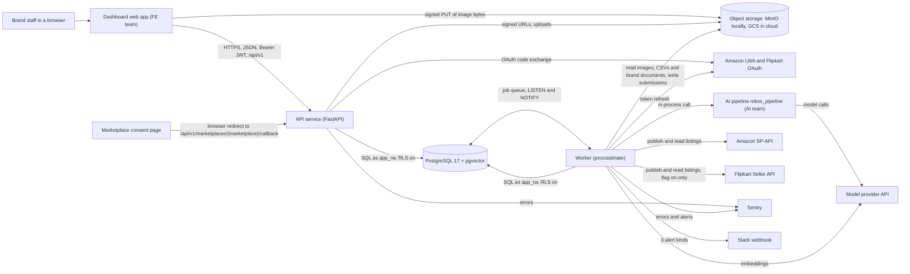

How to read it:

- Arrows point from the caller to the called side. The browser talks only to the dashboard, the
  API, the object store (for a direct image upload) and the marketplace consent page.
- The API and the worker never call each other. They meet in Postgres: the API writes a job row
  and a queue entry; the worker picks the entry up.
- Only the worker talks to the marketplaces' listing APIs and to the AI pipeline. The API's only
  marketplace call is the OAuth code exchange when a seller connects an account.
- There is **no email service** in v1. Passwords are set by staff through the CLI
  (`python -m app.cli user set-password`), and there is no invite or reset email yet.

Why it is shaped this way:

- **AI never publishes.** The chain is: AI proposes, the Rules Engine validates, a human approves,
  an adapter publishes. Import contracts (section 3) make the publish code unreachable from the API
  and from the AI pipeline.
- **One database for everything.** Data, job queue, rate-limit counters, OAuth state and vectors
  all live in Postgres. There is no Redis. One backup covers the whole system, and a job can be
  queued in the same transaction as the data it works on, so it is never lost.

Source: `apps/api/app/main.py`, `apps/api/app/workers/main.py`, `apps/api/app/adapters/`,
`apps/api/app/core/slack.py`, `docs/adr/0001-hosting-gcp.md`, `docs/adr/0004-postgres-job-queue.md`.

---

## 2. Deployment view on Google Cloud

One container image runs every role. The environment variable `APP_ROLE` picks the role at start
(`apps/api/docker-entrypoint.sh`):

| `APP_ROLE` | What it runs | Where it runs in the cloud |
|---|---|---|
| `api` | One `uvicorn app.main:app` process, port `$PORT` (8080 in the image) | Cloud Run **service** |
| `worker` | `python -m app.workers.main`: queues `default` and `publish`, no port | Cloud Run **worker pool** |
| `migrate` | `alembic upgrade head` as the `migrator` role, then `dictionary sync` | Cloud Run **job**, run before each deploy |
| `seed` | Loads demo data; refuses any `APP_ENV` except `local` | Local only |
| `shell` | `python <args>` for one-off commands | Local or a one-off job |

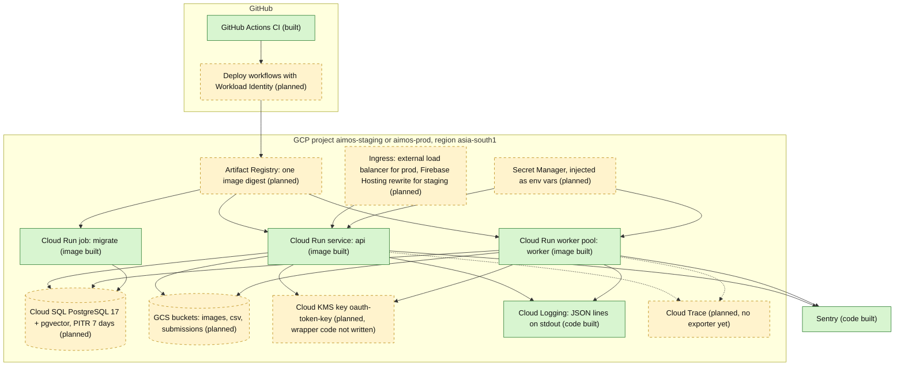

How to read it:

- Green boxes are **built**: the code and the container image exist and pass CI. Yellow dashed
  boxes are **planned**: they need the infrastructure step (S4 for staging, S25 for production),
  whose OpenTofu code is not written yet (`infra/README.md` is a placeholder).
- The three Cloud Run boxes are the same image with a different `APP_ROLE`. The image is built and
  tested; the Cloud Run resources that run it are not created yet.
- The dotted arrows to Cloud Trace mean the spans are created in code but nothing exports them yet.

| Piece | Status | Detail |
|---|---|---|
| Container image (`apps/api/Dockerfile`) | **Built** | `python:3.13-slim-trixie`, digest-pinned, non-root user `app`, roles `api`, `worker`, `migrate`, `seed`, `shell`. |
| API on Cloud Run | **Planned** (runtime built) | ADR-0001: prod 1 vCPU / 1 GiB, min 1 / max 3 instances; staging min 0 / max 1. One uvicorn process per instance. |
| Worker pool | **Planned** (runtime built) | Prod 1 vCPU / 2 GiB, 1 instance. Both queues in one process. On SIGTERM a running job gets 8 s to finish; if it is still running it is aborted and goes back to `queued` without using up an attempt. |
| Migration job | **Planned** (runtime built) | Runs `migrate` with max-retries 0 before every deploy, never at container start. |
| Cloud SQL | **Planned** | Prod: PostgreSQL 17 Enterprise, `db-custom-1-3840`, 7-day point-in-time recovery (PITR), `max_connections` 100. Staging: a shared-core instance stopped off-hours. Both use Cloud Run's built-in socket connection. Locally: `pgvector/pgvector:0.8.5-pg17` in Docker. |
| GCS buckets | **Planned** (client built) | Images, CSVs, publish submissions. The code uses the S3-compatible API (`app/adapters/storage.py`, boto3), so MinIO locally and GCS in the cloud use the same code path. |
| Secret Manager | **Planned** | Secrets arrive as environment variables (`gcloud run deploy --set-secrets`). The app never calls the Secret Manager API. |
| Cloud KMS (token sealing) | **Planned, code missing** | The local key wrapper is built. The Cloud KMS wrapper is not: outside `APP_ENV=local`, getting the key wrapper (needed to seal and to unseal) raises `NotImplementedError("Cloud KMS wrapper lands with S4")` (`app/core/crypto.py`). See section 10. |
| Cloud Scheduler | **Not used** | Periodic work (status sync, token refresh, alerts, retention) runs inside the worker as procrastinate periodic tasks (section 5), so no external scheduler is needed. |
| Cloud Logging | **Built** in code | One JSON line per event on stdout (`LOG_FORMAT=json`), with Cloud Logging's trace fields when a span is active. |
| Sentry | **Built** | Starts when `SENTRY_DSN` is set; required outside local. |
| OpenTelemetry export | **Planned** | Spans are created for requests, jobs, DB calls and adapter calls; no exporter is installed yet (`app/core/observability.py`). |
| Ingress and TLS | **Planned** | Prod: global external Application Load Balancer for `api.<DOMAIN>`. Staging: a Firebase Hosting rewrite. |
| CI/CD | CI **built**, deploy **planned** | 11 required checks on every pull request (section 9). Deploy workflows arrive with S4/S25. |

Connection budget (ADR-0001): API 3 instances x (pool 5 + overflow 5) = 30, worker 2 instances (the
planned maximum) x (app pool 10 + queue pool 5) = 30, migration job 5, proxy and admin 10, reserve
3: 78 of 100. Why it matters: Postgres refuses connections past `max_connections`, so recompute it
whenever instance counts or pool sizes change.

Source: `apps/api/Dockerfile`, `apps/api/docker-entrypoint.sh`, `apps/api/app/workers/settings.py`,
`docs/adr/0001-hosting-gcp.md`, `docs/canon/ENV.md`, `infra/README.md`.

---

## 3. Code layering

All backend code is in `apps/api/app`. Each folder has one job.

| Folder | Its job |
|---|---|
| `api/` | HTTP only: routers in `api/v1/routers`, request and response models, the middleware, the error envelope, the frozen list of 50 operations (`api/v1/surface.py`). |
| `services/` | Business rules: what an operation does, its transaction, its audit row, its job. The Rules Engine (`services/rules_engine`) lives here and is pure. |
| `repositories/` | All SQL. Every tenant table is read through `TenantScopedRepository`, which adds `WHERE tenant_id = :tid`. `uow.py` bundles the repositories on one tenant transaction. |
| `db/` | The engine, the session and its tenant guard, the ORM models, the queue connection. |
| `workers/` | The worker process: the job wrapper, one body per job kind, retries, periodic tasks, alerts. |
| `adapters/` | Everything outside: Amazon and Flipkart clients and mappings, OAuth clients, object storage, the token unseal. |
| `core/` | Shared plumbing: settings, errors, roles (`rbac.py`), JWTs, sealing, logging, redaction, tracing. |
| `admin/` | A read-only staff console at `/internal/admin`, mounted only when `ADMIN_ENABLED=true` and never in production. |
| `cli.py` | Staff commands (`python -m app.cli`): migrate, dictionary sync, seed, create a tenant and add members, set a password, list and requeue dead-letter or failed jobs. |

Two packages sit outside the app:

- `packages/schemas` (`mkos_schemas`): the **contract**. Every request, response and job model,
  error codes and enums, the generated `openapi.json` and the TypeScript types the dashboard uses.
- `packages/pipeline-stub` (`mkos_pipeline`): a deterministic stand-in for the AI team's pipeline,
  used by CI and the end-to-end scripts. A production worker refuses to boot with the stub
  installed.

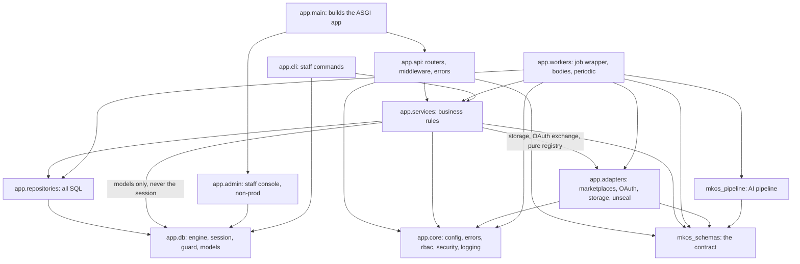

How to read it:

- An arrow means "may import". The main road is `api -> services -> repositories -> db`.
- Only `workers` reaches the AI pipeline and the publishing adapters. The API reaches the
  marketplaces only through pure, no-network pieces (the preview mapping) and the OAuth exchange.
- `mkos_schemas` is at the bottom: everything may import it, and it imports nothing from the app.
- Services also import a few pure job types from `app.workers` (`registry`, `errors`, `policy`,
  `payloads`): they build the job payloads and outcomes that the worker runs. This arrow is left out
  of the diagram to keep it readable.

The rules are enforced, not just agreed. `.importlinter` holds **21 contracts** and the
`lint-imports` CI check fails a pull request that breaks one. The ones that shape the design:

| Contract | Why it exists |
|---|---|
| `layers`: routers -> services -> repositories | A lower layer never calls back up. |
| `routers-never-import-the-db` | A router cannot run SQL or skip the service's rules. |
| `services-never-import-the-engine` | A service cannot open a raw connection that skips the tenant guard. Only `services.health` (the readiness ping) is exempt. |
| `decrypt-path-only-in-adapters-and-workers` | Only adapters and workers can unseal a marketplace token. The API can seal, never unseal. |
| `marketplace-io-only-in-adapters-and-workers` | No API route or service can publish to a marketplace. Publishing happens only in the publish job, after approval. |
| `status-sync-reader-only` | The status sync can only read from the marketplace, never write. |
| `only-workers-import-pipeline`, `pipeline-never-imports-app` | The AI pipeline is called only by the generation job, and it cannot import the app, the web framework, the database driver or the queue. |
| `adapters-no-ai` | Adapters never call a model. |
| `rules-engine-is-pure`, `image-gate-is-pure`, `image-checks-are-pure`, `brand-chunking-is-pure`, `pure-mapping-no-io` | These pieces are pure functions: deterministic, no I/O, easy to test. |
| `image-check-child-is-pure` | The image decoder runs in a child process that loads no settings, database, storage or HTTP client. |
| `boto3-only-in-storage-adapter` | One place builds object-storage clients, with one set of timeouts and credentials. |
| `only-main-imports-admin`, `nothing-imports-the-cli`, `app-never-imports-mock`, `mock-imports-no-app`, `schemas-never-imports-app` | Entry points and dev tools stay at the edges. |

`scripts/ci/check_repo_rules.py` adds 8 rules that import-linter cannot express. For example: only
`app/core/config.py` reads environment variables (R1), no raw SQL outside `app/db` and
`app/repositories` (R4), and the cross-tenant `platform_scope()` is named only in the admin, the
CLI, scripts and two worker modules (R5).

Source: `.importlinter`, `scripts/ci/check_repo_rules.py`, `apps/api/app/repositories/uow.py`.

---

## 4. Request lifecycle

What happens to one HTTP request, in the order the code runs it. The outer layers are pure ASGI
middleware, built in `app/main.py` and `app/core/asgi.py`. Authentication is **not** middleware:
it is a FastAPI dependency on each route, so public routes (login, the probes, the OAuth callback)
need no exclusion list.

| Order | Layer | File | What it does |
|---|---|---|---|
| 0 | Trace header strip | `core/asgi.py` | Drops inbound `traceparent`, `tracestate`, `sentry-trace`, `baggage`. A caller cannot join or force a trace. |
| 1 | Request context | `core/middleware.py` | Keeps a safe `X-Request-ID` or mints a UUID4, binds it to every log line, opens the server span, writes one access log line, sets `X-Request-ID` on the response, logs an escaped exception once. |
| 2 | Security headers | `api/security_headers.py` | `nosniff`, `Referrer-Policy: no-referrer`, `Cache-Control: no-store` on `/api/v1`, HSTS outside local. On every answer, a 500 included. |
| 3 | Server error middleware | Starlette | Turns an unhandled exception into the 500 error envelope (no exception text). |
| 4 | CORS | `api/cors.py` | Only `ALLOWED_ORIGINS`, no credentials, methods `GET POST PATCH DELETE`, exposes `ETag`, `Location`, `Retry-After`, `X-Request-ID`. A refused preflight gets the error envelope. |
| 5 | Body limit | `api/body_limit.py` | 413 `PAYLOAD_TOO_LARGE` over 10 MiB (256 KiB for `/rules/dry-run`), before any parsing or auth. A malformed `Content-Length` is 400. |
| 6 | Exception handlers | `api/errors.py` | Maps `ApiError`, domain errors (conflict, not found, input, limit) and validation errors to the one error envelope. |
| 7 | Route policy | `api/v1/deps.py` | `public()` (per-IP limit, 60/min) or `require(action)`: verify the JWT, probe the membership, per-tenant limit (120/min), check the role. |
| 8 | Handler and service | `api/v1/routers`, `services/` | The service opens a tenant transaction, calls repositories, writes audit rows, may enqueue a job. |

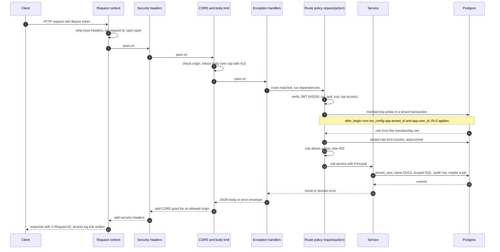

How to read it:

- Time runs top to bottom. Solid arrows are calls, dashed arrows are answers.
- The tenant context is set **inside Postgres**, at the start of every transaction: the session's
  `after_begin` listener runs `set_config('app.tenant_id', ..., true)` (and `app.user_id`). Row
  level security policies compare each row's `tenant_id` with that setting.
- A request usually runs two short transactions: the membership probe, then the service's own
  unit of work. The rate-limit increment is a third, autocommitted, so it is never rolled back.
- Any failure on the way becomes the same error envelope:
  `{"error": {"type", "message", "status", "correlation_id", "details", "error_report"}}`, where
  `correlation_id` is the request id.

Details the FE team should know:

- The tenant comes **only** from the verified token. No route takes a `tenant_id`. Another
  tenant's object answers 404, never 403, so ids cannot be probed.
- The role comes from the membership row, not from the token. A demoted user loses the right on
  the next request, even with an old token.
- `redirect_slashes` is off: `/api/v1/products/` is a 404, not a redirect.

Source: `apps/api/app/main.py`, `apps/api/app/core/asgi.py`, `apps/api/app/core/middleware.py`,
`apps/api/app/api/*.py`, `apps/api/app/api/v1/deps.py`, `apps/api/app/db/session.py`.

---

## 5. Background jobs

Long work never runs inside an HTTP request, because a slow model or marketplace call would hold
the connection open and time out. The endpoint answers **202 Accepted** with a `job_id` and a
`poll_url`, and the dashboard polls `GET /api/v1/jobs/{job_id}`. `POST /listings/publish` is a
batch: its 202 body has a `batch_id` and one `job_id` per item in `items[]`. Nine operations work
this way:
`POST /products/bulk`, `/imports/{import_id}/rows/retry`, `/brand/documents`, `/images/upload`,
`/listings/generate`, `/listings/publish`, `/listings/{listing_id}/regenerate`,
`/listings/{listing_id}/publish/retry-fields` and `/listings/{listing_id}/refresh-status`.

The queue is **procrastinate**, a job queue stored in Postgres itself. Each job has two records:

- the `job_runs` row: our record, with status, attempt, result and error report. The API and the
  dashboard read only this;
- the procrastinate queue entry: carries only the `job_run_id`. The worker loads everything else
  (tenant included) from the row.

### 5.1 Enqueue and run

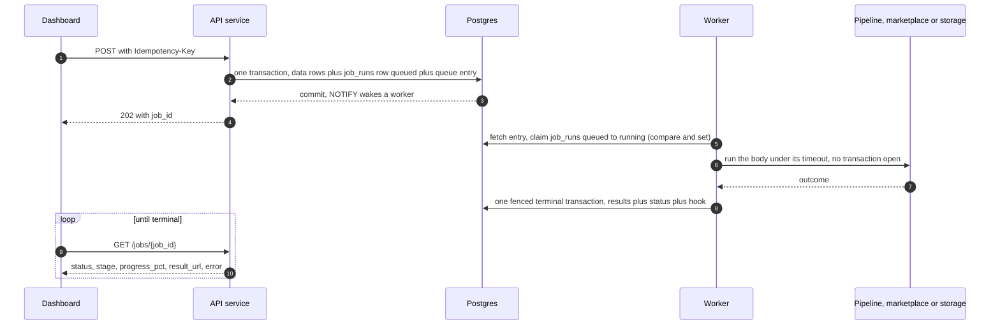

How to read it:

- The data and its job commit together, so a job is never lost and never runs on data that did
  not commit.
- The worker holds no database transaction while it waits on the AI pipeline or a marketplace.
- The terminal write is **fenced** on `status = 'running' AND attempt = <claimed attempt>`: if the
  lease expired and a newer attempt owns the row, the old worker writes nothing.

### 5.2 Job kinds, queues and limits

There are two queues so that a slow import can never starve publishing. One worker process runs
both, `default` with 4 parallel jobs and `publish` with 2 (`app/workers/settings.py`).

| Job kind | Queue | Timeout | Max attempts | Retries network, 5xx, 429 |
|---|---|---|---|---|
| `listing_generate` | default | 300 s | 1 | no (the pipeline has its own bounded correction loop) |
| `listing_publish` | publish | 600 s | 3 | yes |
| `listing_status_sync` | publish | 120 s | 3 | yes |
| `bulk_import` | default | 1800 s | 3 | yes |
| `image_compliance` | default | 300 s | 3 | yes, and one at a time (queue lock) |
| `brand_embed` | default | 300 s | 3 | yes |

Source: `apps/api/app/workers/policy.py`. The lease a claim takes is the timeout plus 60 s.

### 5.3 Job status, retries and dead letters

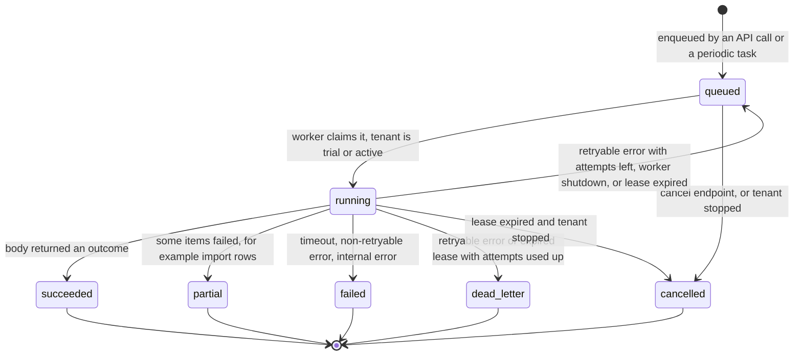

How to read it:

- Boxes are statuses and arrows are the allowed moves, labelled with what causes them. There are 7
  statuses. Five of them (`succeeded`, `partial`, `failed`, `cancelled`, `dead_letter`) are
  terminal: stop polling when you see one.
- A worker shutdown sends the job back to `queued` without counting an attempt. A retry and an
  expired lease do count one.
- Only a `queued` job can be cancelled. A `running` job answers 409 `INVALID_STATUS_TRANSITION`.
- Retry backoff is 1 s doubling to a 60 s cap, with jitter (50 to 100 percent of the step).
- `dead_letter` means "gave up after retries". Staff can requeue it with
  `python -m app.cli jobs requeue`; there is no API route for it. Each dead letter raises an alert.

Failures **around** the job body (a database blip while claiming or finishing) are retried by
the queue itself, up to 20 times with backoff. Past that, the reaper ends the row as
`dead_letter` + `INTERNAL_ERROR`, so no row stays `queued` forever.

### 5.4 Periodic tasks

Every worker runs procrastinate's periodic scheduler. A queueing lock per task makes each slot fire
once across all workers. They run on the `default` queue. A periodic entry carries only a
timestamp, never tenant data. Cross-tenant tasks list ids through the read-only `platform_scope()`
and then do the work in each tenant's own transaction.

| Task | Schedule (cron, UTC) | What it does |
|---|---|---|
| `reaper` | every minute | Expired `running` jobs: requeue, or `dead_letter` + `JOB_TIMEOUT`, or `cancelled` when the tenant is stopped. Prunes dead workers. Reconciles queue entries with `job_runs` (orphaned or lost entries). |
| `schedule_status_sync` | every minute | Finds listings whose `next_sync_at` is due and enqueues one `listing_status_sync` each, under `FOR UPDATE SKIP LOCKED`, so a slot is never enqueued twice. |
| `marketplace_token_refresh` | every 5 min | Refreshes marketplace tokens that expire within 15 minutes (at most 500 a pass). A refused refresh sets the account `needs_reconnect` and opens a `reconnect_account` human task. |
| `check_alerts` | every 5 min | Job error rate, daily model spend against budget, queue latency, dead-letter storms (section 7). |
| `prune_rate_limits` | every 5 min | Deletes rate-limit counters older than 5 minutes. |
| `prune_idempotency_keys` | hourly, minute 0 | Deletes expired `Idempotency-Key` records. |
| `expire_trials` | hourly, minute 15 | Tenants whose trial ended become `suspended`. |
| `oauth_states_prune` | hourly, minute 30 | Deletes expired OAuth state rows. |
| `retention_daily` | 03:00 | Per tenant, in batches: old import rows, job runs, expired refresh tokens, closed invitations, inactive brand chunks, finished queue entries, then orphaned image objects in storage. |

Source: `apps/api/app/workers/periodic.py`.

### 5.5 Why running a job twice is safe

A queue can deliver a job twice (a crash, a lost acknowledgement). Every layer expects that:

- **The HTTP call.** The 202 endpoints require `Idempotency-Key`, and so do `POST /listings/approve`,
  `POST /jobs/{job_id}/cancel` and `POST /issues/{issue_id}/dismiss`. The same key with the same
  body replays the first answer for 24 hours; with a different body it is 409
  `IDEMPOTENCY_KEY_REUSED`. A repeated key never creates a second job.
- **The claim.** `queued -> running` is a compare-and-set. A duplicate delivery finds the row
  already `running` and is dropped.
- **The terminal write.** It is fenced on the claimed attempt (5.1).
- **The bodies.** Publish reads its ledger (`listing_submissions`) before it writes, imports work
  per row with a savepoint each, generation never retries, and the status sync only reads.

Source: `apps/api/app/workers/wrapper.py`, `apps/api/app/workers/retry.py`,
`apps/api/app/repositories/jobs.py`, `apps/api/app/services/idempotency.py`,
`docs/adr/0017-job-retry-and-recovery.md`.

---

## 6. Security model

### 6.1 Authentication: access and refresh tokens

The API is the only issuer of tokens. The dashboard stores them and sends the access token as
`Authorization: Bearer <ACCESS_TOKEN>`.

| Token | Lifetime | Stored server-side | Used for |
|---|---|---|---|
| Access | 30 min (`ACCESS_TOKEN_TTL_MINUTES`) | No; verified by signature | Every `/api/v1` call |
| Refresh | 14 days (`REFRESH_TOKEN_TTL_DAYS`) | Only its sha256 hash, in `refresh_tokens` | `POST /auth/refresh` only |

Both are JWTs signed with HS256 and `JWT_SECRET`. Claims: `sub` (user), `tid` (tenant), `roles`,
`email`, `typ` (`access` or `refresh`), `jti`, `iss`, `aud`, `iat`, `exp`. Decoding accepts only
HS256, checks issuer, audience and type, and every failure is the same 401.

Each login starts a **refresh family**. Every refresh rotates the token: the old one is marked
`rotated` and a new one is issued in the same family. If a rotated or revoked token is ever used
again, someone copied it, so the whole family is revoked (`reuse_detected`) and audited.

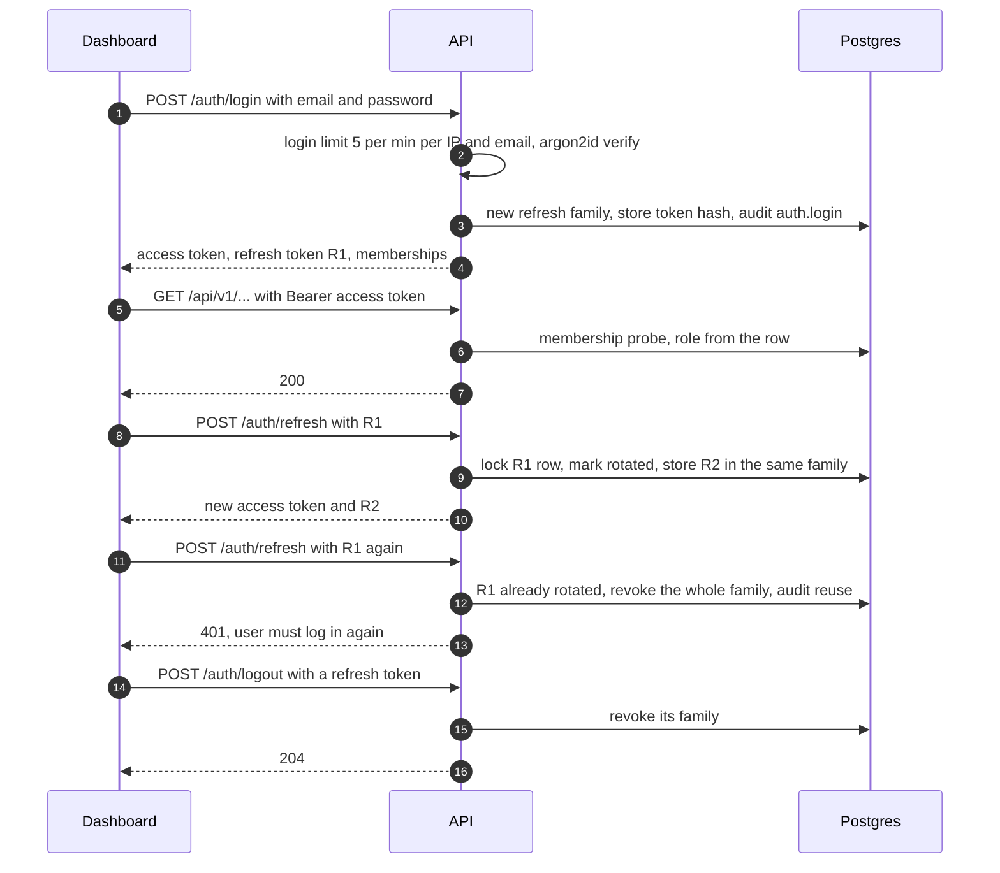

How to read it:

- Steps 1 to 4: login. A failed login writes an audit row and answers the same 401 for an unknown
  email, a wrong password or an inactive user, so emails cannot be probed.
- Steps 5 to 7: a normal call. The membership probe runs on **every** request, so a deactivated
  member or a suspended tenant is locked out at once, even with a valid access token.
- Steps 8 to 13: rotation, then reuse detection. Two tabs refreshing the same token at once count
  as reuse, so the dashboard should refresh from one place only.
- Steps 14 to 16: logout revokes refresh tokens. An access token already issued stays valid until
  it expires (at most 30 minutes); there is no access-token deny list.

`POST /auth/switch-tenant` gives a new token pair (a new family) for another tenant the user
belongs to. `GET /auth/me` lists the memberships.

### 6.2 Roles and what each can do

Every operation except the four public ones (login, refresh, logout, OAuth callback) requires
exactly one **action**. `app/core/rbac.py` maps roles to actions, and
`api/v1/surface.py` names the action of each of the 50 operations, so the code, the OpenAPI file
(`x-mkos-action`) and the tests cannot drift apart.

| Action | owner | admin | operator | reviewer |
|---|---|---|---|---|
| `tenant:read` (all reads, plus `auth/me` and `switch-tenant`) | yes | yes | yes | yes |
| `analytics:read` | yes | yes | yes | yes |
| `product:import` (create products, CSV import and row retry, images) | yes | | yes | |
| `listing:generate` (generate, cancel a job) | yes | | yes | |
| `listing:regenerate` | yes | | yes | yes |
| `listing:edit` (edit content, validate, rules dry-run) | yes | | yes | |
| `listing:approve` (approve, dismiss an issue) | yes | | | yes |
| `listing:publish` (publish, retry fields, refresh status) | yes | | yes | |
| `marketplace:connect` (connect, confirm, revoke) | yes | yes | | |
| `team:manage` (list and change members) | yes | yes | | |
| `settings:manage` (update the tenant profile, upload and delete brand documents) | yes | yes | | |

A role that lacks the action gets 403 `PERMISSION_DENIED`. An unknown role string grants nothing.

### 6.3 Maker-checker

Approval is mandatory before anything is published, and the approver must be a different person
from the makers.

- `POST /listings/approve` walks the listing's version chain back to the last full generation and
  collects every user who generated or edited it. If the approver is one of them, the item fails
  with `MAKER_CHECKER_VIOLATION` (`app/services/maker_checker.py`).
- The database checks the same chain again in the `lv_guard` trigger (error `MKC01`), so even a
  bug in the API cannot approve one's own work.
- The trigger also requires the approver to hold an active `reviewer` or `owner` membership.
- An `owner` holds every action but is still bound by maker-checker.
- Approval is pinned to a version. Editing after approval makes a new version that needs a new
  approval.

### 6.4 Tenant isolation

Four independent layers stop one tenant from reading or writing another tenant's data. Any one of
them alone would block a leak.

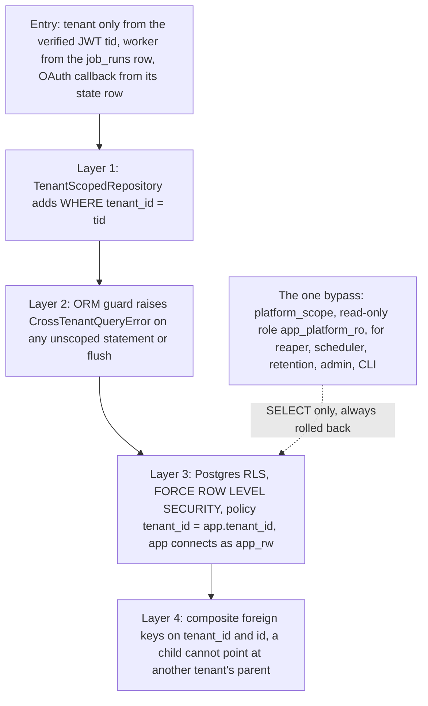

How to read it:

- Read top to bottom: a request passes every layer before it reaches a row.
- Layer 3 runs inside Postgres, so it holds even for SQL that layers 1 and 2 never see. The app
  logs in as `app_rw`, which is not a superuser and cannot bypass RLS. Migrations run as
  `migrator`.
- The dashed arrow is the only cross-tenant path, and it is read-only. Repo rule R5 limits which
  files may name it.

Tests: the `tenant-isolation` CI check runs a suite (`apps/api/tests/tenant_isolation`, 18 test files)
as `app_rw` against its own database, covering every area (products, imports, listings, publish,
images, search, analytics, issues). The OWASP suite's API1 (broken object level authorization)
tests it again over HTTP.

### 6.5 Marketplace tokens are sealed

A marketplace OAuth token can publish on the seller's behalf, so it is never stored in plain text.

- **Seal** (`app/core/crypto.py`): AES-256-GCM under a fresh 32-byte data key per seal, with the
  tenant id as associated data (a blob copied to another tenant's row will not open). The data key
  is wrapped by a key wrapper: a local stub key on `APP_ENV=local`, Cloud KMS in the cloud
  (**not written yet**, section 10).
- **Unseal** (`app/adapters/credentials.py`): reachable only from adapters and workers (import
  contract). Plaintext lives only in local variables as `SecretStr`, for the one call that needs
  it.
- The connect flow: the API builds the consent URL with a one-time state row, the marketplace
  redirects the browser to `/api/v1/marketplaces/{marketplace}/callback`, the API checks the state,
  exchanges the code, seals the tokens and redirects to
  `{DASHBOARD_BASE_URL}/marketplaces/connected?pending=<handle>`. The dashboard then calls
  `POST /marketplaces/connect/confirm` with that handle.

### 6.6 Outbound calls and server-side request forgery

The backend never opens a URL that came from user data. A URL in a CSV cell, a product field or
listing content is stored as text.

- Only six modules build an HTTP client: the Slack sender, the OAuth client, the Amazon client, the
  Flipkart client, the embeddings client and the storage adapter. Each takes its host from
  settings or a pinned constant. None follows redirects or reads proxy settings from the
  environment.
- The Amazon endpoint is pinned to `AMAZON_USE_SANDBOX`: a staging deploy cannot write to the
  production marketplace by a typo. Flipkart hosts are pinned the same way. Outside local, http or
  loopback URLs are refused at boot.
- Marketplace calls go through a shared outbound rate limiter in Postgres (per marketplace,
  account and operation), read replies through a 1 MiB cap, and log no URL, SKU, body or token.
- `apps/api/tests/security/test_owasp_api7_ssrf.py` imports hostile URLs (loopback, the cloud
  metadata address, `file://`) and asserts that no socket opens. It also scans the code for any new
  HTTP client.

### 6.7 Upload and size limits

| Limit | Value | Where |
|---|---|---|
| Any request body | 10 MiB, 413 before parsing | `REQUEST_MAX_BODY_BYTES` |
| Rules dry-run body | 256 KiB | `api/v1/routers/rules.py` |
| Image | 10 MiB, 50 live images per product. The upload URL request accepts `image/jpeg`, `image/png` or `image/webp`, but the compliance check decodes only JPEG, PNG and TIFF, so a WebP file fails it with `FORMAT_UNSUPPORTED` | `services/images.py`, `api/v1/schemas/images.py`, `services/image_checks.py` |
| Image decoding | In a separate child process with CPU and memory limits (Linux), no secrets in its environment | `services/image_check_child.py` |
| Signed image upload URL | 15 minutes, create-only (cannot overwrite) | `services/images.py` |
| Brand document | 10 MiB, 50 live documents, `.txt` or `.md` only | `services/brand_documents.py` |
| CSV import | 10,000 rows, 256 columns, 5,000 characters per cell, 32,768 characters in the header | `services/imports/csv_file.py`, `mkos_schemas/imports.py` |
| Page size | `limit` 1 to 200, default 50, cursor only | `api/pagination.py` |
| Job payload | 64 KiB | `repositories/jobs.py` |

### 6.8 Rate limits

All counters live in the Postgres table `rate_limit_counters`, so every API instance and worker
shares them.

| Bucket | Limit | Applies to |
|---|---|---|
| Per IP | 60 per minute | Public routes (login, refresh, logout, OAuth callback) |
| Per tenant | 120 per minute | Every authenticated route, counted only after the membership probe passes |
| Login | 5 per minute per IP and email | `POST /auth/login`, before the password check |

A 429 carries `Retry-After`. Behind the load balancer the client IP is read from a fixed position
in `X-Forwarded-For`, never the left-most (caller-controlled) entry.

### 6.9 OWASP API Top 10 suites

`apps/api/tests/security` holds one suite per OWASP API Security risk (API1 to API10), plus prompt
injection, "secrets never logged" and "every route is covered" checks. They run inside the
`api-tests` and `api-tests-integration` CI checks.

Source: `apps/api/app/core/security.py`, `apps/api/app/services/auth.py`,
`apps/api/app/core/rbac.py`, `apps/api/app/services/maker_checker.py`,
`apps/api/app/db/guard.py`, `apps/api/alembic/versions/0005_rls.py`, `apps/api/app/core/crypto.py`,
`apps/api/app/api/rate_limit.py`, `docs/adr/0006-identity-and-tenancy.md`,
`docs/adr/0018-token-envelope-encryption.md`.

---

## 7. Observability

One **request id** ties everything together. Quote it when you report a problem.

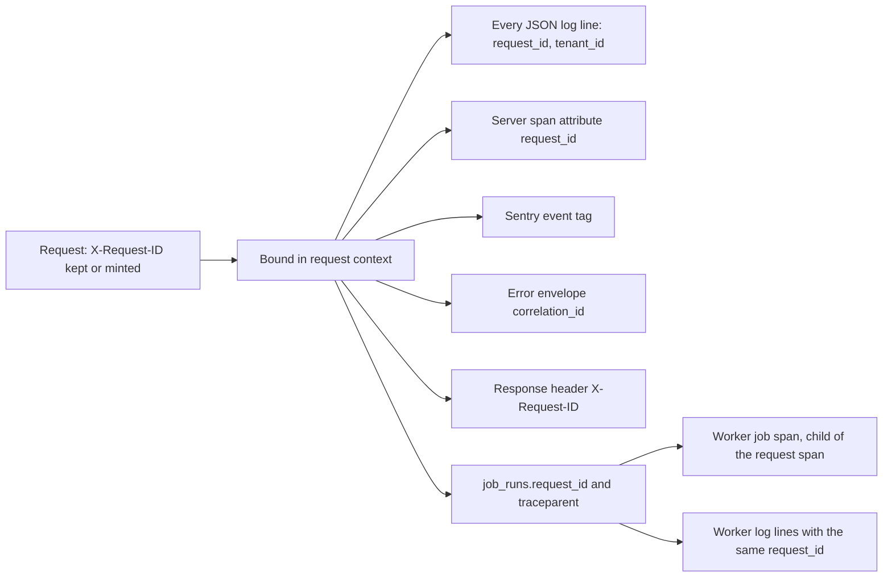

How to read it:

- Start at the left: the id is chosen once, at the edge, and copied into every output on the
  right.
- A job enqueued by a request keeps that request's id, so the worker's logs for that job carry the
  same id as the API call that started it.

| Signal | How it works | Status |
|---|---|---|
| Structured logs | One JSON line per event on stdout: `timestamp`, `severity`, `message`, `module`, `request_id`, `tenant_id` and the event's own keys. One access line per request (method, route template, status, duration; no query string, IP or user agent). | Built |
| Redaction | `app/core/redaction.py` runs on every log line and every Sentry event: denied keys (passwords, tokens, secrets, emails), Bearer and JWT-shaped values, URL credentials, database error details. HTTP client and model SDK loggers are held at WARNING. | Built |
| Sentry | `environment` from `APP_ENV`, `release` from `GIT_SHA`, no PII, no request bodies, no frame locals. | Built; required outside local |
| Traces (OpenTelemetry) | Spans for each request, job, DB call and adapter call, sampled at 10 percent. Inbound trace headers are dropped. | Spans built; **export planned** |
| `/healthz` | Liveness: always 200 `{"status": "ok"}`, never touches the database, never rate limited, not logged or traced. | Built |
| `/readyz` | Readiness: one shared `SELECT 1` (2 s timeout, result cached 1 s). 200 `{"status": "ok", "checks": {"postgres": "ok"}}` when ready, 503 `{"status": "unavailable", "checks": {"postgres": "unavailable"}}` when not. Never rate limited. | Built |
| Worker liveness | No port and no health server. Liveness is the worker heartbeat (every 10 s) and the reaper. | Built |

**Alerts.** `check_alerts` (every 5 minutes) and the worker emit five alert kinds. Each is
deduplicated per time window, logged at WARNING and sent to Sentry. Three also post to Slack
(`ALERT_SLACK_WEBHOOK`, https only). Alert fields are ids and numbers only, never listing text or
tokens.

| Alert | Fires when | Slack |
|---|---|---|
| `job_dead_lettered` | A job reaches `dead_letter` (capped per window, then one summary) | no |
| `job_error_rate` | At least 20 terminal jobs of a kind in 15 min and 25 percent or more failed | no |
| `llm_budget` | Today's model spend reaches 80 or 100 percent of a tenant's or the global daily budget | yes |
| `queue_latency` | The oldest queued job in a queue has waited 10 minutes or more | yes |
| `token_refresh_failed` | A marketplace refused a token refresh and the account needs reconnecting | yes |

Source: `apps/api/app/core/middleware.py`, `apps/api/app/core/logging.py`,
`apps/api/app/core/redaction.py`, `apps/api/app/core/observability.py`,
`apps/api/app/api/health.py`, `apps/api/app/core/alerts.py`, `apps/api/app/workers/periodic.py`.

---

## 8. Configuration

All settings are environment variables, read in one place (`app/core/config.py`). The full
register, with local values, is `docs/canon/ENV.md`. In the cloud, every **secret** comes from
Secret Manager; nothing secret is ever committed. The boot is strict: a missing or unsafe value
stops the process before it serves anything.

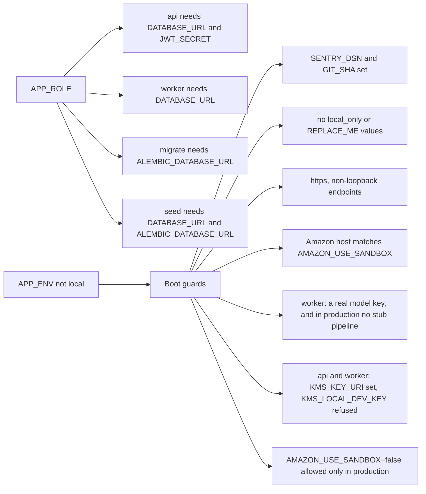

How to read it: `APP_ROLE` decides which variables are required; `APP_ENV` other than `local`
turns on extra checks that refuse development values. Why so strict: a staging or production
process that started with a dev secret or a sandbox switch flipped would fail quietly later; a
refusal at boot fails loudly before any traffic arrives.

| Group | Variables | Secret? |
|---|---|---|
| Process | `APP_ENV` (local, staging, production), `APP_ROLE`, `APP_NAME`, `PORT`, `API_V1_PREFIX` (always `/api/v1`), `LOG_LEVEL`, `LOG_FORMAT` (json in cloud), `GIT_SHA` | no |
| Web | `ALLOWED_ORIGINS` (the dashboard origins), `DASHBOARD_BASE_URL` (OAuth return), `REQUEST_MAX_BODY_BYTES`, `RATE_LIMIT_PER_TENANT_PER_MIN`, `RATE_LIMIT_PER_IP_PER_MIN`, `AUTH_LOGIN_RATE_LIMIT_PER_MIN`, `OAUTH_STATE_TTL_SECONDS` | no |
| Database | `DATABASE_URL` (as `app_rw`), `ALEMBIC_DATABASE_URL` (as `migrator`, migrate job only) | **yes** (both hold passwords) |
| Database tuning | `DATABASE_POOL_SIZE`, `DATABASE_MAX_OVERFLOW`, `DATABASE_POOL_TIMEOUT`, `DATABASE_POOL_RECYCLE`, `DB_STATEMENT_TIMEOUT_MS`, `DATABASE_ECHO` | no |
| Auth | `JWT_SECRET` (different per environment) | **yes** |
| Auth | `JWT_ALGORITHM` (HS256), `JWT_ISSUER`, `JWT_AUDIENCE`, `ACCESS_TOKEN_TTL_MINUTES`, `REFRESH_TOKEN_TTL_DAYS`, `PASSWORD_HASH_SCHEME` (argon2id) | no |
| Storage | `STORAGE_BACKEND` (minio or gcs), `GCS_BUCKET_IMAGES`, `GCS_BUCKET_CSV`, `GCS_BUCKET_SUBMISSIONS`, `S3_ENDPOINT_URL` | no |
| Storage | `S3_ACCESS_KEY`, `S3_SECRET_KEY` | **yes** |
| Cloud and keys | `GCP_PROJECT_ID`, `GCP_REGION` (asia-south1), `KMS_KEY_URI`, `SECRET_MANAGER_ENABLED` | no |
| Cloud and keys | `KMS_LOCAL_DEV_KEY` (local only, never set in cloud) | dev-only |
| Models | `LLM_PROVIDER`, `LLM_MODEL_DEFAULT`, `LLM_MODEL_ESCALATION`, `LLM_PROVIDER_VISION`, `LLM_MODEL_VISION`, `EMBEDDING_MODEL`, `EMBEDDING_DIMENSIONS` (1536, fixed by the database), `LLM_TIMEOUT_SECONDS`, `LLM_MAX_CORRECTION_ATTEMPTS`, `LLM_DAILY_BUDGET_USD`, `LLM_TENANT_DAILY_BUDGET_USD` | no |
| Models | `OPENAI_API_KEY`, `DEEPSEEK_API_KEY` (unused in v1) | **yes** |
| Amazon | `AMAZON_APP_ID`, `AMAZON_CLIENT_ID`, `AMAZON_AUTHORIZE_URL`, `AMAZON_LWA_TOKEN_URL`, `AMAZON_SPAPI_ENDPOINT`, `AMAZON_MARKETPLACE_ID`, `AMAZON_OAUTH_REDIRECT_URI`, `AMAZON_USE_SANDBOX` | no |
| Amazon | `AMAZON_CLIENT_SECRET` | **yes** |
| Flipkart | `FLIPKART_ENABLED` (off by default), `FLIPKART_CLIENT_ID`, `FLIPKART_AUTHORIZE_URL`, `FLIPKART_TOKEN_URL`, `FLIPKART_API_BASE`, `FLIPKART_OAUTH_REDIRECT_URI` | no |
| Flipkart | `FLIPKART_CLIENT_SECRET` | **yes** |
| Observability | `SENTRY_DSN`, `ALERT_SLACK_WEBHOOK` | **yes** |
| Observability | `SENTRY_TRACES_SAMPLE_RATE`, `OTEL_SERVICE_NAME`, `OTEL_EXPORTER_OTLP_ENDPOINT`, `OTEL_TRACES_SAMPLER`, `OTEL_TRACES_SAMPLER_ARG` | no |
| Staff admin | `ADMIN_SESSION_SECRET` | **yes** |
| Staff admin | `ADMIN_ENABLED`, `ADMIN_BASE_URL`, `ADMIN_READ_ONLY` (must be true), `ADMIN_STAFF_EMAILS`, `ADMIN_LOCAL_EMAIL` | no |

Values the FE team will need once the cloud is live: the API base URL, and that their origin is in
`ALLOWED_ORIGINS` and is the `DASHBOARD_BASE_URL`. The OAuth redirect URIs registered with Amazon
and Flipkart must match `AMAZON_OAUTH_REDIRECT_URI` and `FLIPKART_OAUTH_REDIRECT_URI` exactly.

Source: `apps/api/app/core/config.py`, `docs/canon/ENV.md`.

---

## 9. Quality gates

Every pull request must pass **11 required checks** before it can merge. Heavier checks run
locally before a release and nightly on `main`.

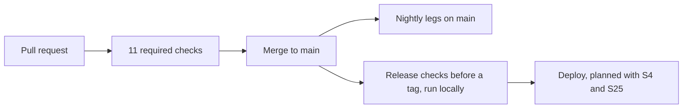

How to read it: a change moves left to right. Nothing reaches a deploy without passing the
required checks, and a release also needs the local release checks.

| Check | When | What it proves |
|---|---|---|
| `api-lint` | every PR | ruff, black, the 8 repo rules, pip-audit of the lock file |
| `api-typecheck` | every PR | mypy over the app |
| `api-tests` | every PR | Shard 1: migration round trip (upgrade, check, downgrade), unit, meta and package suites, part of the database suites, Rules Engine branch coverage gate |
| `api-tests-integration` | every PR | Shard 2: the rest of the database and HTTP integration suites (both shards include the OWASP suites' share) |
| `tenant-isolation` | every PR | The isolation suite as `app_rw` on its own database |
| `lint-imports` | every PR | The 21 import contracts and repo rules R5 to R8 |
| `bootstrap` | every PR | A clean `.env.example` plus `make bootstrap` works from nothing |
| `commit-lint` | every PR | PR title and branch name follow the rules |
| `gitleaks` | every PR | No secret in the diff |
| `contracts` | every PR | `mkos-schemas` installs alone, golden fixtures pass, version check, no breaking change in `openapi.json` (oasdiff), the mock server answers |
| `schemas-drift` | every PR | Regenerated JSON Schemas, `openapi.json` and TypeScript types equal the committed ones |
| `make acceptance` | before a release; nightly | The v1 acceptance run on a fresh stack: setup by the staff CLI, then every leg over HTTP against the fake marketplace and a real worker |
| `make e2e-fresh` | before a release | Every `scripts/e2e/*.sh` flow, twice, on a fresh stack |
| `make drill-restore` | before a release; nightly | Acceptance run, `pg_dump`, restore into a throwaway database, every check again, in 15 minutes or less |
| `make load-smoke` | before a release | Production rate limits, a 1,000-row import, 20 concurrent generations; JSON report |
| `mutation` | nightly | Mutation testing: at least 80 percent per core module, or a written waiver |
| Other nightly legs | nightly | pip-audit, gitleaks over full history, API fuzzing per role (Schemathesis), deep property tests, random test order, migration replay |

A red nightly leg opens or updates one `nightly-red` issue. The nightly run never uses cloud
resources or real secrets: it runs the stub pipeline against the fake marketplace.

Source: `.github/workflows/ci-api.yml`, `ci-meta.yml`, `contracts.yml`, `nightly.yml`, `Makefile`,
`scripts/ci/nightly.sh`.

---

## 10. Known limitations in v1

The full list, with history, is [`docs/review/KNOWN-ISSUES.md`](../review/KNOWN-ISSUES.md). These
are the ones that matter to the frontend and AI teams.

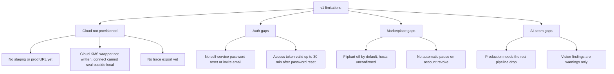

How to read it: each branch is one area; the leaves are the concrete gaps listed below.

| Limitation | Effect | Where it is tracked |
|---|---|---|
| **The cloud is not built.** The OpenTofu code (S4 staging, S25 production) is not written. | No staging or production URL. Until then, use the local API (`make dev`, plus `make worker` for background jobs) or the mock server (`make mock`, port 4010, which answers with the committed `openapi.json` examples). | `infra/README.md`, section 2 |
| **No Cloud KMS wrapper.** Sealing or unsealing a token outside `APP_ENV=local` raises `NotImplementedError`. | Connecting a marketplace account fails on staging and production until S4 writes the wrapper, so nothing there can be published or status-synced yet. Flows that do not touch a marketplace token are unaffected. | `apps/api/app/core/crypto.py` |
| **Trace export not installed.** | Spans exist but are not sent anywhere yet. Logs and Sentry work. | `apps/api/app/core/observability.py` |
| **Proxy hop count unverified.** The rate limiter reads the client IP at a fixed `X-Forwarded-For` position (2 for staging and prod). | Must be checked on the first real request through each ingress. | KNOWN-ISSUES B, rate limiter row |
| **No self-service password reset or invite email.** Staff set passwords with the CLI. An access token issued before a reset stays valid until it expires (30 min). | The dashboard has no "forgot password" flow in v1. | KNOWN-ISSUES, S16 follow-ups |
| **Revoke does not pause listings.** A listing on a revoked account cannot be published (409 `AUTH_EXPIRED`) and is skipped by the status sync; reconnecting the same seller re-adopts it. Listings stranded by a revoke before the fix are not back-filled. | Show "Reconnect" when an account is `needs_reconnect`. | KNOWN-ISSUES E, revoke and reconnect |
| **Flipkart is off by default** and its hosts are "believed until confirmed". | Flipkart connect, callback and confirm answer 501 while `FLIPKART_ENABLED=false`. | `docs/canon/ENV.md` Flipkart rows |
| **Real AI pipeline not dropped yet.** A production worker refuses to boot with the stub. | The AI team's tagged `mkos-pipeline` release is needed before launch. | `docs/HANDOFF-AI.md` |
| **Vision checks only warn.** Image vision findings never block approval in v1; the deterministic image checks do. | A listing can be approved with vision warnings. | `docs/HANDOFF-AI.md` section 4 |
| **Some rules not evaluated.** Fact-source rules return `NOT_EVALUATED`; overlay, watermark and logo image rules are not seeded. | Fewer automatic checks than the full spec. | KNOWN-ISSUES B and S16 follow-ups |
| **Login picks the most recently used tenant.** A user in two tenants lands in one and must call `switch-tenant`. | The dashboard should show a tenant switcher from `memberships`. | `apps/api/app/services/auth.py` |
| **Job-spine items deferred to S25.** Periodic tasks share the `default` queue with long imports; retention holds one transaction per tenant. | Only bites under production load; bounded by the reaper and idempotent job bodies. | KNOWN-ISSUES E, job-spine follow-ups |
| **Image check identity.** The image decoder child runs as the worker's user on the same network. | Fix planned at S4 with a least-privilege identity. | KNOWN-ISSUES, image check identity row |
