# Database architecture (handover)

This page explains how the AI Marketplace OS backend stores its data. It is written for the
frontend team and the AI team, who call the API but do not work in this codebase.

You never connect to the database yourself. Everything goes through the HTTP API under
`/api/v1` (local `http://localhost:8000`, staging `https://api.staging.<DOMAIN>`, production
`https://api.<DOMAIN>`). This page helps you understand what the API returns, why some requests
are refused, and which words mean what.

How this page is built:

- The first part (up to "Schema reference") is written by hand. It explains the ideas.
- The second part is **generated from the code** by `scripts/docs/gen_db_er.py`: every table,
  column, key, index, CHECK constraint, RLS policy and trigger. It cannot drift from the real
  schema. To refresh it, run `.venv/bin/python scripts/docs/gen_db_er.py` from the repo root.
  `--check` fails when the page is out of date.
- When this page and an older design document disagree, the code (and so this page) is right.
  `docs/architecture/DATABASE.md` is the original design proposal; parts of it describe plans
  that changed during the build.

## 1. Words we use

| Word | Meaning |
|---|---|
| **Tenant** | One brand (one seller business) using the product. Each tenant's data is kept apart from every other tenant's. Table `tenants`. |
| **User** and **membership** | A user is one person with one global login (`users`). A membership (`tenant_memberships`) gives that person a role in one tenant: `owner`, `operator`, `reviewer` or `admin`. One person can belong to several tenants. |
| **Product** | A seller item in the catalog (`products`). It holds the facts: title, category, price, tax, legal parties, identifiers, dimensions. |
| **Family / variant** | A product family is a **style** (the parent, with a `variation_theme` such as `size`, `color` or `size_color`) plus its **variants** (child products, each one size and/or colour, with `parent_product_id` set). A product with no family is **standalone**. Colourways (`product_colourways`) and the size x colour grid (`variant_matrix_cells`) describe which variants exist. |
| **Marketplace** | Amazon or Flipkart. Every marketplace column allows exactly `amazon` and `flipkart`. |
| **Marketplace account** | A tenant's connected seller account on a marketplace (`marketplace_accounts`). Its OAuth token is stored encrypted. |
| **Listing** | One product on one marketplace (`listings`). It has a workflow status (`created`, `generating`, `validated`, `needs_review`, `approved`, `publishing`, `published`, `blocked`, `failed`) and a marketplace-side state (`not_submitted`, `processing`, `live`, ...). |
| **Listing version** | An immutable snapshot of a listing's content (`listing_versions.content_json`). Every AI generation, regeneration and human edit makes a new version. The listing points at its `current`, `approved`, `published` and `live` versions. |
| **Listing item** | One sellable SKU inside a listing (`listing_items`): the standalone product, or the family parent and each child variant. |
| **Maker-checker** | The rule that the person who made a version (generated or edited it) cannot approve it. A different reviewer or owner must approve. The database enforces this, not only the API. |
| **Review decision** | One approve / reject / regenerate decision on an exact version (`review_decisions`). |
| **Submission** | One attempt to send an approved version to a marketplace (`listing_submissions`). At most 3 attempts per approved version. |
| **Job run** | One background job (`job_runs`): generate, publish, status sync, CSV import, image check, brand embed. The API answers `202` with a job id; you poll the job. |
| **Issue** | A problem on a listing (`listing_issues`), found by validation or returned by the marketplace, with an error code, a class and a suggested fix. |
| **Human task** | A question the system asks a person when it cannot continue alone (`human_tasks`), for example a missing compliance fact. Answering it resumes the paused work. |
| **Fact / provenance** | A product value plus where it came from (`provenance`: source, confidence, evidence). Critical facts may never come from an AI source. |
| **Facts digest** | A sha256 of the product's resolved facts at one moment (`facts_digest` on validation runs, review decisions and submissions). An approval records it; a submission whose digest differs is refused with `FACTS_CHANGED_SINCE_APPROVAL`, so nothing is published on facts the reviewer never saw. |
| **ErrorReport** | The shared JSON shape for a result and its list of problems (`status`, `error_code`, `retryable`, attempts, and `errors[]` items with `field`, `error_code`, `severity`, `message`, `source`, ...), defined in `packages/schemas` (`mkos_schemas/errors.py`). The `error_report_json` columns (validation runs, AI call records, jobs, imports, submissions, ...) hold it. |
| **Platform data** | Data shared by all tenants (category templates, the error map, the attribute dictionary, the listing status transitions, platform rules). It belongs to no tenant: the platform tables have no `tenant_id` column, and a platform rule is a `rules` row with `tenant_id` NULL. The app can only read it. |
| **RLS** | PostgreSQL Row Level Security: the database itself filters rows by tenant. |

## 2. What is stored where

There is one database: **PostgreSQL 17 with the pgvector extension** (Cloud SQL in production,
the `pgvector/pgvector:0.8.5-pg17` image locally). It holds every record, the job queue and the
brand-voice vectors. There is no Redis and no separate vector database.

Files are **not** stored in the database. They live in **object storage** (MinIO locally, Google
Cloud Storage in staging and production). A table keeps only the object **key** (never a URL),
and the API hands out short-lived signed URLs when you need to upload or download.

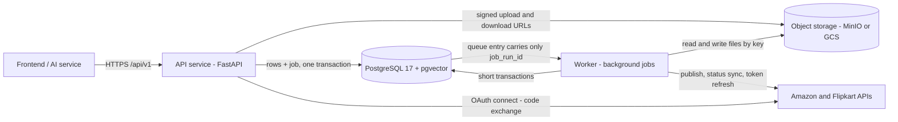

How to read it: boxes are running services, cylinders are data stores, arrows show who talks to
whom. The API and the worker (plus the migration job at deploy time) are the only programs that
touch the database. The frontend never talks to the database or the marketplaces directly.

| Kept in object storage | Bucket setting (default name) | Key layout | Pointed to by |
|---|---|---|---|
| Product images | `GCS_BUCKET_IMAGES` (`marketplace-images`) | `<tenant_id>/<product_id>/images/<image_id>` | `images.storage_key` |
| CSV import files | `GCS_BUCKET_CSV` (`marketplace-csv`) | `<tenant_id>/imports/<import_id>.csv` | `imports.storage_key` |
| Brand documents | `GCS_BUCKET_CSV` (`marketplace-csv`) | `<tenant_id>/brand-documents/<document_id>` | `brand_documents.storage_key` |
| Submission payload sent to a marketplace | `GCS_BUCKET_SUBMISSIONS` (`marketplace-submissions`) | `<tenant_id>/submissions/<submission_id>/payload.json` | `listing_submissions.payload_storage_key` + `payload_sha256` |
| Raw marketplace response | `GCS_BUCKET_SUBMISSIONS` | `<tenant_id>/submissions/<submission_id>/raw.jsonl` | `listing_submissions.raw_response_storage_key` + `raw_response_sha256` |

Every key starts with the tenant id, so one tenant's files can be listed and deleted together.
A daily job deletes image objects older than 24 hours that no `images` row points to.

Everything else is in Postgres: tenants and people, products and facts, listings and every
version, approvals, the submission ledger, issues and tasks, the audit trail, job runs, the job
queue, rate-limit counters, OAuth state, and the brand-voice vectors.

## 3. Multi-tenancy: how one brand never sees another brand's rows

Every table that holds tenant data has a `tenant_id` column (`tenants` itself is scoped on its
`id`). Four separate layers keep tenants apart. Each one catches a different kind of bug, so a
mistake in one layer is stopped by the next.

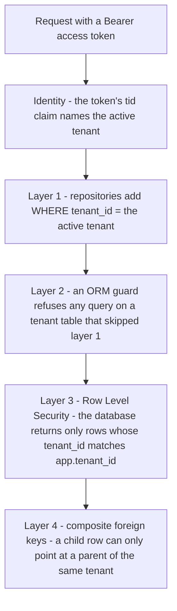

How to read it: a request passes the layers from top to bottom. Layers 1 and 2 live in the
application code; layers 3 and 4 live in the database and hold even if the code has a bug.

**Where the tenant comes from.** The API never takes a tenant id from the request body or query.
It uses only the `tid` claim of the verified access token. A person who belongs to several
tenants switches with `POST /api/v1/auth/switch-tenant`, which issues a new token. Background
jobs take the tenant from their `job_runs` row.

**Row Level Security (RLS).** RLS is **enabled and forced** on every table with a `tenant_id`
(including `rules` and `audit_log`, where `tenant_id` may be NULL for platform rows), plus
`tenants` (scoped on its own `id`) and `users` (no `tenant_id`; it has its own policies).
"Forced" means the rules apply even to the table's owner. At the start of every transaction the
app sets a transaction-local setting `app.tenant_id` with `set_config(...)`. The standard
policies are:

- `t_tenant`: the app role (`app_rw`) sees and writes only rows where
  `tenant_id = app.tenant_id`. If the setting is missing, it sees **zero rows** (it never errors
  open).
- `t_platform`: the read-only roles may SELECT across tenants (see roles below).
- `t_migrator`: the schema owner may do everything (needed because RLS is forced).

A few named extra policies cover requests that have no tenant yet, or that are about one
person rather than one tenant. They match on another transaction-local setting
(`app.login_email`, `app.user_id`, `app.job_id` or a token hash), never on request input:

- Read-only (SELECT): login by email (`users_login`), refresh by token hash
  (`refresh_tokens_hash`), the user's own refresh tokens (`refresh_tokens_own`), invitation
  accept by token hash (`invitations_hash`), the OAuth callback by state hash
  (`oauth_states_hash_select`), the tenant switcher (`tenants_switcher`), "my memberships"
  (`memberships_own`), teammates in the current tenant (`users_teammates`), and the worker
  reading its job by id (`jr_by_id`).
- Writes: sign-up inserts a user (`users_signup`), a user reads and updates their own row
  (`users_self`), and the OAuth callback deletes the used state row (`oauth_states_hash_delete`).
- `rules` and `audit_log` have their own policies instead of `t_tenant`: `rules_read` shows
  platform rules plus the brand's own, `rules_write` / `rules_toggle` touch only the brand's own;
  `audit_read` shows the tenant's audit rows and `audit_insert` also allows platform rows.

The table catalog below lists each table's policies.

**Composite foreign keys.** A child row references its parent by `(tenant_id, parent_id)`, not
just `parent_id`. Actor columns (who generated, edited, approved, decided) reference
`tenant_memberships (tenant_id, user_id)`. So a row can never point at another tenant's row, and
every actor is a member of the same tenant.

### Database roles

The application never connects as a superuser, and **no role has BYPASSRLS**.

| Role | Logs in? | Used by | What it may do |
|---|---|---|---|
| `migrator` | yes | The migration job and operator commands (`python -m app.cli ...`) | Owns every table and function. Runs Alembic, loads platform data (attribute dictionary, category templates, error map), and is the only role that may run `purge_tenant`, `redact_user` and the `prune_*` functions. `lock_timeout` 5 s. |
| `app_rw` | yes | The API service and the worker | Reads and writes tenant rows under the `t_tenant` policy. Only INSERT and SELECT on append-only tables. SELECT only on platform tables (it may add and toggle a brand's own `rules`). Cannot delete tenants, truncate, or change audit rows. Idle-in-transaction timeout 60 s. |
| `app_ro` | yes | Developers, read-only debugging | SELECT across tenants through `app_platform_ro`. Every transaction is read-only by default. |
| `app_platform_ro` | no (NOLOGIN) | Entered with `SET LOCAL ROLE` by `app_rw` inside `platform_scope` | SELECT across tenants under `t_platform`. Has no grant on secret or personal columns (`token_enc`, password and token hashes, PKCE verifier, party contact data, `gstin`, raw import rows, task answers, the audit log's `actor_email` and `ip`). |

**`platform_scope` (cross-tenant reads).** Some work has to look across tenants: the scheduler
that finds listings due for a status sync, the reaper that finds jobs whose worker died, the
retention job, the token-refresh pass, the staff admin pages. They open `platform_scope()`, which
starts every transaction with `SET TRANSACTION READ ONLY` and `SET LOCAL ROLE app_platform_ro`
and never commits. So a cross-tenant read can never write. Any write that follows is done tenant
by tenant, in a normal tenant transaction with `app.tenant_id` set.

## 4. Rules the database enforces

Many business rules are enforced **inside the database**, by CHECK constraints, unique indexes
and triggers. Even a bug in the API cannot break them. When one fires, the API turns it into a
normal error response with a stable error code (the API reference lists each code's HTTP
status). Why both the API and the database check: the API checks first so it can return a
specific, friendly code; the database check is the backstop that still holds if the API has a
bug or a second request races the first. These are the ones you are most likely to meet:

| Rule | Enforced by | Table | Error code you get |
|---|---|---|---|
| **Maker-checker:** whoever generated or edited a version cannot approve it; the approver needs an active `reviewer` or `owner` membership; only the listing's current version can be approved; a version's content never changes after insert | trigger `lv_guard` (SQLSTATE `MKC01`) | `listing_versions` | `MAKER_CHECKER_VIOLATION` (HTTP 403) |
| A listing's status moves only along the allowed transitions (see "Listing status machine" below); `approved` and `publishing` need a human-approved current version | triggers `listings_status_guard`, `listings_status_guard_events` | `listings` | `INVALID_STATUS_TRANSITION` (SQLSTATE `LST01`); `LISTING_PAUSED` / `LISTING_ARCHIVED` (`LST02`) for a paused or archived listing |
| A multi-item (bulk) approve only accepts `validated` listings | trigger `review_bulk_backstop` | `review_decisions` | `BULK_APPROVE_REQUIRES_VALIDATED` |
| **Publish gate:** a publish job can only be created for an approved current version of a listing in `approved`, `failed` (retry) or `blocked` with reason `marketplace_action_required` (resume), not paused or archived, with an active marketplace account, by an active `owner` or `operator`, with fewer than 3 submissions for that version, and with no open `error` issue that needs a user action and has no answered task | trigger `publish_gate` | `job_runs` | the API checks the same conditions first and returns a specific code; if only the trigger catches it, the API answers `INVALID_STATUS_TRANSITION` (HTTP 409) |
| **Submission ledger:** a submission needs the listing in `publishing` and the approved version; the facts must be unchanged since approval; at most 3 attempts; a retry must change something (different input, a retryable error, a marketplace change, or a human fix) | trigger `ls_guard` | `listing_submissions` | `FACTS_CHANGED_SINCE_APPROVAL`, `SUBMISSION_ATTEMPTS_EXHAUSTED`, `DUPLICATE_SUBMISSION_BLOCKED` |
| At most one open (in-flight) submission per listing | partial unique index `ux_ls_open` | `listing_submissions` | `SUBMISSION_IN_FLIGHT` |
| At most one queued or running job per listing and job kind | partial unique index `ux_job_runs_live` | `job_runs` | `LISTING_BUSY` |
| A SKU is unique inside a tenant | unique index `products_tenant_sku_idx` | `products` | `SKU_CONFLICT` |
| At most one **open** issue per listing and dedupe key; a closed issue never changes; an `error` issue can never be dismissed | partial unique index `li_one_open`, trigger `listing_issues_guard` | `listing_issues` | not user-facing: the issue sync updates the open issue instead of adding a second one |
| A task moves only `open -> answered -> applied` (or `cancelled`) and its answer is set once | trigger `human_tasks_guard` | `human_tasks` | `INTERNAL_ERROR` (generic guard refusal, see below) |
| Listing items: the right product for each role (standalone, parent, child), seller SKU frozen after the first submission | trigger `li_guard` | `listing_items` | `SELLER_SKU_CONFLICT` |
| **Facts guard:** a fact key must be known to the attribute dictionary, owned at the right level, and set by an allowed source; a critical fact can never come from an `ai` source | trigger `facts_guard` | `products`, `product_colourways`, `brand_profiles` | `FACT_SOURCE_FORBIDDEN`, `UNKNOWN_FACT_KEY`, `FACT_LEVEL_INVALID` (HTTP 422) |
| Variants follow their style's theme (one level deep, the theme's axes only); a style with live variants cannot be deleted; the size x colour matrix stays complete | triggers `variant_guard` (generic guard refusal), `variant_matrix_guard` (SQLSTATE `VAR01`), `variant_matrix_complete` (`VAR02`, checked at commit) | `products`, `variant_matrix_cells` | `VARIATION_INVALID` (matrix cell; also a CSV import row refused by `variant_guard`), `VARIANT_MATRIX_INCOMPLETE` (commit check) |
| A tenant always keeps at least one active owner | trigger `last_owner_guard` (checked at commit) | `tenant_memberships` | `LAST_OWNER_REQUIRED` |
| Job status moves only along the job state edges (section 8); a finished job is never changed (a staff requeue of a finished job is a new row with `parent_job_id`) | trigger `job_runs_guard` | `job_runs` | `INTERNAL_ERROR` (generic guard refusal) |
| Audit rows, AI call records, validation runs and review decisions are append-only | trigger `append_only_guard` + revoked UPDATE/DELETE | `audit_log`, `agent_runs`, `validation_runs`, `review_decisions` | `INTERNAL_ERROR` (generic guard refusal) |
| Platform tables are read-only to the app (only the migrator loads them); a rule's content never changes, only `enabled` (new content is a new `version` row, each change takes a new `revision`); a template's content is immutable, only `is_current` moves; platform rows are never deleted, and a brand's own rules only by a tenant purge | triggers `rules_guard`, `category_templates_guard`, `error_map_guard`, `dictionary_guard` | platform tables, `rules` | `INTERNAL_ERROR` (generic guard refusal) |
| `auto_publish` is always false in v1, so nothing reaches a marketplace without a human approval | CHECKs `ck_tenants_auto_publish`, `ck_job_runs_no_auto_publish` | `tenants`, `job_runs` | not reachable through the API |

A **SQLSTATE** is the five-character error code PostgreSQL attaches to an error; the guards use
their own (`MKC01`, `LST01`, `SUB02`, ...) so the API can map each one to an error code without
reading the message text (see `apps/api/app/db/integrity.py`). Every other guard refusal has the
generic SQLSTATE `GRD01` and comes back as HTTP 500 `INTERNAL_ERROR`: it means the API let
through something it should have refused first, so please report it with the response's
request id.

## 5. Soft delete, archive and deactivation

Rows that other rows depend on are rarely deleted, because history (versions, approvals,
submissions, audit rows) must keep pointing at what it referred to. Instead:

- `deleted_at` (soft delete) on `products`, `product_colourways`, `images`, `business_parties`
  and `brand_documents`. Normal reads skip soft-deleted rows. A style with live variants
  cannot be soft-deleted.
- `listings` are **paused** (`paused_at`) or **archived** (`archived_at`). A paused or archived
  listing cannot change status until it is unpaused or unarchived.
- `is_active` on `users` (a disabled login), on `tenant_memberships` (deactivate a member, keep
  their history) and on `brand_chunks` (an old embedding set is switched off when a document is
  re-embedded).
- `enabled` on `rules`, `marketplace_error_map`, `attribute_definitions` and
  `category_attributes`, and `is_current` on `category_templates`: rows are switched off or
  superseded, never deleted, because old validation runs pin the exact version they used.
- Tenants are **offboarded** (`status = 'offboarded'`), and only after `purge_after` has passed
  does the migrator-only `purge_tenant` remove their data (its final step, which also removes the
  audit rows, waits for the 24-month audit retention). A user's personal data is removed with
  `redact_user`.

Retention runs as scheduled worker jobs (`apps/api/app/workers/periodic.py`): expired
idempotency keys hourly, rate-limit counters every 5 minutes, OAuth states hourly, and a daily
pass at 03:00 that deletes, tenant by tenant, imports and their rows after 90 days, finished
job-run chains after 90 days (180 for `failed` / `dead_letter`; publish jobs are kept), refresh
tokens 7 days after they expire, invitations 30 days after they closed, inactive brand chunks
after 30 days, old procrastinate queue rows, and orphaned image objects.

## 6. Audit trail

`audit_log` records who did what: actor type and user, action, entity type and id, an
allow-listed `before` / `after` (personal fields are filtered out by the `audit()` function),
the request id, the job id and the time. It is **append-only**: the app may only INSERT and
SELECT, and a trigger refuses any UPDATE, DELETE or TRUNCATE, even by a superuser. The only
exceptions are three migrator-only maintenance functions: `purge_tenant` (a tenant's offboarding
purge: it first clears `actor_email` and `ip` on that tenant's audit rows and, in its final step,
deletes them), `redact_user` (clears `actor_email` and `ip` on one person's audit rows) and the
`prune_*` functions (delete old rows). An allowed update may only set those two columns to NULL,
so no one can rewrite an audit row. A row with a NULL `tenant_id` is a platform event (staff or
system).

## 7. Vectors (pgvector)

`brand_chunks.embedding` is a `vector(1536)`. Brand documents and the brand profile are cut into
chunks, embedded by the worker (`brand_embed` jobs) and stored with the embedding model name.
Search filters first (this tenant, active chunks, the configured embedding model, optional chunk
types) and then orders by exact cosine distance. That is exact and fast at year-one sizes. An
HNSW index (`brand_chunks_embedding_idx`, cosine, `m=16`, `ef_construction=64`) is already built
for when a tenant grows past tens of thousands of chunks. Chunk text is treated as untrusted
prompt input.

## 8. Background jobs: `job_runs` and the procrastinate queue

Jobs use **procrastinate**, a job queue that lives in the same Postgres database (tables
`procrastinate_jobs`, `procrastinate_events`, `procrastinate_periodic_defers`,
`procrastinate_workers`). That gives one important property: the API writes the domain rows,
the `job_runs` row and the queue entry **in one transaction**, so a job can never be lost or
created for a change that was rolled back.

- `job_runs` is the **source of truth**. The API reads job state only from it. A queue entry
  carries nothing but `{"job_run_id": "<uuid>"}`, which is why the procrastinate tables need no
  tenant column or RLS.
- Job kinds: `listing_generate`, `listing_publish`, `listing_status_sync`, `bulk_import`,
  `image_compliance`, `brand_embed`. Two queues: `publish` (for `listing_publish` and
  `listing_status_sync`) and `default` (everything else). A trigger sets the queue from the kind,
  and the worker runs the two with separate concurrency, so publishing is never starved by
  long generation jobs.
- Job states: `queued`, `running`, then one of `succeeded`, `partial`, `failed`, `cancelled`,
  `dead_letter` (gave up after its last attempt; kept for staff to inspect). A worker holds a
  lease (`lease_expires_at`) while it runs a job; the reaper (every minute) finds a job whose
  worker died (lease expired) and cancels it if its tenant is no longer `trial` or `active`,
  puts it back to `queued` if it has attempts left, or else dead-letters it.
- An automatic retry (a retryable failure with attempts left) moves the **same row** back to
  `queued`, keeping its `attempt` count. A staff requeue of a `failed` or `dead_letter` job
  (the operator command `python -m app.cli jobs requeue <job_id> --staff-email ... --reason ...`)
  makes a **new row** linked by `parent_job_id`; the old row stays as it was.

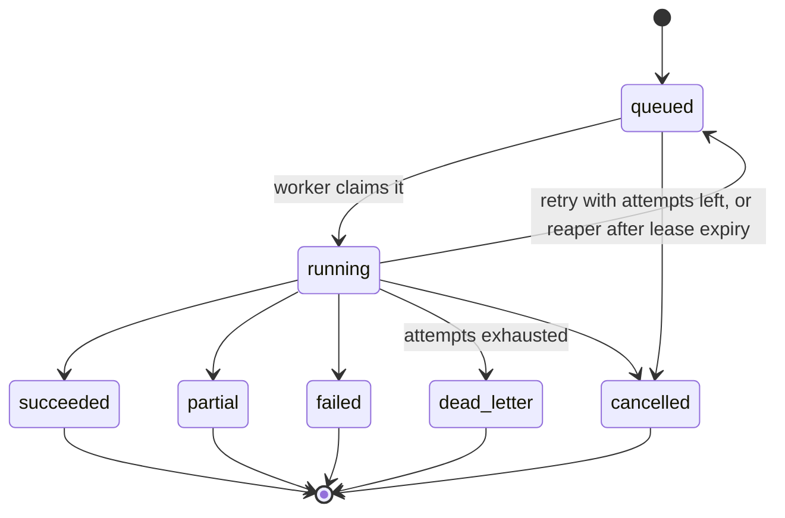

How to read it: a box is a `job_runs.status` value and an arrow is a move the `job_runs_guard`
trigger allows. The five end states are final; the row never changes again. Poll
`GET /api/v1/jobs/{job_id}` until the status is one of them (`POST /api/v1/jobs/{job_id}/cancel`
asks for a cancel).

## 9. Migrations

- Schema changes are **Alembic** revisions in `apps/api/alembic/versions/`, written by hand
  (never autogenerated). The current head is shown at the top of the generated part below.
  CHECK constraints, triggers, RLS and grants live only in the migrations; the SQLAlchemy models
  mirror the tables, and the integration tests (run in CI) use `alembic check` to prove the two
  match.
- Revisions so far: `0001` tenancy and catalog, `0002` listing pipeline, `0002b` the HNSW index,
  `0003` operations tables, `0003b` the procrastinate schema, `0004` integrity (guards,
  privileges, display views, purge), `0005` RLS, `0006` OAuth pending tokens, `0007` facts
  guard, `0008` publish retry condition, `0009` analytics indexes and job trace context.
- Before any migration, `scripts/db/0000_bootstrap.sql` runs once per environment as the
  database admin: it creates the extensions (`vector`, `pgcrypto`, `pg_trgm`) and the roles.
- **Production and staging run migrations as a Cloud Run job**, before each deploy, never at
  container start. The same image runs with `APP_ROLE=migrate`: it executes
  `python -m app.cli db migrate` (`alembic upgrade head` as `migrator`, under an advisory lock
  with a 5 s lock timeout, refusing a database that is newer than the image), then
  `python -m app.cli dictionary sync` (the attribute dictionary the facts guard reads).
  Category templates and the error map are loaded with `app.cli templates load` and
  `app.cli errors load`. The job definition itself is created during the GCP rollout.
- Every change is **expand / contract**: release N must still work with release N-1's code, so
  a rollback is "redeploy the previous image", never a downgrade in production. New columns are
  nullable, indexes are built concurrently, new constraints start `NOT VALID`.
- Locally, `make dev` does it all: it runs `make bootstrap-db`, then
  `alembic -c apps/api/alembic.ini upgrade head` and `app.cli dictionary sync`, then starts the
  API (see `ONBOARDING.md`).

## 10. Backups and restore

- Production uses Cloud SQL automated backups with point-in-time recovery (7 days), set up
  during the GCP rollout.
- The restore is rehearsed with **`make drill-restore`** (`scripts/drill/restore.sh`). It runs
  the acceptance flow on a fresh stack, takes a `pg_dump`, restores it into a throwaway
  Postgres (roles first, then `pg_restore`), and checks the Alembic head, row counts, the
  procrastinate queue, forced RLS, the CHECK helper functions under an empty `search_path`, an
  `app_rw` login with tenant scoping, and that a sealed marketplace token still decrypts. It
  fails if it takes more than 900 seconds.

## 11. How to read an erDiagram

The schema diagrams below are Mermaid `erDiagram`s. GitHub renders them in place.

- A **box** is a table. Inside it, each line is `type column_name KEYS "note"`.
  `PK` = primary key, `FK` = foreign key, `UK` = unique key. `"nullable"` means the column may
  be NULL.
- A **line** between two boxes is a foreign key. The text on the line names the FK column(s) in
  the child table.
- The **symbols at each end** say how many rows can be on that side (crow's foot notation):

| Symbol | Meaning |
|---|---|
| `\|\|` | exactly one |
| `\|o` or `o\|` | zero or one |
| `o{` or `}o` | zero or more |
| `\|{` or `}\|` | one or more |

Example: `listings ||--o{ listing_versions : "listing_id"` reads "one listing has zero or more
versions; each version belongs to exactly one listing, through `listing_id`". A `|o` on the
parent side means the FK column is nullable, so a child may have no parent.

# Schema reference (generated)

<!-- BEGIN GENERATED -->

_This block is generated by `scripts/docs/gen_db_er.py` from the SQLAlchemy models and the Alembic migrations. Do not edit it by hand: change the code, then run `.venv/bin/python scripts/docs/gen_db_er.py`._

**Schema at Alembic head `0011_mfa_lockout`.** 45 application tables in 11 domains, plus 4 job-queue tables owned by procrastinate (not in the models).

## Domains at a glance

| Domain | Model module | Tables |
|---|---|---|
| Tenancy and identity | `app/db/models/tenancy.py` | [`invitations`](#invitations), [`mfa_challenges`](#mfa_challenges), [`signup_requests`](#signup_requests), [`tenant_memberships`](#tenant_memberships), [`tenants`](#tenants), [`user_mfa_factors`](#user_mfa_factors), [`user_password_history`](#user_password_history), [`user_recovery_codes`](#user_recovery_codes), [`users`](#users) |
| Catalog: products and variants | `app/db/models/catalog.py` | [`product_colourways`](#product_colourways), [`products`](#products), [`variant_matrix_cells`](#variant_matrix_cells) |
| Catalog assets: images, marketplace accounts, batches | `app/db/models/catalog_assets.py` | [`batches`](#batches), [`images`](#images), [`marketplace_accounts`](#marketplace_accounts) |
| Fact owners: brand profile and business parties | `app/db/models/facts.py` | [`brand_profiles`](#brand_profiles), [`business_parties`](#business_parties) |
| Listings, versions, reviews and items | `app/db/models/listings.py` | [`listing_items`](#listing_items), [`listing_versions`](#listing_versions), [`listings`](#listings), [`review_decisions`](#review_decisions) |
| Rules (Rules Engine) | `app/db/models/rules.py` | [`rules`](#rules) |
| Runs: validation, AI calls, performance | `app/db/models/runs.py` | [`agent_runs`](#agent_runs), [`performance`](#performance), [`validation_runs`](#validation_runs) |
| Issues and human tasks | `app/db/models/issues.py` | [`human_tasks`](#human_tasks), [`listing_issues`](#listing_issues) |
| Operations: jobs, imports, auth, publishing ledger | `app/db/models/ops.py` | [`idempotency_keys`](#idempotency_keys), [`import_rows`](#import_rows), [`imports`](#imports), [`job_runs`](#job_runs), [`listing_submissions`](#listing_submissions), [`oauth_states`](#oauth_states), [`publish_field_results`](#publish_field_results), [`rate_limit_counters`](#rate_limit_counters), [`refresh_tokens`](#refresh_tokens) |
| Audit trail and brand voice | `app/db/models/audit_brand.py` | [`audit_log`](#audit_log), [`brand_chunks`](#brand_chunks), [`brand_documents`](#brand_documents) |
| Platform-global reference data | `app/db/models/platform.py` | [`attribute_columns`](#attribute_columns), [`attribute_definitions`](#attribute_definitions), [`category_attributes`](#category_attributes), [`category_templates`](#category_templates), [`listing_status_transitions`](#listing_status_transitions), [`marketplace_error_map`](#marketplace_error_map) |

## Big picture: how the domains connect

First the domains alone. An arrow means tables in one domain hold foreign keys to tables in the other.

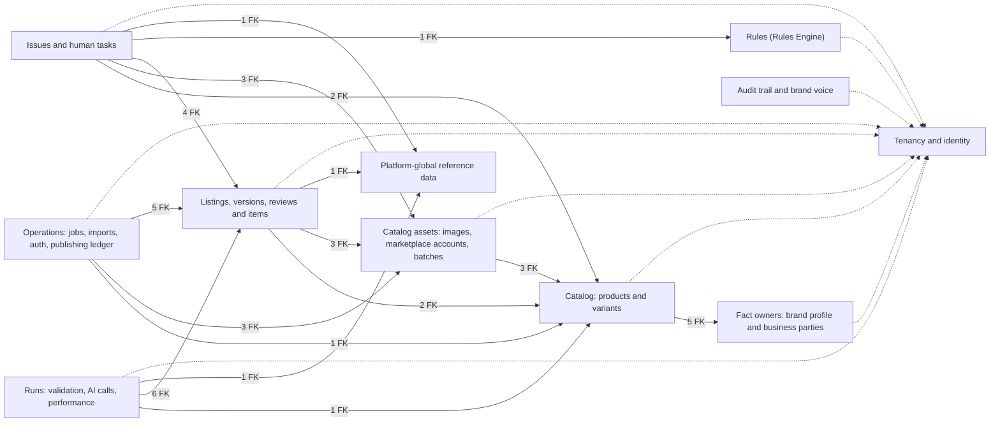

How to read it: each box is one domain (one model module). The arrow points from the domain that holds the foreign key to the domain it references; the label counts those foreign keys. A dotted arrow into Tenancy means the domain's rows carry `tenant_id` and actor columns (`tenants`, `tenant_memberships`); nearly every domain has them, so they are not counted.

Then the 24 central tables and the foreign keys between them. Columns are left out; each domain diagram below shows them.

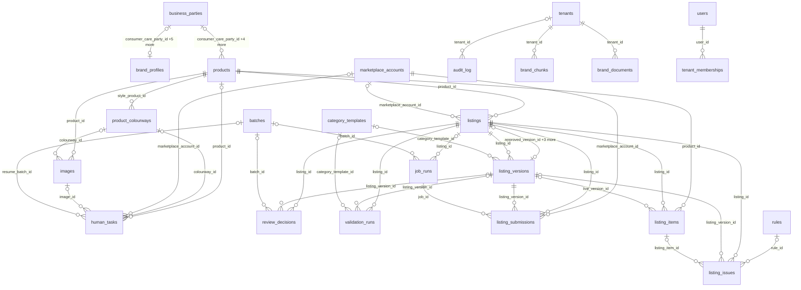

How to read it:
- Each box is a table. A line is a foreign key; the label names the child's FK column(s), and `+N more` means several FKs join the same pair.
- The `||` / `|o` end sits on the parent (the referenced table); `o{` on the child means one parent row has zero or more child rows.
- Almost every table also has `tenant_id -> tenants`. That line is drawn only for a table with no other line here. Actor columns (who generated, approved, decided) point at `tenant_memberships` and are drawn in the domain diagrams instead.
- `category_templates` is platform data with no `tenant_id`; `rules` mixes platform rows (`tenant_id` NULL) and a brand's own rows. Tenant rows point at both.

## Domain diagrams

One diagram per model module. A box with columns belongs to the domain; a box without columns is a table from another domain that this domain points to. Shown columns: primary key (PK), foreign key columns (FK), single-column unique keys (UK), `tenant_id`, and status-like columns. Every column is in the [table catalog](#table-catalog).

### Tenancy and identity

Who the brands (tenants) are, who the people are, and which role each person has in each brand. A person has one global login (`users`) and one membership per brand.

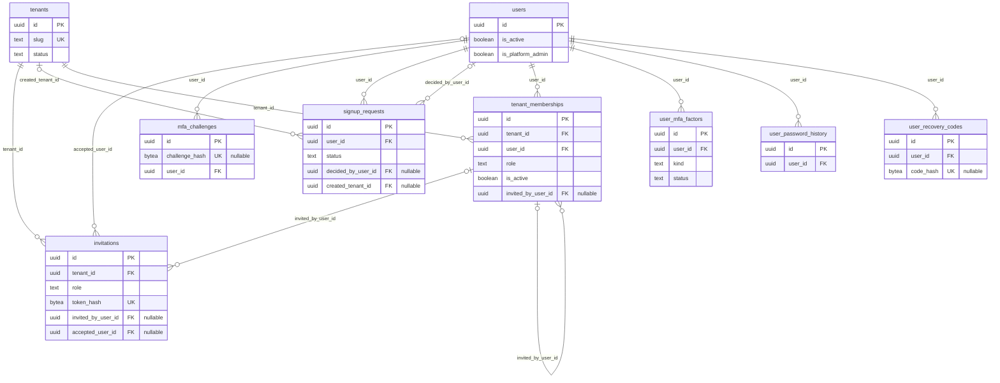

- 9 tables in this domain; 13 relationship lines. `"nullable"` after a column means it may be NULL.
- Here the `tenant_id -> tenants` lines are drawn. In the other domains they are left out, since every tenant table has one.
- A label lists the child's FK columns. Composite FKs also carry `tenant_id`, so a row can only point at a row of the same tenant.

### Catalog: products and variants

The seller's products. A product is a standalone item, a style (the family parent) or a variant (one size or colour of a style). Colourways and the size x colour matrix describe which variants of a style exist.

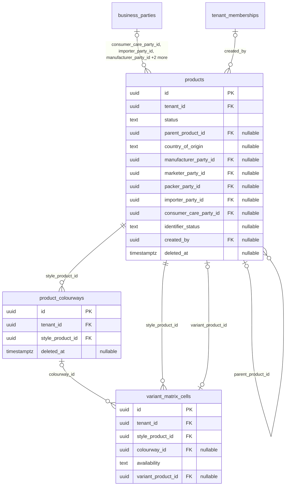

- 3 tables in this domain, 2 from other domains (boxes without columns); 7 relationship lines. `"nullable"` after a column means it may be NULL.
- The `tenant_id -> tenants` line every tenant table has is left out. It is drawn only where it says more: a nullable `tenant_id` (platform rows) or a `tenant_id` primary key (one row per tenant).
- A label lists the child's FK columns. Composite FKs also carry `tenant_id`, so a row can only point at a row of the same tenant.

### Catalog assets: images, marketplace accounts, batches

Product images (the file itself is in object storage), the brand's connected marketplace seller accounts, and batches that group a bulk action.

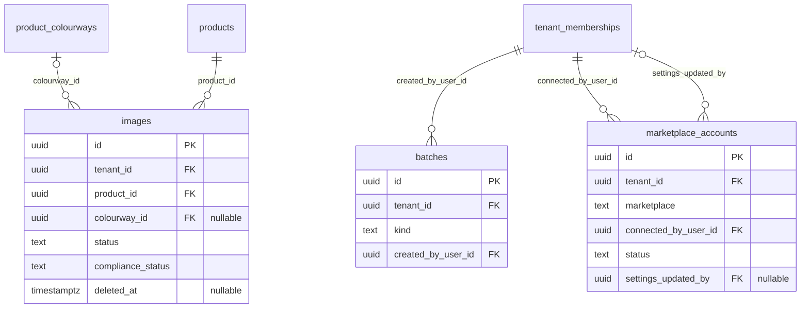

- 3 tables in this domain, 3 from other domains (boxes without columns); 5 relationship lines. `"nullable"` after a column means it may be NULL.
- The `tenant_id -> tenants` line every tenant table has is left out. It is drawn only where it says more: a nullable `tenant_id` (platform rows) or a `tenant_id` primary key (one row per tenant).
- A label lists the child's FK columns. Composite FKs also carry `tenant_id`, so a row can only point at a row of the same tenant.

### Fact owners: brand profile and business parties

The brand-level facts (one profile per tenant) and the address book of legal parties (manufacturer, packer, importer, consumer care) that products point to.

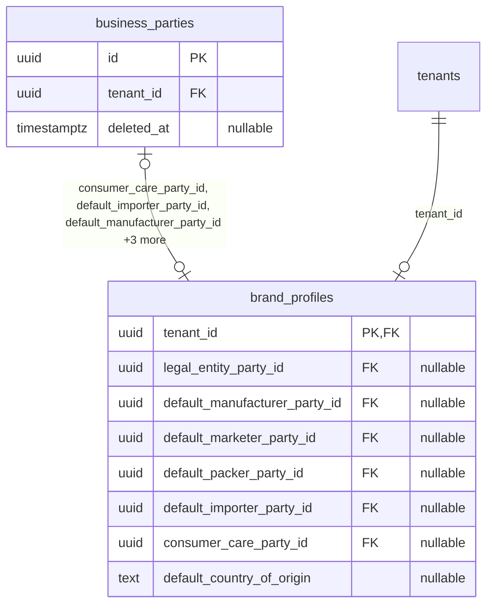

- 2 tables in this domain, 1 from other domains (boxes without columns); 2 relationship lines. `"nullable"` after a column means it may be NULL.
- The `tenant_id -> tenants` line every tenant table has is left out. It is drawn only where it says more: a nullable `tenant_id` (platform rows) or a `tenant_id` primary key (one row per tenant).
- A label lists the child's FK columns. Composite FKs also carry `tenant_id`, so a row can only point at a row of the same tenant.

### Listings, versions, reviews and items

A listing is one product on one marketplace. Its content lives in immutable versions; reviews approve or reject an exact version; items are the sellable SKUs inside it.

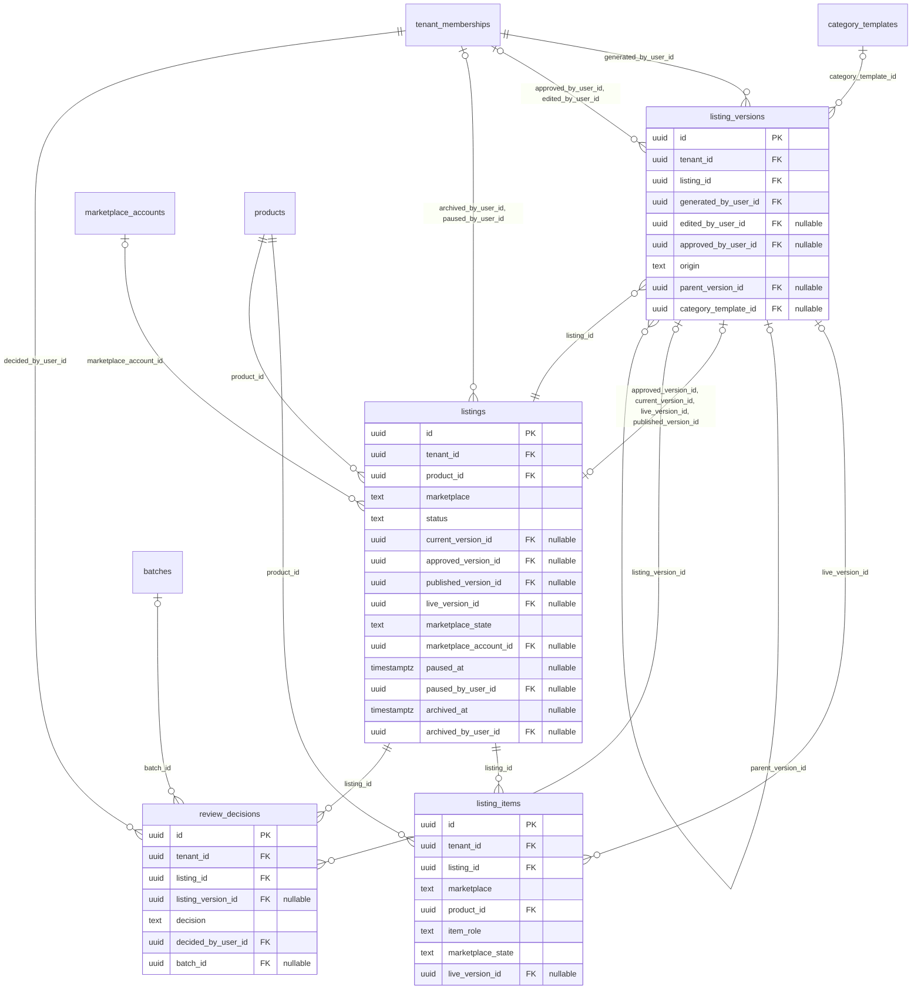

- 4 tables in this domain, 5 from other domains (boxes without columns); 16 relationship lines. `"nullable"` after a column means it may be NULL.
- The `tenant_id -> tenants` line every tenant table has is left out. It is drawn only where it says more: a nullable `tenant_id` (platform rows) or a `tenant_id` primary key (one row per tenant).
- A label lists the child's FK columns. Composite FKs also carry `tenant_id`, so a row can only point at a row of the same tenant.

### Rules (Rules Engine)

The Rules Engine's rules: platform rules (no tenant) and a brand's own rules.

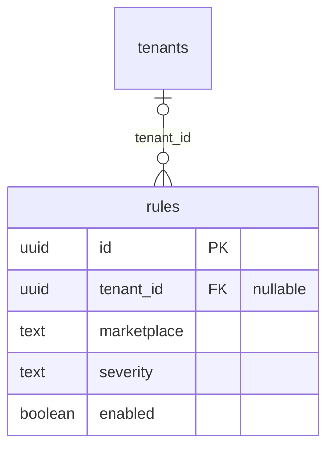

- 1 table in this domain, 1 from other domains (boxes without columns); 1 relationship line. `"nullable"` after a column means it may be NULL.
- The `tenant_id -> tenants` line every tenant table has is left out. It is drawn only where it says more: a nullable `tenant_id` (platform rows) or a `tenant_id` primary key (one row per tenant).
- A label lists the child's FK columns. Composite FKs also carry `tenant_id`, so a row can only point at a row of the same tenant.

### Runs: validation, AI calls, performance

Append-only records of each validation pass and each AI model call, and the daily marketplace performance numbers per listing.

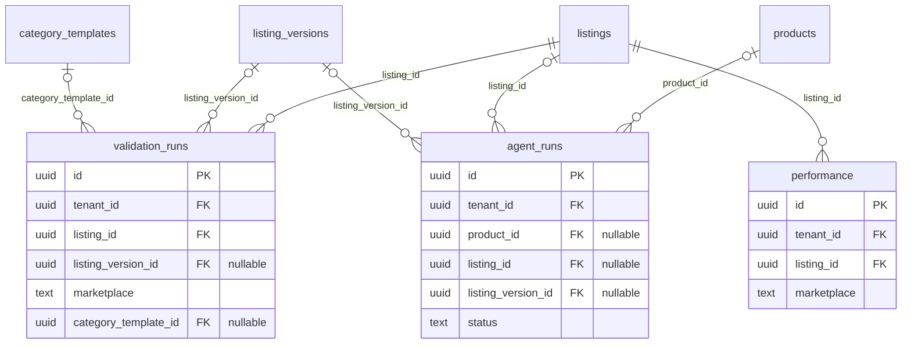

- 3 tables in this domain, 4 from other domains (boxes without columns); 7 relationship lines. `"nullable"` after a column means it may be NULL.
- The `tenant_id -> tenants` line every tenant table has is left out. It is drawn only where it says more: a nullable `tenant_id` (platform rows) or a `tenant_id` primary key (one row per tenant).
- A label lists the child's FK columns. Composite FKs also carry `tenant_id`, so a row can only point at a row of the same tenant.

### Issues and human tasks

Problems found on a listing (by validation or by the marketplace) and the questions the system asks a person when it cannot fix a problem alone.

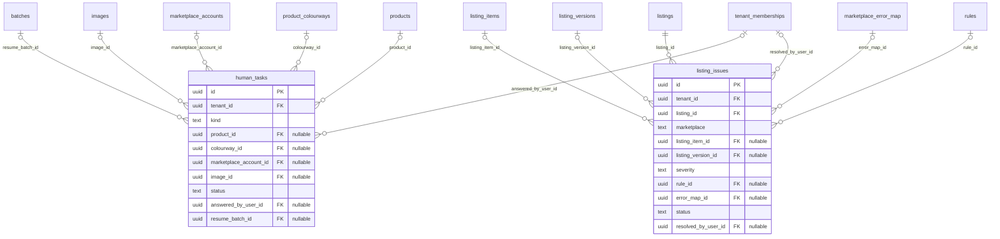

- 2 tables in this domain, 11 from other domains (boxes without columns); 12 relationship lines. `"nullable"` after a column means it may be NULL.
- The `tenant_id -> tenants` line every tenant table has is left out. It is drawn only where it says more: a nullable `tenant_id` (platform rows) or a `tenant_id` primary key (one row per tenant).
- A label lists the child's FK columns. Composite FKs also carry `tenant_id`, so a row can only point at a row of the same tenant.

### Operations: jobs, imports, auth, publishing ledger

Background job runs, CSV imports, login and OAuth tokens, idempotency keys, rate-limit counters, and the ledger of every submission sent to a marketplace.

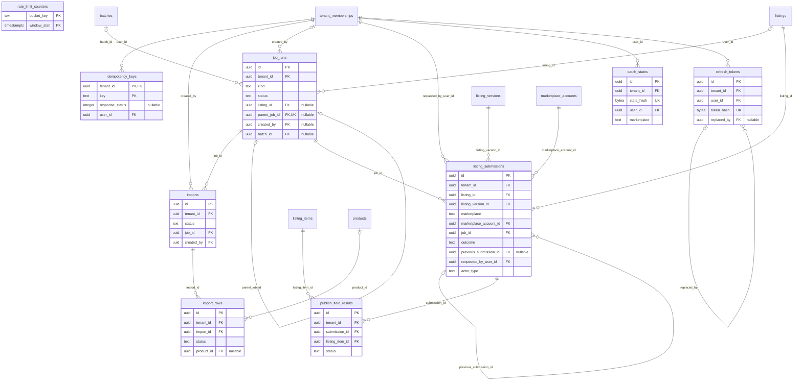

- 9 tables in this domain, 7 from other domains (boxes without columns); 20 relationship lines. `"nullable"` after a column means it may be NULL.
- The `tenant_id -> tenants` line every tenant table has is left out. It is drawn only where it says more: a nullable `tenant_id` (platform rows) or a `tenant_id` primary key (one row per tenant).
- A label lists the child's FK columns. Composite FKs also carry `tenant_id`, so a row can only point at a row of the same tenant.

### Audit trail and brand voice

The append-only audit log, and the brand documents whose text is cut into chunks and embedded as vectors for brand-voice search.

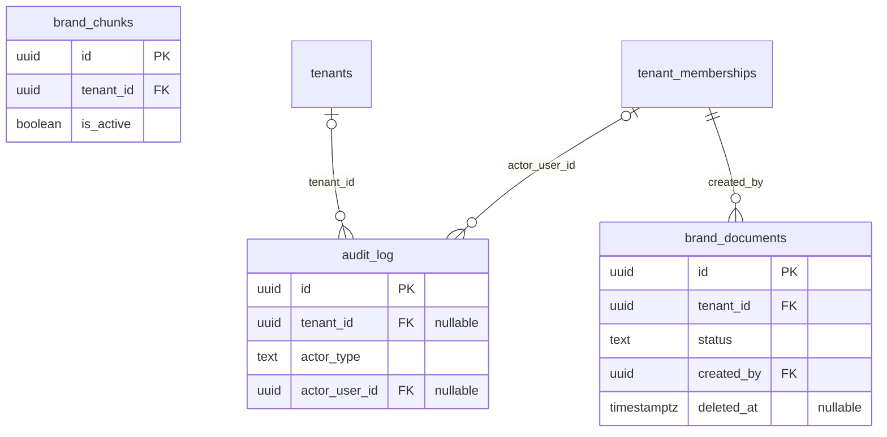

- 3 tables in this domain, 2 from other domains (boxes without columns); 3 relationship lines. `"nullable"` after a column means it may be NULL.
- The `tenant_id -> tenants` line every tenant table has is left out. It is drawn only where it says more: a nullable `tenant_id` (platform rows) or a `tenant_id` primary key (one row per tenant).
- A label lists the child's FK columns. Composite FKs also carry `tenant_id`, so a row can only point at a row of the same tenant.

### Platform-global reference data

Data shared by every tenant and changed only by migrations or operator commands: marketplace category templates, the marketplace error map, the attribute dictionary and the listing status transition table. No `tenant_id`, no RLS, read-only for the app.

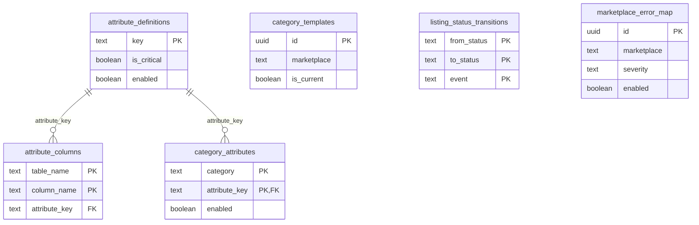

- 6 tables in this domain; 2 relationship lines. `"nullable"` after a column means it may be NULL.
- These tables have no `tenant_id`. Tenant tables point at them (for example `listing_versions.category_template_id`); those lines are in the other domains' diagrams.

## Listing status machine

`listings.status` can only move along the 63 rows of `listing_status_transitions`. The `listings_status_guard` trigger refuses any other move (`INVALID_STATUS_TRANSITION`). This diagram is drawn from those rows.

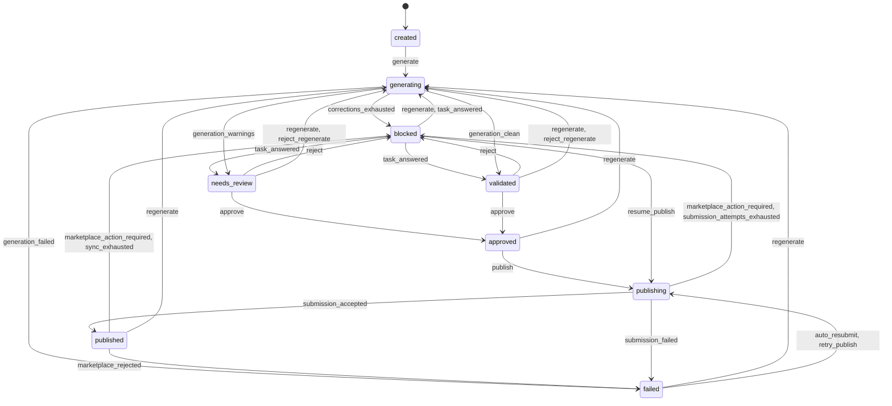

How to read it: a box is a status, an arrow is an allowed move, and the label is the event (`listings.last_event`) that makes it. Three events are left out of the picture to keep it readable; they are listed below.

| Event | From status | To status |
|---|---|---|
| `edit` | `approved` | `blocked`, `needs_review`, `validated` |
| `edit` | `blocked` | `needs_review`, `validated` |
| `edit` | `failed` | `blocked`, `needs_review`, `validated` |
| `edit` | `needs_review` | `blocked`, `validated` |
| `edit` | `published` | `blocked`, `needs_review`, `validated` |
| `edit` | `validated` | `blocked`, `needs_review` |
| `revalidate` | `approved` | `blocked`, `needs_review` |
| `revalidate` | `blocked` | `needs_review`, `validated` |
| `revalidate` | `needs_review` | `blocked`, `validated` |
| `revalidate` | `publishing` | `blocked`, `needs_review` |
| `revalidate` | `validated` | `blocked`, `needs_review` |
| `human_task_opened` | `approved` | `blocked` |
| `human_task_opened` | `blocked` | `blocked` |
| `human_task_opened` | `failed` | `blocked` |
| `human_task_opened` | `generating` | `blocked` |
| `human_task_opened` | `needs_review` | `blocked` |
| `human_task_opened` | `published` | `blocked` |
| `human_task_opened` | `validated` | `blocked` |

Who may fire an event (`actor`): `any`: human_task_opened, revalidate, submission_failed; `user`: approve, edit, generate, publish, regenerate, reject, reject_regenerate, resume_publish, retry_publish, task_answered; `worker`: auto_resubmit, corrections_exhausted, generation_clean, generation_failed, generation_warnings, human_task_opened, marketplace_action_required, marketplace_rejected, submission_accepted, submission_attempts_exhausted, sync_exhausted. `user` needs a signed-in person, `worker` a background job, `any` either.

An event under two actors has a different actor on different rows: `human_task_opened` is `any` from `approved`, `blocked`, `failed`, `needs_review`, `published`, `validated` and `worker` from `generating`.

## Table catalog

Every table, alphabetically inside its domain. **Tenant-scoped** means the table has a `tenant_id` column and row-level security (RLS) is enabled and forced, so the app role sees only the current tenant's rows. CHECK names come from the migrations; an "allowed values" note is read from a `col IN (...)` CHECK.

### Tenancy and identity tables

#### `invitations`

A pending invite of an email address to a brand with a role. Only the sha256 of the invite token is stored.

**Tenant-scoped:** yes (`tenant_id` + RLS enabled and forced). **RLS policies:** `invitations_hash`, `t_migrator`, `t_platform`, `t_tenant`.

| Column | Type | Null | Default | Notes |
|---|---|---|---|---|
| `id` | uuid | no | `gen_random_uuid()` | PK |
| `tenant_id` | uuid | no |  | FK -> `tenants.id`, ON DELETE CASCADE |
| `email` | text | no |  |  |
| `role` | text | no |  | allowed: `owner`, `operator`, `reviewer`, `admin` |
| `token_hash` | bytea | no |  | unique; sha256 of the raw token; never granted to the read-only roles. |
| `invited_by_user_id` | uuid | yes |  | FK -> `tenant_memberships.user_id` |
| `expires_at` | timestamptz | no |  |  |
| `accepted_at` | timestamptz | yes |  |  |
| `accepted_user_id` | uuid | yes |  | FK -> `users.id` |
| `revoked_at` | timestamptz | yes |  |  |
| `created_at` | timestamptz | no | `now()` |  |
| `updated_at` | timestamptz | no | `now()` |  |

Keys and indexes:

- Primary key `pk_invitations`: (id)
- Unique `uq_invitations_tenant_id_id`: (tenant_id, id)
- Unique `uq_invitations_token_hash`: (token_hash)
- Unique index `uq_invitations_pending`: (tenant_id, email) WHERE accepted_at IS NULL AND revoked_at IS NULL

Composite foreign keys:

- `fk_invitations_invited_by_user_id`: (tenant_id, invited_by_user_id) -> `tenant_memberships` (tenant_id, user_id)

CHECK constraints: `ck_invitations_accepted_revoked`, `ck_invitations_email`, `ck_invitations_role`, `ck_invitations_token_hash`.

Triggers: `set_updated_at` (before update).

#### `mfa_challenges`

A sign-in second step, found by the sha256 of its opaque token.

**Tenant-scoped:** no `tenant_id`, but RLS is enabled and forced. **RLS policies:** `mc_hash`, `mc_self`, `t_migrator`, `t_platform`.

| Column | Type | Null | Default | Notes |
|---|---|---|---|---|
| `id` | uuid | no | `gen_random_uuid()` | PK |
| `challenge_hash` | bytea | yes |  | unique |
| `user_id` | uuid | no |  | FK -> `users.id`, ON DELETE CASCADE |
| `purpose` | text | no |  | allowed: `login`, `enroll`, `password_change` |
| `amr` | text[] | no |  |  |
| `attempts` | smallint | no | `0` |  |
| `expires_at` | timestamptz | no |  |  |
| `consumed_at` | timestamptz | yes |  |  |
| `mfa_at` | timestamptz | yes |  |  |
| `ip` | inet | yes |  |  |
| `user_agent` | text | yes |  |  |
| `created_at` | timestamptz | no | `now()` |  |

Keys and indexes:

- Primary key `pk_mfa_challenges`: (id)
- Unique `uq_mfa_challenges_challenge_hash`: (challenge_hash)
- Index `ix_mfa_challenges_user_id`: (user_id)

CHECK constraints: `ck_mfa_challenges_amr`, `ck_mfa_challenges_attempts`, `ck_mfa_challenges_challenge_hash`, `ck_mfa_challenges_mfa_at`, `ck_mfa_challenges_purpose`, `ck_mfa_challenges_user_agent`.

#### `signup_requests`

A self-serve brand sign-up awaiting a platform admin (0010; ADR-0019). A platform table: no tenant_id and not TenantScoped; created_tenant_id is set on approve.

**Tenant-scoped:** no `tenant_id`, but RLS is enabled and forced. **RLS policies:** `sr_admin`, `sr_self_insert`, `sr_self_select`, `t_migrator`, `t_platform`.

| Column | Type | Null | Default | Notes |
|---|---|---|---|---|
| `id` | uuid | no | `gen_random_uuid()` | PK |
| `user_id` | uuid | no |  | FK -> `users.id`, ON DELETE CASCADE |
| `brand_name` | text | no |  |  |
| `owner_name` | text | no |  |  |
| `phone` | text | yes |  |  |
| `website` | text | yes |  |  |
| `status` | text | no | `'pending'` | allowed: `pending`, `approved`, `rejected` |
| `reason` | text | yes |  |  |
| `decided_by_user_id` | uuid | yes |  | FK -> `users.id` |
| `decided_at` | timestamptz | yes |  |  |
| `created_tenant_id` | uuid | yes |  | FK -> `tenants.id`, ON DELETE SET NULL |
| `created_at` | timestamptz | no | `now()` |  |
| `updated_at` | timestamptz | no | `now()` |  |

Keys and indexes:

- Primary key `pk_signup_requests`: (id)
- Index `ix_signup_requests_status_created_at`: (status, created_at, id)
- Index `ix_signup_requests_user_id`: (user_id, created_at)
- Unique index `uq_signup_requests_pending`: (user_id) WHERE status = 'pending'

CHECK constraints: `ck_signup_requests_bounds`, `ck_signup_requests_decided`, `ck_signup_requests_status`.

Triggers: `set_updated_at` (before update).

#### `tenant_memberships`

A person's role in one brand (owner, operator, reviewer, admin). Actor columns elsewhere (who generated, approved, decided) point here, so an actor is always a member of the same tenant.

**Tenant-scoped:** yes (`tenant_id` + RLS enabled and forced). **RLS policies:** `memberships_own`, `t_migrator`, `t_platform`, `t_tenant`.

| Column | Type | Null | Default | Notes |
|---|---|---|---|---|
| `id` | uuid | no | `gen_random_uuid()` | PK |
| `tenant_id` | uuid | no |  | FK -> `tenants.id`, ON DELETE CASCADE |
| `user_id` | uuid | no |  | FK -> `users.id`, ON DELETE RESTRICT |
| `role` | text | no |  | allowed: `owner`, `operator`, `reviewer`, `admin` |
| `is_active` | boolean | no | `true` |  |
| `deactivated_at` | timestamptz | yes |  |  |
| `invited_by_user_id` | uuid | yes |  | FK -> `tenant_memberships.user_id` |
| `last_used_at` | timestamptz | yes |  |  |
| `created_at` | timestamptz | no | `now()` |  |
| `updated_at` | timestamptz | no | `now()` |  |

Keys and indexes:

- Primary key `pk_tenant_memberships`: (id)
- Unique `uq_tenant_memberships_tenant_id_id`: (tenant_id, id)
- Unique `uq_tenant_memberships_tenant_id_user_id`: (tenant_id, user_id)
- Index `ix_tenant_memberships_user_id_active`: (user_id) WHERE is_active

Composite foreign keys:

- `fk_tenant_memberships_invited_by_user_id`: (tenant_id, invited_by_user_id) -> `tenant_memberships` (tenant_id, user_id)

CHECK constraints: `ck_tenant_memberships_role`.

Triggers: `last_owner_guard` (after update or delete, checked at commit), `set_updated_at` (before update).

#### `tenants`

One row per brand (tenant). Holds the brand's lifecycle status (trial, active, suspended, offboarded), plan, brand voice basics and the purge dates. Every tenant row in every other table points here.

**Tenant-scoped:** yes, on its own `id` (RLS enabled and forced). **RLS policies:** `t_migrator`, `t_platform`, `t_tenant`, `tenants_switcher`.

| Column | Type | Null | Default | Notes |
|---|---|---|---|---|
| `id` | uuid | no | `gen_random_uuid()` | PK |
| `name` | text | no |  |  |
| `slug` | text | no |  | unique |
| `tone` | text | yes |  |  |
| `guidelines` | jsonb | yes |  |  |
| `glossary` | jsonb | yes |  |  |
| `status` | text | no |  | allowed: `trial`, `active`, `suspended`, `offboarded` |
| `plan` | text | yes |  |  |
| `trial_ends_at` | timestamptz | yes |  |  |
| `auto_publish` | boolean | no | `false` |  |
| `llm_daily_budget_usd` | numeric(10,2) | yes |  |  |
| `offboarded_at` | timestamptz | yes |  |  |
| `purge_after` | timestamptz | yes |  |  |
| `data_purged_at` | timestamptz | yes |  |  |
| `created_at` | timestamptz | no | `now()` |  |
| `updated_at` | timestamptz | no | `now()` |  |

Keys and indexes:

- Primary key `pk_tenants`: (id)
- Unique `uq_tenants_slug`: (slug)

CHECK constraints: `ck_tenants_auto_publish`, `ck_tenants_glossary`, `ck_tenants_guidelines`, `ck_tenants_llm_daily_budget_usd`, `ck_tenants_offboarded`, `ck_tenants_slug`, `ck_tenants_status`, `ck_tenants_trial`.

Triggers: `set_updated_at` (before update).

#### `user_mfa_factors`

A TOTP factor: one pending and one active per user. The secret is one sealed envelope blob (app.core.crypto.seal_bytes), never loaded unless asked for.

**Tenant-scoped:** no `tenant_id`, but RLS is enabled and forced. **RLS policies:** `t_migrator`, `t_platform`, `umf_self`.

| Column | Type | Null | Default | Notes |
|---|---|---|---|---|
| `id` | uuid | no | `gen_random_uuid()` | PK |
| `user_id` | uuid | no |  | FK -> `users.id`, ON DELETE CASCADE |
| `kind` | text | no | `'totp'` |  |
| `status` | text | no | `'pending'` | allowed: `pending`, `active` |
| `secret_blob` | bytea | yes |  |  |
| `key_version` | text | no |  |  |
| `last_used_step` | bigint | yes |  |  |
| `created_at` | timestamptz | no | `now()` |  |
| `confirmed_at` | timestamptz | yes |  |  |
| `last_used_at` | timestamptz | yes |  |  |

Keys and indexes:

- Primary key `pk_user_mfa_factors`: (id)
- Unique index `uq_user_mfa_factors_active`: (user_id, kind) WHERE status = 'active'
- Unique index `uq_user_mfa_factors_pending`: (user_id, kind) WHERE status = 'pending'

CHECK constraints: `ck_user_mfa_factors_key_version`, `ck_user_mfa_factors_kind`, `ck_user_mfa_factors_secret_blob`, `ck_user_mfa_factors_status`.

Triggers: `user_mfa_factors_guard` (before insert or update).

#### `user_password_history`

A previous password hash: the 9 before the current one are kept.

**Tenant-scoped:** no `tenant_id`, but RLS is enabled and forced. **RLS policies:** `t_migrator`, `t_platform`, `uph_self`.

| Column | Type | Null | Default | Notes |
|---|---|---|---|---|
| `id` | uuid | no | `gen_random_uuid()` | PK |
| `user_id` | uuid | no |  | FK -> `users.id`, ON DELETE CASCADE |
| `hashed_password` | text | yes |  |  |
| `created_at` | timestamptz | no | `now()` |  |

Keys and indexes:

- Primary key `pk_user_password_history`: (id)
- Index `ix_user_password_history_user_id_created_at`: (user_id, created_at DESC)

CHECK constraints: none.

#### `user_recovery_codes`

One recovery code: sha256(user_id || code) only, used once.

**Tenant-scoped:** no `tenant_id`, but RLS is enabled and forced. **RLS policies:** `t_migrator`, `t_platform`, `urc_self`.

| Column | Type | Null | Default | Notes |
|---|---|---|---|---|
| `id` | uuid | no | `gen_random_uuid()` | PK |
| `user_id` | uuid | no |  | FK -> `users.id`, ON DELETE CASCADE |
| `code_hash` | bytea | yes |  | unique |
| `used_at` | timestamptz | yes |  |  |
| `created_at` | timestamptz | no | `now()` |  |

Keys and indexes:

- Primary key `pk_user_recovery_codes`: (id)
- Unique `uq_user_recovery_codes_code_hash`: (code_hash)
- Index `ix_user_recovery_codes_user_id`: (user_id) WHERE used_at IS NULL

CHECK constraints: `ck_user_recovery_codes_code_hash`.

#### `users`

One global login per person (email + password hash). Not tenant-scoped: a person reaches a brand only through a membership.

**Tenant-scoped:** no `tenant_id`, but RLS is enabled and forced. **RLS policies:** `t_migrator`, `t_platform`, `users_login`, `users_platform_admin`, `users_self`, `users_signup`, `users_teammates`.

| Column | Type | Null | Default | Notes |
|---|---|---|---|---|
| `id` | uuid | no | `gen_random_uuid()` | PK |
| `email` | text | no |  |  |
| `hashed_password` | text | yes |  | argon2id; never loaded unless asked for, never granted to the read-only roles. |
| `auth_provider` | text | yes |  |  |
| `is_active` | boolean | no | `true` |  |
| `display_name` | text | yes |  |  |
| `email_verified_at` | timestamptz | yes |  |  |
| `last_login_at` | timestamptz | yes |  |  |
| `erased_at` | timestamptz | yes |  |  |
| `created_at` | timestamptz | no | `now()` |  |
| `updated_at` | timestamptz | no | `now()` |  |
| `is_platform_admin` | boolean | no | `false` | 0010: set only by staff (user make-admin); a trigger refuses any other writer. |
| `failed_auth_count` | integer | no | `0` | 0011 (DPP-1): the lockout counter and lock move only through the definer functions. |
| `locked_until` | timestamptz | yes |  |  |
| `mfa_last_changed_at` | timestamptz | yes |  |  |
| `password_changed_at` | timestamptz | no | `now()` |  |
| `password_must_change` | boolean | no | `false` |  |

Keys and indexes:

- Primary key `pk_users`: (id)
- Unique index `uq_users_email_lower`: (lower(email))

CHECK constraints: `ck_users_credential`, `ck_users_email`, `ck_users_failed_auth_count`.

Triggers: `set_updated_at` (before update), `users_auth_state_guard` (before insert or update of failed_auth_count, locked_until), `users_platform_admin_guard` (before insert or update of is_platform_admin).

### Catalog: products and variants tables

#### `product_colourways`

One colour of a style. Variants, images and matrix cells of that colour point to it.

**Tenant-scoped:** yes (`tenant_id` + RLS enabled and forced). **RLS policies:** `t_migrator`, `t_platform`, `t_tenant`.

| Column | Type | Null | Default | Notes |
|---|---|---|---|---|
| `id` | uuid | no | `gen_random_uuid()` | PK |
| `tenant_id` | uuid | no |  | FK -> `tenants.id`, ON DELETE CASCADE |
| `style_product_id` | uuid | no |  | FK -> `products.id`, ON DELETE RESTRICT |
| `attributes` | jsonb | no |  |  |
| `colour_key` | text | no | generated (stored) |  |
| `colour_sku` | text | yes |  |  |
| `position` | smallint | no |  |  |
| `deleted_at` | timestamptz | yes |  |  |
| `created_at` | timestamptz | no | `now()` |  |
| `updated_at` | timestamptz | no | `now()` |  |

Keys and indexes:

- Primary key `pk_product_colourways`: (id)
- Unique `uq_product_colourways_id_style_product_id`: (id, style_product_id) - the target of the same-style composite foreign keys from variant_matrix_cells and images
- Unique `uq_product_colourways_tenant_id_id`: (tenant_id, id)
- Index `ix_product_colourways_tenant_id_style_product_id`: (tenant_id, style_product_id)
- Unique index `uq_product_colourways_tenant_id_colour_sku`: (tenant_id, colour_sku) WHERE colour_sku IS NOT NULL AND deleted_at IS NULL
- Unique index `uq_product_colourways_tenant_id_style_product_id_colour_key`: (tenant_id, style_product_id, colour_key) WHERE deleted_at IS NULL

Composite foreign keys:

- `fk_product_colourways_style_product_id`: (tenant_id, style_product_id) -> `products` (tenant_id, id) ON DELETE RESTRICT

CHECK constraints: `ck_product_colourways_attributes`, `ck_product_colourways_colour_key`, `ck_product_colourways_colour_sku`.

Triggers: `facts_guard` (before insert or update of attributes), `set_updated_at` (before update).

#### `products`

A seller product: a standalone product, a style (family parent, has a `variation_theme`) or a variant (has `parent_product_id`). Also holds the typed product facts (price, tax, origin, legal parties, identifiers, dimensions) and their provenance.

**Tenant-scoped:** yes (`tenant_id` + RLS enabled and forced). **RLS policies:** `t_migrator`, `t_platform`, `t_tenant`.

| Column | Type | Null | Default | Notes |
|---|---|---|---|---|
| `id` | uuid | no | `gen_random_uuid()` | PK |
| `tenant_id` | uuid | no |  | FK -> `tenants.id`, ON DELETE CASCADE |
| `sku` | text | no |  |  |
| `title` | text | no |  |  |
| `status` | text | no | `'draft'` | allowed: `draft`, `active` |
| `category` | text | no |  |  |
| `brand_name` | text | yes |  |  |
| `style_number` | text | yes |  |  |
| `sub_category` | text | yes |  |  |
| `product_type` | text | yes |  |  |
| `gender` | text | yes |  | allowed: `men`, `women`, `unisex`, `boys`, `girls` |
| `stock_ref` | text | yes |  |  |
| `description` | text | yes |  | Seller text: untrusted prompt data. |
| `source_image_urls` | jsonb | no | `'[]'::jsonb` |  |
| `parent_product_id` | uuid | yes |  | FK -> `products.id`, ON DELETE RESTRICT |
| `variation_theme` | text | yes |  | allowed: `size`, `color`, `size_color` |
| `size_run` | text[] | yes |  |  |
| `variant_attributes` | jsonb | no | `'{}'::jsonb` |  |
| `variant_key` | text | yes |  |  |
| `mrp` | numeric(12,2) | yes |  | fact columns; each non-null one has its provenance key |
| `selling_price` | numeric(12,2) | yes |  |  |
| `currency` | text | no | `'INR'` |  |
| `tax_rate` | numeric(5,2) | yes |  |  |
| `hsn_code` | text | yes |  |  |
| `country_of_origin` | text | yes |  |  |
| `generic_name` | text | yes |  |  |
| `net_quantity` | numeric(10,3) | yes |  |  |
| `net_quantity_unit` | text | yes |  | allowed: `N`, `U`, `pair`, `set`, `g`, `kg`, `m`, `cm` |
| `manufacturer_party_id` | uuid | yes |  | FK -> `business_parties.id`, ON DELETE RESTRICT |
| `marketer_party_id` | uuid | yes |  | FK -> `business_parties.id`, ON DELETE RESTRICT |
| `packer_party_id` | uuid | yes |  | FK -> `business_parties.id`, ON DELETE RESTRICT |
| `importer_party_id` | uuid | yes |  | FK -> `business_parties.id`, ON DELETE RESTRICT |
| `consumer_care_party_id` | uuid | yes |  | FK -> `business_parties.id`, ON DELETE RESTRICT |
| `identifier_type` | text | yes |  | allowed: `gtin`, `ean`, `upc` |
| `identifier_value` | text | yes |  |  |
| `identifier_status` | text | yes |  | allowed: `provided`, `exempt`, `not_applicable` |
| `package_length_cm` | numeric(7,2) | yes |  |  |
| `package_breadth_cm` | numeric(7,2) | yes |  |  |
| `package_height_cm` | numeric(7,2) | yes |  |  |
| `package_weight_g` | integer | yes |  |  |
| `product_weight_g` | integer | yes |  |  |
| `attributes` | jsonb | no | `'{}'::jsonb` |  |
| `provenance` | jsonb | no | `'{}'::jsonb` |  |
| `created_by` | uuid | yes |  | FK -> `tenant_memberships.user_id` |
| `deleted_at` | timestamptz | yes |  |  |
| `created_at` | timestamptz | no | `now()` |  |
| `updated_at` | timestamptz | no | `now()` |  |

Keys and indexes:

- Primary key `pk_products`: (id)
- Unique `products_tenant_sku_idx`: (tenant_id, sku)
- Unique `uq_products_tenant_id_id`: (tenant_id, id)
- Index `ix_products_keyset`: (tenant_id, created_at DESC, id DESC) WHERE deleted_at IS NULL
- Index `ix_products_tenant_id_parent_product_id`: (tenant_id, parent_product_id)
- Unique index `products_identifier_uq`: (tenant_id, lpad(identifier_value, 14, '0')) WHERE identifier_value IS NOT NULL AND deleted_at IS NULL
- Unique index `uq_products_tenant_id_parent_product_id_variant_key`: (tenant_id, parent_product_id, variant_key) WHERE parent_product_id IS NOT NULL AND deleted_at IS NULL

Composite foreign keys:

- `fk_products_consumer_care_party_id`: (tenant_id, consumer_care_party_id) -> `business_parties` (tenant_id, id) ON DELETE RESTRICT
- `fk_products_importer_party_id`: (tenant_id, importer_party_id) -> `business_parties` (tenant_id, id) ON DELETE RESTRICT
- `fk_products_manufacturer_party_id`: (tenant_id, manufacturer_party_id) -> `business_parties` (tenant_id, id) ON DELETE RESTRICT
- `fk_products_marketer_party_id`: (tenant_id, marketer_party_id) -> `business_parties` (tenant_id, id) ON DELETE RESTRICT
- `fk_products_packer_party_id`: (tenant_id, packer_party_id) -> `business_parties` (tenant_id, id) ON DELETE RESTRICT
- `fk_products_parent_product_id`: (tenant_id, parent_product_id) -> `products` (tenant_id, id) ON DELETE RESTRICT
- `fk_products_created_by`: (tenant_id, created_by) -> `tenant_memberships` (tenant_id, user_id)

CHECK constraints: `ck_price_le_mrp`, `ck_products_attributes`, `ck_products_attributes_iff_parent`, `ck_products_brand_name`, `ck_products_category`, `ck_products_country_of_origin`, `ck_products_currency`, `ck_products_dims_all_or_none`, `ck_products_gender`, `ck_products_generic_name`, `ck_products_hsn_code`, `ck_products_identifier_not_on_style`, `ck_products_identifier_pair`, `ck_products_identifier_provided`, `ck_products_identifier_status`, `ck_products_identifier_type`, `ck_products_identifier_valid`, `ck_products_mrp`, `ck_products_net_quantity`, `ck_products_net_quantity_pair`, `ck_products_net_quantity_unit`, `ck_products_not_own_parent`, `ck_products_package_breadth_cm`, `ck_products_package_height_cm`, `ck_products_package_length_cm`, `ck_products_package_weight_g`, `ck_products_product_type`, `ck_products_product_weight_g`, `ck_products_provenance`, `ck_products_selling_price`, `ck_products_size_run`, `ck_products_sku`, `ck_products_source_image_urls`, `ck_products_status`, `ck_products_stock_ref`, `ck_products_style_number`, `ck_products_style_owned`, `ck_products_sub_category`, `ck_products_tax_rate`, `ck_products_theme_on_style`, `ck_products_title`, `ck_products_typed_facts_sourced`, `ck_products_variant_attributes`, `ck_products_variation_theme`.

Triggers: `facts_guard` (before insert or update of attributes, provenance, title and 30 more columns), `set_updated_at` (before update), `variant_guard` (before insert or update), `variant_matrix_complete` (after insert or update, checked at commit).

#### `variant_matrix_cells`

One cell of a style's size x colour grid: is that combination available, and which variant product sells it. A trigger keeps the matrix complete.

**Tenant-scoped:** yes (`tenant_id` + RLS enabled and forced). **RLS policies:** `t_migrator`, `t_platform`, `t_tenant`.

| Column | Type | Null | Default | Notes |
|---|---|---|---|---|
| `id` | uuid | no | `gen_random_uuid()` | PK |
| `tenant_id` | uuid | no |  | FK -> `tenants.id`, ON DELETE CASCADE |
| `style_product_id` | uuid | no |  | FK -> `products.id`, ON DELETE RESTRICT |
| `colourway_id` | uuid | yes |  | FK -> `product_colourways.id`, ON DELETE RESTRICT |
| `size_key` | text | yes |  |  |
| `availability` | text | no |  | allowed: `available`, `unavailable` |
| `variant_product_id` | uuid | yes |  | FK -> `products.id`, ON DELETE RESTRICT |
| `unavailable_reason` | text | yes |  |  |
| `source` | text | no |  | allowed: `seller`, `pim`, `marketplace`, `derived` |
| `evidence_ref` | text | yes |  |  |
| `created_at` | timestamptz | no | `now()` |  |
| `updated_at` | timestamptz | no | `now()` |  |

Keys and indexes:

- Primary key `pk_variant_matrix_cells`: (id)
- Unique `uq_variant_matrix_cells_tenant_id_id`: (tenant_id, id)
- Unique `uq_variant_matrix_cells_tenant_id_variant_product_id`: (tenant_id, variant_product_id)
- Unique `vmc_cell_uq`: (tenant_id, style_product_id, colourway_id, size_key)
- Index `ix_variant_matrix_cells_tenant_id_style_product_id`: (tenant_id, style_product_id)

Composite foreign keys:

- `fk_variant_matrix_cells_colourway_id_style_product_id`: (colourway_id, style_product_id) -> `product_colourways` (id, style_product_id) ON DELETE RESTRICT
- `fk_variant_matrix_cells_style_product_id`: (tenant_id, style_product_id) -> `products` (tenant_id, id) ON DELETE RESTRICT
- `fk_variant_matrix_cells_variant_product_id`: (tenant_id, variant_product_id) -> `products` (tenant_id, id) ON DELETE RESTRICT

CHECK constraints: `ck_variant_matrix_cells_availability`, `ck_variant_matrix_cells_available_variant`, `ck_variant_matrix_cells_derived_not_provided`, `ck_variant_matrix_cells_one_axis`, `ck_variant_matrix_cells_size_key`, `ck_variant_matrix_cells_source`, `ck_variant_matrix_cells_unavailable_reason`.

Triggers: `set_updated_at` (before update), `variant_matrix_complete` (after insert or update or delete, checked at commit), `variant_matrix_guard` (before insert or update).

### Catalog assets: images, marketplace accounts, batches tables

#### `batches`

Groups the items of one bulk action (generate, regenerate, approve, reject, publish, status refresh) so results can be reported together.

**Tenant-scoped:** yes (`tenant_id` + RLS enabled and forced). **RLS policies:** `t_migrator`, `t_platform`, `t_tenant`.

| Column | Type | Null | Default | Notes |
|---|---|---|---|---|
| `id` | uuid | no | `gen_random_uuid()` | PK |
| `tenant_id` | uuid | no |  | FK -> `tenants.id`, ON DELETE CASCADE |
| `kind` | text | no |  | allowed: `generate`, `regenerate`, `approve`, `reject`, `publish`, `status_refresh` |
| `item_count` | integer | no |  |  |
| `created_by_user_id` | uuid | no |  | FK -> `tenant_memberships.user_id` |
| `import_id` | uuid | yes |  | soft reference to `imports.id` (no foreign key); set only on a generate batch |
| `request_id` | text | yes | set by the app on insert |  |
| `created_at` | timestamptz | no | `now()` |  |

Keys and indexes:

- Primary key `pk_batches`: (id)
- Unique `uq_batches_tenant_id_id`: (tenant_id, id)
- Index `ix_batches_tenant_id_created_at`: (tenant_id, created_at DESC, id DESC)

Composite foreign keys:

- `fk_batches_created_by_user_id`: (tenant_id, created_by_user_id) -> `tenant_memberships` (tenant_id, user_id)

CHECK constraints: `ck_batches_import_id`, `ck_batches_item_count`, `ck_batches_kind`.

#### `images`

One product image. The bytes are in object storage; the row keeps the object key, slot, compliance status and the image check report.

**Tenant-scoped:** yes (`tenant_id` + RLS enabled and forced). **RLS policies:** `t_migrator`, `t_platform`, `t_tenant`.

| Column | Type | Null | Default | Notes |
|---|---|---|---|---|
| `id` | uuid | no | `gen_random_uuid()` | PK |
| `tenant_id` | uuid | no |  | FK -> `tenants.id`, ON DELETE CASCADE |
| `product_id` | uuid | no |  | FK -> `products.id` |
| `colourway_id` | uuid | yes |  | FK -> `product_colourways.id`, ON DELETE RESTRICT |
| `storage_key` | text | no |  | an object key, never a URL; signed at read time |
| `slot` | text | no |  | allowed: `main`, `secondary`, `lifestyle`, `size_chart`, `packaging_label` |
| `status` | text | no | `'uploaded'` | allowed: `pending`, `uploaded`, `failed` |
| `metadata` | jsonb | no | `'{}'::jsonb` |  |
| `compliance_status` | text | no | `'pending'` | allowed: `pending`, `passed`, `failed` |
| `image_report_json` | jsonb | yes |  |  |
| `position` | integer | no | `0` |  |
| `source_url` | text | yes |  |  |
| `content_hash` | text | yes |  |  |
| `mime_type` | text | yes |  |  |
| `width_px` | integer | yes |  |  |
| `height_px` | integer | yes |  |  |
| `bytes` | bigint | yes |  |  |
| `deleted_at` | timestamptz | yes |  |  |
| `created_at` | timestamptz | no | `now()` |  |
| `updated_at` | timestamptz | no | `now()` |  |

Keys and indexes:

- Primary key `pk_images`: (id)
- Unique `uq_images_tenant_id_id`: (tenant_id, id)
- Unique `uq_images_tenant_id_storage_key`: (tenant_id, storage_key)
- Unique index `images_one_main`: (product_id, colourway_id) WHERE slot = 'main' AND deleted_at IS NULL
- Index `ix_images_product_id`: (product_id) WHERE deleted_at IS NULL
- Index `ix_images_tenant_id_colourway_id`: (tenant_id, colourway_id) WHERE colourway_id IS NOT NULL
- Index `ix_images_tenant_id_status`: (tenant_id, status)

Composite foreign keys:

- `fk_images_colourway_id_product_id`: (colourway_id, product_id) -> `product_colourways` (id, style_product_id) ON DELETE RESTRICT - product_id is the colourway's style (MATCH SIMPLE: no colourway, no check)
- `fk_images_colourway_id`: (tenant_id, colourway_id) -> `product_colourways` (tenant_id, id) ON DELETE RESTRICT
- `fk_images_product_id`: (tenant_id, product_id) -> `products` (tenant_id, id)

CHECK constraints: `ck_images_bytes`, `ck_images_compliance_status`, `ck_images_dimensions`, `ck_images_image_report_json`, `ck_images_metadata`, `ck_images_position`, `ck_images_slot`, `ck_images_source_url`, `ck_images_status`, `ck_images_storage_key`.

Triggers: `image_slot_guard` (before insert or update), `set_updated_at` (before update).

#### `marketplace_accounts`

A brand's connected seller account on Amazon or Flipkart. The OAuth token is stored envelope-encrypted (`token_enc`) and is decrypted only inside a marketplace adapter call.

**Tenant-scoped:** yes (`tenant_id` + RLS enabled and forced). **RLS policies:** `t_migrator`, `t_platform`, `t_tenant`.

| Column | Type | Null | Default | Notes |
|---|---|---|---|---|
| `id` | uuid | no | `gen_random_uuid()` | PK |
| `tenant_id` | uuid | no |  | FK -> `tenants.id`, ON DELETE CASCADE |
| `marketplace` | text | no |  | allowed: `amazon`, `flipkart` |
| `seller_id` | text | no |  |  |
| `region` | text | yes |  |  |
| `scopes` | text[] | no | `'{}'::text[]` |  |
| `token_enc` | bytea | yes |  | KMS-wrapped AES-256-GCM token: never loaded unless asked for, never granted to the read-only roles, decrypted only inside an adapter call. |
| `kms_key_version` | text | yes |  |  |
| `expires_at` | timestamptz | yes |  |  |
| `last_refresh_at` | timestamptz | yes |  |  |
| `connected_by_user_id` | uuid | no |  | FK -> `tenant_memberships.user_id` |
| `status` | text | no | `'active'` | allowed: `active`, `needs_reconnect`, `revoked` |
| `status_changed_at` | timestamptz | no | `now()` |  |
| `needs_reconnect_since` | timestamptz | yes |  |  |
| `last_refresh_error_code` | text | yes |  |  |
| `revoked_at` | timestamptz | yes |  |  |
| `settings` | jsonb | no | `'{}'::jsonb` |  |
| `settings_updated_at` | timestamptz | yes |  |  |
| `settings_updated_by` | uuid | yes |  | FK -> `tenant_memberships.user_id` |
| `created_at` | timestamptz | no | `now()` |  |
| `updated_at` | timestamptz | no | `now()` |  |

Keys and indexes:

- Primary key `pk_marketplace_accounts`: (id)
- Unique `uq_ma_id_marketplace`: (id, marketplace) - the (marketplace_account_id, marketplace) target on listings
- Unique `uq_marketplace_accounts_tenant_id_id`: (tenant_id, id)
- Unique index `uq_marketplace_accounts_marketplace_seller_id`: (marketplace, seller_id) WHERE status <> 'revoked'
- Unique index `uq_marketplace_accounts_tenant_id_marketplace`: (tenant_id, marketplace) WHERE status <> 'revoked'

Composite foreign keys:

- `fk_marketplace_accounts_connected_by_user_id`: (tenant_id, connected_by_user_id) -> `tenant_memberships` (tenant_id, user_id)
- `fk_marketplace_accounts_settings_updated_by`: (tenant_id, settings_updated_by) -> `tenant_memberships` (tenant_id, user_id)

CHECK constraints: `ck_ma_revoked_shredded`, `ck_marketplace_accounts_marketplace`, `ck_marketplace_accounts_settings`, `ck_marketplace_accounts_status`, `ck_marketplace_accounts_token_required`, `ma_reconnect`.

Triggers: `set_updated_at` (before update).

### Fact owners: brand profile and business parties tables

#### `brand_profiles`

The brand-level facts, one row per tenant (`tenant_id` is the primary key): brand names, owner type, default legal parties, default country of origin, locale.

**Tenant-scoped:** yes (`tenant_id` + RLS enabled and forced). **RLS policies:** `t_migrator`, `t_platform`, `t_tenant`.

| Column | Type | Null | Default | Notes |
|---|---|---|---|---|
| `tenant_id` | uuid | no |  | PK; FK -> `tenants.id` |
| `brand_names` | text[] | no | `'{}'` |  |
| `brand_owner_type` | text | yes |  | allowed: `brand_owner`, `manufacturer`, `reseller`, `distributor`, `trader` |
| `website_url` | text | yes |  |  |
| `brand_description` | text | yes |  |  |
| `logo_storage_key` | text | yes |  |  |
| `legal_entity_party_id` | uuid | yes |  | FK -> `business_parties.id`, ON DELETE RESTRICT |
| `default_manufacturer_party_id` | uuid | yes |  | FK -> `business_parties.id`, ON DELETE RESTRICT |
| `default_marketer_party_id` | uuid | yes |  | FK -> `business_parties.id`, ON DELETE RESTRICT |
| `default_packer_party_id` | uuid | yes |  | FK -> `business_parties.id`, ON DELETE RESTRICT |
| `default_importer_party_id` | uuid | yes |  | FK -> `business_parties.id`, ON DELETE RESTRICT |
| `consumer_care_party_id` | uuid | yes |  | FK -> `business_parties.id`, ON DELETE RESTRICT |
| `default_country_of_origin` | text | yes |  |  |
| `content_locale` | text | no | `'en-IN'` |  |
| `provenance` | jsonb | no | `'{}'` |  |
| `onboarding_completed_at` | timestamptz | yes |  |  |
| `created_at` | timestamptz | no | `now()` |  |
| `updated_at` | timestamptz | no | `now()` |  |

Keys and indexes:

- Primary key `pk_brand_profiles`: (tenant_id)

Composite foreign keys:

- `fk_brand_profiles_consumer_care_party_id`: (tenant_id, consumer_care_party_id) -> `business_parties` (tenant_id, id) ON DELETE RESTRICT
- `fk_brand_profiles_default_importer_party_id`: (tenant_id, default_importer_party_id) -> `business_parties` (tenant_id, id) ON DELETE RESTRICT
- `fk_brand_profiles_default_manufacturer_party_id`: (tenant_id, default_manufacturer_party_id) -> `business_parties` (tenant_id, id) ON DELETE RESTRICT
- `fk_brand_profiles_default_marketer_party_id`: (tenant_id, default_marketer_party_id) -> `business_parties` (tenant_id, id) ON DELETE RESTRICT
- `fk_brand_profiles_default_packer_party_id`: (tenant_id, default_packer_party_id) -> `business_parties` (tenant_id, id) ON DELETE RESTRICT
- `fk_brand_profiles_legal_entity_party_id`: (tenant_id, legal_entity_party_id) -> `business_parties` (tenant_id, id) ON DELETE RESTRICT

CHECK constraints: `ck_brand_profiles_brand_description`, `ck_brand_profiles_brand_names`, `ck_brand_profiles_brand_owner_type`, `ck_brand_profiles_content_locale`, `ck_brand_profiles_default_country_of_origin`, `ck_brand_profiles_logo_storage_key`, `ck_brand_profiles_provenance`, `ck_brand_profiles_website_url`.

Triggers: `facts_guard` (before insert or update of provenance, brand_names, brand_owner_type and 11 more columns), `set_updated_at` (before update).

#### `business_parties`

The tenant's address book of legal entities (manufacturer, marketer, packer, importer, consumer care). Contact columns are personal data and are hidden from the read-only roles.

**Tenant-scoped:** yes (`tenant_id` + RLS enabled and forced). **RLS policies:** `t_migrator`, `t_platform`, `t_tenant`.

| Column | Type | Null | Default | Notes |
|---|---|---|---|---|
| `id` | uuid | no | `gen_random_uuid()` | PK |
| `tenant_id` | uuid | no |  | FK -> `tenants.id`, ON DELETE CASCADE |
| `roles` | text[] | no |  |  |
| `legal_name` | text | yes |  |  |
| `address_line1` | text | yes |  | Personal data under the DPDP Act: never granted to the read-only roles, never in a prompt. |
| `address_line2` | text | yes |  |  |
| `city` | text | yes |  |  |
| `state_code` | text | yes |  |  |
| `postal_code` | text | yes |  |  |
| `country_code` | text | no | `'IN'` |  |
| `email` | text | yes |  |  |
| `phone` | text | yes |  |  |
| `gstin` | text | yes |  |  |
| `source` | text | no |  |  |
| `evidence_ref` | text | yes |  |  |
| `dedupe_key` | text | no | generated (stored) |  |
| `deleted_at` | timestamptz | yes |  |  |
| `created_at` | timestamptz | no | `now()` |  |
| `updated_at` | timestamptz | no | `now()` |  |

Keys and indexes:

- Primary key `pk_business_parties`: (id)
- Unique `uq_business_parties_tenant_id_id`: (tenant_id, id)
- Unique index `bp_dedupe_uq`: (tenant_id, dedupe_key) WHERE deleted_at IS NULL

CHECK constraints: `bp_named`, `ck_business_parties_address_line1`, `ck_business_parties_address_line2`, `ck_business_parties_city`, `ck_business_parties_consumer_care`, `ck_business_parties_country_code`, `ck_business_parties_email`, `ck_business_parties_evidence_ref`, `ck_business_parties_gstin`, `ck_business_parties_legal_name`, `ck_business_parties_phone`, `ck_business_parties_postal_code`, `ck_business_parties_roles`, `ck_business_parties_source`, `ck_business_parties_state_code`.

Triggers: `set_updated_at` (before update).

### Listings, versions, reviews and items tables

#### `listing_items`

One sellable marketplace SKU inside a listing: the standalone product, the family parent, or one child variant. Tracks per-SKU marketplace state.

**Tenant-scoped:** yes (`tenant_id` + RLS enabled and forced). **RLS policies:** `t_migrator`, `t_platform`, `t_tenant`.

| Column | Type | Null | Default | Notes |
|---|---|---|---|---|
| `id` | uuid | no | `gen_random_uuid()` | PK |
| `tenant_id` | uuid | no |  | FK -> `tenants.id`, ON DELETE CASCADE |
| `listing_id` | uuid | no |  | FK -> `listings.id` |
| `marketplace` | text | no |  | allowed: `amazon`, `flipkart` |
| `product_id` | uuid | no |  | FK -> `products.id` |
| `item_role` | text | no |  | allowed: `standalone`, `parent`, `child` |
| `seller_sku` | text | no |  |  |
| `external_id` | text | yes |  |  |
| `live_url` | text | yes |  |  |
| `marketplace_state` | text | no | `'not_submitted'` | allowed: `not_submitted`, `processing`, `pending_review`, `live`, `inactive`, `rejected`, `removed` |
| `live_version_id` | uuid | yes |  | FK -> `listing_versions.id` |
| `first_submitted_at` | timestamptz | yes |  |  |
| `live_confirmed_at` | timestamptz | yes |  |  |
| `last_synced_at` | timestamptz | yes |  |  |
| `state_changed_at` | timestamptz | yes |  |  |
| `created_at` | timestamptz | no | `now()` |  |
| `updated_at` | timestamptz | no | `now()` |  |

Keys and indexes:

- Primary key `pk_listing_items`: (id)
- Unique `uq_listing_items_id_listing_id`: (id, listing_id) - the target of listing_issues' (listing_item_id, listing_id) FK
- Unique `uq_listing_items_listing_id_product_id`: (listing_id, product_id)
- Unique `uq_listing_items_tenant_id_id`: (tenant_id, id)
- Unique `uq_listing_items_tenant_id_marketplace_seller_sku`: (tenant_id, marketplace, seller_sku)
- Index `ix_listing_items_tenant_id_listing_id_item_role`: (tenant_id, listing_id, item_role)
- Index `ix_listing_items_tenant_id_marketplace_external_id`: (tenant_id, marketplace, external_id) WHERE external_id IS NOT NULL
- Unique index `uq_listing_items_one_root`: (listing_id) WHERE item_role IN ('standalone', 'parent')

Composite foreign keys:

- `fk_listing_items_live_version_id`: (listing_id, live_version_id) -> `listing_versions` (listing_id, id) DEFERRABLE INITIALLY IMMEDIATE
- `fk_listing_items_listing_id_marketplace`: (listing_id, marketplace) -> `listings` (id, marketplace)
- `fk_listing_items_listing_id`: (tenant_id, listing_id) -> `listings` (tenant_id, id)
- `fk_listing_items_product_id`: (tenant_id, product_id) -> `products` (tenant_id, id)

CHECK constraints: `ck_item_live_minimum`, `ck_listing_items_item_role`, `ck_listing_items_live_url`, `ck_listing_items_marketplace`, `ck_listing_items_marketplace_state`.

Triggers: `li_guard` (before insert or update), `set_updated_at` (before update).

#### `listing_versions`

An immutable snapshot of a listing's content (`content_json`). A new version is written for every generation, regeneration and human edit. The only allowed change is the one-time approval stamp (enforced by the `lv_guard` trigger).

**Tenant-scoped:** yes (`tenant_id` + RLS enabled and forced). **RLS policies:** `t_migrator`, `t_platform`, `t_tenant`.

| Column | Type | Null | Default | Notes |
|---|---|---|---|---|
| `id` | uuid | no | `gen_random_uuid()` | PK |
| `tenant_id` | uuid | no |  | FK -> `tenants.id`, ON DELETE CASCADE |
| `listing_id` | uuid | no |  | FK -> `listings.id` |
| `version` | integer | no |  |  |
| `content_json` | jsonb | no |  |  |
| `image_reports_json` | jsonb | no | `'[]'::jsonb` |  |
| `generated_by_user_id` | uuid | no |  | FK -> `tenant_memberships.user_id` |
| `edited_by_user_id` | uuid | yes |  | FK -> `tenant_memberships.user_id` |
| `approved_by_user_id` | uuid | yes |  | FK -> `tenant_memberships.user_id` |
| `approved_at` | timestamptz | yes |  |  |
| `origin` | text | no |  | allowed: `generation`, `regeneration`, `edit`, `import` |
| `parent_version_id` | uuid | yes |  | FK -> `listing_versions.id` |
| `changed_paths` | text[] | yes |  |  |
| `locale` | text | no | `'en-IN'` |  |
| `rules_version` | integer | yes |  |  |
| `category_template_id` | uuid | yes |  | FK -> `category_templates.id`;  |
| `job_id` | uuid | yes |  | soft reference (no FK): job_runs are pruned sooner |
| `attempts_used` | integer | no | `0` |  |
| `created_at` | timestamptz | no | `now()` |  |

Keys and indexes:

- Primary key `pk_listing_versions`: (id)
- Unique `listing_versions_listing_version_idx`: (listing_id, version)
- Unique `uq_listing_versions_listing_id_id`: (listing_id, id) - the target of every (listing_id, version id) foreign key
- Unique `uq_listing_versions_tenant_id_id`: (tenant_id, id)
- Index `ix_listing_versions_job_id`: (job_id) WHERE job_id IS NOT NULL
- Index `ix_listing_versions_tenant_id_created_at_generated`: (tenant_id, created_at) WHERE origin IN ('generation', 'regeneration') - added in revision 0009: generation volume for analytics

Composite foreign keys:

- `fk_listing_versions_parent_version_id`: (listing_id, parent_version_id) -> `listing_versions` (listing_id, id)
- `fk_listing_versions_listing_id`: (tenant_id, listing_id) -> `listings` (tenant_id, id)
- `fk_listing_versions_approved_by_user_id`: (tenant_id, approved_by_user_id) -> `tenant_memberships` (tenant_id, user_id)
- `fk_listing_versions_edited_by_user_id`: (tenant_id, edited_by_user_id) -> `tenant_memberships` (tenant_id, user_id)
- `fk_listing_versions_generated_by_user_id`: (tenant_id, generated_by_user_id) -> `tenant_memberships` (tenant_id, user_id)

CHECK constraints: `ck_approval_ts`, `ck_listing_versions_attempts_used`, `ck_listing_versions_changed_paths`, `ck_listing_versions_content_json`, `ck_listing_versions_locale`, `ck_listing_versions_origin`, `ck_listing_versions_version`, `ck_maker_checker`.

Triggers: `lv_guard` (before insert or update).

#### `listings`

One product on one marketplace. Holds the workflow status, pointers to the current / approved / published / live versions, and the marketplace-side state and sync schedule.

**Tenant-scoped:** yes (`tenant_id` + RLS enabled and forced). **RLS policies:** `t_migrator`, `t_platform`, `t_tenant`.

| Column | Type | Null | Default | Notes |
|---|---|---|---|---|
| `id` | uuid | no | `gen_random_uuid()` | PK |
| `tenant_id` | uuid | no |  | FK -> `tenants.id`, ON DELETE CASCADE |
| `product_id` | uuid | no |  | FK -> `products.id` |
| `marketplace` | text | no |  | allowed: `amazon`, `flipkart` |
| `status` | text | no | `'created'` | allowed: `created`, `generating`, `validated`, `needs_review`, `approved`, `publishing`, `published`, `blocked`, `failed` |
| `status_reason` | text | yes |  |  |
| `last_event` | text | no | `'create'` | allowed: `generate`, `generation_clean`, `generation_warnings`, `corrections_exhausted`, `human_task_opened`, `generation_failed`, `approve`, `reject`, `reject_regenerate`, `regenerate`, `edit`, `revalidate`, `task_answered`, `publish`, `submission_accepted`, `submission_failed`, `submission_attempts_exhausted`, `marketplace_action_required`, `marketplace_rejected`, `sync_exhausted`, `retry_publish`, `auto_resubmit`, `resume_publish`, `create`, `sync`, `refresh_requested`, `pause`, `unpause`, `archive`, `unarchive` |
| `last_event_at` | timestamptz | no | `now()` |  |
| `category` | text | no |  |  |
| `status_changed_at` | timestamptz | no | `now()` |  |
| `current_version_id` | uuid | yes |  | FK -> `listing_versions.id` |
| `approved_version_id` | uuid | yes |  | FK -> `listing_versions.id` |
| `published_version_id` | uuid | yes |  | FK -> `listing_versions.id` |
| `live_version_id` | uuid | yes |  | FK -> `listing_versions.id` |
| `first_published_at` | timestamptz | yes |  |  |
| `last_published_at` | timestamptz | yes |  |  |
| `external_id` | text | yes |  |  |
| `marketplace_sku` | text | yes |  |  |
| `marketplace_state` | text | no | `'not_submitted'` | allowed: `not_submitted`, `processing`, `pending_review`, `live`, `partially_live`, `inactive`, `rejected`, `removed` |
| `marketplace_state_changed_at` | timestamptz | yes |  |  |
| `live_url` | text | yes |  | built by the adapter, never user input |
| `live_confirmed_at` | timestamptz | yes |  |  |
| `last_synced_at` | timestamptz | yes |  |  |
| `next_sync_at` | timestamptz | yes |  |  |
| `sync_poll_count` | smallint | no | `0` |  |
| `marketplace_account_id` | uuid | yes |  | FK -> `marketplace_accounts.id` |
| `paused_at` | timestamptz | yes |  |  |
| `paused_by_user_id` | uuid | yes |  | FK -> `tenant_memberships.user_id` |
| `archived_at` | timestamptz | yes |  |  |
| `archived_by_user_id` | uuid | yes |  | FK -> `tenant_memberships.user_id` |
| `created_at` | timestamptz | no | `now()` |  |
| `updated_at` | timestamptz | no | `now()` |  |

Keys and indexes:

- Primary key `pk_listings`: (id)
- Unique `uq_listings_id_marketplace`: (id, marketplace) - the (listing_id, marketplace) foreign key target
- Unique `uq_listings_product_id_marketplace`: (product_id, marketplace)
- Unique `uq_listings_tenant_id_id`: (tenant_id, id)
- Index `ix_listings_human_action`: (tenant_id, status_reason, status_changed_at DESC) WHERE status IN ('blocked', 'failed')
- Index `ix_listings_last_activity`: (tenant_id, last_event_at DESC, id DESC)
- Index `ix_listings_ops_queue`: (status, status_changed_at) WHERE status IN ('blocked', 'failed', 'publishing')
- Index `ix_listings_review_queue`: (tenant_id, status_changed_at, id) WHERE status IN ('validated', 'needs_review') AND paused_at IS NULL AND archived_at IS NULL
- Index `ix_listings_sync_due`: (next_sync_at) WHERE next_sync_at IS NOT NULL AND paused_at IS NULL AND archived_at IS NULL
- Index `ix_listings_tenant_id_marketplace_external_id`: (tenant_id, marketplace, external_id) WHERE external_id IS NOT NULL
- Index `ix_listings_tenant_id_marketplace_marketplace_state`: (tenant_id, marketplace, marketplace_state)
- Index `ix_listings_tenant_id_status_marketplace`: (tenant_id, status, marketplace)

Composite foreign keys:

- `fk_listings_approved_version_id`: (id, approved_version_id) -> `listing_versions` (listing_id, id) DEFERRABLE INITIALLY IMMEDIATE
- `fk_listings_current_version_id`: (id, current_version_id) -> `listing_versions` (listing_id, id) DEFERRABLE INITIALLY IMMEDIATE
- `fk_listings_live_version_id`: (id, live_version_id) -> `listing_versions` (listing_id, id) DEFERRABLE INITIALLY IMMEDIATE
- `fk_listings_published_version_id`: (id, published_version_id) -> `listing_versions` (listing_id, id) DEFERRABLE INITIALLY IMMEDIATE
- `fk_listings_marketplace_account_id_marketplace`: (marketplace_account_id, marketplace) -> `marketplace_accounts` (id, marketplace)
- `fk_listings_marketplace_account_id`: (tenant_id, marketplace_account_id) -> `marketplace_accounts` (tenant_id, id)
- `fk_listings_product_id`: (tenant_id, product_id) -> `products` (tenant_id, id)
- `fk_listings_archived_by_user_id`: (tenant_id, archived_by_user_id) -> `tenant_memberships` (tenant_id, user_id)
- `fk_listings_paused_by_user_id`: (tenant_id, paused_by_user_id) -> `tenant_memberships` (tenant_id, user_id)

CHECK constraints: `ck_listings_last_event`, `ck_listings_live_url`, `ck_listings_marketplace`, `ck_listings_marketplace_state`, `ck_listings_pause_archive`, `ck_listings_published_at`, `ck_listings_status`, `ck_listings_sync_poll_count`, `ck_live_minimum`, `ck_published`, `ck_status_reason`.

Triggers: `listings_status_guard` (before insert or update), `listings_status_guard_events` (before update), `set_updated_at` (before update).

#### `review_decisions`

One review decision (approve, reject, regenerate request) on an exact listing version, with the reviewer and the facts digest at that moment. Append-only.

**Tenant-scoped:** yes (`tenant_id` + RLS enabled and forced). **RLS policies:** `t_migrator`, `t_platform`, `t_tenant`.

| Column | Type | Null | Default | Notes |
|---|---|---|---|---|
| `id` | uuid | no | `gen_random_uuid()` | PK |
| `tenant_id` | uuid | no |  | FK -> `tenants.id`, ON DELETE CASCADE |
| `listing_id` | uuid | no |  | FK -> `listings.id` |
| `listing_version_id` | uuid | yes |  | FK -> `listing_versions.id` |
| `decision` | text | no |  | allowed: `approve`, `reject`, `regenerate_requested` |
| `reason_code` | text | yes |  | allowed: `inaccurate_fact`, `off_brand_voice`, `policy_violation`, `poor_quality`, `wrong_category`, `image_issue`, `other` |
| `feedback` | text | yes |  | untrusted text, inside the prompt-injection boundary |
| `field_paths` | text[] | no | `'{}'::text[]` |  |
| `instructions` | text | yes |  |  |
| `facts_digest` | bytea | yes |  |  |
| `decided_by_user_id` | uuid | no |  | FK -> `tenant_memberships.user_id` |
| `decided_at` | timestamptz | no | `now()` |  |
| `batch_id` | uuid | yes |  | FK -> `batches.id` |
| `regeneration_job_id` | uuid | yes |  | soft reference (no FK): job_runs are pruned sooner |
| `request_id` | text | yes | set by the app on insert |  |
| `created_at` | timestamptz | no | `now()` |  |

Keys and indexes:

- Primary key `pk_review_decisions`: (id)
- Unique `uq_review_decisions_tenant_id_id`: (tenant_id, id)
- Index `ix_review_decisions_regeneration_job_id`: (regeneration_job_id) WHERE regeneration_job_id IS NOT NULL
- Index `ix_review_decisions_tenant_id_batch_id`: (tenant_id, batch_id)
- Index `ix_review_decisions_tenant_id_decided_at`: (tenant_id, decided_at) INCLUDE (decision) - added in revision 0009: approval rate for analytics
- Index `ix_review_decisions_tenant_id_listing_id_decided_at`: (tenant_id, listing_id, decided_at DESC)
- Unique index `uq_review_decisions_listing_version_id`: (listing_version_id) WHERE decision = 'approve'

Composite foreign keys:

- `fk_review_decisions_batch_id`: (tenant_id, batch_id) -> `batches` (tenant_id, id)
- `fk_review_decisions_listing_version_id`: (listing_id, listing_version_id) -> `listing_versions` (listing_id, id)
- `fk_review_decisions_listing_id`: (tenant_id, listing_id) -> `listings` (tenant_id, id)
- `fk_review_decisions_decided_by_user_id`: (tenant_id, decided_by_user_id) -> `tenant_memberships` (tenant_id, user_id)

CHECK constraints: `ck_review_decisions_decision`, `ck_review_decisions_facts_digest`, `ck_review_decisions_feedback`, `ck_review_decisions_instructions`, `ck_review_decisions_listing_version`, `ck_review_decisions_reason_code`, `ck_review_decisions_regeneration_job`, `ck_review_decisions_reject_reason`.

Triggers: `append_only_guard` (before update or delete), `append_only_truncate` (before truncate), `review_bulk_backstop` (before insert).

### Rules (Rules Engine) tables

#### `rules`

A Rules Engine rule. `tenant_id` NULL means a platform rule that every brand sees; otherwise it is the brand's own rule. A rule's content never changes: new content is a new row with a higher `version`. Only `enabled` may be switched on an existing row, and each switch takes a new `revision` number (the `rules_guard` trigger enforces both).

**Tenant-scoped:** yes (`tenant_id` + RLS enabled and forced); `tenant_id` may be NULL for platform rows. **RLS policies:** `rules_read`, `rules_toggle`, `rules_write`, `t_migrator`, `t_platform`.

| Column | Type | Null | Default | Notes |
|---|---|---|---|---|
| `id` | uuid | no | `gen_random_uuid()` | PK |
| `tenant_id` | uuid | yes |  | FK -> `tenants.id`, ON DELETE CASCADE |
| `marketplace` | text | no |  | allowed: `amazon`, `flipkart` |
| `category` | text | yes |  |  |
| `field` | text | no |  |  |
| `rule_type` | text | no |  | allowed: `max_length`, `min_length`, `banned_terms`, `required_attribute`, `max_items`, `min_items`, `allowed_values`, `conditional_required`, `cross_field`, `claim_requires_attribute`, `image_requirement`, `pattern`, `fact_source`, `fact_backed_attribute` |
| `subject` | text | no | `''` |  |
| `pack` | text | no | `'core'` |  |
| `severity` | text | no | `'error'` | allowed: `error`, `warning` |
| `version` | integer | no | `1` |  |
| `enabled` | boolean | no | `true` |  |
| `revision` | integer | no | `nextval('rules_revision_seq')` |  |
| `rule_def` | jsonb | no |  |  |
| `created_at` | timestamptz | no | `now()` |  |
| `updated_at` | timestamptz | no | `now()` |  |

Keys and indexes:

- Primary key `pk_rules`: (id)
- Index `rules_lookup_idx`: (marketplace, category) WHERE enabled
- Unique index `rules_scope_key`: (marketplace, coalesce(category, ''), field, rule_type, subject, pack, version, coalesce(tenant_id, '00000000-0000-0000-0000-000000000000'::uuid))
- Index `rules_tenant_idx`: (tenant_id, marketplace) WHERE tenant_id IS NOT NULL

CHECK constraints: `ck_rules_marketplace`, `ck_rules_rule_def`, `ck_rules_rule_type`, `ck_rules_severity`, `ck_rules_version`, `rules_images_field`, `rules_pack_matches`, `rules_platform_cited`, `rules_platform_only_regex`, `rules_subject_matches`, `rules_tenant_types`, `rules_type_matches`.

Triggers: `rules_guard` (before update or delete), `set_updated_at` (before update).

### Runs: validation, AI calls, performance tables

#### `agent_runs`

One AI model call made for a product or listing: model, tokens, cost, timing, status. Written only by the backend worker. Append-only.

**Tenant-scoped:** yes (`tenant_id` + RLS enabled and forced). **RLS policies:** `t_migrator`, `t_platform`, `t_tenant`.

| Column | Type | Null | Default | Notes |
|---|---|---|---|---|
| `id` | uuid | no | `gen_random_uuid()` | PK |
| `tenant_id` | uuid | no |  | FK -> `tenants.id`, ON DELETE CASCADE |
| `product_id` | uuid | yes |  | FK -> `products.id` |
| `listing_id` | uuid | yes |  | FK -> `listings.id` |
| `listing_version_id` | uuid | yes |  | FK -> `listing_versions.id` |
| `job_id` | uuid | yes |  | soft reference (no FK): agent_runs outlive job_runs |
| `trigger` | text | no |  | allowed: `generate`, `correct`, `embed`, `vision` |
| `model_used` | text | yes |  |  |
| `tokens_in` | integer | no | `0` |  |
| `tokens_out` | integer | no | `0` |  |
| `tokens_cached_in` | integer | no | `0` |  |
| `duration_ms` | integer | no | `0` |  |
| `status` | text | no |  | allowed: `running`, `completed`, `failed`, `timeout` |
| `error_report_json` | jsonb | yes |  |  |
| `cost_usd` | numeric(12,6) | no | `0` |  |
| `request_id` | text | no | set by the app on insert |  |
| `agent_name` | text | no |  | allowed: `content`, `keyword`, `attribute`, `image`, `correction`, `embedding`, `quality` |
| `attempt` | integer | no | `1` |  |
| `prompt_version` | text | yes |  |  |
| `started_at` | timestamptz | no |  |  |
| `finished_at` | timestamptz | yes |  |  |
| `input_digest` | text | yes |  |  |
| `created_at` | timestamptz | no | `now()` |  |

Keys and indexes:

- Primary key `pk_agent_runs`: (id)
- Unique `uq_agent_runs_tenant_id_id`: (tenant_id, id)
- Index `agent_runs_errors_gin`: USING gin (error_report_json jsonb_path_ops) WHERE error_report_json IS NOT NULL
- Index `agent_runs_product_created_idx`: (product_id, created_at) INCLUDE (cost_usd, tokens_in, tokens_out, duration_ms) WHERE product_id IS NOT NULL
- Index `ix_agent_runs_job_id`: (job_id)
- Index `ix_agent_runs_started_at`: (started_at) INCLUDE (cost_usd)
- Index `ix_agent_runs_tenant_id_started_at`: (tenant_id, started_at) INCLUDE (cost_usd)

Composite foreign keys:

- `fk_agent_runs_listing_version_id`: (listing_id, listing_version_id) -> `listing_versions` (listing_id, id)
- `fk_agent_runs_listing_id`: (tenant_id, listing_id) -> `listings` (tenant_id, id)
- `fk_agent_runs_product_id`: (tenant_id, product_id) -> `products` (tenant_id, id)

CHECK constraints: `ck_agent_runs_agent_name`, `ck_agent_runs_attempt`, `ck_agent_runs_cost_usd`, `ck_agent_runs_duration_ms`, `ck_agent_runs_error_report_json`, `ck_agent_runs_finished_at`, `ck_agent_runs_listing_version`, `ck_agent_runs_model_used`, `ck_agent_runs_status`, `ck_agent_runs_tokens`, `ck_agent_runs_trigger`.

Triggers: `append_only_guard` (before update or delete), `append_only_truncate` (before truncate).

#### `performance`

Daily marketplace numbers for a listing (impressions, clicks, orders, returns, revenue).

**Tenant-scoped:** yes (`tenant_id` + RLS enabled and forced). **RLS policies:** `t_migrator`, `t_platform`, `t_tenant`.

| Column | Type | Null | Default | Notes |
|---|---|---|---|---|
| `id` | uuid | no | `gen_random_uuid()` | PK |
| `tenant_id` | uuid | no |  | FK -> `tenants.id`, ON DELETE CASCADE |
| `listing_id` | uuid | no |  | FK -> `listings.id` |
| `marketplace` | text | no |  | allowed: `amazon`, `flipkart` |
| `date` | date | no |  |  |
| `impressions` | integer | no | `0` |  |
| `clicks` | integer | no | `0` |  |
| `orders` | integer | no | `0` |  |
| `returns` | integer | no | `0` |  |
| `ranking_position` | integer | yes |  |  |
| `revenue` | numeric(14,2) | yes |  |  |
| `currency` | text | no | `'INR'` |  |
| `metrics` | jsonb | no | `'{}'::jsonb` |  |
| `created_at` | timestamptz | no | `now()` |  |
| `updated_at` | timestamptz | no | `now()` |  |

Keys and indexes:

- Primary key `pk_performance`: (id)
- Unique `performance_listing_date_key`: (listing_id, date)
- Unique `uq_performance_tenant_id_id`: (tenant_id, id)

Composite foreign keys:

- `fk_performance_listing_id_marketplace`: (listing_id, marketplace) -> `listings` (id, marketplace)
- `fk_performance_listing_id`: (tenant_id, listing_id) -> `listings` (tenant_id, id)

CHECK constraints: `ck_performance_counts`, `ck_performance_currency`, `ck_performance_marketplace`, `ck_performance_metrics`, `ck_performance_ranking_position`, `ck_performance_revenue`.

Triggers: `set_updated_at` (before update).

#### `validation_runs`

One validation pass over one listing version: one checker (`source`, for example `rules_engine` or `schema`) on one generation `attempt`. Findings are stored in the shared ErrorReport shape. Append-only.

**Tenant-scoped:** yes (`tenant_id` + RLS enabled and forced). **RLS policies:** `t_migrator`, `t_platform`, `t_tenant`.

| Column | Type | Null | Default | Notes |
|---|---|---|---|---|
| `id` | uuid | no | `gen_random_uuid()` | PK |
| `tenant_id` | uuid | no |  | FK -> `tenants.id`, ON DELETE CASCADE |
| `listing_id` | uuid | no |  | FK -> `listings.id` |
| `listing_version_id` | uuid | yes |  | FK -> `listing_versions.id` |
| `marketplace` | text | no |  | allowed: `amazon`, `flipkart` |
| `source` | text | no |  | allowed: `schema`, `rules_engine`, `vision_model`, `ai_model`, `amazon_adapter`, `flipkart_adapter`, `system` |
| `passed` | boolean | no |  |  |
| `error_report_json` | jsonb | no |  |  |
| `attempt` | integer | no |  |  |
| `rules_version` | integer | yes |  |  |
| `duration_ms` | integer | yes |  |  |
| `request_id` | text | yes | set by the app on insert |  |
| `category_template_id` | uuid | yes |  | FK -> `category_templates.id`;  |
| `template_version` | integer | yes |  |  |
| `facts_digest` | bytea | yes |  |  |
| `blocking_count` | integer | no | `0` |  |
| `warning_count` | integer | no | `0` |  |
| `created_at` | timestamptz | no | `now()` |  |

Keys and indexes:

- Primary key `pk_validation_runs`: (id)
- Unique `uq_validation_runs_tenant_id_id`: (tenant_id, id)
- Index `ix_validation_runs_failed`: (tenant_id, source, created_at DESC) WHERE NOT passed
- Index `ix_validation_runs_listing_id_created_at`: (listing_id, created_at DESC)
- Index `ix_validation_runs_listing_version_id`: (listing_version_id)
- Index `ix_validation_runs_tenant_id_created_at_first_pass`: (tenant_id, created_at) INCLUDE (passed, marketplace) WHERE source = 'rules_engine' AND attempt = 1 - added in revision 0009: first-pass validation rate for analytics
- Index `validation_runs_errors_gin`: USING gin (error_report_json jsonb_path_ops) WHERE NOT passed

Composite foreign keys:

- `fk_validation_runs_category_template_id_category_templates`: (category_template_id, template_version) -> `category_templates` (id, version) - added by 0003 (NOT VALID + VALIDATE): the template pin, on ct_id_version
- `fk_validation_runs_listing_version_id`: (listing_id, listing_version_id) -> `listing_versions` (listing_id, id)
- `fk_validation_runs_listing_id`: (tenant_id, listing_id) -> `listings` (tenant_id, id)

CHECK constraints: `ck_validation_runs_attempt`, `ck_validation_runs_counts`, `ck_validation_runs_duration_ms`, `ck_validation_runs_error_report_json`, `ck_validation_runs_facts_digest`, `ck_validation_runs_marketplace`, `ck_validation_runs_passed`, `ck_validation_runs_source`, `ck_validation_runs_template_pin`, `vr_rules_pins`.

Triggers: `append_only_guard` (before update or delete), `append_only_truncate` (before truncate).

### Issues and human tasks tables

#### `human_tasks`

A question the system asks a person (for example a missing fact). It moves open -> answered -> applied (or cancelled), and the answer resumes the paused work.

**Tenant-scoped:** yes (`tenant_id` + RLS enabled and forced). **RLS policies:** `t_migrator`, `t_platform`, `t_tenant`.

| Column | Type | Null | Default | Notes |
|---|---|---|---|---|
| `id` | uuid | no | `gen_random_uuid()` | PK |
| `tenant_id` | uuid | no |  | FK -> `tenants.id`, ON DELETE CASCADE |
| `kind` | text | no |  | allowed: `missing_fact`, `conflicting_facts`, `unverified_declaration`, `approval_or_evidence`, `permission_decision`, `reconnect_account`, `marketplace_error_review`, `image_replacement` |
| `product_id` | uuid | yes |  | FK -> `products.id` |
| `colourway_id` | uuid | yes |  | FK -> `product_colourways.id` |
| `target_path` | text | yes |  |  |
| `marketplace_account_id` | uuid | yes |  | FK -> `marketplace_accounts.id` |
| `image_id` | uuid | yes |  | FK -> `images.id` |
| `question` | text | no |  |  |
| `reason` | text | no |  |  |
| `expected_answer` | jsonb | no |  |  |
| `suggestions` | jsonb | no | `'[]'::jsonb` | suggestions, evidence and answer may hold contact data: no read-only-role grant |
| `evidence` | jsonb | no | `'[]'::jsonb` |  |
| `status` | text | no | `'open'` | allowed: `open`, `answered`, `applied`, `cancelled` |
| `answer` | jsonb | yes |  |  |
| `answered_by_user_id` | uuid | yes |  | FK -> `tenant_memberships.user_id` |
| `answered_at` | timestamptz | yes |  |  |
| `resume_from` | text | no |  | allowed: `generate`, `validate`, `publish` |
| `applied_at` | timestamptz | yes |  |  |
| `resume_batch_id` | uuid | yes |  | FK -> `batches.id` |
| `cancelled_reason` | text | yes |  | allowed: `issues_closed`, `listing_archived`, `product_deleted`, `superseded` |
| `request_id` | text | yes | set by the app on insert |  |
| `created_at` | timestamptz | no | `now()` |  |
| `updated_at` | timestamptz | no | `now()` |  |

Keys and indexes:

- Primary key `pk_human_tasks`: (id)
- Unique `uq_human_tasks_tenant_id_id`: (tenant_id, id)
- Unique index `ht_one_live_account`: (tenant_id, marketplace_account_id, kind, target_path) WHERE status IN ('open', 'answered') AND marketplace_account_id IS NOT NULL
- Unique index `ht_one_live_fact`: (tenant_id, product_id, colourway_id, target_path) WHERE status IN ('open', 'answered') AND target_path IS NOT NULL AND marketplace_account_id IS NULL - one question per fact across both marketplaces and every variant
- Index `ix_human_tasks_inbox`: (tenant_id, status, created_at DESC, id DESC)
- Index `ix_human_tasks_tenant_id_product_id`: (tenant_id, product_id)
- Index `ix_human_tasks_tenant_id_resume_batch_id`: (tenant_id, resume_batch_id) WHERE resume_batch_id IS NOT NULL

Composite foreign keys:

- `fk_human_tasks_resume_batch_id`: (tenant_id, resume_batch_id) -> `batches` (tenant_id, id)
- `fk_human_tasks_image_id`: (tenant_id, image_id) -> `images` (tenant_id, id)
- `fk_human_tasks_marketplace_account_id`: (tenant_id, marketplace_account_id) -> `marketplace_accounts` (tenant_id, id)
- `fk_human_tasks_colourway_id`: (tenant_id, colourway_id) -> `product_colourways` (tenant_id, id)
- `fk_human_tasks_product_id`: (tenant_id, product_id) -> `products` (tenant_id, id)
- `fk_human_tasks_answered_by_user_id`: (tenant_id, answered_by_user_id) -> `tenant_memberships` (tenant_id, user_id)

CHECK constraints: `ck_human_tasks_account_target`, `ck_human_tasks_answered`, `ck_human_tasks_applied`, `ck_human_tasks_cancelled`, `ck_human_tasks_cancelled_reason`, `ck_human_tasks_colourway`, `ck_human_tasks_evidence`, `ck_human_tasks_expected_answer`, `ck_human_tasks_fact_target`, `ck_human_tasks_image`, `ck_human_tasks_kind`, `ck_human_tasks_open_unanswered`, `ck_human_tasks_question`, `ck_human_tasks_reason`, `ck_human_tasks_resume_from`, `ck_human_tasks_status`, `ck_human_tasks_suggestions`, `ck_human_tasks_target_path`.

Triggers: `human_tasks_guard` (before update or delete), `set_updated_at` (before update).

#### `listing_issues`

One problem on a listing, found by validation or returned by the marketplace, normalised to an error code, class and fix action. At most one open issue per listing and dedupe key.

**Tenant-scoped:** yes (`tenant_id` + RLS enabled and forced). **RLS policies:** `t_migrator`, `t_platform`, `t_tenant`.

| Column | Type | Null | Default | Notes |
|---|---|---|---|---|
| `id` | uuid | no | `gen_random_uuid()` | PK |
| `tenant_id` | uuid | no |  | FK -> `tenants.id`, ON DELETE CASCADE |
| `listing_id` | uuid | no |  | FK -> `listings.id` |
| `marketplace` | text | no |  | allowed: `amazon`, `flipkart` |
| `listing_item_id` | uuid | yes |  | FK -> `listing_items.id` |
| `listing_version_id` | uuid | yes |  | FK -> `listing_versions.id` |
| `validation_run_id` | uuid | yes |  |  |
| `last_validation_run_id` | uuid | yes |  |  |
| `job_id` | uuid | yes |  |  |
| `source` | text | no |  | allowed: `schema`, `rules_engine`, `vision_model`, `amazon_adapter`, `flipkart_adapter` |
| `field_path` | text | no |  |  |
| `error_code` | text | no |  |  |
| `error_class` | text | no |  | allowed: `missing_data`, `invalid_value`, `category_mismatch`, `variation_error`, `media_error`, `content_error`, `identifier_error`, `compliance_error`, `account_permission`, `marketplace_technical`, `unknown` |
| `retry_class` | text | no |  | allowed: `auto_retry`, `ai_correct`, `user_action`, `system_failure` |
| `severity` | text | no |  | allowed: `error`, `warning` |
| `auto_fixable` | boolean | no | `false` |  |
| `fix_action` | text | yes |  | allowed: `remap_value`, `reformat`, `derive_field`, `rebuild_variation` |
| `rule_id` | uuid | yes |  | FK -> `rules.id` |
| `error_map_id` | uuid | yes |  | FK -> `marketplace_error_map.id`;  |
| `marketplace_code` | text | yes |  |  |
| `raw_message` | text | yes |  | exactly as the marketplace returned it: untrusted |
| `message` | text | no |  |  |
| `plain_message` | text | yes |  |  |
| `suggestion` | text | yes |  |  |
| `value_submitted` | text | yes |  |  |
| `dedupe_key` | text | no |  |  |
| `occurrences` | integer | no | `1` |  |
| `first_seen_at` | timestamptz | no | `now()` |  |
| `last_seen_at` | timestamptz | no | `now()` |  |
| `status` | text | no | `'open'` | allowed: `open`, `auto_fixed`, `resolved`, `dismissed` |
| `resolution` | text | yes |  | allowed: `deterministic_fix`, `ai_correction`, `human_answer`, `human_edit`, `regenerated`, `revalidated_clean`, `marketplace_cleared`, `accepted_warning` |
| `action_taken` | text | yes |  |  |
| `resolved_at` | timestamptz | yes |  |  |
| `resolved_by_user_id` | uuid | yes |  | FK -> `tenant_memberships.user_id` |
| `human_task_id` | uuid | yes |  | soft references: closed issues and terminal tasks are pruned at 13 months |
| `recurrence_of_id` | uuid | yes |  |  |
| `created_at` | timestamptz | no | `now()` |  |
| `updated_at` | timestamptz | no | `now()` |  |

Keys and indexes:

- Primary key `pk_listing_issues`: (id)
- Unique `uq_listing_issues_tenant_id_id`: (tenant_id, id)
- Index `ix_listing_issues_human_task_id`: (human_task_id) WHERE human_task_id IS NOT NULL
- Index `ix_listing_issues_inbox`: (tenant_id, created_at DESC, id DESC)
- Index `ix_listing_issues_job_id`: (job_id) WHERE job_id IS NOT NULL
- Index `ix_listing_issues_open_by_listing`: (tenant_id, listing_id) WHERE status = 'open'
- Index `ix_listing_issues_open_inbox`: (tenant_id, created_at DESC, id DESC) WHERE status = 'open'
- Index `ix_listing_issues_recurrence`: (listing_id, dedupe_key, resolved_at DESC)
- Index `ix_listing_issues_recurrence_of_id`: (recurrence_of_id) WHERE recurrence_of_id IS NOT NULL
- Index `ix_listing_issues_tenant_id_error_code`: (tenant_id, error_code, created_at DESC)
- Unique index `li_one_open`: (listing_id, dedupe_key) WHERE status = 'open' - the issue sync's ON CONFLICT target
- Index `li_unknown_codes`: (marketplace, marketplace_code) WHERE error_class = 'unknown' AND status = 'open'

Composite foreign keys:

- `fk_listing_issues_listing_item_id_listing_id`: (listing_item_id, listing_id) -> `listing_items` (id, listing_id)
- `fk_listing_issues_listing_version_id`: (listing_id, listing_version_id) -> `listing_versions` (listing_id, id)
- `fk_listing_issues_listing_id_marketplace`: (listing_id, marketplace) -> `listings` (id, marketplace)
- `fk_listing_issues_listing_id`: (tenant_id, listing_id) -> `listings` (tenant_id, id)
- `fk_listing_issues_resolved_by_user_id`: (tenant_id, resolved_by_user_id) -> `tenant_memberships` (tenant_id, user_id)

CHECK constraints: `ck_listing_issues_auto_fixed`, `ck_listing_issues_dismissed`, `ck_listing_issues_error_class`, `ck_listing_issues_field_path`, `ck_listing_issues_fix_action`, `ck_listing_issues_marketplace`, `ck_listing_issues_marketplace_code`, `ck_listing_issues_message`, `ck_listing_issues_occurrences`, `ck_listing_issues_open`, `ck_listing_issues_raw_message`, `ck_listing_issues_resolution`, `ck_listing_issues_resolved`, `ck_listing_issues_retry_class`, `ck_listing_issues_seen`, `ck_listing_issues_severity`, `ck_listing_issues_source`, `ck_listing_issues_status`, `ck_listing_issues_value_submitted`, `li_fix`, `li_key_prefix`.

Triggers: `listing_issues_guard` (before insert or update or delete), `set_updated_at` (before update).

### Operations: jobs, imports, auth, publishing ledger tables

#### `idempotency_keys`

Stored responses for requests sent with an `Idempotency-Key` header, so a retried request returns the first response instead of acting twice.

**Tenant-scoped:** yes (`tenant_id` + RLS enabled and forced). **RLS policies:** `t_migrator`, `t_platform`, `t_tenant`.

| Column | Type | Null | Default | Notes |
|---|---|---|---|---|
| `tenant_id` | uuid | no |  | PK; FK -> `tenants.id`, ON DELETE CASCADE |
| `key` | text | no |  | PK |
| `endpoint` | text | no |  |  |
| `request_hash` | bytea | no |  | sha256 of endpoint + body; never granted to the read-only roles |
| `response_status` | integer | yes |  |  |
| `response_json` | jsonb | yes |  |  |
| `user_id` | uuid | no |  | FK -> `tenant_memberships.user_id` |
| `expires_at` | timestamptz | no |  |  |
| `created_at` | timestamptz | no | `now()` |  |

Keys and indexes:

- Primary key `pk_idempotency_keys`: (tenant_id, key)
- Index `ix_idempotency_keys_expires_at`: (expires_at)

Composite foreign keys:

- `fk_idempotency_keys_user_id`: (tenant_id, user_id) -> `tenant_memberships` (tenant_id, user_id)

CHECK constraints: `ck_idempotency_keys_request_hash`.

#### `import_rows`

One row of an import file, its parse status and the product it created or updated.

**Tenant-scoped:** yes (`tenant_id` + RLS enabled and forced). **RLS policies:** `t_migrator`, `t_platform`, `t_tenant`.

| Column | Type | Null | Default | Notes |
|---|---|---|---|---|
| `id` | uuid | no | `gen_random_uuid()` | PK |
| `tenant_id` | uuid | no |  | FK -> `tenants.id`, ON DELETE CASCADE |
| `import_id` | uuid | no |  | FK -> `imports.id`, ON DELETE CASCADE |
| `row_number` | integer | no |  |  |
| `sku` | text | yes |  |  |
| `parent_sku` | text | yes |  |  |
| `raw_row` | jsonb | no |  | cells as uploaded: untrusted, may hold party contact data; no read-only grant |
| `status` | text | no |  | allowed: `pending`, `imported`, `failed` |
| `product_id` | uuid | yes |  | FK -> `products.id`, ON DELETE SET NULL (product_id) |
| `error_report_json` | jsonb | yes |  |  |
| `job_id` | uuid | yes |  | soft reference |
| `created_at` | timestamptz | no | `now()` |  |

Keys and indexes:

- Primary key `pk_import_rows`: (id)
- Unique `uq_import_rows_tenant_id_id`: (tenant_id, id)
- Unique `uq_import_rows_tenant_id_import_id_row_number`: (tenant_id, import_id, row_number)
- Index `ix_import_rows_tenant_id_import_id_status`: (tenant_id, import_id, status, row_number)

Composite foreign keys:

- `fk_import_rows_import_id`: (tenant_id, import_id) -> `imports` (tenant_id, id) ON DELETE CASCADE
- `fk_import_rows_product_id`: (tenant_id, product_id) -> `products` (tenant_id, id) ON DELETE SET NULL (product_id)

CHECK constraints: `ck_import_rows_row_number`, `ck_import_rows_status`.

#### `imports`

One uploaded CSV file and its progress counters. The file is in object storage.

**Tenant-scoped:** yes (`tenant_id` + RLS enabled and forced). **RLS policies:** `t_migrator`, `t_platform`, `t_tenant`.

| Column | Type | Null | Default | Notes |
|---|---|---|---|---|
| `id` | uuid | no | `gen_random_uuid()` | PK |
| `tenant_id` | uuid | no |  | FK -> `tenants.id`, ON DELETE CASCADE |
| `storage_key` | text | no |  |  |
| `filename` | text | no |  |  |
| `status` | text | no |  | allowed: `queued`, `running`, `succeeded`, `partial`, `failed`, `cancelled` |
| `total_rows` | integer | yes |  |  |
| `imported_rows` | integer | no |  |  |
| `failed_rows` | integer | no |  |  |
| `job_id` | uuid | no |  | FK -> `job_runs.id` |
| `created_by` | uuid | no |  | FK -> `tenant_memberships.user_id` |
| `finished_at` | timestamptz | yes |  |  |
| `error_report_json` | jsonb | yes |  |  |
| `created_at` | timestamptz | no | `now()` |  |

Keys and indexes:

- Primary key `pk_imports`: (id)
- Unique `uq_imports_tenant_id_id`: (tenant_id, id)
- Index `ix_imports_job_id`: (job_id)

Composite foreign keys:

- `fk_imports_job_id`: (tenant_id, job_id) -> `job_runs` (tenant_id, id)
- `fk_imports_created_by`: (tenant_id, created_by) -> `tenant_memberships` (tenant_id, user_id)

CHECK constraints: `ck_imports_status`.

#### `job_runs`

The source of truth for every background job (generate, publish, status sync, import, image check, brand embed): status, attempts, lease, result. The queue entry only carries this row's id.

**Tenant-scoped:** yes (`tenant_id` + RLS enabled and forced). **RLS policies:** `jr_by_id`, `t_migrator`, `t_platform`, `t_tenant`.

| Column | Type | Null | Default | Notes |
|---|---|---|---|---|
| `id` | uuid | no | `gen_random_uuid()` | PK |
| `tenant_id` | uuid | no |  | FK -> `tenants.id`, ON DELETE CASCADE |
| `kind` | text | no |  | allowed: `listing_generate`, `listing_publish`, `listing_status_sync`, `bulk_import`, `image_compliance`, `brand_embed` |
| `queue` | text | no | set by trigger | allowed: `default`, `publish`; set by the BEFORE INSERT trigger job_runs_set_queue(), whatever the caller sends |
| `status` | text | no | `'queued'` | allowed: `queued`, `running`, `succeeded`, `partial`, `failed`, `cancelled`, `dead_letter` |
| `node` | text | yes |  |  |
| `attempt` | integer | no | `0` |  |
| `max_attempts` | integer | no | `3` |  |
| `queue_job_id` | text | yes |  |  |
| `listing_id` | uuid | yes |  | FK -> `listings.id` |
| `entity_type` | text | no |  | allowed: `listing`, `import`, `image`, `brand_document` |
| `entity_id` | uuid | no |  |  |
| `idempotency_key` | text | yes |  |  |
| `payload_json` | jsonb | no |  |  |
| `result_json` | jsonb | yes |  |  |
| `error_report_json` | jsonb | yes |  |  |
| `correlation_id` | uuid | no |  |  |
| `request_id` | text | yes | set by the app on insert |  |
| `parent_job_id` | uuid | yes |  | FK -> `job_runs.id`; unique |
| `created_by` | uuid | yes |  | FK -> `tenant_memberships.user_id` |
| `batch_id` | uuid | yes |  | FK -> `batches.id` |
| `error_code` | text | yes |  |  |
| `cost_reserved_usd` | numeric(12,6) | no | `0` |  |
| `queued_at` | timestamptz | no | `now()` |  |
| `started_at` | timestamptz | yes |  |  |
| `lease_expires_at` | timestamptz | yes |  |  |
| `finished_at` | timestamptz | yes |  |  |
| `traceparent` | text | yes | set by the app on insert | added in revision 0009: the enqueuing request's W3C trace context (CHECK ck_job_runs_traceparent_format) |

Keys and indexes:

- Primary key `pk_job_runs`: (id)
- Unique `uq_job_runs_parent_job_id`: (parent_job_id) - one requeue per job
- Unique `uq_job_runs_tenant_id_id`: (tenant_id, id)
- Index `ix_job_runs_batch`: (tenant_id, batch_id) WHERE batch_id IS NOT NULL
- Index `ix_job_runs_dead_letter`: (finished_at DESC) WHERE status = 'dead_letter'
- Index `ix_job_runs_dead_letter_tenant`: (tenant_id, finished_at DESC) WHERE status = 'dead_letter'
- Index `ix_job_runs_entity`: (tenant_id, entity_type, entity_id)
- Index `ix_job_runs_lease`: (lease_expires_at) WHERE status = 'running'
- Index `ix_job_runs_recent`: (tenant_id, queued_at DESC, id DESC)
- Unique index `ux_job_runs_idempotency_key`: (tenant_id, idempotency_key) WHERE idempotency_key IS NOT NULL
- Unique index `ux_job_runs_live`: (tenant_id, listing_id, kind) WHERE status IN ('queued', 'running')

Composite foreign keys:

- `fk_job_runs_batch_id`: (tenant_id, batch_id) -> `batches` (tenant_id, id)
- `fk_job_runs_parent_job_id`: (tenant_id, parent_job_id) -> `job_runs` (tenant_id, id)
- `fk_job_runs_listing_id`: (tenant_id, listing_id) -> `listings` (tenant_id, id)
- `fk_job_runs_created_by`: (tenant_id, created_by) -> `tenant_memberships` (tenant_id, user_id)

CHECK constraints: `ck_job_runs_attempt`, `ck_job_runs_entity_type`, `ck_job_runs_failure_report`, `ck_job_runs_finished`, `ck_job_runs_kind`, `ck_job_runs_lease`, `ck_job_runs_listing_kinds`, `ck_job_runs_max_attempts`, `ck_job_runs_no_auto_publish`, `ck_job_runs_node`, `ck_job_runs_queue`, `ck_job_runs_status`, `ck_job_runs_traceparent_format`.

Triggers: `job_runs_guard` (before update), `job_runs_set_queue` (before insert), `publish_gate` (before insert).

#### `listing_submissions`

The write-ahead ledger of every submission sent to a marketplace: one row per attempt, written before the call, then updated with the outcome. Payload and raw response are in object storage, referenced by key and sha256.

**Tenant-scoped:** yes (`tenant_id` + RLS enabled and forced). **RLS policies:** `t_migrator`, `t_platform`, `t_tenant`.

| Column | Type | Null | Default | Notes |
|---|---|---|---|---|
| `id` | uuid | no | `gen_random_uuid()` | PK |
| `tenant_id` | uuid | no |  | FK -> `tenants.id`, ON DELETE CASCADE |
| `listing_id` | uuid | no |  | FK -> `listings.id` |
| `listing_version_id` | uuid | no |  | FK -> `listing_versions.id` |
| `marketplace` | text | no |  | allowed: `amazon`, `flipkart` |
| `marketplace_account_id` | uuid | no |  | FK -> `marketplace_accounts.id` |
| `job_id` | uuid | no |  | FK -> `job_runs.id` |
| `attempt` | smallint | no |  |  |
| `operation` | text | no |  | allowed: `create`, `update`, `patch` |
| `field_paths` | text[] | yes |  |  |
| `payload_sha256` | bytea | no |  |  |
| `payload_storage_key` | text | no |  |  |
| `facts_digest` | bytea | no |  |  |
| `idempotency_key` | text | no |  |  |
| `submission_ref` | text | yes |  |  |
| `outcome` | text | no | `'pending'` | allowed: `pending`, `accepted`, `partially_accepted`, `rejected`, `error`, `live`, `superseded` |
| `error_code` | text | yes |  |  |
| `retry_justification` | text | yes |  | allowed: `changed_input`, `retryable_condition`, `marketplace_transition`, `human_resolution` |
| `previous_submission_id` | uuid | yes |  | FK -> `listing_submissions.id` |
| `corrections_json` | jsonb | yes |  |  |
| `requested_by_user_id` | uuid | no |  | FK -> `tenant_memberships.user_id` |
| `actor_type` | text | no |  | allowed: `user`, `system` |
| `error_report_json` | jsonb | yes |  |  |
| `raw_response_sha256` | bytea | yes |  |  |
| `raw_response_storage_key` | text | yes |  |  |
| `sent_at` | timestamptz | yes |  |  |
| `responded_at` | timestamptz | yes |  |  |
| `resolved_at` | timestamptz | yes |  |  |
| `created_at` | timestamptz | no | `now()` |  |

Keys and indexes:

- Primary key `pk_listing_submissions`: (id)
- Unique `uq_listing_submissions_id_listing_id_listing_version_id`: (id, listing_id, listing_version_id) - the previous-attempt and per-field target
- Unique `uq_listing_submissions_listing_id_listing_version_id_attempt`: (listing_id, listing_version_id, attempt)
- Unique `uq_listing_submissions_tenant_id_id`: (tenant_id, id)
- Unique `uq_listing_submissions_tenant_id_marketplace_idempotency_key`: (tenant_id, marketplace, idempotency_key)
- Index `ix_listing_submissions_attempts`: (tenant_id, listing_id, created_at DESC, id DESC)
- Index `ix_listing_submissions_job_id`: (job_id)
- Index `ix_listing_submissions_submission_ref`: (tenant_id, marketplace, submission_ref) WHERE submission_ref IS NOT NULL
- Index `ix_listing_submissions_tenant_id_responded_at`: (tenant_id, responded_at) INCLUDE (outcome, marketplace) WHERE responded_at IS NOT NULL - added in revision 0009: publish success rate for analytics
- Unique index `ux_ls_open`: (listing_id) WHERE outcome IN ('pending', 'accepted') - at most one open submission per listing

Composite foreign keys:

- `fk_listing_submissions_job_id`: (tenant_id, job_id) -> `job_runs` (tenant_id, id)
- `fk_listing_submissions_previous_submission_id`: (previous_submission_id, listing_id, listing_version_id) -> `listing_submissions` (id, listing_id, listing_version_id)
- `fk_listing_submissions_listing_version_id`: (listing_id, listing_version_id) -> `listing_versions` (listing_id, id)
- `fk_listing_submissions_listing_id_marketplace`: (listing_id, marketplace) -> `listings` (id, marketplace)
- `fk_listing_submissions_listing_id`: (tenant_id, listing_id) -> `listings` (tenant_id, id)
- `fk_listing_submissions_marketplace_account_id_marketplace`: (marketplace_account_id, marketplace) -> `marketplace_accounts` (id, marketplace)
- `fk_listing_submissions_marketplace_account_id`: (tenant_id, marketplace_account_id) -> `marketplace_accounts` (tenant_id, id)
- `fk_listing_submissions_requested_by_user_id`: (tenant_id, requested_by_user_id) -> `tenant_memberships` (tenant_id, user_id)

CHECK constraints: `ck_listing_submissions_actor_type`, `ck_listing_submissions_attempt`, `ck_listing_submissions_error_code`, `ck_listing_submissions_error_report`, `ck_listing_submissions_facts_digest`, `ck_listing_submissions_field_paths`, `ck_listing_submissions_marketplace`, `ck_listing_submissions_operation`, `ck_listing_submissions_outcome`, `ck_listing_submissions_payload_sha256`, `ck_listing_submissions_payload_storage_key`, `ck_listing_submissions_raw_response_sha256`, `ck_listing_submissions_raw_response_storage_key`, `ck_listing_submissions_resolved`, `ck_listing_submissions_responded`, `ck_listing_submissions_retry_justification`, `ck_listing_submissions_retry_pair`, `ck_listing_submissions_system_changed_input`.

Triggers: `ls_guard` (before insert or update).

#### `oauth_states`

Short-lived state of a marketplace OAuth connect flow (state hash, PKCE verifier) and, between callback and confirm, the sealed token pair.

**Tenant-scoped:** yes (`tenant_id` + RLS enabled and forced). **RLS policies:** `oauth_states_hash_delete`, `oauth_states_hash_select`, `t_migrator`, `t_platform`, `t_tenant`.

| Column | Type | Null | Default | Notes |
|---|---|---|---|---|
| `id` | uuid | no | `gen_random_uuid()` | PK |
| `tenant_id` | uuid | no |  | FK -> `tenants.id`, ON DELETE CASCADE |
| `state_hash` | bytea | no |  | unique; sha256 of the raw state; never granted to the read-only roles |
| `user_id` | uuid | no |  | FK -> `tenant_memberships.user_id` |
| `marketplace` | text | no |  | allowed: `amazon`, `flipkart` |
| `code_verifier` | text | yes |  | the PKCE verifier; never granted to the read-only roles |
| `expires_at` | timestamptz | no |  |  |
| `created_at` | timestamptz | no | `now()` |  |
| `token_enc` | bytea | yes |  | added in revision 0006: a pending row holds the sealed token pair between the callback and the confirm; a state row leaves all six NULL. Never granted to the read-only roles. |
| `kms_key_version` | text | yes |  |  |
| `seller_id` | text | yes |  |  |
| `region` | text | yes |  |  |
| `scopes` | text[] | yes |  |  |
| `token_expires_at` | timestamptz | yes |  |  |

Keys and indexes:

- Primary key `pk_oauth_states`: (id)
- Unique `uq_oauth_states_state_hash`: (state_hash) - the callback carries no JWT: the row is found by hash, the tenant comes from it
- Unique `uq_oauth_states_tenant_id_id`: (tenant_id, id)

Composite foreign keys:

- `fk_oauth_states_user_id`: (tenant_id, user_id) -> `tenant_memberships` (tenant_id, user_id)

CHECK constraints: `ck_oauth_states_marketplace`, `ck_oauth_states_pending_bounds`, `ck_oauth_states_pending_complete`, `ck_oauth_states_pending_no_verifier`, `ck_oauth_states_state_hash`.

#### `publish_field_results`

Per-field result of a submission for each listing item (child SKU). Append-only.

**Tenant-scoped:** yes (`tenant_id` + RLS enabled and forced). **RLS policies:** `t_migrator`, `t_platform`, `t_tenant`.

| Column | Type | Null | Default | Notes |
|---|---|---|---|---|
| `id` | uuid | no | `gen_random_uuid()` | PK |
| `tenant_id` | uuid | no |  | FK -> `tenants.id`, ON DELETE CASCADE |
| `submission_id` | uuid | no |  | FK -> `listing_submissions.id` |
| `listing_id` | uuid | no |  |  |
| `listing_version_id` | uuid | no |  |  |
| `listing_item_id` | uuid | no |  | FK -> `listing_items.id` |
| `field` | text | no |  | a mkos_schemas.paths field path (the revision's CHECK mirrors FIELD_PATH_PATTERNS) |
| `status` | text | no |  | allowed: `succeeded`, `failed`, `skipped` |
| `error_json` | jsonb | yes |  |  |
| `marketplace_code` | text | yes |  |  |
| `created_at` | timestamptz | no | `now()` |  |

Keys and indexes:

- Primary key `pk_publish_field_results`: (id)
- Unique `uq_publish_field_results_submission_id_listing_item_id_field`: (submission_id, listing_item_id, field)
- Unique `uq_publish_field_results_tenant_id_id`: (tenant_id, id)
- Index `ix_publish_field_results_retry`: (tenant_id, listing_id, listing_version_id, listing_item_id, field, created_at DESC)

Composite foreign keys:

- `fk_publish_field_results_listing_item_id`: (listing_item_id, listing_id) -> `listing_items` (id, listing_id)
- `fk_publish_field_results_submission_id_listing_id`: (submission_id, listing_id, listing_version_id) -> `listing_submissions` (id, listing_id, listing_version_id)
- `fk_publish_field_results_submission_id`: (tenant_id, submission_id) -> `listing_submissions` (tenant_id, id)

CHECK constraints: `ck_publish_field_results_error_json`, `ck_publish_field_results_field`, `ck_publish_field_results_status`.

#### `rate_limit_counters`

Per-minute request counters for the rate limiter. No tenant, no RLS, UNLOGGED (emptied after a crash, which is fine for counters).

**Tenant-scoped:** no (platform-global or tenant-less; no RLS). **UNLOGGED** table.

| Column | Type | Null | Default | Notes |
|---|---|---|---|---|
| `bucket_key` | text | no |  | PK |
| `window_start` | timestamptz | no |  | PK |
| `n` | integer | no |  |  |

Keys and indexes:

- Primary key `pk_rate_limit_counters`: (bucket_key, window_start)

CHECK constraints: none.

#### `refresh_tokens`

Login refresh tokens (sha256 only), with rotation family and revocation. The source of truth for logout.

**Tenant-scoped:** yes (`tenant_id` + RLS enabled and forced). **RLS policies:** `refresh_tokens_hash`, `refresh_tokens_own`, `t_migrator`, `t_platform`, `t_tenant`.

| Column | Type | Null | Default | Notes |
|---|---|---|---|---|
| `id` | uuid | no | `gen_random_uuid()` | PK |
| `tenant_id` | uuid | no |  | FK -> `tenants.id`, ON DELETE CASCADE |
| `user_id` | uuid | no |  | FK -> `tenant_memberships.user_id`, ON DELETE CASCADE |
| `token_hash` | bytea | no |  | unique; sha256 of the raw token; never granted to the read-only roles |
| `expires_at` | timestamptz | no |  |  |
| `revoked_at` | timestamptz | yes |  |  |
| `replaced_by` | uuid | yes |  | FK -> `refresh_tokens.id`, ON DELETE SET NULL (replaced_by) |
| `user_agent` | text | yes |  |  |
| `ip` | inet | yes |  |  |
| `family_id` | uuid | no |  |  |
| `revoked_reason` | text | yes |  |  |
| `created_at` | timestamptz | no | `now()` |  |
| `amr` | text[] | yes |  | 0011 (DPP-1): how the family was proven, copied on every rotation |
| `mfa_at` | timestamptz | yes |  |  |

Keys and indexes:

- Primary key `pk_refresh_tokens`: (id)
- Unique `uq_refresh_tokens_tenant_id_id`: (tenant_id, id)
- Unique `uq_refresh_tokens_token_hash`: (token_hash) - looked up by hash before any tenant is known

Composite foreign keys:

- `fk_refresh_tokens_replaced_by`: (tenant_id, replaced_by) -> `refresh_tokens` (tenant_id, id) ON DELETE SET NULL (replaced_by)
- `fk_refresh_tokens_user_id`: (tenant_id, user_id) -> `tenant_memberships` (tenant_id, user_id) ON DELETE CASCADE

CHECK constraints: `ck_refresh_tokens_amr`, `ck_refresh_tokens_token_hash`.

### Audit trail and brand voice tables

#### `audit_log`

The append-only audit trail: who did what to which entity, with an allow-listed before/after. `tenant_id` is NULL only for platform events.

**Tenant-scoped:** yes (`tenant_id` + RLS enabled and forced); `tenant_id` may be NULL for platform rows. **RLS policies:** `audit_insert`, `audit_read`, `t_migrator`, `t_platform`.

| Column | Type | Null | Default | Notes |
|---|---|---|---|---|
| `id` | uuid | no | `gen_random_uuid()` | PK |
| `tenant_id` | uuid | yes |  | FK -> `tenants.id` |
| `actor_type` | text | no |  | allowed: `user`, `system`, `staff` |
| `actor_user_id` | uuid | yes |  | FK -> `tenant_memberships.user_id` |
| `actor_email` | text | yes |  | personal data: a snapshot, redacted with the actor |
| `action` | text | no |  |  |
| `entity_type` | text | no |  |  |
| `entity_id` | uuid | yes |  |  |
| `before` | jsonb | yes |  |  |
| `after` | jsonb | yes |  |  |
| `request_id` | text | yes | set by the app on insert |  |
| `reason` | text | yes |  | untrusted text, never a prompt input |
| `job_id` | uuid | yes |  | soft reference (no FK): job_runs are pruned sooner |
| `ip` | inet | yes |  |  |
| `occurred_at` | timestamptz | no | `now()` |  |

Keys and indexes:

- Primary key `pk_audit_log`: (id)
- Index `ix_audit_log_job_id`: (job_id) WHERE job_id IS NOT NULL
- Index `ix_audit_log_platform`: (occurred_at DESC) WHERE tenant_id IS NULL
- Index `ix_audit_log_tenant_id_actor`: (tenant_id, actor_user_id, occurred_at DESC)
- Index `ix_audit_log_tenant_id_entity`: (tenant_id, entity_type, entity_id, occurred_at DESC)
- Index `ix_audit_log_tenant_id_occurred_at`: (tenant_id, occurred_at DESC, id DESC)

Composite foreign keys:

- `fk_audit_log_actor_user_id`: (tenant_id, actor_user_id) -> `tenant_memberships` (tenant_id, user_id)

CHECK constraints: `ck_audit_log_actor_type`, `ck_audit_log_platform_actor`, `ck_audit_log_reason`, `ck_audit_log_staff_actor`, `ck_audit_log_user_actor`.

Triggers: `append_only_guard` (before update or delete), `append_only_truncate` (before truncate).

#### `brand_chunks`

A chunk of brand text with its 1536-dimension embedding (pgvector), used to retrieve brand voice for generation. The text is untrusted prompt data.

**Tenant-scoped:** yes (`tenant_id` + RLS enabled and forced). **RLS policies:** `t_migrator`, `t_platform`, `t_tenant`.

| Column | Type | Null | Default | Notes |
|---|---|---|---|---|
| `id` | uuid | no | `gen_random_uuid()` | PK |
| `tenant_id` | uuid | no |  | FK -> `tenants.id`, ON DELETE CASCADE |
| `type` | text | no |  | allowed: `tone_rule`, `glossary`, `compliance`, `example` |
| `text` | text | no |  |  |
| `embedding` | vector(1536) | no |  |  |
| `embedding_model` | text | no |  |  |
| `content_hash` | text | no |  |  |
| `source_type` | text | no |  | allowed: `brand_document`, `brand_profile`, `listing_version`; polymorphic, no FK: brand_document, brand_profile or listing_version |
| `source_id` | uuid | no |  |  |
| `chunk_index` | integer | no | `0` |  |
| `token_count` | integer | yes |  |  |
| `is_active` | boolean | no | `true` |  |
| `created_at` | timestamptz | no | `now()` |  |
| `updated_at` | timestamptz | no | `now()` |  |

Keys and indexes:

- Primary key `pk_brand_chunks`: (id)
- Unique `uq_brand_chunks_tenant_id_id`: (tenant_id, id)
- Index `brand_chunks_embedding_idx`: USING hnsw (embedding vector_cosine_ops) WITH (ef_construction = 64, m = 16) - cosine HNSW index for brand-voice search, built CONCURRENTLY in revision 0002b
- Index `brand_chunks_tenant_type_idx`: (tenant_id, type) WHERE is_active
- Unique index `uq_brand_chunks_active_source`: (tenant_id, source_type, source_id, chunk_index, embedding_model) WHERE is_active

CHECK constraints: `ck_brand_chunks_chunk_index`, `ck_brand_chunks_source_type`, `ck_brand_chunks_token_count`, `ck_brand_chunks_type`.

Triggers: `set_updated_at` (before update).

#### `brand_documents`

An uploaded brand guideline document. The file is in object storage; the row tracks its processing status and chunk count.

**Tenant-scoped:** yes (`tenant_id` + RLS enabled and forced). **RLS policies:** `t_migrator`, `t_platform`, `t_tenant`.

| Column | Type | Null | Default | Notes |
|---|---|---|---|---|
| `id` | uuid | no | `gen_random_uuid()` | PK |
| `tenant_id` | uuid | no |  | FK -> `tenants.id`, ON DELETE CASCADE |
| `filename` | text | no |  |  |
| `storage_key` | text | no |  | an object key, never a URL |
| `status` | text | no | `'uploaded'` | allowed: `uploaded`, `processing`, `ready`, `failed` |
| `job_id` | uuid | yes |  | soft reference (no FK): job_runs are pruned sooner |
| `chunk_count` | integer | no | `0` |  |
| `created_by` | uuid | no |  | FK -> `tenant_memberships.user_id` |
| `content_type` | text | no |  |  |
| `bytes` | bigint | no |  |  |
| `content_hash` | text | no |  |  |
| `error_report_json` | jsonb | yes |  |  |
| `deleted_at` | timestamptz | yes |  |  |
| `created_at` | timestamptz | no | `now()` |  |
| `updated_at` | timestamptz | no | `now()` |  |

Keys and indexes:

- Primary key `pk_brand_documents`: (id)
- Unique `uq_brand_documents_tenant_id_id`: (tenant_id, id)
- Unique `uq_brand_documents_tenant_id_storage_key`: (tenant_id, storage_key)
- Index `ix_brand_documents_job_id`: (job_id) WHERE job_id IS NOT NULL
- Unique index `uq_brand_documents_tenant_id_content_hash`: (tenant_id, content_hash) WHERE deleted_at IS NULL

Composite foreign keys:

- `fk_brand_documents_created_by`: (tenant_id, created_by) -> `tenant_memberships` (tenant_id, user_id)

CHECK constraints: `ck_brand_documents_bytes`, `ck_brand_documents_chunk_count`, `ck_brand_documents_error_report_json`, `ck_brand_documents_filename`, `ck_brand_documents_status`, `ck_brand_documents_storage_key`.

Triggers: `set_updated_at` (before update).

### Platform-global reference data tables

#### `attribute_columns`

Maps typed fact columns (for example `products.mrp`) to their dictionary key.

**Tenant-scoped:** no (platform-global or tenant-less; no RLS).

| Column | Type | Null | Default | Notes |
|---|---|---|---|---|
| `table_name` | text | no |  | PK; allowed: `products`, `brand_profiles` |
| `column_name` | text | no |  | PK |
| `attribute_key` | text | no |  | FK -> `attribute_definitions.key`, ON DELETE RESTRICT |
| `created_at` | timestamptz | no | `now()` |  |

Keys and indexes:

- Primary key `pk_attribute_columns`: (table_name, column_name)

CHECK constraints: `ck_attribute_columns_table_name`.

#### `attribute_definitions`

The attribute dictionary: every product fact key, where it is stored, who may own it, its type and which sources may set it.

**Tenant-scoped:** no (platform-global or tenant-less; no RLS).

| Column | Type | Null | Default | Notes |
|---|---|---|---|---|
| `key` | text | no |  | PK |
| `section` | text | no |  | allowed: `identity`, `classification`, `attributes`, `care`, `compliance`, `commercial`, `dimensions` |
| `storage` | text | no |  | allowed: `column`, `attributes` |
| `owner_levels` | text[] | no |  |  |
| `value_type` | text | no |  | allowed: `text`, `text_list`, `enum`, `enum_list`, `number`, `integer`, `boolean`, `money`, `measure`, `composition`, `object`, `party` |
| `unit` | text | yes |  |  |
| `vocabulary` | text[] | yes |  |  |
| `input_aliases` | text[] | no |  |  |
| `is_critical` | boolean | no |  |  |
| `allowed_sources` | text[] | no |  |  |
| `min_confidence` | numeric(3,2) | yes |  |  |
| `confirm_agent_captures` | boolean | no |  |  |
| `brd_ref` | text | yes |  |  |
| `enabled` | boolean | no |  |  |
| `revision` | integer | no | `nextval('rules_revision_seq')` |  |
| `created_at` | timestamptz | no | `now()` |  |

Keys and indexes:

- Primary key `pk_attribute_definitions`: (key)

CHECK constraints: `ck_ad_critical_confirms`, `ck_ad_critical_never_ai`, `ck_attribute_definitions_key`, `ck_attribute_definitions_min_confidence`, `ck_attribute_definitions_owner_levels`, `ck_attribute_definitions_section`, `ck_attribute_definitions_storage`, `ck_attribute_definitions_value_type`.

Triggers: `dictionary_guard` (before update or delete).

#### `category_attributes`

Which dictionary attributes matter for a category, and whether the category makes one critical.

**Tenant-scoped:** no (platform-global or tenant-less; no RLS).

| Column | Type | Null | Default | Notes |
|---|---|---|---|---|
| `category` | text | no |  | PK |
| `attribute_key` | text | no |  | PK; FK -> `attribute_definitions.key`, ON DELETE RESTRICT |
| `relevance` | text | no |  | allowed: `core`, `common`, `optional` |
| `critical_override` | boolean | yes |  | NULL or true: a category may only tighten criticality |
| `display_order` | integer | no |  |  |
| `enabled` | boolean | no |  |  |
| `revision` | integer | no | `nextval('rules_revision_seq')` |  |
| `created_at` | timestamptz | no | `now()` |  |

Keys and indexes:

- Primary key `pk_category_attributes`: (category, attribute_key)

CHECK constraints: `ck_category_attributes_critical_override`, `ck_category_attributes_relevance`.

Triggers: `dictionary_guard` (before update or delete).

#### `category_templates`

A marketplace category's attribute template, versioned. At most one version per marketplace and category is current (`ct_one_current`); validation runs pin the version they used.

**Tenant-scoped:** no (platform-global or tenant-less; no RLS).

| Column | Type | Null | Default | Notes |
|---|---|---|---|---|
| `id` | uuid | no | `gen_random_uuid()` | PK |
| `marketplace` | text | no |  | allowed: `amazon`, `flipkart` |
| `category` | text | no |  |  |
| `version` | integer | no |  |  |
| `is_current` | boolean | no |  |  |
| `product_type` | text | no |  |  |
| `external_category_id` | text | yes |  | adapter-only |
| `source` | text | no |  | allowed: `ptd`, `fk_vertical`, `manual` |
| `source_version` | text | yes |  |  |
| `source_digest` | bytea | yes |  |  |
| `raw_schema_key` | text | yes |  |  |
| `fetched_at` | timestamptz | yes |  |  |
| `attributes` | jsonb | no |  |  |
| `created_at` | timestamptz | no | `now()` |  |

Keys and indexes:

- Primary key `pk_category_templates`: (id)
- Unique `ct_id_version`: (id, version) - the (category_template_id, template_version) target on validation_runs
- Unique `ct_version_key`: (marketplace, category, version)
- Unique index `ct_one_current`: (marketplace, category) WHERE is_current

CHECK constraints: `ck_category_templates_attributes`, `ck_category_templates_marketplace`, `ck_category_templates_raw_schema_key`, `ck_category_templates_source`, `ck_category_templates_source_digest`, `ck_category_templates_version`, `ct_fetched`.

Triggers: `category_templates_guard` (before update or delete).

#### `listing_status_transitions`

The allowed listing status moves: (from, to, event) plus who may make them. The status guard trigger reads this table on every status change.

**Tenant-scoped:** no (platform-global or tenant-less; no RLS).

| Column | Type | Null | Default | Notes |
|---|---|---|---|---|
| `from_status` | text | no |  | PK; allowed: `created`, `generating`, `validated`, `needs_review`, `approved`, `publishing`, `published`, `blocked`, `failed` |
| `to_status` | text | no |  | PK; allowed: `created`, `generating`, `validated`, `needs_review`, `approved`, `publishing`, `published`, `blocked`, `failed` |
| `event` | text | no |  | PK; allowed: `generate`, `generation_clean`, `generation_warnings`, `corrections_exhausted`, `human_task_opened`, `generation_failed`, `approve`, `reject`, `reject_regenerate`, `regenerate`, `edit`, `revalidate`, `task_answered`, `publish`, `submission_accepted`, `submission_failed`, `submission_attempts_exhausted`, `marketplace_action_required`, `marketplace_rejected`, `sync_exhausted`, `retry_publish`, `auto_resubmit`, `resume_publish`, `create`, `sync`, `refresh_requested`, `pause`, `unpause`, `archive`, `unarchive` |
| `actor` | text | no |  | allowed: `user`, `worker`, `any` |
| `requires_current_approval` | boolean | no | `false` |  |
| `voids_approval` | boolean | no | `false` |  |
| `allowed_reasons` | text[] | yes |  |  |
| `requires_from_reason` | text[] | yes |  |  |

Keys and indexes:

- Primary key `pk_listing_status_transitions`: (from_status, to_status, event)

CHECK constraints: `ck_listing_status_transitions_actor`, `ck_listing_status_transitions_event`, `ck_listing_status_transitions_from_status`, `ck_listing_status_transitions_moves`, `ck_listing_status_transitions_reasons`, `ck_listing_status_transitions_to_status`.

#### `marketplace_error_map`

Maps a raw marketplace error to our error code, class, retry class and the plain-language message and seller action.

**Tenant-scoped:** no (platform-global or tenant-less; no RLS).

| Column | Type | Null | Default | Notes |
|---|---|---|---|---|
| `id` | uuid | no | `gen_random_uuid()` | PK |
| `marketplace` | text | no |  | allowed: `amazon`, `flipkart` |
| `match_on` | text | no |  | allowed: `code`, `category` |
| `raw_value` | text | no |  |  |
| `version` | integer | no |  |  |
| `error_code` | text | no |  |  |
| `error_class` | text | no |  | allowed: `missing_data`, `invalid_value`, `category_mismatch`, `variation_error`, `media_error`, `content_error`, `identifier_error`, `compliance_error`, `account_permission`, `marketplace_technical` |
| `retry_class` | text | no |  | allowed: `auto_retry`, `ai_correct`, `user_action`, `system_failure` |
| `severity` | text | no |  | allowed: `error`, `warning` |
| `auto_fixable` | boolean | no |  |  |
| `fix_action` | text | yes |  | allowed: `remap_value`, `reformat`, `derive_field`, `rebuild_variation` |
| `field_hint` | text | yes |  |  |
| `plain_text` | text | no |  |  |
| `seller_action` | text | yes |  |  |
| `policy_ref` | jsonb | yes |  |  |
| `enabled` | boolean | no |  |  |
| `created_at` | timestamptz | no | `now()` |  |

Keys and indexes:

- Primary key `pk_marketplace_error_map`: (id)
- Unique `mem_key`: (marketplace, match_on, raw_value, version)
- Index `ix_marketplace_error_map_lookup`: (marketplace, match_on, raw_value, version DESC) WHERE enabled

CHECK constraints: `ck_marketplace_error_map_error_class`, `ck_marketplace_error_map_marketplace`, `ck_marketplace_error_map_match_on`, `ck_marketplace_error_map_plain_text`, `ck_marketplace_error_map_retry_class`, `ck_marketplace_error_map_severity`, `ck_marketplace_error_map_version`, `mem_fix`, `mem_fix_action`.

Triggers: `error_map_guard` (before update or delete).

## Other database objects

Tables created by migrations that are not ORM models: `procrastinate_events`, `procrastinate_jobs`, `procrastinate_periodic_defers`, `procrastinate_workers` (procrastinate's job queue; no tenant data, no RLS).

Views: `listing_status_display` (security_invoker: RLS applies to the caller), `product_status_display` (security_invoker: RLS applies to the caller). Both are read-only display projections of listing and product status.

Trigger functions and the tables they guard:

| Function | Tables |
|---|---|
| `append_only_guard()` | `agent_runs`, `audit_log`, `review_decisions`, `validation_runs` |
| `category_templates_guard()` | `category_templates` |
| `dictionary_guard()` | `attribute_definitions`, `category_attributes` |
| `error_map_guard()` | `marketplace_error_map` |
| `facts_guard()` | `brand_profiles`, `product_colourways`, `products` |
| `human_tasks_guard()` | `human_tasks` |
| `image_slot_guard()` | `images` |
| `job_runs_guard()` | `job_runs` |
| `job_runs_set_queue()` | `job_runs` |
| `last_owner_guard()` | `tenant_memberships` |
| `li_guard()` | `listing_items` |
| `listing_issues_guard()` | `listing_issues` |
| `listings_status_events()` | `listings` |
| `listings_status_guard()` | `listings` |
| `ls_guard()` | `listing_submissions` |
| `lv_guard()` | `listing_versions` |
| `publish_gate()` | `job_runs` |
| `review_bulk_backstop()` | `review_decisions` |
| `rules_guard()` | `rules` |
| `set_updated_at()` | `brand_chunks`, `brand_documents`, `brand_profiles`, `business_parties`, `human_tasks`, `images`, `invitations`, `listing_issues`, `listing_items`, `listings`, `marketplace_accounts`, `performance`, `product_colourways`, `products`, `rules`, `signup_requests`, `tenant_memberships`, `tenants`, `users`, `variant_matrix_cells` |
| `user_mfa_factors_guard()` | `user_mfa_factors` |
| `users_auth_state_guard()` | `users` |
| `users_platform_admin_guard()` | `users` |
| `variant_guard()` | `products` |
| `variant_matrix_complete()` | `products`, `variant_matrix_cells` |
| `variant_matrix_guard()` | `variant_matrix_cells` |

<!-- END GENERATED -->
