# AI Marketplace OS backend: end-to-end flows

This document shows how every business flow in the v1 backend works, step by step. It is written for
the **frontend team** and the **AI team**, and assumes you have never read this codebase.

Each flow has:

- one or more **sequence diagrams** with the exact endpoint, the key headers, the status codes and
  what changes in the database;
- a short **"Frontend notes"** list: what to show, what to poll, and which errors to expect.

The **state machines** (listing, job, marketplace account, issue, human task, import) are in
[section 12](#12-state-machines).

Where this file and older planning docs disagree, this file follows the **code** (routers in
`apps/api/app/api/v1/routers`, services in `apps/api/app/services`, workers in `apps/api/app/workers`,
and the database guards in `apps/api/alembic/sql/0004`). The request sequences come from the real
end-to-end scripts in `scripts/e2e/*.sh`, mainly `scripts/e2e/acceptance.sh`.

## Contents

0. [Read this first: base URLs, conventions, terms, roles](#0-read-this-first)
1. [Sign in, refresh, switch tenant, sign out, set password](#1-sign-in-refresh-switch-tenant-sign-out-set-password)
2. [Tenant and brand onboarding, members](#2-tenant-and-brand-onboarding-members)
3. [Marketplace connect, refresh, revoke, reconnect](#3-marketplace-connect-refresh-revoke-reconnect)
4. [CSV bulk import](#4-csv-bulk-import)
5. [Products and images](#5-products-and-images)
6. [Listing generation, regeneration and validation](#6-listing-generation-regeneration-and-validation)
7. [Review and approval (maker-checker), edits with ETag](#7-review-and-approval-maker-checker-edits-with-etag)
8. [Publish, retry-fields, refresh-status and the status sync](#8-publish-retry-fields-refresh-status-and-the-status-sync)
9. [Issues and human tasks](#9-issues-and-human-tasks)
10. [Analytics reads](#10-analytics-reads)
11. [The job polling pattern for every 202](#11-the-job-polling-pattern-for-every-202)
12. [State machines](#12-state-machines)

---

## 0. Read this first

### 0.1 Base URLs

| Environment | Base URL | Notes |
|---|---|---|
| Local | `http://localhost:8000` | The port is `API_HOST_PORT` (default 8000). Start with `make dev`, then `make seed`. Run `make worker` beside it, or no job (every 202) ever finishes. |
| Staging | `https://api.staging.<DOMAIN>` | Placeholder. Filled in after the GCP rollout. |
| Production | `https://api.<DOMAIN>` | Placeholder. Filled in after the GCP rollout. |

Every route is under **`/api/v1`**, except the two health probes `GET /healthz` and `GET /readyz`.
The diagrams always show the full path, for example `POST /api/v1/auth/login`.

### 0.2 Conventions every flow relies on

| Topic | Rule |
|---|---|
| **Auth header** | `Authorization: Bearer <ACCESS_TOKEN>` on every route except login, refresh, logout, the OAuth callback and the health probes. |
| **Tenant** | The tenant comes **only** from the access token. No route takes a `tenant_id` (the one exception is the body of `switch-tenant`). |
| **Another tenant's object** | Always **404**, never 403. You cannot tell "does not exist" from "belongs to someone else". |
| **Missing role** | **403** `PERMISSION_DENIED`. The check runs before the handler, so nothing is written. |
| **`Idempotency-Key`** | **Required** on 12 write operations (list below). 1 to 255 visible ASCII characters. The same key with the same body, within 24 hours, replays the first answer byte for byte. The same key with a different body is **409** `IDEMPOTENCY_KEY_REUSED`. Make a new key per user action (a UUID is fine) and reuse it only when you retry the same action. |
| **`If-Match`** | Required on the two PATCH routes: `PATCH /api/v1/tenants/me` and `PATCH /api/v1/listings/{listing_id}/content`. Send the quoted `ETag` you got from the matching GET. A stale value is **409** `STALE_VERSION`. |
| **Async work** | Long work answers **202** with a `job_id` and a `poll_url`. Poll `GET /api/v1/jobs/{job_id}` ([section 11](#11-the-job-polling-pattern-for-every-202)). |
| **Batches** | `POST /api/v1/listings/approve` (200) and `POST /api/v1/listings/publish` (202) take `items[]`. The request succeeds as a whole, and **each item has its own `http_status` and `error`**. Always read the items. |
| **Errors** | One envelope: `{"error": {"type", "message", "status", "correlation_id", "details", "error_report"}}`. Show `message`, log `correlation_id`. A batch item's `error` is an `ErrorReport` whose `errors[0].error_code` names the reason. |
| **Rate limits** | 429 `RATE_LIMITED` always carries `Retry-After` (seconds). Per IP 60/min on public routes, per tenant 120/min, login 5/min per IP and email. |
| **Pagination** | Lists answer `{"data": [...], "page": {"next_cursor", "has_more", "limit"}}`. Pass `limit` (default 50, max 200) and `cursor`. |

Operations that **require** `Idempotency-Key` (from the OpenAPI contract):

| Operation id | Route |
|---|---|
| `products_bulk` | `POST /api/v1/products/bulk` |
| `imports_rows_retry` | `POST /api/v1/imports/{import_id}/rows/retry` |
| `brand_documents_upload` | `POST /api/v1/brand/documents` |
| `images_upload` | `POST /api/v1/images/upload` |
| `listings_generate` | `POST /api/v1/listings/generate` |
| `listings_regenerate` | `POST /api/v1/listings/{listing_id}/regenerate` |
| `listings_approve` | `POST /api/v1/listings/approve` |
| `listings_publish` | `POST /api/v1/listings/publish` |
| `listings_retry_fields` | `POST /api/v1/listings/{listing_id}/publish/retry-fields` |
| `listings_refresh_status` | `POST /api/v1/listings/{listing_id}/refresh-status` |
| `issues_dismiss` | `POST /api/v1/issues/{issue_id}/dismiss` |
| `jobs_cancel` | `POST /api/v1/jobs/{job_id}/cancel` |

### 0.3 Terms used in this document

| Term | Meaning |
|---|---|
| **Tenant** | One brand's workspace. All data (products, listings, accounts, jobs) belongs to exactly one tenant, and the database enforces this with row-level security. A user can be a member of several tenants. |
| **Membership / role** | A user's link to a tenant, with one role: `owner`, `admin`, `operator` or `reviewer`. The role is read from the membership row on every request, not trusted from the token. |
| **Product** | A sellable item with a SKU and facts (title, brand, colour, size and so on). |
| **Family / variant** | A **family** is one parent "style" product plus its **variant** children (one per colour x size). In a CSV, a child row names its style in `parent_style_id`. You generate listings for the style (or a standalone product), never for a single child. |
| **Listing** | One product on one marketplace, for example "style FSH-TEE-001 on Amazon". There is at most one listing per (product, marketplace). It has a `status` (our workflow) and a `marketplace_state` (what the marketplace says). |
| **Listing version** | An immutable snapshot of a listing's content. Every generation, regeneration and human edit creates a new version. `current_version_id` is the newest one. `approved_version_id` is the one a reviewer approved. Only an approved current version can be published. |
| **Maker-checker** | The person who made a version (generated, regenerated or edited it) can never approve it. A second person must check it. The API and the database both enforce this. |
| **Marketplace account** | A connected seller account at Amazon or Flipkart, with its OAuth tokens stored encrypted ("sealed"). Status: `active`, `needs_reconnect` or `revoked`. |
| **Job run** | One piece of background work, stored in the `job_runs` table. Kinds: `listing_generate`, `listing_publish`, `listing_status_sync`, `bulk_import`, `image_compliance`, `brand_embed`. |
| **Issue** | One problem on one field of a listing, found by the Rules Engine, the vision checks or a marketplace answer. Severity `error` (blocks) or `warning`. |
| **Human task** | A question for a person that the system cannot answer itself, for example "reconnect this marketplace account". |
| **Submission** | One publish attempt sent to the marketplace for one listing version. At most 3 per version. |
| **Rules Engine** | The deterministic checker (title length, required attributes, banned words and so on). It is the final judge of whether content is valid. The AI never overrides it. |
| **AI pipeline** | The AI team's package (`mkos_pipeline`). The worker calls one function, `run_listing_pipeline(ctx, deps)`, and stores what it returns. Locally and in CI a stub stands in for it. |
| **Batch** | One approve or publish request with up to 200 items. Each item runs in its own database savepoint, so one refused item rolls back alone and the others still go through. |
| **Worker** | The background process (`python -m app.workers.main`, `make worker` locally) that runs every job. The API never does slow work or calls a marketplace inside a request; it books a job and answers 202. |
| **Status reason** | `blocked` and `failed` always carry a `status_reason` that says why (for example `blocked` / `rejected`). This document writes them as `status/reason`. |
| **`marketplace_state`** | What the marketplace says about the listing (`processing`, `live`, `rejected` and so on). It is separate from `status`, which is our own workflow. |
| **Pins** | The exact rules version, category template and product facts a check ran with. Approval and publish re-check that the pins still hold, so nobody publishes content that was approved against old facts. |
| **`dead_letter`** | A job that failed on every allowed attempt. It is final; staff may requeue it as a new job. |
| **OAuth, PKCE** | OAuth is the standard "sign in at the marketplace and grant access" flow. PKCE is an extra one-time secret Flipkart's OAuth needs; the backend handles it. |

### 0.4 Who may do what

The role matrix lives in `apps/api/app/core/rbac.py`. Every operation needs exactly one action.

| Action | owner | admin | operator | reviewer | Operations |
|---|:-:|:-:|:-:|:-:|---|
| `tenant:read` | yes | yes | yes | yes | every GET except members and analytics, `auth_me`, `auth_switch_tenant` |
| `product:import` | yes | | yes | | `products_create`, `products_bulk`, `imports_rows_retry`, `images_upload_url`, `images_upload` |
| `listing:generate` | yes | | yes | | `listings_generate`, `jobs_cancel` |
| `listing:regenerate` | yes | | yes | yes | `listings_regenerate` |
| `listing:edit` | yes | | yes | | `listings_content_patch`, `listings_validate`, `rules_dry_run` |
| `listing:approve` | yes | | | yes | `listings_approve`, `issues_dismiss` |
| `listing:publish` | yes | | yes | | `listings_publish`, `listings_retry_fields`, `listings_refresh_status` |
| `marketplace:connect` | yes | yes | | | `marketplaces_connect`, `marketplaces_connect_confirm`, `marketplaces_accounts_revoke` |
| `team:manage` | yes | yes | | | `members_list`, `members_patch` |
| `settings:manage` | yes | yes | | | `tenants_me_update`, `brand_documents_upload`, `brand_documents_delete` |
| `analytics:read` | yes | yes | yes | yes | `analytics_get`, `analytics_summary` |

Note that an **admin is not an approver** and cannot publish. An **operator cannot approve**. A
**reviewer cannot generate fresh** but may regenerate.

---

## 1. Sign in, refresh, switch tenant, sign out, set password

The backend is the only token issuer. Login returns a short-lived **access token** (a JWT, default
30 minutes, `ACCESS_TOKEN_TTL_MINUTES`) and a long-lived **refresh token** (default 14 days,
`REFRESH_TOKEN_TTL_DAYS`). Refresh tokens are stored in Postgres in **families**: each refresh
rotates the token inside its family. If an old (already rotated) token is ever used again, the
backend assumes it was stolen and kills the **whole family**.

### 1.1 Login, use, refresh, reuse detection

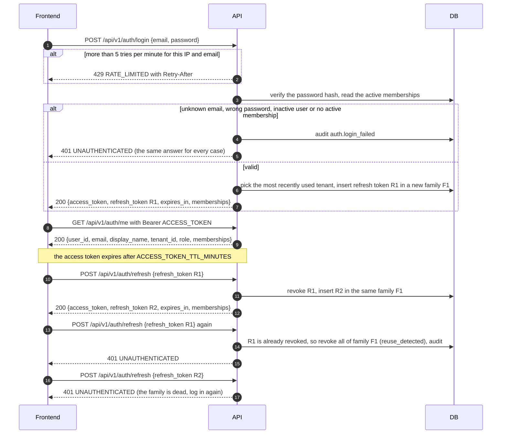

How to read it: steps 1 to 7 are the login (steps 2 and 4-5 are its refusals), and steps 8 and 9
use the access token. Steps 10 to 12 are a normal refresh: the old refresh token R1 stops working
and R2 replaces it. Steps 13 to 17 show reuse detection: presenting R1 again revokes R1, R2 and
every token in that family. This is exactly what
`scripts/e2e/auth_session.sh` checks.

### 1.2 Switch tenant and sign out

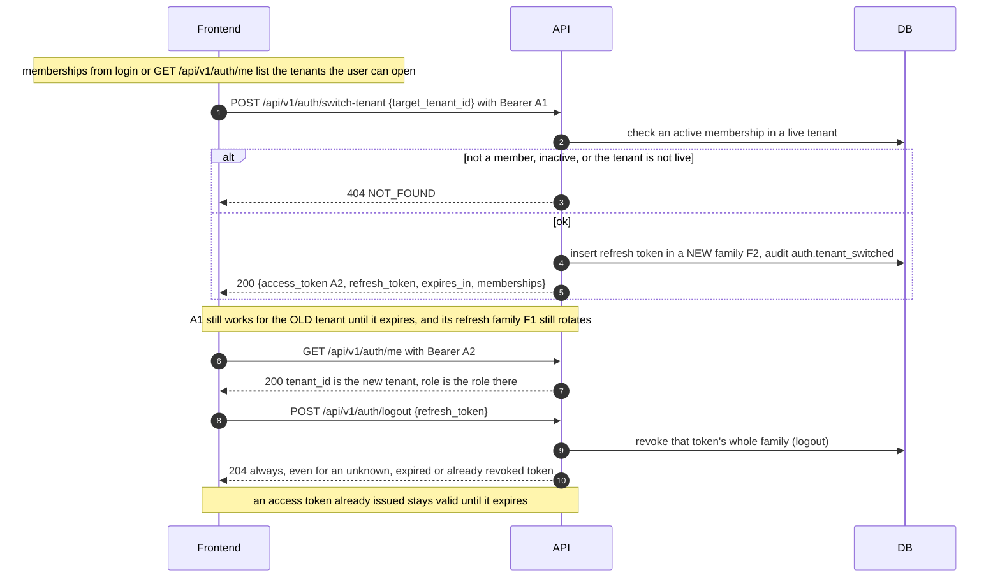

How to read it: switching tenant does not change the old tokens. It issues a brand new pair in a
new family, bound to the new tenant. Logout kills one family only, so log out of every family you
hold if the user had switched tenants.

### 1.3 Set password (staff only in v1)

There is **no self-service password change, reset or invite endpoint in v1**. Staff set a password
with the operator command line. It revokes every live refresh token of that user, in every tenant.

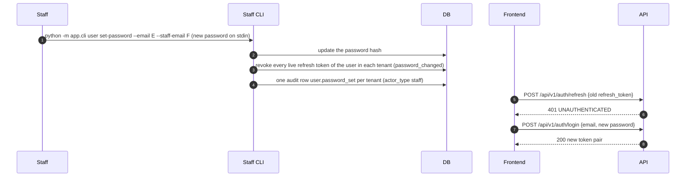

How to read it: the password change happens outside the API. The user's next refresh fails, so the
frontend must send them back to the login screen. An owner or admin deactivating a member with
`PATCH /api/v1/members/{user_id}` has a similar effect, but only for that one tenant (see 2.3).

**Frontend notes**

- Keep both tokens. Send the access token on every call. Never send a `tenant_id`.
- **Serialise refreshes.** Two refreshes of the same token at the same time count as reuse and
  revoke the family. Use one shared in-flight refresh promise for all tabs and requests.
- On a 401 from a normal call: refresh once, retry once. If the refresh is 401, clear tokens and
  show the login screen.
- Login 401 is the same for every cause: show one generic "email or password is wrong" message.
  Login 429: show a wait message using `Retry-After`.
- After `switch-tenant`: replace both tokens, then drop every cached screen and refetch, because
  every list is tenant-scoped.
- Logout: call it, then discard the tokens whatever the answer (it is always 204).
- "Forgot password" and "invite a member" screens have no backend in v1: they must point users to
  support.

---

## 2. Tenant and brand onboarding, members

### 2.1 Creating a tenant and adding members (staff CLI)

Staff can still create a tenant, its first owner and any further member with the operator
command line. A brand can also sign up on its own and wait for a platform admin to approve it
(section 2.1b, ADR-0019). There is no invite email.

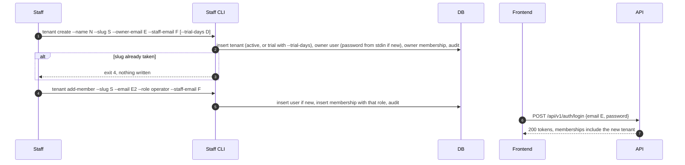

How to read it: everything before the login is staff work. From step 6 on the owner uses the
normal API. `scripts/e2e/acceptance.sh` starts exactly like this.

### 2.1b Self-serve sign-up, waiting for approval, approve or reject (ADR-0019)

The form asks only for the minimum. The rest of the brand profile is filled in after approval
(section 2.2). No email is sent at any step.

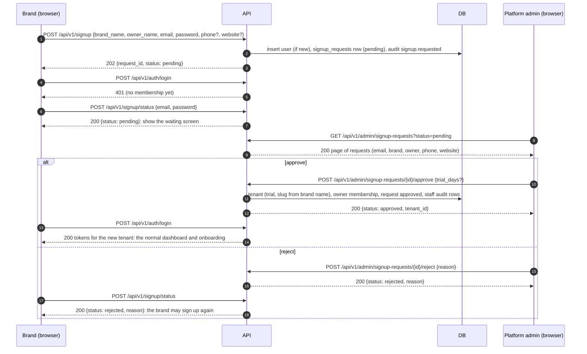

How to read it:
- The 202 is the same for a new email, for an existing email with a wrong password (nothing is
  written) and for a repeat while pending (the same `request_id`). One answer never reveals
  whether an account exists; a pair can (ADR-0019 decision 2), until email verification exists.
- Staff cannot hand an applicant's email a tenant through the CLI (`tenant create`, `add-member`
  exit 4) until the admin approves the request: the applicant chose that password unverified.
- Until approval the applicant has no membership, so login is the usual 401 and no tenant data is
  reachable. `POST /signup/status` is the only thing they can read, and it needs the password.
- A platform admin is a normal member of some tenant (for example a staff tenant) whose user row
  has `is_platform_admin`. Staff set it with
  `python -m app.cli user make-admin --email E --staff-email F`. Everyone else gets 403 on the
  three admin calls.
- Approve and reject are idempotent: the same decision again returns the stored row. The opposite
  decision is 409 `INVALID_STATUS_TRANSITION`.

### 2.2 Brand profile and brand documents

The **brand profile** (tone, guidelines, glossary) and **brand documents** (`.txt` or `.md` brand
guides) feed the AI pipeline. The worker cuts them into chunks and stores vector embeddings, so the
pipeline can retrieve the brand's voice later.

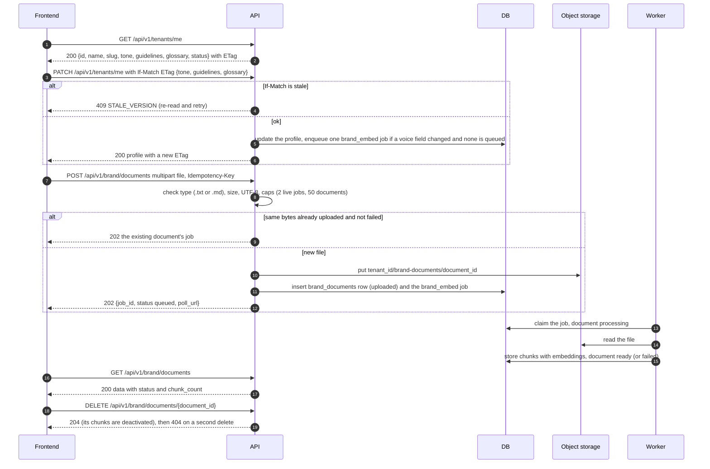

How to read it: the profile is a plain PATCH guarded by `If-Match`. Documents are an async upload:
the 202 names a `brand_embed` job, and the document's own `status` goes `uploaded`, `processing`,
then `ready` or `failed`.

Errors to expect: 403 for operator or reviewer on writes, 413 `PAYLOAD_TOO_LARGE` for a file over
10 MiB, 422
`VALIDATION_FAILED` on `file` for a bad type or encoding, 429 when the caps are full, 409
`IDEMPOTENCY_KEY_REUSED` for the same key with another file.

### 2.3 Members

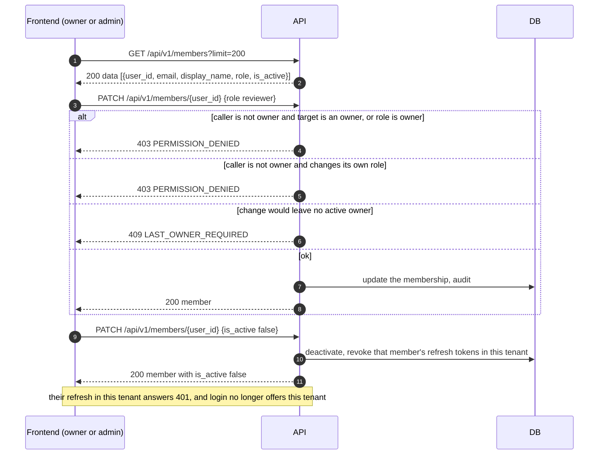

How to read it: only an owner can create, remove or change an owner. A member of another tenant
is 404. Deactivating someone logs them out of this tenant at their next refresh. If they belong to no
other active tenant, their login answers 401 too.

**Frontend notes**

- Keep the profile `ETag` from GET and send it as `If-Match`. On 409, reload the profile, show the
  user the fresh values and let them re-apply.
- After a document upload, poll the job, then refresh the list and show `status` and
  `chunk_count`. A `failed` document shows `error.errors[0].message` (`error` is an `ErrorReport`). Uploading the same file again
  re-queues a failed one.
- Hide the members screen and the profile edit for operator and reviewer (they get 403).
- Show 409 `LAST_OWNER_REQUIRED` as "a tenant needs at least one active owner".

---

## 3. Marketplace connect, refresh, revoke, reconnect

Connecting a marketplace is an OAuth flow: the seller signs in at Amazon or Flipkart and grants the
app access. The backend keeps the tokens sealed; the frontend never sees them.

### 3.1 Connect and confirm

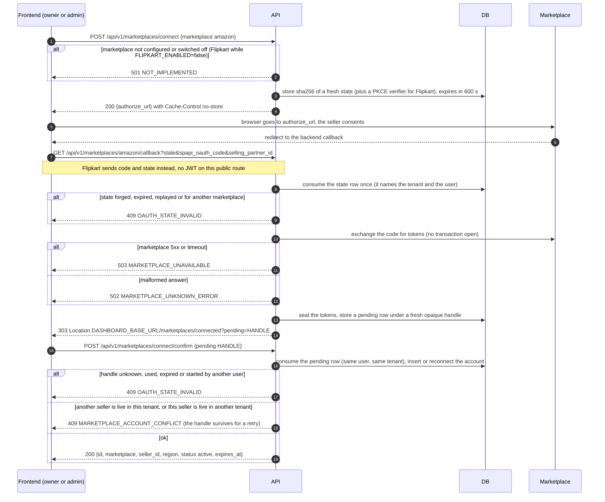

How to read it: there are two frontend calls (`connect`, then `confirm`) with a browser round trip
between them. The callback is the only public step; it never returns tokens or account data, only
a one-time `pending` handle in the redirect. The dashboard page at `/marketplaces/connected` reads
`pending` from its query string and calls `confirm`.

### 3.2 Token refresh, needs_reconnect and reconnect

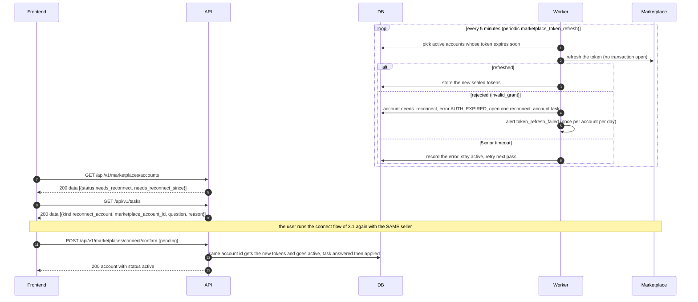

How to read it: the loop is the background refresh. A rejected refresh flips the account to
`needs_reconnect` and opens one `reconnect_account` human task. A publish can also hit a refused
token: the adapter forces one refresh, and if the marketplace still refuses, the listing goes
`blocked/marketplace_action_required` and its issue is linked to the reconnect task (see 8.2).
Reconnecting the same seller keeps the account id, applies the task, and a later publish resumes.

### 3.3 Revoke, then connect again

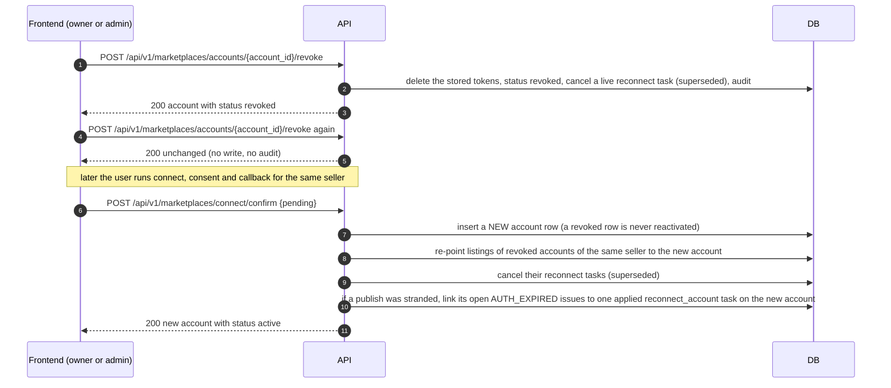

How to read it: revoke is idempotent and only deletes our copy of the tokens; the app stays
authorised at the marketplace until the brand removes it there. A new connect of the same seller
"adopts" the old account's listings, so they can be published and synced again. Listings of a
**different** seller stay on the revoked account and cannot be published or synced (by design).

**Frontend notes**

- "Connect" button: call `connect`, then `window.location = authorize_url`. Do not open it in an
  iframe.
- Build a `/marketplaces/connected` page that reads `?pending=` and calls `confirm` once. Never
  store or log the handle.
- `confirm` 409 `MARKETPLACE_ACCOUNT_CONFLICT`: tell the user another seller account is already
  connected for that marketplace (revoke it first), or that this seller belongs to another brand.
- `confirm` or callback 409 `OAUTH_STATE_INVALID`: the link expired or was used; start again.
- 501 on connect (or on confirm, or the callback): hide or disable that marketplace (Flipkart is
  off at launch, `FLIPKART_ENABLED=false`).
- Show a "Reconnect" button when an account is `needs_reconnect`, and show open
  `reconnect_account` tasks from `GET /api/v1/tasks`.
- After a revoke, warn that listings on that account cannot publish until the same seller is
  connected again.

---

## 4. CSV bulk import

Brands import many products at once from a CSV. The upload is synchronous only for checking the
file header; the rows are processed by a `bulk_import` job. A family (a style row plus its
variant children) is always written in one transaction, so a family is never half imported.

### 4.1 Upload and the import job

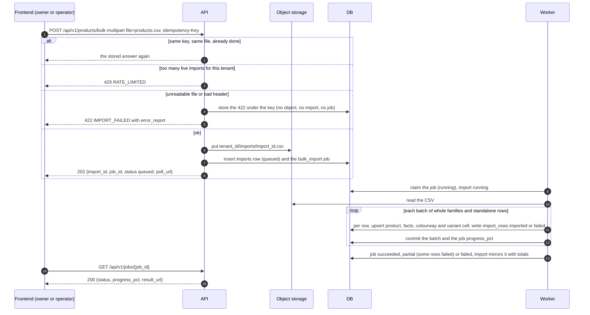

How to read it: the 202 has two ids. `import_id` is the import report; `job_id` is what you poll.
The import never starts generation by itself.

### 4.2 Report, failed rows, retry and cancel

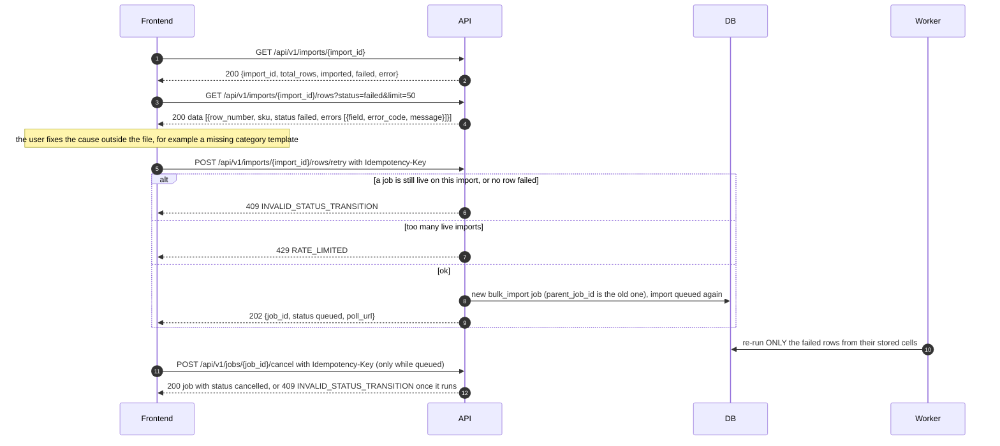

How to read it: the "errors report" is the `rows` list filtered by `status=failed`; each row has its
own `errors[]`. A retry reuses the **stored cell values**, so it only helps when the cause was
outside the file (for example a category that had no template yet). To fix a wrong cell value,
upload a corrected CSV under a new key.

**Frontend notes**

- Make a new `Idempotency-Key` per file the user picks. Reusing it with another file is 409.
- Show a progress bar from `progress_pct` while polling the job.
- When the job ends, read `GET /imports/{import_id}` for counts, then page through
  `rows?status=failed` for a table of errors (row number, SKU, field, message).
- `partial` is a normal outcome (some rows failed). `failed` means the whole job failed: show
  `error.errors[0].message` from the import or the job (`error` is an `ErrorReport`).
- Offer "Retry failed rows" only when `failed > 0` and the job is finished.

---

## 5. Products and images

### 5.1 Create and read a product

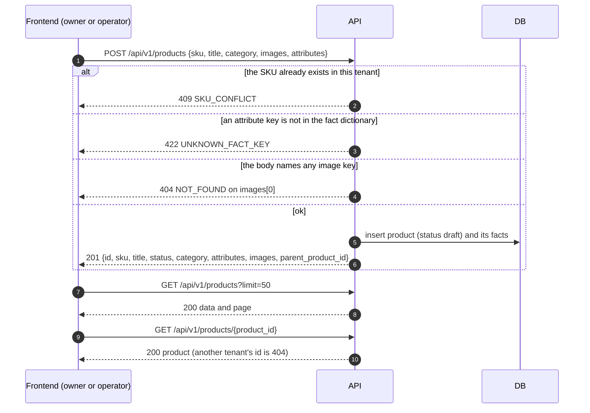

How to read it: this is the one-product path. Send `images: []` here: any image key on create is
404, because images arrive only through `POST /api/v1/images/upload` (5.2). CSV import (section 4)
is the bulk path and the only way to create families with variant children. A product's `status`
is `draft` in v1.

### 5.2 Upload an image and run the compliance check

There are two ways to send the bytes: a **signed URL** (the browser uploads straight to object
storage) or a plain **multipart** upload through the API. Both end in the same
`image_compliance` job.

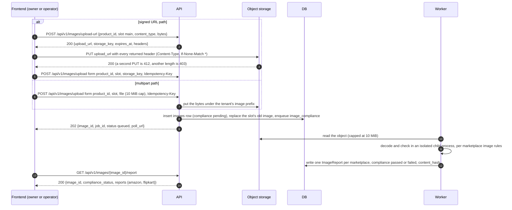

How to read it: the upload answer is 202 because the checks run in the worker. `reports` is empty
while `compliance_status` is `pending`. A storage key must be registered within 23 hours of its
PUT. Uploading a new image for the same slot replaces the old one, whose report then answers 404.
The stored `content_hash` is re-checked at publish time, so the bytes cannot change after the check.

**Frontend notes**

- Prefer the signed URL for big files: send **every** header the API returned with the PUT, or the
  object store refuses it.
- Poll the image job, then read the report. Show each marketplace's findings (`blocking` items in
  red, warnings in amber). Example: the same 800x800 image can fail Amazon (`RESOLUTION_LOW`) and
  pass Flipkart with a warning.
- An image that is not `passed` blocks approval later (422 `IMAGE_NON_COMPLIANT`), so surface it on
  the product page.
- Slots: `main`, `secondary`, `lifestyle`, `size_chart`, `packaging_label` (the last one is never
  published).

---

## 6. Listing generation, regeneration and validation

### 6.1 Ask for a generation

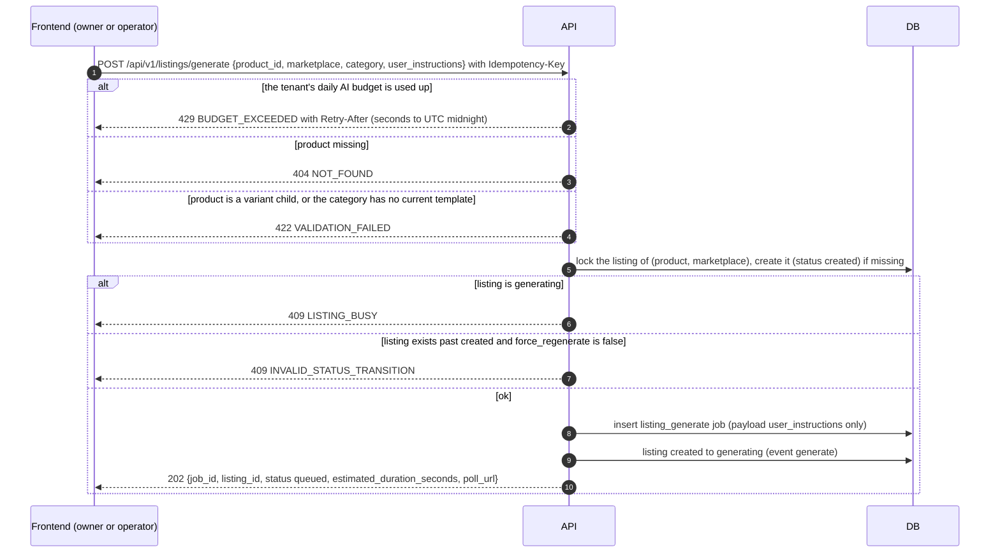

How to read it: the request only books the work. Nothing is sent to the AI pipeline yet. The API
checks only the tenant's budget; the global platform budget is checked when the worker claims the
job (6.2), so a job can still fail later with `BUDGET_EXCEEDED`. With `force_regenerate: true`, an
existing listing takes the regenerate path of 6.3 instead of the 409. The
listing is locked, so two clicks cannot start two generations: the second is 409 `LISTING_BUSY`
(or, with the same key, the first answer again).

### 6.2 The worker runs the AI pipeline and stores the result

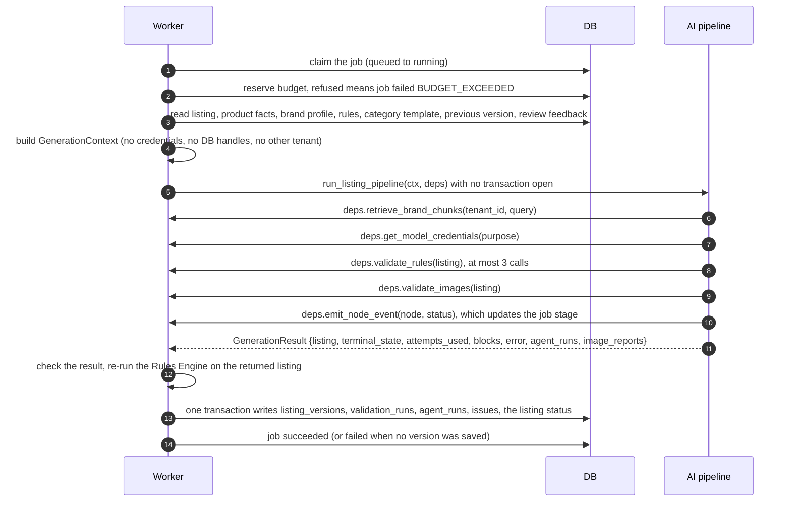

How to read it: the AI pipeline never touches the database. It returns a `GenerationResult`, and
the backend re-checks and stores it. The backend re-runs the Rules Engine itself, because the Rules
Engine (not the model) is the final judge. See `docs/HANDOFF-AI.md` for the seam.

What the backend sends to the AI pipeline (`GenerationContext`): `request_id`, `job_id`,
`tenant_id`, `product_id`, `listing_id`, `marketplace`, `category`, `locale` (`en-IN`), `product`
(facts with their source), `brand_profile`, `marketplace_rules`, `category_template` (adapter-only
fields stripped), optional `previous_version`, `user_instructions`, `review_feedback` (up to 5) and
`max_attempts` (at most 3). The context is built when the job **starts**, so a retry sees fresh
facts.

What the backend stores, in one transaction:

| Table | What |
|---|---|
| `listing_versions` | The new version: content, `origin` (`generation` or `regeneration`), `parent_version_id`, `generated_by_user_id` (the person who asked), `attempts_used`, the rules and template pins, image reports. It becomes `current_version_id`. |
| `validation_runs` | One run per `validate_rules` call the pipeline made, plus the backend's own re-check, linked to the version. |
| `agent_runs` | One row per model call (model, tokens, cost), linked to the version when one was saved. |
| `listing_issues` | Open issues synced from the backend's re-check. |
| `listings` | The status move with the job as actor. |

How the result maps to a listing status (`apps/api/app/services/generation_result.py`):

| Pipeline result | Listing status | Job status |
|---|---|---|
| No listing, or `terminal_state` failed | `failed` / `generation_failed`, no version saved, agent runs kept | `failed` (`GENERATION_FAILED`) |
| The re-check has a blocking error | `blocked` / `corrections_exhausted` | `succeeded` (its `error` carries the report) |
| Warnings, a failed agent block, or `terminal_state` needs_review or blocked | `needs_review` | `succeeded` |
| Clean | `validated` | `succeeded` |

### 6.3 Regenerate

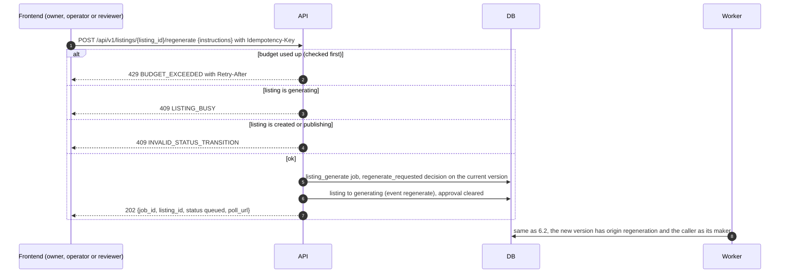

How to read it: regeneration works from `validated`, `needs_review`, `approved`, `blocked`, `failed`
and `published`. It always voids an approval. The person who regenerates becomes the **maker** of
the new version, so they cannot approve it (section 7).

### 6.4 Validate on demand, list rules, dry-run

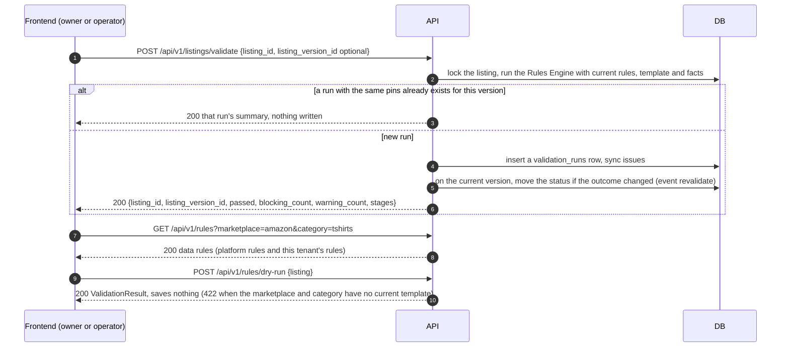

How to read it: a failed check is **200 with `passed: false`**, never an error status. Validate can
move the listing: for example an `approved` listing whose rules changed goes back to
`needs_review` or `blocked` and loses its approval. A human rejection (`blocked/rejected`) is never
undone by validate.

**Frontend notes**

- After a generate or regenerate 202, poll the job. When it ends, **always read the listing**
  (`GET /api/v1/listings/{listing_id}`): a `succeeded` job can still leave the listing `blocked`.
- While polling, show `stage` (for example `content_agent`, `validate_rules`) as progress text.
- 429 `BUDGET_EXCEEDED`: show "daily AI budget reached, try again after midnight UTC" using
  `Retry-After`.
- 409 `INVALID_STATUS_TRANSITION` on generate means the listing already exists: offer
  "Regenerate" instead (or send `force_regenerate: true`).
- Use `rules/dry-run` for live hints in an editor; it never saves anything.

---

## 7. Review and approval (maker-checker), edits with ETag

### 7.1 Read and edit with ETag

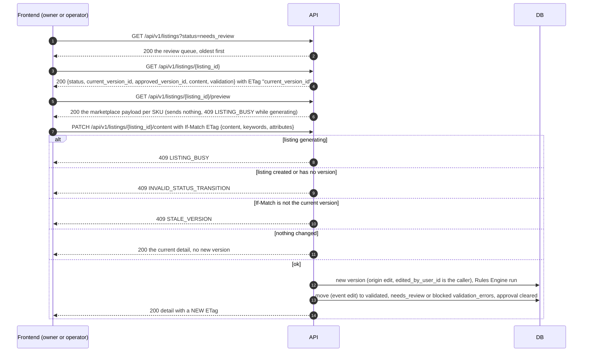

How to read it: the `ETag` of a listing is its `current_version_id`, in quotes. Every real edit
creates a new version, re-runs the rules and voids any approval. The editor joins the version's
"maker" chain.

### 7.2 Approve: who may, and the 403 cases

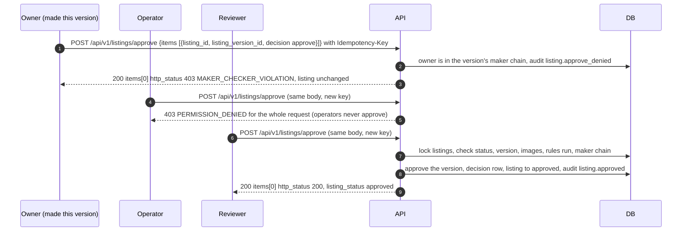

How to read it: this is the exact sequence in `scripts/e2e/acceptance.sh`. The role check is per
**request** (403 for the whole call). Maker-checker is per **item** (the call is 200, the item is
403).

Who may approve a version:

- the caller's role is `owner` or `reviewer`, and the membership is active; **and**
- the caller is **not** in the version's maker chain. The chain is every `generated_by_user_id`
  and `edited_by_user_id`, walking back through parent versions until the last full generation or
  full regeneration. So whoever asked for the generation, whoever edited it since, and whoever
  regenerated it (including a reviewer) cannot approve it.

The database checks the same chain again (`lv_guard`), so a client bug cannot bypass it.

Per-item refusals, in the order they are checked:

| Item status | Code | Cause |
|---|---|---|
| 404 | `NOT_FOUND` | Unknown listing, or another tenant's |
| 409 | `LISTING_PAUSED` / `LISTING_ARCHIVED` | Paused or archived |
| 409 | `LISTING_BUSY` | Generating or publishing |
| 409 | `STALE_VERSION` | `listing_version_id` is not the current version |
| 409 | `INVALID_STATUS_TRANSITION` | Status is not `validated` or `needs_review`, or this version was already approved once |
| 409 | `BULK_APPROVE_REQUIRES_VALIDATED` | A multi-item batch can only approve `validated` listings |
| 422 | `IMAGE_NON_COMPLIANT` | An image has a blocking finding, or was never checked |
| 409 | `STALE_VERSION` | No passed Rules Engine run with the currently resolved rules and facts (run validate) |
| 403 | `MAKER_CHECKER_VIOLATION` | The caller made this version, or is not an active reviewer or owner |

### 7.3 Reject, with or without regeneration

```mermaid
sequenceDiagram
    autonumber
    participant Rev as Frontend (owner or reviewer)
    participant API
    participant DB
    participant W as Worker
    Rev->>API: POST /api/v1/listings/approve {items [{decision reject}]} without reason_code or feedback
    API-->>Rev: 422 VALIDATION_FAILED (a reject needs reason_code and feedback)
    Rev->>API: POST /api/v1/listings/approve {items [{listing_id, listing_version_id, decision reject, reason_code, feedback}]}
    API->>DB: reject decision, listing to blocked rejected
    API-->>Rev: 200 items[0] http_status 200, listing_status blocked
    Rev->>API: POST /api/v1/listings/approve {items [{decision reject, reason_code, feedback, regenerate true}]}
    API->>DB: budget pre-check, listing_generate job, decision names the job
    API->>DB: listing to generating (event reject_regenerate), approval voided
    API-->>Rev: 200 items[0] http_status 200, listing_status generating, job_id
    W->>DB: the new version uses the feedback, the reviewer is now its maker
```

How to read it: anyone allowed to approve may also reject, even the maker. `reason_code` is one of
`inaccurate_fact`, `off_brand_voice`, `policy_violation`, `poor_quality`, `wrong_category`,
`image_issue` or `other` (`REASON_CODES` in `apps/api/app/api/v1/schemas/batches.py`); any other
value is 422. With `regenerate: true` the
feedback goes into the next generation, and because the reviewer started it, a **different**
person must approve the result.

**Frontend notes**

- Store the `ETag` from `GET /listings/{listing_id}` and send it as `If-Match` on every PATCH. On
  409 `STALE_VERSION`, reload and show the user the new content before they re-apply.
- Send `listing_version_id` from the detail you showed the reviewer, so they approve exactly what
  they saw.
- **Always read `items[]`**: the approve call is 200 even when every item is refused.
- Hide "Approve" for operator and admin. For owner and reviewer, disable it with a hint ("you
  made this version, ask someone else") when the current user generated, edited or regenerated it.
  A one-person tenant cannot approve its own work.
- After approve or reject, refresh the listing and `GET /api/v1/listings/{listing_id}/history` to
  show the audit trail (approvals, denials, rejections, edits).

---

## 8. Publish, retry-fields, refresh-status and the status sync

Publishing sends an **approved** listing to the marketplace. Only the `listing_publish` job talks
to the marketplace; the API request only books the work. A publish is not "live" yet: the
marketplace first answers "accepted, processing". The **status sync** later confirms it is live.

### 8.1 Publish request

```mermaid
sequenceDiagram
    autonumber
    participant FE as Frontend (owner or operator)
    participant API
    participant DB
    FE->>API: POST /api/v1/listings/publish {items [{listing_id, listing_version_id}]} with Idempotency-Key
    API->>DB: batch row, lock every listing in id order
    loop each item, in its own savepoint
        alt unknown or another tenant's listing
            API->>API: item 404 NOT_FOUND
        else Flipkart while FLIPKART_ENABLED=false
            API->>API: item 501 NOT_IMPLEMENTED, no job
        else paused, archived, busy, stale version, not approved, no active account, 3 submissions used
            API->>API: item 409 with its code
        else ok
            API->>DB: insert listing_publish job (the publish gate trigger re-checks everything)
            API->>DB: listing to publishing (publish, retry_publish or resume_publish), audit
            API->>API: item 202 with job_id
        end
    end
    API-->>FE: 202 {batch_id, items [{listing_id, http_status, listing_status, job_id, error}], poll_url}
```

How to read it: the request is always 202 and each item says what happened. A refused item changes
nothing. `poll_url` names the first job; each accepted item has its own `job_id` to poll.

Per-item 409 codes: `LISTING_PAUSED`, `LISTING_ARCHIVED`, `LISTING_BUSY`, `STALE_VERSION` (not the
current version), `INVALID_STATUS_TRANSITION` (current version not approved, or a status with no
publish edge), `AUTH_EXPIRED` (no active marketplace account), `SUBMISSION_ATTEMPTS_EXHAUSTED`
(3 submissions for this version), `DUPLICATE_SUBMISSION_BLOCKED` (a retry with nothing new to
justify it).

Which statuses can publish:

| Listing status / reason | Event | Meaning |
|---|---|---|
| `approved` | `publish` | First publish of the approved version |
| `failed` / `publish_failed`, `publish_partial` or `marketplace_rejected` | `retry_publish` | Try again |
| `blocked` / `marketplace_action_required` | `resume_publish` | The user fixed something at the marketplace (for example reconnected) |

### 8.2 The publish job

```mermaid
sequenceDiagram
    autonumber
    participant W as Worker
    participant DB
    participant S3 as Object storage
    participant MP as Marketplace
    W->>DB: claim the job, read listing (must be publishing), approved version, account, images
    opt an earlier submission is still pending
        W->>MP: read the listing first, never resend blind
    end
    W->>S3: re-hash each image, compare with content_hash
    alt product facts or image bytes changed since approval
        W->>DB: revalidate (listing to needs_review or blocked), approval voided, job failed
    else pins hold
        W->>DB: write-ahead a pending submission (attempt n), commit before any send
        W->>MP: create, update or patch with 24-hour signed image URLs
        MP-->>W: per SKU and per field results
        W->>DB: one transaction writes outcome, field results, items, issues and the listing event
    end
```

How to read it: the worker writes a `pending` submission **before** it calls the marketplace, so a
crash never sends twice. A pending row is resolved by reading the marketplace first.

Outcomes of one attempt (`apps/api/app/services/publish_ledger.py`):

| Marketplace answer | Submission | Listing | Job |
|---|---|---|---|
| Every field accepted | `accepted` | `published`, `marketplace_state` `processing` ("Submitted"), sync in 2 min | `succeeded` |
| Some fields failed | `partially_accepted` | `failed` / `publish_partial`, sync also scheduled | `partial` |
| Every field failed | `rejected` | `failed` / `publish_failed` | `failed` |
| A blocking item needs action (account permission, an unmapped marketplace code, a SKU conflict) | `partially_accepted` or `rejected` | `blocked` / `marketplace_action_required`, a `permission_decision` or `marketplace_error_review` task | `partial` or `failed` |
| Token refused even after one forced refresh | `error` `AUTH_EXPIRED` | `blocked` / `marketplace_action_required`, issue linked to a `reconnect_account` task | `failed` |
| Permission refused before anything applied | `error` `ACCOUNT_PERMISSION_DENIED` | `blocked` / `marketplace_action_required`, a `permission_decision` task | `failed` |
| Throttled (`RATE_LIMITED`) | `error` | stays `publishing`, the job retries with backoff | back to `queued` |
| Ambiguous answer, timeout or marketplace down | stays `pending` | stays `publishing`, retried on the same row and key | back to `queued` |
| The 3rd attempt of a version that does not succeed | as above | `blocked` / `publish_attempts_exhausted` | `failed` or `partial` |
| Job ends failed, dead_letter or cancelled while publishing | a `pending` row stays `pending` | `failed` / `publish_failed` | as ended |

### 8.3 Partial accept and retry-fields

```mermaid
sequenceDiagram
    autonumber
    participant FE as Frontend (owner or operator)
    participant API
    participant DB
    participant W as Worker
    participant MP as Marketplace
    FE->>API: GET /api/v1/listings/{listing_id}/status
    API-->>FE: 200 {status failed, status_reason publish_partial, marketplace_state}
    FE->>API: GET /api/v1/listings/{listing_id}/submissions
    API-->>FE: 200 data [{attempt 1, operation create, outcome partially_accepted, items [{seller_sku, fields [{field, status failed}]}]}]
    FE->>API: POST /api/v1/listings/{listing_id}/publish/retry-fields with Idempotency-Key (no body)
    alt status not failed with publish_partial or publish_failed
        API-->>FE: 409 INVALID_STATUS_TRANSITION
    else 3 submissions already, no active account, or nothing justifies a retry
        API-->>FE: 409 SUBMISSION_ATTEMPTS_EXHAUSTED, AUTH_EXPIRED or DUPLICATE_SUBMISSION_BLOCKED
    else Flipkart switched off
        API-->>FE: 501 NOT_IMPLEMENTED
    else ok
        API->>DB: listing_publish job in retry_fields mode, listing to publishing (retry_publish)
        API-->>FE: 202 {job_id, listing_id, status queued, poll_url}
    end
    W->>MP: ONE patch with only the failed fields of the failed SKUs
    W->>DB: attempt 2, operation patch, retry_justification retryable_condition, outcome accepted
    W->>DB: listing published, marketplace_state processing
```

How to read it: in the acceptance run, the fake marketplace throttles only the XL child's `size`
field. Retry-fields resends exactly that one field as one PATCH; the other SKUs are not touched.
Every retry must have a justification (`changed_input`, `retryable_condition`,
`marketplace_transition` or `human_resolution`), so the system never resends the same thing for no
reason.

### 8.4 Refresh-status and the periodic status sync

```mermaid
sequenceDiagram
    autonumber
    participant FE as Frontend (owner or operator)
    participant API
    participant DB
    participant W as Worker
    participant MP as Marketplace
    loop every minute (periodic schedule_status_sync)
        W->>DB: find listings whose next_sync_at is due and whose account is active
        W->>DB: enqueue one listing_status_sync job each
    end
    FE->>API: POST /api/v1/listings/{listing_id}/refresh-status with Idempotency-Key
    alt not published, and not failed with publish_partial
        API-->>FE: 409 INVALID_STATUS_TRANSITION or LISTING_BUSY
    else a second request within 5 minutes
        API-->>FE: 429 RATE_LIMITED with Retry-After
    else ok
        API-->>FE: 202 {job_id, status queued, poll_url} (a live sync job is returned as is)
    end
    W->>MP: read each SKU's state
    W->>DB: aggregate marketplace_state, write the listing event
    alt all SKUs live (or some: partially_live)
        W->>DB: published with marketplace_state live or partially_live, live_url set, submission live when all are live, daily poll after
    else rejected
        W->>DB: failed with marketplace_rejected
    else inactive or removed
        W->>DB: blocked with marketplace_action_required
    else still processing
        W->>DB: next counted poll, and the 9th still waiting is event sync_exhausted, blocked/marketplace_action_required
    end
```

How to read it: the periodic sync polls on a fixed schedule after an accept (+2 min, +10 min,
+30 min, +1 h, +3 h, +6 h, +12 h, +24 h, +72 h). Refresh-status lets a user check now, at most once
per 5 minutes per listing. A live listing is polled once a day. A sync of a `failed/publish_partial` listing only updates
its SKU states and `marketplace_state`; it never moves the status.

### 8.5 Submission outcomes

```mermaid
stateDiagram-v2
    [*] --> pending : write-ahead before the send
    pending --> accepted : marketplace accepted every field
    pending --> partially_accepted : some fields failed
    pending --> rejected : marketplace rejected
    pending --> error : auth, permission, throttle or not applied
    accepted --> live : status sync sees every SKU live
    accepted --> rejected : status sync sees a rejection
    accepted --> error : status sync sees inactive or removed, or sync exhausted
    accepted --> superseded : a newer version's attempt 1 replaces it
    partially_accepted --> [*]
    rejected --> [*]
    error --> [*]
    live --> [*]
    superseded --> [*]
```

How to read it: `pending` and `accepted` are the only open outcomes. `accepted` means "the
marketplace took it and is processing"; only the status sync moves it to `live`. The rest are
final. A version may have at most 3 submissions.

**Frontend notes**

- Publish is per item: read `items[]` and show each refusal next to its listing.
- After 202, poll each item's `job_id`. `partial` is a normal end state: show the failed fields
  from `submissions` and offer "Retry failed fields".
- Show `marketplace_state` as the marketplace-side badge: `processing` means "Submitted", `live`
  means "Live" (with `live_url`). Do not show "Live" just because `status` is `published`.
- Offer "Check status now" (refresh-status) on `published` and `failed/publish_partial`, and
  disable it for 5 minutes after use (429 otherwise).
- `blocked/marketplace_action_required`: show the linked task from `GET /api/v1/tasks` (for
  example "Reconnect this marketplace account"), then offer "Publish again" (resume). A resume
  is 409 `DUPLICATE_SUBMISSION_BLOCKED` until something justifies it: a reconnect applied the
  task, the marketplace state changed, or the content was edited and approved again.
- `blocked/publish_attempts_exhausted` or 409 `SUBMISSION_ATTEMPTS_EXHAUSTED`: this version cannot
  be sent again. The user must edit or regenerate, get a new approval, then publish.
- A Flipkart item answers 501 while Flipkart is switched off: show "Flipkart is not enabled yet".

---

## 9. Issues and human tasks

### 9.1 Issues

An **issue** is opened or updated every time a validation run or a marketplace answer reports a
problem on a field. Issues close by themselves when the next report no longer has them.

```mermaid
sequenceDiagram
    autonumber
    participant FE as Frontend
    participant API
    participant DB
    participant W as API or worker
    W->>DB: a validation run (generation re-check, edit, validate) or a publish result
    W->>DB: upsert one open issue per problem (a repeat adds an occurrence)
    W->>DB: close open issues the new report no longer has (status resolved)
    FE->>API: GET /api/v1/issues?status=open&listing_id=ID
    API-->>FE: 200 data [{id, field_path, error_code, severity, message, suggestion, occurrences, human_task_id}]
    FE->>API: POST /api/v1/issues/{issue_id}/dismiss with Idempotency-Key (owner or reviewer)
    alt caller is operator or admin (checked first)
        API-->>FE: 403 PERMISSION_DENIED
    else the issue is an error, or already closed
        API-->>FE: 409 INVALID_STATUS_TRANSITION
    else warning
        API->>DB: status dismissed, resolution accepted_warning, resolved_by the caller
        API-->>FE: 200 issue with status dismissed
    end
```

How to read it: only a **warning** can be dismissed. An **error** stays open until an edit,
regeneration or revalidation removes it, because the Rules Engine stays the judge. Filters on the
list: `status`, `listing_id`, `source`, `error_code`, `marketplace`.

### 9.2 Human tasks

```mermaid
sequenceDiagram
    autonumber
    participant FE as Frontend
    participant API
    participant DB
    participant W as Worker
    alt token refresh rejected
        W->>DB: open reconnect_account task on the account
    else publish refused for auth, permission or an unknown marketplace error
        W->>DB: open or reuse reconnect_account, permission_decision or marketplace_error_review, link the issue
    end
    FE->>API: GET /api/v1/tasks?status=open
    API-->>FE: 200 data [{id, kind, marketplace_account_id, target_path, question, reason, expected_answer}]
    Note over FE,API: v1 has no endpoint to answer a task, the user acts elsewhere
    FE->>API: POST /api/v1/marketplaces/connect/confirm after reconnecting the same seller
    API->>DB: reconnect_account task open to answered to applied
    FE->>API: POST /api/v1/marketplaces/accounts/{account_id}/revoke
    API->>DB: live reconnect_account task cancelled (superseded)
```

How to read it: in v1 a human task is **read-only** for the frontend. The `reconnect_account` task
closes itself when the user reconnects the same seller, and is cancelled by a revoke. The task kind
list also has `missing_fact`, `conflicting_facts`, `unverified_declaration`,
`approval_or_evidence` and `image_replacement`, but no v1 code path opens them.

**Frontend notes**

- Show an issue inbox per listing and a global one. Group by `severity`; show `plain_message` or
  `message`, and `suggestion` when present.
- Show "Dismiss" only on warnings, only for owner and reviewer.
- After an edit or regenerate, refetch issues: many will have moved to `resolved`.
- Show `GET /api/v1/tasks` as a to-do list with `question` and `reason`. For
  `reconnect_account`, link to the reconnect button of that account.

---

## 10. Analytics reads

```mermaid
sequenceDiagram
    autonumber
    participant FE as Frontend (any role)
    participant API
    participant DB
    FE->>API: GET /api/v1/analytics/summary?from=2026-10-01&to=2026-10-31
    alt from after to, or more than 366 days
        API-->>FE: 422 VALIDATION_FAILED
    else more than 2 analytics requests of this tenant at once
        API-->>FE: 429 RATE_LIMITED
    else ok
        API->>DB: one read-only transaction with a 5 s budget
        API-->>FE: 200 {from, to, listings_generated, approval_rate, validation_pass_rate, publish_success_rate, counts, by_marketplace}
    end
    Note over FE,API: GET /api/v1/analytics answers the same body (an alias)
```

How to read it: both dates are optional UTC days (`YYYY-MM-DD`, both ends included). With
neither, the range is the last 30 days ending today; with only `to`, the 30 days ending `to`; with
only `from`, `from` to today. Rates are rounded to 4 decimals and are `null` when there is nothing to divide by.

| Field | Meaning |
|---|---|
| `listings_generated` | Generations in the range |
| `counts.approvals`, `counts.rejections` | Review decisions; `approval_rate` = approvals / (approvals + rejections) |
| `counts.validation_first_pass_passed`, `..._total` | First Rules Engine pass of each generation; `validation_pass_rate` = passed / total |
| `counts.publish_succeeded`, `counts.publish_failed` | Submissions answered in the range: `accepted`, `live` or `superseded` versus `partially_accepted`, `rejected` or a non-retryable `error`; `publish_success_rate` = succeeded / (succeeded + failed) |
| `by_marketplace` | The same per marketplace |

**Frontend notes**

- Fetch once per date-range change; do not fire several ranges in parallel (the 3rd concurrent call
  is 429).
- Show `null` rates as "no data", not 0%.
- A query that runs past its 5 s budget answers 500 `INTERNAL_ERROR`: suggest a shorter range.

---

## 11. The job polling pattern for every 202

Every 202 in this API names a job. The pattern is always the same.

```mermaid
sequenceDiagram
    autonumber
    participant FE as Frontend
    participant API
    participant DB
    participant W as Worker
    FE->>API: any POST that answers 202
    API->>DB: insert job_runs row (queued) and the queue entry, in the same transaction
    API-->>FE: 202 {job_id, status queued, estimated_duration_seconds, poll_url}
    W->>DB: claim (queued to running), start the lease
    loop until a terminal status
        FE->>API: GET /api/v1/jobs/{job_id}
        API-->>FE: 200 {job_id, kind, status, stage, progress_pct, attempt, max_attempts, listing_id, result_url, error}
    end
    W->>DB: succeeded, partial, failed, cancelled or dead_letter
    FE->>API: GET the entity (listing, import, image report, brand documents)
    opt still queued and the user gives up
        FE->>API: POST /api/v1/jobs/{job_id}/cancel with Idempotency-Key
        API-->>FE: 200 status cancelled, or 409 INVALID_STATUS_TRANSITION once running
    end
```

How to read it: the job envelope is read from `job_runs`, never from the queue. A job can go back
from `running` to `queued` (a retry after a throttle, or a reaped lease), so keep polling until a
terminal status.

Which 202 creates which job:

| Request | Job kind | Read after the job ends |
|---|---|---|
| `POST /api/v1/products/bulk`, `POST /api/v1/imports/{import_id}/rows/retry` | `bulk_import` | `GET /api/v1/imports/{import_id}` and `/rows` |
| `POST /api/v1/images/upload` | `image_compliance` | `GET /api/v1/images/{image_id}/report` |
| `POST /api/v1/brand/documents` | `brand_embed` | `GET /api/v1/brand/documents` |
| `POST /api/v1/listings/generate`, `POST /api/v1/listings/{listing_id}/regenerate`, approve with reject and regenerate | `listing_generate` | `GET /api/v1/listings/{listing_id}` |
| `POST /api/v1/listings/publish`, `POST /api/v1/listings/{listing_id}/publish/retry-fields` | `listing_publish` | `GET /api/v1/listings/{listing_id}` and `/submissions` |
| `POST /api/v1/listings/{listing_id}/refresh-status` | `listing_status_sync` | `GET /api/v1/listings/{listing_id}` |

**Frontend notes**

- Poll with a backoff: 1 s for the first 10 s, then 2 s, then 5 s. Stop when `status` is
  `succeeded`, `partial`, `failed`, `cancelled` or `dead_letter`.
- `estimated_duration_seconds` (default 30) is a hint for a progress bar, not a deadline.
- Show `error.errors[0].message` for `failed` and `dead_letter` (`error` is an `ErrorReport`), and
  log `request_id`.
- `GET /api/v1/listings/{listing_id}/status` is a convenience; poll the job for progress.
- Jobs of another tenant are 404. Cancel needs owner or operator.

---

## 12. State machines

### 12.1 Listing status

A listing has 9 statuses. Every allowed move is a row in the `listing_status_transitions` table
(63 rows, `apps/api/alembic/sql/0004/01_transitions.up.sql`). The database trigger
`listings_status_guard` refuses any other move with 409 `INVALID_STATUS_TRANSITION`. The move is
named by an **event**. `blocked` and `failed` always carry a `status_reason`.

The edges are split into three diagrams.

**(a) Generation and review**

```mermaid
stateDiagram-v2
    [*] --> created : POST generate creates the listing
    created --> generating : generate (POST /api/v1/listings/generate)
    generating --> validated : generation_clean (job)
    generating --> needs_review : generation_warnings (job)
    generating --> blocked : corrections_exhausted (job)
    generating --> failed : generation_failed (job)
    validated --> approved : approve (POST approve)
    needs_review --> approved : approve (POST approve)
    validated --> blocked : reject (POST approve, decision reject)
    needs_review --> blocked : reject (POST approve, decision reject)
    validated --> generating : reject_regenerate or regenerate
    needs_review --> generating : reject_regenerate or regenerate
    approved --> generating : regenerate
    blocked --> generating : regenerate
    failed --> generating : regenerate
    published --> generating : regenerate
```

How to read it: the worker ends every generation in one of four statuses. A human then approves,
rejects or regenerates. "regenerate" is `POST /api/v1/listings/{listing_id}/regenerate` (or
generate with `force_regenerate`); "reject_regenerate" is a reject with `regenerate: true`. Every
move into `generating` voids an approval.

**(b) Edit and revalidate**

```mermaid
stateDiagram-v2
    validated --> needs_review : edit or revalidate
    validated --> blocked : edit or revalidate
    needs_review --> validated : edit or revalidate
    needs_review --> blocked : edit or revalidate
    approved --> validated : edit
    approved --> needs_review : edit or revalidate
    approved --> blocked : edit or revalidate
    blocked --> validated : edit or revalidate
    blocked --> needs_review : edit or revalidate
    failed --> validated : edit
    failed --> needs_review : edit
    failed --> blocked : edit
    published --> validated : edit
    published --> needs_review : edit
    published --> blocked : edit
    publishing --> needs_review : revalidate (publish job pin check)
    publishing --> blocked : revalidate (publish job pin check)
```

How to read it: "edit" is `PATCH /api/v1/listings/{listing_id}/content`; the target is the Rules
Engine's verdict on the new version (`blocked` always with reason `validation_errors`). "revalidate"
is `POST /api/v1/listings/validate`, or the publish job when facts or images changed since the
approval. Edit and revalidate from `approved` void the approval. Validate moves a `blocked`
listing only when its reason is `validation_errors` or `corrections_exhausted`.

**(c) Publish and the marketplace**

```mermaid
stateDiagram-v2
    approved --> publishing : publish (POST publish)
    failed --> publishing : retry_publish (POST publish or retry-fields)
    blocked --> publishing : resume_publish (POST publish)
    publishing --> published : submission_accepted (job)
    publishing --> failed : submission_failed (job or its end hook)
    publishing --> blocked : submission_attempts_exhausted (job)
    publishing --> blocked : marketplace_action_required (job)
    published --> failed : marketplace_rejected (status sync)
    published --> blocked : marketplace_action_required (status sync)
    published --> blocked : sync_exhausted (status sync)
```

How to read it: only an approved current version can enter `publishing`, and the database's
publish gate checks it again. `retry_publish` needs reason `publish_failed`, `publish_partial` or
`marketplace_rejected`; `resume_publish` needs reason `marketplace_action_required`.
`published` means "accepted by the marketplace"; whether it is live is `marketplace_state`.

**Status reasons**

| Status | `status_reason` values | What the user should do |
|---|---|---|
| `blocked` | `corrections_exhausted` | Edit or regenerate |
| `blocked` | `validation_errors` | Fix the errors (edit) or regenerate |
| `blocked` | `rejected` | A reviewer rejected it: edit or regenerate |
| `blocked` | `human_task_open` | Answer the task (not reachable in v1, see below) |
| `blocked` | `marketplace_action_required` | Fix it at the marketplace or reconnect, then publish again |
| `blocked` | `publish_attempts_exhausted` | Edit or regenerate, approve again, publish |
| `failed` | `generation_failed` | Regenerate |
| `failed` | `publish_failed` | Publish again or retry-fields |
| `failed` | `publish_partial` | Retry-fields (or publish again) |
| `failed` | `marketplace_rejected` | Edit, or publish again |

**Every edge, with its trigger**

| From | To | Event | Actor | Triggered by |
|---|---|---|---|---|
| created | generating | `generate` | user | `POST /api/v1/listings/generate` |
| generating | validated | `generation_clean` | worker | `listing_generate` job |
| generating | needs_review | `generation_warnings` | worker | `listing_generate` job |
| generating | blocked | `corrections_exhausted` | worker | `listing_generate` job |
| generating | failed | `generation_failed` | worker | `listing_generate` job (or its budget refusal) |
| validated, needs_review | approved | `approve` | user | `POST /api/v1/listings/approve` (approve) |
| validated, needs_review | blocked | `reject` | user | `POST /api/v1/listings/approve` (reject) |
| validated, needs_review | generating | `reject_regenerate` | user | `POST /api/v1/listings/approve` (reject, `regenerate: true`) |
| validated, needs_review, approved, blocked, failed, published | generating | `regenerate` | user | `POST /api/v1/listings/{listing_id}/regenerate`, or generate with `force_regenerate` |
| validated, needs_review, approved, blocked, failed, published | validated, needs_review, blocked (see diagram b) | `edit` | user | `PATCH /api/v1/listings/{listing_id}/content` |
| validated, needs_review, approved, blocked, publishing | validated, needs_review, blocked (see diagram b) | `revalidate` | any | `POST /api/v1/listings/validate`, or the publish job's pin check |
| approved | publishing | `publish` | user | `POST /api/v1/listings/publish` |
| failed | publishing | `retry_publish` | user | `POST /api/v1/listings/publish` or `POST .../publish/retry-fields` |
| blocked | publishing | `resume_publish` | user | `POST /api/v1/listings/publish` |
| publishing | published | `submission_accepted` | worker | `listing_publish` job |
| publishing | failed | `submission_failed` | any | `listing_publish` job, or its terminal hook when the job dies |
| publishing | blocked | `submission_attempts_exhausted` | worker | `listing_publish` job |
| publishing, published | blocked | `marketplace_action_required` | worker | publish job or status sync |
| published | failed | `marketplace_rejected` | worker | `listing_status_sync` job |
| published | blocked | `sync_exhausted` | worker | `listing_status_sync` job (9th poll still waiting; reason `marketplace_action_required`) |
| validated, needs_review, approved, failed, published, blocked, generating | blocked | `human_task_opened` | any | **Reserved: no v1 code path** |
| blocked | generating, validated, needs_review | `task_answered` | user | **Reserved: no v1 code path** |
| failed | publishing | `auto_resubmit` | worker | **Reserved: no v1 code path** |

Seven more events change no status: `create`, `sync`, `refresh_requested`, `pause`, `unpause`,
`archive`, `unarchive`. v1 has no endpoint to pause or archive a listing, so `LISTING_PAUSED` and
`LISTING_ARCHIVED` cannot happen through the API today.

**`marketplace_state`** is separate from `status`: `not_submitted`, `processing`, `pending_review`,
`live`, `partially_live`, `inactive`, `rejected`, `removed`. It is written by the publish job
(`processing` on accept) and the status sync (everything else). Only the status sync writes `live`.

### 12.2 Job run status

```mermaid
stateDiagram-v2
    [*] --> queued : a 202 request, a periodic slot or a retry
    queued --> running : a worker claims it
    queued --> cancelled : POST /api/v1/jobs/ID/cancel, or the tenant stopped
    running --> succeeded : body finished
    running --> partial : body finished with some items failed
    running --> failed : body failed, timeout or internal error
    running --> queued : retryable error with attempts left, lease reaped, or shutdown
    running --> dead_letter : retries exhausted
    running --> cancelled : the tenant stopped
    succeeded --> [*]
    partial --> [*]
    failed --> [*]
    cancelled --> [*]
    dead_letter --> [*]
```

How to read it: the database trigger `job_runs_guard` allows exactly these edges, and a terminal row
never changes again. A staff requeue makes a **new** row with `parent_job_id`, so a `job_id` you
hold never comes back to life. The API cancels only `queued` jobs (409 otherwise). At most 3
attempts (`max_attempts`).

### 12.3 Marketplace account status

```mermaid
stateDiagram-v2
    [*] --> active : connect confirm (new seller, or replaces a revoked one)
    active --> active : connect confirm of the same seller (reconnect)
    active --> needs_reconnect : token refresh rejected, periodic or forced at publish (AUTH_EXPIRED, reconnect task opened)
    needs_reconnect --> active : connect confirm of the same seller (task applied)
    active --> revoked : POST /api/v1/marketplaces/accounts/ID/revoke
    needs_reconnect --> revoked : POST /api/v1/marketplaces/accounts/ID/revoke
    revoked --> [*] : never reactivated, the next connect makes a new account
```

How to read it: an account is never deleted. `revoked` is final for that row: connecting the same
seller again creates a new row and moves the old row's listings to it. Only `active` accounts can
publish or sync.

### 12.4 Issue status

```mermaid
stateDiagram-v2
    [*] --> open : a validation run or a marketplace answer reports it
    open --> open : the same problem again (occurrences plus one)
    open --> resolved : gone from the next report (human_edit, regenerated or revalidated_clean)
    open --> auto_fixed : reserved, a deterministic fix (no v1 code path)
    open --> dismissed : POST /api/v1/issues/ID/dismiss (warning only, owner or reviewer)
    resolved --> [*]
    auto_fixed --> [*]
    dismissed --> [*]
```

How to read it: the trigger `listing_issues_guard` makes a closed issue immutable and refuses to
dismiss an `error`. The resolution names the cause: an edit is `human_edit`, a regeneration
`regenerated`, anything else (validate, a later generation, a publish result) `revalidated_clean`.
The database also allows `auto_fixed` and the resolution `marketplace_cleared`, but v1 never
writes them. If the same problem comes back later, a **new** issue opens with
`recurrence_of_id` pointing at the old one.

### 12.5 Human task status

```mermaid
stateDiagram-v2
    [*] --> open : token refresh rejected, or a publish refused (auth, permission, unknown error)
    open --> answered : someone answers it (v1 only on reconnect confirm)
    answered --> applied : the answer is applied (same transaction on reconnect)
    open --> cancelled : revoke of the account (superseded)
    answered --> cancelled : revoke of the account (superseded)
    applied --> [*]
    cancelled --> [*]
```

How to read it: the trigger `human_tasks_guard` allows exactly these edges; `applied` and
`cancelled` are final and the answer is written once. In v1 only `reconnect_account` tasks move;
`permission_decision` and `marketplace_error_review` tasks stay `open`, because v1 has no endpoint
to answer a task.

### 12.6 Import status

```mermaid
stateDiagram-v2
    [*] --> queued : POST /api/v1/products/bulk (202)
    queued --> running : the bulk_import job is claimed
    queued --> cancelled : POST /api/v1/jobs/ID/cancel
    running --> succeeded : every row imported
    running --> partial : some rows failed
    running --> failed : the job failed or dead-lettered
    running --> cancelled : the tenant stopped
    partial --> queued : POST /api/v1/imports/ID/rows/retry (new job)
    failed --> queued : rows retry, or a staff requeue
    cancelled --> queued : rows retry, when earlier rows failed
```

How to read it: an import mirrors the status of the job that currently owns it (`dead_letter`
shows as `failed`). A rows retry hands the import to a new job, so it goes back to `queued`. Each
row is `imported` or `failed`.

### 12.7 Smaller status sets

| Object | Statuses | Moves |
|---|---|---|
| Brand document | `uploaded`, `processing`, `ready`, `failed` | upload, `brand_embed` job claims it, job ends; a failed document is re-queued when the same bytes are uploaded again |
| Image compliance | `pending`, `passed`, `failed` | upload, then the `image_compliance` job; a dead job leaves it `pending` (approval then refuses it) |
| Tenant | `trial`, `active`, `suspended`, `offboarded` | staff through the CLI, plus the hourly `expire_trials` pass (an expired `trial` becomes `suspended`, its refresh tokens revoked); jobs of a stopped tenant are cancelled |
| Product | `draft`, `active` | create and import both write `draft`; no v1 code path sets `active` |
