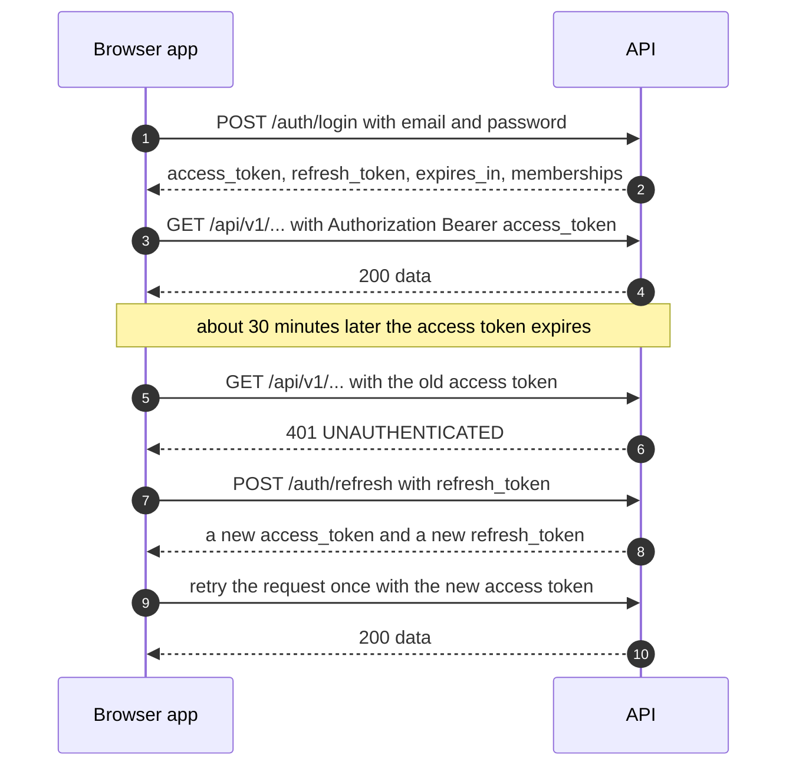
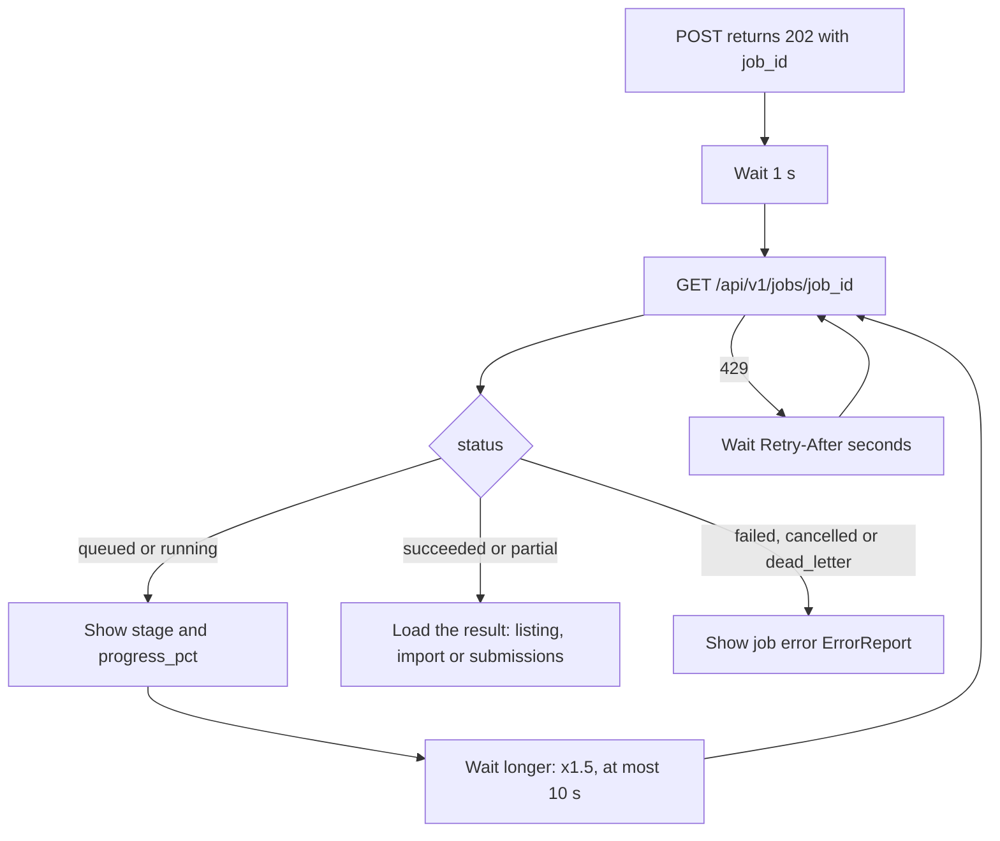
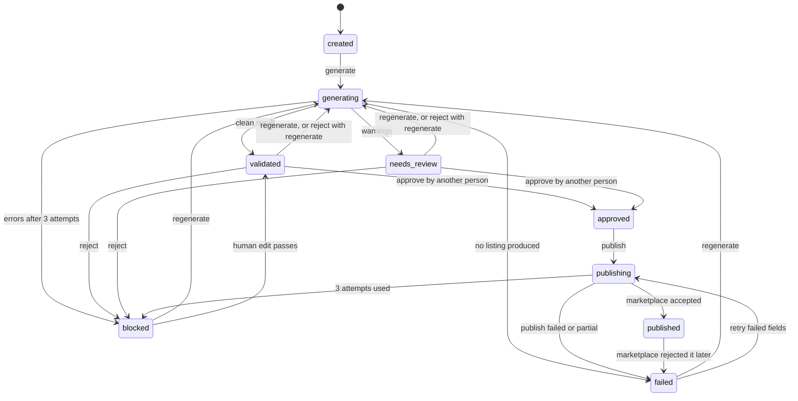
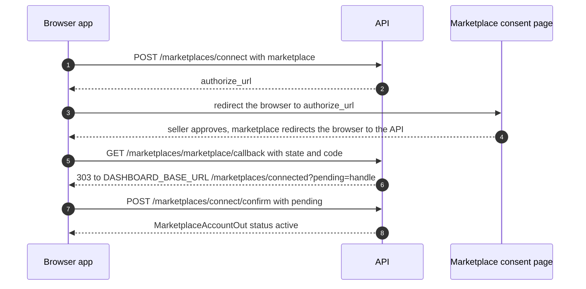

# Frontend integration guide (API v1)

This guide is for the web team. It explains how the dashboard talks to the AI Marketplace OS
backend: where the API lives, how to sign in, how errors and retries work, and which endpoints each
screen uses. You do not need to read the backend code to follow it.

The contract is the OpenAPI file `packages/schemas/jsonschema/openapi.json` (version **1.1.0**, 50
operations under `/api/v1`, plus `/healthz` and `/readyz`). When this guide and that file disagree,
the file wins. Outside production, the running API also serves it at `/openapi.json` with an
interactive Swagger page at `/docs`.

Related handover docs in this folder: [API-REFERENCE.md](API-REFERENCE.md) (every endpoint), [ARCHITECTURE.md](ARCHITECTURE.md), [DATABASE.md](DATABASE.md), [FLOWS.md](FLOWS.md) and [AI-TEAM-GUIDE.md](AI-TEAM-GUIDE.md).

## Contents

1. [Words used in this guide](#1-words-used-in-this-guide)
2. [Quick start](#2-quick-start)
3. [Auth in the browser](#3-auth-in-the-browser)
4. [CORS](#4-cors)
5. [TypeScript types](#5-typescript-types)
6. [Errors](#6-errors)
7. [Every error code](#7-every-error-code)
8. [Idempotency keys](#8-idempotency-keys)
9. [Editing safely: ETag and If-Match](#9-editing-safely-etag-and-if-match)
10. [Pagination](#10-pagination)
11. [Long work: 202 and job polling](#11-long-work-202-and-job-polling)
12. [Rate limits and caps](#12-rate-limits-and-caps)
13. [File uploads](#13-file-uploads)
14. [Feature flags you can see](#14-feature-flags-you-can-see)
15. [The listing lifecycle](#15-the-listing-lifecycle)
16. [Screen-by-screen endpoint map](#16-screen-by-screen-endpoint-map)
17. [Going live checklist for FE](#17-going-live-checklist-for-fe)

---

## 1. Words used in this guide

| Word | Meaning |
|---|---|
| **Tenant** | One brand (a customer company). Every row in the database belongs to one tenant. A user can be a member of several tenants, but a token is always for exactly one. |
| **Member / role** | A user's membership in a tenant, with one role: `owner`, `admin`, `operator` or `reviewer`. |
| **Product** | One sellable item with its facts (SKU, title, category, attributes, prices). |
| **Family / variant** | A style (the parent, for example one kurta design) with child products per size and colour (the variants). |
| **Listing** | The content we sell one product (or one family) with on one marketplace. One product has at most one listing per marketplace. |
| **Listing version** | A frozen copy of a listing's content. Every generation or human edit makes a new version. The listing points at its `current_version_id`. |
| **Maker-checker** | A safety rule: whoever generated or edited a version cannot approve it. A different person must. |
| **Marketplace account** | A connected seller account on Amazon or Flipkart (OAuth). Publishing needs one. |
| **Job (job run)** | Background work (generate, publish, import, image check, brand embedding, status sync). The API answers `202` and you poll the job. |
| **Rules Engine** | Plain backend code (no AI) that checks a listing against the marketplace's and the brand's rules. Its verdict is final: the AI cannot overrule it. |
| **Category template** | The list of attributes one marketplace category needs (required, optional, allowed values). Generation needs a current template for the product's category. |
| **Validation report** | The Rules Engine's verdict on a listing version: a list of errors (blocking) and warnings. |
| **Issue** | A problem the seller must see (from validation, images or the marketplace), with a status (`open`, `dismissed`, ...). |
| **Human task** | A question only a person can answer (for example a missing fabric fact). In v1 tasks can be listed but not answered through the API. |
| **Idempotency key** | A unique string per user action, so a retried request does not run twice. |

## 2. Quick start

### 2.1 Base URLs

| Environment | Base URL | Notes |
|---|---|---|
| Local | `http://localhost:8000` | Port is `API_HOST_PORT` (default 8000). Swagger at `/docs`. |
| Local mock | `http://127.0.0.1:4010` | `make mock`: answers every operation from the OpenAPI examples. No database. |
| Staging | `https://api.staging.<DOMAIN>` | Placeholder until the GCP rollout. Swagger at `/docs`. |
| Production | `https://api.<DOMAIN>` | Placeholder until the GCP rollout. No `/docs` or `/openapi.json` in production. |

Every route is under `/api/v1`, except the two health probes:

- `GET /healthz`: the process is up (no database).
- `GET /readyz`: the API can reach the database; `503` when it cannot.

Keep the base URL in one config value (for example `VITE_API_BASE_URL`), so going live is one change.

### 2.2 Run the backend on your machine

You need Docker, `uv` and Python 3.13. In the backend repository:

```sh
cp .env.example .env
make dev      # starts Postgres and MinIO, migrates, then serves the API on 127.0.0.1:8000 (leave it running)
make seed     # in a second terminal: loads the demo tenants, users and products
make worker   # in a third terminal: runs background jobs (generation, publish, imports, images)
```

Without `make worker`, every `202` job stays `queued`. Note: `make worker` reads only `.env`; it
does not get the fake-marketplace settings that `make dev` adds. For local publish or Flipkart
tests, start the worker with the same variables (`FAKE_MARKETPLACE_ENV` in the `Makefile`), as
`make e2e` does. `make dev` also points the marketplace
settings at a local fake marketplace and switches Flipkart on, so you can test connect and publish
without real seller accounts. Run `make fake-marketplace` in another terminal when you test the
connect or publish flows.

Other useful commands:

- `make mock`: the mock server on `127.0.0.1:4010`. Send `Prefer: code=409` (any declared status)
  to get that operation's declared error example. The mock sends **no CORS headers**, so call it
  through your dev server's proxy (for example Vite `server.proxy`) or from tests, not straight from
  the browser.
- `make e2e`: runs the end-to-end scripts in `scripts/e2e/` against your local API (all of them
  except `onboarding.sh` and `acceptance.sh`, which are run on their own). It starts its own fake
  marketplace. These scripts are the best real examples of request order (for example
  `scripts/e2e/publish_flow.sh`).

The local generation uses a stand-in AI pipeline (the "stub"). It returns fixed content instantly.
You can steer it from the generate request's `user_instructions` field: `stub:blocked` (fails the
rules 3 times and ends `blocked`), `stub:failed` (no listing), `stub:warnings` (ends
`needs_review` for acme, whose demo rule flags the word), `stub:vision_warn`. Anything else is a clean run.

### 2.3 Demo users and data (local only)

`make seed` refuses to run anywhere but `APP_ENV=local`. Every seed user's password is the
local-only `devpassword123`. Never use it anywhere else.

| Tenant slug | Tenant name | Users (one per role) |
|---|---|---|
| `acme` | Acme Apparel | `owner@acme.test`, `admin@acme.test`, `operator@acme.test`, `reviewer@acme.test` |
| `bharat` | Bharat Home | `owner@bharat.test`, `admin@bharat.test`, `operator@bharat.test`, `reviewer@bharat.test` |

What else the seed creates:

- Products `KURTA-001`, `KURTA-002` and `DECOR-001` in both tenants, plus `ACME-900` (acme) and
  `BH-900` (bharat).
- For acme: a demo listing on `KURTA-001`, a kurta family `KURTA-FAM-01` (2 sizes x 2 colours)
  with an Amazon listing, and Flipkart demo listings.
- The category `ethnic_wear_kurta_sets` has current Amazon and Flipkart templates. Use it for new products you want to
  generate and publish. A generate request for a category with no current template is refused at
  once with 422 `VALIDATION_FAILED` on `category`.
- Each seed user belongs to one tenant only. To test the tenant switcher, add a user to the second
  tenant with the staff CLI:
  `uv run python -m app.cli tenant add-member --slug bharat --email owner@acme.test --role reviewer --staff-email dev@local`.

Tenants and their first owner are created by staff (`app.cli tenant create`). There is no sign-up
or invite endpoint in v1.

## 3. Auth in the browser

### 3.1 How it works



How to read it: login returns two tokens. The short-lived access token goes on every call. When a
call answers 401, the app swaps the refresh token for a new pair (steps 7-8) and retries the failed
call once. If the refresh itself answers 401, the session is over: send the user to the login page.

The facts:

| Item | Value |
|---|---|
| Login | `POST /api/v1/auth/login` `{email, password}` → `TokenResponse {access_token, refresh_token, token_type: "bearer", expires_in, memberships[]}`. Every failure is the same 401. |
| Access token | A JWT, about 30 minutes (`expires_in` is in seconds). Send `Authorization: Bearer <ACCESS_TOKEN>`. |
| Refresh token | About 14 days. `POST /api/v1/auth/refresh` `{refresh_token}` returns a **new pair**. The old refresh token is now used up. |
| Refresh reuse | Using an already-rotated refresh token again revokes the whole chain (the user is logged out everywhere for that session). So **refresh one at a time**: never two refreshes in parallel. |
| Logout | `POST /api/v1/auth/logout` `{refresh_token}` → always 204. An access token already issued stays valid until it expires, so also drop it from memory. |
| Who am I | `GET /api/v1/auth/me` → `{user_id, email, display_name, tenant_id, role, memberships[]}`. |
| Active tenant | The tenant comes only from the token. No route takes a `tenant_id`. Login picks the most recently used tenant. |
| Switch tenant | `POST /api/v1/auth/switch-tenant` `{target_tenant_id}` → a new `TokenResponse` for that tenant (404 if the user is not an active member). Replace both tokens and clear every cached query. |
| Another tenant's object | Always 404, never 403, so the UI cannot tell it exists. |

### 3.2 Where to keep tokens

The API uses bearer tokens, not cookies (CORS credentials are off). Recommended:

- Keep the **access token in memory** only (a module variable or your state store), never in
  `localStorage`.
- Keep the **refresh token** in `sessionStorage` (cleared when the tab closes) or, if "stay signed
  in" is needed, `localStorage`. Either is readable by any script on the page, so protect the app
  against XSS: a strict Content-Security-Policy, no `dangerouslySetInnerHTML` with API text, and no
  third-party scripts on authenticated pages.
- On page load, if a refresh token exists, call `/auth/refresh` once to get a fresh pair.

### 3.3 A single-flight refresh

```ts
let accessToken: string | null = null;
let refreshing: Promise<boolean> | null = null;

async function refreshOnce(): Promise<boolean> {
  // Every caller that hits a 401 waits on the same promise: one refresh at a time.
  refreshing ??= (async () => {
    const refresh = sessionStorage.getItem("mkos.refresh");
    if (!refresh) return false;
    const res = await fetch(`${API}/api/v1/auth/refresh`, {
      method: "POST",
      headers: { "Content-Type": "application/json" },
      body: JSON.stringify({ refresh_token: refresh }),
    });
    if (!res.ok) {
      sessionStorage.removeItem("mkos.refresh");
      accessToken = null;
      return false;
    }
    const pair = await res.json();
    accessToken = pair.access_token;
    sessionStorage.setItem("mkos.refresh", pair.refresh_token);
    return true;
  })().finally(() => { refreshing = null; });
  return refreshing;
}

export async function api(path: string, init: RequestInit = {}, retried = false): Promise<Response> {
  const headers = new Headers(init.headers);
  if (accessToken) headers.set("Authorization", `Bearer ${accessToken}`);
  const res = await fetch(`${API}${path}`, { ...init, headers });
  if (res.status === 401 && !retried && (await refreshOnce())) {
    return api(path, init, true); // retry once with the new token
  }
  if (res.status === 401) redirectToLogin();
  return res;
}
```

### 3.4 Roles and what they may do

The API checks every action. Use the same table to hide or disable buttons, but always handle the
403 anyway.

| Action (`x-mkos-action` in openapi.json) | owner | admin | operator | reviewer |
|---|---|---|---|---|
| `tenant:read` (read anything in the tenant) | yes | yes | yes | yes |
| `analytics:read` | yes | yes | yes | yes |
| `product:import` (create products, CSV, images) | yes | | yes | |
| `listing:generate` (generate, cancel a job) | yes | | yes | |
| `listing:regenerate` | yes | | yes | yes |
| `listing:edit` (edit content, validate, rules dry-run) | yes | | yes | |
| `listing:approve` (approve, reject, dismiss an issue) | yes | | | yes |
| `listing:publish` (publish, retry fields, refresh status) | yes | | yes | |
| `marketplace:connect` | yes | yes | | |
| `team:manage` (members) | yes | yes | | |
| `settings:manage` (brand profile, brand documents) | yes | yes | | |

The role comes from the membership row on every request, so a role change takes effect at once,
even on an old token.

## 4. CORS

- The browser may call the API only from origins listed in the backend env var
  **`ALLOWED_ORIGINS`** (comma-separated exact origins, for example
  `https://app.<DOMAIN>,https://app-staging.<DOMAIN>`). The local default is
  `http://localhost:3000`. If your dev server runs elsewhere (Vite's default is
  `http://localhost:5173`), add it to `ALLOWED_ORIGINS` in the backend `.env` and restart `make dev`.
  For the local marketplace connect flow, also set `DASHBOARD_BASE_URL` to the same origin (see the
  last bullet).
- Outside local, the API refuses to boot with `*`, `http://`, a loopback host, a path or a trailing
  slash in `ALLOWED_ORIGINS`.
- Credentials are off. Never set `credentials: "include"`.
- Allowed request headers: `Authorization`, `Content-Type`, `Idempotency-Key`, `If-Match`,
  `X-Request-ID`. Methods: `GET`, `POST`, `PATCH`, `DELETE`.
- Exposed response headers (readable from JS): `ETag`, `Retry-After`, `Location`, `X-Request-ID`.
- A related env var, **`DASHBOARD_BASE_URL`**, is the dashboard origin the marketplace OAuth
  callback redirects to (`{DASHBOARD_BASE_URL}/marketplaces/connected?pending=<handle>`). It must
  match your deployed app origin.

## 5. TypeScript types

The contract ships as an npm package with generated types for every request and response.

```json
"@mkos/schemas": "npm:@maniacultasset/schemas@1.1.0"
```

- It is on GitHub Packages (`@maniacultasset` scope). Your `.npmrc` needs
  `@maniacultasset:registry=https://npm.pkg.github.com` and a token with `read:packages`.
- **Version note:** `schemas-v1.0.0` is tagged; **1.1.0 is not tagged yet** (its CHANGELOG heading is
  still "unreleased"). 1.1.0 adds review, issues, tasks, preview, publish, submissions and
  analytics. Until it is tagged, copy `packages/schemas/ts/src/*.ts` from the backend repo, or point
  your build at that folder. Then switch to the package.
- The package has three files: `api.d.ts` (from `openapi.json`: `paths`, `components`,
  `operations`), `contracts.d.ts` (shared JSON Schemas: `ErrorCode`, `ListingStatus`,
  `CanonicalListing`, ...) and `index.ts` (re-exports both). They are types only: no runtime code.
- Never hand-write a type the package already has. Changes are listed in
  `packages/schemas/CHANGELOG.md`.

### 5.1 Using the types with plain fetch

```ts
import type { components, operations, paths } from "@mkos/schemas";

type Schemas = components["schemas"];
export type ListingDetail = Schemas["ListingDetail"];
export type ErrorEnvelope = Schemas["ErrorEnvelope"];

// The JSON body of an operation's response for a status.
type Ok<Op extends keyof operations, S extends keyof operations[Op]["responses"]> =
  operations[Op]["responses"][S] extends { content: { "application/json": infer B } } ? B : never;

export async function getListing(id: string): Promise<Ok<"listings_get", 200>> {
  const res = await api(`/api/v1/listings/${id}`);
  if (!res.ok) throw await toApiError(res);
  return res.json();
}

// A request body type, by path and method.
type GenerateBody =
  paths["/api/v1/listings/generate"]["post"]["requestBody"]["content"]["application/json"];
```

One quirk: the generated request types mark a field that has a default as required (for example
`force_regenerate: boolean` on `GenerateListingRequest`). The API accepts the request without it.
Either send the default (`force_regenerate: false`) or use `Partial<...>` for those fields.

### 5.2 Using the types with a typed fetch client

If the app already uses a client that reads openapi-typescript `paths` (for example
`openapi-fetch`), pass `paths` as its type parameter. No backend change is needed:

```ts
import type { paths } from "@mkos/schemas";
// const client = createClient<paths>({ baseUrl: API });
// const { data, error } = await client.GET("/api/v1/listings/{listing_id}", {
//   params: { path: { listing_id: id } },
// });
```

## 6. Errors

Every non-2xx answer has one shape, the **error envelope**:

```json
{
  "error": {
    "type": "STALE_VERSION",
    "message": "The request conflicts with the current state.",
    "status": 409,
    "correlation_id": "req-example-0001",
    "details": null,
    "error_report": {
      "schema_version": "1.1.0",
      "status": "failed",
      "error_code": "STALE_VERSION",
      "retryable": false,
      "attempts_used": 0,
      "max_attempts": 3,
      "errors": [
        {
          "field": "request",
          "error_code": "STALE_VERSION",
          "severity": "error",
          "message": "The request conflicts with the current state.",
          "source": "system",
          "retryable": false,
          "auto_fixable": false
        }
      ],
      "request_id": "req-example-0001"
    }
  }
}
```

How to use it:

- `type` is the machine code: branch on it (table in section 7). `status` repeats the HTTP status.
- `message` is safe to show. It never echoes what the user typed.
- `details` is set on a 422: a list of `{loc, msg}`, for example `{"loc": ["body", "sku"], "msg": "..."}`.
  Use `loc` to put the message next to the right form field.
- `correlation_id` equals the request id. Log it and show it in a "copy error id" link, so support
  can find the request. You may send your own `X-Request-ID` header (1-128 characters from
  `A-Z a-z 0-9 . _ : -`); the API echoes it, or mints a new id when yours does not fit.
- `error_report` is the shared `ErrorReport`: the same shape used for validation results, import
  rows, job errors and marketplace errors. Write one renderer for it and reuse it everywhere.

**Batch answers are different.** `POST /listings/approve` (200) and `POST /listings/publish` (202)
take up to 200 items and answer per item: `BatchResult.items[]` each have `http_status`,
`listing_status`, `job_id` and `error` (an `ErrorReport`). The whole request succeeds even if some
items fail. Show each item's result; read the message from `item.error.errors[0].message`.

**Rules failures are not HTTP errors.** `POST /listings/validate` answers 200 with
`passed: false` and the findings. Generation that ends `blocked` is a job that `succeeded`, with the
findings on the listing's `validation`.

## 7. Every error code

This table covers all 76 codes in `ErrorCode` (`packages/schemas/src/mkos_schemas/codes.py`).
"Where you see it" tells you whether it arrives as the envelope's HTTP status, as one item in a
batch answer, or inside an `ErrorReport` (a job's `error`, a validation report, an import row, a
submission). The retry class comes from the code registry:

- `auto_retry`: a temporary fault; the system (or you, after `Retry-After`) may retry as is.
- `ai_correct`: a content problem the AI can fix by regenerating.
- `user_action`: a person must change something first.
- `system_failure`: our fault or a switched-off feature; retrying the same request will not help.

Codes marked "reserved" exist in the contract but no v1 code path sends them today. Handle them by
their retry class.

#### Request and auth

| Code | HTTP status / where you see it | Retry class | What the UI should do |
|---|---|---|---|
| `VALIDATION_FAILED` | 400, 422 (envelope); also a report summary | `user_action` | Malformed body or bad field. Show `details[].loc`/`msg` next to the fields. As a report summary it means checks failed; show the items. |
| `UNAUTHENTICATED` | 401 | `user_action` | Refresh once with the refresh token, then retry. If refresh is also 401, go to login. |
| `PERMISSION_DENIED` | 403 | `user_action` | The role cannot do this. Hide or disable the action for this role. |
| `NOT_FOUND` | 404 (envelope or batch item) | `user_action` | Missing, or another tenant's object. Show "not found" and refresh the list. |
| `METHOD_NOT_ALLOWED` | 405 | `user_action` | A client bug (wrong verb). Log it. |
| `IDEMPOTENCY_KEY_REUSED` | 409 | `user_action` | A client bug: the same key was sent with a different body. Make a new key for a new action. |
| `STALE_VERSION` | 409 (envelope or batch item) | `user_action` | Someone changed it first. Re-read (new `ETag` / `current_version_id`), show the new data, let the user redo the change. |
| `PAYLOAD_TOO_LARGE` | 413 | `user_action` | The request is over 10 MiB. Ask for a smaller file. |
| `RATE_LIMITED` | 429; also a marketplace error item | `auto_retry` | Wait `Retry-After` seconds, then retry. Do not retry in a tight loop. |
| `NOT_IMPLEMENTED` | 501 (envelope or batch item) | `system_failure` | The feature is switched off here (Flipkart while `FLIPKART_ENABLED=false`, or a marketplace not configured). Show the `message`. |
| `INTERNAL_ERROR` | 500; also a job `error` | `system_failure` | Show a generic error with the `correlation_id` so support can find it. |
| `OAUTH_STATE_INVALID` | 409 | `user_action` | The connect link expired or was used. Start the connect flow again. |
| `LAST_OWNER_REQUIRED` | 409 | `user_action` | The tenant must keep one active owner. Explain and block the change. |
| `MARKETPLACE_ACCOUNT_CONFLICT` | 409 | `user_action` | This seller account is already connected elsewhere. Show the message; no retry. |

#### Products, facts and import

| Code | HTTP status / where you see it | Retry class | What the UI should do |
|---|---|---|---|
| `SKU_CONFLICT` | 409 (product create) | `user_action` | The SKU already exists in this brand. Ask for another SKU or open the existing product. |
| `UNKNOWN_FACT_KEY` | 422 (product create); import row | `user_action` | An attribute key is not in the attribute dictionary. Fix the key (see aliases). |
| `FACT_LEVEL_INVALID` | 422; import row | `user_action` | The fact is set at a level it does not belong to (for example a variant-only key on a style). Fix the data. |
| `FACT_SOURCE_FORBIDDEN` | 422; import row | `user_action` | The fact's source is not allowed for this key (a critical fact cannot come from AI). Ask the seller to enter it. |
| `IMPORT_FAILED` | 422 (CSV upload); job `error` | `user_action` | The file or header is wrong. Show `error_report.errors` (field `file.header` or `file.row`). |
| `DUPLICATE_SKU_IN_FILE` | import row | `user_action` | The same SKU is twice in the file. Fix the CSV. |
| `HEADER_DUPLICATE_COLUMN` | import file report (422) | `user_action` | A column appears twice. Fix the CSV header. |
| `HEADER_MISSING_COLUMN` | import file report (422) | `user_action` | A required column is missing (`seller_sku`, `product_name`, `category`). Fix the header. |
| `HEADER_UNKNOWN_COLUMN` | import file report (422) | `user_action` | An unknown column. Rename it or remove it. |
| `REQUIRED_FIELD_MISSING` | import row; preview report | `user_action` | A required cell or field is empty. Show the row and column. |
| `IDENTIFIER_INVALID` | import row; marketplace error | `user_action` | The barcode or identifier is invalid. Fix it. |
| `IDENTIFIER_MISSING` | reserved | `user_action` | Not sent by v1 code; may come from a rules pack row or the marketplace error map. Treat it like its retry class says. |
| `IDENTIFIER_DUPLICATE` | reserved | `user_action` | Not sent by v1 code; may come from a rules pack row or the marketplace error map. Treat it like its retry class says. |
| `PRICE_ABOVE_MRP` | import row | `user_action` | The selling price is above MRP. Fix the prices. |
| `VARIATION_INVALID` | import row; preview report; marketplace error | `user_action` | The variant family is not valid. Fix the sizes or colours. |
| `VARIANT_MATRIX_INCOMPLETE` | database check on family writes | `user_action` | The size/colour grid has gaps. Fill the missing cells. |
| `CRITICAL_FACT_MISSING` | reserved | `user_action` | Not sent by v1 code; may come from a rules pack row or the marketplace error map. Treat it like its retry class says. |
| `FACT_NEEDS_CONFIRMATION` | reserved | `user_action` | Not sent by v1 code; may come from a rules pack row or the marketplace error map. Treat it like its retry class says. |
| `FACT_MISMATCH` | reserved | `ai_correct` | Not sent by v1 code; may come from a rules pack row or the marketplace error map. Treat it like its retry class says. |

#### Listing workflow (generate, edit, approve)

| Code | HTTP status / where you see it | Retry class | What the UI should do |
|---|---|---|---|
| `INVALID_STATUS_TRANSITION` | 409 (envelope or batch item) | `user_action` | The object is not in a state that allows this action. Re-read its status and refresh the buttons. |
| `LISTING_BUSY` | 409 (envelope or batch item) | `user_action` | The listing is generating or publishing. Wait for the job, then retry. |
| `LISTING_PAUSED` | 409 (envelope or batch item) | `user_action` | The listing is paused. No action until it is resumed. |
| `LISTING_ARCHIVED` | 409 (envelope or batch item) | `user_action` | The listing is archived. Read-only. |
| `MAKER_CHECKER_VIOLATION` | 403 (approve batch item) | `user_action` | The user generated or edited this version, so they cannot approve it. Ask another reviewer or owner. |
| `BULK_APPROVE_REQUIRES_VALIDATED` | 409 (approve batch item) | `user_action` | A multi-item approve takes only `validated` listings. Approve `needs_review` ones one at a time. |
| `BATCH_TOO_LARGE` | not sent in v1 | `user_action` | A list over 200 items is refused as 422 `VALIDATION_FAILED` instead. Send at most 200 items. |
| `BUDGET_EXCEEDED` | 429 (generate, regenerate); approve batch item 429 (reject with `regenerate: true`); job `error` | `system_failure` | The daily AI budget is used up. Show it and honour `Retry-After`; try tomorrow. |
| `IMAGE_NON_COMPLIANT` | 422 (approve batch item); image report; publish job `error` | `user_action` | An image blocks approval. Open the image report and replace the image. |
| `CATEGORY_NOT_MAPPED` | preview report; import row; generation job `error` (rare: the generate request already refuses a category with no template, as 422 `VALIDATION_FAILED`) | `system_failure` | No template for this category and marketplace. Pick a supported category, or ask support to load the template. |
| `GENERATION_FAILED` | generation job `error` | `user_action` | The AI produced no listing. Offer "Regenerate". |

#### Rules Engine findings (inside a validation report)

| Code | HTTP status / where you see it | Retry class | What the UI should do |
|---|---|---|---|
| `SCHEMA_INVALID` | reserved | `ai_correct` | Not sent by v1 backend code (a result that does not fit the schema fails the job with `INTERNAL_ERROR` instead). Treat it like its retry class says. |
| `BANNED_TERM` | validation report; issue | `ai_correct` | Highlight the term in the field. Edit or regenerate. |
| `FIELD_TOO_LONG` | validation report; issue; import row | `ai_correct` | Show the limit next to the field. Edit or regenerate. |
| `FIELD_TOO_SHORT` | validation report; issue | `ai_correct` | Show the minimum next to the field. Edit or regenerate. |
| `PATTERN_MISMATCH` | validation report; issue; import row | `ai_correct` | The value has the wrong format. Show the suggestion. |
| `CROSS_FIELD_MISMATCH` | validation report; issue; import row | `user_action` | Two fields disagree. Show both fields. |
| `VALUE_NOT_ALLOWED` | validation report; preview report; import row | `user_action` | The value is not in the allowed list. Offer the allowed values. |
| `MISSING_ATTRIBUTE` | validation report; preview report | `user_action` | A required attribute is empty. Ask the user to fill it. |
| `UNSUPPORTED_CLAIM` | validation report; issue | `ai_correct` | A claim needs proof the product data lacks. Remove the claim or add the attribute. |
| `KEYWORD_DUPLICATE` | reserved | `ai_correct` | Not sent by v1 code; may come from a rules pack row or the marketplace error map. Treat it like its retry class says. |
| `BYTE_BUDGET_EXCEEDED` | reserved | `ai_correct` | Not sent by v1 code; may come from a rules pack row or the marketplace error map. Treat it like its retry class says. |
| `CATEGORY_MISMATCH` | reserved | `user_action` | Not sent by v1 code; may come from a rules pack row or the marketplace error map. Treat it like its retry class says. |
| `COMPLIANCE_DECLARATION_MISSING` | reserved | `user_action` | Not sent by v1 code; may come from a rules pack row or the marketplace error map. Treat it like its retry class says. |

#### Publish and marketplace

| Code | HTTP status / where you see it | Retry class | What the UI should do |
|---|---|---|---|
| `DUPLICATE_SUBMISSION_BLOCKED` | 409 (retry-fields) | `user_action` | Nothing changed since the last failed attempt. Edit the listing or fix the account first. |
| `SUBMISSION_ATTEMPTS_EXHAUSTED` | 409 (retry-fields) | `user_action` | This version was sent 3 times. Edit or regenerate to get a new version. |
| `SUBMISSION_IN_FLIGHT` | 409 (publish batch item); job `error` | `user_action` | A submission is still open. Wait and refresh the status. |
| `AUTH_EXPIRED` | 409 (publish item, retry-fields); marketplace error | `user_action` | No live marketplace account. Send the user to Marketplace connections to connect or reconnect. |
| `FACTS_CHANGED_SINCE_APPROVAL` | publish job `error` | `user_action` | Product facts changed after approval. Re-validate and approve again. |
| `PUBLISH_FAILED` | publish job `error`; submission `error` | `user_action` | Show the per-field errors from the submissions page; offer retry-fields when allowed. |
| `API_REJECTED_PARTIAL` | submission `error` | `user_action` | Some fields were rejected. Show them and offer retry-fields. |
| `SUBMISSION_NOT_APPLIED` | submission / job `error` | `auto_retry` | The marketplace did not apply the change. The system retries; refresh the status later. |
| `ACCOUNT_PERMISSION_DENIED` | marketplace error | `user_action` | The seller account lacks a permission. The owner must fix it in the seller console, then reconnect. |
| `SELLER_SKU_CONFLICT` | marketplace error | `user_action` | The SKU clashes on the marketplace. Change the SKU or fix it in the seller console. |
| `MARKETPLACE_UNAVAILABLE` | 503 (OAuth callback); marketplace error | `auto_retry` | The marketplace is down. Retry later. |
| `MARKETPLACE_UNKNOWN_ERROR` | 502 (OAuth callback); marketplace error | `user_action` | The marketplace answered oddly. Retry later; quote the `correlation_id` if it repeats. |
| `MARKETPLACE_UNCONFIRMED` | status-sync result | `auto_retry` | The marketplace has not confirmed yet. Keep showing "Submitted"; refresh later. |

#### Jobs and AI internals

| Code | HTTP status / where you see it | Retry class | What the UI should do |
|---|---|---|---|
| `JOB_TIMEOUT` | job `error` | `system_failure` | The job ran too long. Offer a retry (regenerate, re-upload, etc.). |
| `RETRY_EXHAUSTED` | job `error` | `system_failure` | The system retried and gave up. Offer a manual retry; quote the `correlation_id`. |
| `MODEL_UNAVAILABLE` | job `error` (rare); agent runs | `auto_retry` | The AI provider is down. Retry later. |
| `TIMEOUT` | job `error`; import row; agent runs | `auto_retry` | A call timed out. Retry. |
| `JSON_INVALID` | agent runs only | `auto_retry` | Internal to the AI pipeline. Nothing to show. |
| `TOKEN_LIMIT` | agent runs only | `auto_retry` | Internal to the AI pipeline. Nothing to show. |

## 8. Idempotency keys

A network error does not tell you whether the server did the work. Idempotency keys make retries
safe.

- These 12 operations **require** an `Idempotency-Key` header (a missing one is 422):
  `products_bulk`, `imports_rows_retry`, `brand_documents_upload`, `images_upload`,
  `listings_generate`, `listings_regenerate`, `listings_approve`, `listings_publish`,
  `listings_retry_fields`, `listings_refresh_status`, `issues_dismiss`, `jobs_cancel`.
- Make **one new key per user action** (one click of "Generate"), for example
  `crypto.randomUUID()`. Keep it with the pending action and **reuse the same key when you retry**
  that action after a timeout or network error.
- Same key and same body within 24 hours: the API replays the first answer (same `job_id`); nothing
  runs twice.
- Same key with a different body (or from another user, or on another endpoint): 409
  `IDEMPOTENCY_KEY_REUSED`. That is a client bug.
- If the first request failed with an error (a 409, a 429, a 5xx), nothing is stored under the key,
  so the retry with the same key runs again. Only a success (and a few 422 answers) is replayed.
- Format: 1-255 visible ASCII characters. Keys are per tenant.
- `POST /products` takes no key: a repeat with the same SKU answers 409 `SKU_CONFLICT`.

```ts
async function generate(productId: string, marketplace: "amazon" | "flipkart", key = crypto.randomUUID()) {
  const res = await api("/api/v1/listings/generate", {
    method: "POST",
    headers: { "Content-Type": "application/json", "Idempotency-Key": key },
    body: JSON.stringify({ product_id: productId, marketplace }),
  });
  return { res, key }; // on a network error, call generate(productId, marketplace, key) again
}
```

## 9. Editing safely: ETag and If-Match

Two people may edit the same thing. The API uses optimistic locking so the second save does not
silently overwrite the first.

| Resource | Read (gives `ETag`) | Write (needs `If-Match`) |
|---|---|---|
| Brand profile | `GET /tenants/me` | `PATCH /tenants/me` |
| Listing content | `GET /listings/{listing_id}` (the `ETag` is the quoted `current_version_id`) | `PATCH /listings/{listing_id}/content` |

The pattern:

1. Read the resource and keep the `ETag` response header (it is exposed to cross-origin JS).
2. On save, send it back unchanged: `If-Match: "<etag value>"` (keep the quotes).
3. 200: save the new `ETag` from the response.
4. 409 `STALE_VERSION`: someone saved first. Re-read, show the new data, and let the user redo
   their change. Do not retry blindly.

A listing content edit creates a new version, re-runs the rules at once, and the editor can no
longer approve that version (maker-checker). Approve and publish items also take
`listing_version_id`; a version that is no longer current is an item 409 `STALE_VERSION`, so you
always approve or publish exactly what the user reviewed.

## 10. Pagination

Every list answers:

```json
{ "data": [ ... ], "page": { "next_cursor": "opaque-string-or-null", "has_more": true, "limit": 50 } }
```

- Pass `limit` (1-200, default 50) and `cursor` (the previous page's `next_cursor`).
- There are no page numbers or totals. Build "Load more" or infinite scroll, not numbered pages.
- Treat the cursor as opaque. Keep the same filters when you pass it.
- Order: newest first, except the review queue (`GET /listings?status=validated` or
  `status=needs_review`), which is oldest first.

## 11. Long work: 202 and job polling

Generate, regenerate, publish, retry-fields, refresh-status, CSV import, row retry, image upload
and brand document upload answer **202** with a job:

```json
{ "job_id": "...", "listing_id": "...", "status": "queued", "estimated_duration_seconds": 30, "poll_url": "/api/v1/jobs/..." }
```

That is `JobAccepted`. The CSV upload answers `ImportAccepted` (adds `import_id`), the image upload
`ImageAccepted` (adds `image_id`), and publish answers `BatchAccepted`: a `poll_url` plus one item
per listing, each with its own `job_id` (or its own error).



How to read it: poll the job until its status is terminal. Start at 1 s and back off to 10 s, so a
tab does not burn the tenant's rate limit. On a terminal status, load the result.

- Job statuses: `queued`, `running`, then one of `succeeded`, `partial`, `failed`, `cancelled`,
  `dead_letter`.
- `stage` shows the AI pipeline step while generating (`load_context`, `retrieve_brand`,
  `content_agent`, ..., `validate_rules`, `correct`, `quality_check`). Use it for a progress label.
- Where the result is: a generation job has `listing_id`: read `GET /listings/{listing_id}`. An
  import job's `result_url` is `/api/v1/imports/{import_id}`. A publish or status-sync job's
  `result_url` is `/api/v1/listings/{listing_id}/submissions`.
- A job that `succeeded` is not always a happy listing: generation that ended `blocked` still
  `succeeded`. Always read the listing's `status`.
- Stop polling after a sane limit (generation has a 300 s job timeout; publish 600 s; import
  1,800 s) and offer "check again".
- `POST /jobs/{job_id}/cancel` cancels only a `queued` job; a running or finished one is 409
  `INVALID_STATUS_TRANSITION`.
- For a list screen, poll `GET /listings/{listing_id}/status` (small) instead of each job.

## 12. Rate limits and caps

Every 429 carries `Retry-After` (whole seconds, at least 1). Honour it.

| Limit | Value | Scope |
|---|---|---|
| Authenticated requests | 120 per minute | **per tenant**: every member and every open tab share it |
| Public routes (login, refresh, logout, OAuth callback) | 60 per minute | per client IP |
| Login attempts | 5 per minute | per IP and email |
| Analytics requests in flight | 2 at a time | per tenant |
| Refresh-status | once per 5 minutes | per listing |
| Live CSV imports | 2 at a time | per tenant |
| Live image check jobs | 20 at a time | per tenant |
| Images | 50 live images | per product |
| Brand documents | 50 live documents, 2 processing at a time, 20,000 chunks in all | per tenant |
| AI budget | a daily USD cap | per tenant (429 `BUDGET_EXCEEDED`) |
| Request body | 10 MiB | every request (413) |

The per-tenant limit is the one to design for: poll with backoff, avoid polling hidden tabs
(`document.visibilityState`), and do not fire one request per row in a big table.

## 13. File uploads

| Upload | Endpoint | Rules from the code |
|---|---|---|
| CSV products | `POST /products/bulk`, multipart field `file`, `Idempotency-Key` | UTF-8 (a BOM is allowed); at most 10,000 data rows; at most 256 columns; a cell at most 5,000 characters; the whole request at most 10 MiB. Required columns: `seller_sku`, `product_name`, `category`. Aliases accepted: `parent_sku`, `mrp_inr`, `price_inr`, `weight_grams`, `package_weight_g`. A header or file problem is 422 `IMPORT_FAILED` with the report in `error_report`. |
| Product image (direct) | `POST /images/upload`, multipart: `product_id`, `slot`, `file`, optional `colourway_id`; `Idempotency-Key` | At most 10 MiB. Slots: `main`, `secondary`, `lifestyle`, `size_chart`, `packaging_label` (`packaging_label` is never published). |
| Product image (signed URL) | `POST /images/upload-url` `{product_id, slot, content_type, bytes}` then `PUT` the file to `upload_url` with every header in `headers`, then `POST /images/upload` with `storage_key` instead of `file` | `content_type` is `image/jpeg`, `image/png` or `image/webp`; `bytes` 1 to 10,485,760. The URL is valid for 15 minutes (`expires_at`). It creates the object once and never overwrites it. Register the key within 23 hours. |
| Brand document | `POST /brand/documents`, multipart `file` and optional `type` (`tone_rule` default, `glossary`, `compliance`); `Idempotency-Key` | `.txt` or `.md`, UTF-8, under 10 MiB (the request cap includes the form overhead). Owner or admin only. |

After an upload:

- CSV: poll the job, then `GET /imports/{import_id}` (totals and per-row results) and
  `GET /imports/{import_id}/rows?status=failed`. Fix the file or retry only the failed rows with
  `POST /imports/{import_id}/rows/retry`.
- Image: poll the job, then `GET /images/{image_id}/report`: `compliance_status`
  (`pending`, `passed`, `failed`) and one `ImageReport` per marketplace with each check and issue.
- Brand document: `GET /brand/documents` shows its `status` and `chunk_count`.

Do not set `Content-Type` yourself on a multipart `fetch`: pass a `FormData` and let the browser add
the boundary.

## 14. Feature flags you can see

| Flag (backend env) | Default | What the FE sees |
|---|---|---|
| `FLIPKART_ENABLED` | `false` at launch (`make dev` turns it on locally) | When off: `POST /marketplaces/connect`, `/connect/confirm` and the Flipkart callback answer **501 `NOT_IMPLEMENTED`** with the message "Flipkart is not enabled". `POST /listings/{id}/publish/retry-fields` on a Flipkart listing is a 501 envelope. `POST /listings/publish` stays 202, but each Flipkart item is an item `http_status: 501`. Preview, revoke and the accounts list still work. Keep the Flipkart button visible and show the 501 message. |
| Marketplace not configured | n/a | A marketplace whose consent URL is not set answers 501 on connect. |
| Swagger docs | on outside production | `/docs` and `/openapi.json` exist locally and on staging, never on production. |

## 15. The listing lifecycle

Most screens show a listing's `status`. These are the main paths (the full table is in
`docs/architecture/DATABASE.md` §6.1).



How to read it: a listing is generated, checked, approved by a second person, then published.
`blocked` and `failed` always come with a `status_reason` that says why, and the way out is an edit
or a regenerate. A human edit can also land in `validated`, `needs_review` or `blocked`, depending on
the re-check, and an edit or regenerate of an `approved` or `published` listing voids the approval
(it must be approved again). The database refuses any move that is not in its transition table,
so the API answers 409 `INVALID_STATUS_TRANSITION` for a button pressed in the wrong state.

Values to show:

| `status` | `status_reason` values | Show as |
|---|---|---|
| `created` | none | Draft |
| `generating` | none | Generating (show the job `stage`) |
| `validated` | none | Ready for review |
| `needs_review` | none | Ready for review, with warnings |
| `approved` | none | Approved, ready to publish |
| `publishing` | none | Submitting |
| `published` | none | Submitted until `marketplace_state` is `live`, then Live |
| `blocked` | `corrections_exhausted`, `validation_errors`, `rejected`, `human_task_open`, `marketplace_action_required`, `publish_attempts_exhausted` | Needs attention, with the reason |
| `failed` | `generation_failed`, `publish_failed`, `publish_partial`, `marketplace_rejected` | Failed, with the reason |

`marketplace_state` is a separate column: `not_submitted`, `processing`, `pending_review`, `live`,
`partially_live`, `inactive`, `rejected`, `removed`. A `published` listing with
`marketplace_state = processing` means "Submitted", not live. It becomes live only after a status
sync confirms it (`POST /listings/{id}/refresh-status`, or the periodic sync).

## 16. Screen-by-screen endpoint map

All paths are under `/api/v1`. "Key" means the call needs an `Idempotency-Key`.

### Login and session

| Need | Endpoint |
|---|---|
| Sign in | `POST /auth/login` |
| Stay signed in | `POST /auth/refresh` |
| Sign out | `POST /auth/logout` |
| Current user, role and tenants | `GET /auth/me` |
| Tenant switcher | `POST /auth/switch-tenant` |

### Sign-up and approval (ADR-0019)

Three screens. The flow is in FLOWS.md section 2.1b.

| Screen | Need | Endpoint |
|---|---|---|
| Sign-up form | Brand name, owner name, email, password (12+ characters); phone and website optional | `POST /signup` (always 202 `{request_id, status: "pending"}`) |
| Waiting for approval | Show "waiting for approval", or the rejection reason with a "sign up again" button | `POST /signup/status` with email and password: `pending`, `rejected` (+ `reason`) or `approved` |
| Waiting for approval | After a login 401, check whether the person has a sign-up pending | `POST /signup/status` (a 401 here means a real wrong email or password) |
| Admin: sign-up requests | Only when `GET /auth/me` has `is_platform_admin: true` | `GET /admin/signup-requests?status=pending` (keyset pages) |
| Admin: sign-up requests | Approve (optional `trial_days`, default 14) or reject (a `reason` the brand reads) | `POST /admin/signup-requests/{request_id}/approve`, `POST /admin/signup-requests/{request_id}/reject` |

Notes:
- Do not keep the password to poll the status. Ask for it again on the waiting screen, or poll
  only while the form is still in memory.
- After approval the brand logs in normally and lands on the dashboard. Onboarding details go
  through the existing settings screens (`PATCH /tenants/me`, `/brand/documents`). Nothing new
  is needed there.
- Both sign-up calls are limited to 5 a minute (per IP for the form, per IP and email for the
  status). Honour `Retry-After`.

### Dashboard and analytics

| Need | Endpoint |
|---|---|
| Rates and counts | `GET /analytics/summary?from=YYYY-MM-DD&to=YYYY-MM-DD` (`GET /analytics` is an alias). Both dates optional: default is the last 30 UTC days; at most 366 days. |
| Listings per status | `GET /listings?status=...`. This is a list, not a count: v1 has no count endpoint and pages carry no totals. For tile numbers use `counts` from analytics, or show "50+" when `has_more` is true. |
| Open problems | `GET /issues` and `GET /tasks` |

Rates (`approval_rate`, `validation_pass_rate`, `publish_success_rate`) are shares from 0 to 1 and
are `null` when there is no data. `counts` gives the numbers behind each rate; `by_marketplace`
splits them per marketplace.

### Products

| Need | Endpoint |
|---|---|
| Product list | `GET /products` |
| Product detail | `GET /products/{product_id}` |
| Create one product | `POST /products` `{sku, title, category, attributes?}` (201). `category` is required; attribute keys come from the attribute dictionary (`mkos_schemas/data/attribute_dictionary.json`). Do not send `images`: any entry is refused with 404. Add images afterwards with `POST /images/upload`. |
| Its listings | `GET /listings?product_id=...` |

There is no product update or delete endpoint in v1. Fix data by a new CSV import.

### CSV import

| Need | Endpoint |
|---|---|
| Upload the file | `POST /products/bulk` (multipart, key) |
| Progress | `GET /jobs/{job_id}` |
| Summary and rows | `GET /imports/{import_id}` |
| Failed rows only | `GET /imports/{import_id}/rows?status=failed` |
| Retry failed rows | `POST /imports/{import_id}/rows/retry` (key) |

An import creates products only. It does not start generation; the user picks products and clicks
Generate.

### Images

| Need | Endpoint |
|---|---|
| Upload | `POST /images/upload` (multipart, key), or `POST /images/upload-url` and then `POST /images/upload` with `storage_key` |
| Check result | `GET /images/{image_id}/report` |

### Listing editor

| Need | Endpoint |
|---|---|
| Start generation | `POST /listings/generate` `{product_id, marketplace, category?, user_instructions?, force_regenerate?}` (key). If the product already has a listing on that marketplace that is past `created`, this is 409 `INVALID_STATUS_TRANSITION` unless `force_regenerate: true` (or use regenerate). A variant child is 422 on `product_id`: generate the family parent. Owner or operator only. |
| Regenerate with instructions | `POST /listings/{listing_id}/regenerate` `{instructions?}` (key). Owner, operator or reviewer. |
| Load listing, content, validation, `ETag` | `GET /listings/{listing_id}` |
| Save a human edit | `PATCH /listings/{listing_id}/content` with `If-Match` |
| Re-run the checks | `POST /listings/validate` `{listing_id, listing_version_id?}` |
| What will be sent to the marketplace | `GET /listings/{listing_id}/preview` (errors in `report.errors`) |
| Rule help | `GET /rules?marketplace=...&category=...`, `POST /rules/dry-run` |
| History | `GET /listings/{listing_id}/history` |
| Cancel a queued job | `POST /jobs/{job_id}/cancel` (key) |

### Review queue

| Need | Endpoint |
|---|---|
| The queue | `GET /listings?status=validated` and `GET /listings?status=needs_review` (oldest first) |
| Open one | `GET /listings/{listing_id}` and `GET /listings/{listing_id}/preview` |
| Approve or reject | `POST /listings/approve` `{items: [{listing_id, listing_version_id, decision: "approve" or "reject", reason_code?, feedback?, regenerate?}]}` (key) |

Reject with `regenerate: true` sends the listing back to generation with the feedback. A
multi-item approve accepts only `validated` listings. Hide Approve for the user who generated or
edited the current version; the API refuses it with item 403 `MAKER_CHECKER_VIOLATION` anyway.

### Publish status

| Need | Endpoint |
|---|---|
| Publish approved listings | `POST /listings/publish` `{items: [{listing_id, listing_version_id?}]}` (key) |
| Per-field results of each attempt | `GET /listings/{listing_id}/submissions` |
| Resend only failed fields | `POST /listings/{listing_id}/publish/retry-fields` (key) |
| Ask the marketplace now | `POST /listings/{listing_id}/refresh-status` (key; once per 5 minutes) |
| Light status for a table | `GET /listings/{listing_id}/status` |

Offer "Retry failed fields" on `failed` with reason `publish_partial` or `publish_failed`. Each
version can be submitted at most 3 times.

### Issues and tasks

| Need | Endpoint |
|---|---|
| Issue list | `GET /issues?status=open&listing_id=&source=&error_code=&marketplace=` |
| Accept a warning | `POST /issues/{issue_id}/dismiss` (key; reviewer or owner; warnings only) |
| Human tasks | `GET /tasks?status=open` (read-only in v1) |

### Marketplace connections



How to read it: the browser leaves the app for the marketplace's consent page (where the seller
says yes), comes back through the API's callback (no token is needed there; the signed `state`
ties it to the user who started), and lands on your `/marketplaces/connected` route with a
one-time `pending` handle. Your page posts that handle to confirm, using the same user's token, then removes `pending`
from the URL with `history.replaceState`.

| Need | Endpoint |
|---|---|
| Start connect | `POST /marketplaces/connect` `{marketplace}` (owner or admin) |
| Finish connect (on `/marketplaces/connected`) | `POST /marketplaces/connect/confirm` `{pending}` |
| Account list | `GET /marketplaces/accounts` |
| Disconnect | `POST /marketplaces/accounts/{account_id}/revoke` |

Your app must serve the route `/marketplaces/connected`. Show "Reconnect" when an account's
`status` is `needs_reconnect`. If the callback itself fails (an expired link), the browser shows the
API's JSON error, not your app; offer a "try again" link from the connections screen.

### Members

| Need | Endpoint |
|---|---|
| Member list | `GET /members` (owner or admin; others get 403) |
| Change role or deactivate | `PATCH /members/{user_id}` `{role?, is_active?}` (owner or admin; 409 `LAST_OWNER_REQUIRED` for the last owner). Deactivating also signs that member out (their refresh tokens are revoked). |

There is no invite endpoint in v1; staff add members with the CLI.

### Settings (brand profile)

| Need | Endpoint |
|---|---|
| Read profile and `ETag` | `GET /tenants/me` |
| Save tone, guidelines, glossary, name | `PATCH /tenants/me` with `If-Match` |
| Brand documents | `GET /brand/documents`, `POST /brand/documents` (key), `DELETE /brand/documents/{document_id}` |

## 17. Going live checklist for FE

- [ ] Replace the base URL: `https://api.staging.<DOMAIN>` for staging and `https://api.<DOMAIN>`
      for production, from one config value.
- [ ] Ask the backend team to put the exact app origins in `ALLOWED_ORIGINS` (https, no trailing
      slash) and the app origin in `DASHBOARD_BASE_URL` for each environment.
- [ ] Serve the `/marketplaces/connected` route on the deployed origin.
- [ ] Pin `@mkos/schemas` to the tagged version (1.1.0 once tagged) and remove any copied type files.
- [ ] Remove the seed users and `devpassword123` from any FE config, test or fixture.
- [ ] Do not rely on `/docs` or `/openapi.json` in production (they are off there).
- [ ] Check the 401 refresh flow, the tenant switch and logout against staging.
- [ ] Check every 429 path honours `Retry-After` and polling backs off.
- [ ] Expect 501 "Flipkart is not enabled" until the Flipkart flag is switched on.
- [ ] If you use the signed-URL image upload, confirm with the backend team that the storage bucket
      allows a cross-origin `PUT` from your origin; otherwise use the multipart `POST /images/upload`.
- [ ] Show `correlation_id` in error toasts and send it with bug reports.
- [ ] Turn on a strict Content-Security-Policy, since the refresh token lives in browser storage.
