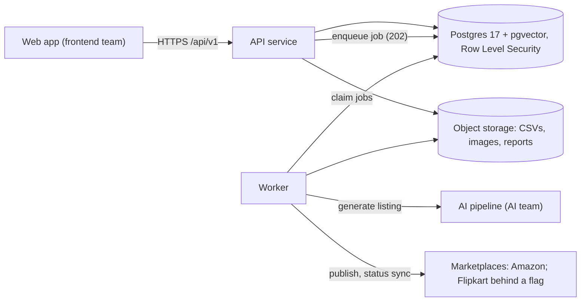

# Backend v1 handover

This folder explains the AI Marketplace OS backend, its API and its database, for the teams
that build on it: the frontend team and the AI team. Every page is checked against the code.
Where an older doc in `docs/` says something different, this folder and the code win.

## Start here

| If you are on... | Read in this order |
|---|---|
| The frontend team | [FRONTEND-GUIDE](FRONTEND-GUIDE.md) → [FLOWS](FLOWS.md) → [API-REFERENCE](API-REFERENCE.md) (or the [Swagger page](swagger.html)) |
| The AI team | [AI-TEAM-GUIDE](AI-TEAM-GUIDE.md) → [FLOWS](FLOWS.md), section 6 (generation) → [DATABASE](DATABASE.md) |
| Anyone new to the backend | [ARCHITECTURE](ARCHITECTURE.md) → [DATABASE](DATABASE.md) → [FLOWS](FLOWS.md) |

## The pages

| Page | What it answers |
|---|---|
| [API-REFERENCE.md](API-REFERENCE.md) | Every endpoint: method, full address, who may call it, parameters, request and response fields with examples, status codes, error codes. Also the conventions every call follows: auth, `Idempotency-Key`, `If-Match`, pagination, the error format, rate limits and polling for 202 jobs. **Generated** from the contract. |
| [swagger.html](swagger.html) | The same contract as an interactive Swagger page. Open the file in a browser (it needs internet for the Swagger UI scripts). To use "Try it out", open `/docs` on a running local or staging API instead; production serves no docs. |
| [ARCHITECTURE.md](ARCHITECTURE.md) | How the backend is built and deployed: the system context, Google Cloud deployment, code layers, the request lifecycle, background jobs, security, observability, configuration, quality gates and known limits. |
| [DATABASE.md](DATABASE.md) | What is stored where, how tenants are isolated (Row Level Security and roles), the rules the database enforces, migrations and backups, ER diagrams per domain and a catalog of every table. The schema part is **generated** from the models and migrations. |
| [FLOWS.md](FLOWS.md) | Every business flow as a sequence diagram with the exact endpoints: sign in, onboarding, marketplace connect, CSV import, images, generation, review and approval, publish, retry, status sync, issues and tasks, analytics. Also the state machines for listings, jobs, accounts, issues, tasks and imports. |
| [FRONTEND-GUIDE.md](FRONTEND-GUIDE.md) | How to call the API from the web app: base URLs, tokens, CORS, the TypeScript types, every error code and what the screen should do, uploads, and which endpoints each screen uses. Ends with a go-live checklist. |
| [AI-TEAM-GUIDE.md](AI-TEAM-GUIDE.md) | The one function the AI pipeline implements: its exact input and output, what the backend checks after it returns, how failures are recorded, and how to replace the stub with the real pipeline. |

## The system on one page

The web app talks only to the API. Slow work (imports, generation, publishing, status checks) is
queued as a job: the API answers `202` with a job id, the worker runs it, and the web app polls
`GET /api/v1/jobs/{job_id}`. The AI pipeline is a Python package that the worker calls; it never
receives HTTP traffic.

## Addresses

| Environment | Base URL | Swagger |
|---|---|---|
| Local | `http://localhost:8000` | `http://localhost:8000/docs` |
| Staging | `https://api.staging.<DOMAIN>` (filled in at the GCP rollout) | `https://api.staging.<DOMAIN>/docs` |
| Production | `https://api.<DOMAIN>` (filled in at the GCP rollout) | none (production serves no docs) |

All routes are under `/api/v1`, except the health checks `/healthz` and `/readyz`.

## Contract version

The API contract is `packages/schemas` version **1.1.0** (additive over 1.0.0; see
`packages/schemas/CHANGELOG.md`). The published package is still `schemas-v1.0.0` until the 1.1.0
release tag is cut.

## Keeping these pages true

`make docs-handover` regenerates `API-REFERENCE.md`, `swagger.html` and the generated part of
`DATABASE.md` from the committed contract and models. Run it after any contract or schema change.
`python scripts/docs/gen_api_reference.py --check` exits 1 when the API pages are stale. The other
pages are written by hand and checked against the code; update them in the same pull request as the
behaviour they describe.
