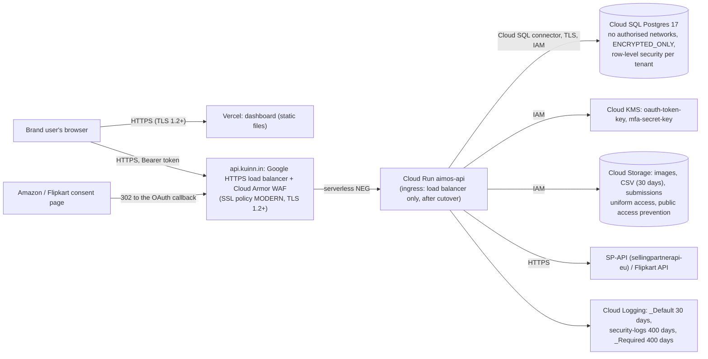

# Security controls index

Kuinn (this backend, its GCP project and the dashboard) holds marketplace credentials for brands that
connect Amazon.in and Flipkart. This folder is the evidence pack for the Amazon Selling Partner API
Data Protection Policy (DPP), its Acceptable Use Policy (AUP) and the Flipkart API partner programme.
Each row maps one clause to the control and the file or command that proves it.

Sources, read on 2026-10-28:
- DPP: https://sellercentral.amazon.com/mws/static/policy?documentType=DPP&locale=en_US
- AUP: https://sellercentral.amazon.com/mws/static/policy?documentType=AUP&locale=en_US
- Amazon's control guidance: https://developer-docs.amazon/sp-api/docs/guidance-to-address-key-security-controls-in-sp-api-integration
- Roles: https://developer-docs.amazon/sp-api/docs/roles-in-the-selling-partner-api
- Flipkart: https://seller.flipkart.com/api-docs/FMSAPI.html

| File | What it holds |
|---|---|
| `README.md` | This index, the scope and the network diagram |
| `INCIDENT-RESPONSE.md` | Roles, incident types, the 24-hour Amazon notice, evidence handling (DPP 1.6) |
| `VULNERABILITY-MANAGEMENT.md` | Scan cadence, the monthly scan, fix deadlines, pentest, the scan log (DPP 2.7) |
| `DATA-RETENTION.md` | What we keep, for how long, how it is deleted, backups and recovery (DPP 1.7, 2.1, 2.7.4) |
| `ACCESS-MANAGEMENT.md` | Access requests, reviews, leavers, staff accounts, devices, training, asset inventory (DPP 1.1.2, 1.2, 1.3, 2.3) |
| `RISK-AND-VENDORS.md` | The yearly risk assessment, sub-processors, organisational changes (DPP 1.6.1, 2.8; AUP 3.11, 4.7) |

## Scope

- **Amazon roles requested:** Product Listing only. The code calls one SP-API surface, the Listings
  Items API (`apps/api/app/adapters/amazon/constants.py` `ITEMS_PATH`, `client.py` put, patch, get),
  plus Login with Amazon for the OAuth token (`apps/api/app/adapters/oauth/amazon.py`). Product
  Listing is not a restricted role, so Kuinn receives **no Amazon customer PII**. DPP section 2
  (PII) therefore does not apply to Amazon data; we still meet most of it, as the table shows.
- **Flipkart:** the Listing Management API through a third-party application (authorization code
  flow with `state` and PKCE, `apps/api/app/services/marketplaces.py`). `FLIPKART_ENABLED=false`
  in prod until the partner application is approved.
- **Systems in scope:** the GCP project `aimos-prod` (asia-south1): Cloud Run `aimos-api` and its
  jobs, Cloud SQL `aimos-db`, the Cloud Storage buckets, Cloud KMS, Secret Manager, Cloud Logging;
  the dashboard on Vercel (static files only, no marketplace data); GitHub (source code); staff
  laptops.

## Network diagram

Until `api.kuinn.in` resolves, the browser and the OAuth callbacks reach Cloud Run's `run.app` URL
directly (ingress `all`), with no WAF in front. The edge is built and tested (ADR-0022,
`docs/runbooks/EDGE-CUTOVER.md`); it goes live after the client's DNS.

## Status words

- **Live:** in production now, checked on 2026-10-28 with read-only `gcloud` describe/list calls.
- **Built:** in the code on `main`, waiting for one named step (a deploy, `setup`, DNS).
- **Owner:** needs a GCP, GitHub or Vercel account owner to act. **Client:** needs Maniacult.
- **Gap:** code still to write.

## DPP clause map

| DPP | Requirement (short) | Control and evidence | Status |
|---|---|---|---|
| 1.1.1 | Firewalls, ACLs, identity-based access | Cloud SQL: no authorised networks, connector enforcement REQUIRED, `ENCRYPTED_ONLY` (`scripts/deploy/gcp/deploy.sh` `setup_sql`); every Google API call is IAM-checked; Cloud Run ingress lock (`deploy.sh edge lock-ingress`) | Live (SQL, IAM); Built (ingress lock, after DNS) |
| 1.1.1 | Segmentation, IDS/IPS or equivalent | Separate service accounts per workload; tenant isolation by forced RLS (`docs/architecture/DATABASE.md` §4); Cloud Armor OWASP CRS rules and Adaptive Protection as the IDS/IPS equivalent (`scripts/deploy/gcp/armor-rules.yaml`) | Live (segmentation); Built (Armor, after DNS) |
| 1.1.1 | WAF on every internet-facing endpoint | Cloud Armor on the HTTPS load balancer, ADR-0022, `docs/runbooks/EDGE-CUTOVER.md` | Built, after DNS |
| 1.1.1 | Malware protection | Containers are rebuilt from a digest-pinned `python:3.13-slim` base on every release, run as a non-root user (`apps/api/Dockerfile`), with no SSH or shell access on Cloud Run; staff laptops: `ACCESS-MANAGEMENT.md` | Live (servers); Owner (laptops) |
| 1.1.2 | Endpoint protection, 15-minute screen lock, managed devices | Device standard and checklist in `ACCESS-MANAGEMENT.md` | Owner / Client |
| 1.1.3 | Network diagrams and control evidence | This file; `deploy.sh edge status` prints the live WAF evidence | Live (doc); Built (WAF evidence) |
| 1.2.1 | Documented access process, unique IDs, no shared accounts | `ACCESS-MANAGEMENT.md`; every app user is one row in `users` with a unique email | Live (doc, app); Owner (retire the shared test login) |
| 1.2.2 | Lockout after 10 failures | `users.failed_auth_count`, locked 15 minutes at 10 (ADR-0021, `apps/api/app/services/sign_in_policy.py`, migration `0011_mfa_lockout`) | Live (release 401717b9) |
| 1.2.2 | Monitor authentication, disable accounts | `auth.*` events with ids and an IP hash (`apps/api/app/services/auth_events.py`); `user unlock` / `reset-mfa` staff commands (`docs/runbooks/MFA-STAFF.md`); edge alerts (`deploy.sh edge alerts`) | Live (events); Built (alerts after DNS, 400-day sink after `setup`) |
| 1.2.2 | Quarterly access review | Procedure and record in `ACCESS-MANAGEMENT.md` | Owner (first review) |
| 1.2.3 | Remove leavers within 24 hours | Leaver checklist in `ACCESS-MANAGEMENT.md`; deactivating a member revokes their sessions (`apps/api/app/api/v1/routers/members.py`) | Live (app); Owner (cloud accounts) |
| 1.2.4 | Approved Users, yearly training | `ACCESS-MANAGEMENT.md` training section and record | Owner / Client |
| 1.3 | Least privilege, deny by default | Forced RLS on every tenant table; roles owner, operator, reviewer, admin (`apps/api/app/core/rbac.py`); the api may only encrypt with `oauth-token-key`, the worker may decrypt (ADR-0018); only the api may use `mfa-secret-key` (ADR-0021) | Live; Owner (remove `roles/editor` from the default compute service account) |
| 1.4.1 | MFA for all user accounts | TOTP with recovery codes (ADR-0021, `apps/api/app/services/mfa.py`); `MFA_ENFORCEMENT` in `scripts/deploy/gcp/prod.env` | Built: needs the dashboard screens, `setup` (creates `mfa-secret-key`), then `MFA_ENFORCEMENT=all` |
| 1.4.1 | Password rules (12+, mix, no name, 1-day min age, 365-day max, history 10) | `apps/api/app/core/password_policy.py` | Live |
| 1.4.1 | MFA on staff accounts (GCP, GitHub, Vercel) | `ACCESS-MANAGEMENT.md` staff accounts | Owner |
| 1.4.2 | Programmatic credentials encrypted, limited, rotated yearly | Secret Manager with per-secret IAM; marketplace tokens sealed with KMS envelope AES-256-GCM (ADR-0018); no service account keys exist; KMS keys rotate every 90 days; rotation calendar in `ACCESS-MANAGEMENT.md` | Live; first secret rotation due by 2027-10-12 |
| 1.5 | TLS 1.2+ in transit | Cloud Run and the edge SSL policy (MODERN, min TLS 1.2); Cloud SQL `ENCRYPTED_ONLY`; outbound marketplace calls are HTTPS only (`apps/api/app/adapters/amazon/endpoint.py`); HSTS (`apps/api/app/api/security_headers.py`) | Live |
| 1.6.1 | Yearly risk assessment, senior sign-off | `RISK-AND-VENDORS.md` | Built (draft); Client (sign-off) |
| 1.6.2 | Incident response plan, reviewed every 6 months | `INCIDENT-RESPONSE.md` | Live (doc); next review 2027-04-28 |
| 1.6.3 | Tell security@amazon.com within 24 hours | `INCIDENT-RESPONSE.md` step 4 | Live (doc) |
| 1.6.4 | Investigate, record, chain of custody | `INCIDENT-RESPONSE.md` steps 5-7 | Live (doc) |
| 1.6.5 | Named Incident Management Point of Contact | `INCIDENT-RESPONSE.md` contacts | Client (name the IMPOC and a backup) |
| 1.7 | Delete within 30 days of a trigger | Revoke deletes the stored tokens at once (`apps/api/app/services/marketplaces.py` `revoke`); tenant purge functions (ADR-0014); manual procedure in `DATA-RETENTION.md` | Live (tokens, manual tenant deletion); Gap (automatic per-account deletion of marketplace responses) |
| 1.8 | Tag the origin of data | Every row carries `tenant_id`; marketplace rows carry `marketplace` and `marketplace_account_id` (`apps/api/alembic/versions/0002_listing_pipeline.py`); objects sit under `<tenant_id>/` | Live |
| 2.1-2.2 | PII retention and governance | No Amazon PII is received (Product Listing only). Our own users' data: `DATA-RETENTION.md` and the public privacy policy | Not applicable to Amazon data; Live (own data) |
| 2.3 | Baseline configs, quarterly asset inventory, change control | Infrastructure from one script (`deploy.sh`); every change by pull request and the local gates (`docs/PROCESS.md`); inventory in `ACCESS-MANAGEMENT.md` | Live (config, change control); Owner (device inventory) |
| 2.4 | Encryption at rest, KMS lifecycle | Cloud SQL and Cloud Storage encrypt at rest with Google-managed AES-256; tokens and MFA secrets also sealed with Cloud KMS keys that rotate every 90 days | Live (MFA key after `setup`) |
| 2.5 | No hard-coded secrets, separate test and prod | gitleaks on every commit (`scripts/ci/gitleaks.sh`, full history clean on 2026-10-28); secrets only in Secret Manager (`scripts/deploy/gcp/prod.env` header); projects `aimos-staging` and `aimos-prod` (ADR-0001) | Live |
| 2.6.1 | Security logs, reviewed every 2 weeks, no PII, kept 12 months | Redaction of every log line (`apps/api/app/core/redaction.py`); `_Required` audit logs kept 400 days by Google; `security-logs` bucket (400 days) fed by the `app-security` sink (`deploy.sh setup`) and the edge sink (`deploy.sh edge alerts`); fortnightly review in `INCIDENT-RESPONSE.md` | Built (run `setup`); Owner (start the reviews) |
| 2.6.2 | Alerts on suspicious activity | Armor deny spike, 429 spike, 5xx ratio, uptime, Adaptive Protection (`deploy.sh edge alerts`) | Built, after DNS |
| 2.7.1 | Scan every 30 days, before each release | `VULNERABILITY-MANAGEMENT.md`; `scripts/security/monthly_scan.sh`; pip-audit and gitleaks run in the local gate before every merge (`make api-lint gitleaks`) | Live (procedure, first run 2026-10-28); Owner (container scanning) |
| 2.7.2 | Pentest every 365 days | `VULNERABILITY-MANAGEMENT.md` pentest section | Client (book and pay) |
| 2.7.3 | Fix critical in 7 days, high in 30 | `VULNERABILITY-MANAGEMENT.md` deadlines and log | Live (procedure) |
| 2.7.4 | DR plan, separate backup site | `DATA-RETENTION.md` backups; `SQL_BACKUP_LOCATION` in `prod.env` | Built; Client (agree the second region), then Owner (`setup`) |
| 2.8 | Yearly vendor risk assessment | `RISK-AND-VENDORS.md` sub-processor table | Built (first pass); Client (sign-off) |
| 3 | Keep records 12 months after the agreement | `RISK-AND-VENDORS.md` records section | Live (doc) |

## AUP and Flipkart

| Rule | Control and evidence | Status |
|---|---|---|
| AUP 1.3 abuse to spapi-abuse@amazon.com | `INCIDENT-RESPONSE.md` type 6 | Live (doc) |
| AUP 2.4 be explicit about AI | Every listing is drafted by AI and approved by a person (ADR-0008); disclosed on the public site and privacy policy | Client (site text) |
| AUP 3.1-3.4, 3.7 never ask for passwords or keys | Brands connect through Amazon's and Flipkart's own consent pages; Kuinn never sees a marketplace password | Live |
| AUP 3.8 only needed data | Product Listing role only | Live |
| AUP 3.11 tell Amazon of organisational changes within 30 days | `RISK-AND-VENDORS.md` written policy | Live (doc) |
| AUP 4.4-4.6 no aggregation or sharing across sellers | Forced RLS per tenant; no cross-tenant export exists; generation never reads marketplace responses (`apps/api/app/services/generation_context.py`) | Live |
| Flipkart: HTTPS redirect URL | `https://<api host>/api/v1/marketplaces/flipkart/callback` | Live |
| Flipkart: `state` against CSRF | Single-use hashed state plus PKCE (`apps/api/app/services/marketplaces.py`) | Live |
| Flipkart: third-party application only, never a seller's self-access keys | Partner Dashboard application; `ACCESS-MANAGEMENT.md` | Client (register as API Partner) |
